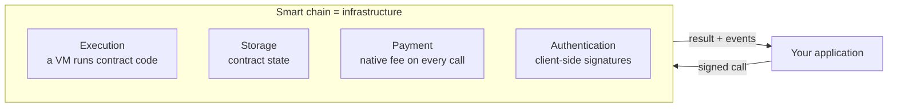
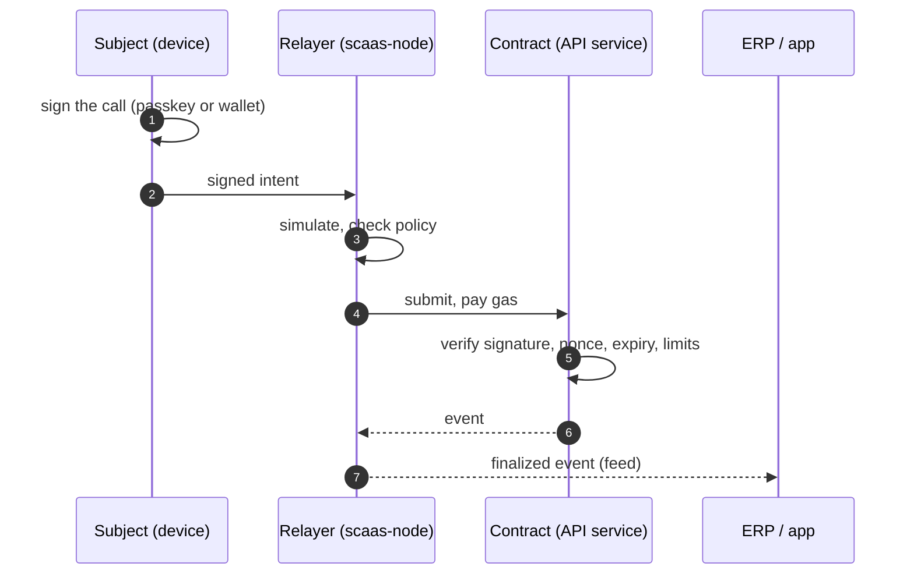
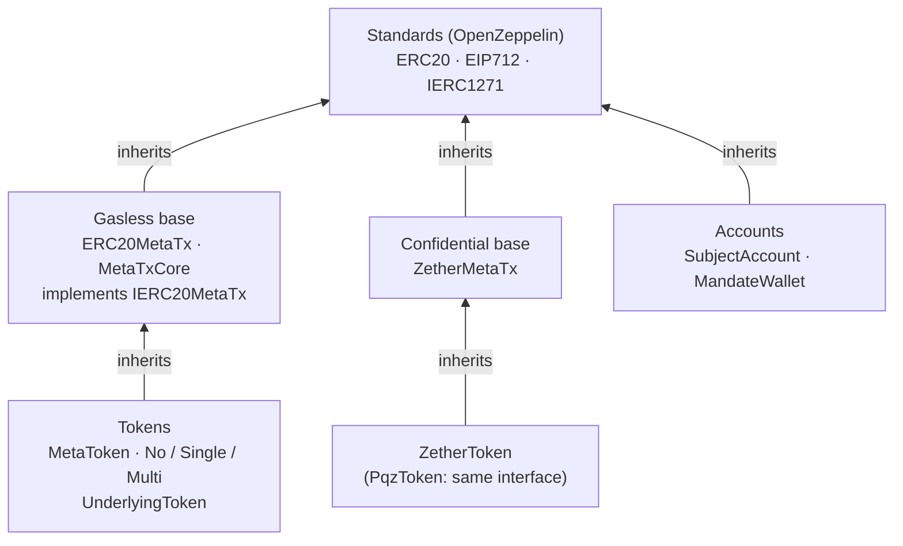
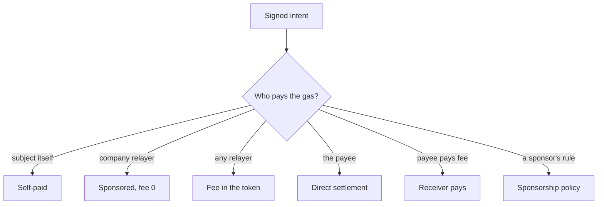
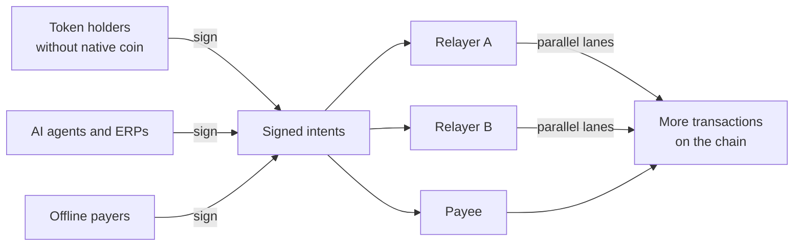
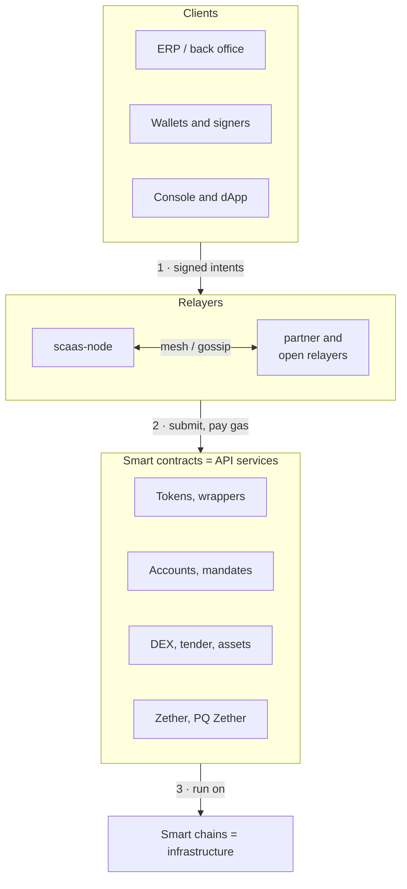

# SCaaS — SmartContract as a Service

**SCaaS treats a smart-contract chain as infrastructure, its smart contracts as API services, and each contract
function as an API function.** Users authorize every valuable call with their own signature; open relayers carry
the call to the chain and pay its gas; the contract checks everything itself.

This page explains the idea from the ground up and points to the detailed docs. It defines no rules: the rules live
in the component docs under [`docs/`](docs/README.md), each with an id and a reason in
[`docs/decisions.md`](docs/decisions.md).

**Contents**

1. [A smart chain is infrastructure](#1-a-smart-chain-is-infrastructure)
2. [Smart contracts are API services](#2-smart-contracts-are-api-services)
3. [Contracts built on standards](#3-contracts-built-on-standards)
4. [Upgradeable or not is decided at deploy](#4-upgradeable-or-not-is-decided-at-deploy)
5. [What the traditional model gets wrong](#5-what-the-traditional-model-gets-wrong)
6. [Meta-transactions and EIP-1776](#6-meta-transactions-and-eip-1776)
7. [Who pays the fee: every model](#7-who-pays-the-fee-every-model)
8. [Meta-transactions and liquidity](#8-meta-transactions-and-liquidity)
9. [Open relayers: open and competitive](#9-open-relayers-open-and-competitive)
10. [Confidential amounts: Zether and PQ Zether](#10-confidential-amounts-zether-and-pq-zether)
11. [Chains and families](#11-chains-and-families)
12. [The components and where to read more](#12-the-components-and-where-to-read-more)
13. [Repository layout](#13-repository-layout)

---

## 1. A smart chain is infrastructure

The usual pitch for blockchains is a "decentralized, immutable ledger". That description does not help when building
on a smart-contract chain, and much of it is not even true in practice (see [below](#what-a-chain-is-not)). SCaaS looks
at a smart chain the way an engineer looks at a cloud platform: **a shared infrastructure that sells four services**.

| Service | What the chain provides | Examples |
|---|---|---|
| **Execution** | A virtual machine that runs contract code deterministically; every validator gets the same result | EVM, Move VM (Aptos, Sui), Soroban WASM, CosmWasm, TVM (TON), SVM (Solana) |
| **Storage** | Durable state owned by each contract, read and written only through its code | EVM key-value storage, Sui objects, Soroban persistent/temporary entries with a rent (TTL), Solana accounts |
| **Payment** | Metering and billing are part of the protocol: every transaction pays a native fee, on the chain, at once — no invoice, no payment processor | ETH/xDAI gas, HBAR, SUI, XLM, TON, SOL; some chains bill in stablecoins (Gnosis xDAI, Celo fee currencies) or peg fees to USD (Hedera) |
| **Authentication** | Every call carries a digital signature made on the **client side**; the chain verifies it. There are no server sessions and no passwords | secp256k1, ed25519, P-256 (passkeys), BLS, post-quantum schemes |

Three supporting services complete the picture:

- **Ordering and commit** — consensus orders transactions; *finality* is the point after which a result will not be
  undone (seconds on BFT chains, minutes on some proof-of-stake chains).
- **Notifications** — contracts emit *events*; anyone can subscribe.
- **API endpoints** — every chain exposes RPC to submit, read and **simulate** a call before paying for it.

**Compared with a cloud platform:**

| Cloud concept | Smart-chain equivalent | The difference that matters |
|---|---|---|
| Function / serverless handler | Contract function | Code is public and runs the same for everyone |
| Database | Contract storage | Writable only through the contract's own code; storage costs fees (or rent) |
| IAM, sessions, API keys | The caller's signature | Issued by the **user's device**, not by the provider; nobody can forge it |
| Billing | Native transaction fee (gas) | Paid per call, inside the call, by whoever submits it |
| Commit / durability | Finality | Probabilistic or BFT, per chain; SCaaS waits for it before reporting a result |
| Webhooks | Events and logs | Public, ordered, verifiable |

**What a chain is not.** Building on the four services means being honest about
their limits:

- **Results can be undone until finality.** Blocks can be reorganized; SCaaS reports nothing before its finality
  gate ([docs/node/indexer-feeds.md](docs/node/indexer-feeds.md)).
- **Contracts are not automatically immutable.** Most platforms let a deployer keep an upgrade key. Immutability is a
  *deployment decision* ([section 4](#4-upgradeable-or-not-is-decided-at-deploy)).
- **A private chain with one block signer is a signed database**, not a decentralized network. SCaaS uses one
  (chain 7622) and names it as such ([docs/networks/evm.md](docs/networks/evm.md#private-chain)).
- **Validators can delay or censor** a transaction; they cannot forge it.
- **Everything is public by default**, including amounts and balances — which is why
  [Zether](#10-confidential-amounts-zether-and-pq-zether) exists.

---

## 2. Smart contracts are API services

On top of that infrastructure, **SCaaS ships the business services as smart contracts**: payments, spending
mandates, tokens and wrappers, an order-book DEX, sealed-bid tenders, vesting and distributions, confidential
transfers. Each contract is an **API service**; each of its functions is an **API function**. ERPs, web portals,
mobile apps and AI agents call them like any other API.

| Web API | SCaaS |
|---|---|
| Service endpoint | A contract address on a chain |
| API function (`POST /payments`) | A contract function (`pay(entryRef)`, `trade(...)`, `transferConfidential(...)`) |
| Bearer token issued by the server | The **subject's own signature** over exactly this call (EIP-712 on EVM) |
| Quotas and limits | Caps inside the contract: per-payment and per-period mandate limits, expiry on every signature |
| API versioning | A version catalogue in the factory; each deployed contract stays fixed ([section 4](#4-upgradeable-or-not-is-decided-at-deploy)) |
| Billing | Gas, paid by a relayer; optionally a fee in the token ([section 7](#7-who-pays-the-fee-every-model)) |
| Commit acknowledgement | A finalized event, delivered by the node as a feed |

The one difference from an ordinary web API is **who authorizes a write**. In a web API the server decides and
signs; anyone holding the server's keys can act for any user. In SCaaS the **subject** — the person, company, device
or AI agent whose value moves — signs each call on its own device (a passkey or a wallet key). A server only carries
the signed call to the chain and reads the result back.

Read more: the authority model and why it differs from IaaS/BaaS —
[docs/architecture.md](docs/architecture.md#authority-model); the product overview —
[docs/SCaaS-v2.md](docs/SCaaS-v2.md).

---

## 3. Contracts built on standards

SCaaS contracts **inherit from the standard contracts** instead of reinventing them. On EVM they are built on
OpenZeppelin (version pinned in CI) and the ERC/EIP interfaces, so wallets, explorers and other contracts see an
ordinary ERC-20 token; the gasless layer is an **extension** of the standard, not a fork of it.

| Layer | Inherits | What it adds |
|---|---|---|
| Standard | `ERC20`, `EIP712`, `IERC1271` (OpenZeppelin) | Balances and transfers, typed-data signing, contract signatures |
| Gasless token | `ERC20MetaTx` / `MetaTxCore` + `IERC20MetaTx` | The meta-transaction entry point inside the token ([section 6](#6-meta-transactions-and-eip-1776)) |
| Token tiers | `MetaToken`; `NoUnderlyingToken`, `SingleUnderlyingToken`, `MultiUnderlyingToken` | Issuer tokens; wrappers of one or several existing tokens ([docs/contracts/token-wrappers.md](docs/contracts/token-wrappers.md)) |
| Confidential | `ZetherMetaTx` → `ZetherToken`; `PqzToken` follows the same `IERC20MetaTx` | Encrypted balances behind the same gasless interface ([section 10](#10-confidential-amounts-zether-and-pq-zether)) |
| Accounts | `SubjectAccount`, `MandateWallet` (`EIP712` + `IERC1271`) | Passkey-controlled accounts, capped spending mandates ([docs/contracts/accounts-mandates.md](docs/contracts/accounts-mandates.md)) |

The other families follow their own token standards — CW20 on Cosmos, TEP-74 jettons on TON, SEP-41 on Soroban, SPL
and Token-2022 on Solana, the native coin model on Move — and add the same meta-transaction model on top
([docs/networks/README.md](docs/networks/README.md)).

---

## 4. Upgradeable or not is decided at deploy

Whether a contract can be changed later is **not a property of the chain; it is a choice made when the contract is
deployed**. Every platform offers a way to keep an upgrade key: proxies on EVM (UUPS, Transparent, Beacon, Diamond),
an `UpgradeCap` on Sui, a package upgrade policy on Aptos, an upgrade authority on Solana, a contract admin on
CosmWasm.

The common habit — "deploy everything behind a UUPS proxy so it can be patched" — means that **whoever holds the
upgrade key can rewrite the rules over every user's balance**. SCaaS does not follow that habit:

- **Every program that holds user value is deployed immutable** ([CTR-GEN-02](docs/contracts/README.md#CTR-GEN-02)):
  no proxy anywhere. Users verify once what a contract does and can rely on it for good.
- **New behaviour is a new version, not a patch.** The open factory keeps a catalogue of versions; a new version
  applies only to contracts deployed after it. A bug fix is a new deployment plus a voluntary migration by the
  balance owners.
- **The deploy gate enforces it.** Each family freezes its programs in the deploy run (Aptos `immutable` policy, Sui
  `make_immutable`, Solana authority `None`, CosmWasm `--no-admin`, EVM non-upgradeable clones), and the deploy
  script fails if a program is still upgradeable. The node re-checks at every start and halts a chain whose
  programs could still be upgraded ([docs/networks/README.md](docs/networks/README.md#deploy-gate)).

The price is that there is no hotfix in place. That is deliberate: an upgrade key is an admin key over every balance.

---

## 5. What the traditional model gets wrong

Three habits of the usual token and wallet model are the source of most losses and most operational pain. SCaaS
designs each of them out.

### `approve`: a standing permission to drain

The standard ERC-20 flow is `approve(spender, amount)` followed by `transferFrom`. It needs two transactions, and the
allowance usually outlives the purpose it was given for — often "unlimited", often to a plain address. A phishing
site that obtains one approval can empty the balance later, at any time.

SCaaS: **a spender must be a contract, and only a contract may call `transferFrom`; an ordinary account is never a
spender** ([CTR-TOK-01](docs/contracts/token-wrappers.md#CTR-TOK-01)). Allowances remain only for code that enforces
its own rules (the DEX, escrow). Everyday payments need no allowance at all: the payer signs one `pay` for one amount,
to one payee, with an expiry.

### Transactions are synchronous and tied to the sender's account

On every chain a normal transaction is built for the sender's own account and its **sequence number** (EVM nonce,
Stellar sequence, Cosmos account sequence, TON wallet seqno), at the moment it is sent. That means:

- the user must be **online, at that moment, holding native coins** for gas;
- the transactions of one account run **strictly one after another**: one stuck transaction blocks **every** later
  operation of that account, on **every** contract (head-of-line blocking);
- a call cannot be signed now and executed later by someone else.

**"Someone pays the fee for me" does not fix this.** The native sponsorship features — Hedera payer accounts, Sui
sponsored transactions, Stellar fee-bump, Cosmos `feegrant`, TON wallet extensions — and the EVM add-ons ERC-2771
(trusted forwarder) and ERC-4337 (bundlers and paymasters) move the *fee* to another party, but the operation is
still a transaction of the subject's own account (so its sequence still orders everything), or it needs both parties
to co-sign at submit time, or it runs through an external forwarder that can swallow a failed call after charging
for it.

SCaaS: the subject signs an **intent** — "this operation, on this contract, valid until this time" — and **anyone**
may execute it later, from their own account ([NET-ALL-02](docs/networks/README.md#NET-ALL-02)). Each contract keeps
its own two-dimensional nonce space (a lane and a sequence inside it), so independent operations never wait for each
other ([section 6](#6-meta-transactions-and-eip-1776)).

### The operator's server holds the power

In a classic web or custody setup, the server signs on the user's behalf. Whoever controls that server — or steals
its keys — can move funds, and the audit log is whatever the server wrote. In SCaaS no server holds a key that can
sign for a subject ([docs/architecture.md](docs/architecture.md#authority-model)).

---

## 6. Meta-transactions and EIP-1776

A **meta-transaction** separates *who authorizes* an operation from *who submits and pays for* it. SCaaS puts it
**inside the contract itself**, following the design of [EIP-1776](https://github.com/ethereum/EIPs/issues/1776)
(native meta-transactions with a fee paid in the token to whoever submits). EIP-1776 never became a final standard;
SCaaS uses its design deliberately, instead of ERC-2771 forwarders or ERC-4337 bundlers
([NET-ALL-02](docs/networks/README.md#NET-ALL-02)).

Why it matters:

- **No native coin needed.** Users hold only the token they use; a relayer pays the gas.
- **Asynchronous by design.** A signed intent is a self-contained, expiring authorization. It can be carried by QR
  code, message or file, and executed by any relayer — or by the payee — until it expires.
- **No head-of-line blocking.** Nonces are two-dimensional (`batch`, `nonce`): independent operations use different
  lanes (a payment's lane is derived from its random reference), dependent steps share one lane in order.
- **Fee and operation are one.** The contract that verifies the signature runs the operation and only then takes the
  fee: **fee collected ⇔ operation completed** ([CTR-MTX-16](docs/contracts/metatx.md#CTR-MTX-16)). No forwarder, no
  swallowed failures.
- **Readable signatures.** EIP-712 typed data: the wallet shows every field instead of 32 opaque bytes.

The signed structure on EVM ([docs/contracts/metatx.md](docs/contracts/metatx.md)):

| Field | Purpose |
|---|---|
| `from` | The subject who signs and whose balance changes |
| `to`, `value`, `data` | The operation: a transfer, a `pay`, a trade, a Zether operation… |
| `batch`, `nonce` | Two-dimensional nonce: the lane, and the sequence inside it |
| `validUntil` | Every signature expires |
| `mode` | Relayer and fee-recipient binding, and the fee mode (`NONE`, `PERCENT`, `FIXED`) |
| `relayer`, `fee`, `feeRecipient` | Who may submit (if bound), how much fee, to whom |

**`mode` decides how open the intent is.** With no binding, any relayer may submit and earn the fee — the open
market. With `MODE_RESTRICT_RELAYER`, only the named relayer may submit — the typical B2B setting with `fee = 0`.
`MODE_RESTRICT_FEE_RECIPIENT` fixes who receives the fee whoever submits.

**Same model on every family.** Cosmos, Soroban, Sui, Aptos, TON and Solana implement the same contract-level
meta-operation with their own signature formats and replay protection; the relayer always submits from its own
account ([docs/networks/README.md](docs/networks/README.md)).

---

## 7. Who pays the fee: every model

Because authorization and payment are separate, SCaaS can offer every reasonable answer to "who pays?". All of them
use the same signed intent; only the fee fields and the submitter differ.

| Model | How it works | Who bears the cost | Status |
|---|---|---|---|
| **Self-paid** | The subject calls the contract from its own account with native coins (always possible; the fallback when no relayer serves it) | Subject | BUILT |
| **Sponsored by a company relayer** | Subject signs with `fee = 0`, bound to the company's relayer. Gas is the company's operating cost | Company | BUILT (portal default) |
| **Fee in the token** | Subject offers a fee in the token (percentage or fixed, capped at 1 %); any relayer that submits earns it | Subject, in the token it already holds | BUILT |
| **Direct settlement (payee self-relay)** | The payer signs offline and hands the signature to the payee — QR, NFC, message, file. The payee submits it and pays the gas. The signature works like an expiring electronic cheque | Payee | BUILT on EVM ([inbound](docs/integration.md#inbound)) |
| **Receiver pays the fee** | The payer signs a payment of `N`; the payee co-signs a fee authorization from its own balance; one transaction delivers `N` and pays the relayer | Payee | SPECIFIED ([receiver-pays](docs/contracts/metatx.md#receiver-pays)) |
| **Gas sponsorship policy** | A node rule such as "inbound to wallet W, value ≥ X ⇒ accept at fee 0, book the gas to account Y" | The sponsor | SPECIFIED ([docs/node/sponsorship.md](docs/node/sponsorship.md)); an on-chain sponsorship pool is PLANNED |
| **Enterprise inbound gateway** | Partners post signed intents to the company's gateway; the company relays them with its own lanes | Company | BUILT on EVM ([docs/node/gateway.md](docs/node/gateway.md)) |

The chain's own billing can help too: on chains that bill gas in stablecoins (Gnosis xDAI, Celo fee currencies) or
peg fees to USD (Hedera), the relayer's cost is predictable. Confidential (Zether) operations use the same envelope
with a public fee taken from the public balance ([docs/contracts/zether.md](docs/contracts/zether.md)). The
break-even of a fee-earning relayer and the B2B default are in [docs/architecture.md](docs/architecture.md#economics).

---

## 8. Meta-transactions and liquidity

Here **liquidity means transaction flow: how many transactions actually happen on the chain**, how often and by how
many participants. A chain is only as useful as the flow of calls into its contracts. The traditional model throttles
that flow at the source; meta-transactions open it up.

| What limits the flow today | What meta-transactions change |
|---|---|
| Every user must first buy the chain's native coin; most never do | A user needs only the token it already holds; a relayer pays the gas, so every holder can transact from day one |
| The user must be online, with a funded wallet, at the moment of sending | An intent is signed once and executed **later** by any relayer or by the payee — offline payments, scheduled steps and AI-agent actions all reach the chain |
| One account = one sequence: transactions queue one by one, and one stuck transaction stops the rest | Two-dimensional nonces: independent operations run in parallel lanes; a relayer spreads work over many lane accounts |
| Small transactions are not worth a user's own gas | Sponsored (fee 0) and fee-in-token models make micro-payments, loyalty points and B2B line items economic |
| Submission depends on one operator | Any relayer may submit; relayers share intents over the mesh and gossip, so more submitters carry more flow |
| Trading needs native gas for every order and cancel | Orders and cancels are signatures in an off-chain book; only matches go on chain, several pairs per transaction ([docs/contracts/dex.md](docs/contracts/dex.md)) |
| Existing tokens were not built for gasless use | A wrapper makes any existing token gasless ([docs/contracts/token-wrappers.md](docs/contracts/token-wrappers.md)), so its holders join the flow too |

The result is more participants, more operations per participant and more parties able to submit them — all under
the same contract rules and the same subject signatures.

---

## 9. Open relayers: open and competitive

**Anyone can run `scaas-node` as a relayer, with their own policies.** A relayer is a business, not a gatekeeper:

- **It cannot forge or change an intent.** It can only submit, delay or refuse it. The subject can always go to
  another relayer, or submit the call itself.
- **Each operator sets its own policy:** what to accept, what fee to require, what to sponsor, whom to peer with,
  its own SLOs and monitoring ([docs/node/README.md](docs/node/README.md)).
- **Relayers compete on price and speed.** An unbound intent with a fee is open to every relayer; the first to land
  it earns the fee. Relayers that want the order flow must be cheaper and faster than the others.
- **Relayers cooperate through the mesh.** Admitted partners share intents over authenticated links with a short,
  round-robin exclusivity window so they do not race each other wastefully; the open network uses gossip in the
  style of 0x-mesh — validate before forwarding, any relayer may race to land
  ([docs/node/mesh.md](docs/node/mesh.md), [docs/node/gossip.md](docs/node/gossip.md)). Private chains never leave
  the admitted set.
- **The only reward is the intent's own fee.** There is no relayer token, no stake and no protocol subsidy
  ([NODE-MESH-05](docs/node/mesh.md#NODE-MESH-05)). A sponsor that wants to pay for others' gas does it by policy or
  by an opt-in sponsorship contract.

The economics are modest by design. A meta-transaction on Gnosis costs about $0.00015 of gas; even at a 10× markup a
relayer needs roughly 40,000 transactions a month to cover a small server and an RPC plan. Many relayers will
therefore be run by parties with a business reason — the issuer, distributors, partners, the payee — alongside open,
fee-earning ones. Both kinds serve the same contracts under the same rules
([docs/architecture.md](docs/architecture.md#economics)).

---

## 10. Confidential amounts: Zether and PQ Zether

On a public chain every amount and balance is visible to competitors. Mixers hide *who* paid *whom*, which breaks
audit and anti-money-laundering duties. **Zether hides the opposite: amounts and balances are encrypted, identities
stay visible.** Auditors can still see that company A paid company B, and disclosure to the sender, the receiver or a
named auditor opens any single transfer.

| | Zether (classical) | PQ Zether |
|---|---|---|
| Protects | Amounts and balances, against today's attackers | The same, **also against a future quantum computer** — both reading balances later ("harvest now, decrypt later") and forging proofs to mint |
| Encryption | ElGamal on elliptic curves (bn254 or BLS12-381, chosen per token at deploy) | Module-lattice (LWE) encryption |
| Proofs | Σ-protocol + two Bulletproofs range proofs | One lattice proof (LNP22) per operation, verified by a native precompile |
| Authorization | Registry of signature schemes | Universal Account `authRef`: ML-DSA-65 by default, or a hybrid post-quantum multisig |
| Gas per transfer | ≈ 3.3 M (measured) | ≈ 2.8 M (estimate; calldata-bound, ≈ 77 KB per transfer) |
| Gasless | Yes — `IERC20MetaTx` envelope, public fee | Yes — the same envelope, plus a post-quantum payer |
| Where | Development chains only, until an independent audit | Private/PoA chains only (chain 7622), behind a precompile self-test |
| Status | BUILT, **unaudited — not for production funds** | SPECIFIED, **unaudited** |

Read more: [docs/contracts/zether.md](docs/contracts/zether.md), [docs/contracts/pq-zether.md](docs/contracts/pq-zether.md),
[docs/contracts/universal-account.md](docs/contracts/universal-account.md).

---

## 11. Chains and families

SCaaS groups chains into **families**: one contract code base and one node adapter per family.

| Family | Chains | Execution | How the meta-transaction is done |
|---|---|---|---|
| EVM | Gnosis, Celo, private chain 7622, local anvil; Hedera (own page) | EVM (Solidity) | EIP-712 intent inside the token |
| Cosmos | CosmWasm chains | CosmWasm (Rust) | `Relay{payload, auth}` to the contract |
| Soroban | Stellar, Pi Network | Soroban WASM (Rust) | native authorization entries |
| Move | Aptos, Sui | Move VM | an account object per subject, lanes inside |
| TON | TON | TVM (Tact) | a custom jetton wallet checks the signed operation |
| Solana | Solana | SVM (Rust) | program-level, subject account + lane accounts |

Other EVM chains can be added as profiles. Finality, signing domains, passkeys and the availability of each feature
per family: [docs/networks/README.md](docs/networks/README.md).

**Deployment shapes:** public chains (your relayer, partners' and open relayers serve the same contracts); a private
or permissioned chain (your nodes and admitted peers only); a consortium (each member runs a node)
([docs/architecture.md](docs/architecture.md#profiles)).

---

## 12. The components and where to read more

Finalized events travel back the same way: the node indexes the chain, waits for finality and serves the result to
clients as feeds.

| Component | What it is | Read |
|---|---|---|
| **Docs map** | Reading order, precedence, status tags | [docs/README.md](docs/README.md) |
| Product overview | Who SCaaS is for, what it offers | [docs/SCaaS-v2.md](docs/SCaaS-v2.md) |
| Architecture | Authority, service and trust models, topology, economics, glossary | [docs/architecture.md](docs/architecture.md) |
| **Smart contracts** | Meta-transactions, tokens and wrappers, accounts and mandates, DEX, tender, asset suite, Zether, PQ Zether, Universal Account | [docs/contracts/README.md](docs/contracts/README.md) |
| **Node** (`scaas-node`) | Relayer and indexer: job API, gateway, submit lanes, finality-gated feeds, admin, sponsorship, DEX venue, mesh, gossip, operations | [docs/node/README.md](docs/node/README.md) |
| **Networks** | The common model and one page per family | [docs/networks/README.md](docs/networks/README.md) |
| **Clients** | Passkey and seed-vault signers, wallet connectors, console and dApp | [docs/clients/signers-clientkeys.md](docs/clients/signers-clientkeys.md), [docs/clients/app.md](docs/clients/app.md) |
| **Integration** | How an ERP or back office uses SCaaS: outbox, push and sync, references, reconciliation | [docs/integration.md](docs/integration.md) |
| Decisions | Every rule's id, reason and cost if wrong; old-id aliases | [docs/decisions.md](docs/decisions.md) |
| History | Frozen designs and the original requirements note with its trace | [docs/history/README.md](docs/history/README.md) |

**Where to start, by role:** integrating an ERP → [docs/integration.md](docs/integration.md); running a node →
[docs/node/README.md](docs/node/README.md) then [docs/node/runbooks.md](docs/node/runbooks.md); building a wallet or
app → [docs/clients/](docs/clients/signers-clientkeys.md); reviewing contracts →
[docs/contracts/README.md](docs/contracts/README.md) and your chain's page under [docs/networks/](docs/networks/README.md).

Every section of the component docs is tagged **BUILT** (code with tests), **SPECIFIED** (rules fixed, code pending)
or **PLANNED** (direction only).

---

## 13. Repository layout

| Path | What |
|---|---|
| `smartcontracts/` | On-chain code by family: `evm/` (Foundry; Gnosis, Celo, private chain, Hedera), `move/{aptos,sui}`, `soroban/`, `cosmos/`, `ton/`, `solana/`; `scripts/{build,test,deploy,devnet}.sh <family>`. See [`smartcontracts/README.md`](smartcontracts/README.md) |
| `scaas-node/` | Rust relayer node: gateway, submit lanes, indexer, admin, mesh |
| `zether-prover/` | Rust/WASM Zether prover |
| `app/` | React + Vite console and dApp (planned) |
| `clientkeys/` | Browser signers (passkey, seed vault) |
| `docs/` | Product docs — start at [`docs/README.md`](docs/README.md). Check: `python3 scripts/docs_check.py check` |
| `scripts/capped` | Run one heavy build in a 4 GB systemd scope, one at a time machine-wide |

SCaaS depends on no ERP. One worked ERP connector lives in a separate repository and is described as an example in
[docs/integration-odoo-example.md](docs/integration-odoo-example.md).
