

<h1 align="center">SCaaS — SmartContract as a Service</h1>

<b>The chain is the infrastructure. The smart contracts are the API services. The subject signs.</b>

  
  
  

**SCaaS treats a smart-contract chain as infrastructure, its smart contracts as API services, and each contract
function as an API function.** Users authorize every valuable call with their own signature; open relayers carry
the call to the chain and pay its gas; the contract checks everything itself.

  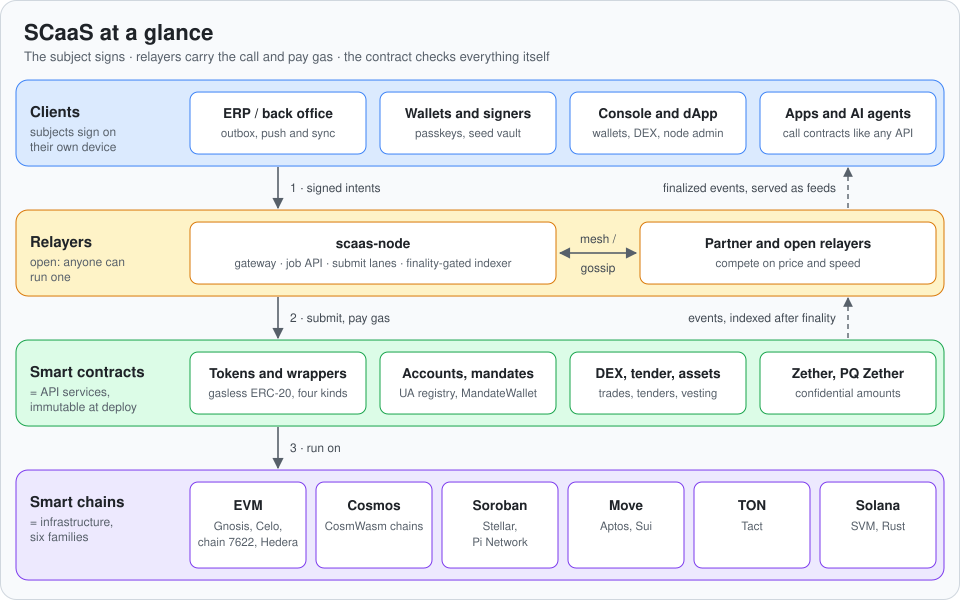

This page explains the idea from the ground up and points to the detailed docs. It defines no rules: the rules live
in the component docs under [`docs/`](docs/README.md), each with an id and a reason in
[`docs/decisions.md`](docs/decisions.md).

  <a href="docs/README.md"><b>Docs map</b></a> ·
  <a href="docs/architecture.md"><b>Architecture</b></a> ·
  <a href="docs/contracts/README.md">Contracts</a> ·
  <a href="docs/node/README.md">Node</a> ·
  <a href="docs/networks/README.md">Networks</a> ·
  <a href="docs/integration.md">ERP integration</a> ·
  <a href="docs/decisions.md">Decisions</a>

**Contents**

| The idea | How it works | Reference |
|---|---|---|
| 1. [A smart chain is infrastructure](#1-a-smart-chain-is-infrastructure) | 6. [Universal Accounts](#6-universal-accounts-one-identifier-for-every-kind-of-key) | 12. [Chains and families](#12-chains-and-families) |
| 2. [Smart contracts are API services](#2-smart-contracts-are-api-services) | 7. [Meta-transactions and EIP-1776](#7-meta-transactions-and-eip-1776) | 13. [Components and where to read more](#13-the-components-and-where-to-read-more) |
| 3. [Contracts: what is built on what](#3-contracts-what-is-built-on-what) | 8. [Who pays the fee](#8-who-pays-the-fee-every-model) | 14. [How the design evolved](#14-how-the-design-evolved) |
| 4. [Shared code, delegate call, separate data](#4-shared-code-delegate-call-separate-data-and-upgradeable) | 9. [Meta-transactions and liquidity](#9-meta-transactions-and-liquidity) | 15. [Repository layout](#15-repository-layout) |
| 5. [What the traditional model gets wrong](#5-what-the-traditional-model-gets-wrong) | 10. [Open relayers](#10-open-relayers-open-and-competitive) | 16. [Use cases](#16-use-cases) |
| | 11. [Zether and PQ Zether](#11-confidential-amounts-zether-and-pq-zether) | 17. [Free Pay](#17-free-pay) |

---

## 1. A smart chain is infrastructure

The usual pitch for blockchains is a "decentralized, immutable ledger". That description does not help when building
on a smart-contract chain, and much of it is not even true in practice (see [below](#what-a-chain-is-not)). SCaaS looks
at a smart chain the way an engineer looks at a cloud platform: **a shared infrastructure that sells four services**.

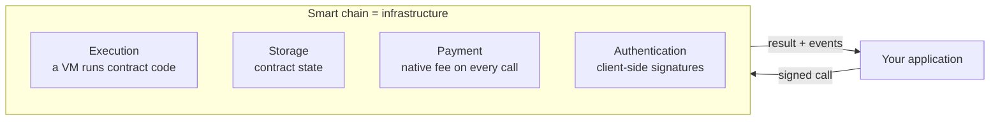

| Service | What the chain provides | Examples |
|---|---|---|
| **Execution** | A virtual machine that runs contract code deterministically; every validator gets the same result | EVM, Move VM (Aptos, Sui), Soroban WASM, CosmWasm, TVM (TON), SVM (Solana) |
| **Storage** | Durable state owned by each contract, read and written only through its code | EVM key-value storage, Sui objects, Soroban persistent/temporary entries with a rent (TTL), Solana accounts |
| **Payment** | Metering and billing are part of the protocol: every transaction pays a native fee, on the chain, at once — no invoice, no payment processor | ETH/xDAI gas, HBAR, SUI, XLM, TON, SOL; some chains bill in stablecoins (Gnosis xDAI, Celo fee currencies) or peg fees to USD (Hedera) |
| **Authentication** | Every call carries a digital signature made on the **client side**; the chain verifies it. There are no server sessions and no passwords | secp256k1, ed25519, P-256 (passkeys), BLS, post-quantum schemes |

Three supporting services complete the picture:

- **Ordering and commit** — consensus orders transactions; *finality* is the point after which a result will not be
  undone (seconds on BFT chains, minutes on some proof-of-stake chains).
- **Notifications** — contracts emit *events*; anyone can subscribe.
- **API endpoints** — every chain exposes RPC to submit, read and **simulate** a call before paying for it.

### How a smart chain compares with IaaS and BaaS

If a smart chain is infrastructure, it should be judged next to the infrastructure people already use: a **cloud VM**
(IaaS, e.g. EC2, Compute Engine) and a **hosted backend** (BaaS, e.g. Supabase, Firebase). The chain loses on speed
and wins on money, authority and trustworthy records; the five tables below — a) to e) — say which, and f) sums up.

  

<b>a) Code and data</b> — for computing and storing data, the chain is slower, smaller and dearer

| | Cloud VM (e.g. EC2, Compute Engine) | Hosted backend (e.g. Supabase, Firebase) | Smart chain + SCaaS |
|---|---|---|---|
| Compute | Your code on virtual machines you rent | A managed database per project plus serverless functions (Supabase: V8 isolates at the edge; Firebase: Cloud Functions) | Contract code in the chain's VM, run identically by every validator |
| Storage and its price | Disks and databases, per GB-month | Rows and files, per plan or usage | Contract state, paid in gas per write (some chains add rent) |
| Latency of a write | Milliseconds | Milliseconds | Seconds to minutes, until finality |
| Throughput | Grows with what you rent | Grows with the plan | Bounded by the chain's block space, shared with everyone |
| Reads | Your server answers | API with row-level rules | Free: RPC, node feeds or an indexer; no signature needed |
| Changing code | Redeploy at will | Migrate at will | Immutable at deploy; new behaviour is a new version ([section 4](#4-shared-code-delegate-call-separate-data-and-upgradeable)) |

For computing and storing data, the chain is slower, smaller and dearer. Application data and logic stay where they are.

<b>b) Money and billing</b> — only the chain has payment inside the infrastructure itself

| | Cloud VM | Hosted backend | Smart chain + SCaaS |
|---|---|---|---|
| How the service is paid | A monthly invoice | A monthly plan or usage invoice | A native fee inside every transaction, settled at once |
| Who pays | The application owner | The application owner | Whoever submits: a relayer, the subject or the payee; it can be passed on in the token ([section 8](#8-who-pays-the-fee-every-model)) |
| Moving value between parties | Needs a bank or a payment processor | Same | Built into the protocol: a payment is an ordinary call |

Only the chain has payment inside the infrastructure itself.

<b>c) Operations and reliability</b> — no single operator, but the chain itself cannot be swapped

| | Cloud VM | Hosted backend | Smart chain + SCaaS |
|---|---|---|---|
| Who operates it | One provider, plus you | One provider | Many independent validators; anyone can run a SCaaS node and relayer |
| Availability | Provider SLA and your redundancy | Provider SLA | The chain's liveness; a relayer outage only delays, and the subject can switch relayer or submit itself |
| When a write is safe | When your database commits; backups | Same | After finality; before it a reorg can undo the write, so SCaaS reports only final results |
| Lock-in | Provider APIs and migration effort | Provider-specific auth, rules and APIs | Contracts and data are public and any node can serve them; the lock-in is to the chain itself |

No single operator controls the service, but the chain is the one dependency that cannot be swapped without a
migration.

<b>d) Who holds the power</b> — the core difference, and where the chain wins

| | Cloud VM | Hosted backend | Smart chain + SCaaS |
|---|---|---|---|
| Who signs a write | The application server, for the user, with a token it issued | The backend's auth service issues the token; the database writes | **The subject**, on its own device (passkey or wallet); the relayer holds no user key |
| Trust root | Operator, cloud IAM, whoever holds the token-signing key | Operator, whoever holds the JWT secret or the admin (service-role) key | The user's authenticator, chain consensus, immutable contract code |
| Who can forge a user's write | Anyone with the signing key, database access or a compromised server | Anyone with the JWT secret or the admin key | **Nobody** without the user's private key; relayers can only refuse or delay |
| Proof and audit | Logs the operator writes and can edit | Same | Each operation carries a signature anyone can verify, forever |
| Where permissions are enforced | Application code (an endpoint is easy to miss) | Row-level rules (the admin key bypasses them) | Contract code on every call: signature, nonce, expiry, limits |
| Revoking a key | Easy: short TTLs, deny lists, rotation | Easy: rotate the secret, revoke refresh tokens | Harder: on-chain rotation, guardians, backup keys (per family) |
| Typical breach | Leaked signing key: every user impersonated | Leaked JWT secret or admin key: every user, rules bypassed | Leaked key of one user: that user only, within its mandate limits |

This is where the chain wins, and why SCaaS exists. The full comparison, with the bounded admin powers and how the
ERP trusts finalized events, is in [docs/architecture.md](docs/architecture.md#authority-model).

<b>e) Privacy and data</b> — confidential amounts, and records nobody can rewrite

| | Cloud VM | Hosted backend | Smart chain + SCaaS |
|---|---|---|---|
| Who can see the data | The operator, and whomever it grants | The provider, and whomever it grants | Amounts and balances hidden by Zether, and by PQ Zether (post-quantum, planned); who transacts stays visible |
| Changing a record | Rows can be edited or deleted, often without a trace | Same | Immutable: a mistake is fixed by a new entry that references it — a wrong invoice gets a correcting invoice, never an edit — so the history is its own audit trail |
| A private setup | A private network | Self-hosting | A private or permissioned chain with admitted peers only |

Because nothing on a chain can be deleted, personal data never goes on chain — only commitments, references and
(hidden) amounts ([docs/integration.md](docs/integration.md#data-protection)).

**f) Which to use for what.** Use the chain for **write authority, value and records nobody may rewrite**: every valuable create or update — a
payment, a trade, a grant of rights, a key registration — carries the subject's signature, and no server ever holds
a key to sign for a subject. Keep reads, reports and business workflows on ordinary infrastructure with ordinary
sessions. The chain does not replace the application's database; it replaces the server's power to act for the
user.

> [!IMPORTANT]
> **What a chain is not.** Building on the four services means being honest about their limits:
>
> - **Results can be undone until finality.** Blocks can be reorganized; SCaaS reports nothing before its finality
>   gate ([docs/node/indexer-feeds.md](docs/node/indexer-feeds.md)).
> - **Contracts are not automatically immutable.** Most platforms let a deployer keep an upgrade key. Immutability is a
>   *deployment decision* ([section 4](#4-shared-code-delegate-call-separate-data-and-upgradeable)).
> - **A private chain with one block signer is a signed database**, not a decentralized network. SCaaS uses one
>   (chain 7622) and names it as such ([docs/networks/evm.md](docs/networks/evm.md#private-chain)).
> - **Validators can delay or censor** a transaction; they cannot forge it.
> - **Everything is public by default**, including amounts and balances — which is why
>   [Zether](#11-confidential-amounts-zether-and-pq-zether) exists.

---

## 2. Smart contracts are API services

On top of that infrastructure, **SCaaS ships the business services as smart contracts**: payments, spending
mandates, tokens and wrappers, an order-book DEX, sealed-bid tenders, vesting and distributions, confidential
transfers. Each contract is an **API service**; each of its functions is an **API function**. ERPs, web portals,
mobile apps and AI agents call them like any other API.

| Web API | SCaaS |
|---|---|
| Service endpoint | A contract address on a chain |
| API function (`POST /payments`) | A contract function (`mtxPay(...)`, `mtxExchange(...)`, `zetherTransfer(...)`, or any allowlisted function of any SCaaS contract) |
| Bearer token issued by the server | The **subject's own signature** over exactly this call (EIP-712 on EVM) |
| Quotas and limits | Caps inside the contract: per-payment and per-period mandate limits, expiry on every signature |
| API versioning | A version catalogue in the factory; each deployed contract stays fixed ([section 4](#4-shared-code-delegate-call-separate-data-and-upgradeable)) |
| Billing | Gas, paid by a relayer; optionally a fee in the token ([section 8](#8-who-pays-the-fee-every-model)) |
| Commit acknowledgement | A finalized event, delivered by the node as a feed |

The one difference from an ordinary web API is **who authorizes a write**. In a web API the server decides and
signs; anyone holding the server's keys can act for any user. In SCaaS the **subject** — the person, company, device
or AI agent whose value moves — signs each call on its own device (a passkey or a wallet key). A server only carries
the signed call to the chain and reads the result back.

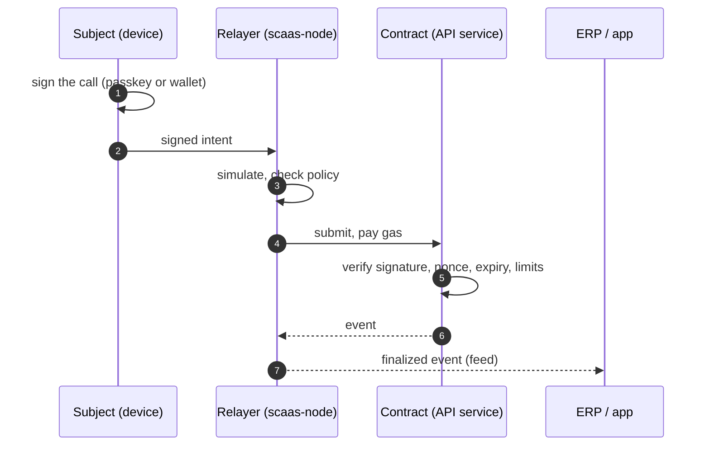

Read more: the authority model and why it differs from IaaS/BaaS —
[docs/architecture.md](docs/architecture.md#authority-model); the product overview —
[docs/README.md](docs/README.md).

---

## 3. Contracts: what is built on what

SCaaS contracts **inherit from the standard contracts** instead of reinventing them. On EVM they are built on
OpenZeppelin (version pinned in CI) and the ERC/EIP interfaces, so wallets, explorers and other contracts see an
ordinary ERC-20 token; the gasless layer is an **extension** of the standard, not a fork of it. Every product sits on
the same few layers:

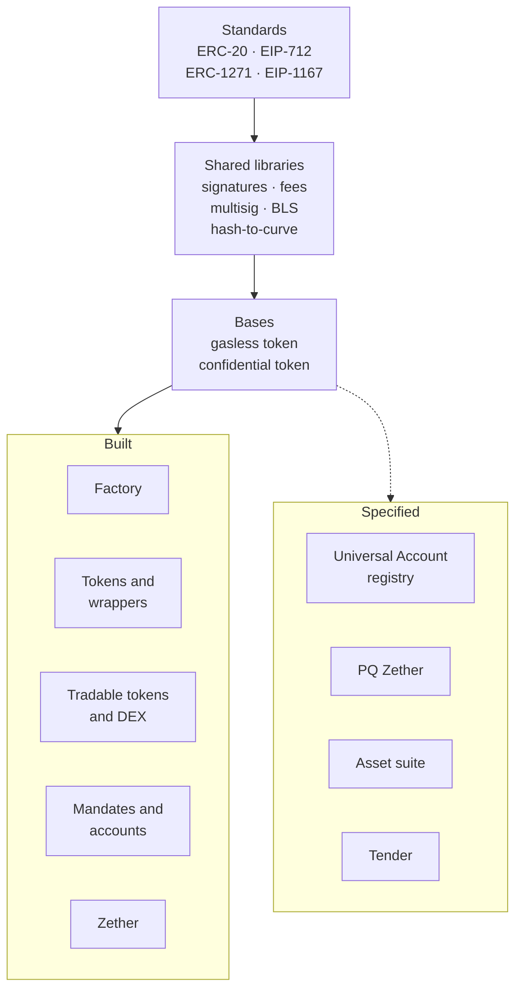

Every EVM token comes from one base tree: the **kind** is code, the **features** are flags chosen at creation, and
heavy logic sits in external libraries ([CTR-TOK-21](docs/contracts/token-wrappers.md#CTR-TOK-21),
[CTR-TOK-24](docs/contracts/token-wrappers.md#CTR-TOK-24)).

  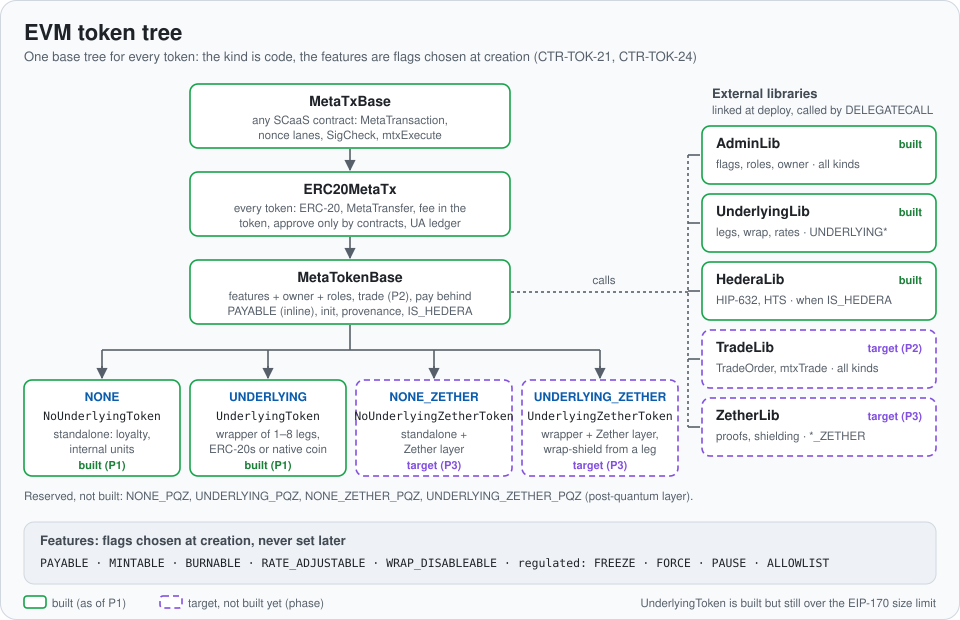

<b>The catalogue (EVM)</b> — every contract area with what it is built on, its status and where to read

| Area | Contracts | Built on | Status | Read |
|---|---|---|---|---|
| Factory | `OpenFactory` (one factory) | EIP-1167 clones at CREATE2 addresses: shared code, separate data ([section 4](#shared-code)); the version catalogue | BUILT as `OpenFactory` (`createToken`; kinds `NONE`, `UNDERLYING`, and `NONE_ZETHER`, `UNDERLYING_ZETHER` on dev chains, P3); the v1 line `OpenFactoryV1` is in `legacy/p5/` (P5) | [token-wrappers](docs/contracts/token-wrappers.md) |
| Gasless contracts | `MetaTxBase` (any SCaaS contract) → `ERC20MetaTx` (every token) → `MetaTokenBase` | `EIP712`; `mtxExecute` runs a signed `MetaTransaction` as a self-call on a selector allowlist; tokens add `ERC20` + `IERC20MetaTx` and the typed `MetaTransfer` ([CTR-MTX-22](docs/contracts/metatx.md#CTR-MTX-22), [CTR-MTX-23](docs/contracts/metatx.md#CTR-MTX-23)) | BUILT (P1a–P1c): `MetaTxBase`, `ERC20MetaTx`, `MetaTokenBase`; the older v1 line remains until the node and clientkeys move (P5) | [metatx](docs/contracts/metatx.md) |
| Payments | a signed `MetaTransfer` with an `entryRef` (`mtxPay`), or `IERC20Payment.payWithFee`; both emit `PaymentSettled` | `IERC20MetaTx` | BUILT: `MetaTransfer` and `mtxPay` on `MetaTokenBase`; the v1 line keeps a `pay(bytes32)` data shape | [metatx](docs/contracts/metatx.md) |
| Token kinds | four kinds by code: `NoUnderlyingToken` (`NONE`), `UnderlyingToken` (`UNDERLYING`, 1–8 legs, the native coin allowed), `NoUnderlyingZetherToken`, `UnderlyingZetherToken` (the two `*_ZETHER` kinds); `*_PQZ` reserved. Features by flags fixed at creation: payable, mint, burn, adjustable rate, wrap-disable, freeze, force, pause, allowlist ([CTR-TOK-21](docs/contracts/token-wrappers.md#CTR-TOK-21)) | `MetaTokenBase` | `NONE` and `UNDERLYING` BUILT (P1c–P1d) with `AdminLib`, `UnderlyingLib`, `HederaLib` (`UnderlyingToken` still over EIP-170); `*_ZETHER` kinds with `ZetherLib` BUILT, unaudited (P3; over EIP-170 too) | [token-wrappers](docs/contracts/token-wrappers.md) |
| Tradable tokens | `mtxTrade`: the token pulls a signed `TradeOrder` into the DEX named in it | `IERC20MetaTx` | BUILT (`TradeLib`, P2; the `trade` op and the legacy `MetaTxDex` are in `legacy/p5/`, P5) | [metatx](docs/contracts/metatx.md), [legacy DEX](docs/contracts/dex.md#legacy-metatxdex) |
| DEX | `SCaaSDex`, `DexPuller` | `EIP712` + `ReentrancyGuardTransient`; one taker against many makers per call on two paths, no maker allowance; `mtxExchange` fills the same orders against AMMs (Uniswap v2/v3), multi-hop or in a cycle, surplus to the signers ([CTR-DEX-20](docs/contracts/dex.md#CTR-DEX-20)) | BUILT (P2c: the exchange path on the new `SCaaSDex`) | [dex](docs/contracts/dex.md) |
| Mandates | `MandateWallet` | `MetaTxBase` + `IERC1271` | BUILT (on `MetaTxBase`, P4) | [mandates](docs/contracts/mandates.md) |
| Smart account (optional) | `SmartKeyAccount`, `SmartKeyAccountFactory` | `MetaTxBase` + `IERC1271`; P-256 passkeys; signs its own calls as itself ([CTR-ACC-10](docs/contracts/accounts.md#CTR-ACC-10)) | BUILT (on `MetaTxBase`, P4) | [accounts](docs/contracts/accounts.md#subjectaccount) |
| Universal Accounts | the UA registry with one verifier per kind (`smartcontracts/evm/src/ua/UARegistry.sol`; the Zether kinds since UA-3; the old Zether-only registry is backed up in `smartcontracts/evm/legacy/ua3/`, not built); next MetaToken v3 with a UA ledger (UA-4) | the signature, multisig, BLS and hash-to-curve libraries | UA registry BUILT; MetaToken v3 / UA ledger (UA-4) SPECIFIED | [accounts](docs/contracts/accounts.md#universal-account) |
| Zether | the `*_ZETHER` kinds (`ZetherLayer` + `ZetherLib`), `ZetherStatements`, `ZetherVerifierBn254`, `ZetherVerifierBls12381`, `ITransferDisclosure` | `MetaTokenBase`; EIP-196/197 and EIP-2537 precompiles | BUILT, unaudited (P3) | [zether](docs/contracts/zether.md) |
| PQ Zether | `PqzToken` | `ERC20MetaTx`, relayed like Zether ([CTR-PQZ-21](docs/contracts/pq-zether.md#CTR-PQZ-21)); a lattice precompile on chain 7622 — public chains once they offer one | SPECIFIED | [pq-zether](docs/contracts/pq-zether.md) |
| Asset suite | `ComplianceRegistry`, `VestingGrant`, `Distribution`, `ExchangeOffer` | regulated flags 5–8 on ordinary token kinds ([CTR-AS-17](docs/contracts/asset-suite.md#CTR-AS-17)); ERC-7201 namespaced storage | SPECIFIED | [asset-suite](docs/contracts/asset-suite.md) |
| Tender | `SealedBidTender` | commit and reveal with deposits | SPECIFIED | [tender](docs/contracts/tender.md) |
| Sponsorship | `SponsorshipPool` | opt-in gas sponsorship contract | PLANNED | [sponsorship](docs/node/sponsorship.md) |
| Hedera | the same kinds with `IS_HEDERA` set, `HederaMandateWallet` | the same EVM contracts plus HIP-632 for native Hedera keys | BUILT: `IS_HEDERA` and `HederaLib` on the same token contracts (CTR-TOK-23); the `Hedera*UnderlyingToken` children are gone | [hedera](docs/networks/hedera.md) |

**Tradable tokens: where they came from.** The first SCaaS code had an `ERC1776Tradeable` token: a trade order signed
against the token itself (`MtxTradeOrder`: amount, receive token, receive amount, relayer, fee) that only a DEX could
pull, matched one taker against several makers in one call. The design returns to that shape: the signed
`TradeOrder` keeps those fields, the token moves funds only into the `dex` named in the order, and the DEX settles one
taker against many makers, either pulling exactly the matched part of a resting order or pulling the whole amount and
refunding the rest ([section 14](#14-how-the-design-evolved)).

<b>Standards</b> — the standards SCaaS builds on, the wallet and client standards, and those deliberately not used

**Standards used:**

| Standard | What for |
|---|---|
| ERC-20 (OpenZeppelin) | Every token stays an ordinary ERC-20 |
| EIP-712, ERC-5267 | Typed, readable signatures; the domain is published by `eip712Domain()` |
| ERC-1271 | Contract accounts (Safe, `SmartKeyAccount`) sign like users |
| EIP-1167 | Cheap, immutable clones from the factory |
| ERC-7201 | Namespaced storage for the regulated module |
| EIP-196/197, EIP-2537 | bn254 and BLS12-381 precompiles for Zether, BLS and Schnorr |
| EIP-7951 (RIP-7212) | P-256 precompile for passkeys, with a Solidity fallback |
| RFC 9380 | Hash-to-curve for BLS |
| BIP-340, BIP-327, RFC 9591 | Schnorr, MuSig2 and FROST Universal Accounts |
| FIPS 204, FIPS 206 | ML-DSA and FN-DSA (Falcon) post-quantum Universal Accounts |

**Wallet and client standards** — how signers and apps reach the user's keys
([docs/clients/signers-clientkeys.md](docs/clients/signers-clientkeys.md#wallet-standards)):

| Standard | What for |
|---|---|
| EIP-1193 | The browser wallet provider interface (`window.ethereum` as the fallback) |
| **EIP-6963** | Discover every installed browser wallet, let the user choose one, remember the choice — no wallet library |
| EIP-712 | The wallet shows each field of what it signs |
| Wallet Standard | Sui, Aptos and Solana browser wallets |
| WalletConnect, TON Connect | Mobile and TON wallets (interfaces reserved; the TON Connect HTTP bridge is not wired yet) |
| WebAuthn | Passkeys (P-256) that sign on the user's device |
| BIP-39, BIP-32, BIP-43, SLIP-10, SLIP-44 | One 24-word seed; per-network and per-kind key paths (Universal Account tree `m/7622'/…`) |
| EIP-2333, EIP-2334 | BLS and bn254 key derivation for BLS and Schnorr Universal Accounts |
| RFC 6979 | Deterministic ECDSA for server-side signing: re-signing after a restart gives the same signature |
| OIDC with RFC 9207 | Console login to a node's admin API, with issuer pinning |

**Standards deliberately not used:**

| Standard | Why not |
|---|---|
| ERC-2771 trusted forwarder | A forwarder sits outside the token, can swallow a failed call after charging for it, and needs a trusted address; the meta-transaction lives inside the token instead ([section 7](#7-meta-transactions-and-eip-1776)) |
| ERC-4337 bundlers and paymasters | An extra mempool, bundler and entry point for something the token already does; SCaaS follows EIP-1776 |
| UUPS, Transparent, Beacon or Diamond proxies | An upgrade key is an admin key over every balance ([section 4](#4-shared-code-delegate-call-separate-data-and-upgradeable)) |
| Approvals by ordinary accounts | The classic drain: only a contract may call `approve` on a SCaaS token ([section 5](#5-what-the-traditional-model-gets-wrong)) |

**Other families** implement the same three pieces — token, mandate, DEX — on their own standards
([docs/networks/README.md](docs/networks/README.md#model)):

| Family | Language | Token | Mandate and DEX | Accounts |
|---|---|---|---|---|
| Cosmos | Rust (CosmWasm) | `token` (CW20) + `metaop` | `mandate`, `dex` | ADR-036 secp256k1, passkey |
| Soroban | Rust (WASM) | `token` (SEP-41) | `mandate`, `dex` | `account` with `__check_auth` |
| Aptos | Move | `meta` (one account object per owner, lanes inside) | `mandate`, `dex` | `auth`, `p256` |
| Sui | Move | `meta` (shared `Account<T>` per subject) | `mandate`, `dex` | `auth` |
| TON | Tact | `jetton` (TEP-74, custom wallet checks the signed op) | `mandate`, `dex` (escrow) | wallet signature, passkey |
| Solana | Rust | program `scaas` (subject account and lane accounts) | in the same program | ed25519 / P-256 precompiles |

On every family a subject signs one of two kinds: a `MetaCall` (a call of one of the contract's allowlisted
functions, checked by one verification library per family) or a typed `MetaTransfer`, and every signed entry point
starts with `mtx` in the family's case (`mtx_transfer`, `MtxExecute`) ([NET-ALL-26](docs/networks/README.md#NET-ALL-26),
[NET-ALL-27](docs/networks/README.md#NET-ALL-27), [NET-ALL-28](docs/networks/README.md#NET-ALL-28)).

---

## 4. Shared code, delegate call, separate data and upgradeable

A contract is two things: **code** (what it does) and **data** (its balances and settings). They do not have to live
in the same place. With `DELEGATECALL` a small contract keeps only its own data and runs code that lives in another
contract, the implementation:

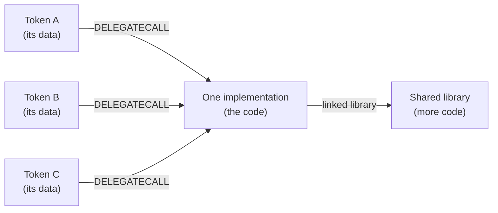

### Two uses of the same mechanism

The same `DELEGATECALL` serves two very different purposes. What separates them is one question: **can the pointer
to the code change after deploy?**

| | Reuse: clone (EIP-1167) | Upgrade: proxy (UUPS, Transparent, Beacon, Diamond) |
|---|---|---|
| Pointer to the code | Fixed at deploy, part of the clone's own bytecode | Stored in a slot that an admin can rewrite |
| Who can change the rules | **Nobody** | Whoever holds the upgrade key |
| What users must trust | The code they can read today | The code today **and** every future decision of the key holder |
| A bug fix | A new version, plus a voluntary migration by the balance owners | Repoint the proxy; every balance follows at once |

The common habit is "deploy everything behind a UUPS proxy so it can be patched". That habit means **whoever holds
the upgrade key can rewrite the rules over every user's balance**. SCaaS uses `DELEGATECALL` only to **reuse** code,
never to upgrade it.

### Shared code: what it brings

Every SCaaS token is a 45-byte EIP-1167 clone whose only code is a fixed pointer to its implementation; the clone
holds only its own balances and settings ([token-wrappers](docs/contracts/token-wrappers.md#CTR-TOK-18)). Subject
accounts, vesting grants, distributions and the other action contracts are clones too, and large shared logic (the
regulated module) sits in a library linked once per chain.

| Benefit | Why |
|---|---|
| **Cheap to create** | A token clone costs about 45,000 gas instead of about 2.5 M for a full deployment; a `SmartKeyAccount` clone about 287,000 instead of several million |
| **Light on the chain's nodes** | The implementation's code is stored once per chain — clients keep code by its hash — and each new clone adds 45 bytes plus its own storage. The one implementation, called by every clone, stays hot in the clients' code caches, and state grows more slowly |
| **One audited code base** | Auditing and verifying one implementation covers every clone; all clones of a version share one code hash, so anyone can check which code a token runs |
| **Versions without upgrades** | A new version is a new implementation added to the factory's catalogue; it applies only to contracts created after it, and existing clones keep their pointer and their rules |

The cost is one extra `DELEGATECALL` per call (a cold address access the first time in a transaction). The original
requirement — *share code through delegation, keep separate data, support several versions* — is met without an
upgrade key.

### Upgradeable: a deploy-time choice

Whether a program can be changed later is **not a property of the chain; it is decided when the program is
deployed**. Every platform offers a way to keep an upgrade key: proxies on EVM, an `UpgradeCap` on Sui, a package
upgrade policy on Aptos, an upgrade authority on Solana, a contract admin on CosmWasm. SCaaS decides:

- **Every program that holds user value is deployed immutable** ([CTR-GEN-02](docs/contracts/README.md#CTR-GEN-02)).
  Users verify once what a contract does and can rely on it for good.
- **New behaviour is a new version, not a patch** (above). A bug fix is a new deployment plus a voluntary migration.
- **The deploy gate enforces it.** Each family freezes its programs in the deploy run, and the deploy script fails if
  a program is still upgradeable. The node re-checks at every start and halts a chain whose programs could still be
  upgraded ([docs/networks/README.md](docs/networks/README.md#deploy-gate)).

The price is that there is no hotfix in place. That is deliberate: an upgrade key is an admin key over every balance.

### Per family

Every family separates shared code from per-user data in its own way, and each has its own switch to freeze the code:

| Family | Code stored once | Data per contract or user | Frozen at deploy by |
|---|---|---|---|
| EVM, Hedera | one implementation per version | 45-byte EIP-1167 clones with their own storage | clones have no upgrade path; no proxy anywhere |
| Cosmos (CosmWasm) | `store` the WASM once (`code_id`) | each `instantiate` is a contract with its own state | instantiate with `--no-admin` |
| Soroban | install the WASM once (by hash) | each instance references that hash | contracts are immutable as built |
| Solana | one program | data in separate accounts (subject account, lanes) | upgrade authority set to `None` |
| Move (Aptos, Sui) | one package | objects and resources per user or token | Aptos `immutable` policy; Sui `make_immutable` on the `UpgradeCap` |
| TON | one jetton-wallet code | each wallet deployed with the same code cell in its `state_init` | code is immutable as built |

---

## 5. What the traditional model gets wrong

Three habits of the usual token and wallet model are the source of most losses and most operational pain. SCaaS
designs each of them out.

### `approve`: a standing permission to drain

The standard ERC-20 flow is `approve(spender, amount)` followed by `transferFrom`. It needs two transactions, and the
allowance usually outlives the purpose it was given for — often "unlimited", often to a plain address. A phishing
site that obtains one approval can empty the balance later, at any time.

SCaaS: **only a contract may call `approve` — an ordinary account never grants an allowance on a SCaaS token, in any
form — and only a contract may spend one** ([docs/contracts/token-wrappers.md](docs/contracts/token-wrappers.md)). Allowances remain only for code that enforces
its own rules (the DEX, escrow). Everyday payments need no allowance at all: the payer signs one `pay` for one amount,
to one payee, with an expiry.

### Transactions are synchronous and tied to the sender's account

On every chain a normal transaction is built for the sender's own account and its **sequence number** (EVM nonce,
Stellar sequence, Cosmos account sequence, TON wallet seqno), at the moment it is sent. That means:

- the user must be **online, at that moment, holding native coins** for gas;
- the transactions of one account run **strictly one after another**: one stuck transaction blocks **every** later
  operation of that account, on **every** contract (head-of-line blocking);
- a call cannot be signed now and executed later by someone else.

**"Someone pays the fee for me" does not fix this.** The native sponsorship features — Hedera payer accounts, Sui
sponsored transactions, Stellar fee-bump, Cosmos `feegrant`, TON wallet extensions — and the EVM add-ons ERC-2771
(trusted forwarder) and ERC-4337 (bundlers and paymasters) move the *fee* to another party, but the operation is
still a transaction of the subject's own account (so its sequence still orders everything), or it needs both parties
to co-sign at submit time, or it runs through an external forwarder that can swallow a failed call after charging
for it.

SCaaS: the subject signs an **intent** — "this operation, on this contract, valid until this time" — and **anyone**
may execute it later, from their own account ([NET-ALL-02](docs/networks/README.md#NET-ALL-02)). Each contract keeps
its own two-dimensional nonce space (a lane and a sequence inside it), so independent operations never wait for each
other ([section 7](#7-meta-transactions-and-eip-1776)).

### The operator's server holds the power

In a classic web or custody setup, the server signs on the user's behalf. Whoever controls that server — or steals
its keys — can move funds, and the audit log is whatever the server wrote. In SCaaS no server holds a key that can
sign for a subject ([docs/architecture.md](docs/architecture.md#authority-model)).

---

## 6. Universal Accounts: one identifier for every kind of key

On a chain, an account is simply **whoever can produce a valid signature**. But each chain natively understands only
its own key types — an EVM chain knows secp256k1 addresses and nothing else. Real users and organizations need much
more: passkeys on phones, HSMs, ed25519 keys, Schnorr and BLS keys, multisig and threshold groups, post-quantum keys,
and confidential (Zether) keys.

**A Universal Account (UA) is an identifier derived from key data or from a policy — an EOA address generalized to
every signature scheme** ([docs/contracts/accounts.md](docs/contracts/accounts.md)).

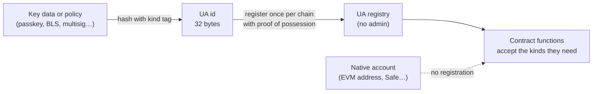

What makes it work:

- **It is an identifier, not a contract.** Nothing is deployed per user: creating a UA is free and deterministic, and
  the same key data gives the same id on every chain of every family
  ([CTR-UA-02](docs/contracts/accounts.md#CTR-UA-02)).
- **Native accounts are used as they are.** An EVM address, a contract account (Safe, `SmartKeyAccount`) or a native
  account of another family is already a UA and never registers. Every other kind registers once per chain, with a
  proof that the registrant holds the key; the registry has no admin and never forgets.
- **Ids never collide.** Every derived id carries a versioned kind tag and is 32 bytes, so a passkey UA can never equal
  an EVM address or a UA of another kind over the same key
  ([CTR-UA-03](docs/contracts/accounts.md#CTR-UA-03)).
- **One key, one purpose.** The same key is never used for two kinds — wallets derive a separate key per kind, and the
  registry refuses a key already registered under another kind
  ([CTR-UA-10](docs/contracts/accounts.md#CTR-UA-10)).
- **Each function accepts the kinds it needs.** A payment accepts any signing kind; a confidential transfer accepts
  only Zether kinds ([CTR-UA-14](docs/contracts/accounts.md#CTR-UA-14)).

<b>What a UA can hold</b> — native accounts, single keys, BLS, n-of-n groups, t-of-n thresholds, multisig, post-quantum and confidential kinds

| Use | Kinds | What it gives |
|---|---|---|
| Native accounts | EVM address, contract account (Safe, `SmartKeyAccount`), Hedera, Solana, Stellar, Aptos, Sui, Cosmos, TON wallets | Work as they are; no registration |
| Sign with one key | `webauthn-p256` (passkey), `p256` (HSM, secure enclave), `ed25519`, `bip340` (Schnorr), `schnorr-bn254`, `schnorr-bls12381` | Sign from any device or HSM, on any EVM chain, not only with secp256k1 |
| BLS | `bls12381-minsig`, `bls-bn254-minsig` | Short signatures that aggregate; one pairing check on chain |
| n-of-n group | `musig2-secp256k1`, `musig2-bn254` | Several parties produce **one** aggregate signature; the registry recomputes the group key |
| t-of-n threshold | `frost-secp256k1`, `frost-bn254` | Any `t` of `n` parties sign; the chain checks **one** signature; key-generation proofs checked at registration |
| Multisig policy | `msig` | A weighted threshold over up to 16 members of any signing kind — e.g. two passkeys plus an HSM, or a director's passkey plus a company EOA |
| Post-quantum signing | `mldsa44`, `mldsa65`, `fndsa512` (Falcon) | Authorization that survives a quantum computer |
| Confidential balances | `zether-bn254`, `zether-bls12381`, `pqz-mlwe` | Encryption keys for Zether and PQ Zether; they never sign — spending is authorized by another UA (`authRef`) |

Threshold ECDSA from MPC custody providers needs no kind of its own: its output is an ordinary ECDSA signature, so it
is a plain EVM address.

**Ways to use it:** sign alone (one key); sign together (`msig`, weighted); aggregate (MuSig2, BLS); share a key by
threshold (FROST); authorize a confidential account (a Zether UA points to the UA that may spend it); and, optionally,
attach verifiable credentials (eKYC) to any account, native or derived — never mandatory, and never parsed on chain
([credentials](docs/contracts/accounts.md#credentials)).

**Rotation and recovery.** A UA is its key data, so a new key is a new UA and funds move to it. Users who need a stable
address across key changes, guardian recovery, or compatibility with contracts that only understand addresses use the
optional smart account `SmartKeyAccount` — itself a native contract UA
([CTR-ACC-09](docs/contracts/accounts.md#CTR-ACC-09)).

**Status.** The UA model is SPECIFIED, nothing of the new registry is built yet. Already BUILT: BLS verification,
bn254 FROST and MuSig2 verification, ECDSA N-of-M quorums, `SmartKeyAccount`, and the Zether-only registry that the UA
registry replaces. In the first version, existing tokens, the DEX and mandates keep accepting native accounts; UA
holders use the new UA-ledger tokens (MetaToken v3) and Zether
([function → kinds](docs/contracts/accounts.md#function-kinds)).

---

## 7. Meta-transactions and EIP-1776

A **meta-transaction** separates *who authorizes* an operation from *who submits and pays for* it. SCaaS puts it
**inside the contract itself**, following the design of [EIP-1776](https://github.com/ethereum/EIPs/issues/1776)
(native meta-transactions with a fee paid in the token to whoever submits). EIP-1776 never became a final standard;
SCaaS uses its design deliberately, instead of ERC-2771 forwarders or ERC-4337 bundlers
([NET-ALL-02](docs/networks/README.md#NET-ALL-02)).

Why it matters:

- **No native coin needed.** Users hold only the token they use; a relayer pays the gas.
- **Asynchronous by design.** A signed intent is a self-contained, expiring authorization. It can be carried by QR
  code, message or file, and executed by any relayer — or by the payee — until it expires.
- **No head-of-line blocking.** Nonces are two-dimensional (`batch`, `nonce`): independent operations use different
  lanes (a payment's lane is derived from its random reference), dependent steps share one lane in order.
- **Any function of any SCaaS contract, gasless.** Not only token transfers: a contract that keeps a family tree, a
  mandate wallet or a token all accept a signed call of one of their own allowlisted functions — `addPerson`,
  `wrap`, `unwrap`, `burn`… `mtxExecute` lets the contract call **itself** with the signer's calldata; it never calls
  another contract on the signer's behalf: no forwarder. A token transfer is a special case with its own typed
  struct, so wallets show the amount and the recipient.
- **All or nothing.** The call and the fee succeed together or revert together: the user never pays for an operation
  that did not happen, and no failure is swallowed.
- **Readable signatures.** EIP-712 typed data: the wallet shows every field instead of 32 opaque bytes.

The signed structures on EVM ([docs/contracts/metatx.md](docs/contracts/metatx.md)): `MetaTransaction` for every
contract and, on tokens only, the typed `MetaTransfer` ([CTR-MTX-23](docs/contracts/metatx.md#CTR-MTX-23)). Both share
the lanes, so one signature spends one lane slot whichever struct carries it.

| Field | Purpose |
|---|---|
| `from` | The subject who signs; the authority the call runs under |
| `data` (`MetaTransaction`) | The contract's own allowlisted function to call (its calldata) |
| `to`, `value`, `entryRef` (`MetaTransfer`) | Recipient, amount, and the payment reference (`0` = a plain transfer) |
| `batch`, `nonce` | Two-dimensional nonce: the lane, and the sequence inside it |
| `validUntil` | Every signature expires |
| `mode` | Relayer and fee-recipient binding, and the fee mode (`NONE`, `PERCENT`, `FIXED`) |
| `relayer`, `fee`, `feeRecipient` | Who may submit (if bound), how much fee, to whom (only tokens charge a fee; other contracts accept fee `NONE`) |

**`mode` decides how open the intent is.** With no binding, any relayer may submit and earn the fee — the open
market. With `MODE_RESTRICT_RELAYER`, only the named relayer may submit — the typical B2B setting with `fee = 0`.
`MODE_RESTRICT_FEE_RECIPIENT` fixes who receives the fee whoever submits.

**Names.** Every entry point a relayer submits on a subject's behalf starts with `mtx`: `mtxExecute` (with
`executeMetaTransaction` kept as an alias, the EIP-1776 name), `mtxExecuteTransfer`, `mtxTransfer`, `mtxPay`, `mtxBatch`,
`mtxBatchTransfer`, `mtxTrade`, `mtxExchange`…
The signing domain carries `chainId`, the contract and `salt = chain_uid`, so a signature is valid on exactly one chain.

**Same model on every family.** Cosmos, Soroban, Sui, Aptos, TON and Solana sign the same two kinds — a `MetaCall` of
an allowlisted function and a typed `MetaTransfer` — with their own signature formats and replay protection, and the
same `mtx` names in their own case; the relayer always submits from its own account
([NET-ALL-26](docs/networks/README.md#NET-ALL-26)).

---

## 8. Who pays the fee: every model

Because authorization and payment are separate, SCaaS can offer every reasonable answer to "who pays?". All of them
use the same signed intent; only the fee fields and the submitter differ.

  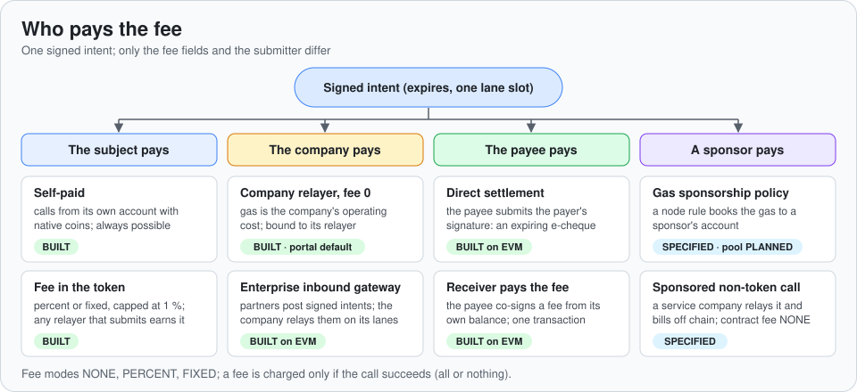

<b>Every model in detail</b> — how it works, who bears the cost, status and where to read

| Model | How it works | Who bears the cost | Status |
|---|---|---|---|
| **Self-paid** | The subject calls the contract from its own account with native coins (always possible; the fallback when no relayer serves it) | Subject | BUILT |
| **Sponsored by a company relayer** | Subject signs with `fee = 0`, bound to the company's relayer. Gas is the company's operating cost | Company | BUILT (portal default) |
| **Fee in the token** | Subject offers a fee in the token (percentage or fixed, capped at 1 %); any relayer that submits earns it | Subject, in the token it already holds | BUILT |
| **Direct settlement (payee self-relay)** | The payer signs offline and hands the signature to the payee — QR, NFC, message, file. The payee submits it and pays the gas. The signature works like an expiring electronic cheque | Payee | BUILT on EVM ([inbound](docs/integration.md#inbound)) |
| **Receiver pays the fee** | The payer signs a payment of `N`; the payee co-signs a fee authorization from its own balance; one transaction delivers `N` and pays the relayer | Payee | BUILT on EVM (`mtxPayReceiverFee`, [receiver-pays](docs/contracts/metatx.md#receiver-pays)) |
| **Gas sponsorship policy** | A node rule such as "inbound to wallet W, value ≥ X ⇒ accept at fee 0, book the gas to account Y" | The sponsor | SPECIFIED ([docs/node/sponsorship.md](docs/node/sponsorship.md)); an on-chain sponsorship pool is PLANNED |
| **Sponsored call of a non-token contract** | A service company relays the user's signed call of, say, a family-tree contract and pays the native gas; the contract takes no fee (`NONE`), the company bills off chain | The service company | SPECIFIED ([CTR-MTX-22](docs/contracts/metatx.md#CTR-MTX-22)) |
| **Enterprise inbound gateway** | Partners post signed intents to the company's gateway; the company relays them with its own lanes | Company | BUILT on EVM ([docs/node/gateway.md](docs/node/gateway.md)) |

The chain's own billing can help too: on chains that bill gas in stablecoins (Gnosis xDAI, Celo fee currencies) or
peg fees to USD (Hedera), the relayer's cost is predictable. Confidential (Zether) operations use the same envelope
with a public fee taken from the public balance ([docs/contracts/zether.md](docs/contracts/zether.md)). The
break-even of a fee-earning relayer and the B2B default are in [docs/architecture.md](docs/architecture.md#economics).

---

## 9. Meta-transactions and liquidity

Here **liquidity means transaction flow: how many transactions actually happen on the chain**, how often and by how
many participants. A chain is only as useful as the flow of calls into its contracts. The traditional model throttles
that flow at the source; meta-transactions open it up.

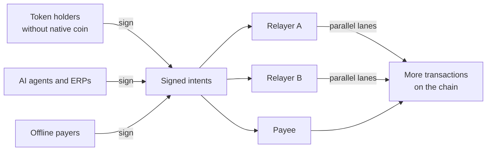

| What limits the flow today | What meta-transactions change |
|---|---|
| Every user must first buy the chain's native coin; most never do | A user needs only the token it already holds; a relayer pays the gas, so every holder can transact from day one |
| The user must be online, with a funded wallet, at the moment of sending | An intent is signed once and executed **later** by any relayer or by the payee — offline payments, scheduled steps and AI-agent actions all reach the chain |
| One account = one sequence: transactions queue one by one, and one stuck transaction stops the rest | Two-dimensional nonces: independent operations run in parallel lanes; a relayer spreads work over many lane accounts |
| Small transactions are not worth a user's own gas | Sponsored (fee 0) and fee-in-token models make micro-payments, loyalty points and B2B line items economic |
| Submission depends on one operator | Any relayer may submit; relayers share intents over the mesh and gossip, so more submitters carry more flow |
| Trading needs native gas for every order and cancel | Orders and cancels are signatures in an off-chain book; only matches go on chain, several pairs per transaction ([docs/contracts/dex.md](docs/contracts/dex.md)) |
| A new venue starts with an empty book | The same signed order also fills against existing AMMs (Uniswap v2/v3), through several pools or in a cycle, and any surplus above the signed price goes to the signer ([CTR-DEX-20](docs/contracts/dex.md#CTR-DEX-20), [CTR-DEX-21](docs/contracts/dex.md#CTR-DEX-21)) |
| Existing tokens were not built for gasless use | A wrapper makes any existing token gasless ([docs/contracts/token-wrappers.md](docs/contracts/token-wrappers.md)), so its holders join the flow too |

The result is more participants, more operations per participant and more parties able to submit them — all under
the same contract rules and the same subject signatures.

---

## 10. Open relayers: open and competitive

**Anyone can run `scaas-node` as a relayer, with their own policies.** A relayer is a business, not a gatekeeper:

- **It cannot forge or change an intent.** It can only submit, delay or refuse it. The subject can always go to
  another relayer, or submit the call itself.
- **Each operator sets its own policy:** what to accept, what fee to require, what to sponsor, whom to peer with,
  its own SLOs and monitoring ([docs/node/README.md](docs/node/README.md)).
- **Relayers compete on price and speed.** An unbound intent with a fee is open to every relayer; the first to land
  it earns the fee. Relayers that want the order flow must be cheaper and faster than the others.
- **Relayers cooperate through the mesh.** Admitted partners share intents over authenticated links with a short,
  round-robin exclusivity window so they do not race each other wastefully; the open network uses gossip in the
  style of 0x-mesh — validate before forwarding, any relayer may race to land
  ([docs/node/mesh.md](docs/node/mesh.md), [docs/node/gossip.md](docs/node/gossip.md)). Private chains never leave
  the admitted set.
- **The only reward is the intent's own fee.** There is no relayer token, no stake and no protocol subsidy
  ([NODE-MESH-05](docs/node/mesh.md#NODE-MESH-05)). A sponsor that wants to pay for others' gas does it by policy or
  by an opt-in sponsorship contract.

  

**One intent, step by step.** The envelope, its signatures and the acceptance checks are BUILT as a library; the bus,
gossip and the scheduler that turn them into a network are SPECIFIED ([docs/node/mesh.md](docs/node/mesh.md),
[docs/node/gossip.md](docs/node/gossip.md), [docs/architecture.md](docs/architecture.md#data-flows)).

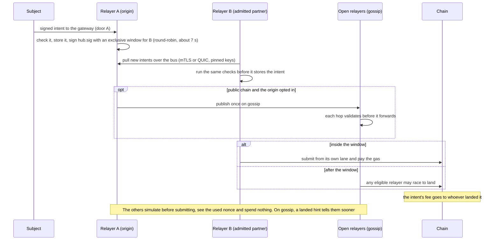

The economics are modest by design. A meta-transaction on Gnosis costs about $0.00015 of gas; even at a 10× markup a
relayer needs roughly 40,000 transactions a month to cover a small server and an RPC plan. Many relayers will
therefore be run by parties with a business reason — the issuer, distributors, partners, the payee — alongside open,
fee-earning ones. Both kinds serve the same contracts under the same rules
([docs/architecture.md](docs/architecture.md#economics)).

---

## 11. Confidential amounts: Zether and PQ Zether

On a public chain every amount and balance is visible to competitors. Mixers hide *who* paid *whom*, which breaks
audit and anti-money-laundering duties. **Zether hides the opposite: amounts and balances are encrypted, identities
stay visible.** Auditors can still see that company A paid company B, and disclosure to the sender, the receiver or a
named auditor opens any single transfer.

> [!WARNING]
> Zether is BUILT but **unaudited — not for production funds**: development chains only, until an independent audit.
> PQ Zether is SPECIFIED, also unaudited.

| | Zether (classical) | PQ Zether |
|---|---|---|
| Protects | Amounts and balances, against today's attackers | The same, **also against a future quantum computer** — both reading balances later ("harvest now, decrypt later") and forging proofs to mint |
| Encryption | ElGamal on elliptic curves (bn254 or BLS12-381, chosen per token at deploy) | Module-lattice (LWE) encryption |
| Proofs | Σ-protocol + two Bulletproofs range proofs | One lattice proof (LNP22) per operation, verified by a native precompile |
| Authorization | Registry of signature schemes | Universal Account `authRef`: ML-DSA-65 by default, or a hybrid post-quantum multisig |
| Gas per transfer | ≈ 3.3 M (measured) | ≈ 2.8 M (estimate; calldata-bound, ≈ 77 KB per transfer) |
| Gasless | Yes — `IERC20MetaTx` envelope, public fee | Yes — the same envelope, plus a post-quantum payer |
| Where | Development chains only, until an independent audit | Private/PoA chains only (chain 7622), behind a precompile self-test |
| Status | BUILT, **unaudited — not for production funds** | SPECIFIED, **unaudited** |

Read more: [docs/contracts/zether.md](docs/contracts/zether.md), [docs/contracts/pq-zether.md](docs/contracts/pq-zether.md),
[docs/contracts/accounts.md](docs/contracts/accounts.md).

---

## 12. Chains and families

SCaaS groups chains into **families**: one contract code base and one node adapter per family.

| Family | Chains | Execution | How the meta-transaction is done |
|---|---|---|---|
| EVM | Gnosis, Celo, private chain 7622, local anvil; Hedera (own page) | EVM (Solidity) | EIP-712 intent inside the token |
| Cosmos | CosmWasm chains | CosmWasm (Rust) | `Relay{payload, auth}` to the contract |
| Soroban | Stellar, Pi Network | Soroban WASM (Rust) | native authorization entries |
| Move | Aptos, Sui | Move VM | an account object per subject, lanes inside |
| TON | TON | TVM (Tact) | a custom jetton wallet checks the signed operation |
| Solana | Solana | SVM (Rust) | program-level, subject account + lane accounts |

Other EVM chains can be added as profiles. Finality, signing domains, passkeys and the availability of each feature
per family: [docs/networks/README.md](docs/networks/README.md).

**Deployment shapes:** public chains (your relayer, partners' and open relayers serve the same contracts); a private
or permissioned chain (your nodes and admitted peers only); a consortium (each member runs a node)
([docs/architecture.md](docs/architecture.md#profiles)).

---

## 13. The components and where to read more

The [overview figure](#top) at the top of this page shows how the parts connect: clients sign, relayers submit and
pay gas, contracts run on the chains. Finalized events travel back the same way: the node indexes the chain, waits
for finality and serves the result to clients as feeds.

| Component | What it is | Read |
|---|---|---|
| **Docs map** | Reading order, precedence, status tags | [docs/README.md](docs/README.md) |
| Product overview | Who SCaaS is for, what it offers | [docs/README.md](docs/README.md) |
| Architecture | Authority, service and trust models, topology, economics, glossary | [docs/architecture.md](docs/architecture.md) |
| **Smart contracts** | Meta-transactions, tokens and wrappers, accounts and mandates, DEX, tender, asset suite, Zether, PQ Zether, Universal Account | [docs/contracts/README.md](docs/contracts/README.md) |
| **Node** | Relayer and indexer: job API, gateway, submit lanes, finality-gated feeds, admin, sponsorship, DEX venue, mesh, gossip, operations | [docs/node/README.md](docs/node/README.md) |
| **Networks** | The common model and one page per family | [docs/networks/README.md](docs/networks/README.md) |
| **Clients** | Passkey and seed-vault signers, wallet connectors, console and dApp | [docs/clients/signers-clientkeys.md](docs/clients/signers-clientkeys.md), [docs/clients/app.md](docs/clients/app.md) |
| **Integration** | How an ERP or back office uses SCaaS: outbox, push and sync, references, reconciliation | [docs/integration.md](docs/integration.md) |
| Decisions | Every rule's id, reason and cost if wrong; old-id aliases | [docs/decisions.md](docs/decisions.md) |
| History | Frozen designs and the original requirements note with its trace | [docs/history/README.md](docs/history/README.md) |

**Where to start, by role:**

- **Integrating an ERP** → [docs/integration.md](docs/integration.md)
- **Running a node** → [docs/node/README.md](docs/node/README.md), then [docs/node/runbooks.md](docs/node/runbooks.md)
- **Building a wallet or app** → [docs/clients/](docs/clients/signers-clientkeys.md)
- **Reviewing contracts** → [docs/contracts/README.md](docs/contracts/README.md) and your chain's page under
  [docs/networks/](docs/networks/README.md)

> [!NOTE]
> Every section of the component docs is tagged **BUILT** (code with tests), **SPECIFIED** (rules fixed, code pending)
> or **PLANNED** (direction only).

---

## 14. How the design evolved

SCaaS did not start from a blank page. Two early prototypes shaped it: a **wrapped ERC-20 with meta-transactions**,
then the **ERC1776 token family** with tradable tokens and a DEX. Most of their ideas survive; some were changed once
they proved unsafe.

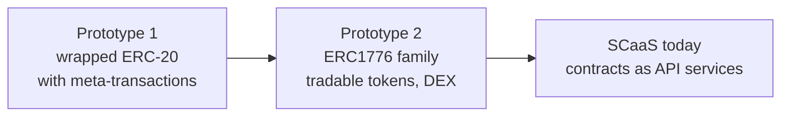

<b>Idea by idea</b> — prototype 1, prototype 2 and today, side by side

| Idea | Prototype 1: wrapped ERC-20 | Prototype 2: ERC1776 family | Today |
|---|---|---|---|
| Meta-transaction inside the token | `executeMetaTransaction`, `mtxTransfer`; one nonce per account; chain id and token address signed | `mtxTransfer` with a two-dimensional nonce (`batch`, `nonce`), `validUntil`, a bound relayer or any relayer (`address(0)`) | A pinned EIP-712 `MetaTransaction` for a call of any allowlisted function of **any** SCaaS contract, plus a typed `MetaTransfer` on tokens: lanes and nonces, expiry, `mode` flags; chain and contract in the domain ([section 7](#7-meta-transactions-and-eip-1776)) |
| Signature format | EIP-712 typed data | Ethereum signed-message prefix | EIP-712 only, low-s, ERC-1271 for contract accounts |
| Fees | The sender chooses the fee amount and its recipient, both signed, at most 1 % of the amount | A fee in parts per million inside each trade order | Fee modes `NONE` / `PERCENT` / `FIXED`, capped at 1 %, recipient optionally bound ([section 8](#8-who-pays-the-fee-every-model)) |
| Payment reference | `mtxPay` with a sender-chosen `payId` and a `Payment` event | — | `pay(entryRef)` emits `PaymentSettled`; a random `entryRef` also picks the lane, which makes each payment pay-once |
| Wrappers | No underlying, one underlying at a numerator/denominator rate, several underlyings with a rate each | — | The same shapes as two kinds (`NoUnderlyingToken`, `UnderlyingToken` with 1–8 legs) with fixed or adjustable rates; basket legs fixed at creation; optional confidential variants (`*_ZETHER`) |
| Factory | A factory with `new`, one wrapper per underlying | — | An open factory of immutable EIP-1167 clones and a version catalogue |
| Code reuse | Every wrapper deployed with its full code | — | The requirements note asked to "share code through delegation, keep separate data, support several versions": clones `DELEGATECALL` one fixed implementation per version ([section 4](#shared-code)) |
| `approve` | Only contracts may call `approve` (code-size check) | The same rule, also on the NFT | Only a contract may call `approve`, decided by explicit rules instead of a code-size guess ([CTR-TOK-01](docs/contracts/token-wrappers.md#CTR-TOK-01)) |
| Trading | — | `ERC1776Tradeable` + `Dex`: one taker against several makers, partial fills, refunds of the unmatched part, at least 50 % of the wanted amount, a fee per side | `TradeOrder` (the old `MtxTradeOrder` fields) pulled only into the named DEX; one taker against many makers per call, resting orders filled in parts or immediate orders refunded; a 50 % minimum fill; the same orders fill against AMMs through `mtxExchange` ([section 3](#3-contracts-what-is-built-on-what)) |
| A contract receiving tokens | — | `ERC1776Holder` pulls a signed transfer into itself | Any contract can be the recipient of a signed `pay` or transfer |
| NFTs | — | `ERC1776Nft721`: `safeTransferFrom` by meta-transaction | PLANNED with the asset suite ([asset-suite](docs/contracts/asset-suite.md)) |
| Admin powers | An `Ownable` owner per wrapper | `ERC1776Adminable` (an admin moves its own tokens by signature), `Rescuable` (an owner or rescuer withdraws stuck tokens) | No one can move a user's funds; only bounded roles fixed at creation ([docs/architecture.md](docs/architecture.md#authority-model)) |
| Upgrades | — | — | Immutable at deploy ([section 4](#4-shared-code-delegate-call-separate-data-and-upgradeable)) |

**Lessons that changed the design:**

- **Executing signed calldata is right; calling out is wrong.** The first prototype forwarded signed calldata to
  **another** contract, which then saw the token as `msg.sender`, so a signed `transfer` moved the token's own
  balance. The fix is not to give up generic execution but to keep it inside: `mtxExecute` calls the token **itself**,
  with the signer carried in transient storage, on a fixed allowlist ([docs/contracts/metatx.md](docs/contracts/metatx.md)).
- **A meta-transaction shaped like a token transfer is too narrow.** `to` and `value` meant nothing for a call such
  as "add a person to a family tree", and a contract without a balance could not even take the fee. The signed call is
  now generic (`MetaTransaction`, any SCaaS contract), and a transfer is its typed special case (`MetaTransfer`)
  ([CTR-MTX-22](docs/contracts/metatx.md#CTR-MTX-22)).
- **One nonce per account is a queue.** A single stuck signature blocks every later one. Two-dimensional nonces came
  in with the second prototype and are now the rule on every family
  ([NET-ALL-02](docs/networks/README.md#NET-ALL-02)).
- **Guessing "is this an ordinary account?" from code size fails**: a contract under construction has no code yet,
  and an account delegated with EIP-7702 has a few bytes of code but is still a key holder. The contract-only spender
  rule now names each case and its treatment.
- **A signed-message prefix shows 32 opaque bytes to the user.** EIP-712 shows every field.
- **An owner on every token is an admin key over balances.** Prototype owners, admin moves and rescue functions are
  gone. A wrapper owned by its factory could not even be configured. Tokens are ownerless clones with roles fixed at
  creation.
- **A basket wrapper whose owner can add underlyings at will can be drained** by adding a weak one and unwrapping
  into the strong ones. Today the legs and their initial rates are fixed at creation, each unwrap is bounded by that
  leg's own reserve, and a guardian can only stop inflow into a depegged leg
  ([token-wrappers](docs/contracts/token-wrappers.md#multi)).

---

## 15. Repository layout

<b>Top-level folders</b> — <code>smartcontracts/</code>, <code>scaas-node/</code>, <code>clients/</code>, <code>docs/</code>, <code>scripts/</code>

| Path | What |
|---|---|
| `smartcontracts/` | On-chain code by family: `evm/` (Foundry; Gnosis, Celo, private chain, Hedera), `move/{aptos,sui}`, `soroban/`, `cosmos/`, `ton/`, `solana/`; `scripts/{build,test,deploy,devnet}.sh <family>`. See [`smartcontracts/README.md`](smartcontracts/README.md), [`smartcontracts/evm/README.md`](smartcontracts/evm/README.md) and [docs/contracts/](docs/contracts/README.md) |
| `scaas-node/` | Rust relayer node: gateway, submit lanes, indexer, admin, mesh. See [`scaas-node/README.md`](scaas-node/README.md) and [docs/node/](docs/node/README.md) |
| `clients/` | Everything that runs on the user's side: `clientkeys/` (browser signers: passkey, seed vault, Zether keys; [signers-clientkeys.md](docs/clients/signers-clientkeys.md)), `zether-prover/` (Rust/WASM prover for Zether proofs, balance reading and disclosure; [zether.md](docs/contracts/zether.md)), and the Universal Account identity libraries `ua-rs/` (Rust), `ua-cxx/` (C++), `ua-qt/` (QML), `ua-dart-frb/` (Dart over Rust), `ua-py/`, `ua-go/`, `ua-cs/` (C#) and `ua-dart/` (pure Dart) ([ua-libraries.md](docs/clients/ua-libraries.md)). The console and dApp `app/` (React + Vite) is planned ([app.md](docs/clients/app.md)) |
| `docs/` | Product docs — start at [`docs/README.md`](docs/README.md). Check: `python3 scripts/docs_check.py check` |
| `scripts/` | [`capped`](scripts/capped): run one heavy build in a 4 GB systemd scope, one at a time machine-wide; [`docs_check.py`](scripts/docs_check.py): the docs checker; [`size_gate.py`](scripts/size_gate.py): the contract size gate |

SCaaS depends on no ERP. One worked ERP connector lives in a separate repository and is described as an example in
[docs/integration-odoo-example.md](docs/integration-odoo-example.md).

## 16. Use cases

What people can build by combining SCaaS contracts with meta-transactions, in eight groups. Each row names the parts
it uses, who can pay the fee and the status. **BUILT**, **SPECIFIED** and **PLANNED** are the docs' own tags;
**NOT SPECIFIED** means no SCaaS doc covers the use case yet: it is an idea the parts could support, not a feature.

**Who can pay the fee** names the realistic payers of the gas in each case, using the models of
[section 8](#8-who-pays-the-fee-every-model); most cases allow more than one. Tokens can take the fee in the token
itself; contracts outside the token set (`MandateWallet`, `SmartKeyAccount`, a registry on `MetaTxBase`) take no fee
on chain, so whoever relays their calls pays the gas and bills off chain, if at all
([CTR-MTX-22](docs/contracts/metatx.md#CTR-MTX-22)).

**Templates.** Every use case, commercial contracts included (escrow with an arbiter, milestone service contracts,
sale with delivery, leases, installment loans, subscriptions, revenue sharing), is meant to ship as a template: an
implementation deployed once per chain, from which anyone creates an instance with their own parameters as an
EIP-1167 clone at a CREATE2 address through a factory, then uses it by meta-transaction — the pattern of today's
`OpenFactory.createToken` and `createDex` ([factory](docs/contracts/token-wrappers.md#factory),
[CTR-DEX-24](docs/contracts/dex.md#CTR-DEX-24)). Off-chain presets are only parameter sets for those factories
([CTR-AS-14](docs/contracts/asset-suite.md#CTR-AS-14)). A template library beyond tokens and the DEX is PLANNED
(owner, 2026-10-12).

<b>a) Retail and loyalty</b> — loyalty and cashback, prepaid points, game points, membership cards, point exchange

| Use case | How SCaaS maps it | Who can pay the fee | Status |
|---|---|---|---|
| **Loyalty and cashback for supermarkets and store chains** | The chain issues points as a `NONE` token with its own minter ([loyalty template](docs/contracts/asset-suite.md#templates)). Members receive and spend points without holding any native coin; the store's relayer pays the gas at fee 0, and one atomic `mtxBatchTransfer` carries many signed credits ([CTR-MTX-24](docs/contracts/metatx.md#CTR-MTX-24)). Campaign payouts as a `Distribution` are specified | The store's relayer at fee 0; or the member, as a fee in points | BUILT; `Distribution` SPECIFIED |
| **Prepaid points (PPP, like gift-card points) used for payment** | A wrapper of a stablecoin at a fixed rate (say 1 USDC → 100 points) is a prepaid point backed by its own reserve ([rates](docs/contracts/token-wrappers.md#rates)). Customers pay merchants with a signed `mtxPay` that carries the payment reference ([section 7](#7-meta-transactions-and-eip-1776)). The voucher template, where expiry is the end of a closable redemption offer, is specified ([templates](docs/contracts/asset-suite.md#templates)) | The merchant (receiver pays, or it submits the customer's signed payment itself); the issuer's relayer at fee 0; or the customer, in points | BUILT; voucher redemption SPECIFIED |
| **Virtual points in games** | In-game points are a `NONE` token minted by the game's own contract or treasury; players sign gasless and the game's relayer pays the gas. In-game items as NFTs (ERC-721/1155 with meta-transactions) are planned ([asset suite](docs/contracts/asset-suite.md#templates)) | The game's relayer at fee 0; or the player, in points | BUILT (points); NFTs PLANNED |
| **Membership cards and event tickets** | A card or ticket is a `decimals 0` token the organizer mints; at the door the holder's passkey (a `SmartKeyAccount` key) can sign a transfer of the ticket back to the organizer, and the gate submits it. Limiting who may receive a card needs the receiver allowlist of the regulated flags ([regulated controls](docs/contracts/asset-suite.md#2-regulated-controls)); fully non-transferable tokens and NFTs are not available, and no ticketing flow is specified | The organizer: its relayer at fee 0, or the gate submitting the holder's signed check-in | Tokens and `SmartKeyAccount` BUILT; allowlist SPECIFIED; NFTs PLANNED; ticketing NOT SPECIFIED |
| **Cross-brand point exchange** | Each brand's points trade on a `SCaaSDex` market that the DEX operator lists; members sign orders gaslessly, with no allowance, and the same orders can fill against Uniswap pools ([dex](docs/contracts/dex.md)). The rate is the book's price; a fixed-rate agreement between brands is not specified | Each trader, as its signed order fee (≤ 1 %, from what it receives); or fee 0 on a brand's own venue | BUILT on EVM |

<b>b) Payments and collections</b> — payroll, direct debit, deposit with periodic withdrawal, split settlement, cross-border payment

| Use case | How SCaaS maps it | Who can pay the fee | Status |
|---|---|---|---|
| **Payroll and commissions in batches** | The employer signs one payment per payee, each with its own `entryRef`, and a relayer lands the run in one atomic `mtxBatchTransfer` ([CTR-MTX-24](docs/contracts/metatx.md#CTR-MTX-24)). Every item carries its own signature; a `SmartKeyAccount` payer covers the whole run with one signature over a Merkle root of the digests ([CTR-ACC-02](docs/contracts/accounts.md#CTR-ACC-02)) | The employer: its relayer at fee 0, or self-paid | BUILT |
| **Recurring collection and direct debit (utilities, tuition, subscriptions)** | The payer deposits into its `MandateWallet` and makes the biller the delegate, with the biller's account as payee, per-payment and per-period caps and an expiry; the biller signs each `payUnderMandate` with its own `entryRef`, and the payer can revoke at any time ([mandates](docs/contracts/mandates.md)) | The biller's relayer (the wallet takes no fee on chain); or the payer, self-paid | BUILT |
| **Deposit, then withdraw a fixed amount per period (allowance, pension-like payout, savings plan, vesting, subscription budget)** | Two parts fit. A `VestingGrant` is one funded contract per grant whose linear schedule with a step `interval` (or up to 16 tranches) releases a fixed amount per interval; anyone may call `release()`, which pays only the beneficiary, and the grantor can take back the unvested part only if the grant was made revocable ([CTR-AS-10](docs/contracts/asset-suite.md#CTR-AS-10)). A `MandateWallet` is the revocable variant: the owner deposits, and a delegate (who may pay to its own address if the owner approves it as payee) pays up to `maxPerPeriod` per period until an expiry; unused budget does not carry over, and the owner can revoke or pay out by hand at any time ([mandates](docs/contracts/mandates.md)). An open-ended plan topped up over time is not specified | Grant: whoever calls `release()` — the grantor's relayer, any relayer or the beneficiary. Mandate: the delegate's or payee's relayer, or the owner, self-paid | `MandateWallet` BUILT; `VestingGrant` SPECIFIED; open-ended plan NOT SPECIFIED |
| **Pocket money and household spending** | A parent funds a `MandateWallet` per child and makes the child's key its delegate, with a weekly cap, a per-payment cap and payees limited to approved shops; the parent can revoke at any time ([mandates](docs/contracts/mandates.md)) | The shop, submitting the child's signed payment; or the parent's relayer | BUILT |
| **Multi-party split settlement (marketplace, food delivery, tax remittance to the state)** | The buyer signs one payment per party — seller, rider, platform, tax authority — each with its own `entryRef`, and a relayer lands them in one atomic `mtxBatchTransfer`, so all parts settle or none ([CTR-MTX-24](docs/contracts/metatx.md#CTR-MTX-24)). Computing the shares or the tax, enforcing the split and reconciling with the authority are not specified | The platform's relayer at fee 0; or the buyer, as a fee in the token | Batch BUILT; split and tax rules NOT SPECIFIED |
| **Sales: the seller pays the fee to receive a CBDC or stablecoin** | Receiver pays: the buyer signs a payment of `N`, the seller co-signs a fee from its own balance, and one transaction delivers `N` and pays the relayer ([receiver-pays](docs/contracts/metatx.md#receiver-pays)). Or the seller submits the buyer's signed payment itself and pays the gas. A stablecoin takes part through a SCaaS wrapper; a CBDC token needs the regulated flags | The seller: receiver pays, or payee self-relay | BUILT on EVM; CBDC token SPECIFIED |
| **Cross-border buying, selling and payment through licensed deposit and withdrawal gateways** | The parts: 1:1 stablecoin wrappers that holders wrap and unwrap against the reserve ([token-wrappers](docs/contracts/token-wrappers.md)), gasless payments with references, and an enterprise inbound gateway a licensed company can run ([gateway](docs/node/gateway.md)). The bank side — deposits, withdrawals, licensing and customer checks — is not specified | The licensed company (gateway, fee 0); or the customer, as a fee in the wrapper token | NOT SPECIFIED (parts BUILT) |
| **Micro-insurance payouts and social benefits** | An insurer or agency pays claims or benefits in a `mtxBatchTransfer` to people who hold only a passkey: today a `SmartKeyAccount` with P-256 passkeys and guardian recovery, later a `webauthn-p256` UA on the UA-ledger tokens ([accounts](docs/contracts/accounts.md#subjectaccount)). Recipients spend without native coin. Claim, eligibility and payout rules are not specified | The insurer or agency, at fee 0; when recipients spend: the merchant, or a fee in the token | Batch and `SmartKeyAccount` BUILT; passkey UA SPECIFIED; claim rules NOT SPECIFIED |

<b>c) Commercial contracts</b> — escrow and deposits, milestone services, sales with delivery, leases, installment loans

| Use case | How SCaaS maps it | Who can pay the fee | Status |
|---|---|---|---|
| **Escrow and deposits (rent, car rental, bookings)** | Holding a deposit and releasing it to either side, by both parties or an arbiter, needs an escrow contract; none is specified, and the asset suite leaves escrow with an arbiter out of its scope ([scope](docs/contracts/asset-suite.md#scope)). The parts: the deposit is a signed payment with a reference, and the contract would be a `MetaTxBase` contract like the mandate wallet ([CTR-MTX-22](docs/contracts/metatx.md#CTR-MTX-22)) | The landlord or rental company's relayer; or the depositor, as a fee in the token | NOT SPECIFIED (parts BUILT) |
| **Milestone service contracts, sale with delivery, leases, installment loans, revenue sharing** | Parts exist: tranches released by an `approver` (a milestone `VestingGrant`), installments and subscriptions by mandate, revenue shares as a `Distribution` to holders of a share token ([asset suite](docs/contracts/asset-suite.md)). No contract or template for any of them is specified | The party that relays — usually the seller, lessor or lender, at fee 0; payers may add a fee in the token | Mandates BUILT; `VestingGrant`, `Distribution` SPECIFIED; the contracts NOT SPECIFIED |

<b>d) Accounts and authority</b> — passkey accounts, multi-signature approval, AI agents under a mandate

| Use case | How SCaaS maps it | Who can pay the fee | Status |
|---|---|---|---|
| **Passwordless accounts that survive a lost device** | A `SmartKeyAccount` holds WebAuthn P-256 passkeys beside secp256k1 keys; when a device is lost, the guardian adds a new key after a 2-day delay that any existing key can cancel ([CTR-ACC-03](docs/contracts/accounts.md#CTR-ACC-03)). A passkey can also be a UA on its own (`webauthn-p256`), but a single-key UA has no recovery: a new key is a new UA; an `msig` UA over several passkeys, with a threshold below their total weight, survives the loss of one ([section 6](#6-universal-accounts-one-identifier-for-every-kind-of-key)) | The service's relayer (account calls take no fee on chain); for payments: the user in the token, or the payee | `SmartKeyAccount` BUILT; passkey and `msig` UAs SPECIFIED |
| **Multi-signature spending approval for a company** | Large payments need a quorum: an `msig` UA (a weighted threshold over up to 16 members of any signing kind) or a FROST t-of-n / MuSig2 n-of-n group key whose one signature the chain checks once; a Safe already signs through ERC-1271. Small everyday spends go through a `MandateWallet` delegate within its caps ([mandates](docs/contracts/mandates.md)) | The company's relayer at fee 0; or self-paid | Safe and mandates BUILT; `msig`, FROST and MuSig2 UAs SPECIFIED |
| **AI agents spending on a user's behalf** | The agent holds the delegate key of the user's `MandateWallet`: it pays only approved payees, within per-payment and per-period caps, until the expiry, and the user revokes at once. Several delegates per token, per-payee caps, a co-sign threshold and an MCP adapter are a research direction only ([node-ai-agents](docs/research/node-ai-agents.md)) | The merchant or the agent platform's relayer; or the owner, self-paid | `MandateWallet` BUILT; agent features NOT SPECIFIED (research) |

<b>e) Business and supply chain</b> — invoice finance, confidential payroll, hidden-amount tenders, enterprise relayers

| Use case | How SCaaS maps it | Who can pay the fee | Status |
|---|---|---|---|
| **Supply-chain finance (invoice tokens)** | A receivable becomes a token whose units are the invoice's face value; the supplier sells it to financiers at a discount on a listed `SCaaSDex` market, and at the due date the buyer redeems it at face, for example through a redemption `ExchangeOffer` like a bond's, funded on time from its `MandateWallet` ([dex](docs/contracts/dex.md), [templates](docs/contracts/asset-suite.md#templates)). Invoice checks, double financing and the redemption contract terms are not specified | Traders: the signed order fee (≤ 1 %); redemption: the buyer's or the financier's relayer | DEX and mandates BUILT; `ExchangeOffer` SPECIFIED; invoice financing NOT SPECIFIED |
| **Confidential payroll with Zether** | Salaries move as Zether transfers, so amounts are encrypted while payer and payees stay visible; one multi-recipient transfer pays several employees ([multi-recipient](docs/contracts/zether.md#multi-recipient)). A token created with an auditor key also encrypts every amount to the auditor, and sender or receiver can disclose single transfers ([auditor mode](docs/contracts/zether.md#auditor-mode), [disclosure](docs/contracts/zether.md#disclosure)) | The employer's relayer at fee 0; or a public fee from the employer's public balance | BUILT, unaudited, dev chains only; PQ Zether SPECIFIED |
| **Contract tenders with hidden amounts (Zether / PQ Zether)** | `SealedBidTender` keeps every bid a salted commitment, bonded by a deposit, until the deadline; bids are revealed afterwards and honest losers' deposits return without anyone's approval ([tender](docs/contracts/tender.md)). Bids that stay hidden after the reveal, with Zether or PQ Zether deposits, are outside the tender's scope | The buyer's relayer or a sponsor (sponsorship policy, SPECIFIED); or a bidder submitting its own commit and reveal | SPECIFIED (sealed until reveal); confidential bids NOT SPECIFIED |
| **Enterprises running their own relayer** | A company runs `scaas-node`: partners post signed intents to its gateway and it relays them on its own lanes ([gateway](docs/node/gateway.md)); it pays gas for its own customers at fee 0 or by a sponsorship policy ([sponsorship](docs/node/sponsorship.md)); the relayers of a business group exchange intents over the mesh's pull bus ([mesh](docs/node/mesh.md)) | The company (gateway at fee 0, or a sponsorship policy); partners may add a fee in the token | Gateway BUILT on EVM; sponsorship policy SPECIFIED; mesh envelope BUILT, bus SPECIFIED |

<b>f) Assets and investment</b> — shares and bonds, pooled funds, tokenized real-world assets, decentralized trading

| Use case | How SCaaS maps it | Who can pay the fee | Status |
|---|---|---|---|
| **Issuing shares and bonds on chain, public or private** | Equity and bond templates: a token with the regulated flags, eligibility in a `ComplianceRegistry`, dividends and coupons as a `Distribution`, redemption at maturity as an `ExchangeOffer`, trading on a managed DEX market ([templates](docs/contracts/asset-suite.md#templates)). A private chain keeps intents among admitted nodes ([profiles](docs/architecture.md#profiles)) | The issuer's relayer at fee 0; trades on a managed market carry no relayer fee on regulated legs, so the venue pays ([managed markets](docs/contracts/asset-suite.md#8-managed-markets)) | SPECIFIED |
| **Pooled investment funds and capital contributions** | Members contribute stablecoins and receive fund units (the equity template covers units of a fund); profits go out as a `Distribution`, and an exit is a buyback `ExchangeOffer` of units for stablecoins ([templates](docs/contracts/asset-suite.md#templates)). Contribution terms, valuation and the fund's governance are not specified | The fund manager's relayer at fee 0; or members, as a fee in the token | SPECIFIED; fund rules NOT SPECIFIED |
| **Tokenized real-world assets (fractional real estate, gold, warehoused produce)** | Fractions are a token the issuer mints, with the regulated flags and eligibility where the law requires them ([regulated controls](docs/contracts/asset-suite.md#2-regulated-controls)); an asset already tokenized on chain (a gold token, say) can be wrapped in a reserve-backed SCaaS wrapper, gasless and redeemable from a reserve anyone can read ([token-wrappers](docs/contracts/token-wrappers.md)). Custody of the physical asset, appraisal and legal title are off chain and not specified | The issuer's relayer at fee 0; or holders, as a fee in the token | Tokens and wrappers BUILT; regulated flags SPECIFIED; custody and title NOT SPECIFIED |
| **Decentralized trading of digital assets** | Orders and cancels are signatures in the node's off-chain book; `SCaaSDex` settles one taker against many makers, with no allowance for SCaaS tokens and no gas for traders, and the same orders fill against Uniswap v2/v3 pools ([dex](docs/contracts/dex.md), [DEX venue](docs/node/dex-venue.md)). Book gossip between relayers is specified | Each trader, as its signed order fee (≤ 1 %, from what it receives), shared with the relayer | BUILT on EVM; book gossip SPECIFIED |

<b>g) Public sector and community</b> — CBDC, public budgets, donations, group funds, voting

| Use case | How SCaaS maps it | Who can pay the fee | Status |
|---|---|---|---|
| **A CBDC issued by the state on a public chain, under strict state control** | The docs list central-bank digital currency as a use of the regulated flags: freeze, forced transfer against a recorded order, bounded pause and a receiver allowlist, chosen at creation and disclosed, with eligibility in a `ComplianceRegistry` ([permissionless vs controlled](docs/contracts/token-wrappers.md#permissionless-vs-controlled), [regulated controls](docs/contracts/asset-suite.md#2-regulated-controls)). Holders still pay without native coin. Today a token refuses these flags (`FeatureNotBuilt`) until the asset suite is built | The central bank's or a bank's relayer at fee 0, or a sponsorship policy (SPECIFIED); the merchant, by receiver pays | SPECIFIED |
| **Transparent public budget and aid disbursement** | Every payment carries a reference and lands on a public chain, so anyone can follow the flows; contracts can be awarded by sealed tender ([tender](docs/contracts/tender.md)), and recipients spend through a `MandateWallet` limited to approved payees and per-period caps ([mandates](docs/contracts/mandates.md)). References are random by default; the agency publishes what they mean off chain. Budget rules are not specified | The agency's relayer at fee 0; suppliers, by submitting payments to themselves | Payments and mandates BUILT; tender SPECIFIED; budget rules NOT SPECIFIED |
| **Transparent donations for temples and charities** | Donations to a public address and their spending are public flows with references. A donor who wants to hide the amount can give in a Zether token: the amount is encrypted, donor and recipient stay visible ([Zether](docs/contracts/zether.md)) | The charity's relayer at fee 0; or the donor, as a fee in the token | Payments BUILT; Zether BUILT, unaudited, dev chains only; donation rules NOT SPECIFIED |
| **Group fund management** | The fund sits in a `MandateWallet`: delegates pay within per-payment and per-period caps, to approved payees, until an expiry, revocable at any time ([mandates](docs/contracts/mandates.md)). A `SmartKeyAccount` holds several keys with guardian recovery; a weighted-multisig Universal Account, one id for a group of keys, is specified ([accounts](docs/contracts/accounts.md)). Contribution, voting and pay-out rules of a fund are not specified | A delegate's or member's relayer (the wallet takes no fee on chain); or self-paid | BUILT (mandates, smart account); UA multisig SPECIFIED; fund rules NOT SPECIFIED |
| **Shareholder and member voting** | Members sign their votes with their own UA, so anyone can check each vote; records kept for decades can be signed with post-quantum kinds (see the last row). No voting contract, weighting or tally rules are specified | The organizer's relayer (sponsored call, SPECIFIED); or a member, self-paid | NOT SPECIFIED (UA SPECIFIED) |

<b>h) Data and records</b> — family tree, provenance and traceability, long-lived quantum-resistant records

| Use case | How SCaaS maps it | Who can pay the fee | Status |
|---|---|---|---|
| **Family tree (permanently stored data)** | A family-tree registry built on `MetaTxBase` stores every record in full on chain — people, names, dates, relations and their changes — so the tree outlives any company or server. Members sign calls such as `addPerson` without holding a native coin; a service company relays them, pays the gas and bills off chain ([CTR-MTX-22](docs/contracts/metatx.md#CTR-MTX-22)). This use case deliberately departs from the platform's default of no personal data on chain ([data protection](docs/architecture.md#data-protection)): what is written can never be erased, and on a public chain anyone can read it, so a deployment needs the consent of the living people it records; a private chain limits who can read the tree | The service company (sponsored call, SPECIFIED); or a member, self-paid | `MetaTxBase` BUILT; sponsored call SPECIFIED; the registry itself NOT SPECIFIED |
| **Provenance and traceability on a public chain (farm to table, medicines, luxury goods, certificates of origin)** | A provenance registry built on `MetaTxBase` records signed events per batch — harvested, processed, tested, shipped, sold — so a buyer can check a product's history without trusting the brand's server. Producers and inspectors sign gaslessly; the brand or a service company relays and pays ([CTR-MTX-22](docs/contracts/metatx.md#CTR-MTX-22)). Product data (batch, origin, test results, certificates) is not personal data and can be stored in full or as hashes of off-chain documents; names of people stay off chain by default ([data protection](docs/architecture.md#data-protection)) | The brand or a service company (sponsored call, SPECIFIED); or a producer, self-paid | `MetaTxBase` BUILT; sponsored call SPECIFIED; the registry itself NOT SPECIFIED |
| **Long-lived, quantum-resistant records** | Records that must stay valid for decades (titles, diplomas, contracts, minutes) are signed with post-quantum UA kinds — ML-DSA, or the hash-based SLH-DSA as a backup if lattice assumptions fall — so a future quantum computer cannot forge them ([CTR-UA-23](docs/contracts/accounts.md#CTR-UA-23)). The verifiers are built but unaudited (a public chain enables them only after an audit) and costly in Solidity (ML-DSA-44 ≈ 11.4 M gas, measured); the record contract is not specified | The record keeper (sponsored call, SPECIFIED); or the signer, self-paid | PQ verifiers BUILT (P6a, unaudited); PQ kinds SPECIFIED (P6); record contract NOT SPECIFIED |

## 17. Free Pay

If you find SCaaS useful, you can pay for it. This is not a donation: the developer does not need donations. Pay any
amount you want, whenever you want, or not at all.

Free Pay carries no warranty and no obligation, and nothing is bound to it: it buys no support, no rights and no
license terms. The license is the same whether you pay or not.

You can Free Pay to **Tu Viện Chơn Như** (Chơn Như Monastery): <https://www.tuvienchonnhu.net>.

## License

SCaaS is licensed under the [Vegan Community License 1.0](LICENSE) (summary in Vietnamese:
[LICENSE.vi.md](LICENSE.vi.md)). Free with the freedoms of MIT or Apache-2.0 for vegan organizations and for
organizations whose group revenue is below USD 10 million; not available to anyone who kills animals (any animal: mammals, birds, fish, insects and every other species), to food businesses that
serve products from killed animals, fertilized eggs or bee products, to groups earning more than 10% of revenue from
such products, or to anyone trading in human organs, tissue, blood or other human-derived products outside donation for
medical treatment (see the license for the exact terms); everyone else needs a Vegan Enterprise License. Contributions are accepted under the CLA in [CONTRIBUTING.md](CONTRIBUTING.md).
Third-party components keep their own licenses.
