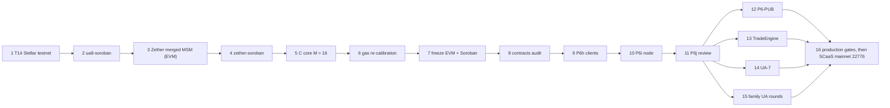

# Roadmap of the "economy" path (branch `pre-typed-signing`)

This file explains how to carry the project to the SCaaS mainnet from this branch, without the `typed-signing` round.
It is meant to be read without the chat history. Every decision below names who decided it and when.
Anything this file could not check against a source is marked **unverified**.

Written 2026-10-31 (controller). Sources: `TODO.md` and `HANDOFF.md` on this branch, the plans under
`docs/superpowers/plans/`, branch `ua8-soroban`, branch `typed-signing` (for the comparison only), `docs/decisions.md`,
and the private notes in `scratchpad/` (git-ignored, listed in §8).

Contents: [1 Purpose](#1-purpose-and-how-to-use-this-branch) ·
[2 Differences from main](#2-differences-from-main-the-typed-signing-path) ·
[3 Status today](#3-status-today-2026-10-31) · [4 Roadmap](#4-roadmap--step-by-step-to-the-end) ·
[5 Not scheduled](#5-not-scheduled) · [6 Standing rules](#6-standing-rules-that-apply-on-this-path) ·
[7 Glossary](#7-glossary) · [8 Source index](#8-source-index)

---

## 1. Purpose and how to use this branch

### What this branch is

- `pre-typed-signing` = `main` at `10ac1417` (2026-10-31), plus this file (`68753d95` and later). Tag:
  `ref/pre-typed-signing` (local, not pushed).
- It is the last version before the **`typed-signing` round**. That round (owner 2026-10-31, TODO work-order item 2d on
  `main`) turns every user-signed operation into a typed, readable EIP-712 struct with its own named entry point.
- The owner kept this branch on 2026-10-31 as a **rollback point**: the project can return to the cheaper path at
  any time before the freeze (step 7).

### What "economy" means, concretely

The economy path keeps the signing forms that exist in the code today:

| Area | What stays as it is |
|---|---|
| Generic envelope | Allow-listed self-calls (wrap, unwrap, burn, shield, mandate and key operations, …) are signed as `MetaTransaction(address from, bytes data, …)`. A wallet shows `data` as hex. |
| Portable UA records | Raw keccak digests over 32-byte words: `portablePopDigest`, `registrationDigest`, `kemRecordDigest`, `pqzKeyDigest`, `memberDigest` (`smartcontracts/evm/src/ua/UAKinds.sol`, Soroban `ua-registry/src/digest.rs`). No chain id, so a record copies to any chain. |
| Packed blobs | Classical Zether `payload`, PQZ `payload`, `msig` `keyData`, `UAAttrs`, the KEM record bytes and `bytes auth` stay packed byte strings. |
| Native EOA `msig` member | Signs a portable record with `personal_sign(memberDigest)` (hex in the wallet). |
| Node job API | Takes the signed calldata (EVM) or XDR (Soroban) as hex built by the client. |

What it saves: about 28 tasks of the typed-signing plan, a regeneration of every portable vector and of the `R_REG`
proofs, a rewrite of ten client libraries and of the node job API, and the code-size risk of named entry points
(details in §2).

### Which 2026-10-31 rulings still hold here

Every ruling of 2026-10-31 that does **not** depend on typed signing holds here (list in §3.2).
These do **not** apply on this path. They came with the typed-signing round:

- the eight owner decisions on typed signing in `scratchpad/eip712-inventory.md` ("Owner decisions 2026-10-31": scope,
  portable typed records under a `name` + `version` domain, no Ledger / Trezor test, EOA members sign typed records,
  `RelayFee` / `WrapOrder` structs, `kind` as `uint16`, no `paramSet`);
- option B, a named entry point per operation (owner 2026-10-31);
- the `UARegistry.kindName(uint16)` view (owner 2026-10-31);
- the "explicit parameters, no packed blobs" rule and the explicit-JSON node job API (owner 2026-10-31, written into the
  typed-signing plan on branch `typed-signing`).

### How to roll back to this path

1. **Pick the base.**
   - If nothing of `typed-signing` has been merged into `main` yet (true on 2026-10-31: `main` = `10ac1417`): keep
     working on `main` and simply do not merge `typed-signing`. Keep that branch as a backup (owner rule "backup, not
     delete").
   - If parts were merged: create a working branch from this one (`git switch -c <name> pre-typed-signing`), then bring
     over every later `main` commit that is **not** part of the typed-signing round. Whether `main` itself is reset is
     the owner's decision (it needs a force push; agents never do that).
2. **Skip TODO work-order item 2d** (the typed-signing round). On this branch, item 2d already points here.
3. **Read "main" as your economy branch** in every plan. The plans say "lands on `main`" or "merge `main` into …"; on
   this path that means the economy integration branch.
4. **Carry over the `ua8-soroban` work.** Branch `ua8-soroban` was cut from `main` at `d883ce5f`, before the
   typed-signing TODO lines (`9f88f43b`). All its commits fit this path unchanged:

   | Commit | Task | Content |
   |---|---|---|
   | `c1b63d68` | plan | `docs/superpowers/plans/2026-10-31-ua8-soroban.md` |
   | `ca503f0e` | R1 | research note `docs/research/relay-fee-minimum.md` (options a–d) |
   | `7a6fa9e3` | R1 | owner ruling 2026-10-31: relay-fee option (c), (d) ruled out |
   | `bb27d77b` | M1 | `msig` minimal-slot rule in clientkeys and ua-rs; one negative vector row in `portable.json` |
   | `94c46404` | G1 | `DeployBase` gate: a gen-1 registry must carry every EIP-2537 kind the probe passes |
   | `fad97f0a`, `c5333fdb` | B0 | Soroban budget spike for the full PQZ + KEM registration (GATE PASS) |

   To continue it: `git merge pre-typed-signing` inside the `ua8-soroban` worktree. Expect one conflict in `TODO.md`
   (both sides edited it); keep both sides' lines.

---

## 2. Differences from `main` (the typed-signing path)

"Main" below means the direction recorded in `TODO.md` item 2d on `main` and in the plan
`docs/superpowers/plans/2026-10-31-typed-signing.md` on branch `typed-signing` (not merged).

| Area | Economy path (this branch) | `main` (typed signing) |
|---|---|---|
| **Signing envelope** | `MetaTransaction(address from, bytes data, …)` for every allow-listed self-call (CTR-MTX-19). Already typed and readable in both paths: `MetaTransfer`, `UAMetaTransfer`, `TradeOrder`, `DexOrder`, `InvalidateNonces`. Opaque today: `CancelOrder(bytes32 orderHash)`, `ReceiverFee(bytes32 paymentDigest, …)`, `uaCancelNonce` (raw keccak), Zether roll-over owner ops (raw keccak), PQZ auth (`keccak("SCAAS-PQZ-AUTH-V1" ‖ keccak(stmt))`). | One typed struct per operation (`Unwrap`, `Burn`, `SetMandate`, …) and the `UA*` twins; nested `CancelOrder(TradeOrder)` and `ReceiverFee(MetaTransfer)`; `RelayFee`, `WrapOrder`, `PqzAuth` structs. |
| **Portable records** | Raw keccak words (§1). The R_REG proof signs `uaMessage(0x0142, POP_V2, portablePopDigest)`. | EIP-712 under domain `EIP712Domain(string name,string version)` = ("SCaaS UA Portable", "1"); structs `UAPortableRecord`, `UAKemRecord`, `UARegistration`, `UAPqzKey`, `UAPqzKeyRecord`; `kind` as `uint16`. |
| **Packed blobs** | Kept: classical Zether `payload`, PQZ `payload`, `msig` `keyData`, `UAAttrs`, KEM record bytes, `bytes auth`. | Every field an explicit named parameter; cryptographic blobs stay `bytes` but each as its own parameter (`proof`, `kemPk`, …). The hashed statement bytes stay byte-identical. |
| **Entry points** | Generic `mtxExecute` / `mtxBatch` / `uaExecute` / `uaBatch` with a selector allow-list. | Named entries (`mtxUnwrap`, `mtxBurn`, `mtxSetMandate`, … and `ua*` twins), each with its own typehash. The generic entries stay beside them (owner ruling recorded in the typed-signing plan, 2026-10-31). Plus `UARegistry.kindName(uint16)`. |
| **Wallet display** | EOA wallets show readable fields for transfers, payments and trades; hex `data` for wrap / unwrap / burn / shield, mandate owner ops and SmartKeyAccount key ops; hex for a native EOA `msig` member's portable record. | EOA wallets show named fields for every operation. App-held UA keys (passkeys, PQ keys, …) still see nothing in a wallet: only the app review shows them (same as here). |
| **Node job API** | Hex blobs (`data`, `op.args`) built by the client; the node decodes and checks them. | Explicit named JSON fields per operation; the node builds the calldata (EVM) or XDR (Soroban). |
| **Calldata** | Unchanged. | Changes with the explicit ABI; task X0 measures it. Risk: PQZH `n2048-kmax1024` debits must still fit 2^24 regular gas on both relay paths. Not measured yet. |
| **Gas** | Unchanged; no re-pins. | About +100–300 gas per typed operation (estimate in `scratchpad/eip712-inventory.md`, not measured); gas re-pins at the four parameter sets. |
| **Code size** | Unchanged (size ratchet baseline). | Each named entry adds bytes to every token kind. Task C0 measures; a contract over 65,536 B is a STOP and the owner picks a fix (module behind `fallback`, or fewer entries). |
| **Work remaining** | None for signing. `ua8-soroban` continues at once (M2 next). | About 28 tasks (Parts P, X0, R, C, N, docs, gates, two reviews); every portable vector and the R_REG `pqzPop` proofs regenerated; ten client libraries; node job API. `ua8-soroban` M2, M3, B1–B3, B5, B7 (and B9, B10) wait for Parts P + R to merge. |

### What the user sees when signing on this path

| Signer | Operation | What the signer sees |
|---|---|---|
| EOA wallet (MetaMask, …), kind `0x0001` | transfer, pay, trade, DEX order | readable EIP-712 fields |
| EOA wallet | wrap, unwrap, burn, add reserve, cancel nonce, shield, mandate owner ops, SmartKeyAccount key ops | the `MetaTransaction` struct with `data` as hex |
| EOA wallet | cancel an order, receiver fee | a 32-byte hash only |
| EOA wallet | relay fee | "pay X to the router, ref 0x…" (a `MetaTransfer` whose `entryRef` hashes the call) |
| EOA wallet | wrap by signature | looks like a `TradeOrder` |
| EOA as a native `msig` member, portable record | register, KEM record, PQZ key | `personal_sign` of a hex digest |
| Passkey, ed25519, secp256k1 `0x0108`, Schnorr, BLS, MuSig2 / FROST, PQ kinds | every UA operation | nothing in a wallet; the app signs `ua_msg` (32 bytes) after its own review |
| Classical Zether prover, PQZ prover | confidential operations | nothing; the proof is the authority |
| Soroban `G…` account (Freighter) | Soroban calls | Freighter decodes the auth entry (readable natively) |
| NEAR, Algorand keys | `MetaOp` | the NET-ALL-23 readable text rebuilt on chain |

**Mitigations on this path:**

- **CLI-SGN-27** (`docs/clients/signers-clientkeys.md`): "check, then sign exactly what was checked". The client
  rebuilds the payload from the terms the user saw and signs only those bytes.
- **CLI-APP-09** (`docs/clients/app.md`): the app's signing review is rendered from the decoded bytes; metadata is
  pinned or cross-checked; the spender is allow-listed; the signature is verified before it is sent.
- **Optional later, no contract change: ERC-7730** clear-signing descriptors. ERC-7730 is a JSON metadata format that
  tells a supporting wallet how to label calldata and EIP-712 fields. Whether a wallet can decode the nested
  `MetaTransaction.data` through a descriptor is **unverified**. Trigger: a wallet the users rely on supports it, or the
  owner asks.

---

## 3. Status today (2026-10-31)

### 3.1 Merged into `main` on 2026-10-31 (all included in this branch)

| Merge | What it brought |
|---|---|
| `e7b92ceb` `soroban-router-fix` | The Soroban relay-fee router runs a target through a relay-executor, never as itself (critical review fix). |
| `d9af46c3` `ua-soroban` | UA on Soroban: registry, token UA ledger, mandate epoch, DEX UA legs, relay-fee router + executor, node `ua_metatx`, clientkeys. Local Protocol 30 e2e passed. |
| `ea2c5c94` `zether-ungate` | Classical Zether and PQZ have no chain-id lock; UA kinds enabled by capability; label "UNAUDITED". |
| `6582329f` `docs-drift-1031` | Stale chain-lock / audit / bn254 / one-recipient text fixed; PQZ corpus regenerated (`n2304-kmax4096`, 877 inputs / 51 valid). |
| `63e49509` `fs3-t13-rollout` | SCaaS testnet reset and roll-out (details in §3.4). |
| `27d77467` `scaas-testnet-rename` | Identifier `private7622` → `scaas-testnet` (profile, chain dir, chain-uids key, CI, docs). |
| `bcb0e1b5` `zether-testnet` | Classical Zether live on the SCaaS testnet (stack v2, see §3.4). |
| `d883ce5f`, `84104d33` | TODO: the pre-freeze work order and its correction (both in §4). |

### 3.2 Rulings of 2026-10-31 that hold on this path

| Ruling (owner unless marked) | Content | Record |
|---|---|---|
| A-I1 option (b) | `soroban-contract` `0x0012` is not an `msig` member (invoker auth); router and executor refused as a mandate delegate. | UA-Soroban final review (HANDOFF 2026-10-31) |
| Zether open everywhere | Classical Zether runs on every chain with EIP-2537 (BLS12-381 only; Hedera refused). | CTR-ZTH-52 (supersedes CTR-ZTH-02 / -33) |
| PQZ without allow-list | PQZ is gated only by the precompile self-test. | CTR-PQZ-01 Change |
| UA kinds by capability | `bls-bn254-minsig` by the bn254 G2 probe; PQ signing kinds where cap ≤ 66 % of the chain's verify budget (was 50 %). | CTR-UA-23 Changes |
| Audit not a deploy gate | Not for the PQ kinds or ed25519. An audit is still required before real funds and before the SCaaS mainnet. | TODO "P6c owner step" |
| Label | Just "UNAUDITED" (was "UNAUDITED — NOT FOR PRODUCTION FUNDS"). | `zether-ungate` |
| Calibration option (b) + baseline fix (b) and (c) | Live rows priced from one ecMul baseline (0.016 ms); option (c) (baseline fixed inside Calibrate) built, to run later on a quiet host. | fs3 Task 13 ledger |
| Node split | SCaaS testnet runs a `sealer` (key, pruned, internal) and a public archive `rpc`. | NET-EVM-10 |
| Restart policy (b) | `restart: unless-stopped` on every service. | fs3 Task 13 |
| Contract verification (a) | A locally patched sc-verifier image until upstream supports Amsterdam. | TODO item "switch to upstream sc-verifier" |
| CREATE2 deployer in genesis | In the SCaaS testnet genesis; **proposed** for the mainnet, owner decides at launch. | fs3 Task 13 (HANDOFF 2026-10-31) |
| `scaas-testnet` identifier | The testnet's id is `scaas-testnet`; the mainnet will be `scaas-mainnet`. | NET-EVM-02 Change |
| Zether merged MSM | Fold the classical Zether verifier into one MSM (step 3). | TODO |
| `msig` `pop` minimal form | Every slot must be necessary; with UA-8 Part B (step 2). | TODO; U8S-D1 |
| Gen-1 kind set option (a) | Every gen-1 deploy carries every kind the chain can run; a `DeployBase` gate refuses otherwise. | U8S-D9; built as G1 |
| Relay-fee minimum option (c) | Per-token price and the job's simulated cost on every family; (d) ruled out. | `docs/research/relay-fee-minimum.md` on `ua8-soroban` |
| Pre-freeze work order | Finish everything that changes contracts or the core, then freeze, then audit, then the clients. | TODO "Pre-freeze work order" |
| Freeze scope correction | The freeze covers EVM + Soroban only; NEAR and Algorand have no UA round yet. | `84104d33` |
| Stop point | "Continue automatically up to the contracts audit … then stop" for the owner. | HANDOFF 2026-10-31 |

### 3.3 Work on branches (not merged)

**`ua8-soroban`** (worktree `.claude/worktrees/ua8-soroban`, from `main` `d883ce5f`):

| Task | Result |
|---|---|
| M1 | Done. Minimal-slot rule (`T ≥ N` and `T − min(weight) < N`) in clientkeys `msigSlotsMinimal` and ua-rs `ua8::msig_slots_minimal`; client builders encode only minimal sets; one negative row `msig-pop-not-minimal` appended to `portable.json` (every other byte unchanged); the ten digest readers skip that row. |
| G1 | Done. `DeployBase._checkGen1Kinds`: with EIP-2537 the gen-1 registry must enable `0x0105`, `0x0106` and (not on Hedera) `0x0141`, else the deploy reverts naming the kind. Tests `test_gen1KindGate_*`. Soroban rule written only. |
| R1 | Done. Research note with options (a)–(d); owner ruling 2026-10-31: option (c), (d) ruled out. Nothing built. |
| B0 | Done, **GATE PASS** (Protocol 30 quickstart, stellar-cli 30.0.0, SDK `=30.0.0-rc.1`). Single-key `mldsa65` `register` with PQZ key + proof + KEM v1 fits in one transaction at every set (largest, `n2816-kmax65536`: tx 50.2 %, write 51.9 %, largest entry 54.3 %, instructions 2.5 %). An `msig` of 16 ML-DSA-65 members fits one `register` at every set (tx 90.6 %). **Finding:** `set_pqz_key` for a 16-member `msig` writes a 79,128 B `PqzK` entry, over the 65,536 B entry limit; see step 2. The old unmerged Zether transfer model exceeds the budget even at M = 1 (why step 3 comes first). |

**`typed-signing`**: the main-path plan and legacy vector copies. Not used on this path; keep it as a backup.

### 3.4 Live on the SCaaS testnet (chain id 7622; stack `/home/dockers/mba-chain-nethermind`, its own git repo)

- Nethermind image `2.2.0-pqz6`, parameter set `n2304-kmax4096`, calibrated rows option (b); genesis `gasLimit` 200 M;
  EIP-7702 off (a type-4 transaction is refused, NET-EVM-07); CREATE2 deployer `0x4e59…` in the genesis alloc.
- Node split (NET-EVM-10): `sealer` (key, pruned, internal network only, `AcceptTxWhenNotSynced`) and `rpc` (archive,
  no key, public RPC 8545 / 8546 / P2P 30303); `MaxTxSize` 2 MiB; `restart: unless-stopped`.
- Blockscout 9.0.2 (UI 8558, API 4000) with a patched sc-verifier for Amsterdam; 144 contracts verified (HANDOFF).
- Contracts: the phase C stack (`Deploy.s.sol`, PQZ e2e full and `--split`, 0 failures) and **stack v2** (salt
  `scaas.deploy.v2`, registry `0x6814…7b79`, factory `0xFa48…9626`) with classical Zether; on-chain Zether e2e
  (register, shield, single, Compact M = 4, BUNDLE M = 2, roll-over, unshield, disclosure, wrapped) all ok.
- PQZ native leak test: no leak (< ≈ 50 B per verify).
- **Not live anywhere yet:** Soroban on the Stellar testnet (T14); NEAR and Algorand on any public network.

---

## 4. Roadmap — step by step to the end

Steps 1–7 change contracts or the core and run before the freeze. Step 8 is the audit stop point. Steps 9 onward are
clients, node, publication and the other families. The owner said on 2026-10-31: continue automatically up to the
contracts audit, then stop.

General limits for every step: at most 3 agents; `scripts/capped` has 2 heavy slots; one Stellar quickstart at a time;
foreground runs only; gate logs per step with resume (§6).

### Step 1 — T14: UA-Soroban on the Stellar testnet

- **Goal:** prove the merged UA-Soroban stack on the public Stellar testnet at Protocol 30.
- **Scope:** swap `soroban-sdk` (and `soroban-ledger-snapshot`) from `=30.0.0-rc.1` to `=30.0.0` in the workspace and
  the spike; `cargo update`; re-run the gate steps `soroban`, `soroban-spike-local`, `e2e-soroban-local`; fund lanes by
  friendbot; run `e2e_soroban_ua` against the testnet; write the log
  `smartcontracts/soroban/runs/<date>-ua-soroban-e2e-testnet.txt`; add the figures to NET-SOR-24.
- **Depends on:** the date (≥ 2026-11-03, when the Stellar testnet votes Protocol 30; mainnet votes 2026-11-23) and the
  release of SDK 30.0.0. `getNetwork` must report `protocolVersion == 30` (read, never assumed).
- **Decisions taken:** U8S-D11 (controller call 2026-10-31, owner may override): T14 runs on its own as work-order
  item 1, not on `ua8-soroban`; this supersedes SOR-D17. The branch name for T14 is not fixed in any source
  (**unverified**).
- **Open questions:** none.
- **Follow:** `docs/superpowers/plans/2026-10-30-ua-soroban.md` Task T14.
- **Done when:** the testnet e2e passes, the log is committed, docs check has 0 errors. If 30.0.0 is not out or the vote
  has not happened: stop and leave T14 open in `TODO.md`.
- **Size:** one task (5 steps).

### Step 2 — `ua8-soroban`: UA-8 Part B on Soroban, `msig` minimal form, gen-1 gate, relay-fee research

- **Goal:** finish portable UA registrations on Soroban (KEM records, PQZ attributes stored in full, relayer-checked
  mode, off-chain verifier, node `call` jobs, the copy EVM → Soroban → EVM), on today's **raw** portable digests.
- **Scope, task by task** (plan `docs/superpowers/plans/2026-10-31-ua8-soroban.md` on branch `ua8-soroban`):

  | Task | What it does | Status |
  |---|---|---|
  | M1 | Minimal-slot rule in clientkeys / ua-rs; vectors | done (`bb27d77b`) |
  | M2 | EVM `UARegistry._msig` refuses a stored `msig` signature with a redundant slot (portable purposes only: `pop` v2, KEM, PQZ key); whole forge suite at the four sets; gas re-pins; DEX KAT regenerated (registry bytecode changes the CREATE2 addresses). Stops if a set's `debit_min_gas` moves. | open |
  | M3 | Same rule on Soroban `check_msig`; plus U8S-D2: a classical-dominant `msig` registers with an empty `pop`, as on EVM. | open |
  | G1 | Gen-1 kind gate in `DeployBase` | done (`94c46404`) |
  | R1 | Relay-fee research and ruling | done (`7a6fa9e3`) |
  | B0 | Soroban budget spike, HARD GATE | done, PASS (`c5333fdb`) |
  | B1 | Soroban `kem_record_digest`, `pqz_key_digest`, `pqz_key_record_digest`: the same raw keccak words as EVM `UAKinds`; checked against `portable.json` `kemRecords[]` / `pqzKeyRecords[]`. | open |
  | B2 | `register` with attributes: entries `PqzK`, `PqzP`, `Kem`, `KemMax`; holder, length, scheme and hash rules; `registration_of` reassembles exactly what EVM `registrationOf` returns; views `checked_of`, `pop_of`, `pqz_pop_of`; errors 13–19. | open |
  | B3 | `set_kem_key`, `set_pqz_key`, `store_pqz_pop`; views `kem_key_of`, `kem_key_at`, `pqz_key_of`, `pqz_key_sig_of`; events with hashes (U8S-D4). Includes the B0 finding (below). | open |
  | B4 | Relayer-checked mode: kinds the chain cannot verify are stored as `Checked::Relayer(id)` by a listed relayer; such a record never signs or receives. | open |
  | B5 | ua-rs feature `pq` (ML-DSA-44 / -65, SLH-DSA-128s, Falcon-512) and `ua8::check_registration` / `check_kem_record` / `check_pqz_key_record`; clientkeys `verifyRegistration` / `verifyKemRecord`. | open |
  | V1 | Missing `ua-ops.json` rows (UA-Soroban final review B-m7). | open |
  | B6 | Node: Soroban `call` jobs, relayer pre-check, `params.ua_registry`, start-up check of `relayers()`. | open |
  | B7 | The copy EVM → Soroban → EVM: `ua8_record_bytes_round_trip`, `ua8-roundtrip.json`, `e2e_ua8_copy_evm_soroban_evm`. | open |
  | B8 | Docs: NET-SOR-27, CTR-UA-34 (relayer-checked mode), UA8-D18–D24 as amended, U8S-D1–D12, the A-m2 doc fix; NET-ALL-84 row 10 gets the minimal-form requirement for later families. | open |
  | B9 | Gate runner `2026-10-31-ua8-soroban-gates.sh` (resumable per step). | open |
  | RV | Whole-branch review (Claude; Codex only on the owner's request) and fix wave. | open |
  | B10 | Stellar testnet e2e of Part B, after T14 is on the integration branch. | open (after step 1) |

  On this path the raw digests mean: M1's vector rows stay valid; no R_REG proof is regenerated; native EOA `msig`
  members keep `personal_sign(memberDigest)`; nothing waits for another round.
- **Depends on:** UA-Soroban (merged). B10 depends on step 1. Order of waves in the plan: (M2, M3, B0) → (B1 → B2 → B3 →
  B4, B5, V1) → (B6 → B7 → B8 → B9 → RV) → B10.
- **Decisions already taken:**
  - `msig` `pop` minimal form (owner 2026-10-31): with T = total weight of the signing slots and N the threshold,
    require T ≥ N and, for every slot i, T − weight(i) < N. Built on EVM and Soroban only; NEAR and Algorand have no UA
    registry, so it is a written requirement for their later UA rounds (owner 2026-10-31 via the controller). Scope (only
    stored portable signatures, not transaction authorisations) is U8S-D1, controller call.
  - Gen-1 kind set, option (a) (owner 2026-10-31): see G1. Built.
  - Relay-fee minimum, option (c) (owner 2026-10-31): a per-token price key in native units on every family and the
    rule "fee × price ≥ the job's simulated cost"; `min_amount` stays as the per-chain floor; sponsored (bound-payee)
    fees stay unpriced; node only, built with P6i (step 10). Option (d), a minimum inside the router contracts, is
    ruled out, so the freeze is not affected.
  - Plan decisions U8S-D1 to U8S-D12 (controller calls 2026-10-31, owner may override), recorded in full by B8.
- **Open questions for the owner** (each has a default; none blocks a task):
  1. U8S-D2: on Soroban a classical-dominant `msig` registers with an empty `pop`, as on EVM. Default: yes. Alternative:
     both families require a minimal member-signed `pop` for every `msig` (EVM change, more gas).
  2. G1: a probe RPC that fails disables the BLS12-381 kinds for good on that gen-1 registry. Default: the stated rule
     only. Alternative: refuse a gen-1 deploy when the probe call itself fails.
  3. M2: if a set's `debit_min_gas` moves, re-pinning `pqz-core/params/sets/*/set.toml` is a set-parameter change; full
     pqz-core gate or not is the owner's call (M2 stops there). Not expected.
  4. **B0 finding for B3** (controller or owner call): `set_pqz_key` of a 16-member `msig` writes `PqzK` = key 22,528 B
     + signature 56,384 B = 79,128 B, over the 65,536 B entry limit. With one entry the largest `msig` is 13 members
     (`n2048-kmax1024`, `n2304-kmax4096`) or 12 (`n2560-kmax16384`, `n2816-kmax65536`) — derived, not simulated. Keeping
     the signature in its own entry `PqzS(ua)` (≤ 56,600 B) lifts it to 16 at every set. Controller suggestion:
     `PqzS(ua)`, so the 16-member maximum of CTR-UA-09 holds everywhere.
- **Follow:** the `ua8-soroban` plan; UA-8 plan `docs/superpowers/plans/2026-10-30-ua8-portable-registrations.md`
  Part B; spec `docs/superpowers/specs/2026-10-30-ua-soroban-design.md`.
- **Done when:** every runner step `rc=0`; review fixes in; B10 testnet e2e passes; owner's go to merge.
- **Size:** 15 tasks left (M2, M3, B1–B9, V1, RV, B10).

### Step 3 — Zether verifier: one merged MSM (EVM)

- **Goal:** make the classical Zether verifier one multi-scalar multiplication (MSM), so the Soroban port fits its
  budget from the start.
- **Scope:** fold every verification equation (Σ-protocol and both Bulletproofs) into one random linear combination.
  The weights come from the transcript; the two Bulletproofs share `G_i` / `H_i`. About 330 → about 182 MSM points at
  M = 1; about +24 instead of about +164 per extra leg. Proof bytes and the prover do not change. On EVM a new verifier
  is a new implementation version (CTR-ZTH-20).
- **Depends on:** nothing. It must finish before step 4. Whether it may run in parallel with step 2 (different files)
  is not stated in the sources (controller call within the agent limits).
- **Decisions taken:** owner 2026-10-31: do it, before `zether-soroban`; measure first.
- **Open questions:** whether the SCaaS testnet stack is redeployed with the new verifier (test-only chain, no
  migration) — not decided (**unverified**).
- **Follow:** TODO item "Zether verifier: one merged MSM (batch verification)"; `docs/contracts/zether.md`.
- **Done when:** EVM Zether vectors verify, negatives fail, gas measured and recorded; security review of the weight
  derivation and of which untrusted points need a subgroup check.
- **Size:** not estimated in the sources.
- **Why it matters (estimate):** B0's cargo figures give `g1_msm` 128 points ≈ 192 M and 256 points ≈ 381 M
  instructions, so a ≈ 182-point merged MSM is roughly 270 M of Soroban's 400 M limit (controller interpolation,
  **unverified** until Z0). The unmerged model (536 M–2,409 M) does not fit.

### Step 4 — `zether-soroban`: classical Zether on Soroban (Part Z)

- **Goal:** port classical Zether (BLS12-381, `NormalZetherToken` / `WrappedZetherToken`) to Soroban with the same
  proof bytes as `clients/zether-prover`. PQZ is not part of this track (NET-SOR-26: no PQZ on Soroban).
- **Scope:**

  | Task | What it does |
  |---|---|
  | Z0 | Stand-alone verifier contract on the CAP-59 host functions; quickstart measurement on real proofs. **HARD GATE.** |
  | Z1 | `zether-prover` Soroban header (32-byte token word) and shared Soroban vectors; EVM vectors unchanged byte for byte. |
  | Z2 | Kind `0x0141` enabled on the Soroban registry; its `checked` row changes from `Relayer` to `Chain` (Part B merges first on this path). |
  | Z3 | Zether layer state, shield, roll-over; ciphertexts in persistent state. |
  | Z4 | Confidential transfers (single, multi, auditor, beneficiary fee). |
  | Z5 | Unshield, Wrapped kind, roll-over modes, disclosure views. |
  | Z6 | Node Zether jobs on Soroban. |
  | Z7 | Local Protocol 30 e2e. |
  | Z8 | Docs: NET-SOR-25 built, zether.md Soroban figures, ZS-D1–D9 in decisions. |
  | Z9 | Gate runner. |
  | Z10 | Whole-branch review and fix wave. |

- **Depends on:** step 3 (merged MSM); step 2 merged (Z2 edits Part B's table).
- **Decisions taken:** classical Zether on Soroban is in this round, its own track, measure first (owner 2026-10-30,
  spec S13a). Port design ZS-D1–ZS-D9 (controller proposals, owner may override; `docs/superpowers/plans/2026-10-30-ua-soroban.md` Part Z).
- **STOP condition (Z0):** a single-recipient transfer, a burn and a 2-recipient transfer must fit the per-transaction
  budget. Otherwise stop, no token code, and the owner picks one of: split verification over transactions, a smaller
  range, Groth16 over a Zether-like circuit, or wait for cheaper host functions.
- **Open questions:** only if Z0 stops. Also the Soroban maximum M is whatever Z0 measures.
- **Follow:** UA-Soroban plan Part Z; `scratchpad/zether-families.md` (Soroban section).
- **Done when:** Z9 runner all `rc=0`, Z10 fixes in, owner's go. The Stellar testnet run of Part Z rides with the next
  testnet e2e (plan T14 step 3 runs `e2e_soroban_zether` "when Part Z is merged"; since T14 runs first here, schedule a
  Part Z testnet run before the freeze — controller suggestion).
- **Size:** 11 tasks.

### Step 5 — C core crash at M = 16 (pqz-core)

- **Goal:** make the PQZL C core memory-safe on the M = 16 shapes.
- **Scope:** found in the fs3 Task 13 phase A report: at `n2304-kmax4096` the C core segfaults or traps natively, and
  in wasm reads out of bounds in `__schwartz_zippel_accumulate_z3`. These shapes exist only in the bench build
  (`OVERSIZE=1`); production M ≤ 8 is not affected. The Rust core (production since 2026-10-19) refuses M = 16
  auditor-on with an `Input` error; the C prover lacks that bound. Fix the bound in C.
  Also edit the stale `popDigest` doc comment in `pqz-core/stmt/src/lib.rs` in the same core change (TODO UA-8 item 3:
  a doc-only core edit forces the full gate, so it waits for a real core change).
- **Depends on:** nothing technical; it comes before step 6 because a core change moves the timings.
- **Decisions taken:** owner 2026-10-31 work order; full gate for any core change (owner 2026-10-25).
- **Open questions:** none.
- **Follow:** `.superpowers/sdd/2026-10-30-fs3-t13/phase-a-report.md` item 3; `pqz-core/gate.sh`.
- **Done when:** full pqz-core gate PASS at the four sets (`gate.sh`, resumable).
- **Size:** not estimated.

### Step 6 — Gas re-calibration on a quiet host

- **Goal:** price the PQZ precompile rows from a clean measurement.
- **Scope:** option (c) = the baseline fixed inside the Calibrate tool (longer warm-up or the minimum over repeats);
  image `2.2.0-pqz6-calib`; the 26 rows of `n2304-kmax4096`; compare with the live option (b) rows. Change the chainspec
  only if they differ materially, at the next SCaaS testnet reset.
- **Depends on:** step 5 (a core change moves the verify timings). The owner must stop the other heavy sessions first;
  ask before starting (no agent may run during the timing).
- **Decisions taken:** owner 2026-10-31 (option (c) on a quiet host; after item 5). Owner 2026-10-15: re-calibrate
  before the mainnet; again before the mainnet only if the core / library changes again or the validator hardware
  differs.
- **Open questions:** "differs materially" has no number in the sources (**unverified**; controller proposal: report the
  per-row change and let the owner decide).
- **Follow:** fs3 Task 13 ledger `.superpowers/sdd/2026-10-30-fs3-t13/progress.md`; `pqz-core/nethermind/` Calibrate.
- **Done when:** the 26 rows measured and compared; the decision (keep / change chainspec) recorded.
- **Size:** about 45–60 min of quiet host time (2026-10-30 estimate for two calibration runs).

### Step 7 — Freeze the contracts of EVM + Soroban

- **Goal:** stop changing contracts so the audit sees a fixed target.
- **Scope:** frozen = EVM (Solidity, incl. Hedera which runs the same bytecode — **unverified** that Hedera is meant)
  and Soroban contracts, base and UA, as of the commit after steps 1–6. Not frozen: NEAR and Algorand (base contracts
  only: token, mandate, DEX, smart-key accounts, relay-fee router; no UA round yet), and the families whose UA round
  has not happened (Cosmos, Sui, Aptos, Solana, TON). Each of those gets an add-on audit when its UA round finishes.
- **Depends on:** steps 1–6.
- **Decisions taken:** owner 2026-10-31 work order; correction the same day (`84104d33`): the freeze covers EVM +
  Soroban only.
- **Open questions:**
  1. How the freeze is marked (a tag, a frozen worktree as in the audit plan) — not specified (**unverified**).
  2. UA-5c (d) — `MandateWallet` with `bytes32` UA owner, delegate and payees (CTR-ACC-12, SPECIFIED, not built) — is
     a contract change that is not in the pre-freeze order. Build it before the freeze, or later with an add-on audit?
     Whether UA-5c (c) (the generic UA pipeline in `MetaTxBase`) is fully done is **unverified**.
  3. The PQZ label scheme "at the production freeze" (`scaas/pqz/<set>/pqzl/v1`, `…/pqzh/v1`, every old id refused;
     owner 2026-10-25) — is that this freeze or the mainnet launch? (**unverified**)
- **Done when:** the freeze commit is recorded in `TODO.md`.
- **Size:** none (a marker).

### Step 8 — Contracts audit (review part 2b)

- **Goal:** an internal multi-reviewer audit of all contract code changed since the last review fix round (`e2e7a01e`,
  2026-10-27).
- **Scope (draft units):**

  | Unit | Scope |
  |---|---|
  | D1 EVM delta | `UARegistry` / `IUARegistry` / `UAKinds` (UA-8, KEM scheme byte, `msig` minimal form from step 2), WebAuthn canonical blob, `SigCheck` (no EIP-7702), metatx split and `MtxRelayFee` + executor |
  | D2 DEX + trade | `SCaaSDex` (`mtxHybrid` / `Via`, DX7 refund, `restorePulled`, batch), `UniswapExecutor`, `TradeLib` |
  | D3 chain-gate removal + Zether | `zether/*` (incl. the merged-MSM verifier from step 3), `PqzSafety`, `PairingVerifiers`, `DeployBase` (capability enables, 66 % rule, Hedera, G1 gate) |
  | D4 Soroban UA stack | registry, ua-common, token, mandate, DEX, relay-fee, relay-executor, smart-key account; plus Part B (step 2) and the Zether port (step 4) |
  | D5 NEAR | `smartcontracts/near/**` |
  | D6 Algorand | `smartcontracts/algorand/**` |
  | D7 other families' delta | Solana, Aptos, Sui, TON, Cosmos changes since `e2e7a01e` |

  Layout as review part 2: a frozen detached worktree, one prompt per unit, read-only reviewers, one triage (P0–P3),
  owner rulings, then a fix-round plan. The draft names `main` after `zether-testnet` as the target; on this path the
  target is the freeze commit of step 7 (controller note).
- **Depends on:** step 7. **The owner's go is required** (stop point, HANDOFF 2026-10-31).
- **Decisions taken:** units D5 and D6 stay separate (owner rule NEAR ≠ Algorand). Gen-1 finding resolved by option (a)
  (G1); the audit checks the gate.
- **Open questions for the owner:**
  1. Go / no-go and reviewers. Codex credits ran out on 2026-10-27 (owner: no refill) — which units, if any, get Codex
     (one type at a time; free `codex sandbox` check first)? agy on every unit in parallel? The Claude Code workflow
     (about 7 units × finder + verifier) needs an explicit go. Fable on D1, optional.
  2. Is the unit split OK?
  3. Include review part 3 (node + clients) now or keep it for P6j?
- **Follow:** `.superpowers/sdd/2026-10-31-contracts-audit/plan.md` (draft); the part 2 layout in
  `pqz-core/research/code-review-2026-10-26/README.md`.
- **Done when:** the triage README, owner rulings and the merged fix round.
- **Size:** 7 units; reviewer effort depends on the owner's choice.

### Step 9 — P6h: clients and WASM

- **Goal:** the wallet side of PQZ and the retail WASM prover.
- **Scope:** `zether-prover --features pq`, `pqz-cli` (incl. `--envelope`), clientkeys `sealPqKey` / `openPqKey` and
  the `PqzToken` domains in the envelope builders; the wallet PQZ prover crate `clients/pqz-prover` (Rust over `pqzl` +
  `stmt`, wasm bindings, API shaped like `clients/zether-prover`); the retail WASM prover (budgets of the P6 spec
  §11.5, WASM / native bit-exactness, loopback `pqz-cli serve` fallback); the browser wallet bundle built with `SV=0`
  (owner 2026-10-13).
  Related open item: the wasm32 limb path in `pqzl/rust/src/arith/ntt.rs` (fs3 Task 14, own branch). Rust wasm32 op 7
  M = 8 auditor-on measured p99 59.3 ms against the 60 ms limit (fs3 Task 13 phase B). It is a core change; where it
  falls relative to the freeze is not stated (**unverified**; owner question).
- **Depends on:** step 8 (audit after the freeze, clients after the audit, owner 2026-10-31).
- **Decisions taken:** P6 mandate (owner 2026-10-14): carry P6 to its end; merge and push each sub-phase once tests,
  size gate, docs checkers and review pass. P6h after the token-family rename (done 2026-10-30).
- **Open questions:** the wasm32 limb path timing (above).
- **Follow:** `docs/superpowers/plans/2026-10-12-p6-roadmap.md` (P6h row); TODO "Review order" item (5b).
- **Done when:** cross-language vectors green; the §11.5 budgets met or the fallback green.
- **Size:** not estimated.

### Step 10 — P6i: node

- **Goal:** the node relays PQZ and the remaining UA work it needs, and prices relay fees.
- **Scope:**
  - P6 roadmap row: a `pqz` chain profile, the `has_pqz_precompile` probe, `metatx` / `ua_metatx` for `kind = pqz`
    tokens, `pqz_call` (follower pre-simulation, never batched), limits, an age-gated roll-over keeper, the op 7 indexer
    for `PqzTransferMulti` + per-leg `PqzCredit`, a keeper over decoy credits; canonical re-encoding of Zether calldata
    (one intent, one id; NODE-JOB-20).
  - **Relay-fee option (c) on every family** (owner 2026-10-31): a per-token price key in native units and "fee × price
    ≥ quote" on Soroban (simulated resource fee + inclusion fee), Cosmos (gas limit × gas price), Sui (gas budget ×
    reference gas price), Aptos (max gas × unit price), Hedera (the EVM quote, once Hedera has a relay-fee check at
    all), Solana (transaction + priority fee added to the first-use rent); EVM address `relay`: the price becomes
    required, as for `uaRelay`. A token without a price gets no relay-fee job that pays the node (fails closed).
  - UA-8 node gaps (owner ruling R-node 2026-10-30): the gateway route `POST /v1/ua/register` and the `~gateway`
    sponsor policy for `register`, `setKemKey`, `storePqzPop`, `setPqzKey` do not exist in code; build them.
  - Open node items that fit here: Soroban per-job resource-fee cap (owner question) and NODE-JOB-08 `lane_hint`; TON
    passkey relays need P-256 in the node; node-ua-jobs re-review minors 2–4 (restart fee basis, forgotten tx after a
    restart, relay-fee starvation).
  - UA F5 stays paused except what P6i needs (owner 2026-10-14).
- **Depends on:** step 9.
- **Decisions taken:** relay-fee (c) and (d) ruled out (owner 2026-10-31); R-node (owner 2026-10-30); P6 mandate.
- **Open questions:** the Soroban per-job fee cap (operator policy, owner question from UA-Soroban T10).
- **Follow:** P6 roadmap row P6i; `docs/research/relay-fee-minimum.md` (on `ua8-soroban`); `docs/node/ops.md` §13.
- **Done when:** node tests green incl. per-family "covers the quote / one unit below refused / no price refused";
  e2e per family where one exists.
- **Size:** not estimated.

### Step 11 — P6j: review part 3

- **Goal:** the third part of the three-part review (core done 2026-10-25, contracts = step 8): node, clients and the
  PQZ prover.
- **Scope:** Claude-subagent reviews of P6a–P6i, the fuzz corpus, the threat-model walk-through (T1–T15); the
  `scaas-node` relay / adapters (about +15 k lines since the last review) and the clients.
- **Depends on:** step 10.
- **Decisions taken:** "review in 3 parts" (owner 2026-10-26). Every Codex run is paired with an agy review of the same
  scope (owner 2026-10-20).
- **Open questions:** reviewers (Codex credits, see step 8).
- **Done when:** review log, fixes merged.
- **Size:** not estimated.

### Step 12 — P6-PUB: publication drafts

- **Goal:** publish the PQ and PQZ results.
- **Scope (owner 2026-10-26: only the PQ and PQZ results):** the PQ signature verification (ML-DSA-44 / -65
  precompiles, EIP-8355 layout) and PQZ (PQZL + PQZH: relations, parameter sets, proofs, precompile, contract state).
  The controller drafts an ePrint paper (LaTeX, citing the frozen package) and an ethresear.ch post (Markdown,
  results first), kept in `scratchpad/pub/`; the source-only package `pqz-core/artifact/` (Docker + `reproduce.sh`;
  fs3 Task 6 updated it on 2026-10-30), re-measured headline numbers in README §11, a five-relation table in
  `pqz-core/README.md`.
- **Depends on:** P6 done and the live precompiles. Can run beside steps 13–15.
- **Decisions taken:** the owner mails the LaZer maintainers the drafts 1–2 weeks before posting and does not wait for
  a reply (owner 2026-10-26); the mail also follows up G-LIC gently. Owner-only steps: posting, the LaZer mail, Zenodo
  DOI, source tag.
- **Open questions:** none recorded.
- **Follow:** TODO "P6-PUB drafts" and "P6-PUB publish PQZL"; letter `scratchpad/sz-private/results-letter-lazer.md`.
- **Done when:** drafts ready for the owner.
- **Size:** not estimated.

### Step 13 — TradeEngine (EVM ∥ non-EVM 1 × N)

- **Goal:** the node plans and executes trades over the DEX round's contracts.
- **Scope:** the planner, quoter, routes, jobs and `GET /v1/dex/exchanges/{ref}` (NODE-DEX-17 rewritten: one atomic
  plan per order; NODE-DEX-18); NODE-DEX-15's clause "no settlement worth less than its gas"; the `UniswapExecutor`
  deploy script and the `uniswap_executor` deployment key with the first chain that has Uniswap. After that, BNB Smart
  Chain venues (owner 2026-10-30): Uniswap v3 / v4 on BNB Chain through `UniswapExecutor`, PancakeSwap v2 through path
  (a), a new `PancakeV3Executor` (callback `pancakeV3SwapCallback`, pool address by CREATE2 from the PoolDeployer), a
  BSC fork test (public RPCs in `scratchpad/public-rpc-providers.md`). PancakeSwap Infinity is out of scope.
- **Depends on:** the DEX round (merged 2026-10-30). Not blocked; can run beside steps 12, 14, 15.
- **Note:** `PancakeV3Executor` is a new EVM contract after the freeze, so it needs an add-on audit (controller note).
- **Decisions taken:** DEX spec accepted (owner 2026-10-30): `minFill` is an amount set by the signer (CTR-DEX-14), DX7
  refund, `restorePulled`, batch form (path (a) only), wrapped `InteractionFailed`.
- **Open questions:** none recorded.
- **Follow:** `docs/superpowers/specs/2026-10-30-dex-round-design.md`, `docs/research/dex-matching-modes.md`,
  `docs/node/dex-venue.md`.
- **Size:** not estimated.

### Step 14 — UA-7: post-quantum chat sessions

- **Goal:** an application contract `PqChat` for end-to-end encrypted sessions keyed by UA-8 KEM keys.
- **Scope:** one ML-KEM-1024 + X25519 key per UA (scheme byte 1, CTR-UA-32); sessions whose AES-256 key is KEM-wrapped
  per member key and stored on chain (epochs for rekey and members); messages off chain (e.g. Matrix custom events).
  Reads `UARegistry.kemKeyOf(ua)` / `kemKeyAt(ua, version)`; any stored version is usable (no revocation).
- **Depends on:** UA-8 KEM keys (EVM built; Soroban after step 2).
- **Decisions taken:** owner 2026-10-25: ML-KEM-1024 + X25519 only; anyone may create a session; every write through
  mtx. HQC only after FIPS 207, as scheme 2 (owner 2026-10-30).
- **Note:** a new contract after the freeze, so an add-on audit (controller note).
- **Follow:** spec `docs/superpowers/specs/2026-10-25-ua7-pq-e2e-sessions.md`; a plan is still to be written.
- **Size:** not estimated.

### Step 15 — UA rounds of the other families

- **Goal:** bring UA (base, portable registrations, classical Zether where possible) to every other family.
- **Order (owner 2026-10-29, Algorand detail 2026-10-30):**
  1. NEAR — new `ua-registry`, `mldsa65` via `ml_dsa_verify`; per-token records, asynchronous calls.
  2. Cosmos, Sui, Aptos, Solana.
  3. Algorand — the shared `account` app, atomic groups; `fndsa512` once AVM v14 ships `falcon_verify`
     (Falcon-DET-512; no Falcon-DET-1024 kind).
  4. TON — registry design first.
- **Per family, in this order:** `ua-<family>` → `ua8-<family>` → `zether-<family>` where the platform allows
  (naming NET-ALL-84, owner 2026-10-30).
- **What each round carries:**
  - its spec answers the NET-ALL-84 checklist (19 rows from UA-Soroban S1–S18);
  - mandate epoch (CTR-ACC-07 parity, owner 2026-10-30): NEAR, Algorand, Cosmos and Solana have none today; Sui,
    Aptos and TON: check and add if missing;
  - the `msig` `pop` minimal form (owner 2026-10-31; NET-ALL-84 row 10 after B8);
  - the relayer-checked mode wherever a kind has no on-chain verifier (UA-8 design P10 / P11);
  - every kind, not only PQ: classical first (`webauthn-p256`, `ed25519`, `secp256k1`, `msig`, native), then PQ where an
    on-chain verifier exists (owner 2026-10-29);
  - the portable records hashed byte-identically to EVM (raw keccak on this path);
  - an **add-on audit** when the round finishes (owner 2026-10-31);
  - the real-node e2e still owed from the metatx split for that family (TODO "metatx split — e2e still owed", items
    (a)–(f)) — controller suggestion to run it in the family's round.
- **Classical Zether feasibility** (`scratchpad/zether-families.md`, research 2026-10-31, nothing decided):

  | Family | Verdict |
  |---|---|
  | NEAR | feasible with changes (Rust / Wasm verifier, 96 B points, little-endian scalars, async handling); needs the merged MSM |
  | Algorand | feasible only with heavy changes (multi-group split verifier, state in boxes, chunked MSMs) or Groth16 |
  | Sui | feasible (`sui::group_ops` BLS12-381) |
  | Aptos | only on Ristretto255 (a different curve from EVM Zether) |
  | Cosmos (CosmWasm 2+) | feasible with a matching prover |
  | TON | maths feasible, but the async actor model breaks "one transfer = one transaction"; high gas |

- **Family follow-ups already recorded:** NEAR indexer fix (deferred, owner 2026-10-29, about 1.5 days); NEAR and
  Algorand node / contract / deploy minors (TODO "NEAR and Algorand family bring-up"); the long-lived-balance
  assessment per family (Soroban TTL and restore, NEAR storage staking, Algorand minimum balance and box MBR).
- **Open questions:** none blocking; each family spec raises its own.
- **Size:** per family, three rounds; not estimated.

### Step 16 — Production gates before the SCaaS mainnet (chain id 22776)

Every change on 22776 is the owner's (owner 2026-10-15); agents work on a throwaway copy only. The chain itself
(docker, chainspec) is run by the owner outside this repo.

| # | Gate | Status / source |
|---|---|---|
| 1 | **External independent audit.** Nothing has had one yet. Scope by risk tier in `scratchpad/audit-scope.md`: (1) self-written cryptography (PQZ cores, FFI, Nethermind precompile, EVM PQZ; classical Zether; PQ and classical UA verifiers), (2) EVM contracts holding funds, (3) non-EVM contracts per family, (4) node and clients, (5) chain and infrastructure. Owner decides order, budget and which tiers gate the launch (today: "cryptographic audit, G-LIC"). | open |
| 2 | **G-LIC** (licence for the LaZer-derived code). The letter was sent; no reply as of 2026-10-26. A production gate, not a publication gate. | open, owner |
| 3 | PQ verifiers and the expanded-key cache audited (P6c owner step; not a deploy gate since 2026-10-31, but before real funds). | open |
| 4 | PQZH: external review of the Ligero ZK argument, with the cryptographic audit. | open |
| 5 | **Chainspec:** Amsterdam; EIP-7702 off at launch (NET-EVM-07); the calibrated PQZ rows; CREATE2 deployer in the genesis alloc (proposed; owner decides at launch). | open |
| 6 | **Node topology:** `sealer` + `rpc` as on the SCaaS testnet (NET-EVM-10, proposed), or an external signer for the sealer (Nethermind 2.2.0 `Mining.Signer` / `Nethermind.ExternalSigner.Plugin`, not tried); a TLS reverse proxy with rate limits in front of the public RPC. | open, owner decides at launch |
| 7 | **Notice period** of 3 days on every mainnet (owner 2026-10-20). | ruled |
| 8 | Last gas calibration only if the core / library or the validator hardware changed since step 6 (owner 2026-10-15 / 2026-10-31). | conditional |
| 9 | **Onboarding 22776** like any chain: `docs/networks/evm.md` row, profile `scaas-mainnet`, finality gate, genesis / identity pin, deploy, node config; ports 22776 (RPC HTTP), 22777 (WS), 22778 (P2P) proposed. | open |
| 10 | Gen-1 registry with every kind the chain runs (G1 gate, option (a)). | built in step 2 |
| 11 | Relay-fee option (c) in the node. | built in step 10 |
| 12 | Parameter set vs block limit: `n2816-kmax65536` `storePqzPop` ≈ 59.9 M gas (gen-2 variant ≈ 60.1 M); do not choose it for a chain whose block limit or relayer cap is 60 M. 22776's block limit is not recorded (**unverified**). | watch |
| 13 | PQZ label scheme switch (`scaas/pqz/<set>/pqzl/v1`, `…/pqzh/v1`; every old id refused) — "at the production freeze" (see step 7 question 3). | open |
| 14 | A replaced `setPqzKey` key survives only in its log (owner ruling R-cross-set): decide whether to keep it in state before logs may be pruned (EIP-4444). | watch, owner |
| 15 | Contract verification: switch to the upstream sc-verifier once it supports Amsterdam (`sc-verifier/check-image.sh <image>` → `SUCCESS OK FULL`). | open |
| 16 | Operator production gates O1–O8 (`docs/node/runbooks.md#production-gates`). | standing |
| 17 | From the launch on, "test-only, no migration" ends on 22776. | ruled |

---

## 5. Not scheduled

The owner decides when. Each line: what it is · what would trigger it.

| Item | What it is | Trigger |
|---|---|---|
| The `typed-signing` round | `main`'s path (§2) | the owner switches back to `main`'s direction (before the freeze, or later as a new contract version with an add-on audit) |
| ERC-7730 descriptors | wallet clear-signing metadata; no contract change | wallet support, or the owner asks |
| Zether BLS12-381 verifier as a Rust precompile | the full verifier inside `Nethermind.Pqz`, opt-in build, default off (owner 2026-10-17) | gas of the Solidity verifier becomes a problem on SCaaS chains |
| ERC-7674 temporary approvals | transient allowance on SCaaS tokens (owner 2026-10-18, after P6) | owner go; a contract change, so an add-on audit |
| EIP-191 `personal_sign` variant for kind `secp256k1` `0x0108` | a second verifier so an EOA-held key can sign via `personal_sign` (owner 2026-10-19, after P6) | owner go |
| `0x0108` readable in MetaMask | pending owner decision; controller proposal "not a goal" | owner ruling |
| Classical Zether on NEAR, on Algorand | separate ports; need the merged MSM | each family's UA rounds finished |
| PQZH proof below ≈ 170 KB; Kyber-style compression of `u` | research (owner 2026-10-21) | PQZH on chain or smaller blobs wanted |
| PQZH 128-bit post-quantum target | new parameter set and id; calldata ≈ 7 M gas (owner 2026-10-18: deferred) | owner go |
| P6-ANON leftovers | `PQZ_DEBUG_MALLOC` sanitizer; op 7 disclosure-bundle vectors; identity hiding beyond the ring (research only) | owner go |
| P6-SV leftovers | independent review of `pqz_sv.c` vs `lnp-tbox.c`; hand-written AVX2 | the external audit, or speed needs |
| Spec phase §0 | governance matrix (then Z2 follows it), template library, `docs/integration.md` rewrite, P0 doc nits | owner go; contract parts need an add-on audit |
| Code streams §1 and asset suite | NET-TON-FIX, NR1–NR5, PAY-FIX, DX-FIX, R3-FIX, node P2…P9, AS1–AS9, tender, receiver-pays | owner go |
| Agent mandates | several delegates, per-payee caps, co-sign threshold (research row c, not accepted) | owner decision |
| UA F5 rest | gateway `/v1/ua-metatx`, record cache, mesh, the other `ua*` jobs, UA order intake | after P6 (paused by the priority rule) |
| Glamsterdam items | T-V3-4, the `ua*` fallback decoder; real chains at 24,576 B cannot take a token implementation until the fork | the Glamsterdam fork |
| EIP-7851 watch | `0xef0101 ‖ delegate` code; today counted as a contract | EIP-7851 ships (classify it like a designator, owner decision then) |
| Codex reviews still owed | AS, TW2, app, OPS, S4F, mesh, A2 | owner request (credits) |
| C# node | scope assessment only (`scratchpad/csharp-node-scope-2026-10-30.md`) | owner answers the open questions |

---

## 6. Standing rules that apply on this path

| Rule | Source |
|---|---|
| All chains are test-only until the SCaaS mainnet launches: no migration, no compatibility code. | owner 2026-10-15 |
| SCaaS testnet (7622) is resettable; the controller may reset and redeploy. 22776 changes are the owner's only. | owner 2026-10-15 / 2026-10-24 |
| Record every decision in full in `docs/decisions.md`: content, who ("owner <date>" or "controller call, owner may override"), status, commit. No bare labels. No branch commit hashes there (write "<branch> <task>", add the merge commit). | owner rule; `docs/decisions.md` header |
| PQZ ≠ classical Zether: separate items, tasks, tests and docs; never written as one lumped item. | owner 2026-10-30 |
| NEAR ≠ Algorand: never lumped (NEAR per-token records and async; Algorand shared account app and atomic groups). | owner 2026-10-29 |
| Never lose ciphertext: classical Zether and PQZ ciphertexts, and the PQZ key and proof bytes, stay in contract state, never only a hash plus calldata / events. | owner 2026-10-21; C0-3 ruling 2026-10-27 (CTR-ZTH-38 Change) |
| Every state-changing `mtx*` write is relayable, fee may be 0 (one exception: native-coin `mtxWrapShield`). | owner 2026-10-20; CTR-MTX-19 Changes |
| fee = 0 is valid for classical Zether and PQZ transfers. | owner 2026-10-14 |
| No zero-gas assumption, no assumption about our block limit: the precompile may ship to customer chains. | owner 2026-10-21 |
| No EIP-7702: an EOA signs with its own key only; no delegate ERC-1271; an EOA runs no code. Off on 7622 and 22776. | owner 2026-10-30; CTR-UA-24, NET-EVM-07 |
| Code size: the only ceiling is 65,536 B runtime; no micro-optimisation; the size ratchet records new numbers. | owner 2026-10-21 |
| One rule everywhere: never split a rule by chain kind. | owner 2026-10-25 |
| Gates log per step and resume (first line `# <step> at commit <sha>`, last `rc=<n>`; skip a step done at the same commit; read `runs/gate/last` first). Never two gate runners at once. | owner 2026-10-23 / 2026-10-27 |
| Full pqz-core gate only for core or set-parameter changes; otherwise only the affected steps. | owner 2026-10-25 |
| Commit locally; push in batches at milestones or on the owner's "push". Agents stop at the branch; merge / push after the owner's go. | owner 2026-10-25; 2026-10-14 |
| Heavy commands only through `scripts/capped` (2 slots, 4 GB each), never inside `timeout`; docker containers need `--memory`; foreground runs; no background shell left. | owner 2026-10-15 |
| Ask the owner before any timing or gas measurement (other heavy sessions must stop). | owner 2026-10-15 |
| Codex only on the owner's request, one type at a time; pair each Codex run with an agy run on the same scope. | owner 2026-10-20 |
| Backup, not delete: superseded code goes to `legacy/`; no built binaries on GitHub. | owner rules |
| Parameter sets are named `n2048-kmax1024`, `n2304-kmax4096`, `n2560-kmax16384`, `n2816-kmax65536` only. | owner 2026-10-23 |
| Family rounds are named `ua-<family>`, `ua8-<family>`, `zether-<family>`. | owner 2026-10-30, NET-ALL-84 |
| One `PQZ` precompile for PQZL and PQZH, dispatched on `proofSystemId`. | owner 2026-10-14, CTR-PQZ-10 |
| `R_TXM` e2 bound per vector ≤ 64 in ℓ2. | owner 2026-10-15, CTR-PQZ-03 |
| Docs and code in English; plain short sentences. | owner rule |

---

## 7. Glossary

| Term | Meaning |
|---|---|
| **Economy path** | This branch: keep the packed / generic signing forms; no typed-signing round. |
| **Typed signing** | `main`'s round: every user-signed operation as a readable EIP-712 struct with a named entry point. |
| **EIP-712** | Ethereum standard for signing typed structured data; wallets can show the fields. |
| **`MetaTransaction`** | The generic EIP-712 envelope whose `bytes data` carries an allow-listed self-call. |
| **UA (Universal Account)** | A 32-byte account id derived from a key kind and key data, registered in `UARegistry` and usable on any chain. |
| **Kind** | The 2-byte code of a UA's key type (`0x0100` WebAuthn P-256, `0x0120` `msig`, `0x0131` `mldsa65`, `0x0141` `zether-bls12381`, `0x0142` PQZ, …); table in `kinds.json`. |
| **UA-8** | The round that made UA registrations portable: a record registered on one chain can be registered by anyone on any other. Step 1 EVM (done), step 2 Soroban (Part B, step 2 here). |
| **Portable record** | A UA registration, KEM record or PQZ key record whose digest has no chain id, chain uid or registry address, so the same bytes are valid everywhere (CTR-UA-07). |
| **PoP (proof of possession)** | The signature (`pop`) that proves the registrant holds the UA's key. |
| **`msig`** | A UA (`0x0120`) whose authority is a weighted set of member UAs with a threshold. |
| **`msig` pop minimal form** | A stored `msig` signature is accepted only if every signing slot is needed to reach the threshold (owner 2026-10-31). |
| **KEM record** | A UA's chat / encryption key: 1,601 B, first byte the scheme (1 = ML-KEM-1024 + X25519), versioned, write-once (CTR-UA-32). |
| **Gen-1 registry** | The first `UARegistry` generation on a chain. Its kinds are fixed at construction (CTR-UA-15); a later generation sits in front of it. |
| **`Checked`** | How a stored part was verified: `None`, `Chain` (by the contract) or `Relayer(id)` (by a listed relayer, off chain). |
| **Relayer-checked mode** | Storing a record of a kind the chain cannot verify, checked off chain by a listed relayer; such a record never signs or receives. |
| **PQZ** | Post-Quantum Zero-knowledge: a post-quantum zero-knowledge proof engine; first application Zether-style confidential tokens. Code ids keep `pqz`. |
| **PQZL** | The lattice-based PQZ proof system (production core: Rust crate `pqzl`; the C core is kept). |
| **PQZH** | The hash-based PQZ backup proof system (Ligero over F_q). |
| **Classical Zether** | Confidential tokens with ElGamal on BLS12-381, a Σ-protocol and Bulletproofs (`ZetherVerifier.sol`); not post-quantum; separate from PQZ. |
| **Merged MSM** | Verifying all Zether equations as one multi-scalar multiplication with random weights (step 3). |
| **R_TXM** | The PQZ multi-recipient transfer relation (op 7). |
| **R_REG** | The PQZ relation that proves a PQZ key is well formed, bound to the UA's registration message. |
| **Relay fee** | A token payment to the relayer for a call that has no fee of its own, through the relay-fee router (CTR-MTX-27). |
| **Relay-fee option (c)** | The node prices each relay-fee job: fee × token price ≥ the job's simulated cost (owner 2026-10-31). |
| **Freeze** | No more contract changes for EVM + Soroban before the audit (step 7). |
| **Add-on audit** | A later audit of a family's contracts when its UA round finishes. |
| **SCaaS testnet** | Chain id 7622, identifier `scaas-testnet`; test-only, resettable; stack `/home/dockers/mba-chain-nethermind`. |
| **SCaaS mainnet** | Future chain id 22776, identifier `scaas-mainnet`; owner only. |
| **Protocol 30 / CAP-0087 / CAP-59** | The Stellar protocol release that adds ML-DSA host functions (CAP-0087); CAP-59 = Soroban BLS12-381 host functions. |
| **T14** | UA-Soroban plan task: the Stellar testnet e2e (step 1). |
| **EIP-2537** | BLS12-381 precompiles on EVM; required for classical Zether and the BLS kinds. |
| **EIP-7702** | EOA code delegation; off on SCaaS chains. |
| **ERC-7730** | JSON descriptors that let a wallet show calldata / EIP-712 fields with labels. |
| **Mandate epoch** | A counter per token in a mandate wallet; a revoke or re-set voids unused delegate signatures (CTR-ACC-07). |
| **G-LIC** | The licence question for the LaZer-derived code; a production gate. |
| **`scripts/capped`** | The wrapper that runs heavy builds in limited memory slots. |
| **Controller** | The coordinating agent session; "controller call" = its decision, the owner may override. |

---

## 8. Source index

- This branch: `TODO.md` ("Pre-freeze work order", P6 section, "Recorded, not scheduled", production items),
  `HANDOFF.md` (session 2026-10-31), `COMPLETED.md`, `docs/decisions.md`, `docs/networks/*.md`.
- Plans: `docs/superpowers/plans/2026-10-30-ua-soroban.md` (T14, Part Z), `2026-10-30-ua8-portable-registrations.md`
  (Part B), `2026-10-12-p6-roadmap.md` (P6h–P6j).
- Branch `ua8-soroban`: `docs/superpowers/plans/2026-10-31-ua8-soroban.md`, `docs/research/relay-fee-minimum.md`,
  `smartcontracts/soroban/runs/2026-10-31-ua8-soroban-b0-spike.txt`.
- Branch `typed-signing`: `docs/superpowers/plans/2026-10-31-typed-signing.md` (for §2 only).
- Git-ignored notes (main checkout): `.superpowers/sdd/2026-10-31-contracts-audit/plan.md`,
  `.superpowers/sdd/2026-10-30-fs3-t13/phase-a-report.md`, `scratchpad/work-order-2026-10-31.md`,
  `scratchpad/work-order-after-p6j.md`, `scratchpad/audit-scope.md`, `scratchpad/zether-families.md`,
  `scratchpad/eip712-inventory.md`.
