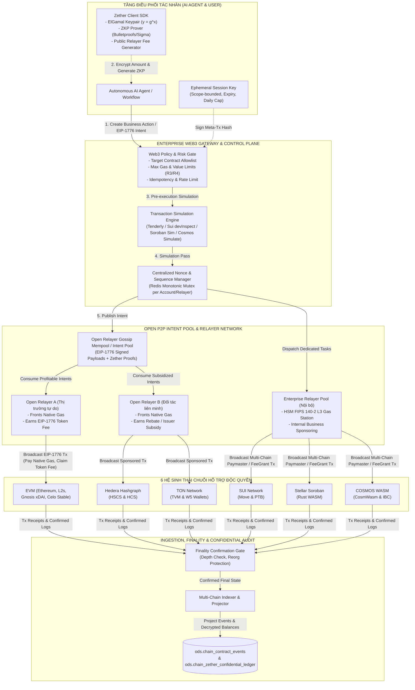
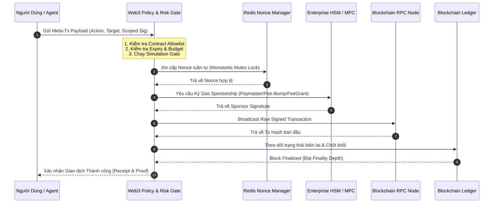

# TOKEN

Các Token MetaTransaction và Zether có thể đến từ nhiều nguồn:

- Tự mint, do issuer phát hành. CREATE NEW TOKEN
- Wrap 1 token ERC20 có sẵn: USDT -> Z-USDT 
- Mint/burn từ 1 hoặc 1 group ERC20 theo 1 tỉ lệ nào đó. Ví dụ 1 USDT (DAI)-> 25000 Z-VND
- Tất cả dùng cơ chế delegate để chia sẻ, dùng chung code, khác data. Support nhiều version
- Có Factory Contract để tự do create2
- Có khả năng thêm nguyên mẫu Contract
- Singleton Account Registry mở rộng theo nhiều hướng: Multi-sign, Schnorr, BLS, FALCON kháng lượng tử.

....

# BLOCKCHAIN

11. **Giao dịch phi tập trung, Open Relayers & Bảo mật Zether qua Meta-Transactions (Decentralized Settlement & Open Relayer Network):** Doanh nghiệp hỗ trợ độc quyền 6 hệ sinh thái: **EVM** (gồm Ethereum, Arbitrum, Optimism, Base, Polygon, BSC, Gnosis xDAI và các chuỗi có phí gas theo Stablecoin như Celo), **HBAR, TON, SUI, Soroban XLM và COSMOS WASM**. Chuẩn hóa Meta-Transactions theo triết lý **EIP-1776** (Native Meta Transactions trả phí bằng Token cho Relayer) và mô hình tương đương trên các chuỗi khác; vận hành **Open Relayer Network** cho phép mọi bên thứ ba tham gia làm trung gian trả native gas fee và nhận thưởng token fee (hoặc trợ cấp từ bên phát hành). Tích hợp giao thức **Zether** cho các giao dịch bảo mật cấp doanh nghiệp: chấp nhận lộ danh tính người gửi/người nhận (loại bỏ mixer/tumbler, tuân thủ 100% AML/KYC và kiểm toán), mã hóa ElGamal và chứng minh không kiến thức (ZKP) để bảo mật tuyệt đối số tiền giao dịch và số dư, công khai phí giao dịch (Public Relayer Fee) tương thích hoàn toàn chuẩn EIP-1776 để Open Relayer xử lý; cấm Agent lưu trữ private key plaintext (bắt buộc HSM/MPC FIPS 140-2 Level 3).


---

### 6.21. Nhóm 21: Blockchain, Smart Contracts & Sổ Cái Phi Tập Trung (EVM, HBAR, TON, SUI, Soroban XLM, COSMOS WASM)

- **Bản chất & Định dạng dữ liệu:**
  - Định dạng: Khối sổ cái (Block headers, checkpoints, heights, timestamps), Giao dịch & Biên lai (Transactions, tx receipts, execution traces, gas/fee metrics), Sự kiện hợp đồng thông minh (Smart contract events decoded qua ABI, Move modules, Rust WASM traits, CosmWasm events), Dữ liệu trạng thái sổ cái (Account state, Sui objects, Soroban footprints, Cosmos bank/feegrant state, Hedera mirror records), và **Trạng thái Mã hóa Zether** (ElGamal balance ciphertexts $C, D$, Bulletproofs/Sigma Range Proofs, Public Relayer Fee receipts).
  - Đặc tính: Bất biến (Immutability), minh bạch công khai hoặc bảo mật số dư (Confidential balances via Zether), định danh rõ ràng người gửi/nhận qua Public Key/Address (loại bỏ mixer, tuân thủ AML/KYC), tính cuối cùng (Finality) phụ thuộc thuật toán đồng thuận.
- **Phạm vi 6 Chuỗi Hỗ trợ Độc quyền:**
  1. **EVM**: Ethereum, Arbitrum, Optimism, Polygon, BSC, Base, **Gnosis xDAI** (phí native bằng stablecoin xDAI), và **các chuỗi thanh toán phí bằng Stablecoin** (như Celo với cUSD, cEUR, USDC, USDT theo CIP-52) (Solidity/Vyper, ABI, EIP-1559, ERC-2771/4337 và **trọng tâm chuẩn EIP-1776**).
  2. **HBAR (Hedera Hashgraph)**: HSCS (EVM smart contracts), HCS (Consensus Service audit trails), HTS, Schedule Service.
  3. **TON (The Open Network)**: FunC/Tact smart contracts, TVM, Actor model async messages, TonConnect, Wallet V4/V5 (W5 gasless external messages).
  4. **SUI (Sui Network)**: Sui Move packages, Object-centric states, Programmable Transaction Blocks (PTB), Native Sponsored Transactions (`GasData`).
  5. **Soroban XLM (Stellar)**: Soroban Rust WASM contracts, State rent TTL, Stellar Horizon & Soroban RPC, CAP-0015 Fee-Bumped Transactions.
  6. **COSMOS WASM**: CosmWasm Rust WASM trên Cosmos SDK (`wasmd`), `x/feegrant` (Basic/Periodic Allowance), `x/authz`, IBC ICS-20 & ICS-27.
- **Cơ chế thu thập & Nạp vào `raw`:**
  - Dedicated Blockchain Nodes, RPC endpoints, Indexers và WebSocket listeners thu thập stream block và event theo thời gian thực.
  - Mạng lưới **Open Relayer Network**: Lắng nghe và tiếp nhận các payload EIP-1776 Meta-Transactions và Zether Confidential Transactions từ p2p gossip / mempool.
  - Lưu trữ tại `raw`: Bảng `raw.blockchain_block_landing` (block metadata, hash, chain_id), `raw.blockchain_tx_receipt_landing` (raw tx hash, sender, recipient, logs, gas_used, status), `raw.blockchain_meta_tx_request_landing` (payload EIP-1776, user signature, nonce, reward_token, reward_amount, relayer address), và `raw.blockchain_zether_proof_landing` (ElGamal ciphertexts, range proof blob, public fee, sender/receiver pubkeys).
- **Chiến lược Bóc tách & Chiếu (Projector Pipeline):**
  - **Chiếu vào `ods`:** Trích xuất các sự kiện nghiệp vụ đã giải mã (Decoded Events): Chuyển tiền token, Thanh toán escrow, Phát hành tín chỉ carbon/chứng nhận số, Cập nhật trạng thái chuỗi cung ứng vào bảng `ods.chain_contract_events`, `ods.chain_meta_tx_relay_ledger` và `ods.chain_zether_confidential_ledger` (lưu trữ số dư mã hóa ElGamal và vết chuyển tiền bảo mật).
  - **Chiếu vào `vec`:** Vector hóa mã nguồn hợp đồng đã verify, ABI JSON schemas, Move modules metadata, CosmWasm JSON schema, và các tài liệu kiểm toán an ninh bảo mật (Security Audit Reports).
  - **Chiếu vào `ekg`:** Xây dựng Đồ thị Thực thể On-chain (On-Chain Knowledge Graph): Node `:BlockchainWallet`, `:SmartContract`, `:Transaction`, `:ZetherAccount` liên kết chéo với thực thể nội bộ `:Partner`, `:SalesOrder`, `:Shipment` qua các cạnh `[:OWNS_WALLET]`, `[:SETTLED_BY]`, `[:INTERACTED_WITH]`, `[:CONFIDENTIAL_TRANSFER_TO]`.
  - **Chiếu vào `sem`:** Cung cấp chỉ số tài chính và vận hành phi tập trung: Khối lượng thanh toán on-chain (On-Chain Settlement Volume), Doanh thu/chi phí phí relayer (Open Relayer Fee Spread & Profitability), Tỷ lệ thành công của Meta-Tx EIP-1776, Độ trễ xác thực Zether ZKP, Độ trễ chốt khối.
  - **Chiếu vào `proc`:** Cung cấp Tool Gateway gọi hợp đồng thông minh, điều phối EIP-1776 Meta-Transactions và kích hoạt chứng minh không kiến thức Zether qua Open Relayer Network.
  - **Chiếu vào `olap`:** Đẩy toàn bộ dữ liệu lịch sử giao dịch, token reward fees và phí gas vào ClickHouse để phân tích tối ưu chi phí và đối soát tài chính dài hạn.
- **Giá trị phục vụ Enterprise AI:**
  - Cung cấp bằng chứng số bất biến (Tamper-evident Proof of Action): Mọi quyết định và cam kết quan trọng của Agent được băm (hash) và neo (anchor) vào sổ cái công khai hoặc Hedera HCS để kiểm toán độc lập.
  - Tự động hóa thanh toán không ma sát qua Open Relayers (EIP-1776): Cho phép Agent và người dùng doanh nghiệp tương tác với Smart Contracts phục vụ giải ngân bảo lãnh, xác thực xuất xứ mà không cần sở hữu native coin, tự do trả phí bằng Token cho bất kỳ Relayer nào trên thị trường.
  - Bảo mật thương mại cấp doanh nghiệp qua Zether (Confidentiality with Accountability): Bảo vệ tuyệt đối bí mật kinh doanh (không để lộ giá mua bán, số tiền thanh toán, số dư tài khoản cho đối thủ cạnh tranh trên blockchain công khai) nhưng vẫn duy trì tính minh bạch về danh tính đối tác (lộ rõ người gửi/người nhận), hoàn toàn miễn nhiễm với rủi ro bị liệt vào danh sách rửa tiền (mixers).

---

---

## CHƯƠNG 10: KIẾN TRÚC HỆ THỐNG PHI TẬP TRUNG, SMART CONTRACTS, OPEN RELAYERS & BẢO MẬT ZETHER ĐA CHUỖI (EVM, HBAR, TON, SUI, SOROBAN XLM, COSMOS WASM)

Nhằm đáp ứng yêu cầu thanh quyết toán không ma sát (frictionless settlement), bảo mật số dư thương mại (commercial confidentiality) mà vẫn đảm bảo tính minh bạch giải trình (regulatory accountability), và tự động hóa thỏa thuận kinh doanh giữa các đối tác độc lập không cần đặt trọn niềm tin (trustless collaboration), kiến trúc thiết lập **Decentralized Settlement, Open Relayer & Confidential State Plane**. 

Hệ thống hỗ trợ độc quyền **6 hệ sinh thái blockchain**:
1. **EVM**: Ethereum Mainnet, các L2s (Arbitrum, Optimism, Base, Polygon, BSC), **Gnosis Chain (xDAI)** (phí native cố định bằng stablecoin xDAI), và **các chuỗi thanh toán phí gas bằng Stablecoin** (tiêu biểu là Celo với cơ chế CIP-52 Fee Currency cho phép trả phí bằng cUSD, cEUR, USDC, USDT).
2. **Hedera Hashgraph (HBAR)**: HSCS (EVM smart contracts), HCS (Consensus Service), HTS, Scheduled Transactions.
3. **TON (The Open Network)**: TVM, Actor model async messaging, Wallet V5 (W5) gasless extensions.
4. **SUI Network**: Object-centric Move, Programmable Transaction Blocks (PTB), Sponsored Transactions.
5. **Soroban XLM (Stellar)**: Rust WebAssembly contracts, State rent TTL, CAP-0015 Fee-Bumped Transactions.
6. **COSMOS WASM (CosmWasm / Cosmos SDK)**: WebAssembly smart contracts (`wasmd`), `x/feegrant`, `x/authz`, IBC ICS-20 & ICS-27.

Mọi tương tác của Agent và Người dùng với sổ cái phi tập trung được chuẩn hóa theo triết lý **EIP-1776 (Standardized Native Meta Transactions)** và mô hình tương đương trên các chuỗi khác, kết hợp mạng lưới **Open Relayers** phi tập trung (cho phép bất kỳ bên thứ ba nào tham gia làm người trung gian ứng trước native gas và thu phí token từ người dùng hoặc nhận trợ cấp từ bên phát hành token). Đồng thời, kiến trúc tích hợp giao thức **Zether** cho phép bảo mật tuyệt đối số dư và số tiền giao dịch thông qua mã hóa ElGamal và chứng minh không kiến thức (ZKP), chấp nhận lộ danh tính công khai giữa các bên để loại bỏ hoàn toàn cơ chế trộn (anti-mixer) và tuân thủ 100% luật phòng chống rửa tiền (AML/KYC).

---

### 10.1. Cấu Trúc Tổng Thể: Enterprise Web3 Gateway, Mạng Lưới Open Relayers & Bộ Xử Lý Bảo Mật Zether

Trong kiến trúc tổng thể của Enterprise AI, Blockchain không thay thế các hệ thống ghi nhận truyền thống (System of Record như ERP, CRM, Core Banking). Thay vào đó, Blockchain đóng vai trò **Lớp Thanh Toán & Bằng Chứng Bất Biến (Settlement & Verification Layer)** song hành cùng System of Record.



#### Các thành phần cốt lõi của Enterprise Web3 Gateway & Open Relayer Architecture:

1. **Mạng Lưới Open Relayers & Mô Hình Kinh Tế Tự Duy Trì (Open Relayer Economic Model):**
   - **Tính Linh Hoạt & Phi Tập Trung:** Hệ thống không chỉ phụ thuộc vào một cụm máy chủ Relayer nội bộ duy nhất của doanh nghiệp. Kiến trúc mở rộng cho phép **bất kỳ bên thứ ba nào (Open Relayers)** đều có thể tham gia vào mạng lưới relay:
     * Open Relayer đóng vai trò **người trung gian (Middleman / Liquidity Provider)**: Ứng trước phí gas giao dịch bằng Native Token (ETH, xDAI, HBAR, TON, SUI, XLM, ATOM).
     * Open Relayer thu hồi vốn và kiếm lợi nhuận (Profit Margin) từ hai nguồn:
       a) **Thu phí trực tiếp bằng Token nghiệp vụ từ Người dùng/Agent (Token-Fee Compensation):** Thông qua chuẩn **EIP-1776**, giao dịch Meta-Transaction quy định một khoản phí thưởng công khai (`rewardAmount`) bằng Token (`rewardToken` như USDT, USDC, hoặc Token doanh nghiệp) được chuyển thẳng vào địa chỉ của Relayer (`msg.sender`) ngay khi thực thi thành công.
       b) **Nhận tài trợ từ Bên Phát Hành Token / Dự án (Issuer Sponsorship & Rebate):** Bên phát hành hoặc đối tác dự án ký quỹ sẵn một bể tài trợ (Sponsorship Escrow Pool) hoặc trả phí dịch vụ off-chain/on-chain định kỳ cho các Relayer tham gia duy trì hạ tầng.
   - **Thị Trường Cạnh Tranh Mempool Lành Mạnh:** Các Open Relayer cạnh tranh nhau về tốc độ xử lý (latency) và mức phí chấp nhận, tạo nên một thị trường mở, triệt tiêu nguy cơ điểm nghẽn đơn lẻ (Single Point of Failure) và giảm thiểu tối đa chi phí vận hành cho doanh nghiệp.

2. **Transaction Simulation Engine (Cổng Kiểm Thử Giả Lập Bắt Buộc):**
   - Mọi giao dịch do Agent hoặc người dùng sinh ra bắt buộc phải chạy mô phỏng giả lập trước khi broadcast ra Open Mempool: Đảm bảo tỷ lệ revert là 0%, kiểm tra tính toán trước mức tiêu thụ gas và xác thực `rewardAmount` của EIP-1776 đủ bù đắp chi phí gas thực tế cộng biên độ lợi nhuận tối thiểu cho Relayer.

3. **Centralized Nonce & Sequence Manager:**
   - Sử dụng Redis Cluster với cơ chế monotonic distributed lock để phân bổ nonce tuần tự cho các tài khoản Relayer nội bộ và các luồng giao dịch đồng thời của Agent, loại bỏ triệt để hiện tượng stuck nonce khi hàng ngàn giao dịch được gửi cùng lúc.

4. **Multi-Chain RPC Gateway & Failover Cluster:**
   - Kết nối cụm RPC node chuyên dụng (Dedicated Nodes) kết hợp với các nhà cung cấp hạ tầng dự phòng (Alchemy, Infura, QuickNode, Mirror Nodes, Allnodes), có bộ đo độ trễ động và tự động failover.

5. **Bộ Xử Lý Giao Dịch Bảo Mật Zether (Zether Confidential Engine):**
   - Hỗ trợ tạo và kiểm tra chứng minh không kiến thức (ZKP) cho các giao dịch bảo mật số dư tài khoản trên nền Smart Contract. Cho phép che giấu số tiền thanh toán nhưng công khai danh tính người gửi/người nhận và công khai phí thưởng cho Relayer để Open Relayer có thể xử lý giao dịch mà không xâm phạm quyền riêng tư thương mại.

6. **On-Chain Event Ingestion Engine & Finality Gate:**
   - Lắng nghe WebSocket và stream log từ các khối sổ cái; chỉ phát tín hiệu xác nhận cho ERP/SoR khi giao dịch đạt ngưỡng sâu chốt khối an toàn (Finality Depth).

---

### 10.2. Chuyên Sâu Smart Contracts & Kỹ Thuật Meta-Transactions Trên 6 Chuỗi Hỗ Trợ Độc Quyền

Dưới đây là bảng ma trận kỹ thuật tổng hợp 6 hệ sinh thái được hỗ trợ:

| Tiêu chí | EVM (ETH, L2s, Gnosis xDAI, Celo) | HBAR (Hedera Hashgraph) | TON (The Open Network) | SUI Network | Soroban XLM (Stellar) | COSMOS WASM (Cosmos SDK) |
|---|---|---|---|---|---|---|
| **Máy ảo / Runtime** | EVM (Ethereum Virtual Machine) | HSCS (EVM compatible) + Hedera aBFT | TVM (TON Virtual Machine) | Sui Move VM (Object-centric) | Soroban VM (Rust WebAssembly) | Wasmd (CosmWasm / CosmWasm Engine) |
| **Ngôn ngữ Hợp đồng** | Solidity / Vyper | Solidity / Native Services | FunC / Tact | Sui Move | Rust | Rust (`cosmwasm-std`) |
| **Mô hình Trạng thái** | Account-based, Key-Value Trie | Account-based, State Proofs, HCS Topics | Actor Model, Asynchronous Cells/BOC | Object-centric (Owned, Shared, Immutable) | Ledger Footprint, Persistent/Temp TTL | State Store (`x/wasm`, Key-Value Store) |
| **Chuẩn Meta-Tx Trọng Tâm** | **EIP-1776** (Native Token-Fee Meta-Tx), ERC-2771, ERC-4337 | Scheduled Transactions & Payer Account Fee | Gasless V5 (W5), Relayer External Msg | Native Sponsored Transactions (PTB) | Fee-Bump Transactions (CAP-0015) | Fee Grant (`x/feegrant`) & Authz (`x/authz`) |
| **Mô hình Open Relayer** | Relayer ứng native gas/xDAI, nhận `rewardToken` từ EIP-1776 | Relayer nộp HBAR, nhận HTS token phí | Relayer nộp nanoTON, nhận Jetton phí | Sponsor nộp SUI gas, nhận token từ PTB | Fee-Bumper nộp XLM, nhận Soroban token | Relayer nộp gas, nhận CW20 / ICS-29 IBC fee |
| **Phương thức Ký của Agent** | EIP-712 Typed Data / EIP-1776 Hash | ED25519 / ECDSA secp256k1 Signature | ED25519 Cell BOC Signature | Ed25519 / Secp256k1 / zkLogin | SEP-0043 Soroban Auth Invocation | Amino / Protobuf Direct Tx Signature |
| **Cơ chế Anti-Replay** | Chain ID, Verifying Contract, Nonce | Valid Start Time (seconds + nanos) | Seqno trong Smart Contract Wallet | Object Sequence Number & Gas Budget | Source Account Sequence Number | Account Sequence & Chain ID |
| **Hỗ trợ Bảo mật Zether** | Zether Contract (alt_bn128) + EIP-1776 Wrapper | HSCS Zether EVM Contract + HCS Audit | TVM ZK Verifier (Ton Cell proofs) | Sui Move ZKP Module (Fast-path ZK) | Soroban Rust Curve25519 Verifier | CosmWasm Rust ZKP Verifier (WASM) |
| **Công cụ Mô phỏng** | `eth_estimateGas`, Tenderly RPC | Hedera Local Node / SDK dry-run | TVM Local Emulator / ton-emulator | `sui_devInspectTransactionBlock` | `simulateTransaction` RPC | `tx/simulate` Endpoint |

---

#### 10.2.1. EVM (Ethereum, Arbitrum, Optimism, Polygon, BSC, Base, Gnosis xDAI, Celo)

1. **Kiến Trúc Smart Contracts & Chuỗi Hỗ Trợ Đặc Thù:**
   - Hợp đồng thông minh được phát triển bằng Solidity/Vyper, tuân thủ mô hình nâng cấp **UUPS (Universal Upgradeable Proxy Standard - ERC-1822)**, đảm bảo khả năng vá lỗi và nâng cấp logic an toàn mà không làm thay đổi địa chỉ hợp đồng gốc.
   - Bắt buộc kích hoạt `ReentrancyGuardUpgradeable` trên mọi hàm có thay đổi trạng thái tài chính (state mutation) và `Pausable` kết nối với mạch ngắt an toàn (Circuit Breakers).
   - **Gnosis Chain (xDAI):** Chuỗi EVM Proof-of-Stake có đồng tiền native là **xDAI** (stablecoin neo giá USD). Việc trả phí native bằng xDAI giúp doanh nghiệp dự báo chính xác 100% chi phí vận hành giao dịch mà không bị ảnh hưởng bởi biến động giá tiền mã hóa, phí giao dịch cực thấp (< $0.001/tx) hoàn hảo cho các giao dịch ERP tần suất cao.
   - **Các chuỗi thanh toán phí bằng Stablecoin (Tiêu biểu: Celo):** Mạng Celo tích hợp cơ chế **CIP-52 (Fee Currency Directory)** ở cấp độ máy ảo và validator, cho phép giao dịch khai báo trường `feeCurrency` để trả phí gas trực tiếp bằng các stablecoin ERC-20 như `cUSD`, `cEUR`, `USDC`, `USDT`. Doanh nghiệp và Open Relayers có thể nộp và bảo lãnh giao dịch hoàn toàn bằng stablecoin mà không cần nắm giữ native CELO.

2. **Kỹ Thuật Meta-Transactions: Trọng Tâm Chuẩn EIP-1776:**
    - **Chuẩn EIP-1776 (Standardized Native Meta Transactions — Dạng Struct & 2D Nonces):**
      * Đây là chuẩn cốt lõi cho mô hình **Open Relayer phi tập trung**. Hệ thống triển khai giao diện dạng struct đóng gói để tối ưu hóa EIP-712 hashing và triệt tiêu nguy cơ lỗi "Stack too deep" trong Solidity:
        ```solidity
        interface IEIP1776 {
            struct MetaTransaction {
                address from;            // Tài khoản người dùng / Agent ký lệnh
                address to;              // Hợp đồng nghiệp vụ hoặc địa chỉ nhận đích
                address tokenContract;   // Token dùng để chuyển amount và khấu trừ fee
                uint256 amount;          // Lượng token chuyển (0 nếu chỉ gọi hàm logic)
                bytes data;              // Calldata thực thi trên hợp đồng đích (to)
                uint256 batchId;         // Định danh luồng song song (2D Nonce)
                uint256 batchNonce;      // Số thứ tự tuần tự trong batchId đó
                uint256 fee;             // Phí token thưởng cho Relayer
                uint256 expiry;          // Thời hạn hiệu lực của giao dịch (Unix timestamp)
                uint8 mode;              // Chế độ ràng buộc Relayer & Fee (Bitmask Flags)
                address relayer;         // Ví Relayer chỉ định (nếu mode yêu cầu)
                address feeRecipient;    // Ví nhận token fee (nếu mode yêu cầu hoặc Relayer điền)
            }

            function executeMetaTransaction(
                MetaTransaction calldata metaTx,
                bytes calldata signature
            ) external returns (bytes memory);

            /// @notice Tra cứu nonce 2 chiều theo tài khoản và luồng xử lý
            function meta_nonce(address from, uint256 batchId) external view returns (uint256);
        }
        ```
      * **Đột phá Kiến trúc 2D Nonce (`batchId` + `batchNonce`):**
        1. **Thực thi song song (Parallel Nonces):** Khi các AI Agent thực thi nhiều tác vụ độc lập (ví dụ: Agent Mua hàng duyệt 10 PO khác nhau), Agent sinh các `batchId` ngẫu nhiên với `batchNonce = 0`. Các giao dịch này không phụ thuộc lẫn nhau, loại bỏ hoàn toàn hiện tượng **Head-of-Line Blocking** (một giao dịch nghẽn làm tê liệt toàn bộ tài khoản).
        2. **Thực thi tuần tự (Sequential Nonces):** Khi cần chuỗi hành động phụ thuộc (Step 1 Escrow $\rightarrow$ Step 2 Deposit $\rightarrow$ Step 3 Settlement), Agent cố định cùng một `batchId` và tăng dần `batchNonce` ($0 \rightarrow 1 \rightarrow 2$), đảm bảo thứ tự thực thi nghiêm ngặt trên sổ cái.
      * **Cơ chế Phân quyền Linh Hoạt Qua Biến `mode` (Toán tử Bitwise OR):**
        Biến `mode` cho phép người dùng/Agent kiểm soát mức độ ràng buộc của Relayer và Người nhận phí khi tạo chữ ký:
        - `MODE_OPEN (0x00)`: **Chế độ Mở Toàn Diện (Open Relayer)**. Chữ ký của user **KHÔNG bao gồm `feeRecipient` và `relayer` trong digest hash** (hoặc hash với `address(0)`). Bất kỳ ai cũng có thể làm Relayer (`msg.sender` tự do), và Relayer tự toàn quyền quyết định ví nhận phí `feeRecipient` (chuyển về ví lạnh, ví pool hoặc ví staking của relayer) mà **không làm thay đổi chữ ký của người dùng**.
        - `MODE_RESTRICT_RELAYER (0x01)`: **Chỉ định chính xác Relayer**. User gắn cứng địa chỉ ví `relayer` vào chữ ký. Smart contract bắt buộc kiểm tra `require(msg.sender == metaTx.relayer)`.
        - `MODE_RESTRICT_FEE_RECIPIENT (0x02)`: **Chỉ định chính xác người nhận phí**. User gắn cứng địa chỉ ví `feeRecipient` vào chữ ký. Bất kỳ ai cũng có thể làm Relayer nộp giao dịch, nhưng phí token `fee` bắt buộc phải chuyển về đúng `metaTx.feeRecipient` đã định (ví dụ: ví quỹ đối tác hoặc ví thanh toán ủy thác).
        - `MODE_RESTRICT_BOTH (0x03 = 0x01 | 0x02)`: **Chỉ định cả Relayer lẫn Người nhận phí**. Hợp đồng kiểm tra đồng thời cả hai ràng buộc nghiêm ngặt.
      * **Cơ chế kinh tế Open Relayer:** Open Relayers quét mempool, trích xuất `fee` và `tokenContract`, chạy `eth_estimateGas`. Khi lợi nhuận ròng dương, Relayer nộp giao dịch lên mạng và nhận phí token ngay lập tức sau khi hợp đồng thực thi xong.
    - **So Sánh Với Các Chuẩn Khác:**
      * *ERC-2771:* Phụ thuộc vào `TrustedForwarder` cố định, phù hợp cho kịch bản private relayer nội bộ.
      * *ERC-4337:* Cần hạ tầng Bundler chuyên biệt và UserOperation mempool riêng. EIP-1776 dạng Struct và 2D Nonces nhẹ hơn, xử lý song song mạnh mẽ và tương thích tức thì với các Open Relayer thông thường trên mạng EVM.

---

#### 10.2.2. Hedera Hashgraph (HBAR)

1. **Kiến Trúc Smart Contracts & Dịch Vụ Đồng Thuận:**
   - **Hedera Smart Contract Service (HSCS):** Chạy EVM bytecode với chi phí cố định neo theo USD (USD-pegged fees) nhưng thanh toán bằng HBAR, bảo vệ ngân sách doanh nghiệp trước biến động giá token.
   - **Hedera Consensus Service (HCS):** Đóng vai trò Sổ cái Bằng chứng Bất biến (Decentralized Audit Log). Mọi hash quyết định quan trọng của Agent được gửi vào private/public HCS Topic qua `TopicMessageSubmitTransaction`. Consensus timestamp của mạng Hedera cung cấp bằng chứng pháp lý không thể chối cãi.
2. **Kỹ Thuật Meta-Transactions & Cơ Chế EIP-1776 Tương Đương:**
   - **Payer Account Sponsoring (Tài trợ phí cấp giao thức):**
     * Trong Hedera SDK, mọi giao dịch đều có `TransactionId` bao gồm `AccountID` của người chịu phí (Payer). Doanh nghiệp hoặc Open Relayer thiết lập ví của mình làm `payerAccountId` khi khởi tạo: `TransactionId.generate(relayerAccountId)`.
     * Người dùng hoặc Agent chỉ ký chữ ký nghiệp vụ bằng khóa riêng của mình. Relayer ký chữ ký người trả phí (Fee Payer Signature) và phát sóng lên mạng Hedera.
   - **Cơ Chế Thưởng Token Cho Open Relayer (EIP-1776 Pattern trên Hedera):**
     * Giao dịch nghiệp vụ nhúng lệnh chuyển HTS (Hedera Token Service) token từ người dùng sang tài khoản của Open Relayer để bù đắp chi phí HBAR mà Relayer đã chi trả cho node mạng.
   - **Scheduled Transactions (Giao dịch lập lịch đa chữ ký):**
     * Với các hành động rủi ro R3/R4, Agent tạo giao dịch qua `ScheduleCreateTransaction`. Quản trị viên hoặc Arbiter Agent sau khi thẩm định sẽ thực thi `ScheduleSignTransaction`. Khi đủ ngưỡng chữ ký, mạng lưới tự động kích hoạt thực thi.

---

#### 10.2.3. TON (The Open Network)

1. **Kiến Trúc Smart Contracts & Actor Model:**
   - Hợp đồng thông minh được viết bằng FunC hoặc Tact, biên dịch ra mã bytecode thực thi trên **TVM (TON Virtual Machine)**.
   - Hoạt động theo **Actor Model hoàn toàn bất đồng bộ (Fully Asynchronous)**: Các hợp đồng không gọi trực tiếp lẫn nhau trong cùng một luồng mà gửi thông điệp (Messages: `InternalMessage` mang nanoTON và payload Cell Bag-of-Cells - BOC).
2. **Kỹ Thuật Meta-Transactions & Cơ Chế EIP-1776 Tương Đương:**
   - **Kiến trúc Ví W5 (Wallet V5R1 Standard):** Chuẩn ví hợp đồng thông minh hiện đại nhất của TON, tích hợp sẵn khả năng ký ủy quyền và trừu tượng hóa tài khoản cấp ứng dụng qua các extension.
   - **Open Relayer Gasless Model (EIP-1776 Pattern trên TON):**
     * Người dùng ký một thông điệp nội bộ (`InternalMessage`) chứa hành động nghiệp vụ kèm lệnh chuyển Jetton (TEP-74) làm phí dịch vụ thưởng cho Relayer.
     * Bản tin đã ký được đóng gói trong một `ExternalMessage` do bất kỳ **Open Relayer** nào phát sóng từ ví `Highload Wallet V2/V3`.
     * Open Relayer trả phí nanoTON cho validator; hợp đồng Jetton Wallet của người dùng tự động trừ một lượng Jetton tương ứng chuyển vào ví của Relayer.

---

#### 10.2.4. SUI Network

1. **Kiến Trúc Smart Contracts Hướng Đối Tượng (Object-Centric Move):**
   - Hợp đồng được tổ chức thành các **Sui Move Packages**.
   - Trạng thái trên Sui không lưu trong bảng tài khoản mà lưu trực tiếp trong các **Đối tượng (Objects)** độc lập có định danh `ObjectID` và số hiệu phiên bản `Version/SequenceNumber`.
   - Đối tượng có 3 dạng: *Owned Objects* (xử lý song song không cần consensus toàn cục), *Shared Objects* (dùng chung qua consensus Bullshark/Mysticeti) và *Immutable Objects*.
2. **Programmable Transaction Blocks (PTB):**
   - Cho phép gom tối đa 1,024 lệnh gọi khác nhau thành một khối giao dịch nguyên tử (Atomic Execution). Đầu ra của lệnh trước có thể làm đối số đầu vào cho lệnh sau mà không cần hợp đồng trung gian.
3. **Kỹ Thuật Native Sponsored Transactions & Mô Hình EIP-1776 trên Sui:**
   - Người dùng dựng `TransactionData` với trường `sender = UserAddress`, để trống đối tượng trả phí gas (`gas_data.payment` và `gas_data.owner`).
   - **Tích hợp EIP-1776 Pattern trong PTB:** Trong chính khối PTB đó, một lệnh chuyển Fungible Token/SUI coin được lập trình sẵn để chuyển khoản thưởng cho địa chỉ của Sponsor (`GasData.owner`).
   - Bất kỳ **Open Sponsor/Relayer** nào cũng có thể kiểm tra PTB, đính kèm coin SUI của mình vào `gas_data.payment`, ký `SponsorSignature` và nộp giao dịch kép (Dual-signed tx) lên mạng lưới, tự động thu khoản phí token đã định.

---

#### 10.2.5. Soroban XLM (Stellar)

1. **Kiến Trúc Smart Contracts & State Rent:**
   - Soroban là nền tảng Smart Contract dựa trên WebAssembly (WASM) viết bằng Rust chạy trên mạng Stellar.
   - **Cơ chế Tiền Thuê Trạng Thái (State Rent / TTL):** Dữ liệu chia thành *Persistent*, *Temporary*, và *Instance*. Hệ thống Relayer định kỳ gọi hàm `extend_ttl` để duy trì trạng thái hợp đồng.
   - **Khai báo Vết Chân Sổ Cái (Ledger Footprint):** Khai báo trước các khóa đọc/ghi giúp validator xử lý song song với hiệu năng cực cao.
2. **Kỹ Thuật Meta-Transactions & Fee-Bump (CAP-0015):**
   - **Stellar Fee-Bump Transactions:** Người dùng khởi tạo `TransactionEnvelope` thông thường với phí giao dịch bằng 0 hoặc tượng trưng và ký bằng khóa riêng. Open Relayer bao bọc giao dịch này trong một `FeeBumpTransactionEnvelope`, chỉ định mức phí XLM tối đa sẵn sàng trả và ký xác thực làm `FeeSource`.
   - **Mô hình EIP-1776 qua Soroban Auth Framework:** Thông qua **SEP-0043 (Soroban Invocation Authorizations)**, giao dịch bên trong chứa lệnh chuyển Soroban token phí cho địa chỉ của Fee-Bumper. Open Relayer vừa trả phí XLM cho mạng lưới, vừa được hợp đồng tự động thanh toán token thưởng.

---

#### 10.2.6. COSMOS WASM (CosmWasm / Cosmos SDK)

1. **Kiến Trúc Smart Contracts & Mô Hình Thông Điệp:**
   - CosmWasm triển khai hợp đồng WebAssembly bằng Rust (`cosmwasm-std`) bên trong module `wasmd` của Cosmos SDK.
   - Kiến trúc Actor Model với các Entry Points rõ ràng: `InstantiateMsg`, `ExecuteMsg`, `QueryMsg`, `MigrateMsg`, `SudoMsg`.
   - Tương tác liên chuỗi qua **IBC (Inter-Blockchain Communication)**: Gửi gói tin (IBC Packets) qua giao thức ICS-20 (Token transfer) và ICS-27 (Interchain Accounts).
2. **Kỹ Thuật Meta-Transactions & Open Relayers trên Cosmos:**
   - **Cosmos SDK Fee Grant Module (`x/feegrant`):** Cơ chế cấp hạn mức trả phí (`BasicAllowance`, `PeriodicAllowance`, `AllowedMsgAllowance`). Validator trừ native token từ tài khoản Granter (`fee.granter`).
   - **EIP-1776 Pattern trong CosmWasm:** Hợp đồng tiếp nhận `ExecuteMsg::MetaExecute` chứa chữ ký xác thực off-chain của người dùng, thực thi logic và phát lệnh chuyển CW20 token thưởng cho `info.sender` (Open Relayer).
   - **IBC Relayer Incentives (ICS-29 Fee Middleware):** Đối với các giao dịch liên chuỗi qua IBC, hệ thống sử dụng chuẩn ICS-29 để nhúng khoản phí thưởng token trực tiếp vào gói tin IBC. Bất kỳ Open IBC Relayer nào chuyển tiếp thành công gói tin và biên lai (acknowledgement) sẽ tự động nhận phần thưởng token từ giao thức.

---

### 10.3. Quản Lý Khóa, Phân Tầng Ủy Quyền & Ngăn Chặn Tấn Công Phát Lại (Anti-Replay)



1. **Kiến Trúc Quản Lý Khóa Bất Biến (HSM / MPC Key Custody):**
   - **Tuyệt đối cấm Agent lưu trữ Private Key dạng Plaintext:** Khóa cá nhân của ví tài trợ và ví quản trị doanh nghiệp bắt buộc phải lưu trong phần cứng chuyên dụng đạt chuẩn **FIPS 140-2 Level 3 Hardware Security Module (HSM)** (như AWS CloudHSM, Google Cloud KMS) hoặc hạ tầng **Multi-Party Computation (MPC)** (Fireblocks, Fordefi, Turnkey).
   - Agent chỉ nắm giữ **Ephemeral Session Keys** ngắn hạn (thời hạn 1–8 giờ), được cấp quyền tương tác với Smart Contract thông qua hợp đồng ủy quyền và bị giới hạn trần giao dịch tối đa.
2. **Hệ Thống Quản Lý Nonce Tập Trung (Centralized Nonce & Sequence Manager):**
   - Sự cố nghẽn mạng do sai số Nonce/Sequence là rủi ro hàng đầu trong hệ thống tự động.
   - Kiến trúc triển khai **Nonce Coordinator trên Redis Cluster**:
     * Duy trì bộ đếm tăng dần bất biến (`INCRBY`) cho từng địa chỉ Relayer trên từng Chain ID.
     * Thiết lập hàng đợi ưu tiên (Priority Queue) cho các giao dịch khẩn cấp; tự động phát sinh giao dịch thay thế với phí gas cao hơn 15% (Speed-up / Replacement Transaction) nếu giao dịch trước đó bị treo trong mempool quá 60 giây.
3. **Phòng Chống Tấn Công Phát Lại (Cross-Chain & Intra-Chain Anti-Replay):**
   - **Domain Separator Bắt Buộc:** Mọi thông điệp Meta-Tx bắt buộc phải băm kèm `ChainID` và địa chỉ hợp đồng tiếp nhận (`VerifyingContract`). Chữ ký sinh ra trên Testnet hoặc Chain A hoàn toàn vô giá trị trên Mainnet hoặc Chain B.
   - **Deadline / Timeout Epoch:** Mọi thông điệp ký đều phải chứa trường `valid_before / deadline`. Giao dịch quá hạn 15 phút sẽ tự động bị hợp đồng từ chối, triệt tiêu nguy cơ tấn công trì hoãn (Delayed Replay Attack).

---

### 10.4. Cổng Mô Phỏng, Ngắt Mạch Gas & Chốt Khối An Toàn (Simulation, Circuit Breakers & Finality)

1. **Cổng Mô Phỏng Bắt Buộc Trước Thực Thi (Simulation Pre-Execution Gate):**
   - Trước khi gửi bất kỳ giao dịch nào ra mempool, hệ thống chuyển giao dịch qua bộ mô phỏng:
     * *EVM:* Gọi `eth_estimateGas` và fork state qua Tenderly Virtual TestNets để phân tích toàn bộ Execution Trace, Event Logs và thay đổi số dư Token.
     * *SUI:* Gọi `sui_devInspectTransactionBlock` để kiểm tra kết quả thực thi các lệnh Move mà không phát sinh phí gas thật.
     * *Soroban:* Sử dụng endpoint `simulateTransaction` để tính toán chính xác chi phí CPU/Memory instructions và footprint cần khai báo.
     * *Cosmos WASM:* Sử dụng endpoint `tx/simulate` để ước tính lượng gas tiêu thụ thực tế của hợp đồng `wasmd`.
     * *TON:* Chạy giả lập trên `ton-emulator` cục bộ để xác nhận Cell tree và tính toán chính xác nanoTON forward.
   - Nếu kết quả mô phỏng trả về lỗi (`Revert / Execution Failed`), giao dịch lập tức bị hủy bỏ và báo cáo về `ops.incident_log`.

2. **Mạch Ngắt An Toàn Phí Gas (Gas Circuit Breakers & Spend Velocity Limits):**
   - **Trần Biến Động Phí Tức Thời (Gas Price Spike Breaker):** Nếu `maxFeePerGas` hoặc Base Fee trên mạng lưới tăng đột biến vượt quá 300% mức trung bình 1 giờ gần nhất, mạch ngắt tự động đình chỉ các tác vụ định kỳ có độ ưu tiên thấp (R1/R2), chỉ duy trì các giao dịch giải tỏa rủi ro thanh khoản khẩn cấp (R3).
   - **Hạn Mức Chi Tiêu Theo Khung Giờ (Velocity Spending Limits):** Giới hạn tổng số USD tài trợ gas trong 1 giờ cho mỗi Agent và toàn doanh nghiệp. Khi chạm ngưỡng 90%, hệ thống gửi cảnh báo qua PagerDuty; khi chạm 100%, hệ thống tự động khóa cổng Relayer.

3. **Cổng Xác Nhận Độ Sâu Chốt Khối (Multi-Chain Finality Depth Gates):**
   Dữ liệu trạng thái giao dịch chỉ được ghi nhận chính thức vào System of Record (ERP, Sổ cái kế toán nội bộ) khi đạt đủ số lượng xác nhận an toàn theo đặc thù từng chuỗi:

| Chuỗi | Thời gian tạo block trung bình | Cơ chế Đồng thuận | Ngưỡng Xác Nhận Ghi Sổ (Finality Gate) | Thời gian chờ trung bình |
|---|---|---|---|---|
| **Ethereum (EVM L1)** | 12 giây | Proof-of-Stake (Gasper) | 2 Epochs (Finalized Checkpoint) | ~12.8 phút |
| **Arbitrum One / Base (EVM L2)** | 250ms | Rollup Sequencer / L1 Posting | Sequencer Confirmed (Soft) / L1 Batch Finalized (Hard) | 1 giây (Soft) / 15 phút (Hard) |
| **Polygon PoS (EVM)** | 2 giây | Bor + Heimdall (Tendermint checkpoints) | Heimdall Checkpoint Milestone | ~25 - 30 phút |
| **Gnosis Chain (xDAI)** | 5 giây | Proof-of-Stake (Gnosis Beacon Chain) | 1 Block Soft / 2 Epochs Finalized | ~5 giây (Soft) / 12.8 phút (Hard) |
| **Celo (Stablecoin-fee)** | 5 giây | Istanbul BFT (IBFT 2.0 Proof-of-Stake) | 1 Block Confirmation (Immediate Finality) | ~5 giây |
| **Hedera Hashgraph (HBAR)** | 3 - 5 giây | Hashgraph aBFT (Asynchronous Byzantine Fault Tolerance) | Consensus Timestamp Confirmed (Single confirmation) | 3 - 5 giây |
| **TON Network** | 5 giây | Proof-of-Stake (BFT Masterchain) | Masterchain Block Inclusion | ~5 - 10 giây |
| **SUI Network** | 400ms (Fast-path) / 2s (Shared) | Fast-path (Owned) / Bullshark-Mysticeti (Shared) | Checkpoint Certification | 400ms - 2 giây |
| **Soroban XLM (Stellar)** | 5 giây | Stellar Consensus Protocol (SCP / FBA) | Ledger Closed & Finalized | ~5 giây |
| **COSMOS WASM (Cosmos SDK)** | 5 - 6 giây | Tendermint / CometBFT (BFT 2/3 voting) | 1 Block Confirmation (Immediate Finality) | ~6 giây |

---

### 10.5. Zether: Giao Dịch Bảo Mật Số Dư Tài Khoản & Meta-Transactions (Account-Based Confidential Payment Architecture)

Trong các giao dịch thanh toán B2B giữa các doanh nghiệp, bí mật thương mại (Commercial Privacy) là yêu cầu sống còn: Doanh nghiệp không thể để lộ bảng giá mua nguyên vật liệu, khối lượng giao dịch với nhà cung cấp, hoặc số dư quỹ ngân quỹ cho đối thủ cạnh tranh trên các sổ cái công khai. Tuy nhiên, các giải pháp bảo mật truyền thống như Tornado Cash hay các cơ chế trộn (Mixers/Tumblers) hoàn toàn bị cấm trong môi trường doanh nghiệp do vi phạm quy định chống rửa tiền. Để giải quyết nghịch lý này, hệ thống tích hợp **Zether** — cơ chế thanh toán bảo mật theo mô hình tài khoản (Account-Based Confidential Payment Protocol).

#### 10.5.1. Triết Lý Thiết Kế: Lộ Danh Tính, Ẩn Số Tiền (Anti-Mixer & Tuân Thủ Pháp Lý Doanh Nghiệp)

1. **Loại Bỏ Hoàn Toàn Cơ Chế Trộn Nguồn Gửi (No Mixers / No Tumblers):**
   - Các hệ thống trộn (như Tornado Cash) cố tình che giấu nguồn gốc tiền bằng cách gom tài sản vào một bể chung (Anonymity Set) rồi rút ra ở một địa chỉ mới không liên quan, phá vỡ toàn bộ đồ thị truy vết giao dịch. Hành vi này vi phạm trực tiếp Quy tắc Chuyển tiền của Lực lượng Đặc nhiệm Tài chính (**FATF Travel Rule**), các lệnh cấm vận của OFAC và các quy định kế toán kiểm toán doanh nghiệp.
   - **Zether loại bỏ hoàn toàn việc trộn nguồn gửi:** Giao dịch Zether diễn ra trực tiếp giữa hai tài khoản xác định:
     * Địa chỉ / Khóa công khai của Người gửi ($y_{sender}$) hiển thị **HOÀN TOÀN CÔNG KHAI**.
     * Địa chỉ / Khóa công khai của Người nhận ($y_{receiver}$) hiển thị **HOÀN TOÀN CÔNG KHAI**.
     * Cơ quan kiểm toán, cục thuế và hệ thống ERP đối soát biết chính xác: Công ty A đã chuyển tiền cho Đối tác B vào thời điểm $t$. Toàn bộ đồ thị chuyển tiền (Transaction Graph) và tính giải trình (Accountability) được bảo toàn nguyên vẹn 100%.

2. **Ẩn Giấu Tuyệt Đối Số Tiền Giao Dịch & Số Dư Tài Khoản (Confidential Amounts & Balances):**
   - Toàn bộ số dư của các bên và số tiền chuyển dịch $v$ được mã hóa mật mã học.
   - Người ngoài, các validator node, hoặc đối thủ cạnh tranh khi nhìn vào sổ cái chỉ thấy các điểm mã hóa trên đường cong Elliptic; họ không thể biết giao dịch trị giá $1 hay $10,000,000, và cũng không thể biết số dư tài khoản của doanh nghiệp còn bao nhiêu.

---

#### 10.5.2. Mật Mã Học Zether: Mã Hóa ElGamal Đồng Hình & Zero-Knowledge Range Proofs

1. **Khởi Tạo Tài Khoản & Khóa Mật Mã:**
   - Mỗi tác nhân doanh nghiệp sở hữu cặp khóa trên đường cong Elliptic (chuẩn `alt_bn128` trên EVM hoặc `Curve25519` trên Move/Rust WASM):
     * Khóa bí mật (Private Key): $x \in \mathbb{Z}_q^*$ (được lưu an toàn trong HSM/MPC FIPS 140-2 Level 3).
     * Khóa định danh công khai (Public Key): $y = g^x$ (trong đó $g$ là điểm sinh - generator của nhóm).

2. **Mã Hóa Số Dư ElGamal Cộng Đồng Hình (Additive Homomorphic ElGamal):**
   - Số dư tài khoản $b$ của người dùng được lưu trên Smart Contract dưới dạng cặp điểm mã hóa ElGamal:
     $$(C, D) = (g^b \cdot y^r, g^r)$$
     trong đó $r \in \mathbb{Z}_q^*$ là một số ngẫu nhiên sinh ra mỗi lần mã hóa.
   - **Tính chất Cộng Đồng Hình (Additive Homomorphism):** Cho phép Smart Contract thực hiện phép cộng trừ số dư trực tiếp mà không cần giải mã:
     * Khi thực hiện chuyển số tiền $v$ từ người gửi sang người nhận, người gửi sinh ciphertext chuyển tiền $(C_{transfer}, D_{transfer}) = (g^v \cdot y_{receiver}^s, g^s)$ và ciphertext trừ tiền $(C_{debit}, D_{debit}) = (g^v \cdot y_{sender}^s, g^s)$.
     * Hợp đồng trừ số dư của người gửi:
       $$C'_{sender} = C_{sender} \cdot C_{debit}^{-1} = g^{b_{sender} - v} \cdot y_{sender}^{r_{sender} - s}$$
       $$D'_{sender} = D_{sender} \cdot D_{debit}^{-1} = g^{r_{sender} - s}$$
     * Hợp đồng cộng số dư cho người nhận:
       $$C'_{receiver} = C_{receiver} \cdot C_{transfer} = g^{b_{receiver} + v} \cdot y_{receiver}^{r_{receiver} + s}$$
       $$D'_{receiver} = D_{receiver} \cdot D_{transfer} = g^{r_{receiver} + s}$$

3. **Hệ Thống Chứng Minh Không Kiến Thức (Zero-Knowledge Proofs - Sigma & Bulletproofs 128-bit):**
   - Để ngăn chặn việc người gửi gian lận chuyển số tiền âm ($v < 0$) nhằm tăng số dư bất hợp pháp hoặc chuyển vượt quá số dư hiện có ($v > b_{sender}$), người gửi bắt buộc phải nộp kèm một chứng minh ZKP:
     * **Khắc phục giới hạn của ConsenSys `anonymous-zether` nguyên thủy:** Trong thiết kế cũ của Bünz/ConsenSys, hằng số trần bị giới hạn ở `uint256 constant MAX = 4294967295; // 2^32 - 1`. Giới hạn này là rào cản chí mạng với token ERC-20 chuẩn (18 decimals), vì $4.29 \times 10^9$ wei chỉ tương đương $0.00000000429$ token (hoàn toàn vô dụng trong thanh toán ERP doanh nghiệp).
     * **Nâng cấp Doanh Nghiệp Lên 128-bit Range Proof:** Kiến trúc nâng cấp Range Proof lên chuẩn 128-bit:
       `uint256 constant MAX = (1 << 128) - 1; // 2^128 - 1 ≈ 3.4028 * 10^38`
       Chứng minh Bulletproofs xác thực $v \in [0, 2^{128}-1]$ và $(b_{sender} - v) \in [0, 2^{128}-1]$ mà hoàn toàn không để lộ giá trị cụ thể của $v$ hay $b_{sender}$. Mức trần $2^{128}-1$ cho phép giao dịch khối lượng token lên tới hàng nghìn tỷ USD với độ chính xác 18 decimals mà không bao giờ gặp rủi ro tràn số (overflow).
     * **Proof of Secret Key & Equality:** Chứng minh người gửi sở hữu khóa bí mật $x_{sender}$ tương ứng với $y_{sender}$ và giá trị $v$ được mã hóa nhất quán giữa người gửi và người nhận.
   - Smart Contract sử dụng các hàm tiền biên dịch (Precompiles) của EVM (`ecAdd`, `ecMul`, `ecPairing` theo EIP-196/EIP-197) để xác thực ZKP với chi phí gas tối ưu (~180,000 - 250,000 gas).

4. **Cơ Chế Epoch Chống Tấn Công Đua Tranh (Epoch-Based State Transition):**
   - Nếu nhiều giao dịch chuyển tiền đến cùng một tài khoản trong cùng một block, số ngẫu nhiên $r$ và ciphertext $C, D$ sẽ bị xung đột.
   - Zether phân chia thời gian thành các **Epoch** (mỗi Epoch dài $\Delta = 5$ blocks hoặc 10 giây). Tiền chuyển đến trong Epoch $e$ được ghi vào bộ nhớ tạm `pending_transfers`. Đầu Epoch $e+1$, người dùng gọi hàm `rollOver()` để cập nhật chính thức vào số dư khả dụng, triệt tiêu nguy cơ race condition.

---

#### 10.5.3. Định Danh Schnorr Address Bằng Hash, Shared Account Registry & Zether Token Riêng Biệt Kế Thừa IERC20

1. **Nguyên Tắc 1: Định Danh `SchnorrAddress` Bằng Hash (`bytes32`):**
   - Thay vì truyền struct tọa độ điểm cồng kềnh 64 bytes $(x, y)$, tài khoản Zether được định danh bằng **Hash 32-bytes**:
     $$\text{schnorrAddress} = \text{keccak256}(\text{abi.encodePacked}(x, y))$$
   - Khi đăng ký, người dùng nộp tọa độ $(x, y)$ và chữ ký Schnorr. Sau khi xác thực quyền sở hữu khóa bí mật $sk$, Shared Registry lưu mapping `schnorrAddress => (x, y)`.
   - Trong mọi giao dịch (nạp, rút, chuyển tiền), tham số `from` và `to` chỉ cần truyền `bytes32 schnorrAddress`, tối ưu hóa calldata và chi phí gas lưu trữ on-chain.

2. **Nguyên Tắc 2: `ZetherAccountRegistry` Dùng Chung (Shared Singleton Registry):**
   - **Khắc phục thiết kế nguyên khối của ConsenSys `anonymous-zether`:** Trong `anonymous-zether` gốc, hợp đồng `ZSC` gộp chung cả Token và Registry vào một khối duy nhất, buộc người dùng phải đăng ký lại khóa cho từng token riêng lẻ.
   - **Mô hình Shared Singleton Registry Doanh Nghiệp:** 
     * `ZetherAccountRegistry` là một bản thể duy nhất (Singleton) phục vụ toàn bộ các Zether Token Contracts trong hệ sinh thái.
     * Cơ chế **"Đăng ký một lần, dùng trên mọi token" (Register Once, Use Everywhere)**: Doanh nghiệp, đối tác B2B và Agent chỉ cần thực hiện `register()` một lần duy nhất. Tất cả các hợp đồng Zether Token (Z-USDC, Z-EUR, Z-VND, Enterprise Token) đều tham chiếu chung về Registry này để xác thực tính hợp lệ của tài khoản.

3. **Nguyên Tắc 3: Mỗi Zether Token Contract Là Riêng Biệt & Kế Thừa Chuẩn `IERC20`:**
   - Mỗi loại tài sản bảo mật là một **hợp đồng riêng biệt**, kế thừa đầy đủ tiêu chuẩn **`IERC20` (ERC-20 Compliant)**.
   - Hợp đồng vừa hỗ trợ các giao dịch công khai chuẩn ERC-20 (`transfer`, `approve`, `transferFrom`), vừa tích hợp khả năng bảo mật Zether (nạp từ ERC-20 vào số dư mã hóa và rút về ERC-20 công khai kèm 128-bit Range Proof).
   - Mỗi Zether Token tự quản lý số dư mã hóa $(C, D)$ và hàng đợi `pending_transfers` của chính token đó, đảm bảo tính độc lập tài chính giữa các đồng tiền.
   - Thiết lập hằng số giá trị tối đa: `uint256 public constant MAX = (1 << 128) - 1; // 2^128 - 1 ≈ 3.4028 * 10^38` (loại bỏ hoàn toàn giới hạn $2^{32}-1$ của ConsenSys cũ, hỗ trợ hoàn hảo token 18 decimals).
   *(Hệ thống phân tách rạch ròi tầng tài khoản và số dư mã hóa; chưa cần định nghĩa interface cho `zetherTransaction` ở giai đoạn này)*

4. **Các Giao Diện Hợp Đồng Chuẩn Hóa:**

   **A. Shared Singleton Account Registry (`IZetherAccountRegistry`):**
   ```solidity
   // SPDX-License-Identifier: MIT
   pragma solidity ^0.8.20;

   /// @notice Shared Singleton Registry dùng chung cho toàn bộ các Zether Token Contracts
   interface IZetherAccountRegistry {
       struct SchnorrPublicKey {
           bytes32 x; // Tọa độ x trên Elliptic Curve (alt_bn128)
           bytes32 y; // Tọa độ y trên Elliptic Curve
       }

       /// @notice Đăng ký Schnorr Address mới vào hệ sinh thái dùng chung
       /// @dev schnorrAddress = keccak256(abi.encodePacked(x, y))
       /// @param x Tọa độ x của Schnorr Public Key
       /// @param y Tọa độ y của Schnorr Public Key
       /// @param schnorrSignature Chữ ký chứng minh sở hữu khóa riêng sk (Proof of Possession)
       /// @return schnorrAddress Định danh hash của tài khoản Zether (bytes32)
       function register(
           bytes32 x,
           bytes32 y,
           bytes calldata schnorrSignature
       ) external returns (bytes32 schnorrAddress);

       /// @notice Kiểm tra schnorrAddress (hash) đã được đăng ký hợp lệ trong Shared Registry hay chưa
       function isRegistered(bytes32 schnorrAddress) external view returns (bool);

       /// @notice Tra cứu điểm Schnorr Public Key (x, y) từ schnorrAddress hash
       function getPublicKey(bytes32 schnorrAddress)
           external view returns (bytes32 x, bytes32 y);
   }
   ```

   **B. Zether Token Contract Riêng Biệt Kế Thừa IERC20 (`IZetherToken`):**
   ```solidity
   // SPDX-License-Identifier: MIT
   pragma solidity ^0.8.20;

   import "@openzeppelin/contracts/token/ERC20/IERC20.sol";

   /// @notice Hợp đồng Zether Token riêng biệt, kế thừa IERC20 và kết nối Shared Registry
   interface IZetherToken is IERC20 {
       /// @notice Ngưỡng trần số dư và chuyển tiền bảo mật: 2^128 - 1 (thay cho 2^32 - 1 cũ)
       /// @dev uint256 constant MAX = (1 << 128) - 1; // 2^128 - 1 ≈ 3.4028 * 10^38
       function MAX_AMOUNT() external pure returns (uint256);

        struct EncryptedBalance {
            bytes32[2] C; // C = g^b * y^r (ElGamal Commitment)
            bytes32[2] D; // D = g^r (ElGamal Randomness)
        }

        struct EncryptedTransfer {
            bytes32[2] C_transfer; // Ciphertext cộng tiền cho toSchnorrAddress: g^v * y_receiver^s
            bytes32[2] D_transfer; // Randomness của ciphertext chuyển: g^s
            bytes32[2] C_debit;    // Ciphertext trừ tiền từ fromSchnorrAddress: g^v * y_sender^s
            uint256 zetherNonce;   // Nonce của fromSchnorrAddress (kháng replay ZKP, require == zetherNonce(from))
            uint256 fee;           // Phí giao dịch bí mật (trích từ số dư bí mật của from, trừ trước khi trừ tiền)
            bytes32 feeRecipient;  // SchnorrAddress nhận phí (hoặc bytes32(0) nếu nộp trực tiếp không fee)
            bytes32[2] C_fee;      // Ciphertext phí chuyển cho feeRecipient: g^fee * y_fee^s_fee (nếu fee > 0)
            bytes zkpProof;        // 128-bit Bulletproofs: chứng minh (b - fee >= 0) và (b - fee - v >= 0)
        }

        event ConfidentialTransfer(
            bytes32 indexed fromSchnorrAddress,
            bytes32 indexed toSchnorrAddress,
            uint256 zetherNonce,
            bytes32[2] C_transfer,
            bytes32[2] D_transfer,
            uint256 fee,
            bytes32 indexed feeRecipient
        );

        /// @notice Chuyển số dư bảo mật giữa 2 tài khoản Schnorr đã đăng ký trong Shared Registry
        /// @dev Hỗ trợ cả gọi TRỰC TIẾP (Direct Call) lẫn gọi GIÁN TIẾP qua Open Relayer (EIP-1776)
        /// @param fromSchnorrAddress Hash tài khoản Schnorr của người gửi
        /// @param toSchnorrAddress Hash tài khoản Schnorr của người nhận
        /// @param transferData Dữ liệu ElGamal ciphertexts, zetherNonce, phí fee bí mật và chứng minh 128-bit ZKP
        function transferConfidential(
            bytes32 fromSchnorrAddress,
            bytes32 toSchnorrAddress,
            EncryptedTransfer calldata transferData
        ) external returns (bool);

        /// @notice Mô phỏng số dư mã hóa ElGamal (C, D) của danh sách tài khoản tại Epoch mục tiêu (sau khi giả lập rollOver)
        /// @dev Hàm view sống còn cho Client SDK/Agent để dựng Bulletproofs ZKP chính xác ngoài chuỗi
        /// @param schnorrAddresses Mảng các hash tài khoản Schnorr cần mô phỏng
        /// @param epoch Số hiệu Epoch mục tiêu mà giao dịch dự kiến được đào
        /// @return simulatedBalances Mảng các cặp điểm ElGamal (C, D) tương ứng sau khi gộp pending_transfers
        function simulateAccounts(
            bytes32[] calldata schnorrAddresses,
            uint256 epoch
        ) external view returns (EncryptedBalance[] memory simulatedBalances);

        /// @notice Nạp token ERC-20 công khai vào số dư Zether mã hóa
        /// @param schnorrAddress Hash định danh Schnorr đã đăng ký trong Shared Registry
        /// @param amount Lượng token nạp vào (phải <= MAX_AMOUNT)
        function deposit(bytes32 schnorrAddress, uint256 amount) external returns (bool);

        /// @notice Rút token Zether mã hóa về số dư ERC-20 công khai của một địa chỉ ví chỉ định
        /// @param schnorrAddress Hash định danh Schnorr rút tiền
        /// @param recipient Địa chỉ ví Ethereum (EOA/Contract) nhận token ERC-20 công khai
        /// @param amount Lượng token rút về công khai (phải <= MAX_AMOUNT)
        /// @param zetherNonce Nonce hiện tại của schnorrAddress (chống replay proof rút tiền)
        /// @param zkpProof Chứng minh ZKP (b - amount >= 0) và sở hữu khóa sk (băm chặt recipient vào challenge)
        function withdraw(
            bytes32 schnorrAddress,
            address recipient,
            uint256 amount,
            uint256 zetherNonce,
            bytes calldata zkpProof
        ) external returns (bool);

        /// @notice Tra cứu nonce giao dịch bảo mật hiện tại của tài khoản Schnorr (Anti-replay cho ZKP)
        function zetherNonce(bytes32 schnorrAddress) external view returns (uint256);

        /// @notice Lấy số dư mã hóa khả dụng hiện tại của schnorrAddress đối với Token này
        function getEncryptedBalance(bytes32 schnorrAddress)
            external view returns (EncryptedBalance memory);

        /// @notice Lấy số dư mã hóa đang chờ chốt theo Epoch (Pending Transfers) của Token này
        function getPendingBalance(bytes32 schnorrAddress)
            external view returns (EncryptedBalance memory);

        /// @notice Chuyển đổi trạng thái sang Epoch mới để chốt số dư khả dụng (RollOver)
        function rollOver(bytes32 schnorrAddress) external;

        /// @notice Địa chỉ của Shared Singleton Registry mà token này đang kết nối
        function registry() external view returns (address);
    }
   ```

5. **Cơ Chế Khóa Trạng Thái, Định Danh Minh Bạch, Gọi Trực Tiếp & Khấu Trừ Phí Bảo Mật:**
   - Mọi thực thể trong System of Record (nhà cung cấp, khách hàng B2B, đơn vị nội bộ) khi mở tài khoản thanh toán bảo mật đều được cấp phát một `schnorrAddress` (hash 32-bytes).
   - Trước khi bất kỳ luồng giao dịch bảo mật nào được xử lý trên bất kỳ Zether Token Contract nào, cổng Gateway và Smart Contract bắt buộc kiểm tra `require(registry.isRegistered(from) && registry.isRegistered(to), "Unregistered Schnorr Address")`.
   - **Hai Phương Thức Thực Thi Giao Dịch Zether:**
     * **Gọi Trực Tiếp (Direct Call):** Người dùng hoặc Agent sở hữu native gas (ETH, xDAI...) có thể gọi trực tiếp hàm `IZetherToken.transferConfidential(...)` bằng ví EOA của mình, hoàn toàn độc lập mà không cần thông qua wrapper EIP-1776.
     * **Ủy Quyền Gasless Qua Open Relayer (EIP-1776):** Khi Agent không có native gas, Agent bọc lệnh `transferConfidential` vào cấu trúc `IEIP1776.MetaTransaction` (`metaTx.to = address(zetherToken)`, `metaTx.amount = 0`, `metaTx.fee = rewardAmount`, `metaTx.data = abi.encodeWithSelector(...)`). Open Relayer nộp giao dịch, ứng native gas và thu phí token thưởng công khai.
   - **Cơ Chế Khấu Trừ Phí Bảo Mật Ưu Tiên (Confidential Fee Deduction — Trừ Phí Trước, Trừ Tiền Sau):**
     * Khi giao dịch có `transferData.fee > 0`, toàn bộ phí được trích xuất trực tiếp từ **số dư ElGamal bí mật** của người gửi `fromSchnorrAddress`.
     * **Quy trình xử lý tuần tự nghiêm ngặt (Strict Execution Pipeline):**
       1. **Bước 1 — Trừ phí bí mật trước:** Hợp đồng kiểm tra điều kiện $b_{sender} - fee \ge 0$. Trừ $(C_{fee}, D_{fee})$ khỏi số dư bí mật của `fromSchnorrAddress` và cộng vào số dư bí mật của `feeRecipient` (hoặc chuyển thành token cho ví xử lý).
       2. **Bước 2 — Trừ số tiền chuyển sau:** Từ số dư bí mật còn lại sau khi đã trừ phí ($(b_{sender} - fee)$), hợp đồng tiếp tục trừ số tiền chuyển $(C_{debit}, D_{debit})$ tương ứng với giá trị $v$, và cộng $(C_{transfer}, D_{transfer})$ vào `pending` của `toSchnorrAddress`.
       3. **Ràng buộc ZKP 128-bit Range Proof:** Chứng minh không kiến thức xác thực đồng thời:
          $$fee \ge 0 \quad \text{và} \quad v \ge 0$$
          $$b_{sender} - fee \ge 0 \quad \text{và} \quad (b_{sender} - fee) - v \ge 0$$
          đảm bảo không thể xảy ra hiện tượng chuyển tiền vượt quá số dư hoặc không đủ tiền trả phí.
   - **Vai Trò Sống Còn Của Hàm `simulateAccounts`:**
     * Trong Zether, các khoản chuyển đến trong Epoch hiện tại nằm ở `pending_transfers`. Số dư chính thức $(C, D)$ chỉ được cập nhật khi chuyển sang Epoch mới và hàm `rollOver()` được gọi.
     * Nếu Client SDK/Agent chỉ đọc số dư lưu trữ tĩnh trên chuỗi để dựng proof, proof đó có thể bị sai lệch so với trạng thái mà Smart Contract sẽ tự động áp dụng tại thời điểm đóng block, dẫn đến giao dịch bị Revert.
     * Hàm `simulateAccounts(schnorrAddresses, epoch)` cho phép Client SDK mô phỏng trước trạng thái $(C, D)$ đã gộp pending tại epoch mục tiêu mà không tốn gas, đảm bảo 100% tỷ lệ chứng minh ZKP thành công khi nộp on-chain.
   - **Quy Trình Rút Tiền Về Địa Chỉ Công Khai (`withdraw`):**
     * **Rút tiền về đâu?** Tiền được rút từ số dư Zether bí mật (`schnorrAddress`) và giải ngân thẳng về địa chỉ ví Ethereum công khai được chỉ định: `address recipient` (ví EOA, ví Multisig, ví Treasury doanh nghiệp, hoặc Smart Contract đích).
     * **Cơ chế chống cướp tiền trong mempool (Anti-MEV / Anti-Frontrunning):** Địa chỉ `recipient` bắt buộc phải được băm chặt vào Fiat-Shamir challenge của chứng minh ZKP ($c = H(\dots, recipient, amount, zetherNonce)$). Kẻ tấn công hoặc Relayer độc hại không thể thay đổi `recipient` thành địa chỉ của chúng, vì việc sửa đổi dù chỉ 1 byte địa chỉ nhận sẽ làm sai lệch challenge, khiến ZKP proof bị invalid và giao dịch revert ngay lập tức.
     * **Thực thi on-chain:** Hợp đồng `IZetherToken` kiểm tra `zetherNonce`, xác thực ZKP proof $(b_{schnorr} - amount \ge 0)$, trừ số dư ElGamal mã hóa của `schnorrAddress`, tăng `zetherNonce[schnorrAddress]++`, và mở khóa chuyển `amount` token ERC-20 công khai cho `recipient`.
   - **Cơ Chế Kháng Replay Hai Tầng (Dual-Layer Anti-Replay):**
     * *Tầng Ngoài (Meta-Tx Envelope):* `IEIP1776.meta_nonce(from, batchId)` kiểm soát luồng giao dịch của ví nộp phí và kênh song song `batchId`.
     * *Tầng Trong (Mật mã học Zether):* `IZetherToken.zetherNonce(fromSchnorrAddress)` được băm trực tiếp vào Fiat-Shamir challenge của chứng minh ZKP. Mỗi khi `transferConfidential` thành công, hợp đồng tự động tăng `zetherNonce[fromSchnorrAddress]++`. Cơ chế này ngăn chặn tuyệt đối việc kẻ gian phát sóng lại (replay) các chứng minh ZKP và ciphertext cũ để trừ tiền tài khoản người gửi lần thứ hai, đồng thời cho phép Client SDK tra cứu trạng thái để sinh proof chính xác.
   - Toàn bộ đồ thị chuyển tiền giữa các `schnorrAddress` đã đăng ký đều được ghi vết minh bạch phục vụ kiểm toán AML/KYC, trong khi số dư và giá trị luân chuyển được che giấu tuyệt đối dưới dạng mã hóa $C, D$.

---


| 15 | Blockchain & Meta-Transactions | Đầy đủ ở mức kiến trúc | Hỗ trợ độc quyền 6 chuỗi (EVM, HBAR, TON, SUI, Soroban, Cosmos), Relayer Pool, Paymaster, HSM/MPC, Simulation Gate, 0 stuck tx |


## CHƯƠNG 14: KIẾN TRÚC MỤC TIÊU 8 PLANE (MỞ RỘNG CHO MULTI-AGENT & AUTONOMOUS ENTERPRISE)

#### 14.2.8. Decentralized Settlement, Open Relayer & Zether Confidential Contract
- Chỉ tương tác với Smart Contracts trên 6 hệ sinh thái được phê duyệt: **EVM** (bao gồm Ethereum, L2s Arbitrum/Optimism/Base/Polygon/BSC, Gnosis xDAI và các chuỗi phí stablecoin Celo), **HBAR, TON, SUI, Soroban XLM và COSMOS WASM**. Mọi chain khác đều bị chặn mặc định ở Network Egress Gateway.
- Chuẩn hóa thực thi Meta-Transactions theo chuẩn **EIP-1776** (Native Meta-Transactions với Token Fee) và các cơ chế tương đương; vận hành **Open Relayer Network** cho phép mọi bên thứ ba tham gia tiếp vận giao dịch, ứng trước native gas và nhận phí token từ hợp đồng hoặc nhận trợ cấp từ bên phát hành token.
- Giao dịch thanh toán bảo mật phải tuân thủ chuẩn **Zether**: Lộ rõ định danh người gửi và người nhận trên sổ cái (loại bỏ hoàn toàn mixer/tumbler, tuân thủ 100% FATF Travel Rule và AML/KYC), ẩn số tiền giao dịch và số dư qua mã hóa ElGamal và Bulletproofs/Sigma ZKP; công khai phí giao dịch (`rewardAmount` & `rewardToken`) để Open Relayer thẩm định và tiếp vận.
- Cấm Agent lưu trữ Private Key dạng Plaintext; bắt buộc lưu trong HSM/MPC FIPS 140-2 Level 3. Agent chỉ dùng Session Keys có hạn mức và thời hạn.
- Mọi Meta-Transaction bắt buộc vượt qua Simulation Gate (Tenderly, `sui_devInspectTransactionBlock`, Soroban `simulateTransaction`, Cosmos `tx/simulate`, `ton-emulator`) với tỷ lệ revert bằng 0%.
- Nonce/Sequence cấp phát qua Redis Centralized Mutex; anti-replay thực thi qua Domain Separator (`ChainID` + `VerifyingContract`) và Deadline Epoch.
- Trạng thái chỉ được xác nhận chính thức vào ERP/SoR sau khi vượt qua Finality Depth Gate tương ứng của từng chuỗi.

----

#### D. Tiêu chuẩn Smart Contracts, Blockchain, Open Relayers & Zether

27. [ERC-2771: Secure Protocol for Native Meta Transactions](https://eips.ethereum.org/EIPS/eip-2771) — chuẩn Trusted Forwarder và trích xuất `_msgSender()` cho EVM.
28. [ERC-4337: Account Abstraction Using Alt Mempool](https://eips.ethereum.org/EIPS/eip-4337) — kiến trúc UserOperation, Bundler và Paymaster cho Smart Accounts.
29. [EIP-1776: Standardized Native Meta Transactions](https://github.com/ethereum/EIPs/issues/1776) — chuẩn hóa Native Meta-Transactions cấp ứng dụng, hỗ trợ trả phí gas bằng Token (`rewardToken` & `rewardAmount`) cho mạng lưới Open Relayers.
30. [Zether: Towards Privacy in a Smart Contract World](https://eprint.iacr.org/2019/191.pdf) (Bünz, Agrawal, Zamani, Boneh — Financial Cryptography 2020) — giao thức thanh toán bảo mật theo mô hình tài khoản sử dụng mã hóa ElGamal cộng đồng hình, Sigma/Bulletproofs ZKP, lộ danh tính người gửi/nhận chống mixer và công khai phí relay.
31. [Gnosis Chain Documentation — Native xDAI Stable Settlement](https://docs.gnosischain.com/) — mạng EVM Proof-of-Stake sử dụng stablecoin xDAI làm token trả phí native, bảo đảm chi phí gas ổn định tuyệt đối.
32. [Celo Documentation — Gas & Fee Currencies (CIP-52)](https://docs.celo.org/protocol/transaction/native-currencies) — giao thức hỗ trợ thanh toán phí gas trực tiếp bằng các stablecoin ERC-20 (cUSD, cEUR, USDC, USDT) tại tầng validator.
33. [Hedera Smart Contract Service (HSCS) & Consensus Service (HCS)](https://docs.hedera.com/hedera/sdks-and-apis/sdks/smart-contracts) — EVM-compatible Hedera smart contracts và consensus timestamps.
34. [TON Documentation — Wallet V5 & Smart Contracts](https://docs.ton.org/develop/smart-contracts/wallet/wallet-v5) — W5 gasless meta-transactions và extension architecture trên TVM.
35. [Sui Move Documentation & Programmable Transaction Blocks (PTB)](https://docs.sui.io/concepts/transactions/prog-txn-blocks) — atomic batching, shared object consensus và sponsor transactions trên Sui.
36. [Stellar Soroban Documentation & Fee Bumping](https://developers.stellar.org/docs/learn/smart-contract-internals) — CAP-0015 fee-bumped transactions và Rust-based Soroban contracts.
37. [CosmWasm Documentation](https://docs.cosmwasm.com/) & [Cosmos SDK Authz/FeeGrant](https://docs.cosmos.network/main/modules/feegrant) — Rust WebAssembly smart contracts, `x/feegrant` module cho gas sponsorship, `x/authz` cho ủy quyền và ICS-29 fee middleware.

