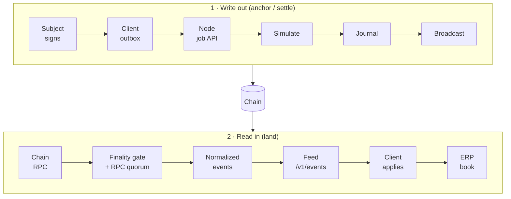
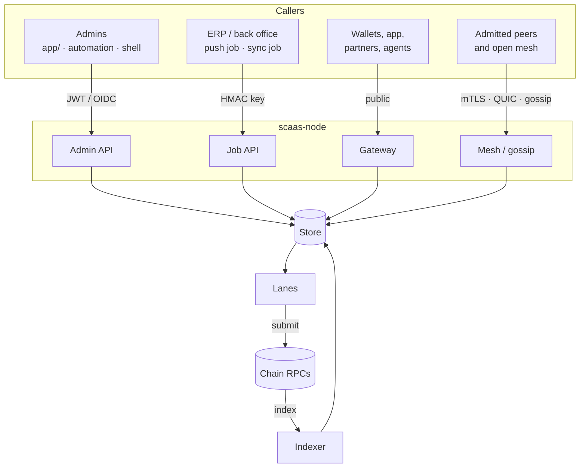

# SCaaS architecture overview

**Not normative.** This page explains how the parts of SCaaS fit together and why. It defines no rules: every rule
it mentions is defined once in a component doc (linked) and its rationale is in [decisions.md](decisions.md).
Where this page and a component doc disagree, the component doc wins ([ARCH-POS-01](decisions.md#ARCH-POS-01)).
For the doc map and reading order see [README.md](README.md); for a short product introduction see
[SCaaS-v2.md](SCaaS-v2.md).

**Contents:** [Positioning](#positioning) · [Authority model](#authority-model) · [What SCaaS is not](#what-scaas-is-not) ·
[Profiles](#profiles) · [Service model](#service-model) · [Components](#components) · [Node roles](#node-roles) ·
[Topology](#topology) · [Data flows](#data-flows) · [Trust model](#trust-model) · [Families](#families) ·
[Economics](#economics) · [Data protection](#data-protection) · [Glossary](#glossary)

## Positioning

**SCaaS (SmartContract as a Service) means that the smart contracts themselves are the API services that run the
business services.** Payments, mandates, tokens and wrappers, the DEX, sealed-bid tenders, vesting, distributions and
confidential transfers are contract functions: code per network family that is immutable from the moment it is
deployed ([CTR-GEN-02](contracts/README.md#CTR-GEN-02)), deployed as EIP-1167 clones from an open factory on EVM and
as equivalent modules or programs elsewhere, and that checks the subject's signature, nonce, expiry and limits on
every call. ERPs, portals, mobile apps and AI agents call them the way they call any API. The contracts are the
product; everything else is a way to reach them:

- **`scaas-node`** — infrastructure, not the product. **Anyone can run it**, and it doubles as a relayer: it submits
  subject-signed intents and pays their gas, journals every submission, indexes the chain, waits for finality and
  serves finalized facts back ([node/README.md](node/README.md)). How a node operates is up to whoever runs it: each
  operator sets its own acceptance, fee, sponsorship, denylist, gossip and peer policies and its own SLOs and
  monitoring. Operators are independent; the protocol guarantees (contract rules, signatures, nonces) do not depend on
  any of them, and the shipped defaults and the `scaas/ops` bundle are recommendations
  ([NODE-OPS-15](node/ops.md#NODE-OPS-15)).
- **Client-side signers** — `clientkeys` (passkey signer, 24-word seed vault, extension wallets) so that the subject
  signs on its own device ([clients/signers-clientkeys.md](clients/signers-clientkeys.md)).
- **`zether-prover`** — proofs for confidential amounts ([contracts/zether.md](contracts/zether.md),
  [contracts/pq-zether.md](contracts/pq-zether.md)).
- **The console and dApp** (`clients/app/`) — wallets, payments, DEX, Zether and node administration
  ([clients/app.md](clients/app.md)).

SCaaS depends on no ERP. Every ERP is one client of the node's job API, and every node is "standalone"
([ARCH-POS-05](decisions.md#ARCH-POS-05), [integration.md](integration.md)).

**Use cases.** Loyalty and rewards, B2B settlement between a brand and its distributors or
suppliers, and end-user payments — all three configurable from the first deployment; the technical focus is
meta-transactions, confidential amounts and stablecoins ([ARCH-POS-06](decisions.md#ARCH-POS-06)).

### Authority model

The difference between SCaaS and IaaS or BaaS is **who signs a valuable write**. In IaaS and BaaS the service is the
operator's server; in SCaaS the service is the contract, and a node only carries signed writes to it and reads facts
back.

| Criterion | IaaS: cloud VM (e.g. EC2, Compute Engine) — the app issues JWTs, the server signs | BaaS: hosted backend (e.g. Supabase, Firebase) — the backend's auth issues JWTs, the server writes; row-level security reads `auth.uid()` | SCaaS — the client signs every valuable create/update |
|---|---|---|---|
| Who signs a write | The application server; the client holds a server-signed JWT and the server writes on its behalf | The backend's auth service signs the JWT; the database executes; row-level security checks the `uid` | **The subject**: its device signs each operation with a passkey (WebAuthn P-256) or a wallet key. The relayer pays gas and holds no subject key |
| Trust root | The operator, the cloud provider (IAM, hypervisor), anyone holding the JWT signing key | The operator plus the project owner holding the JWT secret or the `service_role` key | The subject's authenticator or secure element, chain consensus, and contract code that is immutable at deploy on every family (no upgrade key in the trust root) |
| Who can forge a subject's write | Anyone with the JWT signing key, direct database write access or a compromised server/IAM — indistinguishable from the subject | Anyone with the JWT secret (mints any `uid`) or the `service_role` key (bypasses row-level security) | **Nobody without the subject's private key.** An operator or relayer can only refuse or delay (censorship, liveness); other relayers, or the subject or payee submitting itself, counter that |
| Non-repudiation | None: the server writes the log and can write any line | None, for the same reason | Per operation: a domain-separated signature with nonce and expiry, publicly verifiable forever |
| Audit trail | Application logs and cloud audit logs held by the operator | Database and platform logs held by the operator | An append-only distributed ledger; the ERP is a read-in replica ("Land") **through its node** |
| Authorization enforcement | Application code (an endpoint is easy to miss) | Row-level security (central, but the `service_role` key and policy bugs bypass it) | Immutable contract code checks signature, nonce, expiry and limits on **every** call; **no admin can move a subject's funds**, except the bounded, creation-time powers listed below |
| Revocation and rotation | Easy: short TTL, deny lists, rotate server keys | Easy: rotate the JWT secret, revoke refresh tokens | Harder: on-chain key rotation in a smart account; several passkeys or guardians for device loss ([contracts/accounts.md](contracts/accounts.md)) |
| Write latency and cost | Milliseconds; compute and database cost | Milliseconds; plan-based | Chain finality (seconds to minutes); gas per write, sponsored by a relayer ([Economics](#economics)) |
| Reads | Served by the server | Served by the backend with row-level security | **Unsigned**: through the node feeds, an indexer or the ERP, with ordinary JWT or session auth. Only valuable writes need client signatures |
| Land (booking into the ERP) | — | — | The ERP trusts **its own node** and, through it, the **RPC quorum**: an event is booked only when at least `quorum` independent providers return the same event set for a final range ([NODE-IDX-01](node/indexer-feeds.md#NODE-IDX-01)); `quorum = 1` is single-provider trust, and a compromised node can lie on `/v1/events`. "Verifiable without trusting a server" holds for **signatures**, not automatically for ERP bookings |
| Privacy | Data inside the operator's infrastructure | Same | Public ledger: both parties' identities are visible by design; amounts and balances can be hidden with Zether |
| Typical failure | A leaked JWT signing key or IAM credential = every user impersonated | A leaked JWT secret or `service_role` key = every user impersonated | A leaked key of **one** subject = only that subject, bounded by its mandate limits; a lost relayer = delay, never loss; no upgrade key exists to leak; a leaked admin key reaches only the bounded powers below, never subject balances outside the regulated class |

**Admin-power exceptions.** The complete list is in [contracts/README.md](contracts/README.md#admin-powers-complete-list);
each power is public, set at creation or bounded, and none moves a subject's balance except the regulated class's
forced transfer against a recorded order. Among them: the adjustable-rate `rateAdmin` and the multi-underlying
`guardian` (step-capped, timelocked rate changes; the guardian may only `disableWrap`;
[CTR-TOK-10](contracts/token-wrappers.md#CTR-TOK-10)); `OrderBookDex.admin` `setMarket` (as built a
market fee of at most 1 %, bounded by each order's signed `maxFeePpm`; specified: listing only, plus the split of each
order's signed fee between relayer and treasury — recipients and proportions, never the amount); the tier-1 token admin `mint` on Soroban, TON and CosmWasm (a supply
power, not a balance power); the TON DEX admin `WithdrawFees` (fees only; bounced payouts are claimed by their owners,
[NET-TON-03](networks/ton.md#NET-TON-03)); the market admins of the other DEX programs (Soroban, Sui `AdminCap`, which
also sets the network once, Aptos, which may also sweep assets sent by mistake to its own objects, and Solana
`Config.admin`: market listing and fees); and the `issuer`/`compliance` roles of regulated tokens (only that class,
against a recorded order, [CTR-AS-17](contracts/asset-suite.md#CTR-AS-17)). The Cosmos DEX holds no balances between
transactions, so it has no `Sweep` ([NET-COS-04](networks/cosmos.md#NET-COS-04)). There is **no upgrade key** on any family.

Design consequences:

1. **Scope of client signatures.** Every valuable create or update — transfer, payment, DEX order, tender bid,
   granting or changing authority, registering a key — carries the subject's signature. The server never holds a key
   to sign for a subject. The one exception is a custodial or delegated wallet that the subject or its organization
   **explicitly** entrusted, with limits and an approval log ([INT-ERP-02](integration.md#INT-ERP-02),
   [CTR-ACC-06](contracts/mandates.md#CTR-ACC-06), [INT-ERP-08](integration.md#INT-ERP-08)). The node signs
   client-built `call` jobs (whose own authorization lives in the calldata) only when target and selector are in its
   call table ([NODE-JOB-01](node/job-api.md#NODE-JOB-01)).
2. **Passkeys** (WebAuthn, P-256) sign `authenticatorData ‖ SHA-256(clientDataJSON)` whose `challenge` is the typed
   digest of the operation (EIP-712 on EVM, the family digest elsewhere). Verifiers check `type`, `challenge`,
   `rpIdHash`, `origin` (exact), the UP and UV flags and low-`s`, with **one `clientDataJSON` grammar and one shared
   vector file for every family** ([NET-ALL-04](networks/README.md#NET-ALL-04)).
3. **UX.** One biometric or PIN per signature; related operations are batched under one signature over a Merkle root
   of their digests ([CTR-ACC-08](contracts/accounts.md#CTR-ACC-08)).
4. **Anti-lock.** Subject signatures use **contract-level lanes and nonces**, never the subject's account sequence,
   so a stuck operation on one contract never blocks the subject elsewhere ([NET-ALL-02](networks/README.md#NET-ALL-02)).
5. **Reads, reports and workflow** keep using JWT or session auth as in IaaS/BaaS. SCaaS is the layer for write
   authority and value; it does not replace the application database.

### What SCaaS is not

| Not | Why |
|---|---|
| A custodian | Relayer lanes hold gas only; the DEX holds no balances between transactions; subject funds stay in subject-controlled accounts or wallet contracts |
| A mixer | The identities of both parties are always visible; only amounts and balances can be hidden ([contracts/zether.md](contracts/zether.md)) |
| A database replacement | Business data stays in the client's system of record; only commitments, settlements and the minimum identity linkage go on chain ([Service model](#service-model)) |
| An upgradeable platform | No proxy upgrade on any contract that holds value; **immutable at deploy on every family** (EVM clones; Aptos `upgrade_policy = "immutable"`; Sui `make_immutable` on the `UpgradeCap` in the deploy run; Solana upgrade authority `None` after `initialize`; Cosmos instantiated `--no-admin`; TON and Soroban as built). Each family's deploy script fails if the result is still upgradeable, and the node holds such a chain `halted` with `PROGRAM_UPGRADEABLE` ([CTR-GEN-02](contracts/README.md#CTR-GEN-02), [NODE-STO-07](node/store.md#NODE-STO-07)). New behaviour = a new version plus voluntary migration |
| A token gatekeeper | The factory is open; provenance replaces allowlists. Controlled (regulated) tokens are an explicit creation-time choice, flags 5–8 ([CTR-AS-17](contracts/asset-suite.md#CTR-AS-17); [contracts/token-wrappers.md](contracts/token-wrappers.md), [contracts/asset-suite.md](contracts/asset-suite.md)) |
| A hosted node service | The node is infrastructure anyone can run; operators are independent, set their own policies and can only refuse or delay, never forge |
| A single-ERP product | Any ERP integrates through the same job API ([integration.md](integration.md)) |
| A market maker or profit-seeking relayer market | Relayer economics are cost recovery between parties with aligned interests; fee = 0 is the B2B default ([Economics](#economics)) |

### Profiles

| Profile | Chains | Mesh | Typical relayers | Data exposure |
|---|---|---|---|---|
| **Public** (`profile = public`) | Public networks (Gnosis, Celo, Hedera, Cosmos chains, Sui, Aptos, TON, Solana, Stellar, Pi Network) | Open mesh (gossip, opt-in per chain, policy and job) plus the pull bus for partners | Issuer, distributors, partners, third-party open relayers | The ledger is public; private windows and the per-job bus scope control what is offered to peers ([INT-ERP-15](integration.md#INT-ERP-15)) |
| **Private / PoA** (`profile = private`, the default) | A permissioned chain (reference: chain 7622, Nethermind, Clique, one signer, forks through Fusaka, base fee 0; [networks/evm.md](networks/evm.md)) | No gossip, ever; pull bus only to admitted private peers, served by the origin only, over PQ-protected carriers | The operator's own nodes and admitted private peers | Chain-local; intents never leave the admitted set ([NODE-MESH-06](node/mesh.md#NODE-MESH-06), [NODE-MESH-12](node/mesh.md#NODE-MESH-12)) |
| **Consortium** | A permissioned or public chain shared by members | Pull bus between admitted members (SPKI-pinned mTLS or QUIC), optionally gossip for public chains | Each member runs a node | Per-job `bus_scope`: `restricted` (default), `open` (admitted peers) or `public` (also the open mesh) |

The single-node relayer that serves all three profiles without a mesh is BUILT; the mesh transports are SPECIFIED
([node/mesh.md](node/mesh.md), [node/gossip.md](node/gossip.md)).

## Service model

**Dual loop: write out (anchor or settle), read in (land).**

The finality gate is `depth`, `tag` or `instant` per family, plus agreement across a quorum of RPC endpoints.

| | Write out | Read in |
|---|---|---|
| Initiator | User, agent, workflow, ERP action | Node indexer |
| Pipeline | Client outbox → push (`POST /v1/jobs`) → accept checks → lease → simulate → journal (`signed`) → broadcast → follow | `final_head` → quorum hash → `getLogs` or family scan → normalized events → `feed_item(range)` → client sync |
| Controls | Idempotency key, namespace grants, registered tokens, signed fields read from the payload ([NODE-LANE-16](node/submit-lanes.md#NODE-LANE-16)), normalization of unbound fields ([NODE-LANE-10](node/submit-lanes.md#NODE-LANE-10)), the `call` target table, value-out and deposit caps ([NODE-LANE-17](node/submit-lanes.md#NODE-LANE-17), [NODE-LANE-18](node/submit-lanes.md#NODE-LANE-18)), simulation gate, gas breakers and the per-subject grief score ([NODE-LANE-13](node/submit-lanes.md#NODE-LANE-13)–[NODE-LANE-15](node/submit-lanes.md#NODE-LANE-15)) | Finality mode plus an RPC quorum over the event set ([NODE-IDX-01](node/indexer-feeds.md#NODE-IDX-01)), contiguous ranges, dedup by `(chain, tx_hash, log_index)` |
| Hard rule | No broadcast without a committed journal entry ([NODE-GEN-02](node/README.md#NODE-GEN-02)) | **No business booking before the finality gate** ([NODE-GEN-08](node/README.md#NODE-GEN-08)) |

Three properties distinguish a contract call from an ordinary API call:

1. **Two-phase result.** An HTTP 200, a `tx_hash` or a mined receipt is not the result. The result is the finalized
   event (`PaymentSettled`, `MetaTransactionExecuted`, …) delivered on `/v1/events`.
2. **Permanent publication.** Calldata is public forever; only data that passes the four-condition test below may be
   put in a payload.
3. **No in-place rollback.** Reversal is a new compensating transaction (refund, burn, counter-transfer).

**The four-condition test for anchoring a commitment.** Data may be anchored on chain only if all four hold
([integration.md](integration.md#data-protection)):

1. **Commitment only.** No plaintext amounts outside value transfers, no account numbers, tax ids or party names.
   Business documents are referenced by an unlinkable value: a payment `entryRef` is 32 random bytes
   ([CTR-MTX-03](contracts/metatx.md#CTR-MTX-03)); other anchored records use a salted commitment such as
   `keccak256(salt ‖ payload)` with a per-record salt (current formats: [INT-ERP-23](integration.md#INT-ERP-23)).
2. **Separable, destroyable salt.** Each salt is 256-bit CSPRNG output, stored off chain in the client's secret store,
   keyed by the record. Deleting the salt makes the on-chain value permanently unlinkable (crypto-shredding).
3. **Corporate anchor address.** Commitments are published from one address per legal entity, never from
   per-counterparty addresses that would reveal a relationship graph.
4. **Batching for high-frequency streams.** Delivery proofs, decision logs and similar records are committed as a
   periodic Merkle root (hourly or daily), hiding business cadence.

Value transfers necessarily show sender, receiver and amount on public chains (the transparent mode); hiding amounts
uses Zether; hiding the relationship itself is out of scope by design ("not a mixer").

**Two-phase saga vs one-transaction atomic settlement.**

| | Two-phase saga (client-led) | One-transaction atomic settlement (SCaaS-led) |
|---|---|---|
| Use | Bridging to off-chain systems: bank rails, payment gateways, physical delivery, approvals | Token payments, DEX trades, mandates, tender deposits and refunds, loyalty |
| Mechanism | Client state machine with compensation steps; the on-chain step is one leg | Contract atomicity: all legs in one transaction or none |
| Failure | Can stall between phases; needs timeouts and compensation jobs | **Fee collected ⇔ operation completed**; any failure reverts everything and the nonce is not consumed |
| Latency | Bound by the slowest party (seconds to days) | One inclusion plus finality |
| Risk control | Maker-checker, compensations | `validUntil`, lane nonces, mandate caps, price limits signed by the subject |

When every leg is on chain, use one-transaction settlement. When a leg is off chain, anchor the on-chain leg **after**
the off-chain leg is irrevocable, or give the saga a funded on-chain compensation path. Atomic settlement is BUILT for
payments (the `pay` op), the DEX (`OrderBookDex.settle`, legacy `MetaTxDex`; specified: `OrderBookDex.mtxSettle`, one
taker against several makers, each leg verified by its sell token) and mandates (`MandateWallet.payUnderMandate`,
specified name `mtxPayUnderMandate`); generic saga orchestration is a client concern.

**Anchoring as proof of action.** For automated agents and workflows the anchor gives a tamper-evident proof that a
decision or commitment existed at a time, without publishing it; the relayers make agent payments frictionless (the
agent signs, a relayer pays gas); Zether keeps commercial amounts confidential while disclosure keeps them auditable.

## Components

| Component | Path | Role | Status |
|---|---|---|---|
| EVM contracts | `smartcontracts/evm/` (Foundry; `src/{common,metatx,factory,dex,wallet,account,registry,zether,hedera,chains}`) | Meta-tx tokens, open factory, DEX, mandate wallet, subject (passkey) account, Zether, account registry; build profiles `private7622` (the private chain 7622), `zether`, `gnosis`, `celo` | BUILT; Universal Account registry, MetaToken v3 and `PqzToken` SPECIFIED |
| Hedera contracts | `smartcontracts/evm/src/hedera/` | `HederaMetaToken` (HIP-632 `isAuthorizedRaw` for ED25519 accounts) on the Hedera smart contract service | BUILT |
| Cosmos contracts | `smartcontracts/cosmos/` (CosmWasm workspace) | `scaas-token` (CW20 + meta-op), `scaas-mandate`, `scaas-dex`, shared `scaas-metaop` | BUILT |
| Soroban contracts | `smartcontracts/soroban/` | SEP-41 token + `pay`, mandate, DEX; native auth as the meta-tx (Stellar and Pi Network) | BUILT |
| Move contracts | `smartcontracts/move/{aptos,sui}/` | Package `scaas`: `meta` (per-subject account + lanes), mandate, DEX | BUILT |
| TON contracts | `smartcontracts/ton/` (Tact) | Jetton master/wallet with public key + lanes (`SignedTransfer`), mandate, escrow DEX | BUILT |
| Solana program | `smartcontracts/solana/` (Anchor) | Program `scaas`: subject account PDA, `LanePda`, mandate, DEX | BUILT |
| Build and test scripts | `smartcontracts/scripts/{build,test,deploy,devnet}.sh <family>`; `scripts/capped` | One entry point per family; heavy runs capped at 4 GB, one at a time | BUILT |
| `scaas-node` | `scaas-node/` | Rust relayer: gateway, submit lanes, indexer, drift, DEX venue, admin; mesh envelope library | BUILT with the legacy pull job source; store, job API, admin auth and gateway additions SPECIFIED; mesh transports SPECIFIED ([node/README.md](node/README.md)) |
| Node store | (in `scaas-node`) | Jobs, feeds, configuration authority, credentials, audit, DEX book, mesh tables; SQLite, PostgreSQL or MySQL | SQLite store BUILT; the rest SPECIFIED ([node/store.md](node/store.md)) |
| `zether-prover` | `clients/zether-prover/` (Rust, `cdylib` + `rlib`, WASM) | Key generation (EIP-2333 paths), ElGamal, Σ-protocol + Bulletproofs (n = 64), disclosure openings, BSGS, `zether-cli`, `zether-read-balance` | BUILT (unaudited); feature `pq` and `pqz-cli` SPECIFIED ([contracts/pq-zether.md](contracts/pq-zether.md)) |
| `clientkeys` | `clients/clientkeys/` (ESM, `@noble` / `@scure`) | Passkey signer, 24-word seed vault, Zether keys and balance cache | BUILT (EVM-centric); vault v2, non-EVM signers, `fam/*`, `wallets/*` and `UAKey` SPECIFIED ([clients/signers-clientkeys.md](clients/signers-clientkeys.md)) |
| `clients/app/` | `scaas/clients/app/` (React + Vite) | Console and dApp over every family: contracts, wallets, DEX book, Zether, node administration (built-in login or OIDC) | SPECIFIED ([clients/app.md](clients/app.md)) |
| ERP connectors | in the client's codebase | Outbox, push and sync jobs, payment provider, portal, DEX accounting | one worked example: [integration-odoo-example.md](integration-odoo-example.md) |
| CI | `.github/workflows/ci.yml` (`scaas-ci`) | forge tests (pinned OpenZeppelin v5.2.0, forge-std v1.16.2), `private7622` build, cargo clippy `-D warnings`, cargo test, EVM end-to-end on anvil | BUILT; CI for the prover, clientkeys and non-EVM end-to-end PLANNED |

### Node roles

One binary; modules are switched in configuration ([node/README.md](node/README.md#roles)). Shapes: full node (all
roles), mesh relayer (submit + mesh), forwarder (mesh only) — every shape is ERP-free.

| Role | What it does | Listener |
|---|---|---|
| **gateway** (door A) | Public intake of signed meta-txs and DEX orders from anyone: normalize, simulate, enqueue ([node/gateway.md](node/gateway.md)) | `[modules] gateway_bind` (default `127.0.0.1:8547`); auth `none` (loopback only), `bearer` or `hmac` ([NODE-GW-02](node/gateway.md#NODE-GW-02)) |
| **job API** | External server-side clients push jobs, cancel, read feeds, push watch lists and token subsets ([node/job-api.md](node/job-api.md)) | `[api] bind` (default `127.0.0.1:8548`), HMAC per API key ([NODE-JOB-05](node/job-api.md#NODE-JOB-05)) |
| **submit** | Per-chain lanes: lease → simulate → journal → sign → broadcast → follow → replace or gap-fill; consumption checks ([node/submit-lanes.md](node/submit-lanes.md)) | — |
| **indexer** | Finality gate + RPC quorum → normalized events → `feed_item(range)`; drift reports ([node/indexer-feeds.md](node/indexer-feeds.md)) | — |
| **dex venue** | Price-time order book per market (limit, IOC, FOK, partial fills), settle jobs, final-event watcher; the book lives in the node store ([NODE-DEX-14](node/dex-venue.md#NODE-DEX-14)) | gateway `/v1/dex/*` |
| **mesh** | Envelope `scaas-intent/1.2`, acceptance policy, exclusivity, pull bus, gossip, landed hints, announces, DEX book replication ([node/mesh.md](node/mesh.md), [node/gossip.md](node/gossip.md)); the envelope library is BUILT with 43 conformance vectors | `[mesh] bind` (HTTPS mTLS), `[gossip] listen` (QUIC/TCP) |
| **admin** | `/healthz`, `/readyz`, `/metrics` (open); `/v1/admin/*` (roles) ([node/admin-auth.md](node/admin-auth.md)) | `[modules] admin_bind` (default `127.0.0.1:9108`); optional separate `[modules] metrics_bind` |

### Topology

| Caller | Enters through | Endpoint or transport | Authentication |
|---|---|---|---|
| `clients/app/` (React + Vite) | admin API | login / session | JWT (built-in users, or an optional OIDC IdP) |
| Automation | admin API | admin endpoints | OIDC client credentials |
| Host shell | the store directly | `scaas-node admin …` (the CLI writes the store) | host access |
| ERP or back office, push job (outbox) | job API | `POST /v1/jobs`, cancel, `PUT /v1/watch`, `/v1/tokens` | API key (HMAC) |
| ERP or back office, sync job | job API | `GET /v1/jobs?cursor=`, `GET /v1/events?cursor=` | API key (HMAC) |
| Wallets, app, partners, agents | gateway | `/v1/metatx`, `/v1/ops`, `/v1/ua-*`, `/v1/dex/*` | the subject's signature in each intent |
| Admitted peers | mesh | HTTPS mTLS (X25519MLKEM768) `/v1/mesh/*`; QUIC `/scaas/bus/1.2` | pinned peer keys |
| Open mesh | gossip | libp2p gossipsub over QUIC (PQ) or TCP+Noise | per-message validation |
| Prometheus | metrics listener | `/healthz`, `/readyz`, `/metrics` (scrape) | — |

The store holds `job`, `job_event`, `feed_item`, `chain`, `token`, `lane`, `namespace`, keys, audit, `dex_*`,
`intent` and `gossip_*`; lanes (`submit` / `lane_runner`) send to the EVM, Hedera, Cosmos, Soroban, Aptos, Sui, TON
and Solana RPCs, and the indexer reads them back.

Transitional (BUILT): today the node pulls work from one ERP and writes indexed ranges back to it; a per-chain switch
moves each chain to the push model, and the pull path is removed in one step afterwards
([NODE-JOB-10](node/job-api.md#NODE-JOB-10), [node/runbooks.md](node/runbooks.md#cutover)).

### Data flows

- **Client payment.** The client builds typed data (a `pay(entryRef)` op with a server-chosen `validUntil`) → the
  subject signs on its device → the client verifies the signature and writes an outbox row in the business
  transaction → its push job calls `POST /v1/jobs` (idempotent) → the node accepts (digest recomputed, token
  registered, unbound fields normalized) → a lane leases, simulates, journals `signed`, broadcasts → receipt `mined`
  → the indexer finalizes the range → the feed carries a range item with `PaymentSettled(entryRef)` → the client books
  the payment.
- **Door A.** Anyone posts `{chain, token, m, signature}` to `/v1/metatx` → breaker → normalize → simulate →
  `metaTxDigest` → lane queue → the same submit path.
- **DEX.** Maker and taker orders signed over the DEX domain → `/v1/dex/orders` → venue book → match → settle job
  (`call`) → `OrderBookDex.settle` → `OrderFilled` / `Matched` → watcher → accounting. Specified: role-free
  `TradeOrder`s signed in each sell token's domain → venue book → the venue arranges one taker against its makers →
  `OrderBookDex.mtxSettle` → each sell token's `mtxTrade` checks its signer's limits and moves the funds into the DEX,
  which pays every party and the fee split in the same call → `LegSettled` → watcher → accounting; orders the book cannot
  match may instead be exchanged against AMM pools (`mtxExchange`, [CTR-DEX-20](contracts/dex.md#CTR-DEX-20)). On non-EVM families settlement
  is relayer-bound; the venue re-checks the on-chain market every poll (at most 30 s)
  ([node/dex-venue.md](node/dex-venue.md), [contracts/dex.md](contracts/dex.md)).
- **Mesh.** The origin wraps a bus-eligible intent in `scaas-intent/1.2`, signs `hub.sig`, optionally assigns
  `exclusive` → peers pull (bus) or receive (gossip) → acceptance levels L0–L3 → store → scheduler → a job in the
  `~mesh` namespace → submit. Landed hints trigger consumption reads.
- **Confidential payment** (BUILT on dev chains only). The prover builds the statement, Σ-proof and two Bulletproofs
  bound to the envelope → a meta-tx with `OP_ZTRANSFER` (specified: an `mtxExecute` self-call of
  `zetherTransfer`) → `ZetherToken` verifies → `ConfidentialTransfer(entryRef)` →
  disclosure through `ITransferDisclosure` for reconciliation.

## Trust model

| Boundary | Crossing | Control |
|---|---|---|
| Subject device ↔ everything | Signatures only; keys never leave the device (seed, passkey, Zether secret `x`) | [CTR-ACC-08](contracts/accounts.md#CTR-ACC-08), [CLI-SGN-11](clients/signers-clientkeys.md#CLI-SGN-11), [CLI-SGN-10](clients/signers-clientkeys.md#CLI-SGN-10) |
| Client ↔ node job API | HMAC per API key, namespace-scoped, idempotent; API keys only for external **server-side** clients, never in browser, mobile or desktop apps or extensions | [NODE-JOB-04](node/job-api.md#NODE-JOB-04), [NODE-JOB-05](node/job-api.md#NODE-JOB-05), [NODE-ADM-06](node/admin-auth.md#NODE-ADM-06) |
| Operator ↔ node admin | Built-in users (Argon2id) or optional OIDC; roles; audit. Configuration automation uses OIDC client credentials or the host CLI | [node/admin-auth.md](node/admin-auth.md) |
| Anyone ↔ gateway | Optional bearer or HMAC; body cap 64 KiB; concurrency 32; simulate before queueing; reverse-proxy rate limit | [NODE-GW-02](node/gateway.md#NODE-GW-02) |
| Node ↔ peers | Bus: SPKI-pinned mTLS or QUIC, admission per request; gossip: scoring, rate limits, validation | [NODE-MESH-03](node/mesh.md#NODE-MESH-03), [NODE-GSP-02](node/gossip.md#NODE-GSP-02), [NODE-GSP-07](node/gossip.md#NODE-GSP-07) |
| Node ↔ chain | Simulation gate; finality gate = at least `quorum` independent endpoints agree on the final head **and on the normalized event set** of every range, else no ingest and `/readyz` red; `quorum = 1` is single-provider trust, reported at start and as `scaas_finality_quorum{chain}`; breakers | [NODE-IDX-01](node/indexer-feeds.md#NODE-IDX-01), [NODE-IDX-02](node/indexer-feeds.md#NODE-IDX-02), [NODE-LANE-05](node/submit-lanes.md#NODE-LANE-05) |
| Contract ↔ caller | Signature, lane nonce, expiry, `mode`, fee cap, contract-only allowance | [contracts/metatx.md](contracts/metatx.md), [CTR-TOK-01](contracts/token-wrappers.md#CTR-TOK-01) |
| Node ↔ secrets | TOML and keystores only; the store holds no secret | [NODE-STO-03](node/store.md#NODE-STO-03) |

The node is trusted for **liveness and for the truth of the event feed it serves** (a compromised node can lie on
`/v1/events`). It is never trusted with subject funds or subject keys. The event-set quorum bounds what one dishonest
RPC provider can inject (a provider sees pending payments through the node's own simulate calls); it does not bound a
compromised node — a second independent event source is PLANNED ([node/indexer-feeds.md](node/indexer-feeds.md#limitations)).

**Two key axes.** Authorization keys and confidentiality keys are separate:

| Axis | Key | Purpose | Custody |
|---|---|---|---|
| `auth_custody` | secp256k1 / ed25519 / P-256 signing keys | Authorizes spending (EIP-712, family `MetaCall`/`MetaTransfer`, WebAuthn) | The subject's device (passkey, seed vault) or wallet extension; for explicitly entrusted custodial or delegated wallets, a KMS/HSM (FIPS 140-3 Level 3) behind the custody adapter (PLANNED) |
| `conf_custody` | Zether secret `x` (bn254 or BLS12-381); PQ Zether 32-byte leaf | Decrypts balances, builds proofs | The subject's device (seed path ending `…/7`; the PQ leaf sealed in the key worker); for organizations a threshold-MPC or enclave key oracle with a narrow interface (`zk_mul_by_x(points, ctx)`, `zk_nonce_commit`, `zk_response`) — commercial HSMs do not support these curves (PLANNED) |

Leaking one axis does not compromise the other: a leaked signing key cannot read balances; a leaked `x` cannot move
funds (except for `SELF_SCHNORR` accounts). Relayer lane keys are a third, unrelated class (gas only,
[node/submit-lanes.md](node/submit-lanes.md)). The node never needs `x` ([clients/signers-clientkeys.md](clients/signers-clientkeys.md#custody-axes)).

**Key management of the relayer.** Lane keys sign outer transactions only (the `Signer` seam has a local signer
today; KMS/HSM signers plug in behind it); environment-variable key custody (`env:`) is for development only. A
payment request is pinned by the typed-data domain (`chainId`, `verifyingContract`, and — specified — `salt =
chain_uid`, the genesis hash) and expires at `validUntil`; a subject can revoke an unused signature with
`cancelMetaNonce(batch)` (specified name `cancelNonce`). On private chains the B2B fee mode is `NONE`
with `MODE_RESTRICT_RELAYER` and `fee = 0`; on public chains the gateway also accepts fee-paying intents from anyone.

## Families

SCaaS groups chains into six families, each with one contract code base and one node adapter
([ARCH-POS-02](decisions.md#ARCH-POS-02)): `evm` (EVM chains including Hedera), `cosmos`, `soroban` (Stellar, Pi
Network), `move` (`aptos`, `sui`), `ton` and `solana`. Contract-level meta-transactions are the default on every
family; open relayers form the mesh. Per-family detail, the head-of-line table and the availability matrices are in
[networks/README.md](networks/README.md).

## Economics

**Break-even of a fee-earning relayer** (an order-of-magnitude argument): a meta-tx on Gnosis costs about $0.00015 of
gas; at a 10× markup the margin is about $0.0015 per transaction; a relayer with an SLA RPC, a small VPS and gas float
costs about $45–70 per month, so break-even is about $60 / $0.0015 = **40,000 transactions per month**. Most
enterprises do not reach this early. Hence:

1. Relayers are run by parties with an aligned business interest (issuer, distributors, partners, the payee), not by a
   fee market. The only in-protocol reward is the intent's own `fee` / `feeRecipient`: no mesh sponsorship pool, no
   forwarder pay, no stake ([NODE-MESH-05](node/mesh.md#NODE-MESH-05)). The opt-in `SponsorshipPool` is an application
   contract, not a mesh reward ([NODE-SPN-04](node/sponsorship.md#NODE-SPN-04)).
2. **B2B default `fee = 0`** (`MODE_FEE_NONE` + `MODE_RESTRICT_RELAYER` to the company relayer,
   [INT-ERP-06](integration.md#INT-ERP-06)): gas is an operating expense of the company relayer, booked per
   transaction. `MODE_FEE_NONE` is also the cheapest mode (about 8,300 gas less than a fee-taking meta-tx).
3. Payee-side relaying removes the relayer dependence for incoming payments.
4. A sponsorship policy (gas subsidy for qualifying inbound payments) is a node policy row, never a contract feature
   ([node/sponsorship.md](node/sponsorship.md)).
5. The relayer fee-spread metric (SLI W3B-06) may be negative by design ([node/ops.md](node/ops.md)).

## Data protection

SCaaS takes no position on any one country's law ([ARCH-POS-04](decisions.md#ARCH-POS-04)). Deployments map these
technical controls to their own regime (GDPR-class: lawful basis, minimization, erasure, retention, cross-border
transfer, processor agreements):

1. **No personal data on chain.** On chain go addresses, amounts (or ciphertexts), random `entryRef`s, digests and
   commitments; never names, document numbers, tax ids, order numbers or free text. A CI guard on calldata types
   (allow `address`, `bool`, `uint*`, `int*`, `bytes32`, `bytes32[]`; deny `string` and `bytes` except declared proof
   and signature fields) is PLANNED.
2. **Linkage off chain.** The mapping address ↔ party lives in the client's system of record and can be erased there.
3. **Minimized node state.** The node store keeps payloads (payer, payee, amounts) only as long as needed
   (`job_retention_secs`: 30 days for terminal jobs; feeds 7 days); backups are encrypted, file mode 0600 or database
   grants ([node/store.md](node/store.md)).
4. **Logs carry no payloads** ([node/ops.md](node/ops.md)).
5. **Private chains and private bus scope** for data that must not reach third parties ([Profiles](#profiles)).

Crypto-shredding, disclosure for reconciliation and the land gate are in
[integration.md](integration.md#data-protection).

## Glossary

| Term | Meaning |
|---|---|
| **Subject** | The party whose value moves or whose authority is exercised: a person, a company, an AI agent, a device. Subjects sign; nobody signs for them. |
| **Intent** | A subject-signed, domain-separated authorization of exactly one operation on exactly one contract (a meta-transaction on EVM, a `MetaCall`/`MetaTransfer` elsewhere). Valid until `validUntil`; executes at most once. |
| **Envelope** | The wire wrapper of an intent between nodes: `scaas-intent/1.2` JSON with the family body, `intent_id`, origin signature `hub.sig`, optional `exclusive`, `hop_count` ([node/mesh.md](node/mesh.md#envelope)). |
| **`intent_id` / digest** | The 32-byte digest the contract computes and emits in `MetaTransactionExecuted.digest` (EVM: EIP-712 `_hashTypedDataV4`; other families: their family digest). The dedup key everywhere ([NODE-MESH-08](node/mesh.md#NODE-MESH-08)). |
| **Relayer** | A process holding gas-paying keys that submits subject intents as outer transactions. It cannot alter an intent; it can only submit, delay or refuse it. |
| **Node** | `scaas-node`, the Rust process that runs the relayer roles ([Node roles](#node-roles)). |
| **Lane** | One gas-paying relayer account on one chain (derived from a mnemonic at a BIP-44 account index, or a raw key), with its own outer nonce or sequence; a stuck lane never blocks another. Also the subject-side 2D nonce space: a **subject lane** = `(from, batch)` on EVM, `(subject, lane)` elsewhere ([NET-ALL-02](networks/README.md#NET-ALL-02)). |
| **Outer nonce** | The chain-level nonce or sequence of a relayer lane account; journaled before broadcast ([NODE-LANE-04](node/submit-lanes.md#NODE-LANE-04)). |
| **Family** | A group of chains sharing one contract code base and one node adapter: `evm` (incl. `hedera`), `cosmos`, `soroban`, `move` (`aptos`, `sui`), `ton`, `solana`. |
| **Chain** | One network, keyed by `chain_key = family:network` (`evm:100`, `hedera:296`, `sui:mainnet`, `aptos:1`, `ton:-239`, `solana:<genesis>`, `cosmos:<chain-id>`, `soroban:pubnet`). CAIP-2 is a display field only ([INT-ERP-10](integration.md#INT-ERP-10)). |
| **Profile** | `public` or `private` per chain; default `private` (fails closed). Private-chain intents never leave admitted private peers and never touch gossip. |
| **Namespace** | The node's tenant unit (`[a-z0-9-]{3,40}`; reserved `~gateway`, `~mesh`, `~dex`): granted chains, token subset, external-client API keys, quotas. The node has no notion of "company" ([NODE-JOB-03](node/job-api.md#NODE-JOB-03)). |
| **Store** | The node's durable state: jobs, job events, index ranges, configuration, key metadata, audit log, DEX book, mesh tables. SQLite, PostgreSQL or MySQL; one owner process per store ([NODE-STO-04](node/store.md#NODE-STO-04), [NODE-STO-06](node/store.md#NODE-STO-06)). |
| **Job** | A unit of submission work in the store (`metatx`, `call`, `signed_op` or `tombstone`), identified by `uid` and by its idempotency tuple ([NODE-JOB-02](node/job-api.md#NODE-JOB-02), [NODE-JOB-04](node/job-api.md#NODE-JOB-04)). |
| **Outbox** | The client-side table where a business transaction records "this must go on chain", committed atomically with the business change; the client pushes outbox rows to the node ([INT-ERP-18](integration.md#INT-ERP-18)). |
| **Feed** | A cursor-paged change log served by the node: `/v1/jobs` (job state changes) and `/v1/events` (finalized chain ranges, balances, DEX items) ([NODE-IDX-04](node/indexer-feeds.md#NODE-IDX-04), [NODE-IDX-05](node/indexer-feeds.md#NODE-IDX-05)). |
| **Anchor** | Write-out direction: publishing a commitment or settling value on chain. |
| **Land** | Read-in direction: a finalized on-chain fact delivered to a system of record. Nothing lands before the finality gate. |
| **Settlement** | A transfer of value whose on-chain execution completes a business obligation (payment, trade, tender award). |
| **`entryRef`** | The 32-byte reference carried by a payment op and emitted in `PaymentSettled`; links an on-chain payment to a business document; 32 random bytes ([CTR-MTX-03](contracts/metatx.md#CTR-MTX-03)). Some requirement texts call it `payId`. |
| **Finality gate** | The rule that decides when a block range is final: `depth` (n confirmations), `tag` (`finalized`) or `instant` (BFT families), plus a quorum of independent RPC endpoints returning the same event set ([NODE-IDX-02](node/indexer-feeds.md#NODE-IDX-02)). |
| **Consumed** | Job state: the subject nonce moved past the intent's nonce through a transaction this node did not land (or has not attributed yet). Never a failure by itself ([NODE-LANE-09](node/submit-lanes.md#NODE-LANE-09)). |
| **UA** | Universal Account: an account identifier derived from key data, an EOA generalised to every signature scheme — the native address for a chain's native accounts (never registered), otherwise `keccak256(keccak256(kind_tag) ‖ key_data)` (32 bytes, kind-tagged, top 96 bits non-zero), registered per chain with a proof of possession that binds the chain (`chain_key` and `chain_uid`, the genesis hash), the registry, the UA and `authRef` (not the caller, so registration is relayable) ([contracts/accounts.md](contracts/accounts.md)). The built registry uses the Zether-only `keccak256(encodedY)` form until the UA registry replaces it ([CTR-UA-22](contracts/accounts.md#CTR-UA-22)). |
| **Mandate** | An on-chain spending authorization held by a subject's wallet contract (`MandateWallet`): delegate, per-payment and per-period caps, payees, expiry, revocation ([CTR-ACC-06](contracts/mandates.md#CTR-ACC-06)). |
