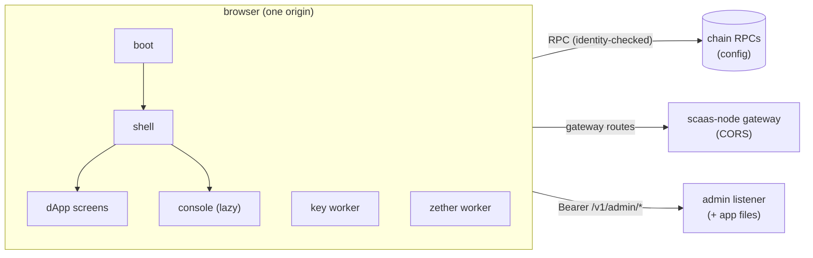
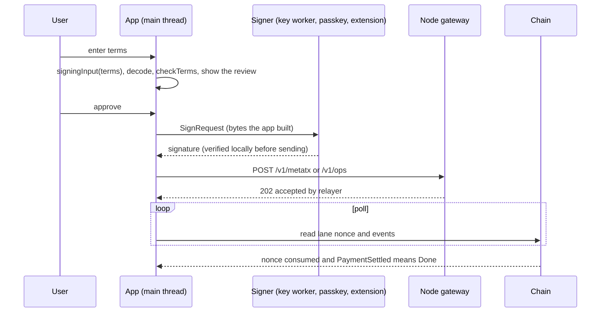

# SCaaS app — console and dApp

The SCaaS app (`scaas/clients/app/`) is one React + Vite single-page app with two halves: a **dApp** for subjects (no login) and
a **console** for node operators (login to one node's admin API). It depends on no ERP. Status: **SPECIFIED**; nothing of
the app is built yet (the node store is built; the node's job API, admin API and admin auth are specified). Signer rules:
[clients/signers-clientkeys](signers-clientkeys.md).

**Contents**

1. [Scope](#1-scope)
2. [Architecture](#2-architecture)
3. [Configuration](#3-configuration)
4. [Family adapters](#4-family-adapters)
5. [Signing](#5-signing)
6. [Submission and status](#6-submission-and-status)
7. [Signing review](#7-signing-review)
8. [Accounts](#8-accounts)
9. [Tokens](#9-tokens)
10. [Screens](#10-screens)
   - 10.1 [Feature availability](#101-feature-availability)
11. [Node clients](#11-node-clients)
12. [Security](#security)
13. [i18n](#13-i18n)
14. [Testing](#14-testing)
15. [Build and deploy](#15-build-and-deploy)

## 1. Scope

<a id="scope"></a>

**dApp** (no login): accounts (the Universal Account default, `SmartKeyAccount` option (b), the seed vault, extension
wallets); balances and the token catalogue; token creation (factory v1 and v2) and wrapping an existing token into a
meta-tx token; wrap/unwrap including gasless unwrap (target: `mtxExecute` with the token's `unwrap` calldata, and
`mtxWrap` by signature for a SCaaS underlying; as built on the v2 line `mtxExecute(unwrap…)`); meta-tx transfers and payments submitted through a node gateway
(all families) or self-paid; the DEX order book (home-bound and relayer-unbound markets) with place/cancel; Zether
(register, deposit/shield, confidential transfer, withdraw, balance via the device cache + BSGS).

**Console** (login to one node's admin API, built-in users or OIDC): chains, tokens, lanes, namespaces, jobs, mesh peers
(SSRF-guarded), policy, gossip (peers, topics, announces, bans, trusted), DEX markets and homes, external-client API keys,
admin users, audit, and a metrics dashboard link.

**Families**, all behind one adapter interface: EVM (Gnosis 100, Celo 42220, private chain 7622 (formerly 9000), anvil 31337); Hedera
295–298 (EVM on HSCS plus the HTS specifics); Cosmos (CosmWasm); Soroban (Stellar and Pi); Aptos; Sui; TON; Solana.

**Deployment**: two modes from one build — a static SPA with a runtime `config.json`, or served by `scaas-node` on its
admin listener. English (default) and Vietnamese; dark and light themes.

Non-goals:

| Not in the app | Why / where instead |
|---|---|
| Any ERP call | the node is independent of any ERP ([ARCH-POS-05](../decisions.md#ARCH-POS-05)) |
| A backend of its own; the job API (`/v1/jobs`, `/v1/events`) | a machine key would sit in the bundle ([NODE-ADM-06](../node/admin-auth.md#NODE-ADM-06)) |
| Admin API keys (`scaas_ak1.`) | the admin API has none |
| Mandates, tender bidding, vesting, distributions, credential presentation, an "Approvers" wizard beyond the minimum | their own designs; the app shows them only where the availability matrix says so |
| Regulated (flags 5–8, [CTR-AS-17](../contracts/asset-suite.md#CTR-AS-17)) send/receive/DEX flows and managed DEX markets | view-only with the regulated-token notice ([CLI-APP-26](#CLI-APP-26)) |
| Zether disclosure openings | not requested; the prover already exposes them |
| Non-EVM token deployment and non-EVM wrappers | PLANNED ([NET-ALL-19](../networks/README.md#NET-ALL-19)); Move/Solana need none |
| Cosmos and TON passkeys | not offered yet ([CLI-SGN-23](signers-clientkeys.md#CLI-SGN-23)) |
| TON Connect HTTP bridge, WalletConnect | seams ([CLI-SGN-06](signers-clientkeys.md#CLI-SGN-06)) |
| HashPack/Blade | `hedera_signMessage` prefixes the message; HIP-632 needs raw ED25519 ([NET-HED-15](../networks/hedera.md#NET-HED-15)) |
| Celo CIP-64 fee currencies | [NET-EVM-01](../networks/evm.md#NET-EVM-01) |
| Offline/PWA, analytics, remote fonts, a Prometheus parser | [CLI-APP-15](#CLI-APP-15), [CLI-APP-20](#CLI-APP-20) |

## 2. Architecture

<a id="architecture"></a>

<a id="CLI-APP-01"></a>**CLI-APP-01** — **One SPA, two halves, one build.** dApp routes never require login; console routes
need a node session and live in a separate lazy chunk; both deployment modes serve the identical `dist/`. Why: chain
features work without login; one artefact to test and pin.

<a id="CLI-APP-03"></a>**CLI-APP-03** — **The app has no server of its own and holds no secret.** It talks to chain RPCs
directly and to `scaas-node` only for (a) the gateway and (b) the admin API. It never holds a job-API key, a gateway
`bearer`/`hmac` secret or an RPC provider key, and the config validator refuses them; a gateway configured
`bearer`/`hmac` is unusable from the app. Why: machine credentials and admin credentials never cross
([NODE-ADM-06](../node/admin-auth.md#NODE-ADM-06)). Cost: public gateways run with auth `none` behind a host proxy with
rate limits.



| Part | Detail |
|---|---|
| boot | URL guard (fetch/XHR/WebSocket) → frame check → config load + validate → React |
| shell | router(#) ─ Query cache ─ store (sessions, signer, chain; memory) |
| dApp screens | family registry ─ lazy adapter chunk (SDK + clientkeys `fam/*` + `wallets/*`) |
| console (lazy) | admin client ─ auth (builtin \| OIDC) |
| key worker | clientkeys only: vault v2, seed, UAKey |
| zether worker | prover WASM + conf |
| gateway routes | `/v1/gateway` `/v1/metatx` `/v1/ops` `/v1/ua/*` `/v1/dex/*` |

<a id="stack"></a><a id="CLI-APP-02"></a>**CLI-APP-02** — **Stack: React 19 + TypeScript strict + Vite; TanStack Query for
every remote read; no global state library; react-router 7 with hash routes.** A ~50-line `useSyncExternalStore` store
holds the in-memory sessions, the active signer and the selected chain; routes are `#/…`. Why: server state dominates;
hash routing removes SPA-fallback rules from every host and from the node. Cost: deep links look like `/#/…`.

Libraries (the direct allowlist, [CLI-APP-15](#CLI-APP-15)):

| Purpose | Package | Note |
|---|---|---|
| UI | `react`, `react-dom` 19; `tailwindcss` 4 + `@tailwindcss/vite`; shadcn/ui copied into `src/ui/` with `@radix-ui/*`, `class-variance-authority`, `clsx`, `tailwind-merge`, `lucide-react` | — |
| Build/test (dev) | `vite`, `@vitejs/plugin-react`, `typescript`, `vitest`, `@playwright/test`, `eslint`, `typescript-eslint` | — |
| Data, routing, i18n, OIDC | `@tanstack/react-query` 5, `react-router` 7, `i18next`, `react-i18next`, `oauth4webapi` | — |
| Keys and encoders | `@scaas/clientkeys` = `file:../clientkeys` (`@noble/*`/`@scure/*` 2.4.0) | `fam/*`, `wallets/*`, `ua.js`, `device.js`, `backup-policy.js` |
| EVM, Hedera | `viem` 2.x | its own `@noble` 1.x copy is accepted and counted in the size spike |
| Cosmos | `cosmjs-types` + clientkeys secp256k1 (preferred); `@cosmjs/*` only if vetting shows no `libsodium`/`elliptic` | — |
| Soroban | `@stellar/stellar-base` (XDR, auth entries) + `fetch` JSON-RPC; `@stellar/freighter-api` 6.0.1 | no Horizon client |
| Sui | `@mysten/sui` (`bcs`, `Transaction`, client with a guarded `fetch`) | — |
| Aptos | `@aptos-labs/ts-sdk` 7.3.0 (`AptosConfig({client})` guarded) | as `smartcontracts/move/aptos/scripts` |
| TON | `@ton/core` 0.63.1 + `fetch` against toncenter **v3** (the shim speaks v3) | `@ton/ton` dropped: its client is v2 |
| Solana | `@solana/kit` 8.4.0, HTTP transport only, no subscriptions | as `smartcontracts/solana/scripts` |
| Polyfill | `buffer` (feross), imported **only** inside the Soroban and TON adapter chunks (`globalThis.Buffer ??= Buffer` there) | `stellar-base` and `@ton/core` need it |

Unpinned versions are fixed in `package-lock.json` by the size spike and recorded in `clients/app/README`. Package layout:

```
clients/app/
  package.json  package-lock.json  .npmrc (save-exact, ignore-scripts)  tsconfig.json  vite.config.ts  index.html
  budget.json (from the size spike)  deps-allowlist.json (direct + transitive)  public/config.example.json
  scripts/ csp.mjs  budget.mjs  abi.mjs  i18n-check.mjs  licenses.mjs  config-from-deployments.mjs  deps-gate.mjs
  src/
    boot.ts (URL guard, frame check, config)  main.tsx  routes.tsx
    config/ schema.ts  load.ts
    lib/ store.ts  amount.ts  url-guard.ts  text.ts (untrustedText)  errors.ts  trusted-types.ts
    ui/ shadcn copies, theme.tsx, AddressView.tsx, SignReview.tsx, AmountInput.tsx
    locales/ en/*.json  vi/*.json
    families/ types.ts  registry.ts  features.ts  identity.ts  tokens.ts (identity/kind tables)
              evm/ (adapter, abi.ts generated, factory, wrap, dex, zether, ua)  hedera/  cosmos/  soroban/  sui/  aptos/  ton/  solana/
    signers/ types.ts  keyworker.ts (client)  keyworker.worker.ts  passkey.ts  extension.ts (wraps clientkeys wallets/*)  dev.ts
    node/ gateway.ts  admin.ts  auth/{builtin,oidc}.ts  roles.ts
    zether/ zether.worker.ts  client.ts
    features/ wallet send accounts tokens create wrap dex zether settings  admin/{overview,chains,tokens,lanes,namespaces,jobs,peers,policy,gossip,markets,keys,users,audit}
  e2e/ playwright.config.ts  fixtures/{mock-node.mjs,mock-idp.mjs,cors-forward.ts}  specs/*.spec.ts
```

Fake wallets are not duplicated: end-to-end tests inject clientkeys `test/wallets/*` with `addInitScript`.
`src/families/evm/abi.ts` is generated by `scripts/abi.mjs` from forge `out/` for `IOpenFactoryV1`, `IOpenFactory`,
`IERC20MetaTx`, `IERC20Payment`, `IMetaTokenV2`, the tier contracts (and v3 when it lands), `SCaaSDex`,
`SmartKeyAccount(Factory)`, `IZetherToken`, `IUARegistry`; it is committed, and CI regenerates and diffs it.

## 3. Configuration

<a id="config"></a>

```jsonc
{
  "version": 1,
  "defaultLocale": "en",
  "policy": { "requireBackupKey": false },                    // boolean, default false (CLI-SGN-12)
  "passkey": { "rpId": "app.example.com" },                  // CLI-APP-14
  "metricsDashboardUrl": "https://grafana.example.com/d/scaas",
  "documents": [ { "termsHash": "0x…", "url": "https://…" } ],   // the only linkable terms (CLI-APP-26)
  "nodes": [
    { "id": "main", "label": "Main node",
      "gateway": "https://gw.example.com",                    // auth none behind a proxy (CLI-APP-03)
      "admin": "https://node.example.com",                    // or "self" (node-served)
      "oidc": [ { "issuer": "https://auth.example.com",
                  "connectSrc": ["https://auth.example.com"] } ] }   // allowed issuers ∩ auth-modes (CLI-APP-12)
  ],
  "chains": [
    { "key": "evm:100", "family": "evm", "label": "Gnosis", "rpc": ["https://a…", "https://b…"],
      "explorer": "https://gnosisscan.io", "native": { "symbol": "xDAI", "decimals": 18 },
      "dev": false, "private": false, "gatewayNode": "main",
      "chainUid": "0x…",                                     // genesis hash = every domain salt (NET-ALL-24)
      "contracts": { "factoryV1": "0x…", "factoryV2": "0x…", "dex": "0x…",           // dex = SCaaSDexV1
                     "dexes": ["0x…"],                         // the DEX list (NET-ALL-24, SPECIFIED)
                     "smartKeyAccountFactory": "0x…", "uaRegistry": null },
      "tokens": [ { "address": "0x…", "symbol": "EUR-M", "decimals": 6, "label": "Euro meta" } ],  // pinned
      "zetherTokens": [] },
    { "key": "hedera:296", "family": "hedera", "rpc": ["https://testnet.hashio.io/api"],
      "mirror": "https://testnet.mirrornode.hedera.com" },
    { "key": "cosmos:scaas-1", "family": "cosmos", "rpc": ["https://rpc…"], "rest": "https://lcd…",
      "bech32Prefix": "wasm", "gasPrice": "0.025uscaas", "contracts": { "token": ["wasm1…"] } },
    { "key": "soroban:testnet", "family": "soroban", "rpc": ["https://soroban-testnet.stellar.org"],
      "networkPassphrase": "Test SDF Network ; September 2015", "coinType": null },     // Pi: 314159
    { "key": "sui:testnet", "family": "sui", "rpc": ["https://fullnode.testnet.sui.io"],
      "contracts": { "package": "0x…", "root": "0x…", "registries": [ { "coinType": "0x2::sui::SUI", "id": "0x…" } ] } },
    { "key": "aptos:2", "family": "aptos", "rpc": ["https://api.testnet.aptoslabs.com/v1"], "contracts": { "package": "0x…" } },
    { "key": "ton:-3", "family": "ton", "rpc": ["https://testnet.toncenter.com/api/v3"], "appDomain": "app.example.com",
      "attachNanoton": "150000000", "contracts": { "masters": ["0:…"] } },
    { "key": "solana:<genesis>", "family": "solana", "rpc": ["https://api.devnet.solana.com"],
      "contracts": { "program": "…", "mints": ["…"] } }
  ]
}
```

`key` is the node's `chain_key` (`config.rs:746`); non-EVM curated tokens and assets carry `symbol`/`decimals` the same
way; a chain without `gatewayNode` has the self-paid path only. `npm run config:from-deployments -- <rpc>` reads
`smartcontracts/evm/deployments/<chainid>.json` and maps `scaas_dex` → `contracts.dex`, `factory` →
`contracts.factoryV1`, `token_factory` (was `factory_v2`) → `contracts.factoryV2`, `smart_key_account_factory` (P4; was `subject_account_factory`) → `contracts.smartKeyAccountFactory`;
the deployment's `dex` key is `MetaTxDex`, a different contract, and is not mapped; other families are written by hand.
Target (SPECIFIED): the deployment file also carries `chain_uid` and the DEX list ([NET-EVM-05](../networks/evm.md#NET-EVM-05)),
mapped to `chainUid` and `contracts.dexes` (with `contracts.dex` = the venue's DEX, which must be on the list); the
validator refuses an EVM or Hedera chain without `chainUid`, and at start the app compares it with the RPC's block-0
hash and with `/v1/gateway` (a mismatch disables the chain). There is one factory and no `MetaTxDex`.

**Validation** (`src/config/schema.ts`, no library). The app refuses to start, with an English + Vietnamese error screen,
on: an unknown `version`; a duplicate `key` or `id`; an unknown family; `policy.requireBackupKey` not boolean; a URL that is
not `https:` (dev builds allow `http://localhost|127.0.0.1|[::1]`, and `"self"`/`location.origin` may be `http:` only when
the page itself is `http:` on those hosts); userinfo in a URL; **RPC secrets** — a query string, a path segment matching
`/(api[-_]?key|token|secret|auth)/i`, any path segment of ≥ 20 characters from `[A-Za-z0-9_-]` (Infura `/v3/<hex>`, Alchemy
`/v2/<key>`), any subdomain label of ≥ 20 characters (QuickNode); `dev: true` on a non-dev chain (an id outside 31337/1337,
or a network outside `localnet`/`standalone`/`local`); `zetherTokens` on a non-dev chain; a curated token without
`decimals` or with `decimals > 36`; a `passkey.rpId` that is not a registrable suffix of `location.hostname` (`localhost`
only when the hostname is `localhost`, `127.0.0.1` never); a `gatewayNode` naming a node without `gateway`; a non-`https`
`nodes[].oidc[].issuer`. Unknown fields warn.

<a id="static-mode"></a><a id="CLI-APP-10"></a>**CLI-APP-10** — **Static mode reads `./config.json` (same origin,
`no-store`), validates it and refuses to start on error; `config.json` is not signed.** Its integrity is the host's
integrity: the hostile third parties are the RPCs and gateways ([CLI-APP-22](#CLI-APP-22)), so same-origin assets carry
no SRI. `npm run csp` writes exact headers for the page **and the workers**; a boot-time frame check stands in for
`frame-ancestors` when headers are missing. Why: one build, every host. Cost: a host without headers runs the weaker meta
CSP.

## 4. Family adapters

<a id="family-adapters"></a>

<a id="CLI-APP-04"></a>**CLI-APP-04** — **One adapter interface, one implementation per family.** `hedera` is the EVM
adapter plus Hedera overrides; an adapter loads lazily on first use of its family, and its `features` set drives every
screen. Owner decision (all families at once). Why: family SDKs are most of the bytes.

```ts
type Family = 'evm' | 'hedera' | 'cosmos' | 'soroban' | 'sui' | 'aptos' | 'ton' | 'solana';
type Feature = 'metaPay' | 'gateway' | 'selfPaid' | 'deposit' | 'factoryV1' | 'factoryV2' | 'wrap' | 'mtxUnwrap'
  | 'dex' | 'zether' | 'passkey' | 'enableCoinType' | 'uaLedger' | 'uaRegister';

interface FamilyAdapter {
  family: Family; chain: ChainCfg; features: ReadonlySet<Feature>;     // narrowed by config + /v1/gateway
  verifyIdentity(): Promise<void>;                                     // chain identity; throws ⇒ chain refused
  parseAddress(s: string): Address; shortAddress(a: Address): string; explorer(kind, id): string | null;
  subjectAccount(owner: SignerAccount, token?: TokenRef): Promise<{ address: Address; exists: boolean }>;
  nativeBalance(a: Address): Promise<bigint>;
  token(t: TokenRef): Promise<TokenInfo>;               // pinned/cross-checked; kind; sanitised text
  tokenBalance(t: TokenRef, holder: Address): Promise<bigint>;
  laneState(t: TokenRef, from: Address, lane: bigint): Promise<bigint | null>;   // null = random (Soroban)
  buildTerms(p: IntentParams): Promise<Terms>;          // family terms, as a portal's start returns them
  signRequest(t: Terms, key: SignerAccount): SignRequest;      // = clientkeys fam.signingInput + envelope name
  decode(r: SignRequest): DecodedIntent;                // review source (CLI-APP-05)
  pack(t: Terms, key: SignerAccount, sig: Uint8Array): Packed; // = fam.packSignature
  verify(t: Terms, p: Packed): Promise<boolean>;        // local check before sending
  submitGateway?(node: NodeCfg, t: Terms, p: Packed): Promise<{ intentId?: string }>;   // /v1/metatx | /v1/ops
  buildSelfPaid(t: Terms, p: Packed, payer: SignerAccount): Promise<UnsignedTx>;
  send(tx: UnsignedTx, by: Signer): Promise<TxId>;
  intentStatus(t: Terms): Promise<'pending' | 'done' | 'expired'>;
  waitTx(id: TxId): Promise<Receipt>;  events(f: EventFilter): Promise<NormalizedEvent[]>;   // HTTP polling only
  factory?: FactoryModule; wrap?: WrapModule; dex?: DexModule; zether?: ZetherModule; deposit?: DepositModule; ua?: UAModule;
}
```

The contract suite (`families/contract.test.ts`, run per family) checks the KAT bytes and digests; address round trips;
that `checkTerms(buildTerms(p), shownOf(p))` passes and fails when any single field differs; **`decode(signRequest(buildTerms(p)))
== p`**; that `verify` is true on the vector signature and false on a flipped byte; that `buildSelfPaid` decodes back to
the terms. Every adapter receives transports wired to the guarded `fetch` ([CLI-APP-19](#CLI-APP-19)).

| Family | Encoders (clientkeys `fam/`) | Subject signs | Gateway | Self-paid | Reads | Events / status |
|---|---|---|---|---|---|---|
| **EVM** | `evm.js` + DEX `Order`/`CancelOrder`/`InvalidateNonces`, v2 calldata, `payLane`; v3 `UAMetaTransaction`/`UAMetaTransfer`; KAT `metatx_kat` (v3), `metatx_v1_kat` (built v1, until P5), `metatransfer_kat`, `dex_kat`, `vectors/ua/*` | EIP-712 (`eip712Domain()` checked); EOA, ERC-1271 SmartKeyAccount, or `UAKey.signUA("metatx", digest)` for a UA | `/v1/metatx`; `/v1/ua-metatx` | `executeMetaTransaction` / named `mtx*` / `ua*`; the direct function when signer = submitter | `balanceOf`, `balanceOfUA`, `mtxNonce` (v1 line: `metaNonce`), `uaNonce`, `payLane`, `versionOf` | `eth_getLogs` (bounded) |
| **Hedera** | EVM + `hedera_kat` | ECDSA alias via extension; ED25519 `0.0.N` raw over the digest via seed (`hedera_ed25519`) | `/v1/metatx` (64-byte signatures allowed) | as EVM via the relay | as EVM; mirror for `0.0.N` ⇄ address, associations, HTS info | relay logs; mirror tx |
| **Cosmos** | `fam/cosmos.js` | ADR-036 via Keplr/Leap or seed `m/44'/118'/0'/0/i` | `/v1/ops` | `MsgExecuteContract{Relay}` signed + broadcast by the user | CW20 `Balance`, `Nonce{owner, lane}` | tx search; `getTx` |
| **Soroban** | `fam/soroban.js` | Freighter `signAuthEntry`, or seed `m/44'/148'/i'` (Pi coin 314159): sha256 of the auth preimage (`G…`) / `Ed25519{key_id, sig}` (`C…`) | `/v1/ops` | user = transaction source: simulate, attach auth, sign the envelope hash (only via `buildSelfPaid`) | SEP-41 `balance`; random nonce | `getEvents`, `getTransaction` |
| **Sui** | `fam/sui.js` incl. KeyOp | `sui:signPersonalMessage`; seed `m/44'/784'/i'/0'/0'`; passkey flag 6 | `/v1/ops` | PTB `meta::relay_pay<T>` | `Account<T>` fields, owned coins | `queryEvents`, checkpoint final |
| **Aptos** | `fam/aptos.js` | AIP-62 `aptos:signMessage`; seed `m/44'/637'/i'/0'/0'` over the client-built `fullMessage` | `/v1/ops` | entry `scaas::meta::relay_pay` | primary store, lane view | account txs; `waitForTransaction` |
| **TON** | `fam/ton.js`, `ton-vectors.json` | TON JS bridge `signData` cell; seed `m/44'/607'/i'` with a bound pubkey | `/v1/ops` | `SignedOp` internal message + `attachNanoton` | jetton wallet get-methods (v3 `runGetMethod`) | v3 `transactions` |
| **Solana** | `fam/solana.js`, `solana_derivation.json` | `solana:signOffchainMessage` (kind 1), else `solana:signMessage` (kind 0, **extension only**); seed: OCMS kind 1 only | `/v1/ops` | Ed25519 precompile instruction + `relay_pay`, the user as fee payer | PDA token accounts, `LanePda.next` | `getSignaturesForAddress` + `getTransaction` (`finalized`), polling |

Where funds must sit: the token balance itself on EVM, Hedera, Cosmos, Soroban and TON (in the jetton wallet); Sui the
`Account<T>`, Aptos the Account object's store, Solana the PDA's token accounts — the `deposit` module moves funds there
with a plain user-paid transfer; EVM UA balances live in the v3 UA ledger, funded by `transferToUA`. Lanes: each
independent intent gets a random 256-bit lane; `pay` uses `payLane(payId)`; Soroban uses a random host nonce instead.

<a id="chain-identity"></a><a id="CLI-APP-22"></a>**CLI-APP-22** — **Chain identity and token metadata are verified, not
trusted.** (a) Once per RPC at adapter load the chain identity is checked; a mismatch refuses the chain:

| Family | Call | Must equal |
|---|---|---|
| EVM, Hedera | `eth_chainId`; block 0 hash | the id in `key`; the profile's `chain_uid` (genesis hash; a chain id such as 7622 is not assumed unique, [NET-ALL-22](../networks/README.md#NET-ALL-22)) |
| Sui | `sui_getChainIdentifier` | the configured `chainIdentifier` (from the `key` network: mainnet/testnet/devnet known values; localnet: first-run pinned in dev only) |
| Solana | `getGenesisHash` | `<genesis>` in `key` |
| Soroban | `getNetwork().passphrase` | `networkPassphrase` |
| Aptos | ledger info `chain_id` | the id in `key` |
| Cosmos | `status.node_info.network` | the chain id in `key` |
| TON | v3 `masterchainInfo` + config param global id | `-239` / `-3` |

(b) Curated tokens pin `decimals` and `symbol` in config; a chain answer that differs refuses the token; non-curated tokens
show the raw integer beside the decimal, need an explicit add, and are refused when `decimals > 36`. (c) `eip712Domain()`
must return the config `chainId` and `verifyingContract` = the token signed for. (d) With ≥ 2 RPCs configured,
security-critical reads are cross-checked on two of them: decimals, code presence, factory provenance, wrapper `legOf`. (e)
There is no RPC override in production builds. Why: a third-party RPC can forge every read. Cost: one extra call per token
and chain.

EVM-chain specifics: Gnosis 100 — `finalized` ~160–240 s, the final badge waits for the `finalized` tag; Celo 42220 — no
CIP-64, CELO gas only; private 7622 — base fee 0, `private: true`, Zether gated, no public explorer links, and the RPC must
send CORS for the app origin; anvil 31337 — `dev: true`, the dev key in dev builds, Zether; everywhere — RIP-7212 presence
changes passkey/UA P-256 cost, so the gas estimate is shown before a self-paid passkey intent. Hedera: the create wizard
reads `getTokenCustomFees` / `getTokenKey(FEE_SCHEDULE)` through the HTS precompile and warns
([NET-HED-07](../networks/hedera.md#NET-HED-07)); unwrap and transfer recipients are checked for HTS association on the
mirror node, with a warning before signing; factory v1/v2 on Hedera needs the Hedera implementations registered in that
chain's factory (`Deploy.s.sol` registers only the EVM ones).

## 5. Signing

<a id="signing"></a>

<a id="CLI-APP-05"></a>**CLI-APP-05** — **The app builds every byte it asks anyone to sign, and the review is decoded from
those bytes.** Encoders live in clientkeys `src/fam/<family>.js` with one interface (`checkTerms`, `signingInput`,
`packSignature`) plus `decode(signingInput)`, ported from the reference client verifiers (`fam_*.py`) and KAT-locked. An adapter's intent is the family **terms**; the review renders
`decode(signingInput(terms))`, and the app asserts that `checkTerms(terms, shown)` holds against what the user entered
([CLI-SGN-27](signers-clientkeys.md#CLI-SGN-27)). A payload, a digest or typed data is never accepted from a node or any
other remote party. Why: display and bytes cannot diverge silently; one JS implementation is shared with portals. Cost:
clientkeys grows to all families.

<a id="signers"></a><a id="CLI-APP-06"></a>**CLI-APP-06** — **App signers: the clientkeys passkey; the seed vault (vault v2
in the key worker); UA keys (`UAKey`, tree `m/7622'/0'/<account>'/<kindNo>'/<i>'`); extension wallets through clientkeys
`wallets/<family>.js` and `wallets/evm.js` (`win` injected); a dev key in dev builds only.** The seed signer signs only the
family envelopes of [CLI-SGN-22](signers-clientkeys.md#CLI-SGN-22) — Solana OCMS kind 1, **never** `solana-raw`, which is
extension-only. Native keys keep their family paths; EVM `m/44'/60'/0'/0/i` is the EOA only
([CLI-SGN-30](signers-clientkeys.md#CLI-SGN-30)). Why: one wallet-glue implementation; one key, one purpose.

```ts
type SignRequest =
  | { kind: 'eip712'; typedData: TypedData }
  | { kind: 'digest'; digest: Uint8Array; scheme: 'secp256k1' | 'ed25519' }     // native keys only
  | { kind: 'ua'; purpose: UAPurpose; digest: Uint8Array; uaKind: number }      // UAKey.signUA
  | { kind: 'message'; bytes: Uint8Array; envelope: 'adr036' | 'sui-personal' | 'aptos-sign-message'
        | 'solana-offchain' | 'solana-raw' | 'ton-sign-data-cell' | 'soroban-auth-entry' | 'soroban-c-payload' };

interface Signer {
  kind: 'passkey' | 'seed' | 'ua' | 'extension' | 'dev';
  label: string; families: ReadonlySet<Family>;
  account(chain: ChainCfg): Promise<SignerAccount>;   // address/UA id, pubkey, scheme, origin, key role
  canSign(r: SignRequest): boolean;                   // seed: false for 'solana-raw'
  sign(r: SignRequest): Promise<Uint8Array>;
  sendTx?(chain: ChainCfg, tx: UnsignedTx): Promise<TxId>;
}
```

Extension wallets (`signers/extension.ts` only adapts clientkeys `wallets/<family>.js` (`create(window)`) to `Signer`):
EVM/Hedera ECDSA EIP-6963; Sui Wallet Standard; Aptos AIP-62; Solana Wallet Standard; Cosmos Keplr, Leap; Soroban Freighter
6.0.1; TON the JS bridge. A wallet whose network differs from the selected chain is refused before signing; a user
rejection (4001 or equivalent) is not an error. The dev key (`signers/dev.ts`) is a raw key in memory only, for chains with
`dev: true`, behind `import.meta.env.DEV` only.

<a id="key-worker"></a><a id="CLI-APP-24"></a>**CLI-APP-24** — **Keys run in a dedicated key worker.** A module Worker that
imports clientkeys only. Its API is `unlock(pin | prf)`, `account(family, role, i)` (public data only), `sign(request)`
(bytes the main thread built and checked, plus the envelope name), `signUA(purpose, digest)` and `lock()`. Seed, entropy and
private keys never cross `postMessage`. The vault v2 store, the idle timer (5 min), the hide timer (5 min) and scrypt
allocation all live in the worker; the Zether worker follows the same rule.

Vault specifics: IndexedDB `scaas-clientkeys`,
store `kv`, keys `device-key:v1`, `vault:seed:<account label>`, `vault:zether-conf:<curve>:<coin>:<account>`; at creation
request `navigator.storage.persist()` and show a refusal if denied, show "clearing this site's data = losing this device"
before the first device-bound write, and on a scrypt `RangeError` stop with "this device cannot create a passphrase vault"
and write nothing; a v2 blob without its device key means "this vault belongs to a cleared browser profile" (phrase import only); seed words are
shown once and are never copyable, and the import field is cleared after parsing. Why: a compromised transitive dependency
in any SDK chunk could otherwise read an unlocked seed. Residual: a hostile main realm can still request signatures while
unlocked ([vault threat model](signers-clientkeys.md#vault)).

| Need | clientkeys |
|---|---|
| Passkey ceremony | `creationOptions`, `requestOptions`, `publicKeyFromSpki`, `derToRS`, `encodeAssertion`, `passkeySubjectKey`, `accountSalt`, `predictAccount`, `accountSignature`, `merkleBatch`, `checkOwnerCall`, `passkeyFlags` |
| Backup | `hasBackup`, `backupStatus` — keys de-duplicated by P-256 `(x, y)` across `rpIdHash`/`originHash` before counting; `keys[]` carries `x, y`; the backup vectors gain "same passkey, two origins ⇒ 1 key" and the `msig` rule |
| Seed vault | `createVault`, `openVault`, `rewrapPin`, `needsRewrap`, `checkPassphrase`, `SeedBackup`, `deriveKey`, `signDigest` (native only), `signFamily`; v2: `openStore`, `deviceKey`, `sealDevice`, `openDevice`, `needsBinding` |
| UA | `ua.js`: `uaOf`, `keyHashOf`, `uaMessage`, `popDigest`, `deriveUAKey`, `UAKey.signUA`, `UAMetaTransaction` typed data |
| Zether | `deriveConfKey` (uses 7/8 only), `sealConfKey`, `openConfKey`, the tagged `zetherPop`, the balance cache |
| Wallets | `wallets/<family>.js`, `wallets/evm.js` (EIP-6963 + `walletKind`), `wallet-signer.js` entry |

## 6. Submission and status



<a id="submission"></a><a id="CLI-APP-07"></a>**CLI-APP-07** — **Two submission paths: the gateway for every family, or
self-paid.** (1) **Gateway**: EVM and Hedera use `POST /v1/metatx` (Hedera with 64-byte HIP-632 signatures allowed); the six
non-EVM families use `POST /v1/ops`; v3 UA intents use `POST /v1/ua-metatx` ([gateway routes](../node/gateway.md#NODE-GW-05));
every one is journaled as a `~gateway` job and run by that chain's lanes. (2) **Self-paid**: a gas-holding account the user
controls submits the same call a lane would; when signer and submitter are the same EVM EOA, the app calls the direct
function (`transfer`, `payWithFee`, `unwrap`) with no meta-tx signature. Owner decision (relayed submission for Hedera and
the non-EVM families: `/v1/ops`, Hedera on `/v1/metatx`). Why: with gateway submission a user needs no native gas on any
family. Cost: until those routes exist, Hedera and non-EVM are self-paid only.

<a id="intent-status"></a><a id="CLI-APP-08"></a>**CLI-APP-08** — **Intent status is chain truth.** A `202` means "accepted by
relayer". *Done* = the nonce is consumed (`mtxNonce` (v1 line: `metaNonce`) / `uaNonce` / the family lane read), plus `PaymentSettled` /
`MetaTransactionExecuted` / `UAMetaTransactionExecuted` when present. *Expired* = `validUntil` passed with the nonce
unconsumed. `GET /v1/intents/{id}` is used when the node returns an id. Why: the node is trusted for liveness, not truth.
Cost: one read per poll.

Gateway client (`src/node/gateway.ts`): `GET /v1/gateway` (capability, cached 30 s; required — no fallback); `POST
/v1/metatx` `{chain: <number>, token, m: WireMetaTx, signature}` (EVM; Hedera) ⇒ `202 {status, intent_id?}`; `POST
/v1/ops`; `POST /v1/ua-metatx`, `POST /v1/ua/register`; `GET /v1/intents/{id}`; `POST /v1/dex/orders`, `/cancel`,
`/cancel-all`; `GET /v1/dex/{markets,depth,trades,ticker,orders}` (polling only); `GET /v1/dex/depth?scope=network` (own
node, read-only). Every request uses `credentials: "omit"`, `redirect: "error"`, a 15 s timeout and bodies ≤ 64 KiB; errors
follow the stable error contract ([NODE-GW-06](../node/gateway.md#NODE-GW-06)): the app decodes revert data with its own ABI
and maps `errors.node.<code>`, and no logic keys on free text.

## 7. Signing review

<a id="signing-review"></a><a id="CLI-APP-09"></a>**CLI-APP-09** — **The signing review is rendered from the decoded bytes;
metadata is pinned or cross-checked, the spender is allowlisted, strings are sanitised, and the signature is verified
locally before sending.** Default validity windows: transfers, pay and unwrap ≤ 15 min; DEX orders ≤ 30 d. For digest-only
envelopes (Aptos, Solana OCMS, TON cell, Hedera ED25519) the review also shows "your wallet will display:
`scaas.metaop.v1:0xABCD…1234`" and "approve SCaaS messages only on `<origin>`"; when a family moves to the readable message
([NET-ALL-23](../networks/README.md#NET-ALL-23)), the review shows that text. Why: extension wallets show hex for most
families; the app's review is the only real check. Cost: non-curated tokens take an explicit-add step.

| Row | Content |
|---|---|
| Network | config label + `chain_key` + identity check passed |
| Contract | curated label, or `untrustedText` name + "unverified"; provenance "curated" / "open factory (anyone can)"; domain check |
| Operation | decoded op: transfer, pay(payId), self-call (function and arguments from the allowlist, [CLI-SGN-34](signers-clientkeys.md#CLI-SGN-34): wrap, unwrap with recipient and `minOut`, burn, add reserve, cancel a lane, Zether fund/transfer/burn), approve on an outside token only (spender: "configured DEX" / "wrapper of <underlying>"), trade order (both tokens, limit price both ways, signed `fee`, effective minimum fill, `dex`, `relayer`, `destination`, order lane, expiry, [CLI-SGN-35](signers-clientkeys.md#CLI-SGN-35)), signature wrap, cancel, UA register (kind, id); as built: trade, approve, DEX order with market and relayer fees |
| From → To | address views; kind (EOA / contract / UA kind / unknown) |
| Amount, fee | decimal from `bigint` with pinned decimals (raw integer beside it if non-curated); fee, recipient (bound, or "relayer's: <addr>") |
| Validity | local time + relative; > 1 h warns; > 24 h needs a second confirmation |
| Relayer | bound lane / any |
| Wallet display | the exact string a digest-only wallet will show + the origin warning |
| Raw | collapsible: exactly what the signer receives |

Blocking warnings: an unknown contract (allowed in dev builds only); a fee ≥ 1 % of the amount; a recipient that is the
token itself; a lookalike recipient; a DEX price ≥ 5 % from the best opposite level; an under-reserved Multi leg; a pending
rate change before `validUntil`; a UA user sending a v1/v2 token.

<a id="approve-allowlist"></a><a id="CLI-APP-23"></a>**CLI-APP-23** — **`approve` is offered only on outside tokens, and
its spenders are allowlisted.** The app never offers `approve` on a SCaaS token ([CLI-SGN-36](signers-clientkeys.md#CLI-SGN-36));
on an outside token (a stablecoin underlying, an outside-token DEX leg) the spender is either a DEX on the chain's list
(`contracts.dexes`), or a wrapper being wrapped into, after `underlyings()` contains the token and the wrapper is
curated or its factory provenance is cross-checked; anything else is refused, with no override outside dev builds. The
amount is exactly what the operation needs, never `2^256−1`; the token page offers "revoke" (approve 0). Why: the
contract-only spender rule ([CTR-TOK-01](../contracts/token-wrappers.md#CTR-TOK-01)) stops EOA spenders only, and anyone
can deploy a contract. Transitional (BUILT): the app also approves SCaaS tokens to the configured DEX for DEX-domain
orders, and to a wrapper over a SCaaS underlying; both disappear with token-verified orders and the signature wrap.

<a id="untrusted-text"></a><a id="CLI-APP-27"></a>**CLI-APP-27** — **Every string from chain or network passes through
`untrustedText(s, max)`.** Sources: token `name`/`symbol`, revert strings, gossip peer fields, audit before/after, peer
labels. The function applies NFKC, strips Cc/Cf (bidi controls included), caps length (symbol 16, name 64, other 256) and
flags non-ASCII; curated labels win; non-curated tokens carry an "unverified" badge; a symbol equal to a curated one on the
same chain warns; provenance reads "created via the open factory (anyone can)" vs "curated by this deployment". Why: with
an open factory anyone can deploy "USDC".

Clipboard and phishing: addresses are grouped with the first and last 6 characters emphasised and a colour badge; a
recipient matching the first 4 and last 4 characters of a history or address-book entry, but different, gets a blocking
lookalike warning; the clipboard is never read (`clipboard-read=()`); secrets cannot be copied (seed words) or only once (an
API key secret, cleared from memory when the dialog closes); links go only to configured explorers and `documents[].url` —
no chain or network string is rendered as a link.

## 8. Accounts

<a id="accounts"></a><a id="CLI-APP-25"></a>**CLI-APP-25** — **The account model follows the Universal Account design.**
The default "Create account" makes a **`webauthn-p256` UA** and registers it gaslessly through the gateway (`POST
/v1/ua/register`, [NODE-GW-03](../node/gateway.md#NODE-GW-03); registration is relayable). "Recoverable account" makes a
`SmartKeyAccount` (option (b), [CTR-ACC-09](../contracts/accounts.md#CTR-ACC-09)). UA balances exist only on
**MetaToken v3** clones ([CTR-UA-18](../contracts/accounts.md#CTR-UA-18)); a UA user offered a v1/v2 token is told to
use v3 or option (b). With `policy.requireBackupKey` on, a single-key derived UA is **unsatisfiable**
([CLI-SGN-15](signers-clientkeys.md#CLI-SGN-15)): the default flow becomes `SmartKeyAccount` + backup step, and an existing
single-key UA is exit-only. An `msig` UA counts as backed up iff `Σweights − max(weight) ≥ threshold`. Until the UA registry,
v3 tokens, `UAKey` and the node's UA routes exist, the default is `SmartKeyAccount` (interim). Cost: two account kinds to
explain.

| Offer | Made of | Families | Backup (switch on) |
|---|---|---|---|
| **Account** (default once UA lands) | `webauthn-p256` UA, registered gaslessly | EVM, Hedera (v3 tokens) | single-key ⇒ unsatisfiable ⇒ not offered; existing ⇒ exit only |
| **Recoverable account** (option (b); interim default) | `SmartKeyAccount` (passkey and/or secp256k1 role key `m/7622'/0'/<account>'/2'/<i>'`, guardian) | EVM, Hedera | ≥ 2 distinct credentials or 1 + guardian |
| Subject accounts per family | Sui `Account<T>`, Aptos Account, Solana PDA, Soroban `C…`, TON jetton wallet | as the matrix | per family (Soroban/TON: ≥ 2 keys) |
| **Approvers** (minimal) | `msig` UA over member UAs/EOAs; the app shows the id and registers it | EVM | `Σw − max(w) ≥ threshold` |
| Native wallet | a seed-vault native key or an extension wallet | all | outside the predicate |
| Zether account | `zether-*` UA, `authRef` chosen from the user's accounts ([CTR-UA-16](../contracts/accounts.md#CTR-UA-16)) | EVM dev | n/a |

The accounts screen (`src/features/accounts/`) shows, per account, the kind and the key role; the bound origin(s) for passkeys; BE/BS labels ("this
device only", "may share one password manager"); the backup state from `backupStatus`.

<a id="passkeys"></a><a id="CLI-APP-14"></a>**CLI-APP-14** — **Passkeys are origin-bound, and backup counting de-duplicates
credentials across origins.** `config.json` sets `passkey.rpId`; a second deployment origin needs a key added for that
origin; backup counting de-duplicates credentials by `(x, y)` across origins — "1 passkey, 2 origins" counts as **one** key.
A **find-my-account** flow recovers the account on a new device or origin: (1) one passkey assertion over a random
challenge; (2) recover the two P-256 public-key candidates from the signature; (3) for each candidate and each origin the
config implies, compute `keyId(x, y, rpIdHash, originHash)` (SmartKeyAccount) and `uaOf(webauthn-p256, x‖y‖rpIdHash‖originHash)`
(UA); (4) check UA `registered`, then SmartKeyAccount `predictAccount` with guardian 0 / the configured guardian; (5) run a
bounded, paginated `KeyAdded(keyId)` log search from the factory deployment block; (6) fall back to "paste your account
address", verified by `hasKey`. After the first success, the worker stores `{credentialId, x, y, account, origin}` in the
key metadata. Why: the two deployment modes are two origins.

## 9. Tokens

<a id="token-kinds"></a><a id="CLI-APP-26"></a>**CLI-APP-26** — **Token kinds are decoded from `versionOf(token)`, values
as built (0–4, [CTR-TOK-21](../contracts/token-wrappers.md#CTR-TOK-21)).** A token with regulated flags 5–8 ([CTR-AS-17](../contracts/asset-suite.md#CTR-AS-17)) is **view-only** with the regulated-token notice until the regulated flows
ship; managed DEX markets are "unavailable" the same way. Named functions are chosen from a `(kind, implementation version)`
table, falling back to `executeMetaTransaction` for unknown versions — including receiver-pays (`mtxPayReceiverFee`)
versions. Target: every gasless operation of a token is `mtxExecute` with calldata the app encodes and decodes against
the implementation's allowlist ([CLI-SGN-34](signers-clientkeys.md#CLI-SGN-34)); `mtxTransfer`, `mtxPay` and
`mtxBatch` stay as typed builders. `termsHash` documents link only to config-listed URLs.

<a id="contract-roles"></a><a id="CLI-APP-18"></a>**CLI-APP-18** — **Contract-held roles get calldata, not transactions.**
`rateAdmin` must be a contract, so rate operations are emitted as **Safe Transaction Builder JSON** (`{to, value: "0",
data}`) or `MultiSig.sol` submit data, never as an EIP-681 link (an EOA sender reverts); the guardian acts directly. Issuer
wizards build Safe transactions the same way.

## 10. Screens

<a id="screens"></a><a id="node-screens"></a>

| # | Screen | Reads | Writes | Families |
|---|---|---|---|---|
| 1 | Home, chain and signer picker | config; identity checks | — | all |
| 2 | Wallet | balances (curated tokens + UA ledger + factory provenance), recent events | — | all |
| 3 | Send / Pay | token info, lane state, `/v1/gateway` | `/v1/metatx` \| `/v1/ops` \| `/v1/ua-metatx` or self-paid | all |
| 4 | Intent status | nonce/lane, receipt, events, `/v1/intents/{id}` | — | all |
| 5 | Accounts & keys | account state, backup status, key metadata (BE/BS, origins), vault state | create UA / SmartKeyAccount / Approvers; register (`/v1/ua/register`); add key/origin; guardian; vault create/import/unlock/rewrap/PRF; find my account | per account kind |
| 6 | Token catalogue | factory versions, `versionOf` kind, views (`legOf`, `collateralValue`, `pendingRate`, `rateAdmin`, guardian), per-leg `balanceOf ≥ reserve` | add token (explicit); revoke approval | EVM, Hedera; read-only lists elsewhere |
| 7 | Create token | factory, catalogue, `predictAddress`, underlying `decimals` (cross-checked), HTS checks, existing wrappers of the underlying shown first | `createToken` (built: `createToken` on `OpenFactory`; `createMetaToken`, `createZetherToken` (dev) on `OpenFactoryV1`) | EVM, Hedera |
| 8 | Wrap / unwrap | `previewWrap`, `previewUnwrap`, `legOf`, allowance, `pendingRate` | `approve` + `wrap`; `unwrap(…, minOut)`; `addReserve`; gasless unwrap via `mtxExecute(unwrap…)` (target: gasless wrap/unwrap/addReserve via `mtxExecute`; `mtxWrap` for a SCaaS underlying, no approve) | EVM, Hedera |
| 9 | Rate & guardian | as 6 | guardian direct; rate ops as Safe JSON | EVM, Hedera |
| 10 | Sui coin type enable | derived `Registry<T>` id | `new_registry<T>` | Sui |
| 11 | Fund meta account | owned coins / FA / SPL | deposit transfer; `transferToUA` | Sui, Aptos, Solana, EVM v3 |
| 12 | DEX markets | `/v1/dex/markets` + `/v1/gateway` `dex`, on-chain `markets(key)` | — | EVM; others "unavailable" |
| 13 | DEX market | `depth` (poll 2 s while visible), `trades`, `ticker`, `orders?maker=`, own-node `depth?scope=network` (read-only) | place, cancel, cancel-all; on-chain `cancel`/`invalidateNonces` (target: `mtxCancelOrder`/`mtxInvalidateNonces` on the sell token, `mtxCancelOrders` on the DEX for outside-token orders) | EVM |
| 14 | Zether | `registered(UA)`, account state, cache, BSGS (worker) | register a `zether-*` UA with `authRef` (gasless); `zetherShield` / `zetherWrapShield` ([CTR-ZTH-45](../contracts/zether.md#CTR-ZTH-45); built: `approve` + `fund`, P3); transfer; burn; rollOver | EVM dev |
| 15 | Settings | — | locale, theme, dev key (dev builds) | — |
| 16 | Console login | `GET /v1/admin/auth-modes` ∩ config OIDC | built-in login; OIDC redirect | — |
| 17 | Overview | `/v1/admin/info`, `/me` | — | — |
| 18 | Chains, Tokens, Lanes | `/v1/admin/chains[/{key}]`, `…/tokens`, `…/lanes` | `PATCH` (hot vs restart labelled), state, breaker reset, fee_recipient, tokens, lanes (`409 LANE_BUSY`) | — |
| 19 | Namespaces, Jobs | `/v1/admin/namespaces`, `/v1/admin/jobs` | create/patch, job cancel | — |
| 20 | Peers, Policy | `/v1/admin/mesh/peers`, `…/policy` | CRUD; `url` + `allow_private` admin-only, pre-checked like the node's write-time guard (`https://`/`quic://` `host[:port]`, no userinfo/path/query/fragment, literal loopback/link-local/metadata/multicast refused, private ranges only with the per-peer toggle); pin 64 hex; `multiaddr`; state (operator) | — |
| 21 | Gossip | `/v1/admin/gossip`, `…/peers`, `…/announces`, `…/trusted` (sanitised text) | ban/unban (operator), trusted (admin) | — |
| 22 | DEX markets & homes | `/v1/admin/dex/markets`, `…/homes` | create/patch (`gossip`, `unbound`), state | — |
| 23 | API keys | `/v1/admin/keys` | create (secret shown once), rotate, revoke (`key_custodian`) | — |
| 24 | Users | `/v1/admin/users` | create, roles ⊆ caller, disable, reset; own password | — |
| 25 | Audit | `/v1/admin/audit?since=` (sanitised text) | — | — |
| 26 | Metrics | — | link to `metricsDashboardUrl` | — |

**Send / pay.** (1) The user enters the recipient (lookalike check), the amount and an optional `payId`; the path is gateway
or self-paid. (2) `buildTerms` sets `validUntil = now + 15 min`; the relayer is unbound on the gateway path unless the user
pins the lane; the fee is `NONE` by default, and an explicit fee needs a fee recipient ≠ payee
([CTR-MTX-08](../contracts/metatx.md#CTR-MTX-08)); an unbound fee recipient is shown as the node's `fee_recipient` from
`/v1/gateway` ([NODE-LANE-10](../node/submit-lanes.md#NODE-LANE-10)). (3) Review, then sign (key worker / wallet), `verify`,
submit, and the status screen.

**Unwrap.** `minOut` defaults to `previewUnwrap` at signing time, exactly, never 0; if a rate change is pending and `eta <
validUntil`, the app warns and shortens `validUntil` to before `eta`.

**Wrap.** An outside underlying: `approve(wrapper)` on the outside token ([CLI-APP-23](#CLI-APP-23)), then `wrap`, direct
or gasless through `mtxExecute(wrap)`. A SCaaS underlying (SPECIFIED): no approve; the app builds the signature wrap of
[CLI-SGN-36](signers-clientkeys.md#CLI-SGN-36) with `receiveAmount` = `previewWrap` at signing time and submits it as
an `mtxWrap` job; the same rate-change warning applies.

**DEX.** Target (SPECIFIED): a SCaaS sell token is traded with a `TradeOrder` signed in the token's domain, funded
without any allowance; fields and review per [CLI-SGN-35](signers-clientkeys.md#CLI-SGN-35) — `dex` from
`contracts.dexes` (refused otherwise), `relayer` = `/v1/gateway` `dex.relayer` by default, `fee` = the venue's rate for
the order's expected role, `minFill` default half the amount (FOK sets it to the amount), cancel on the sell token
(`CancelOrder` per order, `InvalidateNonces` per order lane); an outside sell token uses a `DexOrder` with an
allowance to the listed DEX's `DexPuller` ([CTR-DEX-22](../contracts/dex.md#CTR-DEX-22)); exchange-path options (listed
pools, cycles, surplus) per [CLI-SGN-37](signers-clientkeys.md#CLI-SGN-37).

As built: order fields (`dex.rs:540-580`): `taker` 0 (public book); amounts in `(0, 2^128)`; base amount ≥ the market
`min_base_amount`; `expiry` default 1 d, within `(now + 5 s, now + 30 d]`; FOK and IOC mutually exclusive; `maxFeePpm` = the
market fee by default; `relayer` = `/v1/gateway` `dex.relayer` (home-bound), or 0 on `unbound` markets (resting GTC only);
relayer fee `feeMode` 0 by default, otherwise within `/v1/gateway` `dex.relayer_fee_policy` (`feeMode ≤ 2`, ppm cap 10 000);
≤ `MAX_OPEN_PER_MAKER` (50) open orders per maker. The review shows the relayer fee separately from the market fee. Funding:
`approve(dex)` per [CLI-APP-23](#CLI-APP-23) (configured DEX only, exact amount); `checkOrder` runs after signing. Wording:
an unbound order says "anyone may execute within your limit; cancel binds only when mined"; cancel signatures have no
expiry, and the review says so. Prices are the node's decimal strings, never a float division.

<a id="dex"></a><a id="CLI-APP-21"></a>**CLI-APP-21** — **The non-EVM DEX is "unavailable" until the node has non-EVM venue
books.** Owner decision (non-EVM DEX books after EVM). The DEX module is generic over `/v1/dex/*` and turns on per chain when
`/v1/gateway` reports `dex`. Why: only the EVM venue has a book.

**Zether.** Register: the worker builds the `zether-*` key data and the tagged PoP (purpose `pop`); `authRef` is 0 (self) or
one of the user's accounts; registration is submitted gaslessly or self-paid (no `msg.sender` binding). Prove, in the worker:
`zetherCall("proveTransfer", {curve, key: {x}, chainId, token, sendCounter, accSeq, acc, balance, yTo, amount, fee,
beneficiary})` with `x` from `openConfKey` **inside** the worker; the result is `opData` for the `OP_ZTRANSFER` envelope
(gateway) or `directCalldata`; with `authRef ≠ 0` the authorisation signature comes from the key worker (`zether-auth`
purpose). Balance: open the cache, then `checkBalance` against the current `acc`; on a miss run BSGS on the delta; after own
operations update with `setCachedBalance` / `cacheAfterDebit` / `cacheAfterRollOver`; above the device bound (2^44) show a
banner ([zether balance](signers-clientkeys.md#zether-balance)). Every Zether screen carries "UNAUDITED — dev chains only".

<a id="zether-worker"></a><a id="CLI-APP-13"></a>**CLI-APP-13** — **Zether runs in one session worker.** The worker runs the
prover (`wasm-bindgen --target web`) and opens the conf vault itself (`openConfKey`), so `x` never enters the main realm; it
keeps `x` and the BSGS table for the session and is terminated on lock, after 5 min idle or 5 min hidden. Defaults
`tableBits 22, boundBits 44`; `allowLargeTable` only by explicit choice. Zether shows only on chains 31337/1337 with a
configured ZetherToken ([CTR-ZTH-02](../contracts/zether.md#CTR-ZTH-02); whether chain 7622 joins is an open owner question).
Post-quantum Zether (PQZ) tokens configured on the private chain 7622 run in the same worker
([CTR-PQZ-18](../contracts/pq-zether.md#CTR-PQZ-18)).

### 10.1 Feature availability

**G** = gateway (needs `gatewayNode` + `/v1/gateway`); **S** = self-paid; "—" = not available.

| Feature | EVM | Hedera | Cosmos | Soroban | Sui | Aptos | TON | Solana |
|---|---|---|---|---|---|---|---|---|
| Meta-op transfer / pay | G + S | G + S | G + S | G + S | G + S | G + S | G + S | G + S |
| UA-ledger send/pay (v3 tokens) | G + S, once v3 lands | as EVM | — (later) | — | — | — | — | — |
| UA registration (gasless) | G + S, once the UA registry lands | as EVM | — | — | — | — | — | — |
| Fund meta account (`deposit`) | `transferToUA` (v3) | as EVM | n/a | n/a | ✓ `Account<T>` | ✓ | n/a | ✓ PDA ATA |
| Enable a coin type | — | — | — | — | ✓ `new_registry<T>` | n/a | — | n/a |
| Factory v1 (`META`, wrap or mint) | ✓ | ✓ (Hedera implementation registered) | — PLANNED | — PLANNED | n/a | n/a | — PLANNED | n/a |
| Factory v2 tiers, rates, guardian | ✓ | ✓ (Hedera children) | — | — | — | — | — | — |
| Wrap / unwrap / addReserve | ✓ | ✓ | — | — | — | — | — | — |
| Gasless unwrap (`mtxExecute(unwrap…)`) | G + S | G + S | — | — | — | — | — | — |
| Rate admin (calldata) / guardian | ✓ | ✓ | — | — | — | — | — | — |
| Regulated tokens (flags 5–8) | view-only | view-only | — | — | — | — | — | — |
| DEX book, place, cancel | G (venue); on-chain cancel S | unavailable | unavailable | unavailable | unavailable | unavailable | unavailable | unavailable |
| Zether | ✓ 31337/1337 only | — | — | — | — | — | — | — |
| Passkey | ✓ SmartKeyAccount / UA | ✓ SmartKeyAccount / UA | — | planned (third) | planned (first) | planned (fourth, unaudited) | — | planned (second) |
| Seed vault | ✓ | ✓ ECDSA + ED25519 | ✓ | ✓ (Pi 314159) | ✓ | ✓ | ✓ | ✓ (OCMS kind 1) |
| Extension wallet | EIP-6963 | MetaMask on the relay | Keplr, Leap | Freighter | Wallet Standard | AIP-62 | TON JS bridge | Wallet Standard |

`features` is narrowed at runtime by config, by `/v1/gateway` (chain, token, `dex`), by token kind and by the backup policy.

## 11. Node clients

<a id="node-clients"></a>

Admin API client (`src/node/admin.ts`): every admin route ([node/admin-auth](../node/admin-auth.md)) with `Authorization:
Bearer`, `credentials: "omit"`, `redirect: "error"`; `401` ⇒ back to login; `403` ⇒ re-read `me`; `409`, `422` ⇒ shown inline;
`429` ⇒ backoff; `503 IDP_UNAVAILABLE` ⇒ banner; `X-Request-Id` is shown in error details. Built-in login: `GET
/v1/admin/auth-modes`; `POST /v1/admin/login` ⇒ `{token, expires_at, roles}` (the password field is cleared immediately);
refresh at `expires_at − 60 s` while the tab is visible (a refusal ⇒ login); `POST /v1/admin/logout` (bumps `session_epoch`
for every session of that user, and the UI says so), then clear the cache. Several nodes: sessions are keyed by node id, and
a token is never sent to another node.

<a id="admin-session"></a><a id="CLI-APP-11"></a>**CLI-APP-11** — **Admin tokens live in memory only, per node.**
`sessionStorage` holds only the OIDC `{issuer, code_verifier, state, nonce, returnRoute}` between redirect and callback,
deleted on callback or after 10 min. After a reload: re-login (built-in) or `prompt=none` (OIDC). Logout clears that node's
Query cache. Cost: built-in users retype the password after a reload.

<a id="oidc"></a><a id="CLI-APP-12"></a>**CLI-APP-12** — **OIDC is `oauth4webapi`, a public client with code + PKCE S256.**
`state` + `nonce`, RFC 9207 `iss` check; **allowed issuers = `auth-modes` ∩ `config.json` `nodes[].oidc`**, so a hostile node
cannot redirect users to an arbitrary IdP; `redirect_uri = origin + pathname`; renewal by refresh-token rotation or full-page
`prompt=none`, no iframes. Flow: (1) issuer = `auth-modes` ∩ `nodes[].oidc`; the discovery `issuer` must match byte for byte
and every endpoint origin must be in `connectSrc`; (2) write `{node, issuer, verifier, state, nonce, returnRoute, created}`
to `sessionStorage`, then redirect with `response_type=code`, `client_id`, `redirect_uri`, `scope=openid` (plus
`offline_access` when the IdP advertises refresh for public clients), S256, `state`, `nonce`, and `audience`/`resource` per
the node's audience; (3) callback: match `state` and the stored `issuer`, check `iss` when sent, exchange the code, check the
ID token `nonce`/`iss`/`aud`, keep the access token for that node only, delete the entry, `replaceState` back to
`returnRoute`, then `GET /v1/admin/me`; (4) logout through `end_session_endpoint`. Why: no hand-rolled OAuth. Cost: IdPs
without SPA refresh tokens bounce the page once per token lifetime.

<a id="roles"></a><a id="CLI-APP-17"></a>**CLI-APP-17** — **Role gating in the app is UI only**: `viewer ⊂ operator ⊂ admin`,
with `key_custodian` separate, read from `GET /v1/admin/me`; grants are ⊆ the caller's roles. The node enforces roles
([NODE-ADM-04](../node/admin-auth.md#NODE-ADM-04)).

<a id="metrics"></a><a id="CLI-APP-20"></a>**CLI-APP-20** — **Metrics are a dashboard link** (`metricsDashboardUrl`). Topics
show mesh size and peers from `GET /v1/admin/gossip`; no Prometheus parsing (`/metrics` is not CORS-enabled; the operations
docs own the dashboard).

The node routes the app relies on — `GET /v1/gateway` (served chains, tokens, fee recipient, DEX address, relayer and order
policy), gateway CORS, the stable error contract, `POST /v1/ops` for the six non-EVM families and Hedera on `/v1/metatx`, the
UA routes — are defined in [node/gateway](../node/gateway.md#NODE-GW-05); app serving on the admin listener in
[node/admin-auth](../node/admin-auth.md#NODE-ADM-10).

## <a id="security"></a>12. Security

<a id="security"></a>

**Headers.** Node-served, on every app response:

```
Content-Security-Policy: default-src 'none'; script-src 'self' 'wasm-unsafe-eval'; style-src 'self';
  style-src-elem 'self' 'unsafe-inline'; img-src 'self' data:; font-src 'self';
  connect-src 'self' <origins of chains[].rpc/.rest/.mirror, nodes[].gateway/.admin, nodes[].oidc[].connectSrc, [app] extra_connect_src>;
  worker-src 'self'; manifest-src 'self'; frame-src 'none'; frame-ancestors 'none'; form-action 'none';
  base-uri 'none'; object-src 'none'; require-trusted-types-for 'script'; trusted-types scaas-worker
Cross-Origin-Opener-Policy: same-origin   Cross-Origin-Resource-Policy: same-origin   Referrer-Policy: no-referrer
X-Content-Type-Options: nosniff
Permissions-Policy: camera=(), microphone=(), geolocation=(), payment=(), usb=(), clipboard-read=(),
  publickey-credentials-get=(self), publickey-credentials-create=(self)
```

- **Trusted Types.** `src/lib/trusted-types.ts` defines the one policy `scaas-worker`, whose `createScriptURL` accepts only
  same-origin `/assets/*.js`; both worker constructors use it.
- **Styles.** `style-src-elem 'unsafe-inline'` exists because Radix `RemoveScroll` injects `<style>` elements
  (`react-style-singleton`); under Trusted Types that is of low value to an attacker.
- **Workers.** Worker scripts get the same header minus `frame-ancestors`; in static mode `npm run csp` emits it for
  `/assets/*.worker-*.js`.
- **Static mode.** The meta CSP is the same with `connect-src 'self' https:` (dev builds add localhost) and no
  `frame-ancestors`.
- **Frame check.** `boot.ts` runs `if (window.top !== window.self)` before mounting and renders only a warning.
- **Playwright.** Every suite fails on any `securitypolicyviolation` event.

**No secrets in the bundle.** No job-API key, gateway secret, RPC key, OIDC secret or dev key in source, `VITE_*` or config;
CI greps `dist/` for `scaas_s1.`, `X-Scaas-Key`, the anvil default keys, and 64-hex strings not in the public-constant list;
tokens stay in memory and `Authorization` is stripped from error reports.

<a id="supply-chain"></a><a id="CLI-APP-15"></a>**CLI-APP-15** — **Pinned supply chain and one dev flag.** Exact pins, a
committed lockfile, `npm ci --ignore-scripts`, a **direct and transitive** allowlist (`deps-allowlist.json`;
`scripts/deps-gate.mjs` fails CI on any lockfile package outside it and on a total count above the recorded number), no runtime
CDN, no analytics; CI also runs `npm audit signatures` and `npm audit --omit=dev --audit-level=high`; `scripts/licenses.mjs`
allows MIT, Apache-2.0, BSD, ISC and LGPL (clientkeys); lockfile changes only in dependency-update PRs; known heavy trees:
stellar-sdk (dropped for stellar-base), cosmjs (vetted), `@ton/ton` (dropped). **One dev flag**: `import.meta.env.DEV`; dev
code (dev key, mock hooks) is imported only behind it; a `--mode development` build refuses to start unless
`location.hostname ∈ {localhost, 127.0.0.1, ::1}` and shows a permanent banner; CI asserts the production `dist/` lacks
`scaas-dev-signer` and the anvil keys. Why: every dependency has signing reach. Cost: upgrades are deliberate.

<a id="network-allowlist"></a><a id="CLI-APP-19"></a>**CLI-APP-19** — **The app dials only allowlisted origins.** `config.json`
URLs and the pinned OIDC origins only. DEX homes learned from `/v1/dex/homes` are **never** dialed; network depth is read
from the own node (`depth?scope=network`), and orders are placed only on own-node markets. `boot.ts` installs the guard before
any adapter chunk loads, by wrapping `globalThis.fetch`, `XMLHttpRequest.prototype.open` and `WebSocket`: the origin must be in
config origins ∪ `nodes[].oidc[].connectSrc`; `fetch` is forced to `redirect: "error"` and `credentials: "omit"`; `wss:`/`ws:`
are refused unless configured (none by default); anything else throws `UrlRefused`, logged as such. Explicit transports are
also passed where an SDK accepts one: viem `http(url, {fetchFn})`, the Sui client's fetch, `AptosConfig({client})`. End-to-end
suites assert zero requests to unlisted origins; peer URLs typed in the console are validated, never fetched by the browser.
Why: network-learned URLs are attacker-chosen, and SDKs issue their own requests.

## 13. i18n

<a id="i18n"></a><a id="CLI-APP-16"></a>**CLI-APP-16** — **English is the default and every string has a Vietnamese
translation; risk disclosures show the English original beside the translation until the owner approves the text.**
react-i18next; amounts are `bigint`-based. Owner decision. Files
`src/locales/{en,vi}/{common,wallet,accounts,tokens,dex,zether,admin,errors}.json` — English bundled, Vietnamese loaded on demand. No detector library: the saved choice
(`localStorage`), then `config.defaultLocale`, then `en`. Keys are stable identifiers; plurals use `_one`/`_other` (Vietnamese
uses `_other` only). Error keys: `errors.node.<CODE>`, `errors.chain.<family>.<name>` (contract errors decoded from revert
data), `errors.wallet.rejected`. Formatting: `Intl` on strings built from `bigint`, never `Number`. CI (`scripts/i18n-check.mjs`):
the same key set in both languages, no unused keys, no hard-coded JSX text (lint); every change writes its translated strings,
and a release pass reviews them. Disclosures (`tokens.disclosure.depeg`, `.adjustableMulti`, `.regulated`,
`zether.unaudited`, `accounts.ua.noRecovery`) follow the side-by-side rule.

## 14. Testing

<a id="testing"></a>

Unit (Vitest / `node --test`, no network):

| Area | Vectors / method |
|---|---|
| EVM encoders | `metatx_kat` (v3), `metatx_v1_kat` (built v1, until P5), `metatransfer_kat`, `dex_kat`, `hedera_kat`, `wrap_rate_vectors`, `smart_key_account_create2`, `smart_key_account_kat`, `mandate_pay_kat`, `mandate_revoke_kat`, `webauthn_soft` |
| Non-EVM encoders (clientkeys) | `mesh-envelope-v1.2.json` cross-language payloads, `ton-vectors.json`, `fam_*.json` per family, `sui_vectors.json`, the seed-signed vectors, `solana_derivation.json` |
| UA (clientkeys) | `smartcontracts/vectors/ua/*`: ids, keyHash, `ua_msg`, PoP, `UAMetaTransaction` digests; `deriveUAKey` paths under `m/7622'` |
| Backup / vault | `backup_policy.json` plus the de-duplication and `msig` rows; `vault_v2_fixture.json` |
| Zether | prover vectors through the WASM `nodejs` build; clientkeys `zether.test.js` |
| Adapter contract suite | as above, including `decode ∘ signRequest ∘ buildTerms = id` |
| Config | every validation refusal, including the RPC-secret patterns |
| Guard, text, CSP | URL guard refusals (redirect, credentials, ws); `untrustedText` (bidi, ZW, NFKC, caps); Trusted Types policy |
| Auth | built-in refresh; OIDC against `mock-idp.mjs` (issuer pinning, RFC 9207, state/nonce); a `Storage` spy proves only the OIDC entry is written |
| Roles, amounts | route × role tables; `bigint` round trips at 0, 1, 2^54, 2^64, 2^256−1, decimals 0–36 |

End to end (Playwright, Chromium):

| Suite | Against | Covers |
|---|---|---|
| `evm` | anvil + `deploy.sh evm` + `scaas-node` (gateway, CORS, DEX venue on one lane) | send/pay via gateway and self-paid; v2 tiers; wrap/unwrap/gasless `mtxExecute(unwrap…)`; spender refusals; DEX place/cancel/fill across two contexts; passkey SmartKeyAccount (CDP virtual authenticator); find-my-account; vault v2; backup switch on (receive hidden, value refused, add-key allowed); EIP-6963 fake |
| `ua` | anvil + the UA deployment | passkey-UA create + gasless register; v3 send; Approvers |
| `zether` | anvil `--code-size-limit 65536` + `DEPLOY_ZETHER=1 deploy.sh evm` (dev only: registry, verifiers, the `*_ZETHER` kinds, P3; [evm](../networks/evm.md#deployments)) | register (gasless), fund, transfer, rollOver, burn, cache/BSGS |
| `console` | `mock-node.mjs` + `mock-idp.mjs`; a real node once its admin API exists | login flows, roles, secret shown once, peer URL checks, 409/422 |
| `cosmos`, `soroban`, `sui`, `aptos`, `ton`, `solana` | `wasmd`; `stellar/quickstart --local`; `sui start --localnet`; `devnet.sh aptos`; the TON shim; `devnet.sh solana` (`~/.local/share/solana/install/active_release/bin` on PATH) | first: self-paid with seed + the clientkeys fake wallet; then via `/v1/ops` |
| `node-served` | `scaas-node` with `[app]` | header bytes **and** behaviour (no CSP violations), same-origin console |

Harness: localnet RPCs without CORS (the TON shim, wasmd, possibly quickstart) are forwarded with Playwright `page.route` +
`route.fetch()`, so the CSP still applies to the URL; the Freighter fake speaks freighter-api 6.0.1's postMessage protocol;
each localnet suite runs alone under the memory cap (`scripts/capped`); CI runs unit + `evm` + `console` per PR, the rest
nightly or when their family changes; a keyboard-only pass covers send, review and login.

## 15. Build and deploy

<a id="deploy"></a>

**Static SPA.** (1) `npm ci --ignore-scripts && npm run build` produces `dist/`. (2) The operator adds `config.json` and serves
the headers from `npm run csp -- config.json` (page + workers). (3) Caching: `config.json` `no-store`, hashed assets
`immutable`, `index.html` `no-cache`. No rewrites are needed (hash routing).

**Served by `scaas-node`** ([NODE-ADM-10](../node/admin-auth.md#NODE-ADM-10), [NODE-ADM-11](../node/admin-auth.md#NODE-ADM-11)):
only on the **admin listener**, never on the gateway, job-API or mesh listeners; `nodes[].admin = "self"` (same origin removes
admin CORS; the job API stays browser-unreachable; the admin listener needs TLS in front unless reached on `localhost`):

```toml
[app]
enabled = false
dir = "/opt/scaas/app"                   # built dist/; not writable by the service user
config = "/etc/scaas/app-config.json"    # served at /config.json; validated at start
extra_connect_src = []
```

**Loopback operation.** With the default loopback `admin_bind`, operators tunnel to **`localhost`** (not `127.0.0.1`, if they
use passkeys); `"self"` resolves to `http://localhost:<port>`, which the config validator allows.

**CI job `app`** (paths `clients/app/**`, `clients/clientkeys/**`): (1) `npm ci --ignore-scripts` (clientkeys, app); (2) clientkeys `node --test`;
(3) `tsc --noEmit`, `eslint`, `vitest`; (4) `vite build`, then `budget.mjs`, `deps-gate.mjs`, `i18n-check.mjs`, the dist
secret/dev grep and the `abi.mjs` diff; (5) Playwright `evm` + `console`. Heavy steps never run in parallel with the node's
`cargo` jobs on the self-hosted box.

**Performance budget.** `budget.json` starts from a size spike (one minimal import per SDK built into a throwaway chunk, gzip
sizes recorded, plus 15 %); CI fails above the budget, and the release pass ratchets it to the measured size + 10 %. Starting
caps: shell ≤ 200 kB; EVM adapter incl. viem's noble ≤ 110 kB; key worker ≤ 80 kB; each non-EVM adapter ≤ 250 kB; Soroban
(stellar-base) ≤ 300 kB; console ≤ 120 kB; Vietnamese strings ≤ 40 kB; Zether WASM ≤ 1.2 MB (to be measured). Runtime: shell
interactive ≤ 3 s on a mid-range phone over 4G; adapter switch ≤ 1.5 s; DEX polling ≤ 1 request per 2 s per visible market;
a BSGS 2^22 table about 1.5 s on desktop, once per worker session. Family SDKs load only through `families/registry.ts`
dynamic imports, which the budget script checks.

Build order (dependencies, not schedule): the skeleton (Vite/React/TS/Tailwind/shadcn, theme, router, i18n, config validator,
store, URL guard, frame check, Trusted Types policy, `untrustedText`, size spike, deps gate, CI job) → backup policy, Sui
verification and vault v2 in clientkeys → EVM encoders and wallets in clientkeys → the node's gateway info/CORS/error
contract/app serving → EVM core (adapter, key worker, signers, wallet, send/pay, review, status) → accounts → tokens → DEX →
console → UA registry → Zether → non-EVM submission (`/v1/ops`) → the other families (per family: encoders and vectors, seed
signer, wallet glue, adapter, deposit/enable) → console mesh screens → UA v3 tokens, `UAKey` and the node's UA routes →
Universal Accounts by default → release → non-EVM passkeys → (non-EVM DEX books) → (regulated-token flows).
