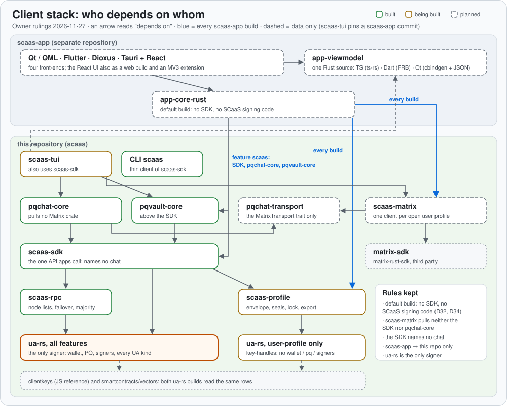
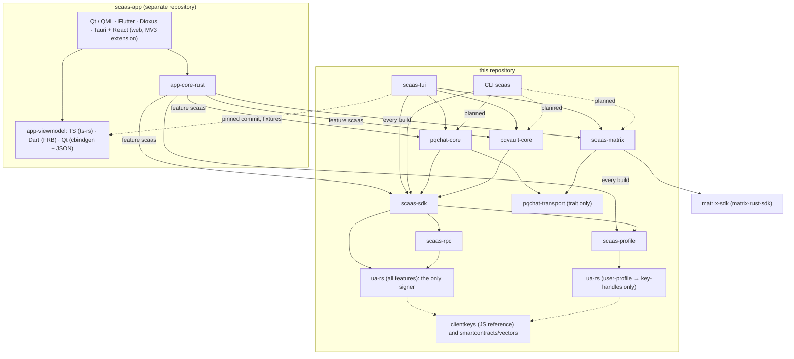

# Client stack: crates and their dependencies

Which client crate depends on which, across this repository and scaas-app (a separate repository), after the owner rulings of
2026-11-27. The rules themselves are defined once in `docs/decisions.md`; this page draws them and links each one.

## 1. The graph

Status: SPECIFIED. `ua-rs`, `scaas-rpc`, `scaas-sdk`, `pqchat-core`, `pqvault-core`, `scaas-tui` and the CLI are BUILT;
`scaas-profile` is being built (branch `user-profiles`); `scaas-matrix` and `pqchat-transport` are PLANNED (branch
`scaas-matrix`); the CLI's links to `pqchat-core`, `pqvault-core` and `scaas-matrix` are PLANNED (owner 2026-11-27,
[CLI-SDK-17](scaas-cli.md#CLI-SDK-17)); scaas-app's crates are planned in that repository.

An arrow reads "depends on". A dotted arrow is a data dependency only (a pinned commit, no Rust dependency), except the
CLI's three arrows labelled "planned", which are Rust dependencies not built yet.

## 2. The rules the graph keeps

Status: SPECIFIED.

1. **The SDK is the one API apps call, and `ua-rs` is the only signer** — every signature of a SCaaS kind goes through
   `scaas-sdk` into `ua-rs` (CLI-UAL-01).
2. **scaas-app's default build links no SDK and no SCaaS signing code.** It links `scaas-profile` and `scaas-matrix`;
   `ua-rs` is present only through `scaas-profile`, with `default-features = false, features = ["user-profile"]` (the
   `key-handles` layer: arena, handles, AEAD, HKDF, Argon2id; no `wallet`, `pq`, `signers`, kinds or native backends).
   The build's gate checks the binary's symbols and `cargo tree -e features` (scaas-app D32, D34; CLI-UPR-02).
3. **The feature `scaas` adds the SDK and the app cores** (`pqchat-core`, `pqvault-core`).
4. **The SDK names no chat** (owner 2026-11-17): chat lives in `pqchat-core` above the SDK and in `scaas-matrix` beside
   it, never inside `scaas-sdk`.
5. **`scaas-matrix` pulls neither `scaas-sdk` nor `pqchat-core`, and `pqchat-core` pulls no Matrix crate**
   (`pqchat-core`'s `tests/deps.rs`). The `MatrixTransport` trait lives in the trait-only crate `pqchat-transport`, which
   both depend on (CLI-PQC-20; the crate name is a working name).
6. **One Matrix client per open user profile.** A profile's Matrix login, session, store, keys and device id are its own;
   the store key is a sealed item of the profile; a profile switch closes the current client first (CLI-PQC-20,
   CLI-UPR-29).
7. **The CLI is a thin client of the SDK and of the app cores above it** (owner 2026-11-27, CLI-SDK-17; PLANNED for the
   app cores): it links `pqchat-core` and `pqvault-core`, each behind its own feature as `scaas-tui` does, and
   `scaas-matrix` for PqChat's Matrix transport, one Matrix client per open user profile (rule 6).
8. **Dependencies point one way:** scaas-app depends on crates of this repository, never the reverse. `scaas-tui` takes
   scaas-app's view-model fixtures by a pinned commit only (CLI-TUI-19).
9. **Byte formats change everywhere at once:** `ua-rs` and clientkeys read the same vector rows (AGENTS.md "Clients and
   vectors").
