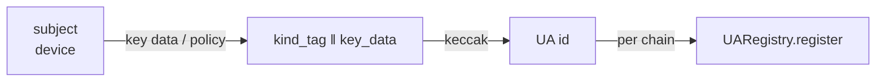
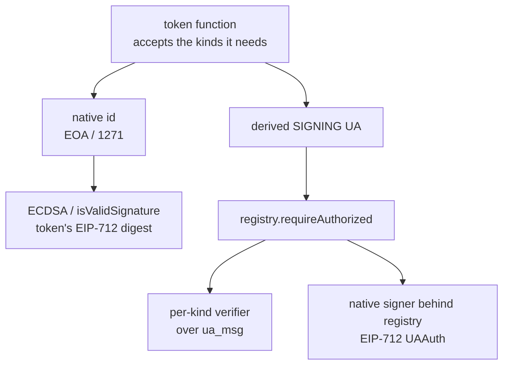
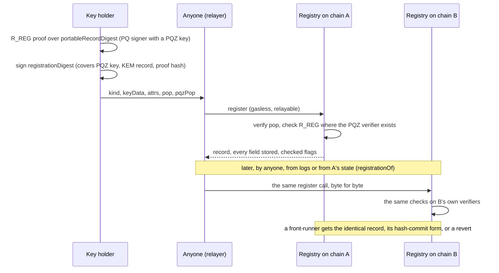
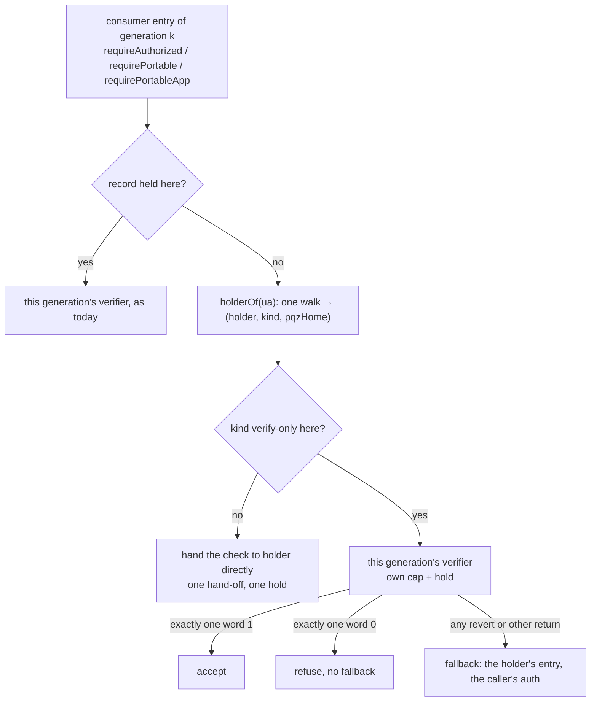
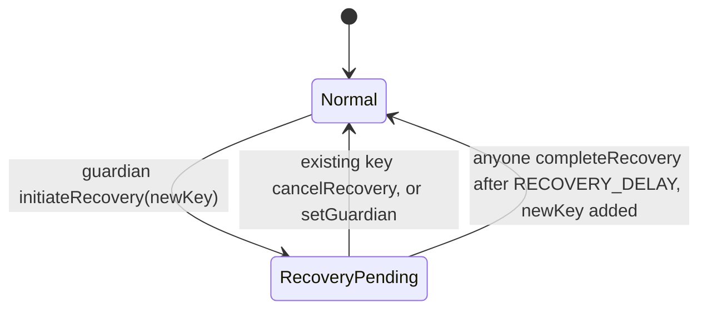

# Accounts

An account is whoever can produce a valid signature. SCaaS knows three forms of account; every contract function
names the forms it accepts.

| Form | What it is | Registration | When to use |
|---|---|---|---|
| **Native account** | The chain's own account: an EVM address (EOA, or a contract via ERC-1271), a Solana, Stellar, Aptos, Sui, Cosmos or GRAM account | none | Wallet users and anything a chain already understands |
| **Universal Account** (default) | An identifier derived from key data or from a policy — passkey, P-256, ed25519, Schnorr, BLS, MuSig2/FROST groups, weighted multisig, post-quantum keys, Zether keys | once per chain, with proof of possession, for derived kinds | The default for subjects: any key type on any family, no contract per user ([Universal Account](#universal-account)) |
| **Smart account** (optional) | `SmartKeyAccount`, an ERC-1271 contract with several keys and guardian recovery | deployed per user as a clone | A stable address across key rotation, guardian recovery, or contracts that only understand addresses ([smart account](#subjectaccount)) |

Passkeys can serve either way: as a `webauthn-p256` Universal Account, or as a key of a `SmartKeyAccount`
([passkeys on chain](#passkeys)). Delegated, capped payment from a payer's own wallet is a separate contract:
[mandates.md](mandates.md).

<p align="center"></p>

<a id="universal-account"></a>
**Contents**

1. [Universal Account (UA)](#1-universal-account-ua)
   - 1.1 [Scope](#11-scope)
   - 1.2 [Model](#12-model)
   - 1.3 [Identity](#13-identity)
   - 1.4 [Registration and proof of possession](#14-registration-and-proof-of-possession)
   - 1.5 [Keys, purposes, tags](#15-keys-purposes-tags)
   - 1.6 [Kinds](#kinds)
   - 1.7 [Function → accepted kinds](#17-function--accepted-kinds)
   - 1.8 [Registry](#registry)
   - 1.9 [Verifiers](#19-verifiers)
   - 1.10 [EIP-7702 and chain identity](#110-eip-7702-and-chain-identity)
   - 1.11 [Credentials (optional)](#111-credentials-optional)
   - 1.12 [Touchpoints](#112-touchpoints)
   - 1.13 [Migration from the legacy registry](#113-migration-from-the-legacy-registry)
   - 1.14 [Security](#114-security)
   - 1.15 [Gas and calldata (estimates; measured numbers replace them in `test/ua/UAGas.t.sol`)](#115-gas-and-calldata-estimates-measured-numbers-replace-them-in-testuauagastsol)
   - 1.16 [Vectors and tests](#116-vectors-and-tests)
2. [Passkeys on chain](#2-passkeys-on-chain)
3. [Smart account (optional): `SmartKeyAccount`](#3-smart-account-optional-smartkeyaccount)
   - 3.1 [Smart-account limitations](#smart-account-limitations)

## 1. Universal Account (UA)

A Universal Account is an account identifier for every signature scheme SCaaS supports: a native account of a chain,
or a 32-byte id derived from key data or from a policy (a multisig structure). A per-chain, admin-free registry stores
what the chain needs to verify derived ids; per-kind verifiers check signatures; tokens accept exactly the kinds each
function needs. An optional verifiable-credential layer sits on top. Status: **SPECIFIED**; the identity layer (kind table, ids, keyHash, purpose tags, digests, key-data validation) is BUILT in six libraries ([ua-libraries.md](../clients/ua-libraries.md)); the UA ledger ([CTR-UA-18](#CTR-UA-18),
[CTR-UA-19](#CTR-UA-19), [CTR-UA-26](#CTR-UA-26)) is BUILT in the token base (UA-4, plan
`docs/superpowers/plans/2026-10-12-ua4-ledger.md`); the PQ signing kinds and the `pqz-mlwe` slot are BUILT in registry
generation 1 (P6c, plan `docs/superpowers/plans/2026-10-13-p6c-pq-kinds.md`; `PqzKeyVerifier` is P6g's). The
Zether-only registry it replaced is backed up in `smartcontracts/evm/legacy/ua3/` (UA-3; [legacy registry](#legacy-registry), [migration](#migration)).
UA parity — every native-address operation for a derived UA ([CTR-UA-27](#CTR-UA-27), [CTR-UA-28](#CTR-UA-28), owner
2026-10-13) — is **SPECIFIED**, in three phases UA-5a / 5b / 5c (`TODO.md`); UA-5a (the receivers, the one-step wrap,
`burn` and `unwrapToUA` on the UA allowlist, `uaPayReceiverFee`) is **BUILT** (plan
`docs/superpowers/plans/2026-10-13-ua5a-receivers-wrap.md`); UA-5b (`UATradeOrder` on tokens, `uaWrap`, `SCaaSDex`
tagged legs) is **BUILT** on EVM (plan `docs/superpowers/plans/2026-10-13-ua5b-trade-dex.md`).

### 1.1 Scope

<a id="scope"></a>

In scope: the **UA identifier** (how an account id is derived from key data or a policy, for every key kind and account
structure supported or planned); the **kind table** (number, tag, key-data layout, id derivation, whether registration
is needed, proof of possession, verifier, families); the **per-chain registry** (EVM interface, storage, events, errors;
per-family realisation); the **verifier library** per kind, the calldata/caching policy and the gas budget; **function →
accepted kinds** for every contract function, and the UA-ledger functions that let tokens hold balances for non-native
UAs directly; **one key = one purpose**, enforced in four layers; the optional **attestation layer** (verifiable
credentials / eKYC); `SmartKeyAccount` kept as **option (b)** ([CTR-ACC-09](#CTR-ACC-09)); node,
mesh, client and ERP touchpoints, migration, security, tests and vectors.

Not in scope: a wallet or proxy contract per account (a UA is an identifier, like an EOA address); key rotation inside
one UA (new key data = a new UA; users who need a stable address across rotation use `SmartKeyAccount`); cross-chain
state sync of registrations (each chain has its own registry; the id is the same on every chain because it is a pure
function); registry-level freeze, revocation or compliance status (compliance stays in the `ComplianceRegistry`,
[CTR-AS-07](asset-suite.md#CTR-AS-07), and in token controls; the registry is monotonic); post-quantum confidential
cryptography ([pq-zero-knowledge.md](pq-zero-knowledge.md) — this file defines only the PQ **signing** kinds and how a Zether UA points
to an authorization UA); a DID method, a credential issuer, or an on-chain credential parser.

### 1.2 Model

<a id="model"></a>

Deriving and registering a UA:



- The device holds the keys (`clientkeys`, per-kind path).
- `UARegistry.register(kind, keyData, attrs, pop, pqzPop)` ([CTR-UA-07](#CTR-UA-07), UA-8; an `msig` through `registerMsig`, the typed entries [CTR-UA-36](#CTR-UA-36)) stores `{kind, registeredAt,
  keyPtr, index}`, the optional PQZ key pointer of a PQ signer ([CTR-UA-16](#CTR-UA-16)), the optional first KEM record
  ([CTR-UA-32](#CTR-UA-32)), every argument of the call ([CTR-UA-31](#CTR-UA-31)) and `keyOwner[keyHash] = ua` (one key =
  one purpose). The same call, with the same bytes, registers the UA on any other chain.

Verifying a signature in a token function (it accepts the kinds it needs):



- The registry call is `registry.requireAuthorized(ua, purpose, digest, auth)`.
- Optional: VC (issuer-signed) + VP / KB-JWT (signed by the identity UA, purpose `vp`) → relying party / attester.

### 1.3 Identity

<a id="ua-identifier"></a>
<a id="CTR-UA-02"></a>**CTR-UA-02** — **A Universal Account is an identifier derived from key data, never a contract**
(owner). For a chain's native single-key account the id is the native address/key; for every other kind
`UA = keccak256(keccak256(kind_tag) ‖ key_data)` (32 bytes), with a distinct versioned tag per kind. The registry is a
contract that stores kind data and commitments; the UA itself has no code, no storage of its own and nothing to deploy
— an EOA generalised to every signature scheme: free to create, deterministic, the same on every chain. A per-account
contract would cost a deploy per user per chain and would make the account upgradeable state.

<a id="id-space"></a>
<a id="CTR-UA-03"></a>**CTR-UA-03** — **32-byte kind-tagged ids, never a 20-byte truncation; derived ids never collide
with native ids or with each other** (owner). Every derived id must have a non-zero top 96 bits (`ua >> 160 != 0`);
the registry refuses the rest (`UAIdInNativeSpace`; honest probability 2^-96, the user derives the next index). Native
20-byte ids (EVM, Cosmos secp256k1) are zero-padded into the same 32-byte space, so on those families the two spaces
are disjoint by construction and `>> 160` tells them apart. **Canonical form everywhere** (node, mesh, client systems,
vectors): lower-case hex; a 32-byte value whose top 96 bits are zero is the 20-byte native id and is always written,
keyed and compared in its 20-byte form.

On families whose native ids are full 32-byte values (Solana, Aptos, Sui,
Soroban, GRAM) native and derived ids share one space (collision 2^-128 birthday, infeasible) but **shape cannot tell
them apart**: records, owners and subject accounts there store an explicit `owner_kind` and dispatch by kind, never by
id shape. Different kinds over the same point give different ids because the tag differs (Schnorr-bls12381 over `Y` ≠
Zether-bls12381 over `Y`). A 20-byte truncation of a policy hash would share the address space with EOAs: grinding an EOA
key and a multisig policy to the same 20 bytes is a 2^80 birthday search, after which the grinder spends the
"multisig" alone. Cost: ids are 12 bytes longer in calldata (192 gas per id at 16 gas/byte). Non-EVM passkey owners
follow the same rule ([NET-ALL-21](../networks/README.md#NET-ALL-21)).

<a id="keccak"></a>
<a id="CTR-UA-04"></a>**CTR-UA-04** — **One hash function for ids in every family: keccak256.** The EVM opcode; native
host functions on Solana (`sol_keccak256`), Soroban (`crypto().keccak256`), Aptos (`aptos_hash::keccak256`), Sui
(`hash::keccak256`), GRAM (`HASHEXT` keccak256); pure Rust in CosmWasm (a few thousand gas units for a software keccak).
The same key data gives the same UA on every chain of every family.

<a id="kind-table"></a>
<a id="CTR-UA-05"></a>**CTR-UA-05** — **Kind numbers and tags are fixed by the kind table and shared by every family; a
registry generation supports a fixed set of kinds.** Adding a kind is a new registry generation and a new row with
vectors. A kind is enabled on a chain only if the registry generation was deployed with a verifier for it. Kinds are
part of the id; a mutable kind table would be an admin key over every account. New schemes wait for a new registry
generation and new token implementations that point to it. A later generation may also carry a kind a predecessor enables
**verify-only** ([CTR-UA-58](#CTR-UA-58)): it verifies that kind's records with its own verifier and does not support it for
registration; the kind keeps its number, tag and home generation.

### 1.4 Registration and proof of possession

<a id="registration"></a>
<a id="CTR-UA-06"></a>**CTR-UA-06** — **Native ids need no registration; every derived kind must be registered before
it can sign or receive, and every derived kind is registrable on every chain whose registry has its verifier — also where
the same key is a native account** (owner; the last clause owner 2026-10-17: kinds are the same on every chain, so a
chain never refuses a kind because its own accounts use that key type). A native key that registers gets the derived id
`keccak256(TAG(kind) ‖ key_data)`, which differs from its native id and is the same on every chain: a Phantom ed25519
key registers `ed25519` (0x0102) on Solana as on EVM, a MetaMask secp256k1 key registers `secp256k1` (0x0108) on EVM as on
Solana; the native id keeps working without a record (the native kinds 0x0001–0x0018 have no record and are not in the
per-kind list, CTR-UA-29), and the two ids are separate accounts. Native = an EVM EOA and any EVM contract account (ERC-1271), Hedera native accounts,
Solana ed25519, Stellar/Pi `G…`, Soroban `C…` contract accounts, Aptos native accounts (any native auth key incl.
MultiKey), Sui native addresses (incl. native multisig, passkey flag 6, zkLogin), Cosmos native accounts, NEAR accounts (named
and implicit), Algorand addresses. **GRAM is the
exception:** a GRAM wallet is a contract, so the native GRAM account is the wallet contract address (registration-free
like ERC-1271). Every derived kind registers on each chain where it is used. Registration is where PoP and
one-key-one-purpose are enforced; receiving to an unregistered derived id is refused, so a typo reverts instead of
burning funds. One registration per chain (bn254 ≈ 75 k gas).

<a id="pop"></a>
<a id="CTR-UA-07"></a>**CTR-UA-07** — **Proof of possession is portable: it binds the UA, its attributes and the PQZ proof — not a chain, a
registry or the caller** (owner 2026-10-25, UA-8 P1/P2; the records as typed EIP-712 structs owner 2026-10-31, `typed-signing`; the
exact strings and the single signed digest are controller calls, owner may override; [decisions.md](../decisions.md)). The registry
accepts only this form:

```
DS_P                 = keccak256(abi.encode(keccak256("EIP712Domain(string name,string version)"),
                                            keccak256("SCaaS UA Portable"), keccak256("1")))
                     = 0x9a2c390d4dc940ccdb5fa6b21e673e87159bdd99aeef22ea791bcea9efc64ca1
typed(s)             = keccak256(0x1901 ‖ DS_P ‖ hashStruct(s))              what eth_signTypedData_v4 returns for s

pqzKeyHash           = keyHashOf(0x0142, pqzKey)                             0 without a PQZ key
pqzPopHash           = keccak256(pqzPop)                                     the R_REG proof; 0 only without a PQZ key
kem                  = UAKemRecord{ua, 0, scheme, keccak256(kemPk)}          the zero record UAKemRecord{ua, 0, 0, 0} without a KEM key
record               = UAPortableRecord{ua, kind, pqzKeyHash, kem}           kind = the registering kind
portableRecordDigest = typed(record)
registrationDigest   = typed(UARegistration{record, pqzPopHash})
pop                  = the signer's signature over  uaMessage(kind, PURPOSE_POP_V2, registrationDigest)
R_REG proof          = over                         uaMessage(0x0142, PURPOSE_POP_V2, portableRecordDigest)
```

| Struct | Type string (`encodeType`: primary, then referenced types sorted by name) | typehash |
|---|---|---|
| `UAKemRecord` | `UAKemRecord(bytes32 ua,uint64 version,uint8 scheme,bytes32 kemPkHash)` | `0x0ab7989827627b89c268e88a0a0b06b62aefa70b0a466014931ca44acfa9a201` |
| `UAPortableRecord` | `UAPortableRecord(bytes32 ua,uint16 kind,bytes32 pqzKeyHash,UAKemRecord kem)UAKemRecord(bytes32 ua,uint64 version,uint8 scheme,bytes32 kemPkHash)` | `0x0c1553cfab3c35326558484df79963dced75ead85272d2a85985f264757bfe7f` |
| `UARegistration` | `UARegistration(UAPortableRecord record,bytes32 pqzPopHash)UAKemRecord(bytes32 ua,uint64 version,uint8 scheme,bytes32 kemPkHash)UAPortableRecord(bytes32 ua,uint16 kind,bytes32 pqzKeyHash,UAKemRecord kem)` | `0xc78b548ceb2fadf1f0a895f79f88b517327c120f0f9ab345f02981441048c87e` |
| `UAPqzKey` | `UAPqzKey(bytes32 ua,bytes32 pqzKeyHash)` | `0x827d90728b100bc830d06b04dd2b9b5f7853adaa05502b4082875f881d925a00` |
| `UAPqzKeyRecord` | `UAPqzKeyRecord(UAPqzKey key,bytes32 pqzPopHash)UAPqzKey(bytes32 ua,bytes32 pqzKeyHash)` | `0xaba20a80603724f71232573a76d2506ae38f60f39ea9cd8e71f4b64775dd7567` |
| `UAMembership` | `UAMembership(bytes32 ua,bytes32 member)` | `0x2ffb61cab130ef54f9af88d7255ca81c570651b2562c2c368286a1f43bfe5cb4` |
| `UAMsigUpdate` | `UAMsigUpdate(bytes32 ua,bytes32 chainUid,address registry,uint64 version,uint16 threshold,UAMsigMember[] members,uint256 enabled,uint64 validUntilBlock)UAMsigMember(uint16 kind,bytes32 id,uint16 weight)` | `0x4f444098cb5d1c5e604d10d13c9c803ac8429ef9938342ded6997343b9c48ac6` |
| `UAMsigMember` | `UAMsigMember(uint16 kind,bytes32 id,uint16 weight)` | `0x49ee2633d577df4283fdcf2546b6c8b72f1e3cddb2449cefdfc6eed31e26a05a` |

| Record | Signed or proven message | Who |
|---|---|---|
| `register` PoP | `uaMessage(kind, PURPOSE_POP_V2, typed(UARegistration{record, pqzPopHash}))` | the key (every single kind); PQ-eligible `msig` members |
| `R_REG` at `register` / `storePqzPop` of a `register` key | `uaMessage(0x0142, PURPOSE_POP_V2, typed(record))` | pqz prover |
| `setKemKey` (version ≥ 1) | `uaMessage(kind, PURPOSE_KEM, typed(UAKemRecord{ua, version, scheme, kemPkHash}))` | KEM holders ([CTR-UA-32](#CTR-UA-32)) |
| `setPqzKey` | `uaMessage(kind, PURPOSE_PQZ_KEY, typed(UAPqzKeyRecord{UAPqzKey{ua, pqzKeyHash}, pqzPopHash}))` | PQZ holders ([CTR-UA-16](#CTR-UA-16)) |
| `R_REG` of a key from `setPqzKey` | `uaMessage(0x0142, PURPOSE_PQZ_KEY, typed(UAPqzKey{ua, pqzKeyHash}))` | pqz prover |
| `acceptMembership` ([CTR-UA-37](#CTR-UA-37)) | a native member `typed(UAMembership{ua, member})`; a derived member `memberDigest(ua, uaMessage(MSIG, PURPOSE_MEMBERSHIP, typed(UAMembership{ua, member})))` under `member` | each `msig` member |
| `updateMsig` ([CTR-UA-44](#CTR-UA-44)) | a native member `typed(UAMsigUpdate{ua, chainUid, registry, version, threshold, members, enabled, validUntilBlock})`; a derived member `memberDigest(ua, uaMessage(MSIG, PURPOSE_MSIG_UPDATE, ·))` under `member` | a threshold of the stored structure |
| Zether PoP (`0x0141`) | Schnorr over `uaMessage(0x0141, PURPOSE_POP_V2, typed(UARegistration{UAPortableRecord{ua, 0x0141, 0, UAKemRecord{ua, 0, 0, 0}}, 0}))` | zether-prover |

`PURPOSE_POP_V2 = keccak256("scaas.ua.purpose.pop.v2")` (the versioned tag `scaas.ua.purpose.pop.v2`; the v1 tag and the
chain-bound `popDigest` are gone from the registry and live in `smartcontracts/evm/legacy/ua8/`). The domain has only `name` and
`version`: **there is no chain key, no `chainUid` and no registry address in any of it**, so the same registration is valid on every
chain whose registry enables the kind ([CTR-UA-31](#CTR-UA-31)). `kemPkHash` is over the whole assembled key, scheme byte
included, `scheme = kemPk[0]`. Every struct field is a 32-byte word or a nested struct hash (`uint16`, `uint64` and `uint8` left-padded),
so every family computes the same bytes with its keccak256; the typed form is the EVM family's wallet-readable form, and other
families hash the records byte-identically and keep their own readable form ([NET-ALL-23](../networks/README.md#NET-ALL-23)).
`kind` is the `uint16` id only: no string field and no parameter-set field (owner 2026-10-31); the name comes from the kind
table or `kindName` ([CTR-UA-35](#CTR-UA-35)). The raw `abi.encode` digests and their `KEM_RECORD_TAG` / `PQZ_KEY_RECORD_TAG` are in
`smartcontracts/evm/legacy/typed-signing/`; `pqz-core` is unchanged (the `R_REG` message stays 32 bytes).
The proof is made first, then signed: `pop` covers `pqzPopHash`, and the proof's own message (`portableRecordDigest`) does
not contain its hash, so there is no cycle; one signature therefore covers the UA, the PQZ key, the KEM record and the proof.

Every kind signs `registrationDigest` the same way, under its own scheme (Zether `0x0141` and the group kinds keep theirs;
only the message changed). A PQ-eligible `msig` signs with its m-of-n (`MemberSig[]`, derived members under
purpose `member`, an `msig` member one level down, [CTR-UA-38](#CTR-UA-38)): **each derived member signs `memberDigest` over `uaMessage(MSIG, PURPOSE_POP_V2, registrationDigest)`**, so a PoP
that holds a PQZ key or a KEM record is signed by every member over those hashes too. **A native member signs the record's typed digest
itself** (owner 2026-10-31; replaces the EIP-191 `personal_sign` of `memberDigest`): an EOA — code-less, or an EIP-7702 designator —
signs the digest `eth_signTypedData_v4` returns for the record (65-byte `r ‖ s ‖ v`, low s) by its own key only, never ERC-1271 through
the delegate; other code (a contract wallet) ⇒ ERC-1271 `isValidSignature(typedDigest, sig)` only ([CTR-UA-24](#CTR-UA-24), owner ruling D1
of 2026-10-30, so a member delegated on one chain and not on another still signs one portable `pop`). The record's `ua` binds the
structure, its struct type the operation. This holds for the three portable purposes (`pop` v2, `kem`, `pqz-key`) and a member's acceptance ([CTR-UA-37](#CTR-UA-37)) only, every other
purpose keeps the EIP-712 `UAAuth` ([CTR-UA-24](#CTR-UA-24)). So an `msig` PoP with native members is portable too, and the member's
wallet shows the record's fields, not a hash. Members come typed ([CTR-UA-36](#CTR-UA-36)), so `abi.encode(MemberSig[])` is only the
stored form and there is no second encoding of one signature to refuse. A classical-dominant `msig` has no PoP of its own (its
members proved theirs) and registers with an empty `pop`; where a member's own registration was only attested by a relayer
([CTR-UA-34](#CTR-UA-34), Soroban), "proved theirs" is false for that member and the `msig`'s `CHAIN` mark says only that its `pop`
holds nothing unverified.

**Minimal form of a stored `msig` signature** (owner 2026-10-31, scope controller call under the owner's rule: with `T` = the
slots' total weight and `N` the threshold, require `T ≥ N` and, for every slot `i`, `T − weight(i) < N` (each slot necessary)).
It applies to the three portable purposes, the signatures the registry stores and copies byte for byte (`pop` v2, `kem`, `pqz-key`):
`UARegistry._msig(…, portable = true)` on EVM, `check_msig(…, portable = true)` on Soroban, one pass summing `T` and keeping the
smallest slot weight `w_min` (accept iff `T ≥ N` and `T − w_min < N`), every slot counting its member's weight, native members
included. Failure is `UAPoP` in `register` and `UAUnauthorized` in `setKemKey` / `setPqzKey` (Soroban: `Pop` / `Unauthorized`); no new
error, no ABI change. A transaction authorisation (`requireAuthorized`) is not stored and keeps its rule (a slot after the threshold
fails). A front-runner that drops a slot from a valid `pop` gets a refusal, and `clientkeys` and `ua-rs` build only minimal sets.
**BUILT** on EVM (ua-portable-soroban M2) and Soroban (M3). NEAR UA round: requirement, to be built in that family's own UA registry; Algorand
UA round: requirement, to be built in that family's own UA registry (neither has a UA registry today, [NET-ALL-84](../networks/README.md#NET-ALL-84)).

**Minimal form of a stored `msig` signature** (owner 2026-10-31, U8S-D1: with `T` = the slots' total weight and `N` the threshold,
require `T ≥ N` and, for every slot `i`, `T − weight(i) < N` (each slot necessary)). It applies to the three portable purposes, the
signatures the registry stores and copies byte for byte (`pop` v2, `kem`, `pqz-key`): `UARegistryCoreLib._msig` on EVM, one pass summing
`T` and keeping the smallest slot weight `w_min` (accept iff `T ≥ N` and `T − w_min < N`), every slot counting its member's weight,
native members included. Failure is `UAPoP` in `register` and `UAUnauthorized` in `setKemKey` / `setPqzKey`; no new error, no ABI change.
A transaction authorisation (`requireAuthorized`, `UARegistry._msig`) is not stored and keeps its rule (a slot after the threshold
fails). A front-runner that drops a slot from a valid `pop` gets a refusal. A `bls12381-multi` (`0x0121`) signature takes the same rule inside the kind on those paths (every signer necessary, through
`verifyMinimal`), the verify path keeping surplus weight ([CTR-UA-50](#CTR-UA-50)).

The PQZ key and the KEM record are the fields not implied by `keyData`; the signer's PoP covers their hashes, so a
front-runner can neither strip them (the PoP over the real hashes fails over the zero record) nor swap them (another key changes the
hash). The `R_REG` proof is over the same portable record under the kind tag `0x0142`, so it is bound to the signer's
id (a proof made for another UA fails) and to nothing else. `register` derives no state from `msg.sender` or from any unsigned
argument, so **anyone** may submit it (gasless, relayable) and a front-run yields the identical record, the hash-commit form of
it, or a revert: both forms of a KEM key sign the same `UAKemRecord`, so the form is the submitter's choice ([CTR-UA-32](#CTR-UA-32)
has the client's repair; owner 2026-11-01, option (a)). A
future field taken from `msg.sender` or left unsigned would turn front-running into capture; tests T-REG-3/3b guard it.

Registration, and the copy of it to a second chain (the copy sends the same fields; a client or a relayer service can do
it for any UA it sees, from the logs or from state, [CTR-UA-31](#CTR-UA-31)):



<a id="rogue-key"></a>
<a id="CTR-UA-08"></a>**CTR-UA-08** — **Rogue-key protection is decided per aggregate kind** (owner: the MuSig2/FROST
kinds stay and are made checkable):

| Kind | Approach | Why |
|---|---|---|
| `msig` (independent signatures, weighted threshold) | **per-member registration**: every member is a native id or a registered single-key UA (each with its own PoP), kinds ∈ MEMBER | no key aggregation happens, so there is no rogue key; members' keys are still proven once |
| `musig2-secp256k1`, `musig2-bn254` | **BIP-327 KeyAgg recomputed on chain** from the registered member list **plus** one aggregate PoP by the result | the coefficients defeat rogue keys; MuSig2 is n-of-n, so a valid PoP by `KeyAgg(list)` proves every listed key took part |
| `frost-secp256k1`, `frost-bn254` | **group key = Σ of the DKG constant-term commitments, each with its PoK, checked on chain** **plus** one group PoP | RFC 9591 leaves DKG out; the FROST paper's KeyGen round-1 PoK is the standard defence; the chain checks it instead of trusting it |
| `bls12381-multi` | **every member's PoP over distinct per-member messages** bound to the group's registration digest, under `DST_MULTI_POP`, n + 1 pairings on chain ([CTR-UA-49](#CTR-UA-49)) | all n prove possession, so every subset's aggregate key is safe; argued in the algebraic group model, an external-audit item (UNAUDITED) |
| threshold ECDSA (MPC providers) | not a kind: the output is an ordinary ECDSA signature by an address ⇒ **native EOA** | the chain cannot tell, and need not |

Each defence is the one native to the scheme, and the registry checks it rather than trusting a hash of it. Group
metadata the chain cannot check is listed as **attestation-only** ([MuSig2 and FROST](#musig2-and-frost-what-the-registry-checks)):
a FROST share distribution that went wrong off chain (a bad VSS share, one party simulating several participants) is
invisible to the chain.

<a id="structures"></a>
<a id="CTR-UA-09"></a>**CTR-UA-09** — **Structures commit to their members; verification goes two levels.** `msig` key data lists
members by `(kind, id, weight)`, strictly sorted by id. A member may be an `msig`, beside signing members, and verification goes two levels only: an
`msig` that holds an `msig` member cannot itself be a member ([CTR-UA-38](#CTR-UA-38), owner 2026-11-02). A `bls12381-multi` group
(`0x0121`) is a structure too: its member keys are in its own key data, and it adds no level ([§1.6.2](#bls12381-multi),
owner 2026-11-19). The call takes the
structure typed (`registerMsig`, [CTR-UA-36](#CTR-UA-36)); the registry assembles these bytes, so the id is the packed form's. Bounded gas (§1.8 step 4), no
cycles: an id hashes the key data that holds its members' ids, and a member is registered first. `SmartKeyAccount` or Safe (native 1271) as a member is another way to
two-level governance. A stored signature of an
`msig` (`pop`, KEM, PQZ key) is **minimal** at each level: every slot necessary, see [CTR-UA-07](#CTR-UA-07) (owner 2026-10-31).

<a id="registration-gate"></a>
<a id="CTR-UA-25"></a>**CTR-UA-25** — **No on-chain registration gate in v1** (owner): registration spam is bounded by
the node's sponsorship limits ([NODE-SPN-01](../node/sponsorship.md#NODE-SPN-01)); self-paid spam pays its own gas. An
immutable `IRegistrationPolicy` (invite / attested) per registry generation is the alternative if ever needed.

<a id="portable-registration"></a>
<a id="CTR-UA-31"></a>**CTR-UA-31** — **A registration is portable: the same record bytes on every chain, anyone copies it, every field is
in state, and `checked` says what the chain verified** (owner 2026-10-25: an account registered on Ethereum may be registered by anyone
on another chain from exactly that information; a UA account does not depend on the chain, its
transactions do; scope every family, owner 2026-10-29; details are controller calls, owner may override;
[decisions.md](../decisions.md)).

- **Copying.** The UA id is chain-independent already ([CTR-UA-03](#CTR-UA-03)); with the portable PoP ([CTR-UA-07](#CTR-UA-07))
  the registration is too. Copying a UA to another chain is sending the same `register(kind, keyData, attrs, pop, pqzPop)` (an `msig`: the same
  `registerMsig`, [CTR-UA-36](#CTR-UA-36)) to that chain's registry; the submitter pays the gas. Transactions stay chain-bound (`UAAuth` domain, [CTR-UA-24](#CTR-UA-24); the
  mtx envelopes). The kind must be enabled in the target registry's generation; a registry that lacks the verifier of a kind
  refuses it as any disabled kind (`UAKindDisabled`), the record stays valid elsewhere. A PQZ key on a registry without the PQZ
  verifier is *not* refused: it is stored unproven ([CTR-UA-16](#CTR-UA-16)). `keyOwner` uniqueness stays per chain.
- **Every field in state.** `register` stores `abi.encode(keyData-rest, pop)` and `pqzPop` and each KEM version's
  `pk ‖ sig` as SSTORE2 chunks of at most `BLOB_CHUNK` = 32,768 B (the largest `msig` PoP the gas bound admits on a chain with a
  larger `verifyBudget` exceeds one 64 KiB code blob); the PQZ key keeps its own single pointer (`PqzCore` checks its code
  length); `keyData` is stored once (the stored-kind key in `keyPtr`, the rest in the blob). So `registrationOf(ua)` returns
  exactly the `register` arguments — `(kind, keyData, attrs, pop, pqzPop)` — and anyone rebuilds the call from state when
  logs are gone (history expiry); the event `UARegistered` carries the same bytes except `pop`, which it carries as
  `popHash = keccak256(pop)` ([CTR-UA-33](#CTR-UA-33): one rule on every family; `pop` is read with `popOf` /
  `registrationOf`). An `msig` is the exception on EVM (owner 2026-11-03, CTR-UA-33 A): state keeps `keccak256(pop)` and a hash per slot,
  the slots' bytes are in `UAMemberSig`. A PQZ key added later by `setPqzKey` is not
  in `attrs` (read it with `pqzKeyOf`, `pqzPopOf`, `pqzKeySigOf`); its bytes are at the SSTORE2 pointer `pqzKeyOf(ua).ptr`
  (`eth_getCode(ptr)` without the leading `STOP` byte), as `recordOf`'s. Cost [measured, A8]: a registration with a
  stored PQZ proof is 84.7–108.9 M gas (regular + state, [§1.15](#gas)), more than a 60 M block, so on such a chain the proof
  goes by `storePqzPop` ([CTR-UA-16](#CTR-UA-16)).
- **`checked` (UA-8 P11.3, the EVM form).** Each part of a record carries who verified it: `NONE` = 0, `CHAIN` = 1, `RELAYER` = 2 (+ the
  relayer id on families that run the relayer-checked mode); these code points are shared by every family (`portable.json`).
  On EVM everything the registry stores is verified on chain, so `checked` is **derived, not stored**:
  `checkedOf(ua) → (pop, pqzPop, kem)` = `(CHAIN, proven ? CHAIN : NONE, KEM key stored ? CHAIN : NONE)` (a hash-committed KEM key reads `NONE` until it is filled, [CTR-UA-32](#CTR-UA-32); an unproven PQZ proof
  reads `NONE`: it is not yet stored or not yet checked; `NONE` for all three on an unregistered id), and the events carry them where the verdict varies:
  `UARegistered` carries all three (`checkedPop`, `checkedPqzPop`, `checkedKem`) and `UAPqzPopStored` carries `checkedPqzPop`; `UAPqzKeyAdded` has no
  field (its key is `NONE` until the `UAPqzPopStored` that proves it) and `UAKemKeySet` has none (always `CHAIN` on EVM).
  Clients of a family in relayer-checked mode re-verify before they use a key read from there (spec P11).
- **Generations** (the registry line, [§1.8.1](#registry-line)). A generation forwards the views (`registrationOf`, `popOf`,
  `kemKeyOf`, `kemKeyAt`, the key and `msig` readers) of a record it does not hold to `holderOf(ua)` directly, and the PQZ views to
  the record's PQZ home ([CTR-UA-70](#CTR-UA-70), [CTR-UA-71](#CTR-UA-71)); `setKemKey`, `acceptMembership` and `updateMsig` for
  such a UA go to the generation that holds the record (`UAUnauthorized` here), and the PQZ writes (`storePqzPop`, `setPqzKey`,
  and their scoped forms) to `pqzHomeOf(ua)`, their signature checked by the holder ([CTR-UA-59](#CTR-UA-59)). **Indexers read
  every generation of the line** ([CTR-UA-65](#CTR-UA-65)): a PQZ home emits the PQZ events (`UAPqzPopStored`, `UAPqzKeyAdded`)
  for the records it hosts, and each generation `UARegistered` only for its own. A generation without `0x0142` behind one with
  it refuses a PQZ key for its own records, `UAKindDisabled(0x0142)` before `UAPqzHolder` (the order of the checks is the order
  of the steps, [§1.8](#registry); built only under the owner's override, CTR-UA-71).
- **Relaying** (owner 2026-10-30, ruling R-node; node built on `ua8` in `64c233d4`, `4d4509e7`, `51b0c027`). The node relays every registry write ([CTR-UA-36](#CTR-UA-36): `register`, `registerMsig`, `registerWebAuthn`, `registerMuSig2`, `registerFrost`, `setKemKey`,
  `storePqzPop`, `setPqzKey`, `acceptMembership`; and `updateMsig`, [CTR-UA-44](#CTR-UA-44)) as ordinary `call` jobs (`kind = "call"`, target = the registry, calldata): its call table has a row for
  each of the nine selectors under the guard rule `Rule::UaRegistry` — the target must be a generation of the chain's
  `[[chains]] ua_registries` (node config, the registry line validated on chain at start, [CTR-UA-65](#CTR-UA-65); unset ⇒ all
  nine are refused `CALL_TARGET_REFUSED`), be bound to this chain (`chainUid()`) and be neither a
  registered token nor the token factory ([NODE-JOB-19](../node/job-api.md#NODE-JOB-19)). The gateway's `~gateway` sponsor policy is
  specified to cover all nine ([NODE-GW-03](../node/gateway.md#NODE-GW-03)), but the gateway route `POST /v1/ua/register` and the
  sponsor policy are **not built** (no route, no sponsor-policy code; `TODO.md`): today relaying goes through job-API `call` jobs
  only. The node lists every generation of the line, so a write for a record of any generation is relayable; a write sent to
  the wrong generation is refused before sending by name, `UA_VERIFY_ONLY` / `UA_WRONG_GENERATION` with its target
  ([CTR-UA-65](#CTR-UA-65); was: one registry per chain, the writes for generation-1 records not relayable once a generation 2
  ran). No new job kind, no fee form (there is no token to
  take a fee from; a relayer that wants payment arranges it off chain). A relayed PQ registration **splits** (`register` / `registerMsig` without
  `pqzPop`, then `storePqzPop`) when the full call's `eth_estimateGas` exceeds **min(block gas limit, the relayer's per-transaction cap)**
  (`max_gas_per_tx`, plus the protocol caps 2^32−1 and, before Amsterdam, 2^24) or the estimate itself is refused for gas ("… exceeds
  allowance"): the node then refuses that `register` with its proof as `UA_REGISTER_SPLIT: <why>; send register without pqzPop,
  then storePqzPop` and sends nothing; every other write, and `register` without the proof, gets the ordinary gas refusals. A
  `storePqzPop` over the cap has no split option (ordinary refusal; see the `n2816-kmax65536` watch item in `TODO.md`).
  The SCaaS testnet's relayer cap stays 64 M (`max_gas_per_tx`), so there a relayed PQ registration with its proof (84.7–108.9 M) always
  splits, while a direct submitter (`e2e.py`) compares with the 200 M block only.
- **A submitter's choice of signatures.** For an `msig` any quorum's signatures are valid, so a front-runner that holds a
  quorum's signatures can submit a different valid subset first: the stored `pop` / `sig` differs, the key, the version and
  the id do not. Nothing depends on which valid subset is stored.
- **Family status.** EVM: built (UA-8 Part A). Soroban: the registry and the portable `register` (empty `attrs`) are **BUILT** in UA-Soroban on branch `ua-soroban` ([NET-SOR-17](../networks/soroban.md#NET-SOR-17)), on the typed digests since `typed-signing`; UA-8 Part B (`ua-portable-soroban`: attributes, KEM records, PQZ attributes stored unproven, `checked = Relayer`, the relayer-checked mode, `call` jobs) is **built, local end-to-end passed; done only after B10**, the Stellar testnet run ([NET-SOR-27](../networks/soroban.md#NET-SOR-27)). Other families: their own UA family rounds; NEAR and Algorand are separate rounds, neither has a UA registry yet.

<a id="CTR-UA-33"></a>**CTR-UA-33** — **The registration event carries `popHash`; `msig` members sign without key data; WebAuthn blobs canonical only** (owner 2026-10-30;
[decisions.md](../decisions.md)). One rule on every family that has a UA registry:

- **A.** The registration event (`UARegistered` on EVM, `UaRegistered` on Soroban, the equivalent elsewhere) carries
  `popHash = keccak256(pop)` (`keccak256("")` for an empty `pop`) instead of `pop`. `pop` stays in contract state, read with
  `popOf(ua)` / `registrationOf(ua)`; the record is rebuilt from the log plus `popOf`, or from state alone. Every other
  argument (`keyData`, `attrs`, `pqzPop`) and the `checked` values stay in the event. On Soroban (owner 2026-11-01) `key_data`
  stays too unless it is over 15,360 B, when `UaRegistered` carries it empty, by its length alone: the id stays the topic and
  `record_of` / `registration_of` return the bytes. Only a `frost-bn254` key reaches that, under the 16,384 B events limit.
- **A, an `msig` on EVM** (Change, owner 2026-11-03, built on `msig-nested`). An `msig` record keeps no `pop` bytes: state keeps
  `keccak256(pop)` of the exact bytes the registry hashed (the `abi.encode(MemberSig[])` it assembled from the typed list) and, per slot of
  the `pop`, `keccak256` of that member's signature object (the slot's `sig`, or an `msig` member's `abi.encode(InnerSig[])`), written once
  with the slot's bit; `memberSigHashOf(ua, index)` returns it. Each slot's bytes go in one event,
  `UAMemberSig(ua, member, index, purpose, sig)`, `ua` and `member` indexed, `purpose` = `PURPOSE_POP_V2`, emitted in index order before
  `UARegistered`. **`popOf(ua)` of an `msig` returns that 32-byte hash as its `bytes`**, as does `registrationOf`'s `pop`; empty for an
  empty `pop`, and then no hash is written. A reader tells which by the record's kind (`kindOf`, `recordOf`): every single-key and derived
  kind keeps its `pop` bytes in state, unchanged. So for an `msig` "from state alone" no longer holds: the record is state plus its events.
  A copy rebuilds the `pop` from the `UAMemberSig` events of purpose `pop`, in `index` order, checks each slot against `memberSigHashOf` and
  the whole against `popOf`, and sends `registerMsig` to the new registry, which verifies it. The node keeps and serves these events'
  bytes ([NODE-IDX-08](../node/indexer-feeds.md#NODE-IDX-08), SPECIFIED). **Staging:** every other family keeps storing an `msig`'s
  `pop` until its own round (Soroban's `registration_of` returns it, [NET-SOR-28](../networks/soroban.md#NET-SOR-28)).
- **A, the `pop` slot set in state** (Change, owner 2026-11-08; BUILT on EVM and Soroban, plan T66a `4cbe89cd`, `00414d6f`,
  `65afdcff`; tests `test_popSlotsOfFromVectors`, `test_popSlotsOfLaterAcceptanceSetsNoPopBit`, `test_nestedVectors_popSlotsOf`).
  `popSlotsOf(ua) → (uint16[] index, bytes32[] hash)` returns the slots that signed the `msig`'s `pop`, in index order, each with
  its `memberSigHashOf` hash: one word per `msig` (`UAStore.Layout` slot 19 `popSlots`, appended; slots 0–18 unmoved,
  `UAStoreLayout.t.sol`), written once at `register`, never by `acceptMembership`; empty for an empty `pop` and any other id; gen 2
  forwards gen-1 records; `popOf` unchanged. So state alone tells which slots signed the `pop` and which accepted later
  (`memberAccepted`); a copy ([CTR-UA-31](#CTR-UA-31)) takes the slot set from state and only the slots' bytes from `UAMemberSig`.
  Soroban: `Key::PopSlots(ua)`, `pop_slots_of(ua) → (Vec<u32>, Vec<BytesN<32>>)`, each hash `keccak256` of the slot's `sig`.
  NEAR, Algorand: in their UA rounds. Gas: the word adds +12,178 regular and +97,920 state gas to `register` of an `msig` with a
  non-empty `pop` (measured at T66a).
- **B.** In `UASig.members` (`MemberSig[]`, [CTR-UA-36](#CTR-UA-36); also the `pop` of `registerMsig` and the KEM / PQZ-key signatures of an `msig`), a
  `MemberSig` has no key data at all (`{index, members, sig}`, owner 2026-11-02, [CTR-UA-38](#CTR-UA-38)): a native member has none, a registered member's key is read from its own record — `vk` at `keyPtr` for the
  stored kinds, the key data in the registration blob for the classical kinds — the key bytes only, never the member's
  `pop`, whose length the member chose (every member is registered or native, §1.8 step 4). On EVM the rule is tied to the
  purpose `member`: `requireAuthorized(id, PURPOSE_MEMBER, …)` takes a `UASig` with an empty `keyData` for every derived
  id, so a gen 2 hands a member of a gen-1 kind to gen 1 with the empty key data and gen 1 reads its record; other purposes
  keep `keyData` + `signature` with the key data of a classical kind.
- NEAR and Algorand have no UA registry and no registration event: their `msig` members are key ids inside the structure,
  never registered, and each member signature carries its key (their own auth formats); A and B have nothing to apply to there.
- **C. WebAuthn signature blob: canonical encoding only** (owner 2026-10-30, every registry). A `webauthn-p256` signature
  `abi.encode(bytes authenticatorData, bytes clientDataJSON, bytes32 r, bytes32 s)` is accepted only when byte-equal to its
  canonical re-encoding: head offsets 0x80 and 0x80 + 32 + pad32(len(authenticatorData)), each dynamic field = 32-byte
  length ‖ data ‖ zero padding, no trailing bytes. Anything else fails before any field or signature check. So one
  signature has one byte string: a front-runner cannot register the same id with other `pop` bytes (another `popHash`,
  [CTR-UA-07](#CTR-UA-07)'s identical record), and a WebAuthn member's `MemberSig.sig` has one byte string too. On EVM
  `WebAuthnP256Verifier` enforces it for `verifyPop` and `verify` alike: `register`'s PoP, the portable `msig` records,
  `requireAuthorized` (tokens' relayed operations, `msig` member slots). `SmartKeyAccount` (CTR-ACC-08) applies the same
  rule in its own decoder, and so do the client verifiers (`clients/ua-rs`, the `clientkeys` reference verifier), so no
  client accepts a blob a registry refuses (owner 2026-10-30, `webauthn-clients`).

<a id="kem-keys"></a>
<a id="CTR-UA-32"></a>**CTR-UA-32** — **KEM (chat) key records: signed, versioned, write-once in any order, never revoked, 1,601 bytes (scheme byte + key)** (owner
2026-10-25, UA-8 P4/P5/P7; scheme byte owner 2026-10-30; the vector keys and the signature format are controller calls, owner may override;
[decisions.md](../decisions.md); the chat protocol is UA-7's).

- **Scheme.** One scheme only: ML-KEM-1024 + X25519 (the X-Wing-style combiner of the CFRG hybrid-KEM draft with ML-KEM-1024),
  public key 1,600 B (ML-KEM-1024 `ek` 1,568 B ‖ X25519 `pk` 32 B), ciphertext 1,600 B, shared secret 32 B. **The first byte of
  `kemPk` is the scheme id** (owner 2026-10-30): `kemPk = 0x01 ‖ ek ‖ pk` = **1,601 B** for scheme 1; scheme 2 (ML-KEM-1024 + HQC +
  X25519, after FIPS 207) is reserved and refused today, like any other id (`UAKemScheme(scheme)`), so a later scheme needs no new
  registry generation. The call takes the key as explicit fields, `KemKey {uint8 scheme; bytes mlkemEk; bytes32 x25519}`, and the registry
  assembles `kemPk = scheme ‖ mlkemEk ‖ x25519` for storage and for the hash ([CTR-UA-36](#CTR-UA-36)). The registry checks the scheme id and that
  scheme's exact length (empty or wrong length: `UAKemKeyLength`); the cryptography is UA-7's. `kemPkHash` is over the whole `kemPk`, so the
  scheme byte is signed. The vector keys are real keys from fixed seeds.
- **Record.** `(ua, version, kemPk)`; the UA signs the chain-independent typed record `kemRecordDigest = typed(UAKemRecord{ua, version, scheme,
  keccak256(kemPk)})` ([CTR-UA-07](#CTR-UA-07)) as `uaMessage(kind, PURPOSE_KEM, kemRecordDigest)` with `PURPOSE_KEM =
  keccak256("scaas.ua.purpose.kem.v1")`. The signature is a `UASig` with `signature` only (the kind's raw signature: every holder is a single key since plan T66a,
  see Holders), never `keyData`; it is stored as `signature` and verified against the stored key data. The same bytes on every family.
- **Version 0 is the `register` key** (owner 2026-10-31). `register` takes no version: the KEM key it carries is always version 0, the
  first record, and `setKemKey` adds versions ≥ 1. "No KEM key" is told by the record, not by the version: `UAKemRecord{ua, 0, 0, 0}`
  is absent, a present version-0 record has `scheme ≠ 0`. Each `(ua, version)` is written **once**, **in any order** (a lower version may be
  stored after a higher one: others may still use it, and every stored version is usable); the version is inside the signed record, so
  version `v` names the same key on every chain — **if the client signs one key per version, the `register` key included** (client rule,
  [§1.13](#migration) step 5: two signed registrations with different version-0 keys diverge across chains, and write-once means nothing can
  repair it). `kemKeyOf(ua)` is the highest stored version, `kemKeyAt(ua, 0)` the `register` key, `kemKeyAt(ua, version)` any stored one.
  Clients normally pick the highest version they see.
- **Never overwritten** (owner 2026-10-31, every family). `setKemKey` refuses a version that already holds a key (`UAKemVersion(ua, version)`),
  version 0 included: a new key always takes a new version, older versions stay readable through `kemKeyAt` so old ciphertexts keep
  decrypting. There is no replace, delete or rotate-in-place path.
- **The first record travels with `register`** in full (`attrs.kem`, `attrs.kemPkHash` 0): it is stored at version 0 with an **empty `sig`**,
  because its consent is the registration `pop`, which covers its record hash; `kemKeyAt(ua, 0)` returns `sig = ""` for it, and it
  reaches another chain only through that chain's `register` (carrying the same record, or the `pop` fails). Later versions come by
  `setKemKey(ua, version, kem, sig)`, relayable by anyone, no fee.
- **Hash commit, only when the transaction does not fit** (owner 2026-10-31). When the full call is over one transaction's calldata
  (`REGISTER_CALLDATA_LIMIT` = 261,909 B, the largest calldata whose EIP-7976 floor of 15,000 + 64 per byte fits the EIP-7825 cap of
  2^24; today one case, an `mldsa65` UA with a PQZ key, its `R_REG` proof and a KEM key at `n2560-kmax16384`, the set with the largest PQZH proof: 262,116 B), the client sends `register` with
  `attrs.kem` carrying only `scheme` and `attrs.kemPkHash = keccak256(kemPk)` (260,548 B). The PoP signs the same `UAKemRecord{ua, 0, scheme,
  kemPkHash}`. The key follows in a second call, `setKemKey(ua, 0, kem, UASig())` (2,020 B): open to anyone, no signature (`sig` must be
  empty, the PoP signed the record, as `storePqzPop`), stored after `keccak256(kemPk) == kemPkHash` (`UAKemKeyHash`). Until then
  `kemKeyOf` / `kemKeyAt(ua, 0)` return nothing and `checkedOf`'s `kem` reads `NONE` (registered, KEM not usable yet); `registrationOf` keeps the
  committed form, filled or not, so a copy of the record stays byte-identical. The full key always ends up in contract state.
- **A front-run of a full `register` may land the commit form; the client repairs it** (owner 2026-11-01, option (a)). The two forms
  sign the same record, so anyone can submit the commit form with the same `pop`. No contract check refuses it (a calldata bound in the
  contract would tie it to one chain's limit). The record is the same; only the key is not stored yet. **Client rule:** after `register`, or
  on `UAAlreadyRegistered`, read `registrationOf`; when `attrs.kemPkHash != 0` and `kemKeyAt(ua, 0)` is empty, send
  `setKemKey(ua, 0, key, UASig())` (clientkeys `kemRepair`, ua-rs `kem_repair`).
- **Holders.** The single PQ signing kinds only: `mldsa44`, `mldsa65`, `fndsa512`, `mldsa87` ([CTR-UA-39](#CTR-UA-39)),
  `fndsa1024` ([CTR-UA-40](#CTR-UA-40)); `slhdsa128s` is not a holder; other kinds revert `UAKemHolder`. **An `msig` holds no KEM key**
  (owner 2026-11-05, confirmed 2026-11-07; BUILT on EVM and Soroban, plan T66a): an `msig`, PQ-eligible or not, reverts
  `UAKemHolder` at `register` (a whole or a hash-committed key) and at `setKemKey`, before any signature; a PQ-eligible `msig` still
  holds a PQZ key ([CTR-UA-16](#CTR-UA-16)). Senders seal to each accepted member's own KEM key. Operators: a client on the old
  builders that registers an `msig` with a KEM key gets `UAKemHolder` (a refused job). So PqChat and PqVault parties are PQ UAs only: a classical-only UA holds no
  KEM key and gets none attached (owner 2026-11-27).
- **No revocation** (what has been on chain stays public forever and cannot be withdrawn; if an old secret key may have leaked,
  the UA must assume that anything sent to that key can be read) and **no one-owner check** (a KEM record carries no proof of
  possession of the KEM secret, so a uniqueness rule would let anyone who sees a key first list it under their own UA and block
  the real owner on that chain; a UA that lists someone else's key gains nothing, it cannot decrypt). One device first: storage is
  keyed `(ua, keyId)` with `keyId = version`, so several keys per UA (one per device) later change no layout.
- **State and events.** The registry stores `kemPk ‖ sig` per version (SSTORE2 chunks); `setKemKey` emits `UAKemKeySet(ua, version, keyHash,
  kem, sig)` with the call's key and the stored signature bytes (`keyHash = keccak256(kemPk)`), checked on chain. Check order of `setKemKey`: an id this
  registry does not hold (`UAUnauthorized`; on gen 2 a gen-1 record goes to gen 1) → holder (`UAKemHolder`) → a stored version, or version 0
  not committed (`UAKemVersion`) → the key: scheme (`UAKemScheme`), length (`UAKemKeyLength`) → signature (`UAUnauthorized`; version 0: a non-empty
  `sig`) / version 0 the committed hash (`UAKemKeyHash`). `setKemKey` decodes the whole registration blob (the key data and `pop` of a single
  PQ key), a few per cent of its gas ([§1.15](#gas)).

<a id="CTR-UA-34"></a>**CTR-UA-34** — **Relayer-checked mode: where a chain cannot verify a part, a listed relayer checks it off chain, the record says so, and nothing it marks ever authorises** (owner rulings P10 and P11 of 2026-10-29, UA-8 spec P11 rules 1 to 6; the Soroban form is controller calls, owner may override; [decisions.md](../decisions.md)). Soroban is the first family to run it ([NET-SOR-27](../networks/soroban.md#NET-SOR-27)); **EVM does not**, every part it stores is verified on chain, so `checked` there is derived ([CTR-UA-31](#CTR-UA-31)). Status: **BUILT** on Soroban (ua-portable-soroban B4, B6, B7b), not yet on a network (B10); every other family: SPECIFIED, in its own UA round.

1. **The relayer checks before it submits.** The full verification the EVM registry does: the id from canonical key data, `pop` over the registration digest, every KEM record signature, the minimal form of an `msig` signature ([CTR-UA-07](#CTR-UA-07)), `keccak256(pqz_pop) == pqz_pop_hash` (the PQZ proof itself is not checked where there is no verifier). The node does it with `scaas_ua::ua_portable::check_*` (feature `pq`, exact-pinned PQ crates, accepted only if every KAT row agrees) and never submits a record that fails it; `clientkeys` re-checks with its own verifiers.
2. **Only listed relayers write in this mode.** The list is the registry's constructor argument, immutable, no admin. A part the chain cannot verify without a `relayer` is `NotVerifiable`, a relayer outside the list `RelayerNotListed`. A part the chain verifies is always verified there and stays open to anyone, whatever `relayer` says.
3. **The record says who checked each part:** `checked = none | chain | relayer(<id>)` per part (`pop`, PQZ proof, KEM record), in state and in the event. Soroban: the relayer authenticates by `require_auth_for_args` over `attest_digest`, a hash of the whole call (owner 2026-11-01), so the transaction does not carry every argument twice.
4. **Everything needed to re-check is stored,** and **clients always re-verify** before using a key read from a relayer-checked record: the id is a hash of the key data, so identity is never taken on the relayer's word, but a member of a classical-dominant `msig` that is itself relayer-checked was not proved by the chain (a Change to the reading of [CTR-UA-07](#CTR-UA-07), controller call).
5. **A relayer-checked record never authorises anything on that chain:** `signable = false`, never receivable, no signer entry; the record serves discovery. Change (controller call, owner may override; B4): this is the rule for a single key. For an `msig` whose `pop` is relayer-marked only because a member or slot is relayer-checked, `signable` counts only members the chain verifies and `G…` accounts, so such an `msig` may stay `signable` by those members; the attestation adds no authority. The reading of the UA-Soroban spec's §6 ("a `Relayer` record has `signable = false`") and S9 ("`pop` checked by the chain") is amended accordingly.
6. **Residual, accepted with the mode:** a listed relayer that stores a bad record takes that write-once `(ua, version)` slot on that chain, and a bad `AcceptSig` takes the member's slot the same way (owner 2026-11-02, [NET-SOR-28](../networks/soroban.md#NET-SOR-28)): the member's own acceptance is a no-op after it. The bit reads true with the relayer named, a client's re-check refuses it, and the slot never signs. Changes (controller call, owner may override; B4): the remedy "the operator delists such a relayer" means **a new registry and new tokens** where the list is immutable (Soroban), records of the old registry staying readable; a bad relayer can also **pin `kem_key_of` through a high version**, so clients read `kem_key_at` with a version they verified; a marked record never blocks a `Chain` kind (a relayer kind's key sits in its own `KeyR` entry, so a bad record cannot take a real key such as a `secp256k1` x from its owner); `key_owner` may return a record that is only marked, so a reader checks `checked_of`.

Open for the owner, stated as open: an `msig` whose `pop` has a `G…` member's slot beside a relayer-checked slot is refused off chain and through node `call` jobs (a host-checked slot has no off-chain form), so such records need another path; and `call` jobs are free to the client, their cost to the lane limited only by the spend breaker.

<a id="CTR-UA-35"></a>**CTR-UA-35** — **`kindName(kind)` answers a kind id's name** (owner 2026-10-31; [decisions.md](../decisions.md)).
`UARegistry.kindName(uint16 kind) external pure returns (string)` is `UAKinds.name(kind)`. Every id of the kind table answers, enabled or
not: it is a name table, not an enablement view (`kindEnabled` is that). An unknown id reverts `UAKindUnknown(kind)`, which an app reads as
"unknown" (owner 2026-10-31). The records a user signs carry the `uint16` only ([CTR-UA-07](#CTR-UA-07)); this view, or the kind table, gives
the name a review shows ([CLI-APP-09](../clients/app.md#CLI-APP-09)). Every family with a UA registry offers the same view
([NET-ALL-84](../networks/README.md#NET-ALL-84)).

<a id="CTR-UA-36"></a>**CTR-UA-36** — **The registry's ABI is explicit: named typed parameters, no packed blob of several fields** (owner
2026-10-31, general rule "every parameter is explicit, as in a REST / JSON / RPC API"; the shapes are controller calls, owner may override;
[decisions.md](../decisions.md)). A genuine cryptographic blob stays `bytes`, as its own named parameter. Ids, digests and the bytes of `keyOf` /
`registrationOf` / `popOf` / `pqzKeySigOf` are those of the packed forms: the registry assembles the packed bytes from the typed
arguments (`IUARegistry`, [§1.8](#registry); client builders [CLI-SGN-41](../clients/signers-clientkeys.md#CLI-SGN-41)).

| Write | Selector | Takes |
|---|---|---|
| `register` | `0x4e229efb` | `(uint16 kind, bytes keyData, UAAttrs attrs, bytes pop, bytes pqzPop)`: every derived kind but `msig` |
| `registerMsig` | `0x61947129` | `(MsigStructure structure, UAAttrs attrs, MemberSig[] pop, bytes pqzPop)`; `register(0x0120, …)` reverts `UAKeyData(0x0120)` |
| `registerWebAuthn` | `0xee03a1fe` | `(WebAuthnKey key, UAAttrs attrs, bytes pop, bytes pqzPop)` |
| `registerMuSig2` | `0xe1eddcdf` | `(uint16 kind, MuSig2Key key, UAAttrs attrs, bytes pop, bytes pqzPop)`, kind `0x0110` or `0x0112` |
| `registerFrost` | `0x7bd63410` | `(uint16 kind, FrostKey key, UAAttrs attrs, bytes pop, bytes pqzPop)`, kind `0x0111` or `0x0113` |
| `setKemKey` | `0x6a3318f9` | `(bytes32 ua, uint64 version, KemKey kem, UASig sig)` |
| `setPqzKey` | `0x0052c1b5` | `(bytes32 ua, bytes pqzKey, bytes32 pqzPopHash, UASig sig)` |
| `storePqzPop` | `0x7fac161a` | `(bytes32 ua, bytes pqzPop)` |
| `acceptMembership` | `0x2c1ac986` | `(bytes32 ua, MemberSig memberSig)`: one slot of an `msig`, [CTR-UA-37](#CTR-UA-37) |
| `updateMsig` | `0x533f2d73` | `(bytes32 ua, uint64 version, MsigStructure structure, uint256 enabled, uint64 validUntilBlock, MemberSig[] sigs, bytes32 chainUid_)`: an `msig`'s members on this registry, [CTR-UA-44](#CTR-UA-44) |

- **Typed keys.** `webauthn-p256` (`0x0100`) and the MuSig2 / FROST kinds (`0x0110`–`0x0113`) register through their typed entry or through
  `register` with the packed key data (owner 2026-10-31): both forms give the same id and run the same `validateKeyData`, and the typed entries are the recommended client
  path. `msig` has one form, `registerMsig`, because its `pop` is `MemberSig[]`. Every other kind holds one cryptographic key and keeps
  `bytes keyData`. `kind` is explicit on `registerMuSig2` / `registerFrost` because secp256k1 and bn254 share one struct; another kind, a
  point of the wrong length (33 B secp256k1, 64 B bn254) or a FROST member without exactly `threshold` commitments reverts `UAKeyData(kind)`, and a
  disabled kind reverts `UAKindDisabled` first. `pop` stays one `bytes` (one cryptographic object).
- **Typed views.** `msigOf`, `webAuthnKeyOf`, `muSig2KeyOf`, `frostKeyOf` return the typed form next to the byte views `keyOf` /
  `registrationOf` (owner 2026-10-31). Each is empty for an id of another kind and forwards a gen-1 record on gen 2. Soroban has the same four: `msig_of`, `web_authn_key_of`, `mu_sig2_key_of`, `frost_key_of` ([NET-SOR-27](../networks/soroban.md#NET-SOR-27)).
- **`UASig {bytes keyData; bytes signature; MemberSig[] members}`** is every registry signature argument (`requireAuthorized`, `setKemKey`,
  `setPqzKey`): a native id only `signature`; a derived single key `keyData` (empty for the stored kinds, [CTR-UA-17](#CTR-UA-17)) + `signature`; an
  `msig` only `members` (the structure comes from the record). Any other field set is not authorized. A portable record's signature never
  carries `keyData`, and is stored as `signature`, or `abi.encode(members)`, so `popOf`, `pqzKeySigOf` and `kemKeyAt`'s `sig` keep their bytes. A kind's
  signature encoding that is one cryptographic object (a WebAuthn assertion, a BLS, Schnorr, MuSig2 or FROST signature, an ML-DSA, FN-DSA
  or SLH-DSA signature, a HIP-632 signature) stays one `bytes signature` (owner 2026-10-31). External standards keep their ABI (ERC-1271,
  Uniswap callbacks).
- **Tokens.** Since typed-signing C2-C6 the named `ua*` entries take `UASig` (`uaUnwrap`, the UA transfer, trade, cancel and payee-fee entries, `uaCancelNonce`, the confidential twins; [CTR-MTX-28](metatx.md#CTR-MTX-28)). The generic `uaExecute` / `uaBatch` and `uaShield` keep `bytes auth` = `abi.encode(keyData, sig)` (TS-D14, owner table): `UAKinds.uaSig` converts it to a `UASig` for the registry (an `msig` is told by `keccak256(TAG(msig) ‖ keyData) == ua`). On a named `ua*` entry a native id signs with `UASig.signature`; `keyData` and `members` are ignored there, being unsigned.
- **The registry is a trio: `UARegistry` and two libraries by domain (owner 2026-11-09, T66b spec §11 (d), (f); it replaces the owner's ruling of 2026-11-01 of one library, which split the registry in two; BUILT on `ua-mtx-merge` T66b, UNAUDITED).** `UARegistry` (28,165 B of runtime, 48.03 M asked) keeps the hot views (`requireAuthorized`, `requirePortable`'s entry, `kindOf`, `recordOf`, `checkedOf`, the key and member readers) and `uaAuthDigest` (on the registry's EIP-712 immutables); no hot read gains a `DELEGATECALL`, and there is no `fallback`. `UARegistryCoreLib` (33,685 B, 56.64 M asked: under the 57 M line) holds the `register` forms, the `msig` and its verification, `acceptMembership`, the `requirePortable` body, the reads `registrationOf` and `uaCount`, and four helpers callable only by delegation (`portableOk`, `pqzHolder`, `pqzProof`, `keyUa`). `UARegistryAuxLib` (20,192 B, 34.04 M asked) holds the writes after registration (`setPqzKey`, `storePqzPop`, `setKemKey`, `cacheExpandedKey`), the reads off the hot path (`popOf`, `popSlotsOf`, `webAuthnKeyOf`, `pqzPopOf`, `pqzKeySigOf`, `uaAt`, `uaPage`, `uaIndex`) and the five `*Digest` views. One `DELEGATECALL` from the registry per operation; the registry's `pure` views whose code a library holds forward through `_libPure(lib, sel)` (R-1). An Aux operation runs a core helper it shares by one nested `DELEGATECALL` (the registry's three appended configuration words forwarded), one level only: Aux to core, never back; `setPqzKey` makes two such calls to keep its check order. Execution gas of the Aux writers, old -> new: `setKemKey` +8.1 k, `setPqzKey` +12.9 k, `storePqzPop` +29.0 k (the key and the proof copied), `cacheExpandedKey` +5.9 k; the charged gas of `storePqzPop` and of an ML-DSA-65 `setKemKey` is unchanged (the EIP-7976 calldata floor). The registry's selectors, ABI, digests, events, errors, storage and verification rules are those before the split. The registry's constructor refuses a library without code (`UAConfig(0)`), and the Aux library's code hash pins the core it links; deploy order core library, Aux library, registry ([NET-EVM-06](../networks/evm.md#NET-EVM-06)). **Next lever, when the core library grows** (deferred by the owner 2026-11-09, not built): entries move from the core to the Aux library in this order, each measured: `acceptMembership` (≈ 981 B exclusive), the reads `registrationOf` and `uaCount`, the `pure` `uaOf` and `keyHashOf`, and only if the core still misses its line `registerFrost`, `registerMuSig2`, `registerWebAuthn`; `register`, `registerMsig`, the `msig` verification, `requirePortable` and the shared helpers stay. The pre-split sources are frozen in `smartcontracts/evm/legacy/typed-signing/UARegistryPreSplit.sol` and the one-library `UARegistryLib` in `smartcontracts/evm/legacy/` (`a1353950`). The `ua-portable-soroban` minimal-`msig` rule (U8S-D1) lands in `UARegistryCoreLib._msig`.

<a id="CTR-UA-37"></a>**CTR-UA-37** — **Listing in an `msig` is no consent; a member's acceptance is, and only accepted members count at
verify** (owner 2026-11-02; the form and the names are controller calls, owner may override; [decisions.md](../decisions.md)).
Registration is unchanged: a PQ-eligible `msig` is signed by a threshold of its members, a classical-dominant one has an empty `pop`, so a
member can be listed without knowing it. `msigOf` makes no claim that a member agreed; `memberAccepted(ua, index)` does. Wallets and
explorers show listed and accepted apart.

- **Accepting.** `acceptMembership(ua, MemberSig{index, [], sig})`, one slot per call; anyone submits, so a member needs no gas.
  `index` is the slot. An `msig` member accepts by a threshold of its own accepted slots, `MemberSig{index, members, ""}` ([CTR-UA-38](#CTR-UA-38)). A native member signs `typed(UAMembership{ua, member})`
  (`eth_signTypedData_v4`) or answers ERC-1271 over it; a derived member signs `memberDigest` under `member`, with the purpose
  `PURPOSE_MEMBERSHIP = keccak256("scaas.ua.purpose.membership.v1")`, so a `pop`, `kem` or `pqz-key` signature is never an acceptance, nor the reverse.
  The struct is portable (domain `DS_P`, no chain, no registry): the same signature accepts on every registry, as
  [CTR-UA-07](#CTR-UA-07) records do, and needs no nonce. Accepting twice is a no-op with no second event: a slot already accepted returns
  before the signature is read, so any bytes there succeed and change nothing.
  Refused with `UAUnauthorized`: an id that is no `msig` on this registry, an index past the members, a bad signature. A member check
  starved of gas reverts `UAVerifyGas`, never a verdict, and the slot stays open.
- **State.** One bitmap slot per `msig`, bit `i` = slot `i`, written at registration: a slot that signed the stored `pop` is accepted from
  the start (a portable `pop` does this on each registry it is copied to); an empty `pop` writes nothing, so every slot starts unaccepted.
  Each registry keeps its own bits: on a new chain a member accepts there too, with the same signature.
- **The signature's hash is kept, its bytes are in an event, and a copy replays it** (owner 2026-11-03, Change of the same day: a hash, not
  the bytes). `acceptMembership` stores `keccak256` of the slot's signature object, bound to `(ua, index)`, written once with the bit, no
  SSTORE2: of the slot's `sig`, or of an `msig` member's `abi.encode(InnerSig[])`, the slot's kind in `msigOf` says which. The same store
  holds the slots of the `pop` from registration ([CTR-UA-33](#CTR-UA-33) A), so an acceptance of a slot the `pop` set stays a no-op.
  `memberSigHashOf(ua, index)` returns it; zero for a slot not accepted and for any other id; gen 2 forwards a gen-1 record. The bytes go
  in `UAMemberSig(ua, member, index, purpose, sig)` with `purpose` = `PURPOSE_MEMBERSHIP`, before `UAMembershipAccepted`. Copying a record
  needs no new signature: a third party takes the bytes from the event (or from the node, [NODE-IDX-08](../node/indexer-feeds.md#NODE-IDX-08)),
  checks them against `memberSigHashOf`, and sends `acceptMembership` on the new registry, which verifies the signature itself. A `pop` with a
  slot of an inner `msig` that accepted this way reverts `UAPoP` on that registry until the acceptance is replayed, the inner's leaves first.
- **What an acceptance costs.** Measured (`test_acceptanceCostRows`, `--isolate`, regular + EIP-8037 state): a native member, 65 B in the event,
  the first bit of the word: 75,621 + 195,840; an `msig` member, a two-leaf list, 384 B in the event, a later bit: 144,751 + 97,920. Before
  anything was kept: 58,776 + 97,920 and 124,083 + 0; with the bytes in SSTORE2 (the first form of the ruling): 97,867 + 578,340 and
  164,803 + 968,490. The hash is one new slot of state gas, whatever the signature's size; the event's bytes cost regular gas only. A
  verification pays none of this: it reads the bit.
- **Verify.** In every `msig` verification (`requireAuthorized`, the ERC-1271 and UA envelope paths through it, `setKemKey`, `setPqzKey`) a
  `MemberSig` of an unaccepted slot fails the verification, even with a good signature. The registration's own `pop` is exempt: it is what
  accepts its signers. **On a registry with this rule, until the accepted weight reaches the threshold, the `msig` can authorize nothing, on any
  contract, for any purpose: payments, mandates, roles, orders, keys, records.** A client computes the accepted weight from `msigOf` and `memberAccepted`, shows
  the `msig` as not active, and does not name it as a signer, party, role holder or payer until then. The verify path reads the one
  bitmap slot and never parses `pop`; that cold read, once per authorization and not per member, is its own term of the registration bound,
  `MSIG_ACCEPTED_GAS` (measured +2,236: `requireAuthorized`, `msig` 2-of-2, 49,634 -> 51,870; 2,500; with CTR-UA-44's current structure,
  +783 more, 52,185 -> 52,968: 3,500), so an `msig` registered at the bound
  still authorizes at it. Single-key kinds do not read it.
- **Scope** (owner 2026-11-02). Built on EVM (`UARegistry`) and on Soroban ([NET-SOR-28](../networks/soroban.md#NET-SOR-28)). NEAR takes the rule in its own UA round: it has
  no registry, and its `msig` counts member weight with no acceptance today (`near/common/src/ua.rs`). Algorand takes the rule in its own UA round: it has no
  registry either, and its `msig` counts member weight with no acceptance today (`algorand/contracts/account.py`).
- **No decline, no leave.** The UA id derives from the first structure, so a member cannot leave by itself; a quorum disables its slot
  ([CTR-UA-44](#CTR-UA-44)).
- **No revoke.** An acceptance cannot be withdrawn: a revoke could drop a held `msig` below its threshold and lock what it holds. The owner
  may add it later.
- **Generations.** The bits live with the record. A gen-1 record on a gen 2 is settled as `setKemKey` does (UA8-D11): `acceptMembership` there
  is `UAUnauthorized` and the member accepts on gen 1; `memberAccepted` forwards to gen 1, and so does the verify, including `setPqzKey` on a
  gen 2 that hosts the record. So does `memberSigHashOf`. A native member of a structure gen 1 holds is judged by gen 1's clone hash (`smartKeyCloneHash`) in the portable path on gen 2 too.

<a id="CTR-UA-38"></a>**CTR-UA-38** — **An `msig` may hold `msig` members; verification goes two levels only** (owner 2026-11-02; [decisions.md](../decisions.md); design and measurements: spec
`superpowers/specs/2026-11-02-msig-nested.md`). UNAUDITED. **EVM: BUILT.** Soroban, NEAR and Algorand: not built, each takes the rule in its own round, see Staging.

- **Members.** An `msig` lists signing members, native members and `msig` members in any mix. MuSig2 and FROST are members too: each is one key on chain (owner 2026-11-02). An `msig` member is registered first and
  holds no `msig` itself, else listing it reverts `UAMemberUnknown`, naming the id one level too deep. The same id may sit at both levels, or in two inner `msig`s: the structure says so, each slot counts in the bound.
- **Shape** (owner 2026-11-02). `InnerSig {uint16 index; bytes sig}`; `MemberSig {uint16 index; InnerSig[] members; bytes sig}`, `members` where the always-empty `keyData` sat. A signing slot has `sig` and an empty list; an `msig` slot
  its list and an empty `sig`; anything else fails the slot. `InnerSig` has no list, so a third level has no form. An empty array encodes as empty `bytes` did: a flat signature's bytes, every stored `pop`, did not move. Every signature holding
  `MemberSig` changed selector, the tuple is `(uint16,(uint16,bytes)[],bytes)`; no typehash moved.
- **Digest.** `md_I = keccak256(I ‖ uaMessage(MSIG, member, md_U))`: an inner slot is the `msig` check run one level down, under purpose `member` whatever the outer's. A derived leaf of `I` signs under `member` over `md_I`; a native leaf
  signs the record's typed digest in the portable purposes, `UAAuth(id, member, md_I)` elsewhere, in the domain of the registry that holds `I`. A list made for one outer fails in another holding the same `I`.
- **One native signature, two slots** (owner 2026-11-02). A native signer listed in two inner `msig`s of one outer signs a portable record once, and that signature serves both slots of that record, bound to that outer and that record.
- **Minimal.** [CTR-UA-07](#CTR-UA-07)'s rule holds at both levels in the portable path, and an acceptance's inner list is minimal too.
- **Acceptance** ([CTR-UA-37](#CTR-UA-37)). Each word speaks for its own structure and both are read at verify. An inner `msig` accepts its slot in `U` by a threshold of its own accepted slots over `UAMembership{U, I}`. The `pop` exemption stops at the outer.
- **PQ eligibility** ([CTR-PQZ-12](pq-zero-knowledge.md#CTR-PQZ-12)). An `msig` member counts as PQ iff it is PQ-eligible itself, read from its record.
- **Limits.** The bound of §1.8 step 4 limits what verifies: every signature across both levels. What registers must fit one block by regular +
  state gas (EIP-8037). Since an `msig` keeps hashes, not its `pop` (owner 2026-11-03, CTR-UA-33 A), the state is a slot per `pop` slot and the
  bytes are log data: 32 ML-DSA-65 signatures in two inner `msig`s, 111,040 B of `pop`: 9,673,506 + 1,262,250 (180,984,718 in all when the `pop`
  was stored); 48 in three, 166,528 B: 14,695,013 + 1,409,130 (271,648,028 before, which did not fit a 200 M block). A chain's block limit is its
  own: the registry assumes none.
- **Generic `bytes auth`.** The tokens' generic entries forward the blob past its one offset word and the registry's calldata decoder reads it (`UAKinds.uaAuthCall`): no parser on an untrusted path. A low-level call replaces the typed one, with the no-code check before it.
- **Generations.** A gen 2 over a gen 1 without this ABI does not deploy (`UAConfig(0)`, the constructor calls `memberSigHashOf`). A gen 1 must be redeployed for it: nothing with value is live.
- <a id="msig-staging"></a>**Staging** (owner 2026-11-03). EVM goes first; each other family in its own round, Soroban, NEAR and Algorand each separately. **Until its round a family refuses a record that holds an `msig` member**, and its flat bytes are unchanged:
  Soroban's `layout_member_ok` has no `msig` arm, so `register_msig` is `KeyData` ([NET-SOR-18](../networks/soroban.md#NET-SOR-18)); NEAR has no nested `msig` ([NET-NEAR-04](../networks/near.md#NET-NEAR-04)); Algorand refuses the member kind ([NET-ALG-09](../networks/algorand.md#NET-ALG-09)).
  **Hashes, not bytes** (owner 2026-11-03) is EVM's too, for now: Soroban keeps the acceptance's bytes in `AcceptSig` (`membership_sig_of`) and an `msig`'s `pop` in its
  record (`registration_of`) until a later round, for every family, after governance, moves an `msig`'s `pop` and acceptances to hashes in state and the bytes in an
  event; a single key keeps its `pop`, on every family. Until then a copy from Soroban to EVM reads the bytes from Soroban's state, a copy from EVM reads them from EVM's events.

<a id="CTR-UA-44"></a>**CTR-UA-44** — **An `msig`'s members change by `updateMsig`, one registry at a time; the id stays the first structure's**
(owner 2026-11-14, TODO 3ze; [decisions.md](../decisions.md); the spec and its Fable review are kept outside the repository). UNAUDITED. **EVM: BUILT.** Soroban, NEAR and
Algorand: not built, see Staging; Solana, Move, TON and Cosmos have no `msig`.

- **Identity (MM-1).** The id is `keccak256(TAG(msig) ‖ keyData)` of the structure given to `registerMsig`, on every chain, for ever.
  `registrationOf(ua).keyData`, `popOf`, `popSlotsOf` keep answering for that first structure; copies to a new registry start from it.
- **Slots (MM-2, MM-3).** A structure is a list of slots; slot `i`'s `(kind, id)` never changes and is never removed. Old members are
  **disabled** (a bitmap, bit `i` = slot `i`), new members are **appended** slots that accept by `acceptMembership`
  ([CTR-UA-37](#CTR-UA-37): per slot, permanent; a disabled slot may accept, a re-enabled slot that accepted counts at once). One `id` has one
  slot whatever its kind. `weight`, the enabled bit and `threshold` may change. At most 256 slots for the life of the UA on that registry,
  at most 16 enabled. A slot counts at verify iff it is **enabled and accepted**; a disabled slot's signature fails, a good one included.
- **The update (MM-4, MM-13).** `updateMsig(ua, version, structure, enabled, validUntilBlock, sigs, chainUid_)`, selector `0x533f2d73`: anyone
  submits, no fee field (a `call` job at fee 0). `sigs` is a minimal threshold of the **stored** structure's enabled and accepted slots over
  `typed(UAMsigUpdate{ua, chainUid, registry, version, threshold, members, enabled, validUntilBlock})` (`members` an EIP-712 array of
  `UAMsigMember{kind, id, weight}`; typehashes `0x4f444098…8ac6` and `0x49ee2633…a05a`; portable domain `DS_P`), signed as
  `requirePortable`'s `msig` arm signs: a native member the typed digest itself (or ERC-1271 over it), a derived member `memberDigest`
  under `member` with `PURPOSE_MSIG_UPDATE = keccak256("scaas.ua.purpose.msig-update.v1")`, an `msig` member by its own list
  ([CTR-UA-38](#CTR-UA-38)). It is not a `requirePortable` purpose. `registry` is the registry's own address: a signed update serves exactly
  one registry, gen 1 and gen 2 of one chain word included. `version` must be the stored version + 1 (0 for a record never updated; owner
  2026-11-14: per chain, so the next version is version + 1, no jump; recorded in decisions.md), `block.number ≤ validUntilBlock`.
  Nothing reads an event; the node has no role beyond relaying the call.
- **Check order and errors.** `chainUid_` (`ChainUidMismatch(expected, got)`) → `validUntilBlock` (`UAMsigExpired`) → an `msig` held by this
  registry (`UAUnauthorized`; a gen-1 record on gen 2 too) → `version == stored + 1` (`UAMsigVersion(ua, stored)`) → at least the stored
  slots, at most 256, no enabled bit past them, at most 16 enabled (`UAMsigSlots`) → stored slots unchanged (`UAMsigSlotChanged(index)`) →
  weights ≠ 0, an appended slot a member kind with a native kind iff a native-space id, one slot per id, no enabled self-slot
  (`UAKeyData(0x0120)`) → `threshold ≠ 0` and at most the weight of the target's enabled **and accepted** slots (`UAMsigThreshold`; a
  member is replaced in two updates: append, accept, disable) → the signatures (`UAUnauthorized`) → a slot appended or re-enabled: native
  or registered under its kind, an `msig` member holding no enabled `msig` (`UAMemberUnknown`) → the registration bound of §1.8 step 4 over
  the enabled slots (`UAKeyData(0x0120)`) → the PQZ holder rule: a PQ-eligible target passes the debit bound, and a PQ-eligible `msig` stays
  PQ-eligible (`UAPqzHolder`) → the next update fits one transaction: `max(_membersWorst + 250,000 per enabled msig slot + 16 ×
  sig bytes, 64 × sig bytes) + MSIG_UPDATE_GAS + count × MSIG_UPDATE_SLOT_GAS ≤ 2^24`, sig bytes the largest quorum's `MemberSig[]`
  (`UAMsigSlots`). `UAMsigUpdated(ua, version, threshold, count, enabled)` is a convenience; state is complete without it.
- **Two levels where structures are read (MM-14).** A member's structure can change after it is listed. At a member's level its own `msig`
  slots are not followed: classical weight for PQ eligibility, no signer and no cap in the bound; verification already gives them no list.
  Only a slot an update appends or re-enables reverts for a third level; an outer keeps, updates and may disable a member that grew one.
  Limit (stated, fail closed): such a slot counts as classical weight in the outer's eligibility, so an inner that gains an `msig` slot
  of enough weight can withdraw the outer's PQ eligibility, and the outer's PQZ key writes are then refused until the slot is disabled.
  A disabled self-slot may be appended (row 7 refuses only an enabled one); it can never be enabled.
- **Storage (MM-6, MM-7).** The current structure is one SSTORE2 blob `u16 threshold ‖ u16 count ‖ count × (u16 kind ‖ id ‖ u16 weight) ‖
  u256 enabled ‖ u64 version`, its pointer in the record's `keyPtr` (0 = never updated: the registration bytes, every slot enabled, version
  0). No storage slot is added, the layout pin does not move; the meaning of an `msig`'s `keyPtr` does (`recordOf`); `keyOf` stays empty.
  Old blobs are never freed, and each blob ends with the pointer of the one before it ([CTR-UA-74](#CTR-UA-74): `‖ address prev`, 20
  bytes after `version`). A never-updated `msig` reads nothing more on the hot path.
- **Views.** `msigOf` the current structure, every slot; `memberAccepted(ua, i)` **enabled and accepted** (a change of meaning: a tool that
  copies acceptances to another registry reads `msigStateOf(ua).accepted` and `memberSigHashOf`); `msigStateOf(ua) → (version, enabled,
  accepted)` (`0xdaee052e`); `msigAt(ua, version)` a structure by version ([CTR-UA-74](#CTR-UA-74)). Gen 2 forwards each for a gen-1
  record, and its constructor probes gen 1 for `msigStateOf` and `msigAt` (`UAConfig(0)`).
- **No forced rotation (MM-5).** An update moves no PQZ key, scoped key or KEM record; a disabled member still knows the `msig`'s PQZ secret
  keys and can read, never spend. Wallets warn while a slot is disabled and the `msig` holds a PQZ key, and offer the existing rotation.
  An `msig` that is a token's PQZ verifier changes its shape with any update: its tokens refuse `PqzVerifierChanged` until re-assigned
  (the frozen-shape rule, [pq-zero-knowledge.md](pq-zero-knowledge.md)); ua-rs builds such an update only when told so.
- **One update per registry** (owner 2026-11-14: no events, they may be deleted, and no node role; apply per chain, by `chainUid`;
  recorded in decisions.md). On a registry with no update the first structure stays in power, and anyone can register the `msig` there from public bytes.
  Client rule: at every change sign the same target for each `(chainUid, registry)` that holds or may hold the `msig`, keep the signed
  updates and the key records in one ordered log, and bring a new registry current by replaying them in order. A stored signature of an
  earlier structure was checked when it was written and is not re-judged later.
  A reader judges a kept record by the structure version its signature names ([CTR-UA-74](#CTR-UA-74), the reader rule; BUILT in
  the clients): ua-rs `check_*_current` over `ua_portable::MsigAt` (`msigAt` by version, `None` the current one), clientkeys
  `verify*` with a record answering `versions`, the scoped PQZ key record too (K3-3: ua-rs `check_pqz_scoped_key_record_current`,
  clientkeys `verifyPqzScopedKeyRecord`; vectors `portable.json` `msigUpdated`, `msigScopedKeyRecords`, each row with its tag).
- **Gas** (measured, `test/ua/UARegistryMsigUpdate.t.sol`, `--isolate`, regular + EIP-8037 state). An update of the same count signed by
  two EOAs: 3 slots 551,292, 16 slots 1,310,222, 64 slots 4,245,434, 256 slots 16,000,442 (61,209 a slot, about 55 k of it the blob's state
  gas), so `MSIG_UPDATE_GAS = 400,000`, `MSIG_UPDATE_SLOT_GAS = 62,000` (since [CTR-UA-74](#CTR-UA-74): 450,000, the figures there). `requireAuthorized` of a 2-of-3 EOA `msig`, cold frame gas: 44,721
  never updated, 40,160 updated (the blob's read replaces the registration blob's). The once-per-level term of the bound,
  `MSIG_ACCEPTED_GAS`, 2,500 -> 3,500 (the current structure's pointer and enabled word, +783 on the 2-of-2 hot path). At the bound with
  wide blobs (`test_gas_wideBlobsAtBound`, every verifier burning its 400 k cap): an outer over a 230-slot inner, bound 1,387,000, least
  frame gas 1,302,166; the outer at 230 slots too, 1,301,434. Row 13 refuses more slots than about 239 at these caps. An update over four
  inner `msig`s of 250 slots each costs 2,590,626 (`test_gas_updateOverWideInners`): hence the 250,000 per enabled `msig` slot.
- <a id="msig-update-staging"></a>**Staging** (owner 2026-11-14). EVM first; each other family in its own round. Until then no update exists
  there at all, and **a member disabled on EVM keeps full power on that family**: Soroban (`UaRegistry` reads the stored `Signer(ua)`,
  16-slot `Accepted` bitmap; follow-up `ua-soroban`: `update_msig`, a wider bitmap, a new deployment), NEAR (no registry, `Auth::Msig`
  carries the key data, compared by id; needs a stored structure first, follow-up `ua-near`), Algorand (no registry, `ua_of(KIND_MSIG, kd)`
  from the caller's auth; follow-up `ua-algorand`, separate from NEAR). Funds there are moved, not re-keyed; ua-rs warns at every update
  when the UA is in use on such a family.

### 1.5 Keys, purposes, tags

<a id="purposes"></a>
<a id="CTR-UA-10"></a>**CTR-UA-10** — **One key = one purpose, enforced in four layers** (owner): (1) wallets/clientkeys
derive a separate hardened path per kind and per account role and expose no generic "sign this digest with that key" for
UA keys ([CLI-SGN-29](../clients/signers-clientkeys.md#CLI-SGN-29)); (2) the registry keeps `keyOwner[keyHash] → ua` and
refuses the same public key under another kind even with a valid PoP (`UAKeyInUse`); (3) every UA signature is over a
tagged message carrying kind and purpose ([CTR-UA-12](#CTR-UA-12)); (4) EOAs stay unregistered, registered secp256k1
kinds sign kind-tagged messages only, and wallets refuse to use an EOA key for any other kind. ECDSA and Schnorr over one
secp256k1 key leak through nonce relations; a Schnorr signing oracle on an ElGamal key is a decryption-adjacent oracle;
untagged digests replay across protocols.

Layer 2 — registry: `keyOwner[keccak256(GROUP(g) ‖ canonical_pubkey)]`. Canonical forms: secp256k1 x-only (so a BIP-340
key and a MuSig2 aggregate or FROST group key with the same x collide, as they must); P-256 `x`; bn254/BLS points
uncompressed; PQ `pk`. A valid PoP does not override `UAKeyInUse`. Because key data must be canonical, one key has one
canonical form here.

Layer 3 — purposes:

| Purpose tag (`scaas.ua.purpose.<p>.v1`) | Digest it wraps |
|---|---|
| `pop` (version 2, tag `scaas.ua.purpose.pop.v2`) | `registrationDigest(ua, kind, pqzKeyHash, kemRecordHash, pqzPopHash)` ([CTR-UA-07](#CTR-UA-07)); the `R_REG` proof's message wraps `portableRecordDigest(ua, kind, pqzKeyHash, kemRecordHash)` under the tag `0x0142` |
| `kem` | `kemRecordDigest(ua, version, kem)` ([CTR-UA-32](#CTR-UA-32)) |
| `pqz-key` | `pqzKeyRecordDigest(ua, pqzKeyHash, pqzPopHash)`, the record of `setPqzKey` version 0 ([CTR-UA-16](#CTR-UA-16)), `pqzKeyVersionRecordDigest(ua, version, pqzKeyHash, pqzPopHash)` for a version v ≥ 1 ([CTR-UA-42](#CTR-UA-42)); its `R_REG` proof's message wraps `pqzKeyDigest` (version 0) or `pqzKeyVersionDigest` (v ≥ 1) under the tag `0x0142` |
| `pqchat` (`scaas.ua.purpose.pqchat.v1`) | the typed digest of a `PqChat` record ([pqchat.md](pqchat.md)); portable, checked by `requirePortable` ([§1.8](#require-portable)), never chain-bound (UA-7 O1, plan T66a) |
| app (`appPurpose(appId)`, namespace `scaas.ua.purpose.app.v1`; SPECIFIED) | an app's record typed digest in the app's own domain: portable through `requirePortableApp`, chain-bound through `requireAuthorized` ([CTR-UA-45](#CTR-UA-45), [CTR-UA-46](#CTR-UA-46)) |
| `metatx` | v3 EIP-712 digest of `UAMetaTransaction` or `UAMetaTransfer` |
| `metatx-cancel` | `keccak256(abi.encode(CANCEL_TAG, chainid, chainUid, token, ua, batch, validUntil))` with `CANCEL_TAG` = this purpose tag (UA-4), the token's view `uaCancelDigest` — derived `ua` only (natives use `cancelNonce`); each signature cancels once |
| `member` | `keccak256(structureUA ‖ ua_msg_of_structure)` (native members: inside `UAAuth`, except for the three portable purposes `pop` v2, `kem` and `pqz-key` and the acceptance of [CTR-UA-37](#CTR-UA-37), where a native member — code-less or an EIP-7702 designator — signs the record's typed digest itself by its own key, or a contract member answers ERC-1271 over it by [CTR-UA-24](#CTR-UA-24)'s rule, [CTR-UA-07](#CTR-UA-07)) |
| `zether-auth` | the PQZ `authDigest` ([pq-zero-knowledge.md](pq-zero-knowledge.md)); classical Zether has none (its proof alone spends) |
| `zether-owner` | the Zether rollOver/mode digests |
| `keyop` | family subject-account key operations (replaces `scaas.keyop.v1` by version bump) |
| `payee-fee` | the `UAPayeeFee` co-sign when the payee is a UA ([CTR-MTX-05](metatx.md#CTR-MTX-05)) |
| `trade` | EIP-712 digest of `UATradeOrder`, of `CancelOrder` over a `UATradeOrder` hash, and of `UAInvalidateNonces` ([CTR-DEX-25](dex.md#CTR-DEX-25)), and of `LiquidityOrder` in the DEX's domain ([CTR-DEX-30](dex.md#CTR-DEX-30); the type hash and domain separate it); BUILT (UA-5b: `UAKinds.PURPOSE_TRADE`, the six UA libraries, `kinds.json`) |
| `vp` | VC presentation / KB-JWT |
| `vc-anchor` | *reserved* (anchor contract deferred) |

Digests are already chain/contract-separated; purpose tags separate *uses*, kind tags *kinds*. Native signers behind
the registry get the same separation from the `purpose` field of `UAAuth`, and a native `msig` member of a portable record from
the record's struct type ([CTR-UA-07](#CTR-UA-07)).

Layer 4 — EOAs: EOAs are never registered and sign only their wallet-native formats: token EIP-712 structs and, behind
the registry, the EIP-712 `UAAuth` — never a raw hash. The one other format is an EOA `msig` member of a portable record (purposes
`pop` v2, `kem`, `pqz-key` only): it signs the record's chain-free EIP-712 typed data (`eth_signTypedData_v4`;
[CTR-UA-07](#CTR-UA-07)). Registered secp256k1 kinds (`bip340`, `musig2-secp256k1`,
`frost-secp256k1`) sign only tagged `ua_msg`. The chain cannot detect that a BIP-340 key is also someone's EOA key (EVM
exposes no nonce/key mapping); layer 1 prevents it for our wallets, and the residual risk for foreign wallets is
recorded under security.

<a id="keyhash"></a>
<a id="CTR-UA-11"></a>**CTR-UA-11** — **`keyHash` is per group, not per kind**: `keccak256(GROUP(g) ‖ canonical_pubkey)`
with `GROUP(g) = keccak256("scaas.ua.group." ‖ g ‖ ".v1")` (controller ruling, pending the owner: the spec named `group_tag` without defining it) and groups `secp256k1` (x-only), `p256` (x), `ed25519`, `bn254-g1`, `bls12381-g1`, `bls12381-g2`, `bn254-g2`, `mldsa44`,
`mldsa65`, `fndsa512`, `slhdsa128s`, `pqz-mlwe` ([CTR-PQZ-13](pq-zero-knowledge.md#CTR-PQZ-13)). All kinds over the same group share the
namespace, so `schnorr-bn254`, `frost-bn254` and `musig2-bn254` can never register the same point, nor
`webauthn-p256` and `p256` the same key. For MuSig2/FROST the keyHash is over the **group key**; participant keys are
not claimed (a participant key may sit in several groups; layer 1 gives it its own path). Key data must be the **unique
canonical encoding** of its key, so one key has exactly one id and one keyHash. A kind-tagged keyHash would let the same
key register under two kinds. Structures have no keyHash (members do), `bls12381-multi` included ([CTR-UA-47](#CTR-UA-47)).

<a id="tagged-message"></a>
<a id="CTR-UA-12"></a>**CTR-UA-12** — **Tagged message:** every derived-UA signature is over
`ua_msg = keccak256(MSG_TAG ‖ TAG(kind) ‖ purposeTag ‖ digest)` (128-byte preimage, BIP-340-style tagged hashing) with
`MSG_TAG = keccak256("scaas.ua.msg.v1")` (so no `ua_msg` preimage is ever an id preimage) and
`purposeTag = keccak256(bytes("scaas.ua.purpose.<p>.v1"))` — the `bytes32` every interface takes, used as-is, never
hashed again. `digest` is the operation's own domain-separated digest (EIP-712 on EVM, the family digest elsewhere). The
kind's scheme then signs `ua_msg` its own way (ML-DSA and SLH-DSA: `pq_msg`, [CTR-UA-23](#CTR-UA-23)). **Native signers behind the registry** (`requireAuthorized` on a native
id: `msig` members) sign the EIP-712 struct `UAAuth(bytes32 ua, bytes32 purpose, bytes32
digest)` under the registry's domain, never a raw hash — except for the three portable purposes (`pop` v2, `kem`, `pqz-key`, the acceptance of [CTR-UA-37](#CTR-UA-37);
[CTR-UA-07](#CTR-UA-07)), where a code-less or EIP-7702-designator native `msig` member signs the record's typed digest
(chain-free) by its own key and a contract member answers ERC-1271 by the [CTR-UA-24](#CTR-UA-24) rule over the same digest; native kinds on token-local paths keep their wallet-native
signing (EIP-712 / family envelope) untouched. The one exception: a `bls12381-multi` member signs
`memberDigest(ua, ua_msg)` under the kind's own DST ([CTR-UA-48](#CTR-UA-48)). Cross-kind and cross-purpose replay die at the hash; native wallets
display what they sign, and no raw-hash (`eth_sign`) signature is ever asked of an EOA. Cost: one extra keccak (~60 gas).

### <a id="kinds"></a>1.6 Kinds

<a id="kinds"></a>

```
kind_tag    = "scaas.ua." ‖ <name> ‖ ".v" ‖ <n>                        (ASCII, e.g. "scaas.ua.zether-bls12381.v1")
TAG(kind)   = keccak256(kind_tag)
UA(kind, d) = keccak256(TAG(kind) ‖ d)                                 d = canonical key data, raw bytes; GROUP(g) = keccak256("scaas.ua.group." ‖ g ‖ ".v1")
valid       ⇔ UA >> 160 ≠ 0
native id   = family native identifier, left-zero-padded to 32 bytes   (EVM/Cosmos 20 B; others 32 B)
canonical   = lower-case hex; top-96-zero values written in 20-byte form
member ref  = (uint16 kind, bytes32 id)                                (structures always type their members)
MSG_TAG     = keccak256("scaas.ua.msg.v1")
purposeTag  = keccak256("scaas.ua.purpose.<p>.v1")                      (bytes32, used as-is everywhere)
ua_msg      = keccak256(MSG_TAG ‖ TAG(kind) ‖ purposeTag ‖ digest)
```

Key-data encodings are byte-exact and identical in every family (the vectors pin them). Points are uncompressed in the
EVM precompile encodings (bn254 EIP-196/197, BLS12-381 EIP-2537), because the EVM verifiers need them that way and
decompression costs more than the calldata it saves.

Native kinds (no registration, no tag-derived id; listed so that structures and functions can name them):

| No. | Name | Native id | Families | Signature accepted |
|---|---|---|---|---|
| `0x0001` | `evm-eoa` | 20-byte address (incl. EIP-7702 delegated) | EVM, Hedera (ECDSA alias) | ECDSA low-s over the EIP-712 digest; 7702-delegated: ECDSA by its own key only on every path, never ERC-1271 of the delegate, and refused as a direct caller (`CallerDelegated`) (owner rulings D1 / D2, 2026-10-30; [CTR-UA-24](#CTR-UA-24)) |
| `0x0002` | `evm-contract` | 20-byte address with code | EVM, Hedera | ERC-1271 `isValidSignature(digest, sig)`, 50 k gas (400 k for `SmartKeyAccount` clones) |
| `0x0003` | `hedera-native` | long-zero address `0.0.N` | **Hedera only** (never a member on another EVM chain) | HIP-632 `isAuthorizedRaw` (64-byte ed25519), else as 0x0001/0x0002 (HIP-632 halts in a static frame: until a non-view path exists, `requireAuthorized` verifies it as 0x0001/0x0002) |
| `0x0010` | `solana-ed25519` | 32-byte pubkey | Solana | ed25519 precompile instruction |
| `0x0011` | `stellar-account` | 32-byte `G…` pubkey | Soroban (Stellar, Pi) | host `require_auth` |
| `0x0012` | `soroban-contract` | 32-byte `C…` id | Soroban | `__check_auth`; never an `msig` member on Soroban (owner ruling 2026-10-31: a contract that calls the registry would meet its own slot by invoker auth; [NET-SOR-18](../networks/soroban.md#NET-SOR-18)) |
| `0x0013` | `aptos-account` | 32-byte address | Aptos | native auth key (ed25519, SingleKey, MultiKey, WebAuthn) |
| `0x0014` | `sui-address` | 32-byte address | Sui | native flags 0/1/2/6, native multisig, zkLogin |
| `0x0015` | `cosmos-account` | 20- or 32-byte account | Cosmos | ADR-036 secp256k1; native multisig |
| `0x0016` | `ton-wallet` | 32-byte account id (workchain from chain config) | GRAM | wallet contract (W5R1/V4R2/V3R2), TON Connect |
| `0x0017` | `near-account` | 32 bytes: an implicit account (64 lower-case hex) is its raw 32 bytes, any other account id (named, ETH-implicit) `sha256(account_id bytes)`; told apart by the account-id string, which travels with the member | NEAR | the member is the call's predecessor (access keys are not readable on chain) |
| `0x0018` | `algorand-address` | 32-byte address public key | Algorand | `ed25519verify_bare` by the current authority (`AcctAuthAddr` if set, else the address); rekeyed to a LogicSig or multisig: through an account record |

`near-account` forms cannot collide: a 64-lower-case-hex account id is always an implicit account (raw bytes), so a
named or ETH-implicit id meets one only through a sha256 preimage; upper-case ids are not NEAR account ids and are
refused; like the other 32-byte natives the id is kind-free, so records dispatch by kind ([CTR-UA-03](#CTR-UA-03);
vectors `smartcontracts/near/vectors/near-vectors.json` `nativeIds`).

Derived kinds (registered; `d` = key data):

| No. | Name (tag `scaas.ua.<name>.v1`) | `d` (bytes) | keyHash group | PoP | Verifier (EVM) | Families (v1 → later) |
|---|---|---|---|---|---|---|
| `0x0100` | `webauthn-p256` | `x ‖ y ‖ rpIdHash` (96; **no origin**, see below) | `p256` | WebAuthn assertion, challenge = base64url(`ua_msg`) | `P256VERIFY` (EIP-7951/RIP-7212 `0x100`), OZ fallback | EVM → Soroban, Solana, Aptos, Cosmos |
| `0x0101` | `p256` | `x ‖ y` (64) | `p256` | ECDSA-P256-SHA256 over `ua_msg`, low-s | same | EVM (HSM, secure enclave) |
| `0x0102` | `ed25519` | `pk` (32) | `ed25519` | Ed25519(`ua_msg`) | Solidity ed25519 incl. SHA-512 | every EVM chain → every family (also where an ed25519 key is a native account, CTR-UA-06) |
| `0x0103` | `bip340` | x-only `pk` (32) | `secp256k1` | BIP-340 over `ua_msg` | `ecrecover` trick + SHA-256 tagged challenge | EVM → Cosmos |
| `0x0108` | `secp256k1` (owner 2026-10-17) | `x ‖ y` (64) | `secp256k1` (x) | ECDSA over the 32-byte `ua_msg` (no prehash, no EIP-191 prefix), `r ‖ s ‖ v` (65), low-s, `v ∈ {27, 28}` | `Secp256k1Verifier`: `ecrecover` = `address(keccak256(x ‖ y))` (BUILT; cap 50 k) | every EVM chain → every family; the same id for a MetaMask key on every chain (its EOA address stays a separate native id) |
| `0x0104` | `schnorr-bn254` | `Y` (64) | `bn254-g1` | scaas Schnorr over `ua_msg` | bn254 `0x06/0x07` (existing `_schnorr`) | EVM |
| `0x0105` | `schnorr-bls12381` | `Y` (128) | `bls12381-g1` | as 0x0104 on BLS12-381 G1 | EIP-2537 G1MSM | EVM (EIP-2537 chains) |
| `0x0106` | `bls12381-minsig` | `pk ∈ G2` (256) | `bls12381-g2` | BLS min-sig, DST_POP | `Bls12381.verifyMinSig` + `HashToCurve` | EVM (EIP-2537 chains) |
| `0x0107` | `bls-bn254-minsig` | `pk ∈ G2` (128, EIP-197 order) | `bn254-g2` | BLS min-sig, POP label | pairing `0x08` | EVM chains where the bn254 G2 probe passes (~100-bit; no chain-id lock, owner ruling 2026-10-31) |
| `0x0110` | `musig2-secp256k1` | `Q (33) ‖ u16 n ‖ n × pk_i (33)`; SEC1 compressed, `pk_i` strictly increasing (BIP-327 KeySort), 2 ≤ n ≤ 16 | `secp256k1` (x(Q)) | KeyAgg recomputed **and** one BIP-340 sig by x(Q) | as 0x0103, `Q` from `keyPtr` | EVM → Cosmos |
| `0x0111` | `frost-secp256k1` | `Y (33) ‖ u16 t ‖ u16 n ‖ n × (t × C_ik (33) ‖ R_i (33) ‖ μ_i (32))`, 2 ≤ t ≤ n ≤ 16 | `secp256k1` (x(Y)) | DKG PoKs and `Y = Σ C_i0` **and** one RFC 9591 FROST(secp256k1, SHA-256) sig by `Y` | `FrostSecp256k1Verifier` (RFC 9591), `Y` from `keyPtr` | EVM → Cosmos |
| `0x0112` | `musig2-bn254` | `Q (64) ‖ u16 n ‖ n × P_i (64)`, `P_i` strictly increasing, 2 ≤ n ≤ 16 | `bn254-g1` | KeyAgg (bn254 port) **and** one scaas Schnorr by `Q` | as 0x0104, `Q` from `keyPtr` | EVM |
| `0x0113` | `frost-bn254` | `Y (64) ‖ u16 t ‖ u16 n ‖ n × (t × C_ik (64) ‖ R_i (64) ‖ μ_i (32))`, 2 ≤ t ≤ n ≤ 16 | `bn254-g1` | DKG PoKs and `Y = Σ C_i0` **and** one FROST(bn254, keccak256) sig by `Y` | as 0x0104 (its H2 is the scaas Schnorr challenge), `Y` from `keyPtr` | EVM |
| `0x0120` | `msig` | `u16 threshold ‖ u16 count ‖ count × (u16 kind ‖ bytes32 id ‖ u16 weight)`, ids strictly increasing | — | none of its own; every member registered or native, kind ∈ MEMBER; a member signs with an empty `keyData` (CTR-UA-33) | inside the registry (members via their own kinds) | EVM → all |
| `0x0121` | `bls12381-multi` | `apk (256) ‖ u16 t ‖ u16 n ‖ n × (pk_i (256) ‖ u16 w_i)`, `pk_i` strictly increasing, 2 ≤ n ≤ 64, `w_i ≥ 1`, `1 ≤ t ≤ Σ w_i` ([CTR-UA-47](#CTR-UA-47)) | — (a structure) | every member's PoP, n + 1 pairings ([CTR-UA-49](#CTR-UA-49)) | `BlsMultiBls12381Verifier` on EIP-2537: `verify` / `verifyMinimal` on the stored `ua ‖ s`, one PAIRING_CHECK ([CTR-UA-50](#CTR-UA-50)) | EVM chains where the EIP-2537 probe passes; disabled on Hedera; Soroban refuses it until `ua-soroban` ([CTR-UA-54](#CTR-UA-54)) |
| `0x0130` | `mldsa44` | `pk` (1312) | `mldsa44` | ML-DSA-44 sign(`pq_msg`, empty ctx) ([CTR-UA-23](#CTR-UA-23)) | `MldsaVerifier` (BUILT, P6a): an EIP-8355 precompile where probed, else pure Solidity on the registry's cached EIP-8051 expanded key (P6c), which `register` needs complete first (`UAKeyNotCached`, owner 2026-11-15); `pk` from `keyPtr` | every EVM chain where the measured cap fits (the budget rule; unaudited label, no audit gate, owner ruling 2026-10-31) |
| `0x0131` | `mldsa65` | `pk` (1952) | `mldsa65` | as 0x0130 | as 0x0130; SCaaS testnet: its `MLDSA65` precompile `0x000000000000000000000000000000005caa0013` (32-bit form, plan 5h Task 8d; live since image `2.2.0-pqz4`, 2026-10-25; the earlier images served `0x5caa500000000000000000000000000000000013`) in the EIP-8355 layout ([CTR-PQZ-10](pq-zero-knowledge.md#CTR-PQZ-10); P6f; registry in P6g) | as 0x0130 |
| `0x0132` | `fndsa512` | `pk` (897: `0x09 ‖ h`) | `fndsa512` | Falcon-512 (specification v1.2, NIST third-round; EIP-8052 SHAKE256 hash-to-point) over `ua_msg`, padded sig 666 B | `FndsaVerifier` (BUILT, P6a), pure Solidity (EIP-8052 has no addresses); `pk` from `keyPtr` | every EVM chain; deployed as 0x0130 |
| `0x0133` | `slhdsa128s` | `pk` (32) | `slhdsa128s` | SLH-DSA-SHA2-128s (FIPS 205) sign(`pq_msg`, empty ctx), sig 7,856 B | `SlhdsaVerifier` (BUILT, P6a), pure Solidity on SHA-256 `0x02` (no EIP proposes an SLH-DSA precompile); `pk` from `keyPtr` | EVM; the P6 gas gate passed ([CTR-UA-23](#CTR-UA-23)); deployed as 0x0130 |
| `0x0134` | `mldsa87` | `pk` (2592) | `mldsa87` | ML-DSA-87 sign(`pq_msg`, empty ctx) ([CTR-UA-23](#CTR-UA-23)), sig 4,627 B | `MldsaVerifier(0x0134, …)` (BUILT, branch `mldsa87`; the cache BUILT on `3zh-mldsa`): an EIP-8355 precompile where probed (`0x14`, the SCaaS testnet's `MLDSA87` `0x000000000000000000000000000000005caa0014`), else pure Solidity on the registry's three-part expanded-key cache ([CTR-UA-39](#CTR-UA-39), owner 2026-11-15); `pk` from `keyPtr` | every EVM chain where the cap fits the 75 % rule (12 M: yes; Hedera's 10.5 M: only with a precompile) → other families in their rounds |
| `0x0135` | `fndsa1024` | `pk` (1793: `0x0A ‖ h`) | `fndsa1024` | Falcon-1024 (round-3 specification v1.2; SHAKE256 hash-to-point) over `ua_msg`, padded sig 1,280 B ([CTR-UA-40](#CTR-UA-40)) | `FndsaVerifier(0x0135)` (BUILT, branch `mldsa87`), pure Solidity (measured 4.73 M; no EIP defines a Falcon-1024 precompile); `pk` from `keyPtr`; no cache | every EVM chain → other families in their rounds |
| `0x0140` | *reserved* (was `zether-bn254`; legacy since UA-6, in `smartcontracts/evm/legacy/ua6/`, [CTR-ZTH-32](zether.md#CTR-ZTH-32)) | — | — | — | — | — |
| `0x0141` | `zether-bls12381` | `Y` (128) | `bls12381-g1` | scaas Schnorr by `x` under the **Zether** Schnorr tag (`SCAAS-ZETHER-SCHNORR-V1`) on `ua_msg` | `ZetherSchnorrBls12381Verifier` (EIP-2537) | EVM (EIP-2537 chains) |

**Scheme `0x0142` `pqz-mlwe` is not a kind** ([CTR-PQZ-13](pq-zero-knowledge.md#CTR-PQZ-13)): no id is derived from it and
`UARegistry.uaOf` refuses it. It names the PQZ public key a PQ signer carries as an attribute
([CTR-UA-16](#CTR-UA-16)), and keeps its tag, keyHash group and registry slot:

| No. | Name (tag `scaas.ua.pqz-mlwe.v1`) | Key (bytes) | keyHash group | Proof | Verifier (EVM) | Chains |
|---|---|---|---|---|---|---|
| `0x0142` | `pqz-mlwe` | `pk` (`PqzCt.PK`, per set: 16,384 / 18,432 / 20,480 / 22,528 B at `n2048-kmax1024` / `n2304-kmax4096` / `n2560-kmax16384` / `n2816-kmax65536`) | `pqz-mlwe` | `R_REG` lattice proof over `uaMessage(0x0142, PURPOSE_POP_V2, portableRecordDigest(ua, kind, pqzKeyHash, kemRecordHash))` ([CTR-UA-07](#CTR-UA-07); `PURPOSE_PQZ_KEY` for a key added by `setPqzKey`), optional in `register`, `storePqzPop` later | `PqzKeyVerifier` → PQZ precompile `0x…0F01` op 3 (the cap is per chain and set: it must cover the precompile's register row + 3 per input word + the verifier; PQZL 3.62–3.67 M at the four sets, PQZH ≥ 5.1 M; 4,500,000 in `e2e.py`, and 3,000,000 refused every PQZ key registration) | SCaaS testnet only ([CTR-PQZ-01](pq-zero-knowledge.md#CTR-PQZ-01)); stored as SSTORE2 beside the record, never as a `keyPtr` |

<a id="CTR-UA-41"></a>**CTR-UA-41** — **A UA verifier contract is named for its scheme, without a `UA` prefix** (owner 2026-11-10;
[decisions.md](../decisions.md#ctr-ua-41--a-ua-verifier-contract-is-named-for-its-scheme-without-a-ua-prefix); **BUILT** on branch
`ua-mtx-3p`; a rename only: no selector, error, event or check moves). The verifiers of `IUAPopVerifier` are
`MldsaVerifier` (`src/ua/MlDsa.sol`), `FndsaVerifier` (`FnDsa.sol`), `SlhdsaVerifier` (`SlhDsa.sol`),
`FrostSecp256k1Verifier` (`src/ua/verifiers/FrostSecp256k1Verifier.sol`), beside `Secp256k1Verifier`, `Ed25519Verifier`
and the others of `src/ua/verifiers/`; the verifier of slot `0x0142` is `PqzKeyVerifier` (`src/pqz/PqzKeyVerifier.sol`),
named for its role: it checks the `R_REG` proof of knowledge of a PQZ key (and gives a PQZ token its precompile and
proof system), not a signed verdict. The error names (`UAMldsaKind`, `UAFndsaKind`, `UAPqzProbe`, …) are unchanged.

<a id="key-validation"></a>Validation at registration, all kinds: **key data must be the unique canonical encoding of
its key, else `UAKeyData`** (one key ⇒ one id ⇒ one keyHash): coordinates and scalars `<` the field modulus / group
order (bn254, BLS12-381, P-256 `x, y < p`; secp256k1 compressed prefix `02`/`03` only, `x < p`); ed25519 `y < p` and not
`x = 0` with the sign bit set; FN-DSA coefficients `< q` and ML-DSA keys as FIPS 204 `pkDecode` (lossless); points on
curve, in the prime-order subgroup (G1 BLS12-381, every G2), not the identity; small-order ed25519 keys refused;
`t`/`threshold` non-zero and ≤ total weight or `n`; `count` ≤ 16 for `msig`, `n` ≤ 16 for MuSig2/FROST; ids / member
keys strictly increasing (no duplicate member).

<a id="CTR-UA-01"></a>**CTR-UA-01** — **BLS keys and signatures at infinity are refused**, for every BLS kind
(`BLS_12381` after G2MSM, a 128-zero-byte `BLS_BN254` key, a BLS12-381 signature at infinity): otherwise the pairing is
trivial and a fake custody BLS key lets `x` alone spend.

**Passkey id without origin (decided).** `webauthn-p256` key data is `x ‖ y ‖ rpIdHash`; the origin is not in the id.
The same credential reached from the web app, an Android app (`android:apk-key-hash:…`, Digital Asset Links) or a desktop
shell is one UA, so a user never splits funds across origins and an "add passkey origin" action needs no new id. The scope is
the authenticator's own anti-phishing scope, `rpId`: any origin the platform lets assert for that `rpId` (its
subdomains, WebAuthn related origins) can request a signature. Deployment rule: `rpId` is the narrowest host covering
the app's origins, and no untrusted content is served under it (an ERP portal origin under it is part of the trusted
computing base). The verifier still enforces the clientDataJSON grammar (type, challenge, `crossOrigin` absent or false)
but compares no origin. A sorted origins root was rejected: origins are fixed at id creation, so a later origin would
still need a new UA. **Accepted residual** (owner 2026-11-27, [CLI-SDK-37](../decisions.md#CLI-SDK-37) (I6)): any browser
extension with host permissions over the `rpId`'s domain can ask the authenticator for an assertion over a challenge it chose, and
the platform prompt shows the `rpId`, not the operation; the deployment rule does not cover it. An origin-bound passkey kind may be
revisited later.

**Closed kind sets (enforced).**

| Set | Members | Enforced at |
|---|---|---|
| ZETHER | `0x0141` | the confidential account of the Zether tokens (`kindOf` in `ZetherLib`); also in SIGNING |
| SIGNING | every derived kind: single-key `0x0100`–`0x0108`, `0x0110`–`0x0113`, `0x0130`–`0x0135`, `0x0141`, and the structures `0x0120` and `0x0121` | `requireAuthorized` (native or SIGNING); v3 `from`/`to` (native or registered SIGNING, else `UAKindNotAccepted(kind)`) |
| MEMBER | SIGNING single-key kinds except `0x0141` (a hot Zether key stays out of `msig`s), plus `msig`, one level down ([CTR-UA-38](#CTR-UA-38)), plus `bls12381-multi` `0x0121` ([CTR-UA-51](#CTR-UA-51)), plus the native kinds the chain profile can verify, all with `id >> 160 == 0` — on EVM `0x0001`–`0x0002`; `0x0003` **only** in a Hedera-profile registry (constructor immutable `hederaNative`, HIP-632) | `msig` members (`UAMemberUnknown`); no other family's native kind, no `hedera-native` outside Hedera and no `msig` that holds an `msig` is ever an EVM member |
| SURPLUS FORM | `0x0121` (`UAKinds.hasSurplusForm`): a signature that may carry more signing weight than its threshold | every stored or hash-committed path checks it through `verifyMinimal` ([CTR-UA-50](#CTR-UA-50)) |

#### <a id="musig2-and-frost-what-the-registry-checks"></a>1.6.1 MuSig2 and FROST: what the registry checks

The kinds stay separate from `bip340` / `schnorr-bn254` (owner) and are made sound: every claim the id makes about the
group is either **checked at registration** or listed as **attestation-only**. The checked group key is stored
(`keyPtr`), so a check costs one signature verification like a single key.

**MuSig2 (BIP-327).** `musig2-secp256k1`: the registry recomputes BIP-327 KeyAgg from the registered list:
`L = hash_{KeyAgg list}(pk_1 ‖ … ‖ pk_n)`, `a_i = hash_{KeyAgg coefficient}(L ‖ pk_i) mod N` (`a_i = 1` for the second
distinct key), `Q = Σ a_i·P_i`, and requires `Q` to equal the `Q` in key data (x and parity). The `pop` blob carries
hint points `H_i` (64 bytes each); each is checked with the `ecrecover` trick
(`address(H_i) == ecrecover(0, v(P_i), x(P_i), a_i·x(P_i) mod N)`, `x(P_i) < N` required) and summed with point additions (Jacobian, no inversion), so no Solidity scalar multiplication is needed. Then one BIP-340 signature by `x(Q)` over the PoP `ua_msg`
(BIP-327 output is BIP-340-valid). `musig2-bn254`: the same KeyAgg with `ECMUL`/`ECADD` (`0x07`/`0x06`) instead of
hints; the hashes are BIP-327's tagged SHA-256 widened to 512 bits (`tagged(x ‖ 0x00) ‖ tagged(x ‖ 0x01)`) and reduced
mod `r`; no x-only / parity negation (points are full); nonce aggregation and partial signing as BIP-327 under the same
port; challenge = the scaas Schnorr challenge, so the result verifies as `schnorr-bn254`. Port details (UA-2c, pinned by `groups.json`): `L`
stays a 32-byte tagged hash; the coefficient and nonce hashes are widened to 512 bits and reduced mod `r`; FROST(bn254)
`H4`/`H5` output the scalar's 32 bytes and there is no `HID`. The FROST DKG PoK challenge is `H_dkg(id (32-byte
big-endian) ‖ C_i0 ‖ R_i)` exactly as ZF `frost-core` 3.0.0 computes it. That challenge has no context string, so a participant's `(C_i0, R_i, μ_i)` can be replayed at the same index in another transcript, by design: what binds a registration is the group PoP by `Y`, which needs the discrete log of every `C_i0` (groups.json row `rogue-contribution`).
For `frost-secp256k1` the on-chain verifier sums `C_i0` with mixed Jacobian additions and refuses a transcript in which a partial sum equals ±the next `C_i0` (repeated or cancelling commitments, only constructible by a party holding two participant slots); every UA library refuses it too (ua-rs `dkg_check`, clientkeys' noble re-check of groups.json: rows `c0-repeated`, `c0-cancelling`), while `frost-bn254` (precompile addition) accepts it on chain and off; the refusal fails closed (`UAPoP`).

**FROST (RFC 9591, DKG of the FROST paper).** Key data is the DKG transcript: for each participant `i = 1..n` (RFC 9591
scalar identifiers), its full Feldman commitment vector `C_i0 … C_i(t−1)` and its round-1 PoK `(R_i, μ_i)` of `a_i0`.
The registry checks every point (canonical, on curve), every PoK — `R_i == μ_i·G − c_i·C_i0` with
`c_i = H_dkg(id_i ‖ C_i0 ‖ R_i)`, `H_dkg` the ciphersuite's `hash_to_field` with DST `contextString ‖ "dkg"`, exactly as
the ZF `frost-core` DKG (`keys::dkg::part1/part2`; the vectors are generated from it and pin it) — and `Y == Σ_i C_i0`.
Then one FROST signature by `Y` over the PoP `ua_msg`. Signatures are **RFC 9591 signatures and are verified by an RFC
9591 verifier, never as BIP-340**:

| Kind | Ciphersuite | Verifier (EVM) | Vectors |
|---|---|---|---|
| `frost-secp256k1` | **FROST(secp256k1, SHA-256)**, RFC 9591 §6.5: `contextString = "FROST-secp256k1-SHA256-v1"`; `c = H2(SerializeElement(R) ‖ SerializeElement(Y) ‖ msg)`, `H2` = `hash_to_field` (`expand_message_xmd` SHA-256, DST `contextString ‖ "chal"`, 48 bytes, mod `N`); sig = `R (33) ‖ z (32)`; accept iff `z < N` and `z·G == R + c·Y` | `FrostSecp256k1Verifier`: `H2` via the SHA-256 precompile, `R` decompressed with one `MODEXP`, `z·G − c·Y` by the `ecrecover` trick compared with `address(R)` | RFC 9591 Appendix E.5 + generated `groups.json` (ZF `frost-secp256k1`) |
| `frost-bn254` | **FROST(bn254, keccak256)**, defined here per RFC 9591 §6's ciphersuite requirements: `contextString = "FROST-BN254-KECCAK256-SCAAS-v1"`; elements 64-byte EIP-196 uncompressed, scalars 32-byte big-endian; `H1`, `H3`, `H4`, `H5`, `H_dkg` = `keccak256(contextString ‖ label ‖ m ‖ 0x00) ‖ keccak256(… ‖ 0x01)` mod `r` (labels `rho`, `nonce`, `msg`, `com`, `dkg`); `H2` = the scaas Schnorr challenge | the `schnorr-bn254` verifier (`z·G == R + c·Y` is the RFC 9591 check) | generated `groups.json` from a `frost-core` `Ciphersuite` impl (single implementation) |

**Attestation-only (shown as such, never presented as checked):**

| Kind | Checked on chain | Attestation-only |
|---|---|---|
| MuSig2 | `Q = KeyAgg(list)`; every listed key took part in the PoP (n-of-n) | which person or device holds each `pk_i`; that the `n` keys are `n` different parties |
| FROST | `Y` = the sum of `n` PoK-proven contributions; the published commitments have degree `t − 1` | that every participant received a share consistent with the commitments (Feldman checks are off chain, each participant's duty); that `n` contributions are `n` different parties (one party simulating several controls `Y` alone); hence that `t` shares are really needed; who holds which share |
| `msig` (for comparison) | every member registered/native with its own PoP | that a member agreed to be listed (membership is not consent) |

Signers: clientkeys and the `scaas-ua` crate implement **BIP-327 MuSig2** (secp256k1; the bn254 port) and **RFC 9591
FROST** with the DKG above (ZF `frost-secp256k1`; the bn254 ciphersuite as a `frost-core` impl, WASM in clientkeys).
Participant keys come from their own path (`kindNo` 0x0110–0x0113) and are never a `bip340`/`schnorr-*` key.

Which kind for whom (guidance for apps and client systems):

| Subject | Default | Option |
|---|---|---|
| Retail outlet / staff with a phone | `webauthn-p256` UA | `SmartKeyAccount` (b) when they want recovery without moving funds |
| User with an extension wallet | native EOA | — |
| Board, finance approvers | `msig` over members' passkey UAs and/or EOAs | Safe (native 1271) |
| Agent cluster, MPC custody with Schnorr | `frost-secp256k1` (cheap on EVM) or `frost-bn254`; shown with the attestation-only caveats | threshold ECDSA ⇒ native EOA |
| HSM-held corporate key | `p256` (HSMs do P-256) | native EOA (secp256k1 HSM) |
| Confidential balances | `zether-bls12381`: the Zether key is the UA, spends by proof alone | — |
| Long-lived PQ-ready authority | `mldsa65` (any EVM chain; cheapest on the SCaaS testnet) | `msig` mixing `mldsa65` and `p256` (hybrid; fits the caps on every chain) |
| PQ confidential balances (SCaaS testnet) | `mldsa65` carrying a PQZ key ([pq-zero-knowledge.md](pq-zero-knowledge.md)) | PQ-dominant `msig` (two or more PQ signers only where a PQ precompile exists) |

<a id="pq-kinds"></a>
<a id="CTR-UA-23"></a>**CTR-UA-23** — **PQ signing kinds (`mldsa44`, `mldsa65`, `fndsa512`) and `ed25519` are enabled on
every EVM chain** (owner). **Message (owner 2026-10-11, SPECIFIED (P6)):** ML-DSA and SLH-DSA kinds sign the 32-byte `pq_msg = keccak256(TAG(kind) ‖ ua_msg)` with the **empty** FIPS 204 / FIPS 205 context (pure signing, not the pre-hash variants): EIP-8051 takes exactly a 32-byte message and EIP-8355 takes the raw message with an always-empty context, so a 32-byte digest whose preimage starts with the kind tag is the one form both verify unchanged (`kind_tag ‖ ua_msg` would not fit 8051); key data, `TAG(kind)` and UA ids do not change. Verifiers BUILT (P6a, `smartcontracts/evm/src/ua/`; vectors `smartcontracts/vectors/ua/pq_kat.json`, `pq_external.json`); the registry BUILT (P6c: stored keys, the ML-DSA expanded-key cache, the caps below; vectors `pq_signatures.json`). Verification uses a native precompile where one is probed (the SCaaS testnet: `MLDSA44` at
`0x000000000000000000000000000000005caa0012` and `MLDSA65` at `0x000000000000000000000000000000005caa0013` (32-bit form, plan 5h Task 8d; live on the SCaaS testnet since image `2.2.0-pqz4`, 2026-10-25; the earlier images served P6f D3's `0x5caa50…0012` / `…0013`), EIP-8355
layout and empty context, gas 59,000 (calibrated 2026-11-15; was 49,000) / 100,000 (calibrated 2026-11-15, TODO 3zg; was 68,000) + 6 per message word (P6f, [CTR-PQZ-10](pq-zero-knowledge.md#CTR-PQZ-10),
[CTR-PQZ-11](pq-zero-knowledge.md#CTR-PQZ-11)); on the P6f copy `MldsaVerifier(0x0130 / 0x0131, …)` picked the precompile
and `verify` cost ≈ 175 k / 236 k gas (`estimateGas`); any future EIP-8051/8052/8355 address by probe, never by assumption)
and a **pure-Solidity verifier** everywhere else. Every check, the registration PoP included, completes **in one
transaction** within the chain's `UA_VERIFY_BUDGET = min(12,000,000, ⌊0.7 × chain per-transaction gas cap⌋)` (EIP-7825
chains: 12 M ≈ 70 % of 16,777,216; Hedera, 15 M cap: 10.5 M), a constructor immutable published in the chain profile.

**Each kind's verify cap is measured per chain** (worst-case accepting and rejecting input, test T-GAS) and set as a
constructor immutable `verifyCap[kind]`, also published: e.g. `mldsa65` ≈ 236 k with the SCaaS testnet precompile (`verify` through `MldsaVerifier`, P6f copy), the
measured Solidity worst case elsewhere. Measured (P6a, `test/ua/PqGas.t.sol`): ML-DSA-44 / -65 11.4 / 18.9 M on the FIPS 204 key, 4.1 / 5.8 M on a stored EIP-8051 expanded key (owner 2026-10-12: the registry stores the FIPS 204 pk; the expanded key is an optional cache it derives itself with `expandKey(pk)`, never one from a caller),
FN-DSA-512 2.3 M, SLH-DSA 0.79 M (worst case 1.32 M); ed25519 0.17 M (measured, UA-2b: worst 171 k, cap 210 k). Gen-1 caps without a precompile (P6c, `DeployBase`): `mldsa44` 4,250,000 / `mldsa65` 5,950,000 on the cached expanded key (measured `verifyCached` 4.11 / 5.80 M), `fndsa512` 2,500,000, `slhdsa128s` 1,400,000 — each ≤ 50 % of 12 M; `fndsa1024` 5,250,000 (43.75 % of 12 M, 50 % of Hedera's 10.5 M; **provisional** until T-GAS, [CTR-UA-40](#CTR-UA-40)). An enabled PQ kind's measured cap must stay ≤ 75 % of the
budget (owner 2026-11-15; 66 % by the ruling of 2026-10-31, ~50 % on public chains before; see the Change below), so a later gas repricing cannot push it over after funds are held. **If a measured verifier exceeds that bound
on a chain, the kind is disabled there (verifier address 0: not registrable), never "registrable but unusable"**: a
registrable but unusable kind can *receive* and then never spend, locking funds. **`slhdsa128s`** (0x0133, SLH-DSA-SHA2-128s, FIPS 205; owner 2026-10-11, SPECIFIED (P6)) is the hash-based backup if lattice assumptions fall, in line with the Ethereum Foundation's hash-based direction: no EIP proposes an SLH-DSA precompile, so it verifies in pure Solidity on the SHA-256 precompile `0x02` (it probes nothing), and it is **enabled on public chains only after P6 measures its verification gas against the chain's per-transaction cap and `UA_VERIFY_BUDGET`** — measured in P6a: 1.32 M at the worst case any input can force (510 WOTS+ steps on each of the 7 layers), 0.79 M for a valid signature, ≤ 13 % of every chain's budget, so the gate passes and enabling it is a registry deploy parameter. The PQ verifiers are home-written and unaudited and carry the label **UNAUDITED**; an audit is not a deploy gate (owner ruling 2026-10-31): a PQ kind is enabled wherever the budget rule above passes; without an EIP-8355 precompile or a stored expanded key ML-DSA is over budget there, so `slhdsa128s` and `fndsa512` are the practical kinds.

**Change (owner 2026-11-15, TODO 3zh; spec `superpowers/specs/2026-11-15-mldsa-precompile-cache.md`, MD-1 … MD-15; BUILT on
branch `3zh-mldsa`, EVM; UNAUDITED).** Found in reset 4b: the pure-Solidity ML-DSA-65 verify on the FIPS 204 key costs 19.30 M
regular gas, over EIP-7825's 2^24 = 16,777,216, which Nethermind applies to `eth_call` too (forge and anvil 1.8.5 do not).
- **75 %** (MD-1): a PQ kind is enabled where its cap ≤ 75 % of the chain's `UA_VERIFY_BUDGET`, integer-exact
  `cap * 100 <= budget * 75` (12 M: 9,000,000; Hedera 10.5 M: 7,875,000; `DeployBase._pqKindFits`). One rule, no chain named.
  A check holds `cap + cap / 63 + margin`: at 9.0 M, 7.63 M of 2^24 remain for the operation, not enough for every operation by
  itself (MD-13 below).
- **Two paths for ML-DSA** (0x0130, 0x0131, 0x0134; MD-2): the chain's EIP-8355-layout precompile chosen by the verifier's probe,
  or, without one, the registry's expanded-key cache (`verifyCached`). The uncached FIPS-key verify is never a registry path:
  measured (forge, `isolate`, regular = `lastCallGas` × 64/63) 11,632,672 (44), **19,299,937 (65)**, **32,553,838 (87)**, the
  last two over 2^24 (`UARegistryPq.t.sol` `test_mldsaCache_c1_under2p24` pins it). `MldsaVerifier.verify` stays (the
  precompile path, outside callers).
- **Cache before register** (MD-3): without a precompile every check of an ML-DSA signature, the PoP included, needs the
  kind's full cache: `cacheExpandedKey(kind, pk, part)` for every part (anyone, one transaction a part, idempotent, derived
  on-chain from `pk`), then `register`. An incomplete cache reverts **`UAKeyNotCached(bytes32 ua)`**, in code on every path
  (`register`'s PoP and `requireAuthorized`, F-8), asked only after a refused check, so an accepted one pays nothing for it (the
  FIPS-key verify, dearer than every cached cap, never yields a verdict there). With a precompile `cacheExpandedKey` stays refused (`UAKeyCache`).
- **Parts** (MD-4): `PqUA.mldsaParts` is the one count, read by `MldsaVerifier.expandedKeyParts`, `cacheExpandedKey` and
  `UAStore.expanded`: `mldsa44` 1 (20,544 B), `mldsa65` 2 (rows 0–2 | 3–5 ‖ tr ‖ t̂1; 15,360 / 21,568 B), `mldsa87` 3 (rows
  0–2 | 3–5 | 6–7 ‖ tr ‖ t̂1; 21,504 / 21,504 / 22,592 B), each one SSTORE2 blob under EIP-170. `UAStore.ekPtr` is
  `address[3]` (base + 0, + 1 where they were; base + 2 new; pinned in `test/ua/UAStoreLayout.t.sol`), and
  `expandedKeyOf(bytes32)` returns `address[3]` (same selector, 96 B instead of 64: a caller decoding two words never sees
  part 2).
- **A kind on the cache only where its parts fit** (MD-5, a deploy-time check): every part transaction's least working regular
  gas × 1.05 < 2^24 and (regular + state) × 1.05 ≤ the chain's block gas limit, from the measured figures (`script/DeployGas.sol`;
  table below); otherwise the kind gets no verifier. A later cut of the block limit under a part stops new keys of that kind
  from being cached: fail closed (no registration, so no funds), the chain operator's change.
- **`MLDSA_PRECOMPILE=on|off`** (MD-6, MD-7, MD-15; a deploy flag, no codegen): `on` (default) = the precompile where the
  chain's probe passes, else the cache; `off` = the cache on every ML-DSA kind, any `MLDSA<x>_VERIFIER` env refused. With
  `on` a probe call that fails refuses the deploy by name, never the cache silently; a chain whose probe passes and no
  precompile verifier was handed in refuses by name. The precompile verifiers are built on the chain by
  `script/pq_verifiers.py` (deploy.sh evm's first step, 0x0130 / 0x0131 / 0x0134 by CREATE2 with `DEPLOY_SALT`), each checked
  there by `verify` of its `pq_kat.json` row within `cap + cap / 63` gas, and `DeployBase` takes one only at this build's CREATE2
  address of `MldsaVerifier(kind, its precompile, pq_kat.json's probe)` (F-6). The deploy JSON records `mldsa_precompile` and
  per kind `mldsa<x>_verifier` and `mldsa<x>_path` (`precompile <address>` | `cache`).
- **Caps** (MD-11, F-2): the least multiple of 50,000 at least 30,000 above the least working gas (cold pointers) of the
  **worst accepting input** — the `pq_kat.json` row, the `pq_signatures.json` PoP and signatures, and
  `smartcontracts/vectors/ua/mldsa_cache.json`'s 16-signature batch with an accepting signature of exactly ω hints (noble):
  `mldsa44` 4,250,000 (worst 4,187,757), `mldsa65` 5,950,000 (worst 5,910,464, the ω row), **`mldsa87` 8,850,000** (worst
  8,772,934, the ω row; the spec's 8,800,000 was from one signature). `PqGas.t.sol` asserts `max + 30,000 <= cap`. ACVP's
  valid cases verify a longer M' (2.8–7.3 KB) the registry never sees (its M' is always 34 B): checked for their verdict on
  both paths, outside the cap's input domain. Precompile-path caps (200,000 / 200,000 / 250,000) are placeholders until T-GAS
  measures them on the SCaaS testnet (spec §6.4).
- **PQZ holders** (MD-13): the debit bound now covers every holder kind, a single key with its own cap; see
  [CTR-UA-16](#CTR-UA-16) and [CTR-PQZ-12](pq-zero-knowledge.md#CTR-PQZ-12).
- **Security** (spec §3): the cache adds no forgery path as built — the expanded key is derived on-chain by the verifier from
  the `pk` whose id the registry stores, never from a caller; the parts are immutable SSTORE2 code starting `0x00`, written by
  the registry only; refused where a precompile is used, so one registry gives one verdict. Its safety rests on `expandKey` =
  FIPS 204 (ExpandA, `tr` = H(pk, 64), `NTT(t1·2^d)`): checked byte for byte against an independent reference built from
  @noble/post-quantum 0.7.1's own XOF128 and NTT (12 keys a level, `MlDsa.t.sol` `test_expandedKey_nobleReference`), ACVP
  sigVer of all three levels through both paths, every `pq_kat.json` mutation through `verify` and `verifyCached`.
  **`verifyCached` trusts its pointers: only the registry may rely on its verdict** (MD-10; documented, not restricted in code);
  its `chunks` is an internal verifier interface (packed pointers the registry wrote).

<a id="CTR-UA-39"></a>**CTR-UA-39** — **`mldsa87` (0x0134), ML-DSA-87 (FIPS 204, NIST level V): a precompile where one verifies it, else the
registry's three-part expanded-key cache** (owner 2026-11-04; Change 2026-11-15 below; [decisions.md](../decisions.md)). BUILT on the EVM (branch `mldsa87`); other families
PLANNED. Key data the FIPS 204 `pk` (2,592 B), signature
4,627 B over `pq_msg` with the empty context, as every ML-DSA kind above. Until 2026-11-15 (the Change below supersedes this
paragraph's Q1): its pure-Solidity verify did not pass the then 66 % rule (cap ≈ 8.8 M on a cached expanded key, 31.9 M on the FIPS
204 key), so the kind was disabled wherever no ML-DSA-87 precompile answered the EIP-8355 probe (`0x14`; the SCaaS testnet's
`MLDSA87` `0x000000000000000000000000000000005caa0014`), with no expanded-key cache, `MldsaVerifier(0x0134, …)` reverting
`UAMldsaNoPrecompile` without one. Config slot 12; cap of the precompile path 250,000, a **provisional estimate** until T-GAS measures it on a chain (the SCaaS testnet deploys the
verifier outside `forge script`, as `mldsa65`'s, P6g D15). Where enabled it is a PQZ / KEM holder ([CTR-UA-16](#CTR-UA-16)) and PQ weight in an `msig`
([CTR-PQZ-12](pq-zero-knowledge.md#CTR-PQZ-12)). EVM first: every other family refuses `0x0134` until its own round.
**Change (owner 2026-11-15, TODO 3zh; BUILT on branch `3zh-mldsa`, EVM; UNAUDITED).** Old: enabled only through a precompile,
no cache, `MldsaVerifier(0x0134)` reverting `UAMldsaNoPrecompile` without one (Q1: the Solidity verify failed the 66 % rule).
New: Q1 rewritten — without a precompile `mldsa87` is on the registry's expanded-key cache in **three parts** (rows 0–2 | 3–5 |
6–7 ‖ tr ‖ t̂1, 21,504 / 21,504 / 22,592 B; a two-part split's part 0 needed ≈ 74 M of block, three parts ≈ 47.9 M) at the cap
8,850,000 (73.75 % of 12 M, under [CTR-UA-23](#CTR-UA-23)'s 75 %; off on Hedera's 10.5 M by the rule itself); the verifier is
constructible without a precompile (the old file in `smartcontracts/evm/legacy/3zh-mldsa/`); `ekPtr` holds three pointers.
Measured: each part transaction 9.19 / 9.19 / 9.68 M regular (least working 10.08 / 10.08 / 10.62 M), state 33.2 / 33.2 / 34.8 M;
`register` after the cache 9.09 M; the uncached FIPS-key verify 32.55 M (over 2^24). A cached `mldsa87` is a PQZ holder only
where MD-13's bound fits the set: at `n2048-kmax1024` and `n2304-kmax4096`, not at `n2560-kmax16384` / `n2816-kmax65536`
([CTR-UA-16](#CTR-UA-16)). On the precompile the cap stays 250,000 (provisional).

<a id="CTR-UA-40"></a>**CTR-UA-40** — **`fndsa1024` (0x0135), Falcon-1024 (round-3 specification v1.2, NIST level V), is enabled
on every EVM chain in pure Solidity** (owner 2026-11-04; [decisions.md](../decisions.md)). BUILT on the EVM (branch `mldsa87`);
other families PLANNED. Key data `pk` (1,793 B) =
`0x0A ‖ h` (1,024 × 14-bit big-endian coefficients, each `< q`); padded signature 1,280 B = `0x3A ‖ salt (40) ‖ compressed s2`,
zero-padded, over the 32-byte `ua_msg` with SHAKE256 hash-to-point, accept iff `‖s1‖² + ‖s2‖² ≤ 70,265,242`, as `fndsa512` at
n = 1,024. The measured verify (4.73 M; 4.93 M at the largest NIST KAT) passes the 66 % rule (75 % since 2026-11-15) on 12 M and on Hedera's 10.5 M; cap
5,250,000, **provisional** until T-GAS measures it. No NTT-key cache, no SCaaS testnet precompile. As built: one verifier code for
both Falcon sizes, `FndsaVerifier(kind)` (`0x0132` or `0x0135`, any other kind reverts `UAFndsaKind`), the library `Falcon` at
`logn` 9 / 10 with one 2,048-byte zeta table whose first 512 entries are Falcon-512's; `DeployBase` configures it through
`_pqKindFits` (every budget ≥ 7,954,546). It is a PQZ / KEM holder
([CTR-UA-16](#CTR-UA-16)) and PQ weight in an `msig` ([CTR-PQZ-12](pq-zero-knowledge.md#CTR-PQZ-12)); config slot 20. A final
FIPS 206 (FN-DSA) that differs from the round-3 specification is a new kind version, never a silent change. EVM first: every other family refuses
`0x0135` until its own round.

Multi-transaction verification with stored partial state and chunked verify are rejected (resumable state is a new replay/griefing surface and a second
audit target for no gain while the estimates fit). The ML-DSA expanded-key cache (P6c) is neither: each part is derived
data the registry computes from the authenticated `pk` and writes once; no verification spans transactions. Structures are bounded by the same caps (register step 4): a hybrid `{mldsa65, p256}` fits everywhere, but a quorum of two Solidity-verified PQ members (2 × 4–19 M) does not, so the
`{mldsa65 ×3} t=2` treasury form is registrable only where an ML-DSA precompile exists (SCaaS testnet; measured P6c: at
the 5.95 M cached cap, 2 × 5.95 M + 2 × 35 k + the caller's hold of 88 k > 12 M, `UARegistryPq.t.sol`). `fndsa512` is
Falcon-512 v1.2 as EIP-8052 (no FIPS 206 draft is published), pinned by the vectors; a final FIPS 206 that differs is a new kind version
(`…fndsa512.v2`), never a silent change. The earlier `PQ_COMMITMENT` scheme ("verify off chain") is retired. PQ checks
cost real money on public chains (an ML-DSA-65 signature is 53–132 k gas of calldata alone, plus 5.8–18.9 M execution).

**Threshold BLS** (Shamir or DKG shares of one BLS key) is not a kind: such a key registers as a plain `bls12381-minsig`
`0x0106` UA, a group the chain does not see, shown attestation-only (owner 2026-11-19, the `bls12381-multi` spec's Q2).

#### <a id="bls12381-multi"></a>1.6.2 `bls12381-multi` (0x0121): weighted t-of-n BLS12-381 multi-signature — BUILT (EVM, clients, node, scaas-sdk); PLANNED (Soroban and the other families)

A group of n member keys with a signer bitmap: one aggregate signature `σ` over one message, checked against the sum of the
signers' keys with one pairing check, and a weighted threshold. Design and reasons:
[spec 2026-11-19-bls12381-multi](../superpowers/specs/2026-11-19-bls12381-multi.md) (revision 4, rulings in its §0.1). Every
cryptographic construction here is **UNAUDITED**; the batched PoP ([CTR-UA-49](#CTR-UA-49)) is an external-audit item.
Built: EVM `6402678a1` `f5f30b48c` `e961a27d5` `383d1e2f8` `f1e88035b` `70dcaadd8` `00cf757bf`, ua-rs `fa436d780`
`9eacde6e6`, clientkeys `2dbb1fb1b`, vectors `b634da99f` `b8d659a31`, node `d02f07d32`, ua-py / ua-go / ua-cs / ua-dart
`bb552d058` `5758b4476` `8869253ef` `103a63ae3`, bindings `cfb30f973`, scaas-sdk `6e16ea8d3` `ed0b3ab37`.

<a id="CTR-UA-47"></a>**CTR-UA-47** — **Key data, id and the stored form.** `d = apk (256) ‖ u16 t ‖ u16 n ‖ n × (pk_i (256) ‖
u16 w_i)`, EIP-2537 G2 encodings, `pk_i` strictly increasing (weights travel with their keys), `apk = Σ pk_i`, `2 ≤ n ≤ 64`,
`w_i ≥ 1`, `1 ≤ t ≤ Σ w_i` (summed in at least 32 bits), no other weight bound (as `msig`); every `pk_i` checked on G2 and not
O, `apk` not O. The id is `keccak256(TAG(0x0121) ‖ d)`, tag `scaas.ua.bls12381-multi.v1`; a structure: **no keyHash** (as
`msig`, [CTR-UA-11](#CTR-UA-11)). A stored kind: `keyPtr` holds `p = ua (32) ‖ s`, `s` = `d` with 48-byte limbs
(`196 + 194·n` bytes), so a verify reads `ua` and the keys from state, never from calldata; `vkLength(0x0121)` returns 228
(the fixed part of `p`) as the stored-kind flag; `registrationOf` and `blsMultiKeyOf` return `d` byte for byte; `keyOf`
returns `apk` (256 B). Off-chain verifiers take `d`; `p` is EVM storage only. Builders sort by key and return the caller's
index map, weights default 1. Threshold BLS (Shamir or DKG shares) is not this kind: it registers as a plain `0x0106` key and is
shown attestation-only, a group the chain does not see (§1.6.1).

<a id="CTR-UA-48"></a>**CTR-UA-48** — **Messages and DSTs.** Members sign `m = keccak256(ua ‖ ua_msg)` (`memberDigest`) hashed to
G1 under `DST_MULTI_SIG = "SCAAS-UA-V1_BLS12381G1_XMD:SHA-256_SSWU_RO_MULTI_SIG_"`; the registration PoP part of member i is
over `m_i = keccak256(popMsg ‖ pk_i)` under `DST_MULTI_POP = "SCAAS-UA-V1_BLS12381G1_XMD:SHA-256_SSWU_RO_MULTI_POP_"` (53 bytes
each), the only use of that DST. Neither is `0x0106`'s: a partial is never a `0x0106` signature, nor the reverse
([CTR-UA-12](#CTR-UA-12)'s exception).

<a id="CTR-UA-49"></a>**CTR-UA-49** — **Rogue-key defence: every member's proof of possession, on chain, at registration.** The
registration `pop` is `π = Σ π_i`, each `π_i = sk_i·H(m_i)` over distinct per-member messages bound to the group's registration
digest (`popMsg`); the verifier checks it with n + 1 pairings (`verifyPop(d)`); all n members take part (one withholding member
blocks the registration), `π ≠ O`. The argument holds in the algebraic group model and the random-oracle model under its two
conditions (spec §4); no published proof of the batched form is known: **external audit item**. A member signer derives `popMsg`
and its own `pk_i` from `d` (`member_pop`), never a coordinator's message; `aggregate_pop` checks each `π_i` and names a bad one.

<a id="CTR-UA-50"></a>**CTR-UA-50** — **Signature and verification; the minimal form on stored paths.** The ABI object is `σ (128,
G1) ‖ signers (32, uint256 big-endian bitmap)`, exactly 160 bytes, in `UASig.signature` with `keyData` and `members` empty;
node JSON, scaas-sdk and client APIs carry it by name, `signature` (σ) and `signers` (strictly increasing indices), never as one
hex ([job-api](../node/job-api.md)). The check: every bit below n, `S ≠ ∅`, `W(S) = Σ_{i∈S} w_i ≥ t`; `apk(S)` is the stored
`apk` when all n sign, the sum of the signers when `2k ≤ n + 1`, else `apk` minus the non-signers (Fp negation per component,
`neg(0) = 0`), not O; one PAIRING_CHECK of k = 2, σ on G1 and not O. The **verify path** (`requireAuthorized`, a hot transaction
authorisation) accepts surplus weight (owner ruling Q7); every path that **stores or hash-commits** a signature (`pop` v2 of an
`msig` holding the group, `kem`, `pqz-key`, `requirePortable`, `requirePortableApp`) takes the **minimal form** (also
`W(S) − min_{i∈S} w_i < t`: every signer necessary; [CTR-UA-07](#CTR-UA-07)'s slot rule inside the kind) through the verifier's
`verifyMinimal` (`IUAMinimalVerifier`). Dispatch: registration `pop` v2 → `verifyPop(d)`; hot path → `verify(p)`; every stored
path → `verifyMinimal(p)`, an `msig` member of kind `0x0121` by a direct call from `UARegistryCoreLib._memberOk` with the verifier
from a fourth word `UARegistry._lib` appends (`_cfg(0x0121)`); no new registry selector. A stored path whose generation has no
`0x0121` verifier is `false`, never handed to the predecessor (consequence kept as stated: a gen-2 `msig` whose `0x0121` member
is a gen-1 record cannot accept that slot until the planned verify-only / N-generations round, where writes go to the member's
holder). Each entry checks the length of its own form (`p`: `228 + 194·n`; `d`: `260 + 258·n`); `UASafeVerifier`'s self-call
takes a mode (`Verify`, `Minimal`, `Pop`). Failures: `UAKeyData(0x0121)`, `UAPoP`, `UAUnauthorized(ua)`, `UAVerifyGas`; no new
error.

<a id="CTR-UA-51"></a>**CTR-UA-51** — **Registration, nesting, portability.** Typed `registerBlsMulti(BlsMultiKey key, UAAttrs
attrs, bytes pop, bytes pqzPop)` ([CTR-UA-36](#CTR-UA-36)), the packed `register` the same id and record; no KEM key and no PQZ
key (`UAKemHolder` / `UAPqzHolder` on a non-empty one); the record `UAPortableRecord{ua, 0x0121, 0, UAKemRecord{ua, 0, 0, 0}}`
([CTR-UA-07](#CTR-UA-07)); portable copies by the same call; the kind's own list ([CTR-UA-29](#CTR-UA-29)). In SIGNING and MEMBER:
an `msig` may hold a group (it adds no level, [CTR-UA-38](#CTR-UA-38)); a group holds only keys, never a UA. App purposes as every
kind ([CTR-UA-46](#CTR-UA-46)). No membership change: new members, weights or threshold are a new UA.

<a id="CTR-UA-52"></a>**CTR-UA-52** — **Gas and the member cap (64).** Two columns, regular and EIP-8037 state gas (§1.15). Measured
(`UAGas.t.sol`, `--isolate`): `registerBlsMulti` at n = 2, 16, 32, 64 regular 476,726 / 2,139,607 / 4,066,303 / 8,003,477 and
state 2,096,100 / 6,251,580 / 11,000,700 / 20,498,940; state = 1,530 × (new code bytes + 120 × new accounts) + 97,920 × new
slots (183,600 a new SSTORE2 account). The cap gate (owner ruling Q4): regular gas at n = 64 within 75 % of 2^24 (8,003,477, 63.6 %):
the cap stays 64, one constant on every chain, never lowered per chain; inclusion needs regular + state within a block's limit,
which no figure assumes. What a client registers in one transaction is the SDK's: on a chain capping the regular gas at 2^24 its
`register_bls_multi` registers at most 45 members (owner 2026-11-22; [scaas-sdk](../clients/scaas-sdk.md#sdk-bls-multi)). Verifier caps: `CHECK_GAS` 300,000 (worst measured 252,564), `POP_GAS` 6,700,000 (worst 5,578,617, n =
64), `CAP_BLS12381_MULTI` 330,000 (least `verifyCap` at n = 64, k = 33: 310,778 hot / 310,823 stored); `MSIG_MEMBER_GAS`
unchanged (an `msig` of 16 groups of 64 registers and authorises at `verifyBudget`). The SDK quotes from the gas table's
`item: "members"` / `per_item` rows (`gas + per_item × n`; scaas-sdk spec §13.3); the node's sponsorship books and caps regular
plus state gas ([NODE-SPN-01](../node/sponsorship.md#NODE-SPN-01)).

<a id="CTR-UA-53"></a>**CTR-UA-53** — **Byte formats everywhere at once.** Contracts, ua-rs, clientkeys, every `ua-*` reader, the
vectors (`kinds.json` key-data rows from clientkeys; `groups.json` `blsMulti`, `blsMultiRegistrations` and `surplusForm` from
ua-rs; `portable.json` registration rows), the node's typed rows and scaas-sdk change together; each language reads the same
rows.

<a id="CTR-UA-54"></a>**CTR-UA-54** — **Families: every family must support the kind** ([ARCH-POS-18](../decisions.md#ARCH-POS-18)):
host functions or precompiles where present, else a software BLS12-381 with the same checks and the same cap. EVM: the deploy
probe (EIP-2537 incl. G2ADD) chooses the path; `0x0121` is **disabled on Hedera** (owner-confirmed 2026-11-19); on any other EVM
chain without EIP-2537 the deploy refuses `0x0121`, names it in the deploy book (`ua_kind_0x0121`), and the case goes to the owner.
No software path for `0x0121` in this round. Soroban: the registry refuses `0x0121` (fail closed) until the `ua-soroban` round.
Other families: [NET-ALL-84](../networks/README.md#NET-ALL-84) rows 3 and 11, each round. No `bls-bn254-multi` kind.

<a id="CTR-UA-55"></a>**CTR-UA-55** — **Member keys.** `0x0106`-format keys (G2 `sk·g2`), derived on the `0x0121` path
(CTR-UA-10 layer 1; EIP-2333, index 0: `ua_key(0x0121, account, 0)`); participant keys are not claimed (no keyHash). A member key
may also be a registered `0x0106` UA's (the chain cannot tell); the DSTs keep the two uses apart.

<a id="CTR-UA-56"></a>**CTR-UA-56** — **Partial signatures and aggregation.** The aggregator (ua-rs, clientkeys, scaas-sdk, anyone)
checks each partial `σ_i` against `pk_i` on `m` under `DST_MULTI_SIG` before summing, refuses a duplicate index or one at or
above n, names and drops an invalid partial, refuses an aggregate below t of weight, and emits a **minimal** set unless the
caller asks for surplus (`aggregate(…, surplus)`); a member signer derives `ua` from `d` (`member_sign`). The chain's check is the
only authority; the aggregator's checks are availability.

### 1.7 Function → accepted kinds

<a id="functions"></a>
<a id="function-kinds"></a>
<a id="CTR-UA-14"></a>**CTR-UA-14** — **Each function accepts the kinds it needs** (owner): every operation open to a
native id is open to a registered SIGNING UA ([CTR-UA-27](#CTR-UA-27), owner 2026-10-13) through the UA-ledger functions
(`ua*`), the UA allowlist, `UATradeOrder` on tokens and in `SCaaSDex`, and `bytes32` owners, delegates and payees in
`MandateWallet`; the address-typed functions keep their ABI and accept native ids only; the role and admin functions
stay as they are, their holders gasless through their own contract account ([CTR-UA-27](#CTR-UA-27)); a UA never grants
or holds an allowance. The UA-ledger functions of the token base accept a native id or a registered SIGNING kind as
`from` and as `to`; Zether functions accept `zether-bls12381` only, registered first, as the confidential account (the
same UA is a SIGNING UA on the UA ledger, [CTR-ZTH-51](zether.md#CTR-ZTH-51)). The kind sets SIGNING, ZETHER and MEMBER are **closed and enforced** at each point that names them: v3
`from`/`to`, `requireAuthorized` (SIGNING and native only), `msig` members (MEMBER).
The address-typed ABI does not change for them; a Zether UA is a SIGNING UA: it signs through `requireAuthorized` with
its Schnorr key `x` under any purpose and receives on the UA ledger, but is never an `msig` member (owner Q1,
CTR-UA-30 in [decisions.md](../decisions.md)). "v3" in this file names the
UA-ledger functions (`ua*`) of the one token base `ERC20MetaTx` ([CTR-MTX-07](metatx.md#CTR-MTX-07)), not a separate
token generation.

<a id="ua-parity"></a>
<a id="CTR-UA-27"></a>**CTR-UA-27** — **Parity: every operation open to a native id is open to a registered SIGNING UA**
(owner 2026-10-13), PQ kinds included. A UA never sends a transaction, so parity has two axes: the **subject** — every
function a native calls or signs has a signed UA form (one `mtx*` entry per operation on `bytes32` ids since the merge, [CTR-MTX-30](metatx.md#CTR-MTX-30), and the UA allowlist,
[CTR-UA-26](#CTR-UA-26); `UATradeOrder` on tokens and in `SCaaSDex`, [CTR-DEX-25](dex.md#CTR-DEX-25),
[CTR-DEX-26](dex.md#CTR-DEX-26); the generic UA pipeline of `UAMetaTxBase`, [CTR-MTX-22](metatx.md#CTR-MTX-22), with
`bytes32` ids in `MandateWallet`, [CTR-ACC-12](mandates.md#CTR-ACC-12); the Zether public side,
[CTR-ZTH-51](zether.md#CTR-ZTH-51)) — and the **receiver** — every `address` receiver has a `bytes32` form credited in
the UA ledger ([CTR-UA-28](#CTR-UA-28)). Rules for every UA form:

- **Own struct, any id.** A UA intent is its own struct with `bytes32` ids and its own typehash in the contract's
  existing domain ([CTR-UA-19](#CTR-UA-19)); it takes a native id too (zero-padded, **U**): a native signs the digest
  itself (ECDSA, ERC-1271 by [CTR-UA-24](#CTR-UA-24), HIP-632 on Hedera), a derived id goes through
  `registry.requireAuthorized(id, purpose, digest, auth)`.
- **One lane per id.** UA nonces and order lanes use the existing maps keyed by `bytes32`, natives zero-padded, so a
  native id and its padded form share one lane on both paths.
- **Receivers.** A derived receiver is registered and SIGNING (`UANotRegistered`, `UAKindNotAccepted`); a Zether UA
  receives like any SIGNING UA.
- **Ledger writes.** Every UA credit or debit goes through `_uaMove` (a mint is a move from 0,
  [CTR-UA-28](#CTR-UA-28)), so `balanceOf(UA_POOL) == Σ _uaBalance` and the `Transfer` / `UATransfer` pairing of
  [CTR-UA-18](#CTR-UA-18) hold by construction.
- **Funds.** A derived UA holds balances only in SCaaS tokens whose ledger is on (`registry() ≠ 0`), never an outside
  ERC-20, an HTS token or the native coin: a UA leg in such an asset reverts (`UALegNotLedger(token)`,
  `UAReceiveNotLedger(token)`) and that side stays on the address path; outside-token orders and the `DexPuller` are
  native only.
- **Events.** An address-typed event keeps its shape; a UA party gets a separate `UA…` event with `bytes32` ids (as
  `UATransfer`, `UAPaymentSettled`).
- **Allowlist or dedicated function.** A self-call whose body reads only `_msgSender()` as its subject joins the UA
  allowlist (under a derived ticket `_msgSender()` is `UA_POOL` and a burn debits the subject); a `bytes32` receiver,
  another signed struct or a native caller who pays (`msg.value`, an outside `transferFrom`) needs a dedicated function.
  Named UA builders exist only where the address path has one.
- **No allowance.** A UA never grants or holds an allowance, as an EOA ([CTR-TOK-01](token-wrappers.md#CTR-TOK-01));
  a contract moves a UA's funds only against a signed, named intent (`UATradeOrder` for the DEX and `uaWrap`, a
  mandate in the payer's own `MandateWallet`); `approve` stays refused on every `ua*` function.
- **Governance by UA, not on the token's `ua*` path** ([CTR-GOV-01](../decisions.md#ctr-gov-01--governancebase-on-every-token-kind-and-the-dex),
  [CTR-GOV-15](../decisions.md#ctr-gov-15--no-operator-delay-on-a-governance-holder); BUILT on branch `governance`, T10b
  `ac29de05`, T11 `ea9f4e9d`): the token owner and role holders (`mint` role, rate admin, guardian, the `IGovernance`
  functions), the DEX `owner` and its holders of `LISTING` and `FEE_ROUTING`, and `TokenConfig.owner` / `roles` are UA
  ids (`bytes32`): a native account is its padded address, a derived UA (a PQ key, an `msig`) its registered id. The
  governed contract has no `ua*` or `mtx*` twin of these entries; a native holder calls them directly or through its
  contract account (below), and any UA signs a typed `ua<Op>` (a native address `mtx<Op>`) on the chain's
  `GovernanceRouter`, which verifies through `requireAuthorized` (`PURPOSE_METATX`, an `msig` up to its accepted
  threshold) and names the subject to the target for that one call. A contract-only bit (`RATE_ADJUSTABLE`) is held only
  by a native id with code.
- **Unchanged, no UA counterpart:** the factory creator and `initialHolder`,
  `SmartKeyAccount` keys and guardian, `addReserve`, and a one-call `mtxWrapShield` from a UA source (a UA source
  wrap-shields in two signed steps: `uaWrap`, then `uaExecute(mtxShield)`). Their holders **still act gaslessly**
  through their own contract account — `SmartKeyAccount.mtxExecuteAsOwner`, a `MandateWallet` owner's `execute` through
  `mtxExecute`, or a Safe's `execTransaction` — with fee `NONE`, relayed as a `call` job
  ([NODE-JOB-01](../node/job-api.md#NODE-JOB-01), [NODE-JOB-19](../node/job-api.md#NODE-JOB-19)); what stays is that no
  token allowlist carries a role function ([CTR-MTX-19](metatx.md#CTR-MTX-19)). `SmartKeyAccount` is option (b), the
  alternative to a UA, not a UA consumer.
- **Regulated tokens** (not built): the asset suite's per-transfer checks will hook `_uaMove` and `_uaMint` too, the
  UA → UA branch included, and compliance will key accounts by `bytes32` ([CTR-AS-07](asset-suite.md#CTR-AS-07)).

Phases (`TODO.md`, stream UA-5): **UA-5a** receivers, one-step wrap and payee fee ([CTR-UA-28](#CTR-UA-28),
[CTR-MTX-05](metatx.md#CTR-MTX-05)); **UA-5b** trade and DEX; **UA-5c** Zether public side and mandates. Status: UA-5a
and UA-5b **BUILT** (UA-5b on EVM; the node's UA order intake, `bytes32` book and PQ order gossip after UA F5), UA-5c
**SPECIFIED**; relayed `ua*` use needs the node's UA jobs (UA F5; the address-allowlist rows of
`wrapToUA` and `unwrapToUA` relay as `call` jobs today, the gateway reads `mtxSelectors()` on chain). Design record:
`docs/history/specs/2026-10-13-ua-parity-design.md`.

Legend: **N** = native ids only (EOA, ERC-1271 incl. `SmartKeyAccount`/Safe/`MandateWallet`, Hedera native); **U** = a
native id or a registered SIGNING kind (the Zether kind included); **Z** = a `zether-bls12381` UA;
**PQZ-holder** = a PQ signing UA with a PQZ key; **sender** = `msg.sender` (native by
definition).

EVM tokens, address-typed paths:

| Contract | Function | Subject parameter | Accepts | Verified by |
|---|---|---|---|---|
| `ERC20MetaTx` | `mtxExecute(m, sig)` (alias `executeMetaTransaction`) | `m.from` | N | `_requireValidSignature`: EOA ECDSA or ERC-1271 |
| same | `cancelNonce(batch)` | sender (or `m.from` through `mtxExecute`) | N | — |
| same | `transfer`; `approve`, `transferFrom` | sender; `approve` caller and spender | N; caller and spender contracts | — |
| same | `mtxTrade`, `mtxCancelOrder`, `mtxInvalidateNonces` | `o.from` | N | `_requireValidSignature`; `msg.sender == o.dex` |
| `MetaTokenBase` | `mtxTransfer`, `mtxTransferWithFee`, `mtxPay`, `mtxBatch` (`mtxExecuteWithFee` went to `legacy/typed-signing/`) | `from` / `m.from` | N | same pipeline |
| same | `payWithFee`, `wrap`, `unwrap`, `addReserve`; `mtxWrapOrder` | sender (`_msgSender()`); `o.from` | N | — ; the underlying's `mtxTrade` |
| same | `mtxPayWithPayeeFee` | payer `t.from`, payee `t.to` co-signs | N (payer), N (payee) | `_requireValidSignature` |
| same (BUILT, UA-5a) | `payWithFeeToUA`; `wrapToUA`; `unwrapToUA`; `mintToUA` (`NORMAL*`, minter) | sender (`_msgSender()`), or for `unwrapToUA` the signer of `uaExecute`; receiver `to` | sender N (`unwrapToUA`: U); `to` U-derived | — ([CTR-UA-28](#CTR-UA-28)) |
| Hedera children | as above | as above | N incl. `hedera-native` | HIP-632 for 64-byte sigs from codeless accounts |
| regulated tokens (planned) | transfers, `recordOrder`, `freeze`, … | `to`, `account` | N (address-keyed `ComplianceRegistry`); U when built, keyed by `bytes32` ([CTR-UA-27](#CTR-UA-27)) | — |

EVM Zether (the `*_ZETHER` tokens, BLS12-381 only):

| Function | Subject | Accepts | Verified by |
|---|---|---|---|
| `mtxShield(bytes32 toUA, uint256 amount)` | receiver `UA(zether, Y)`; sender pays | Z (registered); sender N, or U through `uaExecute` (UA-5c) | registry `kindOf` |
| `mtxConfidentialTransfer(payload, proof, auth, beneficiary, accHint)` (`auth`, `accHint` empty on Zether) | `from = UA(Y_f)`, `to = UA(Y_t)`, `beneficiary` | Z, Z, Z | the proof alone (knowledge of `x`); the token checks `kindOf(from)` |
| `mtxUnshield(payload, proof, auth, beneficiary, accHint, amount, recipient)` | `from`, `beneficiary`; `recipient` a native address (zero-padded `bytes32`) | Z, Z; recipient N | as transfer |
| `mtxUnshield(…, uint256 amount, bytes32 recipient)` with a derived-UA `recipient`, `mtxUnshieldUnwrap` with a UA recipient (no separate `…ToUA` entry point; BUILT, plan 5h Task 3b; [CTR-ZTH-51](zether.md#CTR-ZTH-51)) | `from`, `beneficiary`; `recipient` id | Z, Z; recipient U-derived | as transfer |
| `mtxRollOverSigned(ua, …, sig)`, `mtxSetRollOverMode(ua, …, sig)` | `ua` | Z | `requireAuthorized(ua, PURPOSE_ZETHER_OWNER, digest, sig)`: Zether Schnorr by `x` |
| `mtxRollOver(bytes32 ua, uint256 n)`, `mtxRollOverBatch(uas)` | `ua` | Z | none (public) |
| `wrap`, `unwrap` | sender | N | — |
| `mtxExecute(m, sig)` (self-call of `mtxConfidentialTransfer`/`mtxUnshield`/`mtxShield`/`wrap`/`unwrap`, outer fee) | `m.from` (outer-fee payer) | N | the base's `_requireValidSignature` |
| `uaExecute(m, auth)` (the same self-calls under the UA envelope binding, outer fee from the UA ledger; `mtxShield` BUILT (UA-6 Task 4), the other Zether self-calls SPECIFIED, UA-5c) | `m.from` (outer-fee payer) | U | `requireAuthorized` (derived) / the native check ([CTR-ZTH-51](zether.md#CTR-ZTH-51)) |
| views `registered`, `accountState`, `sendCounter` | `ua` | Z | — |

The proof-covered entry points carry no `authSig`: the proof of knowledge of `x` is the authorization. The roll-over and
mode digests take purpose `zether-owner` (the purpose names the digest, CTR-UA-10): `sig = abi.encode(bytes(""), sig)`,
`sig` a Zether Schnorr by `x` over `uaMessage(0x0141, PURPOSE_ZETHER_OWNER, digest)`, `Y` read from the record (Zether
is a stored kind, below). Every other write of a Zether UA (UA-ledger transfers, trades, mandates, payee fees) is the
same Schnorr under that write's purpose, through `requireAuthorized`.

PQZ tokens (op 1 transfer, op 7 multi-recipient, unshield, burn): the proof, plus `requireAuthorized(from,
PURPOSE_ZETHER_AUTH, authDigest, authSig)` by the signing UA itself, which must be a PQZ-holder
([pq-zero-knowledge.md](pq-zero-knowledge.md)).

<a id="zether-kinds"></a>
<a id="CTR-UA-16"></a>**CTR-UA-16** — **The Zether key is the UA; the PQZ key is an attribute of a PQ signer** (owner, CTR-UA-30 in
[decisions.md](../decisions.md)). **Classical Zether:** `zether-bls12381` id = `keccak256(keccak256(tag) ‖ Y)`; the key
is the UA, with no authority record: the proof alone spends, every other write is a Schnorr signature by `x` under the
Zether tag through `requireAuthorized` (the kind is SIGNING, not MEMBER, [CTR-UA-14](#CTR-UA-14)); its public balance on
the UA ledger and its confidential account are one id. A leaked `x` loses funds and privacy together (accepted). The
token derives the receiver UA from `Y` in the payload with one keccak and no lookup. **PQZ:** the PQZ public key
(scheme `0x0142`, [CTR-PQZ-13](pq-zero-knowledge.md#CTR-PQZ-13)) is an optional, immutable attribute of a PQ signing UA,
supplied in `register(kind, keyData, attrs, pop, pqzPop)` as `attrs.pqzKey` with its proof hash `attrs.pqzPopHash`, which the
signer's PoP covers; the `R_REG` proof over the portable digest ([CTR-UA-07](#CTR-UA-07)) is **optional** in the call
(owner 2026-10-25, UA-8 P8). Holders: single-key `mldsa44`, `mldsa65`, `fndsa512`, `mldsa87` (owner 2026-11-04,
[CTR-UA-39](#CTR-UA-39)), `fndsa1024` (owner 2026-11-04, [CTR-UA-40](#CTR-UA-40)), and an `msig` whose members of kinds other than `0x0130`–`0x0135` weigh less than its threshold ([CTR-PQZ-12](pq-zero-knowledge.md#CTR-PQZ-12));
every other kind, `slhdsa128s` and Zether included, reverts `UAPqzHolder`. **Change (owner 2026-11-15, MD-13 / F-1; BUILT on
`3zh-mldsa`):** the debit bound below covers **every** holder kind: a single key counts its kind's cap `w` (`cfg >> 160`; gen 1's
for a record gen 1 holds) and its signature's calldata (192 + the signature in words), `UAPqzHolder` where `w + w / 63 + margin
+ PQZ_DEBIT_MIN_GAS + 16 × bytes > 2^24`, so a kind that can receive PQZ credits can spend them. Arithmetic at the cached
`mldsa87` cap 8,850,000: 16.37 / 16.59 / 16.80 / 17.04 M at the four sets, so a cached `mldsa87` is a signing kind everywhere but
a PQZ holder only at `n2048-kmax1024` and `n2304-kmax4096` (`UARegistryPqzBound.t.sol` `test_register_cachedHolders_thisSet`
per set); on its precompile (cap 250,000) and the cached `mldsa65` / `mldsa44` it is one at every set. Measured with a cached
`mldsa87` holder (`PqzRollSignedGas.t.sol` `PqzRollSignedGasSol87Test`, stand-ins at the worst accepting gas): a signed rollover
of 1–16 entries costs 14.68–16.04 M by `mtxExecute`, under 2^24 but over the 0.75 · 2^24 that sizes `ROLL_MAX`, and 20.6–22.0 M
with a cached `mldsa65` fee UA (`uaExecute`): no rollover fits, so such a holder relays through an ECDSA envelope. An `msig` holder whose worst-case authorization plus `PqzSet.PQZ_DEBIT_MIN_GAS` (at least the cheapest PQZL debit, full relayed transaction, rounded up to 1,000: [pq-zero-knowledge.md](pq-zero-knowledge.md#debit-min-gas)) and the authorization's own calldata exceeds 2^24 (EIP-7825) reverts `UAPqzHolder` too, so that no holder is registrable but unable to spend ([CTR-PQZ-12](pq-zero-knowledge.md#CTR-PQZ-12), review2 C0-5). A PQ-eligible `msig` always registers with
its m-of-n `pop` (a squatter could otherwise fix it without a key forever). The PQZ key is not in the id. **Version 0 is written once, without exception** (owner 2026-11-06, group 3g: ruling
R-cross-set's replacement of a key of another parameter set is retired; a second version 0 reverts `UAPqzKeySet` whatever its
set): the `register` key, or, for a PQ signer registered without one, `setPqzKey(ua, 0, pqzKey, pqzPopHash, sig)` (controller
call, owner may override: otherwise an old copied registration without the key would permanently deny it on that chain):
anyone submits, `sig` is the signer's `UASig` ([CTR-UA-36](#CTR-UA-36)) over `uaMessage(kind, PURPOSE_PQZ_KEY,
pqzKeyRecordDigest(ua, pqzKeyHash, pqzPopHash))` (`typed(UAPqzKeyRecord)`, [CTR-UA-07](#CTR-UA-07)), chain-independent and
stored (`pqzKeySigOf(ua, 0)`); the key is stored unproven, and its `R_REG` proof, made over `uaMessage(0x0142, PURPOSE_PQZ_KEY,
pqzKeyDigest(ua, pqzKeyHash))`, comes by `storePqzPop(ua, 0, pqzPop)`. A new key is a new **version** v ≥ 1, never a
replacement ([CTR-UA-42](#CTR-UA-42)); a key of another parameter set copied to this chain stays as it is and is never proven
here, so its holder adds a version of this chain's set. The key of a version is the same on every chain only if the client
uses one key per `(UA, version)`, ever (a client rule; a gen-2 host reads both generations, [CTR-UA-42](#CTR-UA-42)'s host
rules). **`proven`**: the key carries a flag. With the proof bytes in `register` (version 0), or later by `storePqzPop(ua,
version, pqzPop)` (no signature: `keccak256(pqzPop)` must equal the stored `pqzPopHash`, which the `pop` covers, so garbage cannot match;
a no-op once stored), and where slot `0x0142` has a verifier, the proof is checked (`UAPoP` on failure) and `proven = true`; on a
registry without the PQZ verifier the bytes are stored unchecked and the key stays `proven = false` (it is a directory entry to
copy elsewhere; formerly `UAKindDisabled(0x0142)`). **An unproven PQZ key claims nothing**: no `keyOwner` entry and no `0x0142` list entry
until it is proven, so listing someone else's key without a proof gains nothing and blocks nobody; one PQZ key belongs to one UA
(`UAKeyInUse`, group `pqz-mlwe`), `msig` included, checked when the key becomes proven. **`PRECOMPILE` PQZ tokens accept only proven keys**:
`pqzKeyOf(ua) → (version, ptr, pqzPopHash, proven)` is the view tokens read, the UA's current version ([CTR-UA-42](#CTR-UA-42);
`PqzCore._keyPtr` refuses an unproven key with the existing `AccountNotRegistered(ua)`); **`OFFCHAIN` PQZ tokens** accept an
unproven key of this set's length, which their verifier checks off chain (owner 2026-11-06, group 3f;
[CTR-PQZ-30](pq-zero-knowledge.md#CTR-PQZ-30)); `recordOf` keeps its shape and returns the pointer for unproven keys too. A leaked PQZ secret is a
read-only breach: spends need the signer's signature. This supersedes the eight `AuthScheme` values and
`link_eth`/`links` of the legacy registry.

<a id="CTR-UA-42"></a>**CTR-UA-42** — **PQZ key records per `(ua, version)`: version 0 as before, versions v ≥ 1 strictly
sequential and signed by the UA, each proven on its own; `current` is the highest eligible version** (the owner's rulings of
2026-11-06; group 3g, spec [`2026-11-06-pqz-key-versions.md`](../superpowers/specs/2026-11-06-pqz-key-versions.md)
KV-1 … KV-5, KV-14). Status: **BUILT on EVM** (`UARegistry` gen 1 and gen 2, plan T51 `3f80f072`, T54; tests
`test/ua/PqzKeyVersions.t.sol`, `test/ua/UAStoreLayout.t.sol`, the token side `test/pqz/PqzKeyVersionsToken.t.sol`, invariants
`test/pqz/invariant/PqzVer{Handler,Invariants}.t.sol`), UNAUDITED; the other families: PLANNED, each in its own round.

- **Version 0** is the record of [CTR-UA-16](#CTR-UA-16) byte for byte (`UAPqzKey` / `UAPqzKeyRecord`, `PURPOSE_POP_V2` /
  `PURPOSE_PQZ_KEY`), write-once.
- **Version v ≥ 1**: `setPqzKey(ua, v, pqzKey, pqzPopHash, sig)` needs version 0 stored and `v == pqzKeyLatest(ua) + 1`, else
  `UAPqzKeyVersion(ua, v)`; `sig` is the UA's own `UASig` (`members` m-of-n for an `msig`, never `keyData`) over
  `uaMessage(kind, PURPOSE_PQZ_KEY, pqzKeyVersionRecordDigest(ua, v, pqzKeyHash, pqzPopHash))`, the typed
  `UAPqzKeyVersionRecord{UAPqzKeyVersion{ua, version, pqzKeyHash}, pqzPopHash}`. Its `R_REG` proof, by
  `storePqzPop(ua, v, pqzPop)`, is over `uaMessage(0x0142, PURPOSE_PQZ_KEY, pqzKeyVersionDigest(ua, v, pqzKeyHash))`: the version
  is in the message, so one version's proof is never evidence for another. Check order as `IUARegistry.setPqzKey` states it.
- **Distinct keys.** A UA's versions never share key bytes: the per-UA marker `pqzKeyUsed(ua, pqzKeyHash)` refuses a repeat at
  storage (`UAKeyInUse(pqzKeyHash, ua)`, on every registry kind; a gen-2 host reads gen 1's marker too); across UAs one proven
  key has one owner (`keyOwner`, per proven version), as before. The `0x0142` list ([CTR-UA-29](#CTR-UA-29)) takes the UA once.
- **`current`** is the highest eligible version: proven where slot `0x0142` has a verifier; without the verifier, a key of this
  build's set length with its proof bytes stored. It moves only when proof bytes are stored (`register` with a `pqzPop`,
  `storePqzPop`), never down, and emits `UAPqzKeyCurrent(ua, version)`; credits go to it from that log position on. A latest
  version of this set's length that is not yet eligible is **pending**: wallets draw no decoy with a pending version and the node
  refuses debits to it by name ([NODE-JOB-23](../node/job-api.md#NODE-JOB-23)). Nothing is ever deleted.
- **Views and events.** `pqzKeyOf(ua) → (version, ptr, pqzPopHash, proven)` (the current version: what PQZ tokens read),
  `pqzKeyAt(ua, version)`, `pqzKeyLatest(ua)` (clients sign `latest + 1`), `pqzKeyUsed(ua, pqzKeyHash)`, `pqzPopOf(ua, version)`,
  `pqzKeySigOf(ua, version)`, the pure `pqzKeyVersionDigest` and `pqzKeyVersionRecordDigest`; `UAPqzKeyAdded(ua, version, …)`,
  `UAPqzPopStored(ua, version, …)`, `UAPqzKeyCurrent(ua, version)`.
- **Host rules** (a gen 2 in front of a gen 1, spec §2.3): the sequence reads both generations' `latest` and refuses a version
  stored in either; the key marker is read in both; `pqzKeyAt` answers gen 2's own record of a version first, else gen 1's;
  `current` is per generation.
- **Every chain** takes the versioned records with this release's registry generation (KV-14); a PQZ token keeps its state per
  `(ua, version)` ([pq-zero-knowledge.md](pq-zero-knowledge.md)). Measured at T51 (history, before the T66b split): deploy gas
  `UARegistryLib` 60.83 M → 63.08 M, `UARegistry` 50.62 M → 53.51 M.

**Change of [CTR-UA-42](#CTR-UA-42) (owner 2026-11-13, three-key model; SPECIFIED):** the records above are the `registry` key
class ([CTR-PQZ-37](pq-zero-knowledge.md#CTR-PQZ-37)); the per-UA marker `pqzKeyUsed` and `keyOwner` now span the scoped
records of [CTR-UA-43](#CTR-UA-43) too, so key bytes stored in one class are refused in every other (`UAKeyInUse`).

<a id="CTR-UA-43"></a>**CTR-UA-43** — **Scoped PQZ key records: a record space per `(ua, scope, version)` for the
`offchain-shared` (scope `address(0)`) and `offchain-token` (scope the token) key classes, each with its own `R_REG` proof and,
on an opening scope, its own opening KEM key** (owner 2026-11-13; spec
[`2026-11-13-pqz-three-keys.md`](../superpowers/specs/2026-11-13-pqz-three-keys.md) K3-3). Status: **SPECIFIED** on EVM (a new
registry generation; nothing deployed is upgraded), UNAUDITED; other families take it with their first `OFFCHAIN` PQZ token.

- **Write.** `setPqzScopedKey(bytes32 ua, address scope, uint64 version, bytes pqzKey, bytes32 pqzPopHash, KemKey openKem,
  uint64 validUntilBlock, UASig sig)`, relayable by anyone, no fee (as `setKemKey`); the entry point is pinned in the vectors.
  `sig` is the UA's own signature (`members` for an `msig`) over `uaMessage(kind, PURPOSE_PQZ_SCOPED_KEY,
  typed(UAPqzScopedKeyRecord{bytes32 ua, uint8 keyClass, bytes32 chainUid, address token, uint64 version, bytes32 pqzKeyHash,
  bytes32 pqzPopHash, bytes32 openKemHash, uint64 validUntilBlock}))` (`openKemHash = keccak256(kemPk)` when `openKem` is present,
  else 0), refused after `validUntilBlock`. Both classes sign this registry's `chainUid` (a record made for another chain is
  refused); `offchain-shared` signs `token = 0`, `offchain-token` the scope. The UA must be registered with a holder kind of
  [CTR-PQZ-12](pq-zero-knowledge.md#CTR-PQZ-12), and `version == latest(ua, scope) + 1`, the first being 0. **Every version of a
  scope has version 0's key length** (`UAKeyData(0x0142)` otherwise): a holder's set is fixed per scope at first registration.
- **Proof.** `storePqzScopedPop(ua, scope, version, pqzPop)`; the `R_REG` message is `uaMessage(0x0142, PURPOSE_PQZ_SCOPED_KEY,
  digest(ua, keyClass, chainUid, token, version, pqzKeyHash))`, so no proof serves another class, chain, token or version.
  Scoped proofs are made under **`PQZL_ID`** (the registry's id, PQZL only), never the token's id: `0x0142` verifies them where
  the precompile exists, and an `OFFCHAIN` token's verifier checks them under `PQZL_ID`. Eligibility and `current` per
  `(ua, scope)` exactly as [CTR-UA-42](#CTR-UA-42); on an `OFFCHAIN` token [CTR-PQZ-30](pq-zero-knowledge.md#CTR-PQZ-30) applies
  unchanged. The proof bytes are stored for both classes (owner 2026-11-13). A key of another set than the `0x0142` verifier's
  is stored unproven even where the verifier is enabled (`CHECKED_NONE`, owner 2026-11-15, Codex U4h-1,
  [CTR-PQZ-30](pq-zero-knowledge.md#CTR-PQZ-30)'s Change).
- **Opening KEM key.** A scoped record may carry `KemKey openKem {uint8 scheme; bytes mlkemEk; bytes32 x25519}`
  ([CTR-UA-32](#CTR-UA-32)'s scheme 1 and length checks, 1,601 B stored), signed as `openKemHash`. It is present **if and only if
  the scope's tokens have the opening on**: always on an `offchain-shared` record (absent: refused); on an `offchain-token` record
  the registry reads the token's `pqzOpening` (`pqzVerifyConfig()`, one static call to `scope`; a scope that does not answer is
  refused) and refuses a record that has the key for an opening-off token or lacks it for an opening-on token
  (`UAPqzOpenKem(scope)`). It is written once with its version, rotates only with that record's version and is read by
  `pqzOpenKemAt(ua, scope, version)`. It is not a CTR-UA-32 record: the chat KEM key is never used for an opening, and
  CTR-UA-32 is unchanged.
- **`msig`.** An `offchain-shared` record for an `msig` is refused at first (`UAPqzHolder`; owner 2026-11-13); an
  `offchain-token` record for an `msig` is accepted as the holder rule allows, and on an opening-on token it must carry the
  opening KEM key like any other.
- **Never the registry key.** The per-UA marker `pqzKeyUsed(ua, pqzKeyHash)` and `keyOwner` span all three record spaces
  (`UAKeyInUse`).
- **Views and events.** `pqzScopedKeyOf(ua, scope) → (version, ptr, pqzPopHash, proven)`, `pqzScopedKeyAt(ua, scope, version)`,
  `pqzScopedKeyLatest(ua, scope)`, `pqzScopedPopOf`, `pqzOpenKemAt`, a per-scope holder list (`count` / `at`, as
  [CTR-UA-29](#CTR-UA-29)) so a wallet finds a token's holders from state (owner 2026-11-15, Codex U4h-2; BUILT on `3zh-mldsa`: on
  a registry that is not the PQZ host, in front of a predecessor, the list is the predecessor's then its own, as the scoped key
  reads forward); events `UAPqzScopedKeyAdded`, `UAPqzScopedPopStored`,
  `UAPqzScopedKeyCurrent`. Nothing is deleted.
- **Token reads.** Every current and historical PQZ key read of a token uses the token's scope
  ([CTR-PQZ-30](pq-zero-knowledge.md#CTR-PQZ-30)'s Change); no record: `AccountNotRegistered(ua)`. A holder without the record
  cannot be credited on that token. Wallets register lazily: the `offchain-shared` key at the first use of any shared-key token
  of the chain, an `offchain-token` key per token.
- **Versions and sets.** Each `(ua, scope)` has its own sequence; token state stays per `(ua, version)`
  ([CTR-PQZ-31](pq-zero-knowledge.md#CTR-PQZ-31)) with the version of the token's scope; rotating one class moves no other, and
  rotating an `offchain-token` key does not end that token's exposure. `offchain-shared`: one key, hence one set, per holder per
  chain (a shared-key token of another set answers `AccountNotRegistered`). `offchain-token`: the token's own set; the registry
  accepts any of the four `PqzCt.PK` lengths and the token checks its own.
- **Auditor.** The token's `auditorUA` holds a key of the token's class and scope, and on an opening token its record carries
  the opening KEM key. `offchain-token`: `init` does not check the auditor's key; a transfer with the auditor on reverts
  `AccountNotRegistered(auditorUA)` until the auditor registers its key for that token (and for ever if it does not): the issuer
  and the wallet read `pqzScopedKeyOf(auditorUA, token)` first, and the node refuses the job by name (`AUDITOR_KEY_MISSING`,
  [NODE-JOB-28](../node/job-api.md#NODE-JOB-28)). `AuditorAsParty` unchanged.

<a id="ua-ledger"></a>
<a id="CTR-UA-18"></a>**CTR-UA-18** — **EVM balances of derived UAs live in a separate `bytes32` ledger in the token base**
(owner; `_uaBalance[ua]`), never in an address projection; native ids in UA-ledger functions read and write the ERC-20
ledger. To ERC-20 observers the UA ledger is the **sub-ledger of one sentinel address**
`UA_POOL = address(uint160(uint256(keccak256("scaas.ua.pool.v1"))))`: `balanceOf(UA_POOL)` returns `_uaTotal` (= Σ
`_uaBalance`, kept by every UA-ledger write), so `totalSupply == Σ
balanceOf(native incl. UA_POOL)`. **BUILT (UA-4):** `_uaTotal` is the ERC-20 slot of `UA_POOL` itself, written only by
UA-ledger moves through the ERC-20 core (so the `Transfer` events and `totalSupply` come from it unchanged); every other
move, mint or burn to or from `UA_POOL` reverts `UAPoolNotPayable`, except a self-call of `uaExecute` under a derived UA,
whose burn through `UA_POOL` debits that UA (`unwrap`, and since UA-5a `unwrapToUA` and `burn`: `UATransfer(ua, 0)` +
`Transfer(UA_POOL, 0)`).

Every movement emits `UATransfer(bytes32 from, bytes32 to, uint256 value)` (BUILT with `from` and `to` indexed) when a side
is derived, and every move that changes a native balance also emits ERC-20 `Transfer`: native → UA is
`Transfer(sender, UA_POOL)`, UA → native (including a fee from a UA to `feeRecipient`) is `Transfer(UA_POOL, to)`; UA →
UA emits `UATransfer` only; a mint into a derived UA (`_uaMint`: `wrapToUA`, `mintToUA`, BUILT (UA-5a); `uaWrap`, BUILT (UA-5b); [CTR-UA-28](#CTR-UA-28)) emits `Transfer(0, UA_POOL)` and `UATransfer(0, ua)`; an unshield to a derived UA mints nothing: the pool moves `SHIELD_POOL → ua`'s ledger balance (`Transfer(SHIELD_POOL, UA_POOL)` and `UATransfer`, [CTR-ZTH-51](zether.md#CTR-ZTH-51) Change 2026-10-20). Native
`transfer`/`transferFrom` and v3 `to` refuse `UA_POOL` (`UAPoolNotPayable`).
Projecting `bytes32 → address` re-creates the 2^80 collision ([CTR-UA-03](#CTR-UA-03)); without the pool, replaying
`Transfer` logs would stop equalling `balanceOf` for native holders. Naive ERC-20 indexers see one large `UA_POOL`
holder; the SCaaS indexer splits it.

<a id="uametatransaction"></a>
<a id="CTR-UA-19"></a>**CTR-UA-19** — **The UA-ledger meta-transactions have their own structs and typehashes**
(`UAMetaTransaction` and `UAMetaTransfer`, ids as `bytes32`; owner) in the token's own domain `("SCaaS MetaToken", "1", chainId,
clone, salt = chainUid)` — one domain for both structs, the typehash separates them — where `chainUid` is the
implementation's constructor immutable ([CTR-MTX-02](metatx.md#CTR-MTX-02)), checked equal to `registry.chainUid()` at
`initialize`; and the base's two pipelines ([metatx.md](metatx.md#execution-pipeline),
[CTR-MTX-23](metatx.md#CTR-MTX-23)), split as on the address path ([CTR-UA-26](#CTR-UA-26)).
**Transitional:** an earlier text gave this path its own domain `("SCaaS MetaToken", "3", chainId, clone, salt =
chainUid)` and copied `registry.chainUid()` into the clone at `initialize`; neither is built. This is a deliberate exception to "no second typehash"
([CTR-MTX-11](metatx.md#CTR-MTX-11)): that rule forbids a second hash of the **same** intent; these are different
structs whose `from` cannot be an `address`. Clients build the UA struct shapes beside the address ones (vectors
below). `UATradeOrder` and `UAInvalidateNonces` ([CTR-DEX-25](dex.md#CTR-DEX-25)) follow the same rule: own struct, own
typehash, the sell token's domain.

The UA entries live in the one base, so every kind (built kinds `NORMAL`, `WRAPPED`) has them; since the merge ([CTR-MTX-30](metatx.md#CTR-MTX-30)) they are the one
`mtx*` entry per operation on `bytes32` ids (`ua*` before). Storage adds `_uaBalance[bytes32]`, the used `metatx-cancel` digests (ERC-7201 `scaas.ua.ledger`) and
`_uaNonce[bytes32][batch]` (BUILT: `MetaTxBase`'s one map, keyed by `bytes32`; the registry is an implementation
immutable, 0 = the ledger is off: since the merge a native id still runs every entry, a derived side reverts `UALedgerOff` by name (`MtxPipelineLib`), and `supportsInterface(IUALedger)` is false; the v3 nonce map is keyed by `bytes32` for
both paths; native ids are zero-padded).

<a id="CTR-UA-26"></a>**CTR-UA-26** — **The UA path splits like the address path** (owner): a generic
`UAMetaTransaction` (an allowlisted call of this token under a UA — BUILT: the two `unwrap`s with `minOut` (UA-4),
`unwrapToUA` on the wrapper kinds and `burn` on `NORMAL` / `NORMAL_ZETHER` (UA-5a); SPECIFIED: `mtxShield` and the
confidential ops under the UA envelope binding on
the Zether kinds (UA-5c, [CTR-ZTH-51](zether.md#CTR-ZTH-51)); `PqzToken`'s four PQZ selectors,
[CTR-PQZ-21](pq-zero-knowledge.md#CTR-PQZ-21)) and a typed `UAMetaTransfer` (transfer with `entryRef = 0`, or
payment). Both share the one nonce map `_uaNonce[bytes32][batch]` with the address path (native ids zero-padded). Since the
merge ([CTR-MTX-30](metatx.md#CTR-MTX-30)) these are the token's only signed structs: `mtxExecute(UAMetaTransaction, UASig)` and
`mtxBatch` run the generic one, `mtxExecuteTransfer(UAMetaTransfer, UASig)` and `mtxBatchTransfer` the typed one
([CTR-MTX-23](metatx.md#CTR-MTX-23), [CTR-MTX-24](metatx.md#CTR-MTX-24)); the `ua*` signed entries are retired.

```solidity
struct UAMetaTransaction {
    bytes32 from; bytes data; uint256 batch; uint256 nonce; uint256 validUntil;
    uint32 mode; address relayer; uint256 fee; address feeRecipient;
}
struct UAMetaTransfer {
    bytes32 from; bytes32 to; uint256 value; bytes32 entryRef; uint256 batch; uint256 nonce; uint256 validUntil;
    uint32 mode; address relayer; uint256 fee; address feeRecipient;
}
// typehashes: keccak256("UAMetaTransaction(bytes32 from,bytes data,uint256 batch,uint256 nonce,uint256 validUntil,"
//                       "uint32 mode,address relayer,uint256 fee,address feeRecipient)")
//             keccak256("UAMetaTransfer(bytes32 from,bytes32 to,uint256 value,bytes32 entryRef,uint256 batch,"
//                       "uint256 nonce,uint256 validUntil,uint32 mode,address relayer,uint256 fee,address feeRecipient)")
```

| Function | Builds | Mirrors | `from` | `to` |
|---|---|---|---|---|
| `uaExecute(UAMetaTransaction m, bytes auth)` | `UAMetaTransaction` | `mtxExecute` (UA allowlist only) | U | — |
| `uaUnwrap(from, underlying, wrapped, recipient, minOut, batch, nonce, validUntil, mode, relayer, auth)` | `UAMetaTransaction{data: unwrap(…)}` | `mtxExecute(unwrap(…))` | U | `recipient` address (N) |
| `uaBatch(UAMetaTransaction[] ms, bytes[] auths)` | `UAMetaTransaction` per item | `mtxBatch` | each U | — |
| `uaExecuteTransfer(UAMetaTransfer t, bytes auth)` | `UAMetaTransfer` as given | `mtxExecuteTransfer` | U | U (`UANotRegistered`, `UAKindNotAccepted`, `UAPoolNotPayable`) |
| `uaTransfer(from, to, amount, batch, nonce, validUntil, mode, relayer, auth)` | `UAMetaTransfer{entryRef: 0, fee: 0}` | `mtxTransfer` | U | U |
| `uaTransferWithFee(…, fee, feeRecipient, auth)` | `UAMetaTransfer{entryRef: 0}` | `mtxTransferWithFee` | U | U |
| `uaPay(from, to, amount, payId, validUntil, mode, relayer, fee, feeRecipient, auth)` | `UAMetaTransfer{entryRef: payId, batch: payLane(payId), nonce: 0}` | `mtxPay` | U | U |
| `uaPayMeta(from, to, amount, salt, meta, validUntil, mode, relayer, fee, feeRecipient, auth)` ([CTR-MTX-26](metatx.md#CTR-MTX-26)) | as `uaPay` with `payId = metaPayId(salt, meta)`; `PaymentMeta` before `UAPaymentSettled` | `mtxPayMeta` | U | U |
| `uaBatchTransfer(UAMetaTransfer[] ts, bytes[] auths)` | `UAMetaTransfer` per item | `mtxBatchTransfer` | each U | each |
| `uaCancelNonce(bytes32 ua, uint256 batch, uint256 validUntil, bytes auth)` | — | `cancelNonce` | **derived** SIGNING `ua` only (purpose `metatx-cancel`); native ids use `cancelNonce` (sender), which writes `_uaNonce[pad(sender)]` | — |
| `transferToUA(bytes32 to, uint256 amount)` | — | — | sender N | registered SIGNING (emits `Transfer(sender, UA_POOL)` + `UATransfer`) |
| `uaPayReceiverFee(UAMetaTransfer t, payerAuth, fee, feeRecipient, rfValidUntil, payeeAuth)` (BUILT, UA-5a) | `UAMetaTransfer` as given; the payee co-signs `UAPayeeFee` | `mtxPayWithPayeeFee` | U | U, co-signs (derived: purpose `payee-fee`) ([CTR-MTX-05](metatx.md#CTR-MTX-05)) |
| `uaTrade(UATradeOrder o, auth, f)` (only `o.dex`), `uaCancelOrder`, `uaInvalidateNonces` (BUILT, UA-5b; `UALedgerOff` while the ledger is off, a padded native `from` included) | `UATradeOrder` / `CancelOrder` / `UAInvalidateNonces` | `mtxTrade`, `mtxCancelOrder`, `mtxInvalidateNonces` | U (purpose `trade`) | `o.dex`; proceeds to `o.destination` U via the DEX ([CTR-DEX-25](dex.md#CTR-DEX-25)) |
| `uaWrap(address u, UATradeOrder o, auth)` (BUILT, UA-5b) | `UATradeOrder` on the underlying | `mtxWrap` | U | `o.destination` U ([CTR-TOK-20](token-wrappers.md#CTR-TOK-20)) |
| views `balanceOfUA(bytes32)`, `uaNonce(bytes32, batch)`, `uaDigest(m)`, `uaTransferDigest(t)`, `registry()` | — | — | — | — |

Rules: step 5 of the pipeline is ECDSA/1271 over the v3 EIP-712 digest when `from` is a native id (`from >> 160 == 0`),
classified per [CTR-UA-24](#CTR-UA-24) (no code or a 7702 designator: ECDSA by its own key only; other code: 1271), else
`registry.requireAuthorized(from, PURPOSE_METATX, digest, auth)`. Selectors allowed in `UAMetaTransaction.data`: the
UA allowlist (`unwrap(…)`, `unwrapToUA`, `burn`; with UA-5c the selectors above; on `PqzToken` its four PQZ selectors); **`approve`,
`mtxTrade` and `uaTrade` are refused in every `ua*` function, for native `from` too** (`MetaTxUnknownOp`): a UA trades
by a signed `UATradeOrder` ([CTR-DEX-25](dex.md#CTR-DEX-25)) and never holds an allowance
([CTR-UA-27](#CTR-UA-27)). The base **keeps the
address-typed entry points** (`mtxExecute`, `mtx*`) unchanged; they and the `ua*` functions share one
nonce map, `_uaNonce[pad(addr)]`, so one native nonce cannot be used on both paths (test T-V3-1).

Fees are paid from the
`from` ledger to `feeRecipient` (an address, native ledger; from a UA `from` it emits `Transfer(UA_POOL, feeRecipient)`);
the `FeeRecipientIsPayee` check compares `bytes32(uint256(uint160(feeRecipient)))` with `t.to`. Event per item (both
structs):
`UAMetaTransactionExecuted(bytes32 indexed from, address indexed relayer, uint256 indexed batch, uint256 nonce, bytes32
digest, address feeRecipient, uint256 fee)`; its `digest` is the mesh `intent_id`
([NODE-MESH-18](../node/mesh.md#NODE-MESH-18)). A payment (`entryRef ≠ 0`) also emits `UAPaymentSettled(bytes32 indexed
from, bytes32 indexed to, uint256 amount, uint256 feeAmount, address feeRecipient, bytes32 indexed entryRef)`;
`uaCancelNonce` emits `UANonceCancelled(bytes32 indexed ua, uint256 indexed batch, uint256 newNonce)`. A selector off
the UA allowlist (today: the two `unwrap`s with `minOut` and `unwrapToUA` on the wrapper kinds, `burn` on `NORMAL` and
`NORMAL_ZETHER`) reverts `MetaTxUnknownOp(selector)` after
the signature check; a fee recipient `UA_POOL` reverts `UAPoolNotPayable`; a signer that is the native id `0` reverts `UANotRegistered(0)` before the signature check (review C5-2: its fee move would mint); a UA-ledger move to a native receiver or fee recipient equal to the token's own address reverts `TransferToSelf` ([CTR-MTX-18](metatx.md#CTR-MTX-18)). Errors: `UALedgerOff`,
`UARegistryChainUid`, `UAPoolNotPayable`, `UANotRegistered`, `UAKindNotAccepted(ua, kind)` (a Zether or other non-SIGNING
receiver; kind 0 only from `uaCancelNonce` given a native id; a native `to` of a `…ToUA` function is `UANotRegistered(to)`,
[CTR-UA-28](#CTR-UA-28)), `UAInsufficientBalance`, `UACancelUsed`, `MetaTxUnknownOp` (`IUALedger`). Code size: the
fallback decoder is not built (owner: no size work before Glamsterdam); every token implementation exceeds 24 576 bytes
(`size-baseline.json`), so chains need 64 KiB code until then; verification code never lives in the token.

<a id="ua-receivers"></a>
<a id="CTR-UA-28"></a>**CTR-UA-28** — **A native caller credits a derived UA in one call** (owner 2026-10-13: the receiver
axis of [CTR-UA-27](#CTR-UA-27), Q9; the TODO's "UA wrap in one step"). Beside `transferToUA`, every `address` receiver
of a direct path gets a `bytes32` form. A mint into a UA is a UA-ledger move from 0, so it emits `Transfer(0, UA_POOL,
v)` and `UATransfer(0, ua, v)`:

```solidity
function _uaMint(bytes32 to, uint256 v) internal;  // ERC20MetaTx: `to` registered SIGNING (derived); _uaMove(0, to, v)
// WrappedToken (and WRAPPED_ZETHER)
function wrapToUA(address u, uint256 amount, bytes32 to) external payable returns (uint256 minted);
function unwrapToUA(address u, uint256 wrapped, bytes32 to, uint256 minOut) external returns (uint256 out, uint256 burned);
// NormalToken (and NORMAL_ZETHER): MINTABLE, role minter, as mint
function mintToUA(bytes32 to, uint256 amount, bytes32 chainUid_) external;   // the chain word: CTR-GOV-28's Change (BUILT, build 3zb + 3zc)
// every kind: PAYABLE, as payWithFee
function payWithFeeToUA(bytes32 to, uint256 amount, FeeMode feeMode, uint256 fee, address feeRecipient,
                        bytes32 entryRef) external returns (bool);
event UnwrappedToUA(address indexed account, address indexed underlying, bytes32 indexed to, uint256 burned, uint256 out);
error UALegNotLedger(address token);
```

| Function | Rule |
|---|---|
| `wrapToUA` | exactly `wrap(u, amount)` — `WrappedLib.wrap(i, amount, _msgSender(), msg.value)` on any leg (outside ERC-20, HTS, native coin) — then `_uaMint(to, minted)`; `Wrapped(account, u, received, minted)`. Address allowlist `ABSOLUTE` ([CTR-MTX-19](metatx.md#CTR-MTX-19)): relayed, a self-call carries no value (a native-coin leg reverts as the address path does) and the fee is charged after the call from the signer's own native balance of this token (a signer without one signs fee `NONE`). Not on the UA allowlist (a UA holds no outside underlying; a UA holding a SCaaS underlying uses `uaWrap`, UA-5b). No single-leg `wrapToUA(uint256, bytes32)`. |
| `unwrapToUA` | the checks of `unwrap(u, …)`; burns from the subject (a native caller, or a UA through `UA_POOL` under `uaExecute`), `reserve -= out`, then pays leg `u` by `IUALedger(u).transferToUA(to, out)`; the wrapper's own balance of `u` must drop by exactly `out` (`UnderlyingTransferMismatch`). A leg whose token does not report `IUALedger` by ERC-165 (an outside ERC-20, HTS, the native coin, a SCaaS token with the ledger off) reverts `UALegNotLedger(u)`; a native `to` reverts in `u` (`UANotRegistered`: use `unwrap`). The credit lives in the leg's ledger, so a wrapper with its own ledger off still pays a UA of a ledger-on leg for a native caller (only the UA-subject path needs the wrapper's ledger). Event `UnwrappedToUA(account, u, to, burned, out)` (`account` = `UA_POOL` under a derived subject, whose burn `UATransfer(ua, 0)` names it; owner 2026-10-13). Both allowlists, `AMOUNT(1)`. |
| `mintToUA` | `mint`'s role check (`MINTABLE`, role `minter`), then `_uaMint(to, amount)`; a native `to` reverts `UANotRegistered` (use `mint`); never allowlisted (a role function, [CTR-MTX-19](metatx.md#CTR-MTX-19)). |
| `payWithFeeToUA` | `payWithFee` with a derived payee: the caller (`_msgSender()`, native: not allowlisted, it charges its own fee) pays `amount` to `to` by `_uaMove(pad(payer), to, amount)` and the fee on top to `feeRecipient`; a native `to` reverts `UANotRegistered` (use `payWithFee`); emits `UAPaymentSettled(pad(payer), to, amount, feeAmount, feeRecipient, entryRef)`. `MandateWallet` pays a derived payee through it ([CTR-ACC-12](mandates.md#CTR-ACC-12)). |

Every `to` is checked as a `UAMetaTransfer` receiver (`UANotRegistered`, `UAKindNotAccepted`). The reserve invariant of
the wrapper kinds is unchanged: `totalSupply` counts `UA_POOL`. `uaPayReceiverFee` (the UA twin of payee fee) is
[CTR-MTX-05](metatx.md#CTR-MTX-05); the unshield to a UA (`mtxUnshield` with a derived-UA `recipient`) is [CTR-ZTH-51](zether.md#CTR-ZTH-51). Status **BUILT (UA-5a)**
(plan `docs/superpowers/plans/2026-10-13-ua5a-receivers-wrap.md`; `test/ua/UAReceivers.t.sol`, `UAAllowlist5a.t.sol`,
`UAPayeeFee.t.sol`, `wrapToUA` / `unwrapToUA` also at a 3/2 rate (minted, burned and out distinct), the
`UALedgerInvariant` replay over the new moves with the ledger-leg wrapper at 3/2, and `invariant_ledgerLegSolvent`).

Measured (forge, osaka; a native caller, cold: each call from its own state snapshot, minus intrinsic gas):

| Call | Address twin | `…ToUA` | Δ |
|---|---|---|---|
| `wrapToUA`, outside ERC-20 leg (`wrap(u, v)`) | 114,975 | 145,161 | +30,186 |
| `wrapToUA`, native-coin leg (`wrap(u, v)`) | 93,228 | 123,415 | +30,187 |
| `unwrapToUA`, SCaaS ledger leg (`unwrap(u, …)`) | 42,700 | 76,557 | +33,857 |
| `payWithFeeToUA` (`payWithFee`) | 59,683 | 89,710 | +30,027 |
| `mintToUA` (`mint`) | 26,344 | 56,392 | +30,048 |

The ~30 k is the cold registry `kindOf` and the new `UA_POOL` and UA slots. `uaExecute(burn)` with the real verifiers
(`UAMetaTx3Vectors.t.sol`, warm token): 68,092 (`p256`) … 224,983 (`ed25519`). Sizes, runtime / init bytes:
`NormalToken` 32,985 / 34,491 (+1,215), `WrappedToken` 41,685 / 43,198 (+2,496), `NormalZetherToken`
41,248 (+1,181), `WrappedZetherToken` 52,182 / 53,877 (+2,404), `WrappedLib` 12,560 (+863, under 24,576); all
below the design's estimates, recorded in `size-baseline.json`.

EVM DEX, mandates, accounts, registry:

| Contract | Function | Subject | Accepts | Note |
|---|---|---|---|---|
| `SCaaSDex` | `mtxSettle`, `mtxCancelOrders`, `mtxInvalidateNonces`; SCaaS legs through the token's `mtxTrade` | `o.from` | N; U on shape-1 legs (`UATradeOrder` on SCaaS ledger tokens, BUILT, UA-5b) | outside legs: `_validSig`, its ERC-1271 branch with the 50 k/400 k cap ([CTR-DEX-08](dex.md#CTR-DEX-08)), native only; SCaaS legs: the token (`mtxTrade` / `uaTrade`, [CTR-DEX-26](dex.md#CTR-DEX-26)) |
| `MandateWallet` (native 1271 itself) | `setMandate`, `setPayee`, `revoke`, `execute`; `mtxExecuteAsOwner`; `mtxPayUnderMandate`, `mtxRevoke` | owner; delegate; payee | owner N (ECDSA); delegate N (ECDSA); payee N — SPECIFIED (UA-5c): owner, delegate, payee U | UA ids through the generic UA pipeline of `MetaTxBase`; a derived owner gets no ERC-1271 answer ([CTR-ACC-12](mandates.md#CTR-ACC-12)) |
| `SmartKeyAccount` (option (b)) | `mtxExecuteAsOwner`, `isValidSignature`, recovery | its keys | P-256 WebAuthn, secp256k1 (account keys) | is itself an N id |
| `UARegistry` | `register` | — | any derived kind | PoP |
| `SealedBidTender` (planned) | `commitBid(… m, depositSig)`; `revealBid`, `withdrawDeposit` | bidder = `m.from` | N; U when built ([CTR-UA-27](#CTR-UA-27)) | a UA bidder deposits through the UA ledger; the bidder id in the commitment is `bytes32` |
| `VestingGrant`, `Distribution`, `ExchangeOffer` (planned) | `release`, `claim(account)`, `exchange(m, sig)` | beneficiary, account | N; U when built ([CTR-UA-27](#CTR-UA-27)) | beneficiaries keyed by `bytes32`; a `SmartKeyAccount` beneficiary stays valid as option (b) |

**Transitional (BUILT names).** `SmartKeyAccount` and `MandateWallet` expose `executeAsOwner(data, nonce, validUntil,
signature)` (recovery cancel: `executeAsOwner(cancelRecovery)`); Zether exposes `rollOverSigned(ua, …, sig)` and
`setRollOverMode(ua, …, sig)` and verifies envelopes with `MetaTxBase._requireValidSignature` (P3); the classifier is
`MetaTxCore._isContract`; `SCaaSDexV1` keys orders by `o.maker`; the legacy `MetaTxDex.settle(a, b)` takes legs
signed by `a.m.from` and `b.m.from`. The renames and deletions are [CTR-MTX-21](metatx.md#CTR-MTX-21) and
[CTR-DEX-16](dex.md#CTR-DEX-16).

Non-EVM families ([NET-ALL-20](../networks/README.md#NET-ALL-20)):

| Family | Today (subject) | With UA |
|---|---|---|
| Soroban | `Address` (`G…`, `C…`); `SmartKeyAccount` keys `Ed25519`, `Passkey` (1-of-N) | native kinds unchanged; `webauthn-p256` key ids follow the derivation when the account binds them; seed role keys of a `C…` account use `kindNo` 18; registry = `UaRegistry` (a stand-alone contract, persistent entries, [NET-SOR-17](../networks/soroban.md#NET-SOR-17)); derived ids shown only as the URN, the UA ledger is in the token ([NET-SOR-20](../networks/soroban.md#NET-SOR-20)) |
| Aptos | `owner: address`; account keys ed25519 / WebAuthn | native unchanged; non-native owner keys keyed by UA id; `account_of(ua)` for passkey-first accounts |
| Sui | native address (flags 0/1/2/6) | native unchanged (Sui passkeys are native, flag 6); `Registry<T>` gains a `key_owner` table |
| Solana | `owner: [u8;32]`; passkey owner `sha256("scaas.owner.p256" ‖ pk33)` | passkey owner = `webauthn-p256` UA id, stored with `owner_kind`, shown only as URN; PDA `["acct", ua]`; PDA `["ukey", keyHash]` enforces keyHash uniqueness |
| Cosmos | bech32 `from`; passkey address 20-byte truncation | passkey owner = 32-byte UA id, a ledger key in our contracts, shown only as URN; `bip340`/MuSig2/`frost-secp256k1` via an `ua-registry` contract |
| GRAM | `MetaOp.from` wallet; jetton-wallet `passkey` bound by `set_key` | native `ton-wallet`; no registry |
| NEAR | `Holder::Near(account)` or `Holder::Ua(id)` | native `near-account`; UA ids opened lazily in each token |
| Algorand | holder kind 0 (address) or 1 (UA id) | native `algorand-address`; UA ids opened lazily in the `account` app |

Families keep their entry points (`mtx_pay`, `MtxExecute`…, [NET-ALL-28](../networks/README.md#NET-ALL-28)); UA changes the owner ids and adds
the registry check where an account opens for a derived owner. Every non-EVM owner field gains an explicit
`owner_kind`: on these families a native 32-byte key and a derived id cannot be told apart by shape.

### <a id="registry"></a>1.8 Registry

<a id="registry"></a>

<a id="monotonic-registry"></a>
<a id="CTR-UA-15"></a>**CTR-UA-15** — **The registry is monotonic and admin-free**: no unregister, no freeze, no status,
no owner, non-upgradeable, holds no value (a stray goes to the constant dev address by anyone's `rescue`, [CTR-GOV-26](../decisions.md#CTR-GOV-26)). A record never changes after `register`; the only later writes **add** an attribute
that was absent and never change or remove one: the PQZ proof of a key version (`storePqzPop`), PQZ key versions (`setPqzKey`, each `(ua, version)` once,
[CTR-UA-42](#CTR-UA-42))
and KEM versions (`setKemKey`, each once, [CTR-UA-32](#CTR-UA-32)). Tokens may then rely on a record
forever ([CTR-UA-17](#CTR-UA-17)) and nobody can repoint a victim's key. A compromised derived key is handled like a
compromised EOA: move the funds; compliance freezes stay token-level.

<a id="no-rotation"></a>
<a id="CTR-UA-13"></a>**CTR-UA-13** — **No key rotation inside a UA; no rotatable policy kind in v1** (owner). A UA is
immutable: key data, members and threshold are in the id. Rotation = a new UA + moving the funds (a transfer, or a
confidential transfer to the new Zether UA). A stable identity across rotation is `SmartKeyAccount`
([CTR-ACC-09](#CTR-ACC-09)) or another native contract account. Immutable records make tokens' view
of the registry cacheable and the registry admin-free. An `msig`'s members change in place since owner 2026-11-14
([CTR-UA-44](#CTR-UA-44)): the id stays the first structure's, a quorum disables and appends slots per registry; no funds move.
(A rotatable "policy" kind — id = hash of the first policy, current policy in the registry with a timelock — was
rejected for v1: it brings back an admin-like mutable record per account.) The PQZ key attribute is versioned, not rotated in
place: its holder adds version v + 1 and migrates its balance; nothing is replaced (owner 2026-11-06, [CTR-UA-42](#CTR-UA-42)).

<a id="verification"></a>
<a id="CTR-UA-17"></a>**CTR-UA-17** — **Verification goes through the registry; small key data travels in calldata,
large key data is stored once.** `requireAuthorized(ua, purpose, digest, auth)` does the lookup and the per-kind check in
one call. For kinds with key data ≤ 256 bytes, `auth.keyData` carries the key data and the registry checks
`keccak(tag ‖ keyData) == ua` (a structure's key data comes from its record, [CTR-UA-36](#CTR-UA-36)); for **stored kinds** — PQ kinds (public key) and MuSig2/FROST (the checked group key) — the
registry stores the verification key at registration (an SSTORE2 code pointer, `keyPtr`) and `auth` carries only
`signature`. `zether-bls12381` stores `Y` the same way (UA-3): not for verification (128 bytes would fit calldata)
but so that `keyOf(ua)` serves a sender's storage-only recovery ([CTR-ZTH-50](zether.md#CTR-ZTH-50)); its signed
writes then carry only the signature too. The optional PQZ key of a PQ signer is stored as a separate SSTORE2 pointer
beside the record (`recordOf` returns it), never as `keyPtr`; the registry holds no length for it (`PqzKeyVerifier`
refuses any key that is not exactly `PqzCt.PK` bytes with every coefficient `< q`). Every PQ kind is stored, `slhdsa128s`'s 32-byte key included (one rule for
the PQ kinds, P6c). **ML-DSA expanded-key cache** (P6c, owner 2026-10-12): where the ML-DSA verifier has no
precompile, `cacheExpandedKey(kind, pk, part)` stores part `part` of the EIP-8051 expanded key — computed by the
kind's verifier from `pk` (`expandedKeyPart`), never taken from a caller (a caller-supplied expanded key allows universal
forgery) — with SSTORE2 under `uaOf(kind, pk)`, one part per transaction under EIP-170 (`mldsa44` one of 20,544 B;
`mldsa65` two: rows 0–2 of the matrix `A` (15,360 B), then rows 3–5 ‖ `tr` ‖ `NTT(t1·2^d)` (21,568 B)); anyone may call it, before or after
`register`; a stored part is never rewritten. With every part stored, PoP and verify go through the verifier's
`verifyCached(parts, ua_msg, sig)`, which reads the parts by EXTCODECOPY; without it the FIPS 204 path exceeds the cap
and fails (so the PoP of an uncached ML-DSA key fails, `UAPoP`). Where the verifier uses a precompile the cache is
refused (`UAKeyCache`). Tokens do not cache records in v1 (one call per check); because records are immutable
([CTR-UA-15](#CTR-UA-15)) a cache would be safe, and is allowed in a later token version if measured worthwhile. Calldata
beats storage for small keys (a 64-byte key costs ~1 k gas in calldata vs 4.2 k for two cold SLOADs); PQ keys are
1.3–2.6 KB (21–42 k gas each time in calldata vs ~3 k to read back). A token-local "seen" bit would save the cold `CALL`
(2.6 k) on later checks but costs a 22.1 k SSTORE once: break-even after ~9 uses per (token, UA) — not worth the state
in v1.

<a id="require-portable"></a>**The portable check `requirePortable(ua, purposeTag, typedDigest, auth)`** (UA-7 O1, owner 2026-11-04;
the purpose set and the native-id refusal owner 2026-11-08; BUILT on EVM, plan T66a `3d150ad6`, tests
`test/ua/UARegistryPortable.t.sol`, UNAUDITED). A view, chain-free: it reverts `UAUnauthorized(ua)` unless `auth` is the UA's
portable signature over `uaMessage(kind, purposeTag, typedDigest)`, `typedDigest` a portable record's typed digest. A single key:
`signature` only (no `keyData`, no `members`), checked by the kind's verifier as `setKemKey` / `setPqzKey` check it. An `msig`:
`members` only, over two levels, minimal at each level, accepted slots only ([CTR-UA-37](#CTR-UA-37)), derived members over
`memberDigest` under `member`, native members over `typedDigest` itself, never `UAAuth`; any `msig`, PQ-eligible or not. The
purpose set is closed: `PURPOSE_KEM`, `PURPOSE_PQZ_KEY` and `PURPOSE_PQCHAT = keccak256("scaas.ua.purpose.pqchat.v1")`
([pqchat.md](pqchat.md)); `PURPOSE_POP_V2` (the registration's own check) and every chain-bound purpose are refused, so are a
native id (it signs chain-bound only) and an unregistered one; a new SCaaS portable purpose waits for the next registry
generation, and an app's portable records use the open app namespace instead ([CTR-UA-45](#CTR-UA-45); the earlier
`PURPOSE_PQVAULT` proposal was withdrawn the same day, 2026-11-17).
Gen 2 forwards a gen-1 record and returns gen 1's verdict (UA8-D11); its constructor does not probe gen 1 for the view (a gen 1
without it reverts, which is a refusal). `UAVerifyGas` when too little gas is left for a verifier's cap. Built as
`UARegistryCoreLib.requirePortable`, run by DELEGATECALL inside the registry's view (it writes nothing).

<a id="CTR-UA-74"></a>**CTR-UA-74** — **Every version of an `msig`'s structure stays readable, and an `msig`'s signature names the
version it was accepted under** (owner 2026-11-25, on finding F-1b of the Fable re-review: add the view "msig structure by version" to the
registry, a contract fix before the freeze, in this round; recorded in [decisions.md](../decisions.md); the version tag and its form are
controller calls under that ruling, its place inside the signature object an owner ruling of 2026-11-26, R-4, in the same entry).
UNAUDITED. **EVM: BUILT** (contract side; the client readers are a follow-up, listed below). Soroban, NEAR and Algorand: with their
`updateMsig` round ([Staging](#msig-staging)), the same rule; the other families have no `msig`.

- **Why.** A record an `msig` signed stays in a consumer's state ([CTR-CHAT-23](pqchat.md#CTR-CHAT-23): the signature or its hash; a
  KEM or PQZ key record here) after an `updateMsig` disabled one of its signers. Judged by the current structure the legal record fails
  for every later reader; judged by "any earlier structure that verifies" a slot disabled because its key leaked would sign new
  records for ever. So the record carries the one version it was accepted under, and the registry answers for that version.
- **The view.** `msigAt(bytes32 ua, uint64 version) → (MsigStructure s, uint256 enabled)`, selector `0x7006bbe1`: version 0 is the
  registration's structure (every slot enabled), version `v ≥ 1` the blob `updateMsig` stored for `v`, every slot and its `enabled`
  word. Every version from 0 to `msigStateOf(ua).version` answers, for ever. Any other id, or a version never stored: the empty
  structure (threshold 0, no members, `enabled` 0); a view, it never reverts. Gen 2 forwards a gen-1 record to its holder.
  The version-of view is `msigStateOf(ua).version` ([CTR-UA-44](#CTR-UA-44)).
- **Storage.** No storage slot: the blob of version `v ≥ 1` ends with `address prev`, the SSTORE2 pointer of version `v − 1`'s
  blob (0 for version 0, whose bytes are the registration's), so the blob is `u16 threshold ‖ u16 count ‖ count × 36 ‖ u256 enabled ‖
  u64 version ‖ address prev`, 64 fixed bytes. SSTORE2 code is immutable and never freed: the chain from the record's `keyPtr` back to
  the registration is append-only state; no event is read. `msigAt` walks `current − version` blobs back (a view; one code read each).
  The storage layout pin did not move. 20 more bytes of code per update, nothing on a verify.
- **The version tag.** Wherever an `msig`'s member signatures travel, one `bytes` beside them is its version tag: `UASig.signature`
  for the signing `msig` (it was always empty), and `MemberSig.sig` of a slot whose member is an `msig` (it was always empty), for
  that member's own structure. The tag is empty at version 0 and else the version as exactly 8 bytes, big-endian. The registry
  accepts only the **current** version's tag, on every path: `requireAuthorized` (tokens' `mtx*`, the router, any chain-bound consumer),
  `requirePortable`, `requirePortableApp`, `setKemKey`, `setPqzKey`, `setPqzScopedKey`, `acceptMembership`, `registerMsig`'s `pop`,
  `updateMsig`'s `sigs` (an `msig` member's tag; the update's own version is in its typed data). Any other tag: `UAUnauthorized`, as a
  wrong signature. A record of an `msig` never updated is byte-identical to before this rule; no typehash, digest or purpose moved.
  The tag is not signed: the members sign the record, and the registry's equality check at acceptance is what binds it. A relayer
  cannot change it (only the current value passes).
- **What a consumer keeps.** A consumer that keeps a record's `UASig` or `keccak256(abi.encode(UASig))` (`PqChat`, `PqVault`) keeps
  the tags with it and changes nothing. The registry's own stored portable signature of an `msig` (`kemKeyAt`'s `sig`,
  `pqzKeySigOf`, the scoped key's, and the events' `sig`) is `abi.encode(MemberSig[])` followed by the tag: unchanged at version
  0; with a tag the length is ≡ 8 mod 32 and the last 8 bytes are the version. The signature object of an `msig` member's slot
  (`memberSigHashOf`, `UAMemberSig`: its `pop` slot or its acceptance) is `abi.encode(InnerSig[])` followed by that member's tag, the
  same way; a copy to another registry replays the list with the tag of the member's version **there**. The registration bound counts 32 more bytes for an
  `msig` slot (`_slotBytes`).
- <a id="msig-replica-copy"></a>**A replica's copy** (Change 2026-11-26, A-1 of the Fable fix check; controller call under the owner's
  auto-run grant of 2026-11-25, the owner may veto; EVM BUILT, UNAUDITED). A consumer's replica (another instance of a portable record,
  on this chain or another: a PqChat session's or a mode-0 vault's records, [CTR-CHAT-14](pqchat.md#CTR-CHAT-14),
  [CTR-PQV-14](pqvault.md#CTR-PQV-14)) checks an `msig`'s record on **its** registry, so the copy carries the tag of that `msig`'s
  current version on the replica's registry (and each `msig` member's own tag there), not the home's: after any `updateMsig` the
  home's bytes are `UAUnauthorized` in the replica, and the copy's `UASig`, and so its `sigHash`, differ from the home's. A reader
  compares a replica's record with the home's with the version tags stripped (the signer's `UASig.signature` and each `msig` member
  slot's `MemberSig.sig` set empty, every other byte equal; on a `none` instance each side's `UASig` is first checked against its own
  `sigHash`), and judges each kept signature by the [reader rule](#msig-reader-rule) on its own instance's registry. When the update
  disabled a slot the record needs, the copy cannot be stored in the replica at all, as before this rule; nothing else here changed
  (`test_a1_replicaCopyCarriesTheReplicaTag` in `PqChatEpochs` and `PqVaultEpochs`).
- <a id="msig-reader-rule"></a>**The reader rule** (ua-rs, clientkeys, every `ua-*` reader; mechanical; BUILT in ua-rs, clientkeys and
  scaas-sdk; step 6 on the tree walk and its pin `msigVersions` (a signing `msig` member's version included), the mode-0 walk of
  pqchat-core and pqvault-core's chain check (2026-11-26, C-3, C-4), UNAUDITED):
  1. Read the kept signature of the record (the `UASig`; on a `none` instance the bytes from any source, compared with the `sigHash`
     in state first). The signer is an `msig`: `keyData` is empty and `members` is not.
  2. `v` = the tag in `UASig.signature`: empty → 0; exactly 8 bytes → that big-endian `uint64`, which must be ≥ 1; any other length, or
     8 zero bytes: the record is refused (a lying read).
  3. `(s, enabled) = msigAt(ua, v)` on the registry that holds the `msig` on the record's chain. For `v = 0` the reader also checks
     `uaOf(0x0120, bytes(s)) == ua` (the id commits to the first structure, so version 0 needs no trust in the read). Threshold 0:
     refused.
  4. `accepted = msigStateOf(ua).accepted` (acceptance is per slot and permanent, CTR-UA-37). The slots that count are
     `enabled ∧ accepted`. Check the quorum exactly as the contract does (strictly increasing indexes, minimal on a portable
     record, weights of `s`, threshold of `s`).
  5. A signing slot whose member is an `msig`: its tag is that slot's `MemberSig.sig`, same form; verify its `InnerSig[]` against
     `msigAt(member, tag)` and `msigStateOf(member).accepted`, one level down.
  6. Along one chain of records (a session's epochs, a vault's versions) the version an `msig` signs with never decreases; a record
     after the reader's pin names a version ≥ the one the pin saw for that `msig`. A decrease is a lying read.
  7. Never try another version than the tag's, and never fall back to `msigOf` for a kept record. A **new** signature is always built
     with the tag of `msigStateOf(ua).version` (and each `msig` member's own), read at signing time.
  The stored portable signatures of the registry (KEM and PQZ key records) and an `msig` member's slot object (`UAMemberSig`): the
  tag is the trailing 8 bytes when the stored length is ≡ 8 mod 32, else version 0; then steps 3–5.
- **What a lying endpoint can still do.** Against true state nothing: the contract accepted each kept record under the tag's version
  and keeps its bytes or hash. An endpoint that serves false state and holds a quorum of keys of an **earlier** version can present a
  record under that version only where the reader cannot place it after the update: before the reader's pin it contradicts the pin
  (step 6); for a reader with no pin it is the same fork an endpoint could already serve by hiding the update, bounded by
  [ARCH-POS-15](../decisions.md#ARCH-POS-15)'s majority option. It can never present a record under an earlier version *after* a record
  of a later one in the same chain. Residual, stated: a slot appended at version `v` that accepted later verifies for records of `v`
  from before its acceptance too (acceptance has no version); that slot is a member the quorum itself appended.
- **Rejected.** A storage slot per version (`mapping(ua ⇒ mapping(version ⇒ pointer))`): O(1), but +128,718 gas an update (regular and
  EIP-8037 state) against +30,600 for the 20 bytes, and with `MSIG_UPDATE_GAS` raised to cover it a 256-slot structure's next update
  no longer fits the bound (`UAMsigSlots(256)`). (a) The registry keeps the block each version became current and every consumer keeps each record's acceptance
  block: a storage word per record in every consumer, nothing for a consumer that keeps a hash only, and two writes of one block
  are ambiguous. (b) The version inside the members' signed digest: every `msig` digest, vector and client changes, and it adds
  nothing over the equality check (a holder of a leaked old key signs any version). (c) Try every stored version: the forgery above.
- **Gas** (measured, `test/ua/UARegistryMsigUpdate.t.sol` `test_gas_updateRowModel`, `--isolate`, regular + EIP-8037 state). An
  update of the same count signed by two EOAs: 3 slots 551,292 → 600,606, 16 slots 1,310,222 → 1,369,932, 64 slots 4,245,434 →
  4,276,034, 256 slots 16,000,442 → 16,031,042 (61,087 a slot, 417,345 fixed), so `MSIG_UPDATE_GAS` 400,000 → 450,000;
  `MSIG_UPDATE_SLOT_GAS` stays 62,000 and a 256-slot structure still fits. A verify: the tag compared with the structure's
  version, `requireAuthorized` of a flat 2-of-2 `msig` 53,275 → 53,915 (`test_gasHotPath`); `registerMsig` of it 167,694 → 168,197.
- **Sizes** (runtime). `msigAt`'s body is in `UARegistryAuxLib` (a thin view on the registry; `msigOf` stays a hot view there), and
  the `pure` views `kemRecordHash` and `kemRecordDigest` moved to it as the five `*Digest` views did: `UARegistry` 35,166 → 35,069 B,
  `UARegistryAuxLib` 33,858 → 35,099 B (its line 35,694), `UARegistryCoreLib` 23,465 → 23,790 B, `UARegistryRegLib` 31,683 →
  31,739 B.

<a id="CTR-UA-45"></a>**CTR-UA-45** — **Apps sign records by two paths, both supported: (A) the registry's open portable
app namespace, one entry added before the freeze, so any app gets portable (chain-free, replica-able) records with no
further registry change; (B) the chain-bound `requireAuthorized`, open to any contract and purpose already, the app's own
EIP-712 domain binding the chain, one instance and no replica** (owner 2026-11-17, N1; BUILT on EVM: path (A) `09000f2af`, its
vectors and `ua-rs` `5dfad16d3`; path (B) needs no registry change; UNAUDITED). An app
needs no SCaaS registration beyond its users' UAs, with or without `OpenFactory`. `PqVault` is the first app on both
paths ([CTR-PQV-16](pqvault.md#CTR-PQV-16)); `PqChat` keeps `PURPOSE_PQCHAT` on `requirePortable`, unchanged.

<a id="CTR-UA-46"></a>**CTR-UA-46** — **`requirePortableApp(bytes32 ua, bytes32 appId, bytes32 typedDigest, UASig auth)`
is a view that runs `requirePortable`'s checks under `purpose = keccak256(abi.encode(keccak256("scaas.ua.purpose.app.v1"),
appId))`, computed by the registry, `appId ≠ 0`, else `UAUnauthorized(ua)`; an app purpose is never a SCaaS purpose and
the reverse; an app's portable domain is exactly `name, version, salt` with `salt = appId`; gen 2 forwards a record it
does not hold to its predecessor's entry plainly; an app contract on this entry computes the digest itself, names the
signing UA in every record and uses different domain field sets on the two paths** (controller calls, owner may override;
BUILT on EVM `09000f2af`, tests `test/ua/UARegistryPortableApp.t.sol`, 6 mutants killed; clientkeys, the vectors
(`vectors/ua/sign.json` `portableApp`, `rs_signatures.json` `appRows`) and `ua-rs` (`ua_portable::app_purpose`, `ua_sig_app`,
`msig_sig_app`) `5dfad16d3`; UNAUDITED). `UAKinds.APP_PURPOSE_NS` and `UAKinds.appPurpose(appId)`. Separation: a SCaaS purpose hashes an
ASCII `scaas.ua.purpose.<p>.v<n>` string shorter than 64 bytes, an app purpose exactly 64 bytes starting with
`APP_PURPOSE_NS`, so equality needs a hash collision; `requirePortable`'s closed list refuses every app purpose; a new SCaaS
purpose keeps that string form and `APP_PURPOSE_NS` is never a purpose itself. An app portable domain has a `salt` field
and so another domain typehash than every SCaaS portable domain (`name, version`): an app digest never equals a SCaaS
portable digest. The body is `requirePortable`'s, `_sigOk` unchanged (its single-key tail shared as `_single`, its guard
kept). Derived members sign `memberDigest(ua, uaMessage(MSIG, purpose, typedDigest))`, so their signatures bind the app. A
native member of an `msig` signs the typed digest itself, as under `requirePortable`: neither the purpose nor the `ua` is
in what it signs, so its signature is valid under every `appId` for the same digest; **the guard is the app contract
computing that digest itself**, not the salt. Hence three obligations of every app contract on this entry: (a) compute
the digest itself, in its own EIP-712 domain, never from a caller's bytes; (b) name the signing UA in a field of every
record; (c) use different domain field sets on the portable and the chain-bound path. Residual: a dapp can phish a native
member's signature over a valid record (one typed-data request per member, the quorum needed), for every app and for
`PqChat` alike. A predecessor without the entry reverts, which is a refusal (no mapping to a named error). Path (B) uses `appPurpose(appId)` as its purpose by default
(PqVault does); an app with its own chain-bound contract may name its own purpose, never a SCaaS one. The design, the size figures and the vectors are the pqvault spec's
[§4.1](../superpowers/specs/2026-11-17-pqvault.md#41-r-a-the-open-portable-app-namespace-n1-a-vc20).

```solidity
interface IUARegistry is IERC5267 {
    struct Record { uint16 kind; uint40 registeredAt; address keyPtr; uint40 index; }   // one slot; keyPtr ≠ 0 only for stored kinds; index = place in the kind's list (CTR-UA-29)

    struct KemKey { uint8 scheme; bytes mlkemEk; bytes32 x25519; }   // scheme 1: 1,568-byte ek; kemPk = scheme ‖ mlkemEk ‖ x25519 (1,601 B); all zero = no key
    struct UAAttrs { bytes pqzKey; bytes32 pqzPopHash; KemKey kem; bytes32 kemPkHash; }   // empty / 0 = absent; pqzPopHash = keccak256(pqzPop) whenever pqzKey is set; the KEM key is version 0: kem in full, or (hash commit, CTR-UA-32) kem = the scheme only + kemPkHash
    struct InnerSig { uint16 index; bytes sig; }                     // a slot of an inner msig: no list, so no third level (CTR-UA-38)
    struct MemberSig { uint16 index; InnerSig[] members; bytes sig; } // a signing member: sig; an msig member: members (CTR-UA-38)
    struct UASig { bytes keyData; bytes signature; MemberSig[] members; }   // CTR-UA-36: native signature; derived keyData + signature; msig members
    struct MsigMember { uint16 kind; bytes32 id; uint16 weight; }
    struct MsigStructure { uint16 threshold; MsigMember[] members; }       // the CTR-UA-09 key data, typed
    struct WebAuthnKey { bytes32 x; bytes32 y; bytes32 rpIdHash; }         // key data x ‖ y ‖ rpIdHash
    struct MuSig2Key { bytes aggKey; bytes[] memberKeys; }                 // key data aggKey ‖ u16 n ‖ n × key
    struct FrostMember { bytes[] commitments; bytes r; bytes32 z; }
    struct FrostKey { bytes groupKey; uint16 threshold; FrostMember[] members; }   // key data groupKey ‖ u16 t ‖ u16 n ‖ n × (t commitments ‖ r ‖ z)

    /// every register argument, pop as popHash = keccak256(pop) (CTR-UA-33; pop itself: popOf / registrationOf), and the
    /// three checkedOf values at registration
    event UARegistered(bytes32 indexed ua, uint16 indexed kind, bytes keyData, UAAttrs attrs, bytes32 popHash, bytes pqzPop,
        uint8 checkedPop, uint8 checkedPqzPop, uint8 checkedKem);
    /// the PQZ proof of key version `version` stored (register with a pqzPop: version 0, or storePqzPop); pqzPop = the bytes storePqzPop wrote, empty when register wrote them
    event UAPqzPopStored(bytes32 indexed ua, uint64 indexed version, uint8 checkedPqzPop, bytes pqzPop);
    event UAPqzKeyAdded(bytes32 indexed ua, uint64 indexed version, bytes32 pqzKeyHash, bytes32 pqzPopHash, bytes pqzKey, bytes sig);   // setPqzKey
    event UAPqzKeyCurrent(bytes32 indexed ua, uint64 indexed version);   // group 3g: the version became current (CTR-UA-42)
    event UAKemKeySet(bytes32 indexed ua, uint64 indexed version, bytes32 keyHash, KemKey kem, bytes sig);    // setKemKey; keyHash = keccak256(kemPk) of the assembled key
    event UAKeyCached(bytes32 indexed ua, uint16 indexed kind, uint256 part, address ptr);   // P6c, ML-DSA
    /// owner 2026-11-03: one msig member signature, purpose PURPOSE_POP_V2 (a pop slot) or PURPOSE_MEMBERSHIP; sig hashes to memberSigHashOf
    event UAMemberSig(bytes32 indexed ua, bytes32 indexed member, uint16 index, bytes32 purpose, bytes sig);

    error UAKindDisabled(uint16 kind);            // not enabled in this generation (incl. kinds a predecessor offers)
    error UAKeyData(uint16 kind);                 // non-canonical, curve, subgroup, identity, ordering, threshold, cap bound
    error UAIdInNativeSpace(bytes32 ua);
    error UAAlreadyRegistered(bytes32 ua);
    error UAKeyInUse(bytes32 keyHash, bytes32 owner);   // layer 2
    error UAMemberUnknown(bytes32 member);        // structure member not native/registered, or hedera-native outside a Hedera profile (other kinds ∉ MEMBER: UAKeyData)
    error UAPqzHolder(bytes32 ua);                // this kind / structure may not carry a PQZ key (CTR-UA-16)
    error UAKemHolder(bytes32 ua);                // this kind / structure may not hold a KEM key (CTR-UA-32)
    error UAKemVersion(bytes32 ua, uint64 version);   // setKemKey: a version already stored (every version write-once), or version 0 not committed by hash at register
    error UAKemKeyHash(bytes32 ua);               // setKemKey version 0: the key does not hash to the committed kemPkHash
    error UAKemKeyLength(uint256 length);         // empty, or ≠ 1,601 for scheme 1
    error UAKemScheme(uint8 scheme);              // first byte of kemPk: not an enabled scheme (1 only; 2 reserved)
    error UAPqzPopHash(bytes32 ua);               // a PQZ key without its proof hash or a hash without a key, the hash of "" (an empty proof is no proof), or proof bytes that do not hash to the stored pqzPopHash
    error UAPqzKeySet(bytes32 ua);                // setPqzKey of version 0 on a record that has a version 0 (whatever its set)
    error UAPqzKeyVersion(bytes32 ua, uint64 version);   // group 3g: v ≥ 1 without version 0, or v ≠ latest + 1
    error UAPoP();
    error UAUnauthorized(bytes32 ua);             // also: ua is unregistered
    error UAKeyCache(uint16 kind);                // not ML-DSA, disabled, part past the last, or the verifier uses a precompile
    error UAIndex(uint16 kind, uint256 i);        // uaAt past the kind's count (CTR-UA-29)
    error UANotIndexed(bytes32 ua);               // uaIndex of an unregistered id

    function generation() external view returns (uint8);                     // 1 … MAX_GENERATION (16), CTR-UA-70
    // the line (CTR-UA-58, CTR-UA-70, CTR-UA-71; in the frozen interface, CTR-UA-72):
    // holderOf(ua) → (holder, kind, pqzHome), pqzHomeOf(ua), kindHome(kind), verifierOf(kind), verifyOnly(kind), txGasCap()
    function predecessor() external view returns (address);
    function kindEnabled(uint16 kind) external view returns (bool);          // kindEnabled(0x0142): this generation accepts PQZ keys
    function verifyCap(uint16 kind) external view returns (uint64);          // measured per chain; verifyCap(0x0142) = the R_REG cap
    function verifyBudget() external view returns (uint64);                  // UA_VERIFY_BUDGET of this chain
    function chainUid() external view returns (bytes32);                     // genesis hash, constructor immutable
    function chainKeyHash() external view returns (bytes32);                 // keccak256("evm:" ‖ decimal(chainid)), at deploy
    function hederaNative() external view returns (bool);                    // Hedera profile: 0x0003 ∈ MEMBER
    function uaOf(uint16 kind, bytes calldata keyData) external pure returns (bytes32);
    function keyHashOf(uint16 kind, bytes calldata keyData) external pure returns (bytes32);   // 0 for structures
    function kindName(uint16 kind) external pure returns (string memory);    // CTR-UA-35; UAKindUnknown for an unknown id
    // the portable records (CTR-UA-07, CTR-UA-32): typed EIP-712 under ("SCaaS UA Portable", "1"), pure, no chain context; hashes 0 = absent
    function portableDomainSeparator() external pure returns (bytes32);
    function portableRecordDigest(bytes32 ua, uint16 kind, bytes32 pqzKeyHash, bytes32 kemRecordHash) external pure returns (bytes32);
    function kemRecordHash(bytes32 ua, uint64 version, KemKey calldata kem) external pure returns (bytes32);   // hashStruct(UAKemRecord); the zero record for an empty key
    function registrationDigest(bytes32 ua, uint16 kind, bytes32 pqzKeyHash, bytes32 kemRecordHash, bytes32 pqzPopHash) external pure returns (bytes32);
    function kemRecordDigest(bytes32 ua, uint64 version, KemKey calldata kem) external pure returns (bytes32);
    function pqzKeyDigest(bytes32 ua, bytes32 pqzKeyHash) external pure returns (bytes32);
    function pqzKeyRecordDigest(bytes32 ua, bytes32 pqzKeyHash, bytes32 pqzPopHash) external pure returns (bytes32);
    // group 3g (CTR-UA-42): typed(UAPqzKeyVersion{ua, version, pqzKeyHash}) and typed(UAPqzKeyVersionRecord{…, pqzPopHash})
    function pqzKeyVersionDigest(bytes32 ua, uint64 version, bytes32 pqzKeyHash) external pure returns (bytes32);
    function pqzKeyVersionRecordDigest(bytes32 ua, uint64 version, bytes32 pqzKeyHash, bytes32 pqzPopHash) external pure returns (bytes32);
    function uaMessage(uint16 kind, bytes32 purposeTag, bytes32 digest) external pure returns (bytes32);
    /// EIP-712 digest of UAAuth(ua, purposeTag, digest) under this registry's domain: what native signers sign.
    function uaAuthDigest(bytes32 ua, bytes32 purposeTag, bytes32 digest) external view returns (bytes32);
    function eip712Domain() external view returns (bytes1 fields, string memory name, string memory version,
        uint256 chainId, address verifyingContract, bytes32 salt, uint256[] memory extensions);  // ERC-5267

    /// pop: the kind's signature over uaMessage(kind, PURPOSE_POP_V2, registrationDigest(...)); pqzPop: the R_REG proof, optional
    /// (empty: the key is stored unproven, storePqzPop later; also unproven where slot 0x0142 is empty). Anyone may submit. Every kind but msig.
    function register(uint16 kind, bytes calldata keyData, UAAttrs calldata attrs, bytes calldata pop,
        bytes calldata pqzPop) external returns (bytes32 ua);
    /// the typed entries (CTR-UA-36): the registry assembles the packed key data, same id, same digests
    function registerMsig(MsigStructure calldata structure, UAAttrs calldata attrs, MemberSig[] calldata pop,
        bytes calldata pqzPop) external returns (bytes32 ua);
    function registerWebAuthn(WebAuthnKey calldata key, UAAttrs calldata attrs, bytes calldata pop,
        bytes calldata pqzPop) external returns (bytes32 ua);
    function registerMuSig2(uint16 kind, MuSig2Key calldata key, UAAttrs calldata attrs, bytes calldata pop,
        bytes calldata pqzPop) external returns (bytes32 ua);
    function registerFrost(uint16 kind, FrostKey calldata key, UAAttrs calldata attrs, bytes calldata pop,
        bytes calldata pqzPop) external returns (bytes32 ua);
    /// anyone: the R_REG proof of the UA's PQZ key version `version`, later; keccak256(pqzPop) must equal its stored pqzPopHash; a no-op (no event) once stored
    function storePqzPop(bytes32 ua, uint64 version, bytes calldata pqzPop) external;
    /// anyone: PQZ key version `version`, each once (CTR-UA-42): version 0 to a record without one; v ≥ 1 = latest + 1;
    /// sig over uaMessage(kind, PURPOSE_PQZ_KEY, pqzKeyRecordDigest(...)) for version 0, pqzKeyVersionRecordDigest(...) for v ≥ 1
    function setPqzKey(bytes32 ua, uint64 version, bytes calldata pqzKey, bytes32 pqzPopHash, UASig calldata sig) external;
    /// anyone: a KEM record (version ≥ 1, assembled kemPk 1,601 B), each (ua, version) once, any order; sig over uaMessage(kind, PURPOSE_KEM, kemRecordDigest(...));
    /// version 0: only the key register committed by hash, empty sig, keccak256(kemPk) == kemPkHash
    function setKemKey(bytes32 ua, uint64 version, KemKey calldata kem, UASig calldata sig) external;
    /// anyone: slot memberSig.index of the msig ua accepts its place, the member's signature (CTR-UA-37); a no-op once accepted
    function acceptMembership(bytes32 ua, MemberSig calldata memberSig) external;
    /// anyone: the msig ua's structure on this registry, version = stored + 1, signed by a threshold of the stored one (CTR-UA-44)
    function updateMsig(bytes32 ua, uint64 version, MsigStructure calldata structure, uint256 enabled, uint64 validUntilBlock,
        MemberSig[] calldata sigs, bytes32 chainUid_) external;
    function memberAccepted(bytes32 ua, uint256 index) external view returns (bool);          // CTR-UA-44: enabled and accepted
    function msigStateOf(bytes32 ua) external view returns (uint64 version, uint256 enabled, uint256 accepted); // CTR-UA-44
    function msigAt(bytes32 ua, uint64 version) external view returns (MsigStructure memory s, uint256 enabled); // CTR-UA-74
    function memberSigHashOf(bytes32 ua, uint256 index) external view returns (bytes32);  // CTR-UA-33 A / CTR-UA-37: keccak256(sig, or abi.encode(InnerSig[]))
    function popSlotsOf(bytes32 ua) external view returns (uint16[] memory index, bytes32[] memory hash);   // CTR-UA-33: the slots that signed the pop
    function smartKeyCloneHash() external view returns (bytes32);                             // 0 for none

    function recordOf(bytes32 ua) external view returns (Record memory r, address pqzKey);   // pqzKey: SSTORE2 pointer, proven or not (a directory), 0 = none
    /// exactly the register arguments (a PQZ key added later by setPqzKey is not in attrs: pqzKeyOf, pqzPopOf, pqzKeySigOf);
    /// an msig: keyData the assembled bytes, pop = abi.encode(MemberSig[]); a hash-committed KEM key stays in its committed form
    function registrationOf(bytes32 ua) external view returns (uint16 kind, bytes memory keyData, UAAttrs memory attrs,
        bytes memory pop, bytes memory pqzPop);
    /// the typed keys (CTR-UA-36), empty for an id of another kind
    function msigOf(bytes32 ua) external view returns (MsigStructure memory);
    function webAuthnKeyOf(bytes32 ua) external view returns (WebAuthnKey memory);
    function muSig2KeyOf(bytes32 ua) external view returns (MuSig2Key memory);
    function frostKeyOf(bytes32 ua) external view returns (FrostKey memory);
    function popOf(bytes32 ua) external view returns (bytes memory);   // an msig: keccak256(pop) as 32 bytes (CTR-UA-33 A)
    function pqzPopOf(bytes32 ua, uint64 version) external view returns (bytes memory);
    function pqzKeySigOf(bytes32 ua, uint64 version) external view returns (bytes memory);   // setPqzKey's signature; empty when the key came with register
    /// the current version (CTR-UA-42), what PQZ tokens read; key bytes = eth_getCode(ptr) minus the leading STOP
    function pqzKeyOf(bytes32 ua) external view returns (uint64 version, address ptr, bytes32 pqzPopHash, bool proven);
    function pqzKeyAt(bytes32 ua, uint64 version) external view returns (address ptr, bytes32 pqzPopHash, bool proven);
    function pqzKeyLatest(bytes32 ua) external view returns (uint64);                 // the highest stored version
    function pqzKeyUsed(bytes32 ua, bytes32 pqzKeyHash) external view returns (bool);   // some version of ua stores this key
    function checkedOf(bytes32 ua) external view returns (uint8 pop, uint8 pqzPop, uint8 kem);   // CTR-UA-31: NONE 0 / CHAIN 1 / RELAYER 2, derived
    function kemKeyOf(bytes32 ua) external view returns (uint64 version, KemKey memory kem, bytes memory sig);   // the highest stored version; sig "" for the register key (version 0); (0, none, "") without one
    function kemKeyAt(bytes32 ua, uint64 version) external view returns (KemKey memory kem, bytes memory sig);   // (none, "") if not stored
    function kindOf(bytes32 ua) external view returns (uint16);              // 0 = not registered (native ids too)
    function isRegistered(bytes32 ua) external view returns (bool);
    function keyOwner(bytes32 keyHash) external view returns (bytes32);
    function keyOf(bytes32 ua) external view returns (bytes memory);         // stored key (MuSig2 Q, FROST Y, Zether Y, PQ pk; bls12381-multi apk), else empty
    /// ML-DSA without a precompile (P6c): part `part` of the expanded key the registry derives from pk, one tx each
    function cacheExpandedKey(uint16 kind, bytes calldata pk, uint256 part) external returns (bytes32 ua);
    function expandedKeyOf(bytes32 ua) external view returns (address[3] memory);   // stored part pointers (0 = not yet; 3 since 3zh)
    /// The per-kind list of registered UAs (CTR-UA-29): every kind, appended at registration
    function uaCount(uint16 kind) external view returns (uint256);
    function uaAt(uint16 kind, uint256 i) external view returns (bytes32);
    function uaPage(uint16 kind, uint256 start, uint256 n) external view returns (bytes32[] memory);   // clipped at the end
    function uaIndex(bytes32 ua) external view returns (uint256);

    /// Reverts UAUnauthorized unless `auth` authorizes `digest` for `ua` under `purposeTag` (CTR-UA-36).
    /// Native ids (ua >> 160 == 0): auth.signature only, ECDSA low-s (EOA) or ERC-1271 (50 k cap; 400 k for SmartKeyAccount
    ///   clones, by the immutable clone codehash) over uaAuthDigest(ua, purposeTag, digest) — never over the raw digest.
    ///   Classified by code at call time (owner ruling D1): empty or 7702 designator ⇒ ECDSA by its own key only; other ⇒ 1271.
    /// Derived SIGNING: auth.keyData + auth.signature; keyData empty for stored kinds and under PURPOSE_MEMBER (CTR-UA-33).
    /// msig: auth.members only. zether-bls12381 is SIGNING: auth.signature, a Zether Schnorr by x; unregistered: UAUnauthorized.
    function requireAuthorized(bytes32 ua, bytes32 purposeTag, bytes32 digest, UASig calldata auth) external view;
    /// The portable check (UA-7 O1): purposeTag one of PURPOSE_KEM, PURPOSE_PQZ_KEY, PURPOSE_PQCHAT (see requirePortable above)
    function requirePortable(bytes32 ua, bytes32 purposeTag, bytes32 typedDigest, UASig calldata auth) external view;
    /// CTR-UA-46: the portable check under appPurpose(appId), the open app namespace
    function requirePortableApp(bytes32 ua, bytes32 appId, bytes32 typedDigest, UASig calldata auth) external view;
}
// constructor (the UA-2a UARegistry): error UAConfig(uint16 kind) — kind outside the code's table, duplicate, verifier
//   (or smartKeyAccountImpl) not a contract (no code or an EIP-7702 designator, owner ruling D5), cap 0 or above the budget, a keyHash group the predecessor enables, a predecessor of another
//   chain/profile or itself not a contract (D5) (kind 0 for the non-kind arguments)
// UAAuth typehash = keccak256("UAAuth(bytes32 ua,bytes32 purpose,bytes32 digest)")
// domain          = EIP712Domain("SCaaS UARegistry", "<generation, decimal>", block.chainid, address(this),
//                                bytes32 salt = chainUid)                 // ERC-5267 fields = 0x1f
```

The `UAAuth` wrapper is what every native signer behind the registry signs: `msig` native members
(`UAAuth(memberId, PURPOSE_MEMBER, member_digest)`), except for the three portable purposes (`pop` v2, `kem`, `pqz-key`, the acceptance of [CTR-UA-37](#CTR-UA-37)), where a
code-less or EIP-7702-designator member signs the record's typed digest by its own key and a contract
member answers ERC-1271 over it by the [CTR-UA-24](#CTR-UA-24) rule ([CTR-UA-07](#CTR-UA-07)). Wallets display it as typed data with its purpose; ERC-7739-style 1271 wallets rehash under the
registry's `eip712Domain()`. The domain's `salt` is the chain's `chain_uid`: clientkeys refuses to sign a `UAAuth` (or a
v3 `UAMetaTransaction`) whose `salt` differs from the chain profile's `chain_uid`, the app shows it, and the vectors pin
it. The v3 token's own native path keeps its `UAMetaTransaction` typed data.

`register` steps (cheap first; the typed entries of [CTR-UA-36](#CTR-UA-36) assemble the key data first, a typed `pop` of `registerMsig` is the `MemberSig[]`):

1. `kindEnabled(kind)` (immutable table) — `UAKindDisabled`.
2. Key data is the canonical encoding and passes validation — `UAKeyData`.
3. `ua = uaOf(kind, keyData)`; `ua >> 160 ≠ 0` — `UAIdInNativeSpace`; not registered here or in the predecessor —
   `UAAlreadyRegistered`.
4. Single-key kinds: `kh = keyHashOf(kind, keyData)`; `keyOwner[kh] == 0` here and in the predecessor — `UAKeyInUse`.
   Structures: every member's kind ∈ MEMBER of this registry's profile (`0x0003` only if `hederaNative()`) and the member
   is native or `kindOf(member) == memberKind` (here or in the predecessor), an `msig` member holding no `msig` itself — `UAMemberUnknown`; and the worst-case
   verify gas of a minimal authorizing set — Σ of the `c` largest member `verifyCap`s plus a fixed per-member overhead
   (`MSIG_MEMBER_GAS`) plus the one read of the accepted bits (`MSIG_ACCEPTED_GAS`, [CTR-UA-37](#CTR-UA-37)), `c` = the number of
   lightest-weight members needed to reach the threshold — is ≤
   `verifyBudget()` — `UAKeyData`. Over the line ([CTR-UA-60](#CTR-UA-60)): a member held elsewhere adds its walk
   (`LINE_HOP_GAS` a generation passed); a member of a kind verify-only here counts this generation's cap plus `VO_READ_GAS`;
   a member of a kind not carried here is checked by its holder (`holderOf(member)`, never the predecessor),
   which holds `cap / 63 + 5 k` again inside the call: it counts with the holder's `cap + cap / 63 + 5 k` (this generation keeps 1/64 of
   what it forwards through `_viaPredecessor`, so a handed member has the caller's hold too). Let `held` be the largest
   such entry among the `c` — a member of this generation with its cap, or a handed one with `cap + cap / 63 + 5 k`; if
   `held` is above the 400 k that `MSIG_MEMBER_GAS` holds for (the PQ caps, P6c), the bound adds `(held − 400 k) / 63`. The bound is sound because
   verification stops at the threshold, so no accepted set has more than `c` members (T-GAS authorizes an `msig`
   registered exactly at the budget with `verifyBudget` gas). An `msig` member's own worst is that slot's cap, so the total counts every signature across both levels; `held` is the largest single
   cap at either level, and one held by gen 1 is one more call level, its natives at 400 k ([CTR-UA-38](#CTR-UA-38)).
   Beside `verifyBudget`, the **hard bound** of [CTR-UA-60](#CTR-UA-60): the structure's consumer and write modes must fit one
   transaction of `txGasCap` — `UAKeyData(0x0120)`.
5. Attributes (before the PoP, in the order of `portable.json`'s `negatives`). PQZ key (only if `attrs.pqzKey` is non-empty): on a
   generation that does not enable `0x0142` while a predecessor does (`kindHome(0x0142) != 0`), `UAKindDisabled(0x0142)` (the
   record has no PQZ home yet, [CTR-UA-71](#CTR-UA-71); this
   check comes before the holder check, so on such a generation a non-holder's PQZ key gets `UAKindDisabled` and not `UAPqzHolder`); the holder
   rule of [CTR-UA-16](#CTR-UA-16) (single-key `mldsa44`/`mldsa65`/`fndsa512`, or an `msig` whose members of other kinds weigh
   less than its threshold, read from `keyData`, and whose worst-case authorization plus the cheapest PQZ debit and the authorization's own calldata fits the
   registry's `txGasCap`; the worst case is the consumer path's fallback worst, [CTR-UA-59](#CTR-UA-59)) — `UAPqzHolder`. KEM key (only if `attrs.kem` or `attrs.kemPkHash` is set): a holder of the same set
   (without the debit bound) — `UAKemHolder`. A PQZ key comes with `attrs.pqzPopHash` and only with it, the hash is not
   `keccak256("")`, and given proof bytes hash to it — `UAPqzPopHash`; the key has the length of one of the four parameter
   sets — `UAKeyData(0x0142)`; the KEM key is version 0 ([CTR-UA-32](#CTR-UA-32)): in full, scheme 1 — `UAKemScheme` — and 1,601 B assembled — `UAKemKeyLength`; hash-committed (`kemPkHash` ≠ 0), the scheme alone, other key bytes — `UAKemKeyLength`, scheme 1 — `UAKemScheme`. `h = keyHashOf(0x0142,
   pqzKey)` (0 without a key). The key's owner (`UAKeyInUse`) is checked at step 7, only for a proven key.
6. PoP: verify `pop` over `uaMessage(kind, PURPOSE_POP_V2, registrationDigest(ua, kind, h, kemRecordHash, pqzPopHash))` with the
   kind's verifier (ML-DSA: on the cached expanded key when every part is stored; MuSig2: the KeyAgg
   check, then one group signature; FROST: the DKG PoKs and `Y = Σ C_i0`, then one group signature; Zether: Schnorr by
   `x` under the Zether tag; a classical-dominant `msig`: **no** PoP of its own — members proved theirs, a non-empty
   `pop` is refused; a PQ-eligible `msig` (non-PQ weight below the threshold) **signs its registration**: `pop` is
   a `MemberSig[]` reaching the threshold over the same message, with purpose `pop` v2, with or without a PQZ key,
   so nobody can register it first without the key; a code-less or EIP-7702-designator native member signs the typed digest by its own key, a contract member answers ERC-1271 over it,
   [CTR-UA-24](#CTR-UA-24), owner ruling D1; [CTR-UA-07](#CTR-UA-07)) — `UAPoP`. The PoP goes through `IUAPopVerifier.verifyPop`
   (below). For the group kinds the PoP call is capped at `verifyBudget` without the
   caller-holds-that-much check (else every group registration needs a ≥ 12.4 M gas limit); a starved group registration
   reverts `UAPoP` (a gas shortage at the key write reverts `SSTORE2WriteFailed`), never creates a record.
7. PQZ key attach (only with a PQZ key; [CTR-UA-16](#CTR-UA-16)): the key is stored (SSTORE2 pointer) with `pqzPopHash`. If `pqzPop` is given, the bytes
   are stored and, where slot `0x0142` has a verifier, `PqzKeyVerifier.verifyPop(pqzKey, uaMessage(0x0142, PURPOSE_POP_V2,
   portableRecordDigest(ua, kind, h, kemRecordHash)), pqzPop)` is checked, capped at `verifyCap(0x0142)` with the hold — `UAPoP`; then the key's
   owner (`UAKeyInUse`, here and through every predecessor), `keyOwner[h] = ua`, this generation's `0x0142` list and `proven = true`. Without `pqzPop`, or on a
   registry whose slot `0x0142` is empty, the key stays `proven = false` and claims nothing. The proof is bound to the signer's id, so a
   proof made for another UA fails.
8. Store `Record{kind, uint40(block.timestamp), keyPtr, index}` (stored kinds: `keyPtr = SSTORE2.write(vk)`, `vk` = PQ
   `pk`, MuSig2 `Q`, FROST `Y`, Zether `Y`), `keyOwner[kh] = ua` (single-key kinds), the kind's list, the KEM key at version 0 with an empty `sig` (a hash commit: only its hash and scheme, [CTR-UA-32](#CTR-UA-32)),
   and the registration blob `abi.encode(keyData-rest, pop)` (SSTORE2 chunks of at most 32,768 B, [CTR-UA-31](#CTR-UA-31));
   emit `UARegistered(ua, kind, keyData, attrs, keccak256(pop), pqzPop, checkedPop, checkedPqzPop, checkedKem)` ([CTR-UA-33](#CTR-UA-33)). A PQZ holder's key was appended to the list `0x0142` at step 7 (when proven;
   [CTR-UA-29](#CTR-UA-29)).

The later writes (each relayable by anyone, no fee):

- `storePqzPop(ua, version, pqzPop)` — empty proof or bytes that do not hash to that version's stored `pqzPopHash`: `UAPqzPopHash`; once stored, a no-op with no event; else the bytes
  are stored and, where the verifier exists, checked over the key's `R_REG` message (`UAPoP`), then the key's owner, `keyOwner`, the `0x0142` list,
  `proven`; `UAPqzPopStored` with the bytes; `UAPqzKeyCurrent` when the version becomes current ([CTR-UA-42](#CTR-UA-42)). `UAUnauthorized` on a generation that is not
  the record's PQZ home (`pqzHomeOf(ua)`, [CTR-UA-71](#CTR-UA-71)): a home that does not hold the record proves the holder's key and keeps
  the proof, `proven`, owner and list entry itself.
- `setPqzKey(ua, version, pqzKey, pqzPopHash, sig)` — check order: a generation that is not the record's PQZ home
  (`UAUnauthorized`; a record held here on a generation without a home: next step) → a generation without `0x0142` behind one with it
  (`UAKindDisabled(0x0142)`) → holder (`UAPqzHolder`) → the version (`UAPqzKeySet` for a second version 0, `UAPqzKeyVersion` for v ≠ latest + 1) → key length (`UAKeyData(0x0142)`) → the key repeated in the UA (`UAKeyInUse`) → a zero or `keccak256("")` hash
  (`UAPqzPopHash`) → signature, checked by `holderOf(ua)` ([CTR-UA-59](#CTR-UA-59); `UAUnauthorized`). `UAPoP` and `UAKeyInUse` fire only where a proof is checked (`storePqzPop`, `register` with a `pqzPop`). `UAPqzKeyAdded`.
- `setKemKey(ua, version, kem, sig)` — check order in [CTR-UA-32](#CTR-UA-32); `UAKemKeySet`.

The event carries every argument of the call: records and ids are rebuildable offline from logs, and from state alone (`registrationOf`), except an `msig`'s `pop`: it comes from its `UAMemberSig` events, checked against `memberSigHashOf` / `popOf` ([CTR-UA-33](#CTR-UA-33) A). Every verifier `staticcall` is
capped at `verifyCap[kind]`; **any failure — revert, out-of-gas (including 63/64 starvation by the caller's gas limit),
short or malformed return — is a failed check and reverts**; nothing ever counts as success by default (test T-AUTH-4).

Storage:

```
mapping(bytes32 ua      => Record)  _records;     // one slot: kind (16) | registeredAt (40) | keyPtr (160) | index (40)
mapping(bytes32 ua      => PqzKey)  _pqzKey;      // {SSTORE2 pointer of the PQZ key (0 = none), proven, added (setPqzKey)}; the key written once
mapping(bytes32 ua      => bytes32) _pqzPopHash;  // the PQZ key's proof hash (attrs.pqzPopHash, or setPqzKey's)
mapping(bytes32 ua      => address[]) _pqzPop;    // the R_REG proof bytes, SSTORE2 chunks, written once
mapping(bytes32 ua      => address[]) _pqzKeySig; // setPqzKey's signature, written once
mapping(bytes32 ua      => address[]) _reg;       // abi.encode(keyData-rest, pop), SSTORE2 chunks of ≤ BLOB_CHUNK = 32,768 B
mapping(bytes32 ua => mapping(uint64 version => address[])) _kem;   // KEM record kemPk ‖ sig (version 0, the register key: sig = ""), each version once
mapping(bytes32 ua      => KemCommit) _kemCommit; // {kemPkHash, scheme} of a hash-committed register key (filled or not)
mapping(bytes32 ua      => uint64)  _kemMax;      // the highest version stored by setKemKey, 0 = none above the register key
mapping(bytes32 keyHash => bytes32) _keyOwner;    // single-key kinds, and keccak256(GROUP("pqz-mlwe") ‖ pqzKey) for every holder with a PROVEN key, msig included
mapping(bytes32 ua      => address[2]) _ekPtr;    // ML-DSA expanded-key parts (SSTORE2), each written once (P6c)
immutable: generation, predecessor, chainKeyHash (= keccak256("evm:" ‖ decimal(block.chainid)), computed in the
           constructor), chainUid (constructor argument, ≠ 0), hederaNative, per-kind verifier addresses
           (0 = disabled), per-kind verifyCap and flags (verifyOnly bit 224, keyForm bit 225; CTR-UA-58),
           verifyBudget, txGasCap (CTR-UA-58), SmartKeyAccount clone codehash (1271 cap),
           EIP-712 domain separator (incl. salt = chainUid)
```

No owner, no setter, no `payable`, no token balances (an invariant test). Deployed by CREATE2 from a fixed salt per
generation; constructor arguments (chain uid, verifier set, caps, budget) differ per chain and are published in the chain
profile, so the address is predictable from the profile and differs between two chains sharing a chain id.

Verifiers: per-kind verifiers are stateless contracts whose addresses are immutable in the registry; the registry
`staticcall`s them with the kind's measured cap. They share one interface:

```solidity
// src/ua/IUAVerifier.sol
interface IUAKindVerifier {
    /// keyData already matched against the id (or vk read from keyPtr) by the registry; message = ua_msg.
    function verify(bytes calldata keyData, bytes32 message, bytes calldata sig) external view returns (bool);
}
interface IUAPopVerifier is IUAKindVerifier {
    /// message = uaMessage(kind, PURPOSE_POP_V2, registrationDigest(...)); the BLS min-sig kinds check their PoP domain here
    /// (DST_POP / the POP label), every other kind as verify.
    function verifyPop(bytes calldata keyData, bytes32 message, bytes calldata sig) external view returns (bool);
}
```

`msig` is implemented inside the registry (it recurses into member records), not as an external verifier. The MuSig2
KeyAgg and FROST DKG checks are registration-only code in the kind's verifier contract (`verifyPop(keyData, message, pop)`),
never run at verify time.

**Generations.** A registry generation fixes its kind set. The generations of a chain form a **line** of up to
`MAX_GENERATION` = 16 ([§1.8.1](#registry-line), [CTR-UA-70](#CTR-UA-70); was: at most two): each later generation takes
the chain's latest as `predecessor` and reads the line through `holderOf(ua)` for `kindOf` / `recordOf` and the other
readers, and through `keyOwner` for `UAAlreadyRegistered` / `UAKeyInUse` where a walk is needed. A generation is immutable and never sees its successors, so uniqueness holds only if the generations cannot overlap:

- **A later generation registers only single-key kinds (Zether included) whose kind *and* keyHash group no predecessor
  enables** (`kindHome(kind) == 0` on the predecessor, the group checked over the whole line). A predecessor's kind keeps registering in its home only;
  a later generation may carry it **verify-only** ([CTR-UA-58](#CTR-UA-58)): it verifies the home's records, registers none
  (`UAVerifyOnly`), and writes no `keyOwner`. A kind every predecessor has disabled on this chain (verifier 0) may be enabled
  later if its group is also new. Then no key can register under two kinds of one group across generations. The PQZ scheme
  `0x0142` is the exception: a later generation may enable it again for its own records, its `pqz-mlwe` group kept unique by a
  walk ([CTR-UA-71](#CTR-UA-71); was: `0x0142` in one generation per chain).
- **Structures (`msig`) may be re-enabled in gen 2**: a structure record is a pure function of its key data (no keyHash;
  a PQZ key claims `pqz-mlwe` in one generation only), so the same id registered in both generations has the same `kind` and `keyPtr` (each generation keeps
  its own `registeredAt`). A gen-1 `msig` can only name gen-1 members; an `msig` with a gen-2 member registers in gen 2.
  With the portable PoP (UA-8) a PQ-eligible `msig` registered in gen 2 can also be copied into gen 1 by anyone (before UA-8 the
  PoP named the registry, so this needed a new signature), even from another signed registration with other attributes: two
  records of one id on one chain. Gen-2 readers use gen 2's record, so authorization is unaffected; but where gen 1 enables `0x0142`,
  a PQZ key proven in the gen-1 copy is invisible to gen-2 readers (final review 2026-10-30, m5; recorded, no code change; client
  rule 5 in [§1.13](#migration)).
- **Deploy order: a gen 2 points only at a UA-8 gen 1.** A UA-8 gen 2 forwards the UA-8 views (`registrationOf`, `pqzKeyOf`,
  `checkedOf`, …) to its predecessor; over a pre-UA-8 gen 1 those calls revert, and with them `PqzCore._keyPtr` for every gen-1
  holder. Every chain redeploys both generations on UA-8 (test chains only, no migration); the gen-2 constructor checks
  `generation()`, `chainUid()` and `hederaNative()` of its predecessor and probes gen 1's `checkedOf(0)`: a gen 1 without the UA-8
  views reverts it, and the constructor reverts `UAConfig(0)` (final review 2026-10-30, n3; built in `cc965914`).
- **The SCaaS testnet's gen 1 deploys the PQ signing kinds and the PQZ scheme together**, so the holder's signer is visible to
  `0x0142` (the SCaaS testnet redeploys gen 1 with `PqzKeyVerifier` in slot `0x0142`; every other chain leaves it 0: a `pqzKey` is then stored unproven: a directory entry
  that `PRECOMPILE` PQZ tokens do not accept until the UA is copied to a chain with the verifier and `storePqzPop` proves it, and that
  `OFFCHAIN` PQZ tokens accept, their verifier checking it off chain, [CTR-UA-16](#CTR-UA-16), [CTR-PQZ-30](pq-zero-knowledge.md#CTR-PQZ-30)). On other chains PQ signing kinds may arrive as gen 2 (their groups are new).

- **A check gen 2 hands to gen 1 keeps T-AUTH-4** (controller proposal, review W-M, 2026-10-19; owner may override):
  gen 1's `UAVerifyGas` is re-raised, and so is gen 1 running out of gas before its own hold (a revert with no data
  while gen 2 has at most the 1/64 it kept, `gasleft() < g / 63` with `g` read before the call); any other revert of
  gen 1 is a failed check. Before, that out-of-gas came back as `UAUnauthorized` (fail-closed, but a relayer told
  "bad signature" instead of "more gas"). Tests `test_W_M_gen1OutOfGas_isUAVerifyGas_aCheapRevertIsAVerdict`, `test_W_M_gen1StarvedBeforeItsHold_isUAVerifyGas`.

Tokens bind one registry address at `initialize` (immutable); a token that needs new kinds, or a new verifier for an existing
kind, is a new implementation version pointing to a later generation (the factory accepts any generation of the router
registry's line, [CTR-UA-67](#CTR-UA-67)). A later generation sees every predecessor's records, so nobody re-registers.

Other families:

| Family | Where the records live | keyHash uniqueness | Notes |
|---|---|---|---|
| Hedera | the EVM registry with `hederaNative = true` (`0x0003` members via HIP-632; HIP-632 `isAuthorizedRaw` halts in a STATICCALL frame, so a native Hedera Ed25519 owner cannot be verified through a static ERC-1271 call: `HederaMandateWallet` fails closed, integrators verify on a non-static path) | yes | HSCS has the bn254 precompiles; EIP-2537 per probe; budget 10.5 M (15 M cap) |
| Cosmos | `ua-registry` CosmWasm contract; tokens query it (`WasmQuery::Smart`) | yes | software keccak; secp256k1/P-256 host verify; derived ids shown as URN, never the account HRP |
| Soroban | `UaRegistry` contract, persistent entries (`Ua(ua)`, `Key(keyHash)`, `Signer(ua)`, `List`, `Count`), TTL extended by use (every write and in-transaction read), **no node job** ([NET-SOR-22](../networks/soroban.md#NET-SOR-22)) | yes | `secp256r1_verify`, `ed25519_verify` host functions |
| Sui | `Registry<T>`: `Table<vector<u8>, address>` for `key_owner`; account objects keyed by UA | yes | native verify functions |
| Aptos | resource under the package root: `Table<vector<u8>, address>` | yes | pure-Move P-256 (UNAUDITED) |
| Solana | PDAs `["ua", ua]` (record) and `["ukey", keyHash]` (claim) | yes | precompile-instruction verification |
| GRAM | none; wallet-bound keys with a key signature in `set_key` | no (documented gap) | async actor model |
| NEAR | no registry: subject records per `Holder` in each token contract (keys, origins, guardian, key nonce, policy), opened lazily; `near-account` (`0x0017`) members count only as the predecessor | no (per token, not chain-wide) | a key op fans out to every token the subject uses; P-256 in wasm ([NET-NEAR-03](../networks/near.md#NET-NEAR-03)) |
| Algorand | no registry: subject records `"s" ‖ kind ‖ id` in the deployment's one `account` app, shared by every token, opened lazily; `algorand-address` (`0x0018`) members sign by their current authority | no (per deployment) | tokens, mandate and DEX verify by inner app call ([NET-ALG-07](../networks/algorand.md#NET-ALG-07)) |

On every family, records, account owners and subject accounts store an explicit **`owner_kind`** next to the id and
dispatch verification by that kind; id shape (`>> 160`) is an EVM/Cosmos-20-byte rule only.

#### <a id="registry-line"></a>1.8.1 The registry line and verify-only kinds — BUILT (EVM: contracts, deploy, node, scaas-sdk targets and verify rows, clients' target check); PLANNED (the ua-rs bindings' export, other families)

The design record is the spec [2026-11-19-registry-verify-only-kinds.md](../superpowers/specs/2026-11-19-registry-verify-only-kinds.md)
(revision 4; the owner's rulings recorded in its §0 and in [decisions.md](../decisions.md), entry CTR-UA-58, which also lists
the rulings behind each rule below); the rules below are normative. Built on branch `multi-gen-verify` (plan `2026-11-19-registry-verify-only-kinds`): contracts `d2f6b6c32` (`txGasCap`),
`9ebf6931c` (kind flags, the line), `2bbe3380d` (the walk, readers, probes), `0a78d4d64` (writes), `cc82e3ecc` (consumer path),
`4f643c791` (fallback), `72ced51f3` and `0812a0467` (bounds), `a40d8acc0` (PQZ home), `de05b0789` (ML-DSA verify-only verifiers),
`6c558f1dd` (equivalence), `773ae4988` (frozen interface), `098c30feb` (factory); deploy `53d4ad79d`, `78ce41390`; gas rows
`9cb373c30` (WIPs `0cda19be5`, `80a0a033f`, `66d7f61ac`); node `d019be659`, `e6268a472`; scaas-sdk `535bf1dcb`; clients
`ff732ade0`, `9cac74ea0`, `afbc160f2` (local commits, not squashed: other tasks' commits sit on top of them). Everything
cryptographic is **UNAUDITED**.



<a id="CTR-UA-58"></a>**CTR-UA-58** — **A later generation may carry a predecessor's single-key kind verify-only, declared in
the kind word and checked by the constructor** (owner rulings of spec §0.2 – §0.4: V1, P1, P6, P11, P16, P17, X1, M6 and others; BUILT on EVM,
`d2f6b6c32`, `9ebf6931c`, `de05b0789`, `0812a0467`).

- **Which kinds.** A single-key kind of the kind table that a predecessor enables: the signing kinds, PQ `0x0130`–`0x0135`, the
  group kinds `0x0110`–`0x0113`, `zether-bls12381` `0x0141`. A kind is **eligible** only with its edge-class list and vectors
  ([CTR-UA-62](#CTR-UA-62)); this build has them for ML-DSA (`0x0130`, `0x0131`, `0x0134`) only, which the deploy enforces (the
  constructor takes any single-key kind: it is not the eligibility gate, so a registry deployed outside `DeployBase` may carry
  another kind verify-only with any contract that answers the verifier getters; a release binds only a registry governance names
  in its env, [CTR-UA-67](#CTR-UA-67)). Never `msig` `0x0120` (a structure: re-enabled in full in every generation; a
  predecessor's `msig` is forwarded whole, [CTR-UA-60](#CTR-UA-60)), never `pqz-mlwe` `0x0142` ([CTR-UA-71](#CTR-UA-71)), never
  `bls12381-multi` `0x0121` in this build.
- **Declaration.** `KindConfig{uint16 kind; address verifier; uint64 cap; bool verifyOnly; uint8 keyForm}`, one immutable word
  `verifier | cap << 160 | verifyOnly << 224 | keyForm << 225`. Every reader masks: `_capOf(cfg) = uint64(cfg >> 160)`,
  `_registrable(cfg) = uint160(cfg) != 0 && cfg >> 224 & 1 == 0`; `verifyCap` reads the cap; `kindEnabled` stays local (true for
  a verify-only kind too).
- **Key form** (bit 225, equal to the verifier's own `KEY_FORM()`). `0`: the bytes the holding generation passes on that path;
  any other form the precompile needs is derived per call inside the verifier's cap. `1` (ML-DSA only): the holder's complete
  expanded-key cache read through the holder's `expandedKeyOf`, allowed only where the kind's home verifier is on the cache path
  and the holder's parts, concatenated, are exactly the precompile's input (pinned by a test). The constructor refuses form `1`
  where `verifierOf(kindHome(kind))` of the predecessor reports `PRECOMPILE() ≠ 0` (the home's verifier, never a middle
  generation's), `UAConfig(kind)`; the deploy first by name, `GEN_KEY_FORM_IMPOSSIBLE <kind>`. A later generation never caches.
- **A working precompile.** A verify-only verifier whose constructor probe found no precompile (`PRECOMPILE() == 0`) is refused,
  `UAConfig(kind)` (deploy: `GEN_VERIFY_ONLY_NO_PRECOMPILE <kind>`); there is no Solidity-only verify-only verifier: the holder's
  software path serves [ARCH-POS-18](../decisions.md#ARCH-POS-18).
- **Constructor.** For a single-key kind, `verifyOnly ⇔ predecessor.kindHome(kind) != 0`, else `UAConfig(kind)` (a flag on
  generation 1 or on a kind no predecessor enables is refused, and so is an unflagged predecessor kind); `msig` and `0x0142` are
  never flagged and never refused for a predecessor enabling them. The keyHash group check runs over the whole line
  (`kindHome(j) != 0` for each kind `j` of the group), verify-only kinds exempt (their group is the home's), `0x0142` excepted.
  The cap is the generation's own measured cap, `0 < cap ≤ verifyBudget`, and the deploy's 75 % rule applies.
- **The PQZ debit check.** Where `0x0142` is on the line, each verify-only kind's single-key fallback (this generation's cap and
  hold, then the home's cap and one hand-off, plus the reads) must pass `_msigDebit`'s bound at the compiled set's
  `PQZ_DEBIT_MIN_GAS` and this generation's `txGasCap` (`UARegistryRegLib.voDebitFits`), else `UAConfig(kind)`; the deploy first
  by name, `GEN_PQZ_DEBIT_BOUND <kind>`, with the numbers for the owner. The kind stays served by its home.
- **`txGasCap`.** The chain's per-transaction gas cap is an immutable constructor argument right after `verifyBudget_`, from the
  deploy book ([CTR-UA-64](#CTR-UA-64)); `verifyBudget ≤ txGasCap < 2^64`, else `UAConfig(0)`; view `txGasCap()`. Every bound
  of the generation reads it (the constant `TX_GAS_CAP` is gone); nothing assumes 2^24. A raised cap later is a new generation.
- **The group stays where it is.** A later generation writes no `keyOwner` for a verify-only kind and reads `keyOwner` through
  the line.

<a id="CTR-UA-59"></a>**CTR-UA-59** — **Every signature-authenticated write is authenticated by the generation that holds the
signer's record; a verify-only verifier authenticates no write** (owner rulings of spec §0.2 – §0.4, W1 and M2 among them; BUILT on EVM, `2bbe3380d`,
`0a78d4d64`, `0812a0467`).

- **The holder checks.** A single-key signer is checked by `holderOf(ua)`, each derived member of an `msig` by
  `holderOf(member)`, directly (never through `predecessor`), wherever the write is stored. `_sigOk` / `_msig` / `_memberOk` /
  `_single` take a flag `write` whose default is the write side; only the three consumer entries (`requireAuthorized`,
  `requirePortable`, `requirePortableApp`) pass `false`. On a write `_single` forwards to the holder whenever
  `!_registrable(cfg)` (a kind not carried here, or carried verify-only). So a forgery a verify-only verifier accepts changes no
  registry state in any generation. Permissionless writes have no signer: `cacheExpandedKey` (the key is authenticated by its
  id) and `storePqzPop` / `storePqzScopedPop` (checked by a proof at the record's PQZ home).
- **Refusals.** `register`, `registerWebAuthn`, `registerMuSig2`, `registerFrost` and `cacheExpandedKey` of a kind carried
  verify-only revert **`UAVerifyOnly(uint16 kind)`** at step 1, before any other check (register at `kindHome(kind)`; the cache
  is filled in the holding generation). `setKemKey`, `acceptMembership`, `updateMsig` keep `UAUnauthorized` on a generation that
  does not hold the record; the PQZ writes go to the record's PQZ home ([CTR-UA-71](#CTR-UA-71)).
- **The PQZ holder bound.** `_pqzHolder` / `_msigDebit` (CTR-PQZ-12's debit bound) counts the **fallback worst of the consumer
  path** ([CTR-UA-68](#CTR-UA-68)): a single-key holder held elsewhere whose kind is verify-only here, this generation's cap and
  hold plus the holder's cap, one hand-off and the reads; an `msig` holder, its minimal authorizing set at that worst; against
  `txGasCap`. Over it, `UAPqzHolder` at registration, `setPqzKey` and `updateMsig`. Stated limit (owner M2): on a chain without
  an ML-DSA precompile an `msig` with two ML-DSA members cannot hold a PQZ key (two `mldsa44` members fit at `n2304-kmax4096`
  only: debit 15,588,664 of 16,777,216 measured).
- **Views.** `verifyOnly(kind)`, `kindHome(kind)` (the generation where the kind registers, by the walk; 0 where none does);
  every line-wide question is `kindHome(kind) != 0`. A client offers registration of a kind on a registry only where
  `kindHome(kind) == registry`. `uaCount` / `uaAt` / `uaPage` / `uaIndex` of a verify-only kind answer from its home;
  `expandedKeyOf(ua)` forwards to the holder. A generation emits no event for a verify-only kind.
- **Cost.** A write pays the holder's path: the treasury `{mldsa65 ×3} t=2` with gen-1 members on the cache ≈ 12.3 M per
  `updateMsig` or PQZ key write [estimate], against ≈ 2 × 0.25 M on the consumer path.

<a id="CTR-UA-60"></a>**CTR-UA-60** — **A consumer check of a record held elsewhere walks once: this generation's verifier
where the kind is verify-only here, else the holder directly; an `msig` fits `verifyBudget` and one transaction of `txGasCap`**
(owner rulings of spec §0.2 – §0.4: V1, V3, W1, P3, P9, X1, M2, P15 and others; BUILT on EVM, `cc82e3ecc`, `72ced51f3`, `0812a0467`).

- **One rule.** A consumer entry of generation `k` reads `holderOf(ua)` once. If the holder's `kind` is verify-only here, it
  verifies with this generation's verifier, under its own `verifyCap` and the caller's hold (T-AUTH-4), with the fallback of
  [CTR-UA-68](#CTR-UA-68); else it hands the check to `holder` directly (`via`: starvation `UAVerifyGas`, a refusal
  `UAUnauthorized`): a middle generation that carries the kind verify-only is never asked for a later one, and holds do not
  stack per hop. The same for a member of this generation's `msig` held elsewhere (purpose `member`, empty key data). An inner
  `msig` held elsewhere and a predecessor's `msig` record are forwarded whole to their holder (owner, spec §0.2: a registered `msig`
  cannot register again in a later generation, `UAAlreadyRegistered`, so it keeps its holder's verifiers). `requirePortableApp`
  goes to the holder's `requirePortableApp` with its `appId`, never to `requirePortable` with the derived purpose. The PoP
  (`PURPOSE_POP_V2`) is never checked by a later generation.
- **Key bytes.** Exactly the bytes the holding generation's code passes on that path: `keyOf(ua)` for the stored kinds,
  `webAuthnKeyOf(ua)`, `registrationOf(ua).keyData` for a classical member, `auth.keyData` checked against the id for a classical
  signer; under key form `1` the holder's complete cache (an incomplete one is `UAKeyNotCached(ua)`, the kind read from
  `holderOf`). The entry and the DST are the holder's for that path (`verify`, `verifyPop` on the portable path, `verifyCached`).
  A failed read of the line is `UAVerifyGas`, never a verdict.
- **Consumer bound, `verifyBudget`** (registration step 4, `_slotCap`). A member held elsewhere counts its walk, `LINE_HOP_GAS`
  per generation passed (13,100: one further generation measured 12,410 cold on the consumer path, `9cb373c30`); a member whose
  kind is verify-only here counts this generation's cap plus `VO_READ_GAS` (60,000: the reads of its record at the holder and the
  library entry); a member of a kind not carried here counts the holder's `verifyCap` plus one hand-off (`cap / 63 + GAS_MARGIN`),
  never the predecessor's cap.
- **Hard bound, `txGasCap`** (owner P9, X1, M2). Over the slots of a minimal authorizing set, the larger (never the sum) of two
  modes must fit `txGasCap`: the **consumer mode**, the fallback worst (each derived member at this generation's cap and hold
  plus its holder's path), the intrinsic 21,000, the signatures' calldata at the larger of 16 gas a byte and the EIP-7976 floor
  of 64, and `UA_CONSUMER_RESERVE_GAS` (350,000; measured 310,144 for an `mldsa65` UA's `mtxExecuteTransfer` with a fee beyond
  its `requireAuthorized`); the **write mode**, each derived member at its holder's path, the calldata, and the dearest write that
  fixes or uses the structure: `MSIG_REGISTER_GAS` (350,000; a 16-slot `registerMsig` measured 317,415 regular), `updateMsig`'s
  constants ([CTR-UA-44](#CTR-UA-44)), `PQZ_KEY_WRITE_GAS` (2,600,000; `setPqzKey` of a 22,528 B key, regular gas only: EIP-8037
  leaves the state gas to the block) for a PQ-eligible structure. Over it: registration `UAKeyData(0x0120)`, `updateMsig`
  `UAMsigSlots(n)`, never at the write. A structure bound, not a disabled kind under ARCH-POS-18. At 2^24: the treasury
  `{mldsa65 ×3} t=2` registers (consumer ≈ 12.6 M + the reserve, write ≈ 12.3 M + constants [estimates]); `{mldsa87 ×2} t=2`
  and `{mldsa65 ×3} t=3` are refused although they fit `verifyBudget` on a precompile path.
- **Controller calls (owner auto-run 2026-11-19).** The consumer path in `UARegistry` reads the walk through the predecessor's
  `holderOf` for a record it does not hold (the same answer without the PQZ fill), and the verify-only check lives in
  `UARegistryCoreLib` behind a `requireAuthorized` library entry (`UARegistry` measured 144 B over its T-1 line with it inline).
  [CTR-UA-44](#CTR-UA-44)'s row 12 kept: the treasury registers but its `updateMsig` with a PQZ key is `UAPqzHolder`; the
  rows the hard bound makes unregistrable at 2^24 (the `verifyBudget` capacity tables, the 12 × `slhdsa128s` rows) run on a
  registry of `txGasCap` 2^25.

<a id="CTR-UA-68"></a>**CTR-UA-68** — **When a verify-only verifier gives no answer the check falls back to the holder's
verdict; an answer 0 refuses** (owner rulings of spec §0.2 – §0.4: P2, P3, P10, P20 and others; M7; BUILT on EVM, `4f643c791`, `de05b0789`).

- **The verifier owns the three states.** Lengths and encodings first (a malformed input answers 0); the precompile called with an
  **explicit gas limit** (`CALL_GAS`: the precompile's worst cost for the kind's largest input, measured, a constructor argument and
  so part of the verifier's CREATE2 address), never all its gas; exactly one word `1` accepts, exactly one word `0` refuses;
  anything else re-runs the constructor's valid row (kept in code) as an **alive-check** under the same limit: answered, the input
  was invalid (0); else `PqNoAnswer()`. The cap covers the failed call at its limit plus the alive-check.
- **The registry reads its own call** (`UAStore.voCall`, with `capped`'s gas rule: the cap, the hold, `UAVerifyGas` before the
  call): exactly one word `1` accepts, exactly one word `0` refuses with no fallback; any revert and any other return (empty, two
  words, another value) is no answer and falls back to the holder's entry for that path (`requireAuthorized` with the caller's
  `auth`, a member's `UASig("", sig, [])`; `requirePortable`; `requirePortableApp` with its `appId`) under the holder's hold.
- **Hold on every verify-only call**, the group kinds' portable path included (cap `verifyBudget`, ≈ 0.2 M more). So a relayer
  cannot buy a fallback below the cap; one it could still force gains only the holder's (sound) path at more gas.
- **Bound.** The accepted set is the holder's plus this generation's, never laxer than the holder ([CTR-UA-62](#CTR-UA-62)).
  Nothing limits a check to `verifyBudget` at run time: the check takes what the transaction carries, up to `txGasCap`, and the
  hard bound ([CTR-UA-60](#CTR-UA-60)) keeps the registry's check of every registered `msig` within one transaction; a consumer
  operation dearer than its reserve fails while the precompile gives no answer and works again when it answers. A removed, moved
  or repriced precompile no longer locks a holder's funds in tokens bound to a later generation.

<a id="CTR-UA-61"></a>**CTR-UA-61** — **A verify-only verifier may use a later precompile only for the same scheme, message and
key** (controller proposal within the owner's key-form rulings, spec §0.2 and P1; BUILT for ML-DSA, `de05b0789`). A gen-1 signature must verify unchanged:
ML-DSA and SLH-DSA sign `pq_msg = keccak256(TAG(kind) ‖ ua_msg)` pure with the empty context, ML-DSA in EIP-8355's layout as
pinned ([CTR-UA-23](#CTR-UA-23)); Falcon is specification v1.2 with EIP-8052's hash-to-point over `ua_msg`. Eligible: (1) only the
call shape differs (address, argument order, output encoding, gas), key form `0`; (2) a key form derivable per call within the
cap (form `0`), or for ML-DSA the holder's complete cache (form `1`), else refused by name. Never: (3) a different algorithm
(HashML-DSA, a mandatory context, Falcon FIPS 206 final ≠ v1.2): that is a new kind version with a new id. Per call an ML-DSA-65
key expansion does not fit a useful cap, so an EIP-8051 precompile serves ML-DSA only under form `1`. Which case applies is
decided by evidence ([CTR-UA-62](#CTR-UA-62)); the EIP's status only guards the address ([CTR-UA-69](#CTR-UA-69)).

<a id="CTR-UA-62"></a>**CTR-UA-62** — **Equivalence modulo gas, never laxer, differences to the owner** (owner rulings of spec §0.2 (strictness) and P1;
the method a proposal; BUILT for ML-DSA, `6c558f1dd`, `de05b0789`). With enough gas on both sides a verify-only verifier gives the
same verdict as the holder's path for the same key, message and signature (same scheme, `ua_msg` / `pq_msg`, DST, encodings,
lengths, strictness). Any difference, either way, found by the tests or the deploy probe stops that kind's verify-only deploy and
goes to the owner with its rows; no automatic refusal or acceptance (a stricter verifier the owner confirms still falls back on
no answer). A kind is eligible only with its **edge-class list**, each class with pinned vectors and its own mutant (ML-DSA:
hint order, hint padding, hint count, `‖z‖∞` at its bound, `c~` flipped, lengths ± 1, a non-empty context, HashML-DSA, the NIST
ACVP / Wycheproof sets and the KATs; Falcon and the classical kinds as listed in the spec §7). Tests per kind: (a) shared vectors
on both verifiers, (b) a byte-flip differential, (c) the registry routing per entry, (d) per-class mutants, (e) an accept-all
stand-in against every write ([CTR-UA-59](#CTR-UA-59)), (f) three generations with an accept-all middle generation; under form
`1` the layout equality. On forge the precompile is a stand-in; the verdicts on real rows come from the deploy's differential
probe against a client that has it. No difference found for ML-DSA. Controller call (owner auto-run 2026-11-19): the ACVP and
Wycheproof sets carry no `ua_msg` framing, so they are not in the forge suite (against the stand-in they would compare the
holder's code with itself); they run against a real precompile in the local deploy probe.

<a id="CTR-UA-63"></a>**CTR-UA-63** — **Verify-only adds no message form, so no cross-generation replay** (follows from the code;
no change). A derived kind signs `ua_msg` ([CTR-UA-12](#CTR-UA-12)), which names no registry and no generation; replay protection
is the operation's digest. `uaAuthDigest` names the registry (EIP-712 version = the generation's decimal number) and is signed
only by native ids and native `msig` members, which are never verify-only (a predecessor's `msig` is forwarded whole). The
portable purposes' native members sign a chain-free typed digest, derived members `ua_msg`; neither names a registry.

<a id="CTR-UA-64"></a>**CTR-UA-64** — **A later generation is deployed over the book's latest, with every refusal by name before
broadcast** (owner rulings of spec §0.2 – §0.4: W5, X1, P18, M9, P15, P16 and others; BUILT, `53d4ad79d`; the runbook in
[evm.md](../networks/evm.md#registry-line-deploy)). A later generation deployed after a qualifying precompile exists carries the
kind verify-only in the same deploy (no sibling verify-only generation). Before anything is sent the deploy refuses
`GEN_NOT_LATEST` (the predecessor is not the book's latest; overridable only with the owner's confirmation and reason in the book),
`GEN_DEPTH`, `GEN_WALK_MISMATCH <g>` (every address, code hash and generation from the predecessor to generation 1 compared
with the book, and the predecessor's libraries' code hashes where the book records them: a registry's code hash covers the
addresses of the libraries it links, and library code cannot change), `GEN_TX_CAP_UNKNOWN` / `GEN_TX_CAP_MISMATCH` (the cap probe, [CTR-UA-58](#CTR-UA-58)),
`GEN_PQZ_OMITTED` (`0x0142` is carried, with the home's verifier and cap, wherever a predecessor enables it; overridable only by
the owner, recorded), `GEN_KEY_FORM_IMPOSSIBLE`, `GEN_VERIFY_ONLY_NO_PRECOMPILE`, `GEN_PQZ_DEBIT_BOUND` (per verify-only kind) and
the 75 % rule; the deploy's **differential probe** (by `eth_call` through the chain's node list under strict majority,
[ARCH-POS-15](../decisions.md#ARCH-POS-15)) runs every KAT row on the holder's entry (on the cache: `expandedKeyPart` per part, then
`verifyExpanded`) and on the verify-only verifier, any difference `GEN_DIFFERENTIAL_MISMATCH` with the rows (to the owner, [CTR-UA-62](#CTR-UA-62)).
The probe is **re-run after every client upgrade** on the chain as an operations check (a precompile is client code). The book
records the generation, predecessor, code hash, libraries and their code hashes, `tx_gas_cap` with its probe rows and the nodes'
client versions, `gen_pqz`, `verify_only` per kind `{kind, verifier, cap, keyForm, …}`, the walk check and every owner override;
each contract is verified on the explorer ([NET-EVM-12](../networks/evm.md#NET-EVM-12)). Generation 1 carries the line's views
and `txGasCap` from now; a generation 1 deployed before them cannot be a predecessor (the probes of [CTR-UA-72](#CTR-UA-72)).
Controller call (owner auto-run 2026-11-19): the cap probe runs in `deploy.sh evm`, not inside `deploy_batch.py` (a receipts and
fee checker). A verify-only verifier must be this build's CREATE2 over the chain's candidates and `pq_kat.json`'s valid and edge
rows (`GEN_VERIFY_ONLY_UNBOUND`), its cap at least 2 x `CALL_GAS` + 40,000 (`GEN_VERIFY_ONLY_CAP`), and its book entry must carry
the differential probe's `ok` for its address (`GEN_DIFFERENTIAL_MISSING`); `pq_verifiers.py verify-only` builds it, runs the
differential and writes the entry (`4984efa8c`; not yet run on a chain with an ML-DSA precompile). A book of the next generation
already written refuses a deploy over an older one (`GEN_NOT_LATEST`, owner override recorded). Not built: an ordinary new kind
(one no predecessor enables) in the later-generation mode.

<a id="CTR-UA-69"></a>**CTR-UA-69** — **A PQ verifier's deploy probes by default only Final EIP addresses and the chain's own
precompiles; a Draft address only under the owner-confirmed flag, with the fuller probe** (owner, spec §0.2 "the middle way", and plan C5; BUILT,
`78ce41390`). For gen 1's ML-DSA verifiers and every later generation's: by default the chain profile's own precompiles
([NET-EVM-15](../networks/evm.md#NET-EVM-15): `0x…5caa0012` / `13` / `14` on the SCaaS chains) and any Final EIP address (no
ML-DSA EIP is Final today). A Draft address (EIP-8355's `0x12` / `0x13` / `0x14`) is a candidate only when the chain's row in
`chain-uids.json` sets `probe_draft_precompiles: true` **and** the chain's deploy book holds `probe_draft_precompiles_owner` (the
owner's confirmation with its reason; the flag without it refuses `DRAFT_PROBE_UNCONFIRMED`), and then only with the fuller probe:
the valid row, a flipped row and every edge-class row, each answered exactly. The chain profile also states whether the chain
commits to keep its own precompile.

<a id="CTR-UA-67"></a>**CTR-UA-67** — **A factory accepts one registry line: the router's registry or a registry whose
predecessor chain reaches it** (owner rulings of spec §0.2 and §0.3, P4 among them; BUILT on EVM, `098c30feb`). `OpenFactory`'s env check (`publishTokenEnv`,
`publishDexEnv`, `publishClassEnv`) accepts `env.registry` 0, the router's registry, or a registry whose `lineReaches(router's
registry)` answers exactly one word `1`: the walk `predecessor()` from it reaches the router's registry within `MAX_GENERATION − 1`
steps, each a contract, and its `smartKeyCloneHash()` equals the router's; `chainUid` as `_requireChainUid`; else
`EnvRegistryMismatch(expected, got)`. Checked in code, no admin key, no stored list. Cost: the `SmartKeyAccount` implementation is
frozen for the factory's line. `uaRegistry()` and the directory keep naming the router's registry, which authenticates
governance; a release that names a later generation runs its token operations through that generation's verifiers. Which
registry is the chain's real later generation is the deploy book's word ([CTR-UA-64](#CTR-UA-64)); a factory already deployed
keeps its rule.

<a id="CTR-UA-70"></a>**CTR-UA-70** — **The registry line: up to 16 generations, one walk `holderOf`, every lookup read where
the record is held** (owner rulings of spec §0.2 – §0.4: N generations, the depth cap 16, P5, P12, X1, Y1, P14; BUILT on EVM, `9ebf6931c`, `2bbe3380d`; the off-chain
readers: BUILT in scaas-sdk, its write targets `535bf1dcb`, its PQZ, verdict and Zether reading layers since the merge of
sdk-complete, the round's review F2).

- **The line.** Generation 1 has `predecessor = 0`; a later registry takes the chain's latest generation `n` as predecessor and is
  generation `n + 1` (two generations: generation 2 takes `predecessor = gen1`); one registry code serves every generation; its EIP-712 version is the generation's decimal number.
  `MAX_GENERATION = 16`: the constructor refuses a predecessor of generation ≥ 16 (`UAConfig(0)`), and walks every predecessor
  down to generation 1 (each a contract of this chain and profile, generations consecutive, at most 16 steps).
- **One walk.** `holderOf(bytes32 ua) → (address holder, uint16 kind, address pqzHome)`: a generation that holds the record
  answers `(this, kind, this if it enables 0x0142 else 0)`; else it asks its predecessor once (`(0, 0, 0)` at generation 1) and,
  where the holder is not 0, the PQZ home 0 and this generation enables `0x0142`, fills `pqzHome = this`. One call per generation.
  `pqzHomeOf(ua)` is its third word. `kindHome(kind)`: this generation if the kind is registrable here, else the predecessor's
  answer (for `0x0142`, the newest enabling generation on the walk). `verifierOf(kind)`: this generation's verifier address.
  The walk's logic is in `UARegistryCoreLib`; `UARegistry` keeps thin views (`_libView`), so the selectors stay on the registry.
- **Lookups.** Every reader that forwards reads `holderOf(ua)` once and reads the record at the holder directly: `recordOf`,
  `kindOf`, `registrationOf`, `keyOf`, `webAuthnKeyOf`, `muSig2KeyOf`, `frostKeyOf`, `blsMultiKeyOf`, `popOf`, `popSlotsOf`,
  `msigOf`, `msigStateOf`, `msigAt`, `memberAccepted`, `memberSigHashOf`, `checkedOf`, the KEM views, `expandedKeyOf`; the PQZ views by
  [CTR-UA-71](#CTR-UA-71). `keyOwner` walks back (local first). A kind's list lives in its home; `msig` has one list per
  generation; `0x0142` one per enabling generation ([CTR-UA-29](#CTR-UA-29)).
- <a id="off-chain-readers"></a>**Off-chain readers** (the SDK's PQZ, verdict and Zether reading layers, indexers, wallets;
  BUILT in scaas-sdk: the write targets `535bf1dcb`, the PQZ, verdict and Zether reading layers since sdk-complete's merge;
  their only `eth_call`s are these address reads, `holderOf` and `kindHome`, every confidential word staying a storage read).
  A record of `ua` is read **where it is held**: call `holderOf(ua)` once on the registry the
  token binds (one walk; a native-space id answers `(0, 0, 0)` without a walk), then read the record (keys, registration, KEM,
  `popOf`, `msig` state) at `holder`, and the PQZ attachment at `pqzHomeOf(ua)`, the walk's third word (at `holder` where it is 0:
  no generation on that walk enables `0x0142`, so an unproven key stays with the record). A reader that reads storage does the walk
  and the reads at the one block it reads at ([CLI-UAL-33](../clients/ua-libraries.md#CLI-UAL-33)). A reader that goes through
  the bound registry's own views gets the same answer by forwarding; a reader that reads **storage, logs or library state of one
  registry directly must not assume that registry holds the record**: a gen-1 holder read through a gen-2 registry is read at
  gen 1, never refused (fail-closed) because the gen-2 registry's own storage lacks it.
- **Native-space shortcut.** An id in the native space (top 12 bytes zero) answers `kindOf = 0`, `holderOf = (0, 0, 0)`,
  `isRegistered = false`, `pqzHomeOf = 0` without a walk: every generation refuses to register such an id.
- **Single-key registrations walk nothing.** A single-key kind registrable here has its kind and group only in this generation
  (the constructor's rule), so `UAAlreadyRegistered` and the group's `UAKeyInUse` read this generation only; `msig` and the PQZ
  key keep the walk.
- **Gas** (measured, `2bbe3380d`, `9cb373c30`). One further generation costs ≈ 12.4 k cold on the consumer path (`LINE_HOP_GAS`
  13,100 in the bounds); a miss at depth 4 is one `holderOf` call per generation, 37,016 gas; a thin view costs ≈ 4.7 k over a
  local read (`holderOf` 12,750 against `kindOf` 8,062 warm; the spec's "a few hundred gas" was low). The SDK gas table carries
  the extra per registry and depth ([CTR-UA-65](#CTR-UA-65)).
- **Controller call (owner auto-run 2026-11-19, refining the plan's choice C8; the spec's P21 stays the owner's open
  question).** `UARegistry` reads the walk for a record it does not hold through its predecessor's `holderOf` (one DELEGATECALL
  and one self-call fewer); the libraries' reader (`UARegistryCoreLib._holder`) takes it by a static self-call to the registry's
  `holderOf`, which kept `UARegistryAuxLib` under its T-1 line.

<a id="CTR-UA-71"></a>**CTR-UA-71** — **A record's PQZ attachment lives at its PQZ home: the oldest generation from its holder to
the reader that enables `0x0142`** (owner rulings W2, P7, P8, M5, M9; replaces rulings A5-I1 and A6-I1 for more than two
generations; BUILT on EVM, `a40d8acc0`).

- **The home.** For a record held in generation `j` read through generation `k ≥ j`: the oldest `g`, `j ≤ g ≤ k`, that enables
  `0x0142`, or none; `pqzHomeOf(ua)` (the walk's third word, never a second walk). A later generation that enables `0x0142` hosts
  its own records and those of earlier generations without a home below it; a home, once a reader sees one, never changes; a reader
  below the home sees none.
- **A5-I1 changed.** (1) A later generation may enable `0x0142` although a predecessor does (exempt from the group check; never
  verify-only). (2) The `pqz-mlwe` group stays unique by the walk: a proof in a home checks `keyOwner` here and through every
  predecessor (`UAKeyInUse`). (3) `UAKindDisabled(0x0142)` stays only for a generation without `0x0142` behind one with it, for its
  own records; the deploy builds such a generation only under the owner's override (`GEN_PQZ_OMITTED`, [CTR-UA-64](#CTR-UA-64)).
  (4) A6-I1's "oldest generation that enables `0x0142`" reads "the record's PQZ home".
- **Writes and views.** `setPqzKey`, `setPqzScopedKey`, `storePqzPop`, `storePqzScopedPop` are accepted only at the home
  (`UAUnauthorized` elsewhere), a signed one's signature checked by `holderOf(ua)` ([CTR-UA-59](#CTR-UA-59)). Every PQZ view
  (`pqzKeyOf`, `pqzKeyAt`, `pqzKeySigOf`, `pqzPopOf`, `pqzKeyUsed`, `pqzKeyLatest`, `recordOf`'s key, `checkedOf`'s proof,
  `registrationOf`'s proof patch, the scoped views, `pqzOpenKemAt`): home == this ⇒ this generation's, with the holder's for a
  version not copied (`pqzKeyLatest` the larger, `pqzKeyUsed` either); home elsewhere ⇒ forward to the home; no home ⇒ forward to the
  holder. The copy of a version (`_pqzRecord`), `_pqzNext` and the KEM hash read the holder, never `predecessor`. A scope's holder
  list is the line's, oldest first. The `0x0142` list of a generation is **its own** (`uaCount` / `uaAt` / `uaPage` / `uaIndex`
  never concatenate); the SDK concatenates the lists of every enabling generation on the token registry's walk for the decoy draw,
  drawing by distinct key hash (owner P19). A generation that does not enable `0x0142` (one built under the `GEN_PQZ_OMITTED`
  override) forwards these reads to its predecessor, so a reader that concatenates or counts per generation asks
  `kindEnabled(0x0142)` first and skips a generation that answers `false` (the round's review, P3-8). `PqzStateLib._auditorChecks` asks `kindHome(0x0142) != 0` (line-wide).
- **Residual (owner P8).** An older home cannot see a newer one, so two UAs of the line may each hold the same `pqz-mlwe` key
  proven (newer home first, older second); only the holder of the secret key can cause it (`R_REG` binds the UA, if it is a proof
  of knowledge: UNAUDITED); no code under `src/pqz/` reads `keyOwner` (checked on this tree), so no `PqzCore` property relies on
  one key per UA by code; indexers flag a hash owned twice. If the review finds such a property, the reader-side rule is taken
  instead: a key read from home `g` through `k` is usable only if no generation in `(g, k]` has `keyOwner[hash]` set to another UA.
- **Controller call (owner auto-run 2026-11-19).** `UARegistryAuxLib` had 24 B left: the scoped readers and `pqzPopOf` /
  `pqzKeySigOf` moved to `UARegistryCoreLib`; `registrationOf` stays in `UARegistryAuxLib`.

<a id="CTR-UA-72"></a>**CTR-UA-72** — **Every generation carries the walked views, the walked interface is frozen, and a
generation trusts its predecessors fully** (owner rulings W3, W4, W5, P13; M8; BUILT on EVM, `2bbe3380d`, `773ae4988`).
Generation 1 carries `holderOf`, `kindHome`, `verifierOf`, `verifyOnly`, `pqzHomeOf`, `txGasCap` and a forwarding `expandedKeyOf`;
each generation's constructor probes every predecessor for them and for `checkedOf`, `memberSigHashOf`, `msigStateOf`, `msigAt` (`try` …
`catch` ⇒ `UAConfig(0)`), so a read of a predecessor fails only by gas. What a successor, the node and the SDK call on a
predecessor is frozen and pinned by `RegistryWalkInterfaceIsPinned` (55 entries, `lineReaches` among them since the round's review, owner 2026-11-20: approved; `msigAt` since [CTR-UA-74](#CTR-UA-74), owner 2026-11-25; their full signatures with return types and
selectors and the list's hash; the error selectors `UAVerifyGas`, `UAKeyNotCached`, `UAKeyCache`, `UAKeyData`, `UAPoP`,
`UAUnauthorized`, `UAVerifyOnly`; the `UASig` / `MemberSig` encodings; the verifier getters `PRECOMPILE()`, `KEY_FORM()`,
`verifyCached`; the hold's `GAS_MARGIN` 5,000; `expandedKeyOf`'s pointer form): a change moves the pin old → new and needs the
owner. Trust: a middle generation answers before those below it, so wrong code there can answer for any id; nothing on chain
checks "same code"; the guards are the deploy's walk check against the book ([CTR-UA-64](#CTR-UA-64)) and the
governance-published env ([CTR-UA-67](#CTR-UA-67)); the only recovery from a faulty generation is a sibling line from the one below
it, losing the records of the faulty generation and every later one.

<a id="CTR-UA-73"></a>**CTR-UA-73** — **A contract serves the UAs of its env's registry generation and the generations before it,
never later ones** (owner 2026-11-24; BUILT: the code already behaves so; UNAUDITED).
- **Why:** the registry line walks back only (§1.8.1). A contract reads its signers and its derived receivers from the
  registry in its env. That generation knows its own records and the older ones, never a newer one.
- **A UA held only in a later generation:**
  - cannot receive a transfer from a contract on an older env (`UANotRegistered`);
  - cannot sign there (`UAUnauthorized`);
  - cannot hold a role there.

  The contract refuses the call; nothing is lost.
- **Governance:** G1 resolves role holders through each factory-made target's own env registry
  ([CTR-GOV-33](token-wrappers.md#CTR-GOV-33)), so it follows the same rule. Factory operations use the router's own
  generation.
- **The way to reach older contracts:**
  - a UA whose kind the older generation also supports registers there too: the same bytes and the same id, since
    registration is portable ([CTR-UA-31](#CTR-UA-31));
  - a UA of a kind that only a later generation has works only with contracts on that generation's env or a later
    one.
- **Clients:** they check before signing ([CLI-SDK-34](../clients/scaas-sdk.md#CLI-SDK-34)).

<a id="CTR-UA-65"></a>**CTR-UA-65** — **The node, indexers, the SDK and clients address the line, not one registry** (owner rulings
of spec §0.2 – §0.4, W2 and P19 among them; node BUILT, `d019be659`, `e6268a472`, [job-api.md](../node/job-api.md#NODE-JOB-19), [ops.md](../node/ops.md); scaas-sdk BUILT,
`535bf1dcb`; clients' target check BUILT, `ff732ade0`, `9cac74ea0`, `afbc160f2` (the ua-rs bindings' export PLANNED)).

- **Node.** `ua_registries = [...]` (every generation, any order) replaces `ua_registry` (refused by name at load); validated on
  chain at start (`chainUid()`, one generation 1 with predecessor 0, consecutive generations, one line, at most 16; refusals
  `UA_LINE_*`). `Rule::UaRegistry` is the line's set of addresses; the allow-lists hold per registry. A registration or
  `cacheExpandedKey` off `kindHome(kind)` is refused before sending, `UA_VERIFY_ONLY`; a key write off `holderOf(ua)` or a PQZ write
  off `pqzHomeOf(ua)`, `UA_WRONG_GENERATION`; each names its target. `UA_KEY_NOT_CACHED` through a later generation names the
  holding generation (the parts belong there) and stays `queued`; a part the holder refuses (`UAKeyCache`) is `dead`
  `UA_KEY_NOT_CACHEABLE` ([NODE-JOB-29](../node/job-api.md#NODE-JOB-29)). A registry-checked job is sent with its simulated limit
  up to the line's `txGasCap()`, never clamped to `verifyBudget`; `UAVerifyGas` waits `queued` `UA_VERIFY_GAS`, never `dead`.
- **Indexer.** Reads every generation (`UARegistered` from each, the PQZ key-version events from every generation that enables
  `0x0142`) and flags a `pqz-mlwe` hash proven for two UAs of the line (`pqz_key_owned_twice`). A verify-only generation emits
  nothing for its verify-only kinds. The node verifies nothing itself: the token checks on chain.
- **SDK.** A registration targets `kindHome(kind)`, a key write `holderOf(ua)`, a PQZ write `pqzHomeOf(ua)`; reads follow the
  off-chain reader rule of [CTR-UA-70](#off-chain-readers). Verify rows of the gas table are keyed by chain, registry address and
  signer kind, the verify path (`cache` / `precompile` / `fallback`), the depth and the write path as columns, measured per chain
  per registry; the quote takes the row of the registry the token binds; `txGasCap` per chain. The PQZ decoy draw concatenates the
  `0x0142` lists of every enabling generation on the token registry's walk, by distinct key hash.
- **Clients.** Signing is unchanged. `ua-rs` and every `ua-*` registration builder check the target against a `kindHome` value the
  caller passes (no RPC in `ua-*`; owner C6); only scaas-sdk reads it from the chain. A client choosing a token release shows its
  registry and that registry's verify path for the holder's kind.

<a id="CTR-UA-66"></a>**CTR-UA-66** — **One principle on every family: a later registry or verifier deployment may verify, with
its own verifier, records an earlier deployment holds for the same kind, reading them and writing nothing** (controller proposal;
EVM BUILT as above; every other family PLANNED in its round, [networks/README.md](../networks/README.md#registry-line-families)).
Equivalence as [CTR-UA-62](#CTR-UA-62); nothing deployed is upgraded; the holding deployment keeps its software path
([ARCH-POS-18](../decisions.md#ARCH-POS-18)).

### 1.9 Verifiers

<a id="verifiers"></a>

```
digest   = the operation's domain-separated digest (EIP-712 v3 metatx; Zether authDigest; family digest)
ua_msg   = keccak256(MSG_TAG ‖ TAG(kind) ‖ purposeTag ‖ digest)
registry : kind = record.kind ∈ SIGNING ; keccak(TAG(kind) ‖ keyData) == ua (or vk from keyPtr) ;
           verifier[kind].verify(keyData | vk, ua_msg, sig)   — capped staticcall, fails closed
native   : ECDSA / 1271 over uaAuthDigest(ua, purposeTag, digest), classified by code
```

| Kind | `sig` | Check |
|---|---|---|
| `webauthn-p256` | `abi.encode(authenticatorData, clientDataJSON, r, s)` (the `SmartKeyAccount` encoding) | type `webauthn.get`, challenge = base64url(`ua_msg`), `rpIdHash`, UP+UV, low-s, P-256 over `sha256(authData ‖ sha256(clientDataJSON))`; the strict clientDataJSON grammar of `SmartKeyAccount._clientDataOk` is reused, **without** its origin comparison (the id has no origin); `crossOrigin` absent or false |
| `p256` | `r ‖ s` (64) | low-s; P-256 over `sha256(ua_msg)` |
| `ed25519` | 64 | RFC 8032 strict = ed25519-dalek `verify_strict` (canonical `S`, canonical and not small-order `A` and `R` (canonical `A` checked on top of dalek, which does not), cofactorless `[S]B == R + [k]A`; a mixed-order `A` passes when the equation holds) over the 32-byte `ua_msg` |
| `bip340` / `musig2-secp256k1` | 64 | BIP-340 verify of `ua_msg` (x-only key; MuSig2: `x(Q)` from `keyPtr`); EVM: `ecrecover` trick with `e = sha256(tag "BIP0340/challenge")`, `R` lifted with one `MODEXP` |
| `frost-secp256k1` | `R (33) ‖ z (32)` (RFC 9591) | RFC 9591 FROST(secp256k1, SHA-256) verify: `c = H2(R ‖ Y ‖ ua_msg)`, `z < N`, `z·G == R + c·Y`; **not** BIP-340 |
| `schnorr-bn254` / `musig2-bn254` / `frost-bn254` | `R ‖ z` (96) | `e = hashToScalar(keccak256("scaas.ua.schnorr.v1" ‖ R ‖ Y ‖ ua_msg))`, `[z]G − R − [e]Y == O`, `z < r`, `R ≠ O`, `e ≠ 0` (for `frost-bn254` this is its ciphersuite's RFC 9591 verify) |
| `schnorr-bls12381` | `R ‖ z` (160) | as above on BLS12-381 G1 |
| `bls12381-minsig` | G1 sig (128) | `HashToCurve.hashToG1(ua_msg, DST)` with `DST_SIG = "SCAAS-UA-V1_BLS12381G1_XMD:SHA-256_SSWU_RO_SIG_"`, PoP uses `…_POP_`; sig in subgroup, ≠ O |
| `bls12381-multi` | `σ (128) ‖ signers (32)` (160; named `signature` / `signers` off chain) | [CTR-UA-50](#CTR-UA-50): `σ` against `apk(S)` on `memberDigest(ua, ua_msg)` under `DST_MULTI_SIG`, `W(S) ≥ t` (`verify`), every signer necessary on stored paths (`verifyMinimal`); `p = ua ‖ s` read from `keyPtr`; σ in subgroup, ≠ O |
| `bls-bn254-minsig` | G1 sig (64) | `mapToG1("SCAAS-UA-BLS-BN254-SIG-V1" ‖ ua_msg)` (POP label for PoP); pairing `0x08` |
| `msig` | `auth.members`, `MemberSig{uint16 index; InnerSig[] members; bytes sig}` with strictly increasing `index`; the structure is read from the record ([CTR-UA-36](#CTR-UA-36)); a token's `bytes auth` until Part C: `abi.encode(keyData, sig)` with `sig` = `abi.encode(MemberSig[] sigs)` | for each: member `kind,id` from the structure; every `MemberSig.keyData` empty (else `UAUnauthorized`; [CTR-UA-33](#CTR-UA-33)); native ⇒ ECDSA/1271 over `uaAuthDigest(id, PURPOSE_MEMBER, member_digest)`; registered (derived) ⇒ the key from the member's own record: `vk` at its `keyPtr` (stored kinds), else the key data in its registration blob (classical kinds; every member is registered, step 4, and records are immutable); a member held in another generation is checked by this generation's verifier where its kind is verify-only here, else by `holderOf(member)` directly with the empty key data ([CTR-UA-60](#CTR-UA-60)); verifier over `uaMessage(kind, PURPOSE_MEMBER, member_digest)`; `member_digest = keccak256(ua ‖ ua_msg)`; **stops at the threshold**: a `MemberSig` after Σ weight ≥ threshold ⇒ `UAUnauthorized` (keeps register step 4's bound sound); an `auth` or `MemberSig[]` that does not ABI-decode reverts without data (fails closed) |
| `mldsa*` / `fndsa512` / `slhdsa128s` | raw signature | ML-DSA: an EIP-8355 precompile if probed (the chain's own or a Final address; a Draft address only under the owner-confirmed flag, [CTR-UA-69](#CTR-UA-69)), else Solidity on the cached expanded key (`verifyCached`, parts by EXTCODECOPY; P6c; never the uncached FIPS-key verify: an incomplete cache is `UAKeyNotCached`, [CTR-UA-23](#CTR-UA-23)); FN-DSA, SLH-DSA (on SHA-256 `0x02`): Solidity; `pk` from `keyPtr` (EXTCODECOPY); ML-DSA and SLH-DSA verify `pq_msg` with the empty context, Falcon `ua_msg` ([CTR-UA-23](#CTR-UA-23); verifiers BUILT, P6a; registry BUILT, P6c) |
| `zether-bls12381` | `R ‖ z` (160) | Zether Schnorr with tag `SCAAS-ZETHER-SCHNORR-V1` over `ua_msg` — never the UA Schnorr tag, so a Zether key never produces a `schnorr-*` signature |

Members of `msig` (kinds ∈ MEMBER) may be native EOAs, native contracts (Safe, `SmartKeyAccount`), or registered
single-key UAs (incl. PQ, MuSig2, FROST: each one key on chain), or a registered `msig` that holds no `msig` ([CTR-UA-38](#CTR-UA-38)); never a Zether UA. This is how "a UA that is the hash of an
MPC/multisig structure pointing to members with their own schemes" is expressed (owner).

Per-chain enablement:

| Kind | Enabled on | Reason |
|---|---|---|
| `webauthn-p256`, `p256` | every EVM chain | precompile `0x100` where present (≈ 3.5–6.9 k gas), OZ Solidity fallback otherwise (measure; the passkey accounts already accept it) |
| `bip340`, `musig2-*`, `frost-*`, `schnorr-bn254` | every EVM chain | `ecrecover`, SHA-256, `MODEXP`, bn254 `0x06/0x07` |
| `ed25519` | every EVM chain (owner) | no precompile; Solidity verify incl. SHA-512, ~170 k gas (measured); unaudited label, the audit is not a deploy gate (owner ruling 2026-10-31; `DeployBase` enables it on every chain) |
| `bls12381-*`, `schnorr-bls12381`, `zether-bls12381` | chains where the deploy-time `CurveCapability` probe passes (built as `script/UAPrecompileProbe.sol`, asked through `eth_call`: G1MSM/G2MSM return the point within the registry's key-check caps and refuse kinds.json's points outside the subgroup, returndata compared; a k = 2 PAIRING_CHECK within its EIP-2537 price; G1ADD 0x0b and MAP_FP_TO_G1 0x10 answer within their EIP-2537 prices) | EIP-2537 |
| `bls-bn254-minsig` | every chain where the probe passes the bn254 G2 check (no chain-id lock, owner ruling 2026-10-31; [CTR-UA-23](#CTR-UA-23)) (0x08 refuses kinds.json's G2 point outside the subgroup within `PAIRING_GAS`; a k = 2 pairing within its EIP-1108 price) | ~100-bit pairing security |
| `zether-bls12381` | every chain but Hedera where the EIP-2537 probe passes ([CTR-ZTH-52](zether.md#CTR-ZTH-52), owner ruling 2026-10-31) | classical Zether |
| `mldsa44/65/87`, `fndsa512` | every EVM chain (owner); only ML-DSA probes (EIP-8355); enabled wherever the budget rule passes — `DeployBase` enables each on every chain where its cap is ≤ 75 % of the chain's `UA_VERIFY_BUDGET` (`cap * 100 <= budget * 75`; owner 2026-11-15, was 66 % by the rulings of 2026-10-31: no chain-id lock, no audit gate; an ML-DSA kind on the cache also only where each cache part fits the block, MD-5 in [CTR-UA-23](#CTR-UA-23); `mldsa87` on the cache 8,850,000: on at 12 M, off at Hedera's 10.5 M; unaudited label; all four on at 12 M and on Hedera's 10.5 M — there `mldsa65` plus a heavy operation such as relay fee + mandate can come close to the 15 M cap; on Hedera `mldsa44` is usable only if its expanded-key cache step fits Hedera's 15 M per-transaction cap — 12.76 M measured on an osaka anvil, not measured on Hedera), ML-DSA without a precompile on the cached expanded key | Solidity (measured, P6a): ML-DSA-44 / -65 11.4 / 18.9 M (FIPS 204 key; 4.1 / 5.8 M on an expanded key), FN-DSA-512 2.3 M; measured cap ≤ 66 % of the chain's `UA_VERIFY_BUDGET` (owner ruling 2026-10-31), else disabled on that chain ([CTR-UA-23](#CTR-UA-23)) |
| `slhdsa128s` | every EVM chain: the P6 gas gate passed; enabled wherever the budget rule passes, unaudited label, no audit gate (owner ruling 2026-10-31, [CTR-UA-23](#CTR-UA-23)); P6c: as `fndsa512` | pure Solidity on SHA-256 `0x02`: 0.79 M valid, 1.32 M worst case (measured, P6a) |
| scheme `0x0142` `pqz-mlwe` (PQZ key of a PQ signer) | SCaaS testnet only (`PqzKeyVerifier` refuses other chains) | [CTR-PQZ-01](pq-zero-knowledge.md#CTR-PQZ-01), [CTR-PQZ-10](pq-zero-knowledge.md#CTR-PQZ-10) |

The enabled set, each kind's measured `verifyCap` and the chain's `verifyBudget` are constructor arguments (verifier
address 0 = disabled); the chain profile publishes them; clients read the caps before building a structure and offer
registration of a kind on a registry only where `kindHome(kind) == registry` (`kindEnabled` is local and also true for a
kind carried verify-only, [CTR-UA-59](#CTR-UA-59)). `DeployBase` (`_deployUARegistry`, UA-3) deploys generation 1 on every chain it runs on with
this table's set and the gen-1 default caps; a kind whose probe fails gets no verifier (CTR-UA-23).

<a id="gen1-kind-gate"></a>**Gen-1 kind gate** (owner ruling 2026-10-31, option (a); **BUILT**, ua-portable-soroban G1): every gen-1 deploy
carries every kind the chain can run. `DeployBase._checkGen1Kinds(reg, bls, isHedera)` runs in `_deployUARegistry` right
after the registry's constructor and before the `chainUid()` gate: when the probe passes EIP-2537, the generation-1
registry must enable `schnorr-bls12381` 0x0105, `bls12381-minsig` 0x0106 and, except on Hedera (no Zether token can
exist there, `ZetherLayer`), `zether-bls12381` 0x0141, else the script reverts `gen-1 registry: EIP-2537 kind <k> the
probe passes is missing` and nothing is broadcast. No `UARegistry` change. A probe whose RPC call fails reports no
EIP-2537 and the gate requires nothing (the stated rule; owner open question). **Change (owner 2026-11-15; BUILT on branch
`reset4`, UNAUDITED):** the same for the chain's own PQ precompiles: when `PqPrecompileProbe` (by `eth_call`, `_pqPrecompiles`)
finds the `PQZ` self-test answering, the registry must enable `pqz-mlwe` 0x0142, and when an ML-DSA-87 precompile answers the
KAT probe (0x14 or 0x…5caa0014), `mldsa87` 0x0134, else `gen-1 registry: PQ precompile kind <k> the probe passes is missing`.
Their verifiers probe those precompiles in their constructors, which forge's EVM lacks, so `deploy.sh evm`'s first step
(`script/pq_verifiers.py`, e2e.py's builders) deploys them on the real chain by CREATE2 with `DEPLOY_SALT` and hands them to
`DeployBase` (`PQZ_KEY_VERIFIER`, `MLDSA87_VERIFIER`; caps 4,500,000 and 250,000); a chain whose precompile does not answer
skips the verifier by name and the gate requires nothing. Tests: `test/ua/UADeploy.t.sol` `test_gen1KindGate_pqKinds`,
`test/governance/GovDeploy.t.sol` `test_deployPqzPublishesEveryKind`, `test_deployPqzRefusals`. **Change (owner 2026-11-15, round
3zh; BUILT on `3zh-mldsa`):** with `MLDSA_PRECOMPILE=on` the same for `mldsa44` 0x0130 / `mldsa65` 0x0131 (`MLDSA44_VERIFIER`,
`MLDSA65_VERIFIER`; `PqPrecompileProbe` answers per level), the verifier required at its CREATE2 address (F-6), and a probe
call that fails refuses the deploy (MD-15); with `off` the ML-DSA kinds are on the cache and no ML-DSA precompile is required
([CTR-UA-23](#CTR-UA-23)'s Change; `UADeploy.t.sol` `test_mldsaPrecompileFlag`, `test_mldsaProbeFailureRefuses`). Soroban (controller call, owner may override; no code): its kinds are
compiled in and it has no generations — a new kind is a new registry deployment with new tokens bound to it
([NET-SOR-17](../networks/soroban.md#NET-SOR-17)); the rule there is "a Soroban registry meant to stay (mainnet) is
deployed from a build carrying every kind built for Soroban at that time" (so after `zether-soroban`). Tests:
`UADeploy.t.sol` `test_gen1KindGate_*`.

### 1.10 EIP-7702 and chain identity

<a id="eip7702"></a>
<a id="CTR-UA-29"></a>**CTR-UA-29** — **The registry keeps an on-chain list of the UAs of each kind** (owner 2026-10-17). Purpose: wallets pick decoys for PQZ and classical Zether multi-recipient transfers (op 7 / Z-multi) from the UAs registered under the token's kind; on chain because event logs can be pruned on a long-running chain (EIP-4444), and in the registry because one UA serves many tokens and purposes. Every registration appends the UA at `uaCount(kind)` (assigned by the registry, `Record.index`, in the record's free 40 bits), every kind including `msig` (owner 2026-10-17: verified by its threshold as usual). Views `uaCount`, `uaAt`, `uaPage(kind, start, n)` (clipped at the end), `uaIndex`; how a wallet reads the list (all, ranges, random) is its own decision. **Decoy selection rule** (on-chain review W-C, 2026-10-19; controller proposal, owner may override): registration is permissionless, so an observer can register many UAs of a kind (a PQZ holder costs one PQ registration, ≈ 5 M gas, free on the SCaaS testnet) and recognise its own decoys; a wallet therefore draws decoys only from UAs active in the token (a pending entry, a debit or a rollover in the token within the wallet's look-back window), weighted by recency; the filter adds gas-level cost only (a pending entry from `mtxShield(sybil, 1)` costs about 52–74 k gas, the unit is recoverable, a rollover is permissionless, and a sybil picked once as a decoy is credited by the honest op 7 for free), a wallet that wants more counts only holder-authorised activity (a `sendCounter` move) in the window, and never from UAs registered after the wallet's last sync point (there is no on-chain grouping left to cap: one key per UA); threat S30. **Change (owner 2026-11-07):** the activity filter is an **option** of the wallet, not a requirement: by default a wallet draws decoys uniformly from the kind's list (all UAs registered up to its last sync point, never later ones); the token-activity filter (recent activity, recency weight, holder-authorised activity) may be turned on by the wallet or the holder; the trade-off (sybil decoys an observer can recognise) is stated to the holder. **Change (group 3g, owner 2026-11-06):** a UA whose latest PQZ key version is pending ([CTR-UA-42](#CTR-UA-42)) is never drawn as a PQZ decoy, and UAs without a recent `UAPqzKeyCurrent` come first (`clientkeys` `pqzDecoyCandidates`, BUILT). **PQZ-capable list:** a PQZ holder is also appended to the list of key `0x0142`, once per UA whatever its number of key versions ([CTR-UA-42](#CTR-UA-42)) (`uaCount(0x0142)`, `uaAt(0x0142, i)`, `uaPage(0x0142, …)`; no reverse index, `Record.index` stays the kind-list position; ≈ +27 k gas per holder registration), so PQZ decoy legs are drawn from one anonymity set of recipients that all have a PQZ key, across the signer kinds; each generation that enables `0x0142` keeps its own list (its own homed records), never a concatenation; the SDK concatenates the lists of every enabling generation on the token registry's walk for the decoy draw, by distinct key hash ([CTR-UA-71](#CTR-UA-71)). Classical Zether decoys keep using the `0x0141` list. Cost ≈ +27 k gas per registration (one new slot + the counter); registration stays relayable (no `msg.sender` state). A kind a generation does not register (not enabled, or carried verify-only) is answered by its home, `kindHome(kind)` (a single-key kind registers in exactly one generation; `msig`, re-enabled in every generation, has one list per generation; [CTR-UA-70](#CTR-UA-70)). Native ids are not listed and are never registered automatically (they cannot be decoys: no encryption key). Status: BUILT and deployed on the SCaaS testnet (2026-10-17: `UARegistry` `0x4bfb288c19f63b71ae22d326d39c865836c40d10` with the verifiers, factory and PQZ tokens redeployed; e2e 92 ok incl. the list checks, `smartcontracts/evm/runs/2026-10-17-p6g-op7-7622.txt`).

<a id="CTR-UA-24"></a>**CTR-UA-24** — **An EIP-7702 delegated EOA is an EOA everywhere: it signs by its own key only and never
runs code for SCaaS.** One classification by code at verify time, on every EVM path: empty code, or code that is exactly the
EIP-7702 designator `0xef0100 ‖ delegate` (23 bytes) ⇒ an EOA, ECDSA low-s by the address's own key only, **never ERC-1271
through the delegate**; any other code ⇒ a contract, ERC-1271 only (50 k; 400 k for `SmartKeyAccount` clones). The paths:
the registry (`requireAuthorized` and `msig` native members, on the `UAAuth` path and on the portable path; one rule,
`UARegistry._byCode`), the address path (`SigCheck.isValid`: `mtxExecute*`, the transfers, pay-meta, the UA ledger's native
`from` in `MtxPipelineLib`, the DEX orders / cancels, `mtxWrap` / `uaWrap`, `MandateWallet`, `SmartKeyAccount`) and the
node's DEX venue (`valid_sig`). A member's stated kind `0x0001`/`0x0002` is a label checked for MEMBER, never the dispatch. On
`requireAuthorized` both legs are over `uaAuthDigest`; for an `msig` native member of a portable record (`pop` v2, `kem`,
`pqz-key`; [CTR-UA-07](#CTR-UA-07)) the ECDSA is over the record's chain-free typed digest and
ERC-1271 is `isValidSignature(typedDigest, sig)`. The chain-bound rule is unchanged by the typed portable records.

**A designator direct caller is refused** (`SigCheck.CallerDelegated(address caller)`) wherever the caller is authority:
`MetaTxBase._msgSender()` (so every token, `MandateWallet` and `SmartKeyAccount` entry that reads the direct caller: `transfer`,
`approve`, `payWithFee*`, `transferToUA`, `wrap` / `unwrap`, `mtxShield`, `cancelNonce`, the owner and role functions), the
`SmartKeyAccount` guardian (`initiateRecovery`, now through `_msgSender()`), the DEX owner and holders (`SCaaSDex._caller()`), the
`OpenFactory` registrar, and the bound relayer of a `MODE_RESTRICT_RELAYER` envelope (`MtxPipelineLib`). The pipeline's step-5
ticket (self-call) is unchanged. **While an account is delegated it cannot call SCaaS contracts directly.** It still acts
through relayed `mtx*` / `ua*` signed with its own key (the fee may be 0), or it first clears its delegation (a type-4
transaction authorising `address(0)`, signed by its key). Open roles are unchanged: any submitter of a relayed call (a PQZ
op reads its caller only to pull a non-zero `shieldIn` from it, no7702 review m1), the
`mtxWrap` / `uaWrap` fee mint, the `RelayFeeRouter` open-mode payee, the DEX settle submitter and its order-relayer binding, the
`OpenFactory` creator. **SCaaS never calls into a designator where it picks the callee:** a `RelayFeeRouter` target must be a
contract (`RelayTargetNoCode`; before, a designator pointing at a code-less address passed and the payer paid for an empty
call), a native-coin unwrap recipient (`unwrap`, the Zether / PQZ unshield-unwrap) that is a designator is refused
(`UnwrapRecipientInvalid`), and every deployer-, registrar- or creator-chosen code dependency (`OpenFactory` DEX and token
implementations, `UARegistry` `smartKeyAccountImpl` and kind verifiers, an underlying leg, the Zether / PQZ registry, verifiers
and disclosure) must be a contract (`SigCheck.isContract`). Owner-chosen targets are left as they are: `MandateWallet` /
`SmartKeyAccount` `execute` and DEX solver interactions.

Owner rulings **D1–D5** of 2026-10-30 after the hot-wallet drain of 2026-10-29 ("an EOA must really sign — no delegation at
all; an EOA must not run code"; the EIP-7702 audit of 2026-10-30 is the Source of these records in
[decisions.md](../decisions.md)). Built: the
registry in `0c113cfc` (portable path) and `128becef` (`requireAuthorized`, the shared `_byCode`); the rest on branch `no7702`:
`SigCheck` (D1) `5ddc577d`, the caller refusal and the relayer binding (D2, D3) `6bb05818`, the relay target, the unwrap
recipient and the deploy-time checks (D4, D5) `955f5337`, the node `dad611dc`, clientkeys `b76b168c`. It supersedes ruling
R-7702 of the same day (`cc965914`: a designator ⇒ root-key ECDSA first, then ERC-1271) and the owner ruling of 2026-10-28
(ECDSA, else ERC-1271 of the delegate, on both paths). Cost: one warm EXTCODESIZE per guarded call, 313 gas
(`test_requireNotDelegated_gas`); a relayed call with a bound relayer +352 gas per item.

The base key of a 7702 account controls it at protocol level (it can send a transaction itself, re-delegate or clear the
delegation), so no signature rule of ours can make it weaker than root; refusing its ECDSA would add no security and break
plain 7702 wallets. The delegate's ERC-1271 is refused, and a delegated caller is refused, because either lets whatever code the
account is delegated to — a sweeper delegate after a phishing signature — sign or act for the account; so a delegated wallet's
session keys or passkeys sign for nothing of ours. (A 7702 account is also not a contract for allowances, `ERC20MetaTx`
`CallerNotContract` / `SpenderNotContract`, CTR-TOK-01; a delegated caller now gets `CallerDelegated` first.) If a future EIP
lets a 7702 account disable its base key, ECDSA acceptance for it must follow that EIP's flag (a new registry generation).
Chain level: EIP-7702 is off on the SCaaS testnet from the fs3 Task 13 reset and on the SCaaS mainnet from its launch
([NET-EVM-07](../networks/evm.md#NET-EVM-07)); customer chains keep 7702, so the contract rule above stays on every chain.

A chain is identified by `(chain_key, chain_uid)` (`chain_key` is the mesh form `evm:<chainid>`, `chainKeyHash = keccak256(chain_key)`, computed from `block.chainid` in the constructor, never a constructor string), never by its chain id alone ([NET-ALL-22](../networks/README.md#NET-ALL-22)):
`chain_uid` (`bytes32`, `≠ 0`) is the genesis block hash as the RPC reports it (EVM, Hedera), a **constructor
immutable** of the registry exposed as `chainUid()` and published in the chain profile. It is bound into
the registry's EIP-712 domain `salt` (`UAAuth`), the v3 `UAMetaTransaction` domain `salt` and the `metatx-cancel` digest,
and, as a constructor argument, it also makes the CREATE2 address differ per chain. The EVM cannot read its own genesis
hash after block 256, so the registry cannot *prove* `chain_uid`; what the rule guarantees is that two honest registries
on chains sharing a chain id (22779, or any other) never accept each other's `UAAuth` or v3 signatures (the registration PoP is the exception: it is portable by design, [CTR-UA-07](#CTR-UA-07), and registers the same UA on both). A replica
deployed elsewhere with a copy of our profile's arguments is trusted by nothing of ours: tokens bind the registry
address at `initialize`, and the node binds the registry address, its `chainUid()` and the RPC's genesis hash per chain
profile and refuses a mismatch. A chain reset (new genesis) needs a new registry; dev chains redeploy anyway.

### 1.11 Credentials (optional)

<a id="credentials"></a>
<a id="CTR-UA-20"></a>**CTR-UA-20** — **The VC/eKYC layer is optional and never mandatory** (owner). Any account, native or
derived, may attach Verifiable Credentials; nothing in a token or the registry requires one. Contracts consume
credentials only through `ComplianceRegistry` flags set by an attester that verified them off chain
([CTR-AS-07](asset-suite.md#CTR-AS-07)). The on-chain anchor contract (`UAAttestations`) is **deferred from v1** (it would
be optional, read by nothing on chain, and leak metadata). "I register my EOA and here is my VC" works with zero chain
changes; contracts never parse VCs. There is no public co-statement of holder and issuer in v1; the evidence bundle
carries the same facts privately.

| Role | Who | Holds |
|---|---|---|
| Holder | the subject controlling a UA or native account | the VC, the salts, the device keys |
| Issuer | KYC provider, bank, registrar, the brand itself | issuer key (a UA or a `did:web` key) |
| Relying party | a company, a managed-market operator, an asset issuer | trust list, presentations received, evidence bundles |
| Attester | the relying party's compliance service | the `ComplianceRegistry` attester role |

Formats: W3C VC Data Model 2.0. Securing: **SD-JWT VC** (selective disclosure, salted claim digests) as the default.
`bbs-2023` stays an option **only with anonymous holder binding and per-verifier pseudonyms** (the W3C Data Integrity
BBS pseudonym feature): such a presentation discloses neither `credentialSubject.id` nor a UA-signed proof, so the
holder binding below is not used for it. Its presentation header must carry the relying party's `aud` and `nonce`, but
it proves only "a holder of a credential bound to this pseudonym presented it", not "this account presented it": **a bbs
presentation is never accepted where the legal-recourse evidence trail applies** — those workflows require the
account-signed binding (SD-JWT VC + `scaas-ua` KB-JWT, `nonce` = deal reference / `intent_id`).

Until that feature is a
final W3C/IETF text with an implementation in our libraries, bbs is not offered: a bbs presentation bound to the stable
UA (the same id on every chain) would be linkable anyway. Status: W3C Bitstring Status List (or IETF Token Status List);
`validUntil` on every credential. `credentialSubject.id`: `did:pkh:<caip10>` for native accounts (e.g.
`did:pkh:eip155:100:0xabc…`), `urn:scaas:ua:v1:<kind>:<hex32>` for derived UAs (resolution = the `UARegistered` event or
`recordOf` + key data). Presentations under one subject id are linkable across relying parties by design.

<a id="holder-binding"></a>
<a id="CTR-UA-21"></a>**CTR-UA-21** — **Holder binding = a presentation signed by the account itself under purpose `vp`**
(owner: SD-JWT VC default, BBS optional, no DID method of our own), with audience and nonce from the relying party; for
SD-JWT VC it is a standard KB-JWT with the private JWS `alg: "scaas-ua"`; credential subjects are `did:pkh` (CAIP-10) for
native ids and `urn:scaas:ua:v1:<kind>:<hex32>` for derived UAs. The subject should be a **dedicated identity UA** (its own
`<account>'`), not the paying UA, so credentials do not label the payment history. The same verifier code checks
presentations off chain. `scaas-ua` KB-JWTs are accepted only by verifiers that implement it (our libraries).

The issuer puts `cnf = {"kid": "<credentialSubject.id>"}` (RFC 7800) in the SD-JWT VC. The holder appends a KB-JWT
exactly as the SD-JWT VC spec defines it — header `{"typ": "kb+jwt", "alg": "scaas-ua"}`, payload `{iat, aud, nonce,
sd_hash}` — and signs it as follows:

```
vp_digest = keccak256(abi.encode(keccak256("scaas.vp.kb-jwt.v1"), sha256(ASCII(b64url(header) ‖ "." ‖ b64url(payload)))))
derived : signature = b64url(auth blob) of a UA signature over uaMessage(kind, PURPOSE_VP, vp_digest)
native  : signature = b64url(ECDSA / 1271 sig) over EIP-712 UAAuth(pad(account), PURPOSE_VP, vp_digest),
          domain EIP712Domain(name = "SCaaS VP", version = "1")   (off chain: no chainId, no contract)
```

The verifier checks `sd_hash`, `aud`, `nonce`, `iat` as the SD-JWT VC spec says, then the signature with the shared kind
library (same vectors). `alg: "scaas-ua"` is not registered with IANA: external SD-JWT verifiers and wallets accept these
presentations only if they implement it; that is the cost of never letting a UA key produce a raw ES256/ES256K
signature. `nonce` is chosen by the relying party (for a trade: the deal reference or the `intent_id`), so a
presentation proves "this account's key holder presented this credential to us for this deal at this time".

On-chain anchor, deferred: `UAAttestations` is **not in v1**: it is optional, no token reads it, it would publish which UA
holds which issuer's credential, and the evidence bundle proves the same facts to the people who need them. If a later
design reinstates it, consent must be EIP-712 `Anchor{bytes32 subject, bytes32 issuer, bytes32 schemaId, bytes32
commitment, uint64 expiresAt}` under its own domain `("SCaaS UAAttestations", "1", chainId, contract)` (derived signers:
that digest under purpose `vc-anchor`; native signers: the typed data itself), and revocation/withdrawal digests are
separate EIP-712 structs, so consent binds chain, contract and expiry. Commitments keep the record format
`keccak256(abi.encode(keccak256("scaas.commit.v1"), salt, sha256(JCS(credential))))`
([integration.md](../integration.md)).

Privacy and erasure:

- No personal data on chain; in v1 nothing credential-related is on chain at all.
- Correlation: a credential names its subject id, so every relying party that receives it can link it to that UA's
  public activity; hence the dedicated identity UA. Payment UAs never appear in credentials.
- Erasure: salts, credentials and relying-party evidence are held under the per-subject data key (DEK); destroying the
  DEK makes them unreadable. It does **not** unlink the UA itself: counterparties and client records may still link the
  UA to the person by other means; erasure removes our copy of the claims and of the link, not the chain history.
- Selective disclosure: the relying party asks only for the claims it needs (SD-JWT disclosures); the evidence bundle
  keeps exactly what was disclosed.

Trust lists and consumption:

- **Trust lists** are relying-party configuration, not chain state: issuer id + key, accepted schemas, assurance level,
  validity window. A managed-market operator publishes its list as a signed JSON document (its UA signs it, a
  `vp`-style digest `scaas.trustlist.v1`); its hash may be anchored with any commitment anchor. No on-chain trust-list
  contract (nothing on chain needs to read it).
- **Contracts** consume only `ComplianceRegistry` flags. Flow: the holder presents → the attester verifies VP, VC,
  status, trust list → `ComplianceRegistry.attest([account], [flags], [validUntil ≤ credential validUntil])`. The registry
  stays address-keyed; a v3 token that wants UA receivers in a regulated market needs a `bytes32`-keyed compliance
  check — not in v1.
- **Node**: does not verify credentials; it already refuses intents whose `validUntil` exceeds the receiver's
  attestation.
- **Clients**: the holder's credentials and salts live in the client store only, never in a relying party's ERP. On the
  relying-party side, presentations and evidence are stored as attachments **encrypted under the per-subject DEK**, with
  the hash in the record.

Legal-recourse evidence trail. For a trade where a company relied on a counterparty's credential, the relying party
keeps an **evidence bundle**:

| Item | Proves |
|---|---|
| VC (issuer-signed) and its status at the time | who the issuer says the subject is |
| VP signed by the counterparty's account (the KB-JWT; a bbs pseudonymous presentation does not qualify), `nonce` = deal reference / `intent_id` | the key holder of that account presented it for this deal |
| finalized tx hash + `intent_id` + event (`UAMetaTransactionExecuted`, `PaymentSettled`, …) | the account performed the on-chain act |
| `UARegistered` event (derived UAs) | the key data behind the id, and when it was registered |
| trust-list version and verification log | what the relying party checked and when |

`bundleHash = sha256(JCS(bundle manifest))` is stored on the business document. Retention follows the legal-claims basis
of the applicable data-protection regime (market-neutral): erasure requests are honoured after the claim period, by DEK
destruction.

### 1.12 Touchpoints

- **Mesh**: UA intents travel as a new EVM body `evm.ua_meta_tx` under `scaas-intent/1.3`
  ([NODE-MESH-18](../node/mesh.md#NODE-MESH-18)); the node verifies every single-key UA kind natively before gossip
  ([NODE-GSP-15](../node/gossip.md#NODE-GSP-15)).
- **Node**: a job payload kind `ua_metatx`; the indexer normalizes `UATransfer`, `UAMetaTransactionExecuted` and
  `UARegistered` (with its `attrs`, `popHash`, `pqzPop` and `checked` values; `pop` by `popOf`; an `msig`: the `pop` from its `UAMemberSig` events, checked against `memberSigHashOf` / `popOf`, [CTR-UA-33](#CTR-UA-33) A) and pairs `Transfer` to/from `UA_POOL` with the `UATransfer` of the same log batch; gasless
  registration through the gateway (`POST /v1/ua/register`, [NODE-GW-03](../node/gateway.md#NODE-GW-03)); the later registry writes
  (`storePqzPop`, `setPqzKey`, `setKemKey`) are ordinary `call` jobs with no fee ([CTR-UA-31](#CTR-UA-31)); per-chain
  config `ua_registry` address and generation; the node never holds UA keys.
- **zether-prover**: the Zether PoP is the portable Schnorr ([CTR-UA-07](#CTR-UA-07)); `pop.v2` purpose tag via `purpose_tag_v`; `r33_keys.json`
  and `schnorr_bls12381.json` carry it ([§1.13](#migration)).
- **Clients**: derivation, `UAKey` and the signers ([CLI-SGN-29](../clients/signers-clientkeys.md#CLI-SGN-29),
  [CLI-SGN-30](../clients/signers-clientkeys.md#CLI-SGN-30)); the typed portable digests, the PQZ key record, the KEM record and the
  registry-argument builders in the UA libraries ([ua-libraries.md](../clients/ua-libraries.md)); the app's default "create account" makes a
  `webauthn-p256` UA and registers it gaslessly ([clients/app.md](../clients/app.md)).
- **ERP**: UAs are stored as addresses of a new kind, never as off-chain policy ([integration.md](../integration.md#accounts)).

### 1.13 Migration from the legacy registry

<a id="migration"></a>
<a id="CTR-UA-22"></a>**CTR-UA-22** — **Migration is breaking, dev chains only**: `UniversalAccountRegistry`,
`IUniversalAccountRegistry` and `AuthScheme` leave the build (backed up in `smartcontracts/evm/legacy/ua3/`, owner:
backup, not delete); `ZetherTypes.toUA` becomes the tagged derivation; Zether accounts re-register; no data migration.
**BUILT (UA-3)**, plan `docs/superpowers/plans/2026-10-12-ua3-zether.md`. Every chain with the EIP-2537 probe may hold registrations ([CTR-ZTH-52](zether.md#CTR-ZTH-52));
test balances are recreated by scripts. Generation 1 on a chain must carry every kind the chain can run: the gen-1 kind gate
(owner 2026-10-31, option (a); **BUILT**, ua-portable-soroban G1) is in [§1.9](#gen1-kind-gate).

What existed before UA-3: `UniversalAccountRegistry` (Zether-only, `UA = keccak256(encodedY)`, untagged; `AuthScheme` 8 values; PoP
binds `msg.sender`; `links`/`link_eth`; no rotation). Consumers: the Zether kinds, P3 (`ZetherLayer.registered` via `keyLengthOf`,
`ZetherLib` `requireAuthorized`, `toUA` on shield/transfer/unshield), `IZetherToken`, `ITransferDisclosure`, tests
(`UniversalAccountRegistry.t.sol`, `ZetherFixture`, `ZetherNormal.t.sol`, `ZetherRevertPaths.t.sol`, `AuthScheme.t.sol`,
vectors `test/vectors/zether/*`), `zether-prover` (`keys.rs` `ua()`, `curve.rs` `ua_of`, `schnorr.rs` PoP and `entryRef`,
`api.rs`, `vectors.rs`, `r33_keys.json` + copies), clientkeys `zether.js` (`confPublic`, `popMessage`, `zetherPop`,
balance cache key `ua:token`), the built client bundle, the app's account and Zether screens; `DeployBase` with `DEPLOY_ZETHER=1`. Not used by
the node, client-system code or non-EVM contracts.

| Item | Change |
|---|---|
| `src/registry/UniversalAccountRegistry.sol`, `IUniversalAccountRegistry.sol` | moved to `legacy/ua3/` with `test/zether/UniversalAccountRegistry.t.sol`; `UARegistry.sol`, `IUARegistry.sol`, `verifiers/*.sol` (UA-2) |
| `src/common/AuthScheme.sol` + `test/AuthScheme.t.sol` | moved to `legacy/ua3/` (kinds replace schemes) |
| `src/common/MultiSig.sol` | kept in `src/` (no caller since UA-3: the `msig` structure verifies its EOA members itself) |
| `ZetherTypes.toUA(encodedY)` | `keccak256(keccak256("scaas.ua.zether-<curve>.v1") ‖ Y)` = `keccak256(abi.encodePacked(TAG_ZETHER_<curve>, encodedY))`; curve from length |
| `ZetherLayer.registered(ua)` | `registry.kindOf(ua) == ZETHER_<verifier curve>` |
| `ZetherLib` auth calls | none after UA-6 (`requireZetherAuthorized` removed in UA-6): the proof spends; owner ops through `requireAuthorized` |
| `entryRef` | unchanged formula; `fromUA` is the new id (vectors regenerate) |
| zether-prover | `ua_of` tagged; PoP per [CTR-UA-07](#CTR-UA-07) (`schnorr::zether_pop`, API `pop`), the self owner op (`owner_auth`, API `ownerAuth`); vectors regenerated (`r33_keys.json` carries the PoP context). UA-8: the PoP is the Schnorr by `x` over `uaMessage(0x0141, PURPOSE_POP_V2, registrationDigest(ua, 0x0141, 0, kemRecordHash(ua, 0, none), 0))` (typed, the zero KEM record, [CTR-UA-07](#CTR-UA-07)) — no chain, registry or `chainUid` in it (`purpose_tag_v(p, version)`, tag `pop.v2`; the `*_v1` functions are kept for the legacy vectors); `r33_keys.json` and `schnorr_bls12381.json` regenerated; the crate checks its own `ua_message` copy against `portable.json` and `structures.json` |
| clientkeys | `zether.js` (`confPublic` returns the tagged UA; `zetherPop` signs the new PoP; `zetherOwnerAuth` signs owner ops; `popMessage` removed); `r33_keys.json` regenerated. UA-8: `zetherPop(curve, x)` signs the portable PoP (no chain context); the chain-bound functions are in `clients/clientkeys/legacy/ua8/` |
| `DeployBase` | deploys the UA registry on every chain (`ua_registry`); `DEPLOY_ZETHER` points the Zether implementations at it (`zether_registry` = the same address); e2e `scripts/e2e-zether.sh` on an anvil or a deployed chain (the SCaaS testnet, 2026-10-31) |
| Legacy `AuthScheme` values | none maps on: the Zether `authRef` they mapped to was removed in UA-6; a threshold or multisig holder is an `msig` UA (or `frost-*` / `musig2-*` UA) that owns its own funds; `PQ_COMMITMENT` retired; `linkEVM` retired (index `UARegistered`) |

New registration flow:

1. The client derives the key for the kind, builds `keyData`, computes `ua` and checks `ua >> 160 ≠ 0`.
2. It builds the attributes: for a PQ holder the PQZ key (from the sealed leaf), `pqzPop` (the `R_REG` proof over `pqzRegMessage` =
   `uaMessage(0x0142, PURPOSE_POP_V2, portableRecordDigest(ua, kind, h, kemRecordHash))`) and its hash `pqzPopHash`, and the first KEM key
   (version 0). It computes `holderPopMessage(kind, …)` — `registrationDigest` wrapped as `uaMessage(kind, PURPOSE_POP_V2,
   ·)` — and signs it with the kind's signer (`UAKey.signUA("pop", …)`; MuSig2/FROST: a group signing session, plus the KeyAgg hints or the
   DKG transcript; a PQ-eligible `msig`: the derived members' signatures over `memberDigest`, a code-less or EIP-7702-designator native member over the typed digest (`eth_signTypedData_v4`), one with code by
   the [CTR-UA-24](#CTR-UA-24) rule). Nothing on the
   chain is read: no chain key, `chain_uid` or registry address is in the message, so the same `pop` serves every chain.
3. Anyone submits `register(kind, keyData, attrs, pop, pqzPop)`, or the kind's typed entry ([CTR-UA-36](#CTR-UA-36); `registerMsig` for an `msig`; `registrationArgs` builds it, and the KEM hash commit plus its `setKemKey(ua, 0, kem, UASig())` when the full call does not fit, [CTR-UA-32](#CTR-UA-32)) (self-paid, a relayer job, or sponsored through the gateway route
   `POST /v1/ua/register`). If the whole call (with the proof) does not fit one transaction — a direct submitter compares `eth_estimateGas` with
   the block gas limit (`e2e.py`: the full path only when the estimate is at most `gasLimit·1023/1024`, otherwise, or when the estimate fails,
   the split; `e2e.py --split` forces the split), a relayer with min(block gas limit, its per-transaction cap) (ruling R-node; the SCaaS
   testnet relayer cap is 64 M) — it submits `register` with an empty `pqzPop` and then `storePqzPop(ua, pqzPop)`. A copy to another chain is the
   same call, built from `registrationOf`, or from the first chain's logs plus `popOf` (the event carries `popHash`, [CTR-UA-33](#CTR-UA-33);
   an `msig`: the `pop` from its `UAMemberSig` events, checked against `memberSigHashOf` / `popOf`, [CTR-UA-33](#CTR-UA-33) A;
   [CTR-UA-31](#CTR-UA-31)).
4. On the finalized `UARegistered` the client checks `registrationOf(ua)` — the stored `(kind, keyData, attrs, pop)` equal what it sent (an `msig`'s `pop` there is `keccak256(pop)`, [CTR-UA-33](#CTR-UA-33) A) —
   and `pqzKeyOf(ua).proven` / `checkedOf(ua)` for the PQZ key, and only then marks the account usable on that chain. Later KEM versions
   come by `setKemKey`.
5. A client keeps **one PQZ key per `(UA, version)`** ([CTR-UA-16](#CTR-UA-16), [CTR-UA-42](#CTR-UA-42); a key of another set is
   never replaced: the holder adds a version of the chain's set, owner 2026-11-06, which retires ruling R-cross-set), and **one KEM key per KEM version, the `register` key included** ([CTR-UA-32](#CTR-UA-32)): every
   `(ua, version)` is write-once, so if a UA signs two registrations whose version-0 keys differ (for example a
   re-registration with a new device key), each chain keeps whichever copy arrived first and nothing can repair the
   divergence; a new key always takes a new version. When it reads a registration from a registry, it reads both generations of that
   chain (gen 2 emits PQZ events for gen-1 UAs). An `msig` (enabled in both generations) can hold a record in each: a PQ-eligible
   `msig` registered in gen 2 can be copied into gen 1 by its portable PoP (gen 1 cannot see gen 2), possibly from another signed
   registration with other attributes; gen-2 readers use gen 2's record (no authorization impact), but a PQZ key proven in the gen-1
   copy (where gen 1 enables `0x0142`) is invisible to gen-2 readers (gen 2 forwards only records it does not hold, and its
   `setPqzKey` is `UAKindDisabled(0x0142)` there) — a recorded limit (final review 2026-10-30), no code change.

Order: the registry, the Zether re-point, the prover and the client Zether change land in one change set (the vectors
are shared; a partial landing breaks the cross-language tests); dev chains 31337/1337 redeploy; fixtures re-register;
dev `SmartKeyAccount` secp256k1 keys rotate to the role path with `rotateKey` (script; UA-3: no dev chain keeps state
across deploys, so nothing to rotate — every chain is redeployed); non-EVM owner derivations move with their family
work. The built client bundle (`npm run build`, written outside this repo) and the app's account and Zether screens
follow with their own work.

#### <a id="legacy-registry"></a>1.13.1 Legacy registry

<a id="legacy-registry"></a>

**Backed up (UA-3).** Until UA-3 `smartcontracts/evm/src/registry/` held the Zether-only `UniversalAccountRegistry`;
it is kept, not built, in `smartcontracts/evm/legacy/ua3/`, and described byte for byte in
[zether.md](zether.md#legacy-zether-registry). In short:
`UA = keccak256(encodedY)` (64 or 128 bytes ⇒ curve; one UA per (curve, network, account) — never per token; the same
person has distinct UAs on two curves, never merged). `register(encodedY, authScheme, authData, popSignature, linkEVM)`:

- the point is valid, not the identity, in the subgroup; the UA not yet registered (`AccountAlreadyRegistered`);
- **proof of possession** (anti-rogue-key): `c = keccak256(abi.encodePacked(registry, encodedY, msg.sender))`;
  `popSignature = abi.encode(schnorrPop, authPop)` — a Schnorr signature by `x` over `c` **and** a proof of the
  authorization key over `c`. Because `c` binds `msg.sender`, registration is not relayable by third parties: the subject
  calls from its own EOA or smart account;
- `linkEVM` ⇒ `links[msg.sender] = UA`, `link_eth[UA] = msg.sender` (`EVMAlreadyLinked` if already linked);
- no key rotation, no relinking: a new key is a new UA.

| # | Scheme | `authData` | Authorization on transfer/unshield/mtxRollOverSigned | Use |
|---|---|---|---|---|
| 0 | `SELF_SCHNORR` | `0x` | the ZK proof itself (or Schnorr by `x`) | single holder |
| 1 | `ECDSA_MULTISIG` | `abi.encode(address[] ownersSorted, uint256 threshold)`, `0 < t ≤ n` | `abi.encode(bytes[] sigs)` sorted by signer, raw digest, low-s | boards, finance approvers |
| 2 | `FROST_BN254` | `abi.encode(bytes groupKey64, uint256 t, uint256 n)` | one Schnorr by the group key | t-of-n agents / MPC |
| 3 | `MUSIG2_BN254` | `abi.encode(bytes aggKey64, uint256 n)` | one Schnorr by the aggregate key | n-of-n |
| 4 | `BLS_BN254` | `abi.encode(bytes g2PubKey128)` | BLS min-sig, pairing `0x08` | private chains; **forbidden on a bn254 Zether key** |
| 5 | `BLS_12381` | `abi.encode(bytes g2PubKey256)` | BLS min-sig, EIP-2537 | public chains; **forbidden on a BLS12-381 Zether key** |
| 6 | `PQ_COMMITMENT` | `abi.encode(bytes32 pqCommitmentHash)` | as 0 on chain; PQ verification off chain; commitment kept for future rotation | PQ readiness (retired by the UA PQ kinds, verified on chain) |
| 7 | `SMART_ACCOUNT_1271` | `abi.encode(address account)` (must have code) | `isValidSignature(digest, sig)` | Safe, `SmartKeyAccount` (passkeys) |

FROST and MuSig2 share one Schnorr verification path (`z·G == R + c·P`, O(1) gas regardless of the signer count). BLS
on the same curve as the ElGamal key is rejected because publishing `[x]G2` makes DDH decidable on G1. BLS keys at
infinity are rejected ([CTR-UA-01](#CTR-UA-01)). Authorization digest `keccak256("SCAAS-ZETHER-AUTH-V1" ‖
keccak256(statement))`: every transfer and burn needs **both** the proof (knowledge of `x`) **and** the scheme
signature, so a leaked `x` of a non-`SELF_SCHNORR` account was a read-only breach. The legacy PoP
did not bind chain and registry (the UA registry replaced it in UA-3). Scheme
mapping at migration: the table above.

```solidity
interface IUniversalAccountRegistry {
    struct AccountConfig { bool registered; AuthScheme scheme; address linkedEVMAddress; bytes authData; }
    event AccountRegistered(ZetherTypes.UA indexed ua, AuthScheme indexed scheme, address indexed linkedEVM, bytes authData);
    error AccountAlreadyRegistered(ZetherTypes.UA ua);
    error InvalidProofOfPossession();
    error UnauthorizedScheme(AuthScheme scheme);
    error EVMAlreadyLinked(address evmAddress);
    error InvalidPublicKey();
    error InvalidAuthData();
    error Unauthorized(ZetherTypes.UA ua);

    function register(bytes calldata encodedY, AuthScheme authScheme, bytes calldata authData,
                      bytes calldata popSignature, bool linkEVM) external returns (ZetherTypes.UA ua);
    function accounts(ZetherTypes.UA ua) external view returns (bool registered, AuthScheme scheme,
                                                                address linkedEVMAddress, bytes memory authData);
    function links(address evmAddress) external view returns (ZetherTypes.UA);
    function link_eth(ZetherTypes.UA ua) external view returns (address);
    function isRegistered(ZetherTypes.UA ua) external view returns (bool);
    function keyLengthOf(ZetherTypes.UA ua) external view returns (uint256);                       // 64 | 128 | 0
    function popChallenge(bytes calldata encodedY, address account) external view returns (bytes32); // keccak256(abi.encodePacked(registry, encodedY, account))
    function requireAuthorized(ZetherTypes.UA ua, bytes32 digest, bytes calldata sig, bool zkCovered) external view;
}
enum AuthScheme { SELF_SCHNORR, ECDSA_MULTISIG, FROST_BN254, MUSIG2_BN254, BLS_BN254, BLS_12381, PQ_COMMITMENT, SMART_ACCOUNT_1271 }
```

There is no `EVMLinkUpdated` (no relinking). An earlier `attributes(UA)` extension proposal is withdrawn: compliance flags
live in the separate `ComplianceRegistry`. This interface was replaced by `IUARegistry` at migration (UA-3).

#### 1.13.2 Threshold and aggregate signatures (status)

| Scheme | Where | Property | Status |
|---|---|---|---|
| ECDSA N-of-M (`MultiSig.requireQuorum`) | legacy registry scheme 1, controlled-token quorums; UA: the EOA-member path of `msig` (`0x0120`, weighted threshold, ≤ 16 members, one level) | sorted signers, raw digest, low-s; gas grows with M | **BUILT**; `msig` **SPECIFIED** |
| FROST t-of-n | legacy scheme 2 (bn254); UA kinds `frost-secp256k1` `0x0111` (RFC 9591) and `frost-bn254` `0x0113` | one signature verification on chain (O(1)); UA registration checks every DKG proof of knowledge and `Y = Σ C_i0` on chain; share distribution and party distinctness are attestation-only | bn254 verification **BUILT**; UA kinds, signers and DKG **SPECIFIED** |
| MuSig2 n-of-n | legacy scheme 3 (bn254); UA kinds `musig2-secp256k1` `0x0110` (BIP-327) and `musig2-bn254` `0x0112` | UA registration recomputes KeyAgg on chain from the member list plus one aggregate PoP; nonce reuse leaks the key | bn254 verification **BUILT**; UA kinds and signers **SPECIFIED** |
| BLS aggregation (BN254 where the G2 probe passes, BLS12-381 via EIP-2537) | legacy schemes 4/5; UA `bls12381-minsig` `0x0106`, `bls-bn254-minsig` `0x0107`; `Bls12381.verifyMinSig`, RFC 9380 hash-to-curve (KAT tested) | one pairing check; never on the same curve as a Zether key | **BUILT** |
| BLS weighted t-of-n multi-signature (BLS12-381, EIP-2537) | UA kind `bls12381-multi` `0x0121` ([§1.6.2](#bls12381-multi)) | one pairing check against `apk(S)` (stored `apk`, add or subtract), every member's PoP at registration; the minimal form on stored paths | **BUILT** on EVM (UNAUDITED; the batched PoP an external-audit item); Soroban PLANNED (`ua-soroban`) |
| Threshold ECDSA (MPC providers) | not a kind: the output is an ordinary ECDSA signature ⇒ native EOA ([CTR-UA-08](#CTR-UA-08)) | — | — |
| Smart-account policies (Safe, `SmartKeyAccount`) | legacy scheme 7; UA: native contract id (never registered) | arbitrary policy via ERC-1271 | **BUILT** |

### 1.14 Security

<a id="security"></a>

| # | Threat | Mitigation | Residual |
|---|---|---|---|
| S1 | Namespace collision derived ↔ native (EVM 20-byte) | 32-byte ids; `ua >> 160 ≠ 0` required; native ids zero-padded | none at 2^-96 |
| S2 | Cross-kind collision (same point, two kinds) | the tag in the id; `keyOwner` per group | none |
| S3 | Rogue key in aggregates | per kind ([CTR-UA-08](#CTR-UA-08)); `msig` members registered with PoP; MuSig2 KeyAgg **recomputed on chain** + n-of-n PoP; FROST DKG PoKs and `Y = Σ C_i0` **checked on chain** + group PoP | the attestation-only list: FROST share distribution, distinct parties, real `t`; MuSig2 key ↔ person |
| S4 | Registering someone else's key | PoP over a chain+registry+UA digest | none |
| S5 | Front-running `register` (incl. stripping or swapping the PQZ key) | every record field follows from signed data: the signer's PoP binds the PQZ key hash, `R_REG` is over the same digest; the client checks `recordOf(ua)`'s PQZ pointer; a front-run yields the same record, its hash-commit form, or a revert, and the client fills a commit form ([CTR-UA-32](#CTR-UA-32)); T-REG-3/3b | the victim's relayer may lose one transaction's gas (economically reversed); a commit form leaves the KEM key unusable until the fill |
| S6 | Spam registrations (state growth, sponsored pools) | sponsorship policy at the node; no on-chain invite gate in v1 | self-paid spam pays its own gas |
| S7 | Key reuse across purposes | four layers | a foreign wallet reusing an EOA key for `bip340` (layer 4 cannot be enforced on chain) |
| S8 | Cross-protocol / cross-purpose replay | tagged `ua_msg`; digests domain-separated | none |
| S9 | WebAuthn origin/iframe confusion | the `SmartKeyAccount` clientDataJSON grammar reused (fail-closed), `crossOrigin` refused, `rpIdHash` in the id | no origin in the id: any origin the platform lets assert for the `rpId` (subdomains, related origins) can request a signature; deployment rule: narrowest `rpId`, no untrusted content under it |
| S10 | ed25519 malleability / small-order keys | strict RFC 8032 verify; small-order `A` refused at registration | — |
| S11 | BLS subgroup / infinity | G2MSM k=1 at registration; signatures in subgroup, ≠ O ([CTR-UA-01](#CTR-UA-01)) | — |
| S12 | A Zether `x` reused as a same-curve BLS key (DDH) | disjoint derivation trees + a clientkeys test (a wallet rule; the registry has no authority record to constrain) | a foreign wallet reusing a Zether `x` as an independent same-curve BLS key makes G1 DDH decidable (not detectable on chain) |
| S13 | Zether key used as a signing key | `zether-*` signatures use the Zether Schnorr tag only; `schnorr-*` can never register the same point | — |
| S14 | Verifier DoS (huge structures, PQ; node intake) | `count`/`n` caps; measured per-chain caps; the structure bound with stop-at-threshold; the node verifies natively | — |
| S15 | Registry capture; permissive verifier | no admin, no upgrade, immutable verifier set; generations disjoint; differential fuzzing of the pure-Solidity verifiers (T-FUZZ) | a bug in a verifier is permanent for that generation (UNAUDITED label; no dev-chain gate and, for the PQ kinds and `ed25519`, no audit gate on deploy since the owner rulings of 2026-10-31); kinds with a single implementation are only self-consistent |
| S16 | Compromised derived key | like an EOA: move funds; compliance freeze at token level | no recovery by design; option (b) exists |
| S17 | Lost structure member (n-of-n MuSig2) | default FROST/`msig` with threshold < n | MuSig2 groups lose funds if one member is lost (the UI warns) |
| S18 | Credential misuse / replay | KB-JWT `nonce` + `aud` + `sd_hash`; status checked | issuers are trusted for what they assert |
| S19 | Credential correlation | dedicated identity UA; no anchor in v1; no personal data on chain; bbs only with per-verifier pseudonyms | presentations under one subject id are linkable by the relying parties that receive them |
| S20 | Typo in a UA id; Zether UA as receiver | unregistered `to` refused; `to` ∈ native ∪ SIGNING (`UAKindNotAccepted`) | none |
| S21 | ERC-20 replay of `Transfer` ≠ `balanceOf` | the `UA_POOL` sub-ledger: every native balance change emits `Transfer` | naive tools show one large `UA_POOL` holder |
| S22 | Gas repricing pushes an enabled kind over budget after funds are held | caps ≤ ~50 % of the budget for the classical kinds, ≤ 75 % for the PQ kinds (owner 2026-11-15; 66 % by the ruling of 2026-10-31); budget ≤ 70 % of the chain cap | a large repricing fork can still lock a PQ/ed25519 UA on that chain until a new generation and v3 version |
| S23 | Raw-hash signing by EOAs (`eth_sign` drain) | native signers behind the registry sign EIP-712 `UAAuth` only, except an `msig` native member of a portable record (`pop` v2, `kem`, `pqz-key`), which signs the record's chain-free EIP-712 typed data ([CTR-UA-07](#CTR-UA-07)), never a raw hash; `uaCancelNonce` derived-only | the `secp256k1` kind (0x0108): its verifier checks ECDSA over the raw digest, so an EOA-held key signs it only through `eth_sign` (on-chain review W-J; owner 2026-10-19: recorded residual risk; an EIP-191 `personal_sign` variant after P6, with new vectors and the six clients). The same class, both directions, for a wallet's imported key that registers its own derived kind (owner 2026-11-08, [CLI-SGN-29](../clients/signers-clientkeys.md#CLI-SGN-29)'s Change): (a) the key's native raw-digest call (CLI-SGN-40's opt-in, kept: its native use is unchanged) or another wallet holding the key (`eth_sign`; an ed25519 wallet's sign-message of given bytes) signs any 32 bytes, a `ua_msg` of its `0x0108` / `0x0102` UA included; (b) every `0x0108` / `0x0102` signature is a raw signature of the key over the 32-byte `ua_msg` (`Secp256k1Verifier` recovers the EOA by design), dangerous only to a verifier that takes an arbitrary hash from the key, which [CTR-UA-12](#CTR-UA-12) forbids in SCaaS; the guard of (a) is [CLI-SGN-22](../clients/signers-clientkeys.md#CLI-SGN-22) (the family's own envelope, never a server digest); signatures over operations that hash their own preimage (EIP-712, transactions, the key proof) do not cross (vectors `ua/sign.json` `imported.separation`) |
| S24 | Native send to a derived id on non-EVM (keyless address) | derived ids shown only as URN, never in the chain's address format | a user who converts the URN by hand |
| S25 | Membership shown as consent | app rules (members confirm off chain); the MuSig2 PoP proves participation | `msig`/FROST groups found on chain without member confirmations |
| S26 | Chain-id collision (22779 or any id shared by two networks): `UAAuth` or v3 signature replayed to a same-address registry/token there (a registration PoP is portable, so its replay is not an attack: it registers the same UA, S31) | `chain_uid` (genesis hash) in both EIP-712 domain salts, the cancel digest and the CREATE2 init code; the node binds registry, `chainUid()` and genesis hash per profile | a replica built from a copy of our profile on a colliding chain can copy our records; nothing of ours trusts it |
| S27 | EIP-7702 delegated EOA: a sweeper delegate (after a phishing authorization) signs or acts for the account | the delegate never authorises: a designator signs by ECDSA with its own key only, never ERC-1271, on every path; a delegated direct caller is refused (`CallerDelegated`) wherever the caller is authority; no relay target or native unwrap recipient is a designator ([CTR-UA-24](#CTR-UA-24), owner rulings D1–D5 2026-10-30); 7702 off on the SCaaS testnet and mainnet | a 7702 wallet's own policy (session keys, passkeys) signs for nothing of ours; a delegated account cannot call SCaaS directly until it clears its delegation (relayed `mtx*` signed by its key still work); the delegate still controls assets outside SCaaS |
| S28 | Foreign-family native member (`hedera-native` on a non-Hedera EVM chain) | MEMBER per chain profile; `0x0003` only where `hederaNative()` | — |
| S29 | Forwarded/brokered BBS presentation as legal evidence | bbs never accepted where the evidence trail applies; KB-JWT bound to the account and `intent_id` | — |
| S30 | Decoy flooding: an observer registers many UAs of a kind and recognises its own decoys in a ring (on-chain review W-C) | the decoy selection rule of [CTR-UA-29](#CTR-UA-29): activity in the token, recency, sync point; the PQZ-capable list (`0x0142`) is one anonymity set | a patient observer who keeps its UAs active in the token (this costs gas only: a pending entry or a permissionless rollover counts as activity and the unit is recoverable, so the filter is not a transfer-cost bound), and a sybil decoy set now costs one PQ registration per decoy (≈ 5 M gas, free on the SCaaS testnet where node sponsorship quotas bound it, CTR-UA-25); the rule binds wallets, not the chain (P6h); the real bound is the one-time registration (recipient anonymity only) |
| S31 | Replay of a portable registration on another chain (UA-8) | intended: the PoP covers the UA, the PQZ key, the KEM record and the proof hash, so replay registers the same UA with the same attributes; transactions stay chain-bound (`UAAuth` domain, mtx envelopes) | an `msig` with a native member needs fresh typed-data signatures only for the quorum subset it wants stored; a front-runner may store another valid subset first (key, version and id unaffected) |
| S32 | Listing a victim's PQZ or KEM key under one's own UA (UA-8) | an unproven PQZ key claims no `keyOwner` or `0x0142` entry and PQZ tokens refuse it; a KEM key has no one-owner check on purpose (a uniqueness rule would let anyone block the real owner) | a UA that lists someone else's key gains nothing: it cannot decrypt |

### 1.15 Gas and calldata (estimates; measured numbers replace them in `test/ua/UAGas.t.sol`)

<a id="gas"></a>

Verification per check (execution gas, EVM). Caps are **starting values**; the deployed `verifyCap[kind]` per chain is the
measured worst case (T-GAS), published in the chain profile. Measured (UA-2a, forge, osaka;
`test/ua/UAGas.t.sol` and the verifier tests): the registry adds ~6 k per derived check; `register` costs 77 k–273 k
per kind, and a `bls-bn254-minsig` registration needs ≥ 450 k call gas because of the 63/64 holds; `msig` adds
`MSIG_MEMBER_GAS` = 45 k per member to the structure bound (the worst measured member overhead, cold, is 28.5 k for a
member handed to gen 1 — it includes reading the member's key bytes from its record, never its `pop`,
[CTR-UA-33](#CTR-UA-33) — plus the caller's hold for a 400 k cap, 11.3 k; 35 k before CTR-UA-33), and a member handed to gen 1 adds gen 1's own hold, `cap / 63 + 5 k`; an
`msig` registered exactly at `verifyBudget` authorizes with `verifyBudget` gas (T-GAS, cold under `--isolate`).

| Kind | Calldata (key data + sig) | Verify | Registry overhead | Cap |
|---|---|---|---|---|
| native EOA | 65 | ~3.5 k | none (token-local) | — |
| native 1271 | per account | per account | — | 50 k / 400 k (registry: by the immutable `SmartKeyAccount` codehash too) |
| native behind the registry (`UAAuth`) | 65 | ~3.5 k + EIP-712 hash ~1 k | ~5 k | 50 k / 400 k for 1271 |
| `webauthn-p256` | 96 + ~300 | 24.7 k with P256VERIFY / ~267 k Solidity (measured; invalid signatures cost the same) | ~6 k (measured) | 400 k |
| `p256` | 64 + 64 | 10.6 k with P256VERIFY / ~250 k Solidity (measured) | ~6 k (measured) | 400 k |
| `bip340` | 32 + 64 | 11.2 k osaka / 8.5 k prague (measured; one `MODEXP`) | ~6 k (measured) | 50 k |
| `musig2-secp256k1` | 64 (stored `Q`) | as `bip340` | ~5 k + EXTCODECOPY ~2.6 k | 50 k |
| `frost-secp256k1` | 65 (stored `Y`) | ~10 k (`expand_message_xmd` SHA-256 + `MODEXP` + `ecrecover`) | ~5 k + EXTCODECOPY ~2.6 k | 50 k |
| `schnorr-bn254` | 64 + 96 | ~29 k (measured, bounded self-call; a malformed point ~5 k) | ~6 k (measured) | 50 k |
| `musig2-bn254`, `frost-bn254` | 96 (stored) | as `schnorr-bn254` (`musig2-bn254` runs under `UASafeVerifier`'s bounded self-call; `frost-bn254` calls the precompiles directly, no self-call) | ~5 k + EXTCODECOPY ~2.6 k | 50 k |
| `schnorr-bls12381` | 128 + 160 | ~41 k (measured, bounded self-call) | ~6 k (measured) | 70 k |
| `bls-bn254-minsig` | 128 + 64 | ~125–146 k (measured; message-dependent try-and-increment map iterations, `CHECK_GAS` 330 k) | ~6 k (measured) | 345 k |
| `bls12381-minsig` | 256 + 128 | ~159 k (measured, bounded self-call) | ~6 k (measured) | 200 k |
| `bls12381-multi` | 160 (key data stored: `228 + 194·n` B) | inside the check, `verify` / `verifyMinimal` (measured, `UAGas.t.sol`): (n, k) (2, 2) 164,205 / 164,291; (16, 8) 183,855 / 183,941; (64, 1) 185,318; (64, 32) 251,689; (64, 33) 252,478 / 252,564 (subtract); (64, 64) 221,848 | ~6 k + EXTCODECOPY of `p` | 330 k (`CHECK_GAS` 300 k) |
| `msig` k-of-n | 4 + 36n + Σ member sig (no member key data, CTR-UA-33) | Σ member verifies (≤ `c` members, stop at threshold) + ~2 k; each member's key read from its record (EXTCODECOPY) | ~5 k | Σ of the `c` largest member caps + `c` × `MSIG_MEMBER_GAS` ≤ `verifyBudget` |
| `ed25519` | 32 + 64 | ~170 k (measured: 168 k valid, 171 k worst; SHA-512 30 k per block; early reject 2.7 k) | ~6 k (measured) | 210 k |
| `mldsa44` | 2 420 sig | EIP-8355-class precompile / 11.4 M Solidity on the FIPS 204 key (never a registry path since 2026-11-15); worst accepting input on the cache 4,187,757 least working; on the cached expanded key `verifyCached` 4.11 M (measured P6c; `requireAuthorized` of the vector row 4,117,867) | ~7 k (one part pointer, no `pk` read) | 4,250,000 (P6c); ≈ 20 k with a precompile |
| `mldsa65` | 3 309 sig | 9 k-class precompile / 18.9 M Solidity on the FIPS 204 key (19,299,937 as its own transaction, **over 2^24**: never a registry path, owner 2026-11-15); worst accepting input on the cache 5,910,464 least working (ω hints); cached 5.80 M (measured P6c; `requireAuthorized` 5,811,372) | ~8 k (as `mldsa44`) | 5,950,000 (P6c); 200,000 on the SCaaS testnet's precompile (P6g; `requireAuthorized` measured 301,776 incl. the transaction's intrinsic and calldata) |
| `mldsa87` | 4 627 sig | precompile, or Solidity on the three-part cache ([CTR-UA-39](#CTR-UA-39), owner 2026-11-15): `verifyCached` 8.86 M as its own transaction, least working 8,772,934 at the worst accepting input (ω hints, three cold pointers); the uncached FIPS-key verify 32,553,838, **over 2^24** (never a registry path); each cache part 9.19 / 9.19 / 9.68 M regular, 33.2 / 33.2 / 34.8 M state; `register` after the cache 9,092,254 (measured 2026-11-15, `UARegistryPq.t.sol`, `PqGas.t.sol`) | ~9 k (three part pointers) | 8,850,000 on the cache; 250,000 on a precompile, **provisional estimate** (T-GAS on a chain) |
| `fndsa1024` | 1 280 sig | 4.73 M Solidity on the UA row, 4.79–4.93 M on the NIST KAT messages (measured, research `fndsa1024-evm-gas.md`; [CTR-UA-40](#CTR-UA-40)) | as `fndsa512` (no cache) | 5,250,000, **provisional** until T-GAS |
| `fndsa512` | 666 sig | 2.27–2.35 M Solidity (measured; the hash-to-point and the signature length vary with the message; `requireAuthorized` 2,343,443) | ~5 k + EXTCODECOPY ~1.5 k | 2,500,000 (P6c) |
| `slhdsa128s` | 7 856 sig | 0.79–0.81 M valid (measured; WOTS+ steps vary with the message), 1.32 M worst; `requireAuthorized` 808,298 | ~5 k + EXTCODECOPY ~2.6 k | 1,400,000 (P6c) |
| `zether-*` | — (proof path); owner op `R ‖ z` | unchanged ([zether.md](zether.md#gas-measured)); owner op 58.7 k BLS12-381, cold (measured, `UARegistryZether.t.sol --isolate`; re-measured in UA-6 through `requireAuthorized`) | ~5 k (`kindOf`) | 50 k / 70 k (as `schnorr-*`) |

The `bls12381-minsig` figure is ~159 k as measured in UA-2a (forge, the verifier with its bounded self-call). An earlier
estimate from the private chain with EIP-2537 live gave ≈ 120 k (precompile costs: `MAP_FP_TO_G1` (0x10) × 2 = 11,682;
`G1ADD` (0x0b) ~1,100; `expand_message_xmd` + 2 × reduced MODEXP ~4,000 (estimate); `PAIRING_CHECK` (0x0f) with k = 2
= 103,959 (measured)). That does not contradict the
Zether measurement that BLS12-381 is ~2 % more expensive at Bulletproofs-scale MSM (k = 277): pairing and MSM are
different operations. Measured on the private chain (2026-08-31, EIP-2537 live): the BLS12-381 pairing with k = 2 costs 103,959 gas, **less**
than the bn254 pairing (114,091), so `bls-bn254-minsig` exists only for chains without EIP-2537. Final EIP-2537
addresses differ from early drafts (`G2ADD` is `0x0d`, not `0x0e`; `MAP_FP_TO_G1` is `0x10`, not `0x11`; a draft
address hits another precompile and, on all-zero input, still returns bytes).

Skipping `clear_cofactor` is correct
there: RFC 9380 computes `P = clear_cofactor(Q0 + Q1)`, but EIP-2537's `MAP_FP_TO_G1` already clears the cofactor, so
the verifier computes `h·Q0 + h·Q1`, equal to `h·(Q0+Q1)` (scalar multiplication is a group homomorphism); checked on
chain: `G1MSM(H(m), 1) == H(m)`. `G1ADD`/`G2ADD` check only on-curve, while `G1MSM`/`G2MSM`/`PAIRING_CHECK` also check
the subgroup, so aggregating keys with plain `G2ADD`s is unprotected: registration forces one `G2MSM` with k = 1
(`Bls12381.requireInG2Subgroup`).

Registration (execution gas, bn254 base):

| Kind | Storage | PoP | Total (measured: `register` for the UA-2a rows, with P256VERIFY, else est.; `requireAuthorized` for the group rows, whose `register` totals are in the PoP column) |
|---|---|---|---|
| `webauthn-p256` / `p256` | record + keyOwner = 2 × 22.1 k | 25 k / 11 k with P256VERIFY; ~267 k / ~250 k Solidity | 93,009 / 79,574 (+ ~240 k on Solidity P-256) |
| `bip340` / `schnorr-bn254` | 2 × 22.1 k | 11 k / 29 k | 76,794 / 90,052 |
| `schnorr-bls12381` | 2 × 22.1 k | ~41 k | 115,853 |
| `bls12381-minsig` | 2 × 22.1 k + G2MSM 22.5 k | ~159 k | 245,960 |
| `bls-bn254-minsig` | 2 × 22.1 k + the G2 subgroup pairing check | ~125–146 k | 272,706 (needs ≥ 450 k call gas: the 63/64 holds) |
| `msig` (n members) | 1 × 22.1 k | none (n member lookups `kindOf`, 2.6 k each, + the step-4 bound) | 51,162 for 4 members; ~30 k + 2.6 k·n + event |
| `musig2-secp256k1` (n) | record + keyOwner + SSTORE2(33 B) | KeyAgg with hints (Jacobian, no inversion) + one BIP-340; measured register 163 k / 254 k / 375 k at n = 2 / 8 / 16, verify 11.2 k | requireAuthorized ~27 k |
| `musig2-bn254` (n) | as above, SSTORE2(64 B) | n `ECMUL` + `ECADD` + one scaas Schnorr; measured register 180 k / 254 k / 352 k at n = 2 / 8 / 16, verify 28.6 k | requireAuthorized ~45 k |
| `frost-secp256k1` (t, n) | as above | n PoKs (~22 k each, measured) + `Σ C_i0` + one FROST verify; key validation dominates (1.6 M at t = n = 16); measured register 262 k / 794 k / 2.19 M at (2,3) / (2,16) / (16,16), verify ~16 k | requireAuthorized ~31 k |
| `frost-bn254` (t, n) | as above | n PoKs (~19 k each, measured) + `Σ C_i0` + one scaas Schnorr; measured register 229 k / 548 k / 893 k at (2,3) / (2,16) / (16,16), verify ~27 k | requireAuthorized ~43 k |
| `zether-bls12381` | record + keyOwner + SSTORE2(`Y`) | one Zether Schnorr | measured, cold: 205,059 (UA-3; UA-6 re-measures) |
| `mldsa44` / `mldsa65` | 2 slots + SSTORE2 1 312 / 1 952 B ≈ 0.3 / 0.43 M; before it, the expanded-key cache: 12.76 M (one part) / 9.58 M + 13.41 M (two parts), one transaction each (measured P6c on an osaka anvil) | one verify on the cached key | ~0.35–0.5 M + verify; measured P6c: 4,485,024 / 6,312,492 |
| `fndsa512` / `slhdsa128s` | 2 slots + SSTORE2 897 / 32 B | one verify | measured P6c: 2,746,484 / 927,577 |
| `pqz-mlwe` | as [pq-zero-knowledge.md](pq-zero-knowledge.md#keys) (SSTORE2 of the per-set `pk`, 16–22 KB; ~0.13 M log); UA-8: the proof is stored too (measured below) | `R_REG` via precompile, in `register` or `storePqzPop` | [pq-zero-knowledge.md](pq-zero-knowledge.md#gas), [UA-8 gas](#gas-ua8) |

<a id="gas-ua8"></a>**UA-8 registration gas (measured, plan task A8; forge `--isolate`, `evm_version amsterdam`, deterministic; log
`smartcontracts/evm/runs/2026-10-30-ua8-gas.txt`; the rows below re-read from the `UARegistryUaPortable.t.sol` pins after `typed-signing`, the FROST row from UA-8).** The rows above that predate UA-8 (`register` 77 k–273 k, the "Total" column of the
registration table) are the pre-UA-8 figures: the UA-8 record stores every `register` field (SSTORE2 of the whole registration, state gas
≈ 1.1–1.2 M for a single classical key under EIP-8037, 1.70 M for `webauthn-p256`), so a single-key registration is now regular + state gas as below. Columns are
regular gas (including the calldata floor) + EIP-8037 state gas. The `sum` column is an upper bound on what the sender pays, exact only above the floor: the sender pays `max(total, floor)`, `total` being execution plus state gas, so a row below the calldata floor is not charged the sum of the two columns. A transaction is **included** only if its `tx.gas` (regular plus state) fits the block gas limit; the block's `gas_used`, `max(Σ regular, Σ state)`, is accounting, not an inclusion test. The figures assume no gas price and no
block limit; the 60 M statements below compare one transaction with a 60 M block only to show what the split is for.

| `register` (with its attributes) | regular | state | sum |
|---|---|---|---|
| `p256` | 158,839 | 1,164,330 | 1.32 M |
| `ed25519` | 318,356 | 1,115,370 | 1.43 M |
| `secp256k1` / `bip340` | 154,556 / 155,644 | 1,213,290 / 1,115,370 | 1.37 M / 1.27 M |
| `zether-bls12381` | 209,467 | 1,594,260 | 1.80 M |
| `msig-classical` | 153,420 | 1,115,370 | 1.27 M |
| `mldsa44` | 4,341,407 | 6,881,940 | 11.22 M |
| `mldsa65` (cached expanded key, precompile mocked) | 387,992 | 9,232,020 | 9.62 M |
| `fndsa512` | 2,734,649 | 6,384,690 | 9.12 M |
| `slhdsa128s` | 1,116,222 | 13,246,740 | 14.36 M |
| `msig-pq-native` | 308,120 | 6,843,690 | 7.15 M |
| FROST(bn254) 16-of-16 (the largest group) | 1,259,582 | 28,816,020 | 30.08 M |

With the PQZ attachment (`n2048-kmax1024` / `n2304-kmax4096` / `n2560-kmax16384` / `n2816-kmax65536`; the `R_REG` proof is 28,191 / 30,381 /
32,539 / 35,479 B; sums in millions of gas):

| Call | `n2048-kmax1024` | `n2304-kmax4096` | `n2560-kmax16384` | `n2816-kmax65536` |
|---|---|---|---|---|
| `register` `mldsa65` **with** `pqzPop` | 84.7 | 91.4 | 98.1 | 106.4 |
| `register` `msig-pq` with `pqzPop` | 87.2 | 94.0 | 100.7 | 108.9 |
| `register` `mldsa65` without `pqzPop` | 39.0 | 42.3 | 45.6 | 48.8 |
| `register` `msig-pq` without `pqzPop` | 41.8 | 45.1 | 48.4 | 51.6 |
| `storePqzPop` | 45.6 | 49.1 | 52.6 | 57.5 |

A registration with the proof in the call (84.7–108.9 M) does not fit a 60 M block, so on such a chain the client registers without
`pqzPop` and then calls `storePqzPop` ([CTR-UA-16](#CTR-UA-16); `e2e.py` takes the full path only when `eth_estimateGas` of the full register is at most `gasLimit·1023/1024`, otherwise, or on an estimate error, `register` + `storePqzPop`; `e2e.py --split` forces the split path, so it can be exercised on the SCaaS testnet; a relayer compares with min(block gas limit, its per-transaction cap), owner 2026-10-30 ruling R-node, [CTR-UA-31](#CTR-UA-31)). The calldata floor of EIP-7976 (21,000 + 16 gas per token over the whole ABI calldata) is the regular gas of
`storePqzPop` (1.83 / 1.97 / 2.10 / 2.29 M), and the proof as log data (243,048 gas at `n2304-kmax4096`) sits under that floor; a repeated
`storePqzPop` costs the same floor and no state gas. These rows use the `rreg` stand-in for the PQZ verifier, so **the real `R_REG`
verify (≈ 3.65 M) is not in them**; adding it lifts `storePqzPop` at `n2816-kmax65536` to **≈ 59.9 M, right at a 60 M block**, and the gen-2 variant (a gen 2 that enables
`0x0142` proving a gen-1 record's key, 57,729,122 measured with the stand-in) to **≈ 60.1 M, above a 60 M block** (≈ 2.4 M net for the
real verify): on such a chain a gen-1 PQ holder's key could never be proven (the other sets keep headroom: `n2304-kmax4096` about 7 M). That concerns chains with a 60 M block, not the SCaaS testnet (200 M, genesis `gasLimit` `0xbebc200`, where `e2e.py` takes the full path): a watch item measured in fs3 Task 13 before `n2816-kmax65536` is used on a 60 M-block chain ([TODO.md](../../TODO.md)). `setKemKey` (version 2): `mldsa65` 8.3 M,
`fndsa512` 6.5 M, `msig-pq` 14.4 M (mostly the KEM record's state gas), of which the read of the registration blob is 4.3 % /
0.5 % / 3.1 % of the regular gas (the separately stored key prefix, about 2 KB for `mldsa65`, adds 4–5 %); a 12-of-12 `slhdsa128s` `msig`
(96,832 B signature) costs 158.3 M and is a test construction for a registration blob above 64 KiB, not a product row. `mldsa65`
figures use a mocked precompile in forge, so its verify gas is the mock's. The pins in `UAGas.t.sol` and `UARegistryUaPortable.t.sol` are regression
guards (the first measured run), not derived bounds. Gen 2 over a gen-1 record: `registrationOf` +46 % (153,453 vs 105,418 gas at `n2304-kmax4096`), `storePqzPop`
+195,840 state gas.

Calldata floor (EIP-7623): it binds when execution gas < 24 × non-zero bytes. With a precompile (execution small) a PQ
check is floor-priced at 40 gas/byte: an ML-DSA-65 signature is ~132 k gas of calldata (~53 k at 16 gas/byte when a
Solidity verifier makes execution dominate). With a Solidity verifier the 5.8–18.9 M execution dominates: on a public L1
at 10 gwei and ETH $3 000 that is ≈ $170–570 per ML-DSA-65 check (the 1.2–8.1 M estimate said $36–240) — enabled because the owner wants PQ everywhere, and
shown to the user before they choose a PQ kind on such a chain. On rollups and low-fee chains it is cents; on
private/PoA chains with zero gas price it is not money. EIP-7825 (16.78 M per transaction) bounds a single check, hence
`UA_VERIFY_BUDGET` (min(12 M, 0.7 × chain cap)) and the structure bound.

### 1.16 Vectors and tests

<a id="vectors"></a>

Cross-language vectors (`smartcontracts/vectors/ua/`; `kinds.json` and `structures.json` BUILT as the identity layer — `signatures.json` BUILT with the UA-2a verifiers (PoPs, `metatx` / `member` signatures and negatives for the seven classical kinds, native `UAAuth`, `msig` sets, the official BIP-340 vectors; re-verified by noble and by `scaas-ua::verify`); `groups.json` BUILT (UA-2c: 20 groups, the official BIP-327 and RFC 9591 E.5 vectors, ZF's DKG vector, 57 negatives, T-FROST rows; generated by the `scaas-ua` signers, the secp256k1 rows re-verified by noble), `metatx3.json` BUILT (UA-4: the native key and the eight classical kinds of `signatures.json` × both structs, generated by
`ua-sig-vectors.mjs` with clientkeys' builders, recomputed and verified by `test/ua/UAMetaTx3Vectors.t.sol`; group and
`msig` rows wait for UA F3; UA-5a adds the `burn`, `unwrapToUA` and `payeeFee` rows), `pq_signatures.json` BUILT
(P6c: the PQ kinds on context A — PoPs, `metatx` / `member` signatures, 27 negatives, the `msig` treasury
`{mldsa65 ×3} t=2` and hybrid `{mldsa65, p256} t=2` with their member signature sets, and their `metatx3` rows; UA-5a:
`metatx3.payeeFee`, an `mldsa65` payer and an `mldsa65` payee); generated by `ua-sig-vectors.mjs` from `src/pq.js`, re-verified by noble
(`test/pq-sig.test.js`) and on chain by `test/ua/UARegistryPq.t.sol` and `UAMetaTx3Pq.t.sol`), `derivation.json` with the signers):

`kinds.json` — for **every** kind (including native rows for member refs):

- `kind`, `tag`, `TAG(kind)`, `keyData` (hex), expected `ua`, `keyHash` (group + hash);
- (UA-8: `chain_key`, `chain_uid` and `registry_id` stay in the `UAAuth` rows and the `messages` rows of `structures.json`; the PoP rows are in `portable.json`, below) `pqzKeyHash`, the expected portable digests, `ua_msg` for `pop` (version 2), a PoP signature and its
  validity (deterministic: Ed25519; BIP-340 with zero `aux_rand`; scaas Schnorr with a fixed nonce; BLS (deterministic);
  P-256 RFC 6979; WebAuthn with a fixed authenticatorData/clientDataJSON; ML-DSA deterministic variant; FN-DSA fixed
  seed);
- purpose vectors: `purposeTag` and `ua_msg` (with `MSG_TAG`) for every purpose tag over a fixed digest;
- negatives: the same point under two kinds ⇒ two ids and one `UAKeyInUse`; a synthetic id with zero top 96 bits ⇒
  `UAIdInNativeSpace` (constructed by asserting the check on a fabricated id); a wrong-tag PoP; **the same PoP accepted on registries of different chain ids, `chain_uid`s and addresses** (the copy, `portable.json`); a PoP for another
  `pqzKeyHash`; unsorted / duplicate structure members; threshold 0 or > weight; BLS infinity; a small-order ed25519 key;
  high-s P-256/ECDSA; **non-canonical encodings**: ed25519 `y ≥ p` and `x = 0` with the sign bit set, bn254/BLS
  coordinates `≥ p`, P-256 `x ≥ p`, secp256k1 prefix ∉ {02, 03}, an FN-DSA coefficient `≥ q`.

`portable.json` (BUILT, UA-8, version 2 since `typed-signing`; `clients/clientkeys` `scripts/ua-portable-vectors.mjs` writes it; read by Foundry, `ua-rs` and every client library) —
the shared contract of every family: the `typed` section (domain, separator, type strings), the tags (`PURPOSE_POP_V2`, `PURPOSE_KEM`, `PURPOSE_PQZ_KEY`) and the
`checked` code points (`NONE` 0, `CHAIN` 1, `RELAYER` 2); `registrations` (25 UAs: every signing kind, the `msig` shapes, each with
proof bytes and hash-only forms; 8 with a PQZ key at all four parameter sets, 6 `msig`), the digests of each step (`pqzKeyHash`,
`kemRecordHash`, `portableRecordDigest`, `registrationDigest`, `popMessage`, the `pop`, the `memberDigest` of an `msig`, the `typedData` a native member signs,
the typed call `args`, and for the 9 rows with a KEM key `kemCommit {register, fill}`), `kemRecords` (9),
`pqzKeyRecords` (8, `setPqzKey`), and `negatives` (67: stripped or swapped attributes, a PQZ key on a non-holder, a proof hash without a key or of `keccak256("")`,
a KEM key of the wrong length, a second `setPqzKey`, a KEM record of another UA, a native `personal_sign` signature, a pop over another `kind`, a KEM-record signature submitted as a `pop`). The KEM keys are real `ML-KEM-1024 ek ‖ X25519 pk` (1,568 + 32 B) from fixed seeds; **the `pqzPop` in a row is
deterministic filler of a real proof's length per parameter set, not a proof** (forge mocks the PQZ precompile per exact bytes, the
families without a verifier store it unchecked); the real `R_REG` path is run by `script/pqz/e2e.py` (fs3 Task 13). Kinds with a
real signature carry real signatures (ML-DSA deterministic variant, FN-DSA fixed seed). `kinds.json` carries the four PQZ key lengths
and the versioned purpose rows; `structures.json` and `signatures.json` are regenerated on the portable messages. Pre-UA-8 vector files are in
`smartcontracts/vectors/ua/legacy/`, the pre-`typed-signing` copies in `legacy/typed-signing/` there.

`structures.json` — `msig` with mixed members (EOA, `SmartKeyAccount`, `webauthn-p256`, `bip340`, `mldsa44`) and the member
digests; **`UAAuth` typed data and digests** for native members, with the domain `salt` =
`chain_uid` (and the same struct under another `chain_uid` as a negative); members ∉ MEMBER (Zether, structure, a foreign
native kind, `hedera-native` in a non-Hedera profile, a top-96-nonzero native) as negatives.

`groups.json` — MuSig2: BIP-327 KeyAgg/sign vectors, KeyAgg hints, a registered group and its PoP; the bn254 port. FROST:
RFC 9591 Appendix E.5 FROST(secp256k1, SHA-256) vectors, DKG transcripts with PoKs from the ZF `frost-secp256k1` crate, a
bad PoK, `Y ≠ Σ C_i0`; the FROST(bn254, keccak256) ciphersuite's vectors. `bls12381-multi` ([CTR-UA-53](#CTR-UA-53)): `groups.json` `blsMulti` (PoP and
signature rows, the rogue-key, split-key and cross-group rows, verify vs minimal, the wallet member parts), `blsMultiRegistrations`
and `surplusForm`, generated by ua-rs; `kinds.json` key-data rows from clientkeys; `portable.json` registration rows; every
language reads the same rows.

`metatx3.json` (BUILT, UA-4) — `UAMetaTransaction` and `UAMetaTransfer` typed data (one vector set per struct; domain `salt` = `chain_uid`), digests and auth blobs per kind (the v3 KAT,
like `MetaTxKat`). UA-5a (BUILT; documented in `noteUA5a`, the earlier keys byte-identical): `burn` and `unwrapToUA` —
`UAMetaTransaction` rows per signer, as `call`; `payeeFee` — `mtxPayWithPayeeFee` rows `{payer, payee, transfer,
paymentDigest, payeeFee, payeeFeeDigest, payerAuth, payeeAuth}`, a native payer × each of the eight derived payees
and `p256` × `bip340`; a derived payee signs under purpose `payee-fee`. `uatrade_kat.json` (BUILT, UA-5b; generated
by `ua-sig-vectors.mjs`, re-verified by `test/ua-trade.test.js` and on chain by `test/ua/UATradeVectors.t.sol`) —
`UATradeOrder`, `CancelOrder` over its hash and `UAInvalidateNonces` under purpose `trade` in the sell token's domain:
a native and the eight classical derived signers (order, struct hash, order hash, auth, cancel and invalidate digests
and auths), a native maker as counterparty, and three `mldsa65` orders for the per-transaction caps
([CTR-DEX-26](dex.md#CTR-DEX-26)). `derivation.json` — seed → per-kind keys for the derivation paths (BIP-39 test mnemonic), including the
role paths and the PQ HKDF.

Consumers that must pass the same files: Foundry (`test/ua/*`), clientkeys (`node --test`), the `scaas-ua` crate (to be adopted by the node and
zether-prover), the client-system libraries in Python, Go and C#, and each family's tests when its work lands (Move, Soroban,
CosmWasm, Solana). The files are generated by one script (clientkeys `scripts/ua-vectors.mjs`, on `@noble/curves`)
and accepted only when an independent implementation agrees (`k256`/`p256`/`curve25519-dalek`/arkworks in Rust; py_ecc,
gnark-crypto and big-integer code in the others). **Single-implementation kinds** — the scaas Schnorr transcript (bn254/BLS), bn254
`mapToG1`, `musig2-bn254` (our BIP-327 port), FROST(bn254, keccak256), `pqz-mlwe` — have no independent second
implementation: for them "both agree" is self-consistency only, stated as such in the vector files and the audit scope.

EVM tests:

| Id | Test |
|---|---|
| T-REG-1 | every kind: register with the vector PoP ⇒ record, event, `keyOwner` |
| T-REG-2 | every negative vector reverts with its error |
| T-REG-3 | the same `register` calldata from two senders ⇒ identical storage diff; the hash-commit form of the same `pop` registers the same id, `kemKeyAt(ua, 0)` empty until anyone sends `setKemKey(ua, 0, key, UASig())` |
| T-REG-3b | (portable PoP) a PQZ key or KEM record stripped or swapped by a front-runner ⇒ `UAPoP`; `R_REG` over another UA's digest ⇒ `UAPoP`; the same PQZ key on two UAs (an `msig` and an ML-DSA UA) ⇒ `UAKeyInUse` once both are proven (an unproven listing blocks nobody); a non-holder (`secp256k1`, `slhdsa128s`, Zether, classical-dominant `msig`) with a key ⇒ `UAPqzHolder`; a PQ-eligible `msig` without `pop` ⇒ `UAPoP`; a `pqzKey` where `0x0142` is disabled ⇒ stored unproven, and `UAKindDisabled(0x0142)` on a gen 2 in front of a gen 1 that enables it; gen-2 `recordOf` forwards the pointer; `uaCount(0x0142)` order |
| T-REG-3c | UA-8 (`test/ua/UARegistryUaPortable.t.sol`): `registrationOf` returns exactly the `register` arguments after later `setKemKey`s; the same registration is accepted on two registries with different chain ids, `chainUid`s and addresses (the copy from state); the `pop` covers every attribute; `storePqzPop` (hash check, no-op, proves on a registry with the verifier); `setPqzKey` once, portable; `setKemKey` any order, write-once, 1,601 B (scheme byte + key), holders; an `msig` with a native member signs the typed digest; the gen-2-over-gen-1 paths; `checkedOf` |
| T-REG-4 | a later generation sees every predecessor's records (`holderOf`, a line of three and more, `test/ua/UARegistryLine.t.sol`); `UAKeyInUse` across generations; a later generation refuses (`UAConfig(kind)`) a kind a predecessor enables unless it is flagged verify-only, refuses the flag otherwise, refuses the impossible key form (through a middle verify-only generation too) and a verify-only verifier without a precompile; a verify-only kind's `register*` and `cacheExpandedKey` revert `UAVerifyOnly`, its lists and `expandedKeyOf` answer from its home; every keyHash group a predecessor enables stays refused, so registering in two generations for a shared group is impossible by construction; `0x0142` may be enabled again ([CTR-UA-71](#CTR-UA-71)); `msig` re-enabled in a later generation gives the same `kind` and `keyPtr` (its own `registeredAt`); generation 16 deploys, 17 is `UAConfig(0)`; SCaaS testnet `mldsa65` + PQZ key in gen 1 ([CTR-UA-58](#CTR-UA-58), [CTR-UA-70](#CTR-UA-70)) |
| T-REG-5 | invariants: registry balance 0, no record ever changes, `uaOf(record.keyData) == ua` |
| T-REG-6 | MuSig2: wrong `Q`, a bad hint, unsorted keys ⇒ `UAKeyData`/`UAPoP`; FROST: one bad PoK, `Y ≠ Σ C_i0`, a commitment vector of the wrong length ⇒ refused; the attack of naming one's own key as `Q` with the board's list ⇒ refused |
| T-AUTH-1 | `requireAuthorized` per kind × purpose; a wrong purpose fails; a wrong kind's tag fails |
| T-AUTH-1b | a Zether UA via `requireAuthorized` with a Schnorr by `x` ⇒ accepted; a wrong key, wrong purpose or a Zether UA as an `msig` member ⇒ `UAUnauthorized` / `UAMemberUnknown` |
| T-AUTH-2 | `msig` threshold/weights, duplicate member, unregistered member, nested structure, member ∉ MEMBER refused; a `MemberSig` after the threshold ⇒ `UAUnauthorized` |
| T-AUTH-3 | native paths: EOA low-s over `UAAuth` (a raw-digest signature fails), 1271 gas caps incl. the `SmartKeyAccount` codehash in the registry, an ERC-7739 wallet against `eip712Domain()` (incl. `salt`); **EIP-7702 delegated accounts** ([CTR-UA-24](#CTR-UA-24), owner rulings D1–D5 2026-10-30), in the registry, v3's native path and the address path (`SigCheck.t.sol` `test_isValid_7702_*`, `UALedger` `test_7702_nativeFrom`, the parity rows `err_e7702_viaDelegate*`): ECDSA by the base key passes; the delegate's ERC-1271 fails even when it answers the magic value, and is never called; a designator-length code that is not `0xef0100…` is treated as a contract (1271 only); `Sweeper7702.t.sol`: a sweeper delegate's direct calls (`transfer`, `payWithFee`, `approve`, `mint`, `transferAdmin`, `cancelNonce`, `unwrap`, `MandateWallet.execute` / `setMandate` / `setPayee`) revert `CallerDelegated`, its signatures fail, plain EOA and contract callers are unchanged; a delegated bound relayer, guardian, DEX admin and registrar are refused; a designator relay target, native unwrap recipient, implementation or env dependency is refused |
| T-CHAIN | two registries with the same `block.chainid` and different `chainUid` (and v3 clones bound to them): a native `UAAuth` and a v3 signature from one fail on the other (a registration PoP is portable and passes on both, [CTR-UA-07](#CTR-UA-07)); `eip712Domain()` returns `fields = 0x1f` and `salt = chainUid`; the constructor refuses `chainUid = 0` |
| T-MEMBER | an `msig` with a `hedera-native` member registers in a `hederaNative` registry and is refused (`UAMemberUnknown`) in every other profile |
| T-AUTH-4 | 63/64 starvation and out-of-gas inside every capped verifier `staticcall` ⇒ the check reverts, never passes; malformed/short returndata ⇒ revert |
| T-FROST | RFC 9591 vectors pass `FrostSecp256k1Verifier`; the same signatures fail the BIP-340 verifier and vice versa (BUILT, `test/ua/UAFrost.t.sol`) |
| T-FUZZ | **differential fuzzing** (deterministic part BUILT in P6a: mutation sets with noble's verdicts, `test/ua/PqVectors.sol` `_uaVector`; for ed25519 in UA-2b: `smartcontracts/vectors/ua/ed25519_fuzz.json`, 2144 cases with ed25519-dalek `verify_strict` verdicts, noble cross-checked, Solidity parity in `test/ua/verifiers/Ed25519Verifier.t.sol`) of the pure-Solidity ML-DSA-44/65, FN-DSA-512, SLH-DSA and ed25519 (incl. SHA-512) verifiers against at least one independent implementation (e.g. the precompile's C core / `pqcrystals`, `ed25519-dalek` strict): accept/reject parity on mutated signatures, keys and messages; run before each generation is deployed (a permissive verifier is permanent, S15) |
| T-ZET-1 | the Zether suite green with tagged UAs; spends with no `authSig`; owner ops through `requireAuthorized` (BUILT, UA-3: `test/ua/UARegistryZether.t.sol`, the Zether suites; the old authority suite is in `legacy/ua6/`) |
| T-V3-1 | v3 equivalences (`uaTransfer ≡ uaExecute`, …) as for the v2 named functions; the v2 address-typed path and the `ua*` path share `_uaNonce[pad(addr)]` (BUILT, UA-4: `test/ua/UALedgerNamed.t.sol`, `UALedger.t.sol`) |
| T-V3-2 | invariants: `totalSupply == Σ balanceOf(native incl. UA_POOL)`, `balanceOf(UA_POOL) == Σ _uaBalance`, replaying `Transfer` logs equals `balanceOf` for every native holder; `UATransfer` emitted iff a side is derived (BUILT, UA-4: `test/ua/UALedgerInvariant.t.sol`) |
| T-V3-3 | `to` unregistered ⇒ revert; `approve`/`trade` in any `ua*` function, native or derived `from` ⇒ `MetaTxUnknownOp`; `FeeRecipientIsPayee` with a padded `feeRecipient` (BUILT, UA-4: `test/ua/UALedger.t.sol`) |
| T-V3-3b | `to` = a Zether UA (`zether-*`, `pqz-mlwe`) ⇒ `UAKindNotAccepted`; `to` = `UA_POOL` ⇒ `UAPoolNotPayable`; `uaCancelNonce` with a native `ua` ⇒ refused (BUILT, UA-4: `test/ua/UALedger.t.sol`) |
| T-V3-4 | `--sizes` ≤ 24 576 for every v3 implementation (deferred, owner: Glamsterdam; UA-4 records the sizes in `size-baseline.json` and the gate ratchets them) |
| T-GAS | `UAGas.t.sol` replaces the estimates above and produces each chain profile's `verifyCap`s; every enabled kind's worst-case verify ≤ its cap ≤ `verifyBudget` (≤ ~50 % for the classical kinds, ≤ 66 % for the PQ kinds); register the PQ-eligible `msig` shapes that hold a PQZ key (`{mldsa65, p256} t=2`, `{mldsa65 ×3} t=2`) on the SCaaS testnet and the hybrid on a precompile-less chain; the PQ treasury on a precompile-less chain is refused; a structure over the bound is refused (PQ part BUILT, P6c: `PqGas.t.sol`, `UARegistryPq.t.sol` — the hybrid authorizes within `verifyBudget`, the treasury is refused at the 5.95 M cap and authorizes within `verifyBudget` at 5,909,000, the largest cap the bound admits with `MSIG_MEMBER_GAS` 45 k and `MSIG_ACCEPTED_GAS` 3,500 (5,910,000 at 2,500, 5,911,000 without the latter, 5,921,000 at 35 k, before [CTR-UA-33](#CTR-UA-33)); members burning their whole cap authorize at that bound; the SCaaS testnet precompile shapes with P6g) |

Off chain: clientkeys — `UAKey` cannot sign raw digests (API test); derivation paths disjoint from native paths (a
property test over kinds × accounts); `deriveConfKey` refuses other `use`; no BLS-kind key equals a Zether conf scalar;
MuSig2/FROST sessions against `groups.json`; the URN form refused as a native send target. Node: native verification of
every single-key kind matches the Foundry verdicts on all vectors; a canonical `from` (20-byte vs padded) shares one rate
bucket; pre-gossip rejection of bad UA signatures (garbage PQ intents never reach simulation); cache behaviour. Client
systems: `ua_id` canonicalised on write (a padded EOA ⇒ 20-byte form, upper-case ⇒ lower) so a UNIQUE constraint holds;
vectors pass in Python.

## 2. Passkeys on chain

<a id="passkeys"></a>
<a id="CTR-ACC-08"></a>**CTR-ACC-08** — Portal and mobile subjects sign with **WebAuthn P-256 passkeys** (owner). An
assertion `{authenticatorData, clientDataJSON, r, s}` carries `challenge = base64url(operation digest)` (the EIP-712
digest on EVM, the family's typed digest elsewhere). A subject account or contract on each family stores the
passkeys; operations signed by a passkey travel the family's meta-tx path. Batching: one assertion over a Merkle root
of digests (keccak on EVM, SHA-256 elsewhere), leaf `keccak256(keccak256(0x00 ‖ digest))` (second-preimage safe);
each operation carries `(keyIndex, proof, sig)` — one biometric prompt for N lines, each still bound to the signed
root. The key lifecycle runs through the account ([NET-ALL-05](../networks/README.md#NET-ALL-05)); the grammar and the
check order are one rule for every family ([NET-ALL-04](../networks/README.md#NET-ALL-04)); custodial and mandate
wallets remain the only place a server signs, explicitly delegated and limited.

Verifier checks, in order: on EVM the signature blob `abi.encode(authenticatorData, clientDataJSON, r, s)` is its
canonical encoding ([CTR-UA-33](#CTR-UA-33) C); `authenticatorData` ≥ 37 bytes; `rpIdHash` (its first 32 bytes) equals the stored one
(`SHA-256(rpId)`); flags UP **and** UV; `clientDataJSON` matches exactly
`{"type":"webauthn.get","challenge":"<b64url(digest)>","origin":"<origin>"` followed by `}` (end), or by
`,"crossOrigin":false` and then `}` (end) or `,` (more members; the string must still end in `}`, review C1-2); the origin equals a stored origin **exactly** (stored per key as
`keccak(origin)` on EVM; no prefix match); `s ≤ n/2` (low-s; WebAuthn returns DER and authenticators do not enforce
low-s, so clients convert DER to `(r, s)` and normalize `s := n − s` when `s > n/2`, still valid); then P-256 over
`sha256(authenticatorData ‖ sha256(clientDataJSON))`.

The EVM check (`type == "webauthn.get"`, the challenge, the
origin) is the bounded WebAuthn Level 3 algorithm (§5.8.1.2 of the standard): a fixed prefix, the origin up to the
next `"`, then only the two endings above (the EVM `_clientDataOk` grammar); a browser that orders members
differently fails closed. Shared vectors `smartcontracts/test/vectors/webauthn_kat.json` (accept shapes of Safari
Level 2 and Chrome/Firefox Level 3; rejects: `crossOrigin:true`, `topOrigin`, a member before `crossOrigin`,
whitespace, a suffixed origin such as `https://a.example.evil` against a stored `https://a.example`, wrong rpIdHash,
UV unset, high-s, another digest) run in every family's suite. Built gaps closed by planned fixes: Cosmos checks
neither rpIdHash, origin nor UV; Sui, Soroban, GRAM and Solana do not refuse `crossOrigin: true`; the built GRAM check
accepts a suffixed origin.

Per family: EVM/Hedera `SmartKeyAccount` (ERC-1271; P-256 via OpenZeppelin 5.2 `P256.verify`, which calls the
RIP-7212 precompile `0x100` when present, else the Solidity verifier); Sui `secp256r1_verify`/passkey; Soroban
`secp256r1_verify` (CAP-51) in a custom account; Cosmos `secp256r1_verify` (cosmwasm-std 2.1+); Aptos pure-Move
P-256; Solana Secp256r1 precompile; GRAM passkey auth kind in the jetton wallet. Merkle batching under one assertion
exists today on EVM and Soroban only; the other families verify one digest per assertion. In the generic form the leaf is
`H(H(0x00 ‖ digest))` with `H` the family hash (the OpenZeppelin double-hash recommendation against second
preimages), and each operation carries `(assertion, proof)`: the verifier checks the proof (digest → root), then the
assertion over the root.

On EVM the subject account is the legacy registry's (`legacy/ua3/`) `AuthScheme.SMART_ACCOUNT_1271 = 7` kind of
account, holding several passkeys `(qx, qy, rpIdHash)`; key types are `P256_WEBAUTHN(qx,qy,rpIdHash)` or
`SECP256K1(address)`; the account signature was first specified as `abi.encode(keyIndex, payload)` and is now
`abi.encode(keyIndex, bytes32[] proof, bytes sig)` for both key types. Key lifecycle: `addKey`/`removeKey`/`setGuardian`
only through `mtxExecuteAsOwner` signed by an existing key (the account's lane nonce), or `recover(newKey)` by the guardian after
`RECOVERY_DELAY` (default 2 days, cancellable by a key); the account never has zero keys. P-256 verification per
family: Sui `ecdsa_r1::secp256r1_verify`; Soroban `env.crypto().secp256r1_verify` (CAP-51); Cosmos `secp256r1_verify`
(cosmwasm-std 2.1+); Hedera as EVM (probe the precompile, Solidity fallback); GRAM: TVM has
`P256_CHKSIGNU/P256_CHKSIGNS` (TVM upgrades of 2023/2024), used through `asm` in Tact, confirmed by compiling in the
sandbox (otherwise GRAM is ed25519 only and the gap is recorded). The client side
(`clients/clientkeys/src/passkey-signer.js`: `creationOptions` with PRF enabled by default, `requestOptions`, `derToRS`,
`encodeAssertion = abi.encode(authenticatorData, clientDataJSON, r, s)`, `merkleBatch`, `accountSignature =
abi.encode(keyIndex, bytes32[] proof, sig)`) is [CLI-SGN-09](../clients/signers-clientkeys.md#CLI-SGN-09).

Tests: real WebAuthn vectors — generated by a software authenticator (fixed P-256 key, correct WebAuthn format) and a
published vector suite; failure cases; batch; key lifecycle; recovery; a token `pay` signed by a passkey and by
a seed key; precompile and Solidity gas; end to end: add a second key (seed when a passkey exists) and sign with each.

## 3. Smart account (optional): `SmartKeyAccount`

Status: **BUILT** (`smartcontracts/evm/src/account/`).

<a id="CTR-ACC-11"></a>**CTR-ACC-11** — **The multi-key ERC-1271 contract account is named `SmartKeyAccount` (factory `SmartKeyAccountFactory`) in every chain family that has a contract account**: "smart" marks a contract account, "key" its many keys. Done for EVM (contract, factory, domain `SCaaS SmartKeyAccount`, vectors), the Solana PDA type and the Soroban contract (crate `scaas-smart-key-account`); Sui/Aptos keep `meta::Account<T>`, a per-token balance object and not a contract account, and GRAM/Cosmos have none ([networks](../networks/README.md)); the built `SubjectAccount` is in `smartcontracts/evm/legacy/p4/`.

<a id="subjectaccount"></a>
<a id="CTR-ACC-09"></a>**CTR-ACC-09** — **`SmartKeyAccount` is option (b), kept as built**: an optional ERC-1271 smart
account (P-256 + secp256k1 keys, guardian recovery, Merkle batch) for users who need a stable address across key
rotation, guardian recovery, or compatibility with third-party contracts that only understand `address`. It is a
native id (an `evm-contract` id in the UA kind table); it never registers. **The default is UA kinds verified directly
by the tokens** ([CTR-UA-02](#CTR-UA-02)); rotation and recovery are account features, not
identifier features. Tokens verify a `SmartKeyAccount` through ERC-1271 with the 400 k cap for its clones
([CTR-ACC-05](#CTR-ACC-05)). Non-EVM equivalents (Sui/Aptos/Solana/Soroban accounts) keep their role likewise.

- When to offer it: the subject asks for recovery without moving funds, wants one address across key changes, or must
  interact with third-party contracts that only understand `address`.
- Keys: multiple authorized keys (`P256_WEBAUTHN(x, y, rpIdHash, originHash)`, `SECP256K1(address)`), never zero keys (`LastKey`);
  guardian `initiateRecovery(newKey)` → anyone `completeRecovery` after `RECOVERY_DELAY`. Its
  `SECP256K1` keys come from the role path `m/22776'/0'/<account>'/2'/<i>'` ([CLI-SGN-30](../clients/signers-clientkeys.md#CLI-SGN-30)),
  never from the EOA path (the factory salt and the 400 k cap as built: `SmartKeyAccountFactory.salt`,
  `MetaTokenBase._erc1271Gas`); registering a key whose address equals the subject's own EOA (its payer address) on the
  same account is refused ([CLI-SGN-07](../clients/signers-clientkeys.md#CLI-SGN-07)). Its P-256 keys are passkeys
  (per `rpId`). A passkey that is a `webauthn-p256` UA may **also** be a `SmartKeyAccount` key: same kind, same
  WebAuthn scheme, digests differ (the account's challenge is the token's EIP-712 digest with `from` = the account);
  allowed.
- <a id="CTR-ACC-10"></a>**CTR-ACC-10** — **Key management is a `MetaTransaction` signed by the account itself**
  (owner). `SmartKeyAccount` is a `MetaTxBase` contract ([CTR-MTX-22](metatx.md#CTR-MTX-22)): `addKey`, `removeKey`,
  `rotateKey`, `setGuardian` and `execute` are allowlisted self-calls, `onlySelf` (`_msgSender() == address(this)`).
  Its keys include P-256 passkeys that have no address, so the signer of the `MetaTransaction` is **the account**:
  `from = address(this)` is allowed here (the `SelfSender` guard of tokens is overridden) and `_requireValidSignature`
  checks the signature against the account's own key set (its ERC-1271 logic), signed by an existing key. Domain
  `("SCaaS SmartKeyAccount", "1", chainId, account, chain_uid)`, the 2D lane nonce, fee mode `NONE` (the relayer pays
  gas); `cancelRecovery` and the base `cancelNonce` are allowlisted too. `mtxExecuteAsOwner(data, nonce, validUntil,
  signature)` is the flat builder of that `MetaTransaction` with `batch = 0` (it stays, owner 2026-11-01). A plain EOA never rotates. BUILT (P4).
  **Named entries (typed-signing C5, [CTR-MTX-28](metatx.md#CTR-MTX-28); controller calls, owner may override).** `mtxAddKey`, `mtxRemoveKey`, `mtxRotateKey`, `mtxSetGuardian`, `mtxCancelRecovery` and `mtxExecute(Envelope e, target, value, data, sig)` take an `Envelope` and an `AccountSig` `{keyIndex, proof, signature}` (the account's key set, not a `UASig`), each with its own struct (`AddKey(address from,uint8 kind,bytes32 x,bytes32 y,bytes32 rpIdHash,bytes32 originHash,…envelope)`, `Execute(address from,address target,uint256 value,bytes data,…envelope)`); the key arguments are explicit fields, not a packed key blob. The account still signs as itself. A generic `Execute` is kept only because the call is inherently arbitrary. `Execute` runs in `src/wallet/WalletExecute.sol`, an abstract `MetaTxBase` both wallets inherit. `test_skaMerkleBatchLeafIsTypedDigest`, `test_skaPasskeyChallengeTypedDigest`.
- The client backup predicate ([CLI-SGN-13](../clients/signers-clientkeys.md#CLI-SGN-13)) applies to it unchanged;
  derived UAs are "single-key, no recovery" by construction and the app shows that.
- `msig` UAs may list a `SmartKeyAccount` as a member (native contract member).
- Seed and passkey back each other up: the seed-derived key is the natural recovery key when a passkey is lost, and
  vice versa.

<a id="factory"></a>
<a id="CTR-ACC-01"></a>**CTR-ACC-01** — `SmartKeyAccountFactory` deploys **EIP-1167 clones** (`Clones.cloneDeterministic`)
and runs `initialize` in the same transaction; salt = `keccak256(abi.encode(firstKey, guardian))`. The guardian is
in the salt: with a salt of the first key alone, whoever deployed first would choose the guardian (a front-run that
takes the recovery power). Clones make a deploy ~287 k gas instead of several million (the P-256 verifier lives in
the implementation). `deploy` is idempotent: a repeat returns the existing address and does not revert; `predict`
gives the address in advance, so the client enqueues the deploy job before the subject's first payment (deploying
needs no permission: whoever deploys gets the same account for the same key and guardian).

<a id="signature-encoding"></a>
<a id="CTR-ACC-02"></a>**CTR-ACC-02** — A `SmartKeyAccount` signature is `abi.encode(uint256 keyIndex, bytes32[] proof,
bytes sig)`. An empty `proof` ⇒ the signed message is the digest; a non-empty one ⇒ the message is
`MerkleProof.processProof(proof, leaf)`, `leaf = keccak256(keccak256(0x00 ‖ digest))` (node pairs sorted as in
OpenZeppelin). A one-item batch signs the digest directly. P-256: `sig = abi.encode(authenticatorData,
clientDataJSON, r, s)`, challenge = base64url(message). secp256k1: `sig` is a 65-byte ECDSA signature (low-s) over the
raw message.
<a id="erc1271-wrap"></a>**ERC-1271 is ERC-7739, bound to the wallet (B P3-2; owner 2026-11-12: ERC-7739 only).**
`isValidSignature(hash, sig)` of `SmartKeyAccount` and `MandateWallet` (`HederaMandateWallet` too) answers only for the two
ERC-7739 messages, each naming the wallet and its chain (`src/common/ERC7739Lib.sol`; the layout of EIP-7739 and of
OpenZeppelin Contracts v5.4.0 `draft-ERC7739Utils`, with the EIP's recommended `contentsName` checks):
- **`TypedDataSign`** (EIP-712 typed data of an app): `sig = inner ‖ APP_DOMAIN_SEPARATOR ‖ contents ‖ contentsDescription ‖
  uint16(contentsDescription.length)`, accepted only when `hash = keccak256(0x1901 ‖ APP_DOMAIN_SEPARATOR ‖ contents)`; the key
  signs `keccak256(0x1901 ‖ APP_DOMAIN_SEPARATOR ‖ hashStruct(TypedDataSign{contents, name, version, chainId,
  verifyingContract, salt}))` with the wallet's own `eip712Domain()` fields, so a wallet UI shows the app's struct and its
  fields. `contentsDescription` is the contents' types sorted by name (implicit mode when `contentsName` sorts first; else
  explicit, `contentsType ‖ contentsName`); a `contentsName` that is empty, holds `, )(` or NUL, or starts with `a`-`z` is
  refused.
- **`PersonalSign`** (an EIP-191 hash): the whole `sig` over `keccak256(0x1901 ‖ WALLET_DOMAIN_SEPARATOR ‖
  keccak256(abi.encode(keccak256("PersonalSign(bytes prefixed)"), hash)))`.
- `isValidSignature(0x7739…7739, "")` answers `0x77390001` (support detection; a derived `MandateWallet` owner: none).

A signature over the raw `hash` is refused; there is no other form (fail closed). **Limit:** the wallet cannot see how `hash`
was made, so `PersonalSign` accepts whatever `hash` the caller passes; it is meant for EIP-191 hashes, and a client signs
`PersonalSign` only for an EIP-191 message it rebuilt itself (clientkeys and `ua-rs` offer `TypedDataSign` only). A hash that is neither
an app's EIP-712 digest nor an EIP-191 hash has no supported form. A key shared by two accounts, or an owner's EOA and its
`MandateWallet`, answers only for the wallet it signed for. In a batch, each leaf is the ERC-7739 message of its operation
and each operation carries its own suffix. Every caller of `SigCheck`'s ERC-1271 (tokens, DEX, registry, Zether and PQZ
envelopes) is unchanged: the signature it forwards is longer, the wallet rebuilds. Each caller family is tested with a real `SmartKeyAccount` clone and a real `MandateWallet` (`TypedDataSign` accepted, the raw digest refused; `test_erc7739RealWallets_*`: DEX outside order, router op, registry `UAAuth`, payee-fee co-signature with the longest type at the 50 k cap, Zether and PQZ relayed shields). Clients: clientkeys `erc7739TypedData` /
`erc7739Signature`, KAT `erc7739_kat.json` (forge `AccountKat.t.sol`, read by clientkeys).
The account's own entries (`from = account`, already in its domain) are checked unwrapped through `isValidOwnDigest`, the
account's static self-call only (`NotSelf` for anyone else). The Safe-style one-level wrap of `be8d0772` is in
`smartcontracts/evm/legacy/ua-mtx-fix2-contracts/` and `clients/clientkeys/legacy/ua-mtx-fix2-contracts/`.

<a id="recovery"></a>
<a id="CTR-ACC-03"></a>**CTR-ACC-03** — **Guardian recovery adds a key; it removes none.** The guardian calls
`initiateRecovery(newKey)`; after `RECOVERY_DELAY = 2 days` anyone calls `completeRecovery(newKey)` ⇒ the key is
**added** (recovery is for a LOST key; a STOLEN key could already spend through meta-transactions and needs no
recovery). An existing key cancels through `mtxExecuteAsOwner(cancelRecovery)`; `setGuardian` cancels a pending recovery.
The guardian may be a multisig contract; an EIP-7702 delegated guardian is refused (`CallerDelegated`, [CTR-UA-24](#CTR-UA-24): it clears its delegation first). Watching `RecoveryInitiated` events is the owner's defence against a
compromised guardian (the 2-day delay plus cancel by key). Where the key set is capped (Sui and Aptos `MAX_KEYS`, Solana
8 keys) the recovery key needs a free slot: a full set refuses it (Solana already at `start_recovery`), so an owner who
lost every key of a full set cannot be recovered; keep a slot free.



<a id="signcount"></a>
<a id="CTR-ACC-04"></a>**CTR-ACC-04** — The authenticator `signCount` is not checked: synced passkeys always return 0.

<a id="erc1271-cap"></a>
<a id="CTR-ACC-05"></a>**CTR-ACC-05** — **The 400 k ERC-1271 gas cap is only for `SmartKeyAccount` clones.** Every token
implementation pins the chain's `SmartKeyAccount` implementation (constructor parameter, immutable,
`SMART_KEY_ACCOUNT_IMPL`); `ERC20MetaTx._erc1271Gas(from)` defaults to 50 k and grants 400 k **only** when
`from.codehash` is the EIP-1167 clone code of that implementation, because a Solidity P-256 verifier costs ~200–330 k
gas on chains without the precompile. Other contract wallets (Safe, …) keep 50 k. `Deploy.s.sol` deploys
`SmartKeyAccountFactory` before the token and records its address in `deployments/<key>.json`. The same rule is
applied by `SCaaSDex` ([CTR-DEX-08](dex.md#CTR-DEX-08)) and to Zether envelopes ([CTR-ZTH-21](zether.md#CTR-ZTH-21)).
`SmartKeyAccount` has its own salted domain `("SCaaS SmartKeyAccount","1", chainId, account, chain_uid)`; the factory
takes `chain_uid` as a constructor argument and passes it to `new SmartKeyAccount(chainUid)`, so a user's account has a
different address on each chain and the node and app predict it per chain ([CTR-GEN-05](README.md#CTR-GEN-05)).

ERC-1271 answers are ERC-7739, bound to the wallet ([CTR-ACC-02](#erc1271-wrap); the on-chain review W-K limit,
documented by the owner on 2026-10-19, is fixed by B P3-2, owner 2026-11-12). The delegate of a `MandateWallet` cannot use ERC-1271, so the
mandate caps hold; a derived owner gets no ERC-1271 answer ([CTR-ACC-12](mandates.md#CTR-ACC-12)).

| Function | Rule |
|---|---|
| `initialize(firstKey, guardian)` | factory only, once |
| `isValidSignature(hash, sig)` | ERC-1271 by ERC-7739 ([CTR-ACC-02](#erc1271-wrap)); the inner signature in the [CTR-ACC-02](#CTR-ACC-02) encoding |
| `isValidOwnDigest(digest, sig)` | the account's own static self-call only: its entries' digests, unwrapped |
| `mtxExecuteAsOwner(data, nonce, validUntil, signature)`, `mtxExecute` | self-call of `addKey`/`removeKey`/`rotateKey`/`setGuardian`/`cancelRecovery`/`execute`, signed as the account; the lane nonce increments before the call |
| `initiateRecovery` / `completeRecovery` / `cancelRecovery` | [CTR-ACC-03](#CTR-ACC-03) |
| factory `predict`, `deploy` | idempotent, [CTR-ACC-01](#CTR-ACC-01) |

Key lifecycle per family ([NET-ALL-05](../networks/README.md#NET-ALL-05) is normative; gaps are planned work):

| Family | Rotation | Guardian / recovery | Gap |
|---|---|---|---|
| EVM | `SmartKeyAccount` add/remove/rotate via `mtxExecuteAsOwner` | guardian + `RECOVERY_DELAY` | — |
| Hedera | native account key update (no `SmartKeyAccount`) | native | — (stated) |
| Aptos | account keys + origins | guardian + `RECOVERY_DELAY` | — |
| Sui | per subject `Keys` object, shared by every `Account<T>` of the subject | guardian on `Keys` | planned (today per `Account<T>`) |
| Soroban | account-authorised add/remove | **seam only** | guardian + delayed recovery planned |
| Cosmos | **none** (passkey address = hash of key + rp + origin) | **none** | passkey account contract with rotation planned |
| GRAM | wallet key follows the owner's wallet; **a passkey cannot rotate** | **none** | guardian + delayed passkey rotation planned |
| Solana | KeyOp add/remove/policy | `start_recovery` / `finish_recovery` | — |
| NEAR | key ops per token contract | guardian-signed start / finish, adds a key | — |
| Algorand | key ops in the `account` app | guardian-signed start / finish, adds a key | — |

### <a id="smart-account-limitations"></a>3.1 Smart-account limitations

<a id="smart-account-limitations"></a>

- **Scoped payee-fee key** (PLANNED): a `SmartKeyAccount` key kind that validates only `UAPayeeFee` preimages with a
  fee cap, so that a payee's co-signing key ([CTR-MTX-05](metatx.md#CTR-MTX-05)) need not control its wallet. Until
  then the co-signing wallet is a hot collection wallet.
