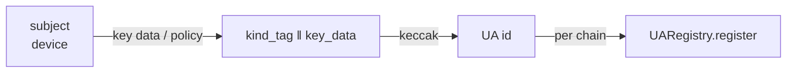
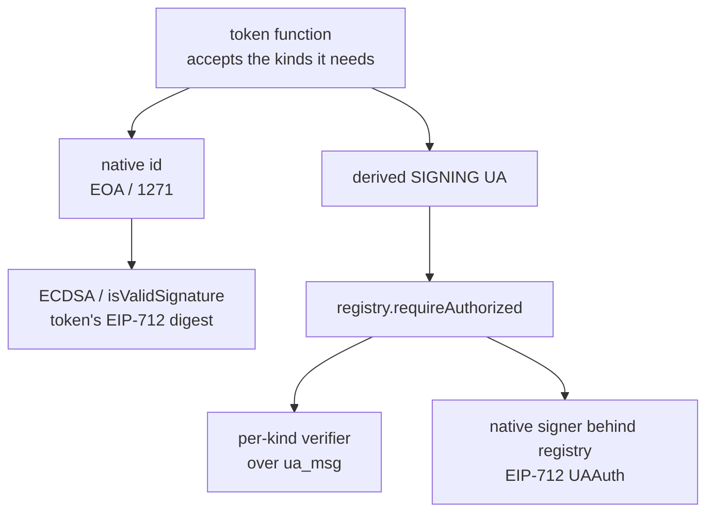
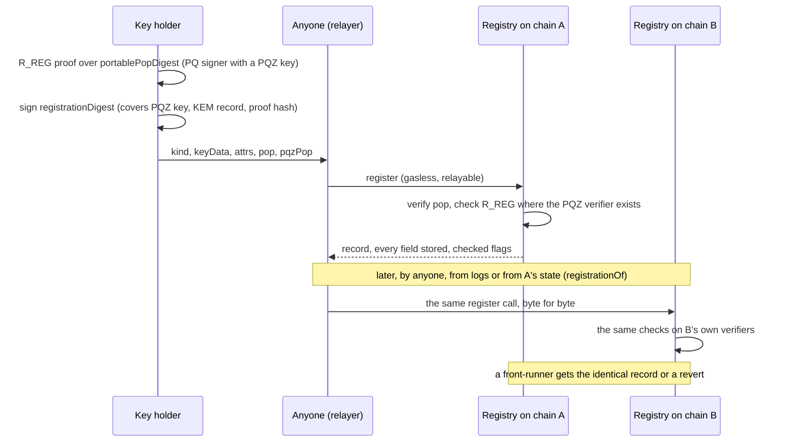
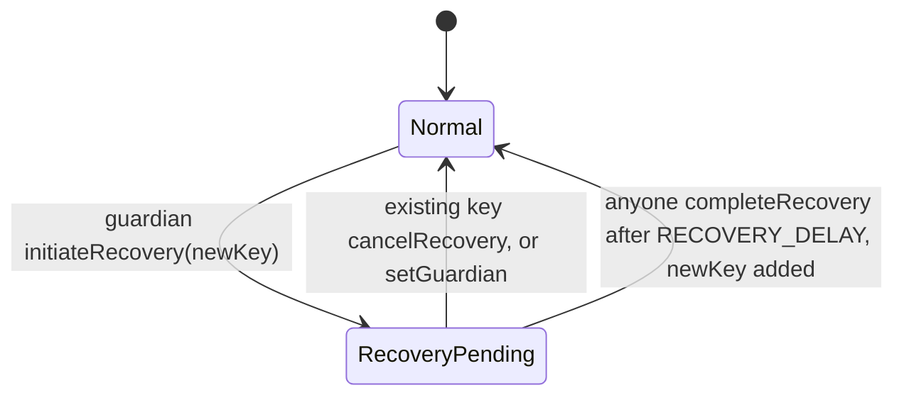

# Accounts

An account is whoever can produce a valid signature. SCaaS knows three forms of account; every contract function
names the forms it accepts.

| Form | What it is | Registration | When to use |
|---|---|---|---|
| **Native account** | The chain's own account: an EVM address (EOA, or a contract via ERC-1271), a Solana, Stellar, Aptos, Sui, Cosmos or GRAM account | none | Wallet users and anything a chain already understands |
| **Universal Account** (default) | An identifier derived from key data or from a policy — passkey, P-256, ed25519, Schnorr, BLS, MuSig2/FROST groups, weighted multisig, post-quantum keys, Zether keys | once per chain, with proof of possession, for derived kinds | The default for subjects: any key type on any family, no contract per user ([Universal Account](#universal-account)) |
| **Smart account** (optional) | `SmartKeyAccount`, an ERC-1271 contract with several keys and guardian recovery | deployed per user as a clone | A stable address across key rotation, guardian recovery, or contracts that only understand addresses ([smart account](#subjectaccount)) |

Passkeys can serve either way: as a `webauthn-p256` Universal Account, or as a key of a `SmartKeyAccount`
([passkeys on chain](#passkeys)). Delegated, capped payment from a payer's own wallet is a separate contract:
[mandates.md](mandates.md).

<p align="center"></p>

<a id="universal-account"></a>
**Contents**

1. [Universal Account (UA)](#1-universal-account-ua)
   - 1.1 [Scope](#11-scope)
   - 1.2 [Model](#12-model)
   - 1.3 [Identity](#13-identity)
   - 1.4 [Registration and proof of possession](#14-registration-and-proof-of-possession)
   - 1.5 [Keys, purposes, tags](#15-keys-purposes-tags)
   - 1.6 [Kinds](#kinds)
   - 1.7 [Function → accepted kinds](#17-function--accepted-kinds)
   - 1.8 [Registry](#registry)
   - 1.9 [Verifiers](#19-verifiers)
   - 1.10 [EIP-7702 and chain identity](#110-eip-7702-and-chain-identity)
   - 1.11 [Credentials (optional)](#111-credentials-optional)
   - 1.12 [Touchpoints](#112-touchpoints)
   - 1.13 [Migration from the legacy registry](#113-migration-from-the-legacy-registry)
   - 1.14 [Security](#114-security)
   - 1.15 [Gas and calldata (estimates; measured numbers replace them in `test/ua/UAGas.t.sol`)](#115-gas-and-calldata-estimates-measured-numbers-replace-them-in-testuauagastsol)
   - 1.16 [Vectors and tests](#116-vectors-and-tests)
2. [Passkeys on chain](#2-passkeys-on-chain)
3. [Smart account (optional): `SmartKeyAccount`](#3-smart-account-optional-smartkeyaccount)
   - 3.1 [Smart-account limitations](#smart-account-limitations)

## 1. Universal Account (UA)

A Universal Account is an account identifier for every signature scheme SCaaS supports: a native account of a chain,
or a 32-byte id derived from key data or from a policy (a multisig structure). A per-chain, admin-free registry stores
what the chain needs to verify derived ids; per-kind verifiers check signatures; tokens accept exactly the kinds each
function needs. An optional verifiable-credential layer sits on top. Status: **SPECIFIED**; the identity layer (kind table, ids, keyHash, purpose tags, digests, key-data validation) is BUILT in six libraries ([ua-libraries.md](../clients/ua-libraries.md)); the UA ledger ([CTR-UA-18](#CTR-UA-18),
[CTR-UA-19](#CTR-UA-19), [CTR-UA-26](#CTR-UA-26)) is BUILT in the token base (UA-4, plan
`docs/superpowers/plans/2026-10-12-ua4-ledger.md`); the PQ signing kinds and the `pqz-mlwe` slot are BUILT in registry
generation 1 (P6c, plan `docs/superpowers/plans/2026-10-13-p6c-pq-kinds.md`; `UAPqzVerifier` is P6g's). The
Zether-only registry it replaced is backed up in `smartcontracts/evm/legacy/ua3/` (UA-3; [legacy registry](#legacy-registry), [migration](#migration)).
UA parity — every native-address operation for a derived UA ([CTR-UA-27](#CTR-UA-27), [CTR-UA-28](#CTR-UA-28), owner
2026-10-13) — is **SPECIFIED**, in three phases UA-5a / 5b / 5c (`TODO.md`); UA-5a (the receivers, the one-step wrap,
`burn` and `unwrapToUA` on the UA allowlist, `uaPayReceiverFee`) is **BUILT** (plan
`docs/superpowers/plans/2026-10-13-ua5a-receivers-wrap.md`); UA-5b (`UATradeOrder` on tokens, `uaWrap`, `SCaaSDex`
tagged legs) is **BUILT** on EVM (plan `docs/superpowers/plans/2026-10-13-ua5b-trade-dex.md`).

### 1.1 Scope

<a id="scope"></a>

In scope: the **UA identifier** (how an account id is derived from key data or a policy, for every key kind and account
structure supported or planned); the **kind table** (number, tag, key-data layout, id derivation, whether registration
is needed, proof of possession, verifier, families); the **per-chain registry** (EVM interface, storage, events, errors;
per-family realisation); the **verifier library** per kind, the calldata/caching policy and the gas budget; **function →
accepted kinds** for every contract function, and the UA-ledger functions that let tokens hold balances for non-native
UAs directly; **one key = one purpose**, enforced in four layers; the optional **attestation layer** (verifiable
credentials / eKYC); `SmartKeyAccount` kept as **option (b)** ([CTR-ACC-09](#CTR-ACC-09)); node,
mesh, client and ERP touchpoints, migration, security, tests and vectors.

Not in scope: a wallet or proxy contract per account (a UA is an identifier, like an EOA address); key rotation inside
one UA (new key data = a new UA; users who need a stable address across rotation use `SmartKeyAccount`); cross-chain
state sync of registrations (each chain has its own registry; the id is the same on every chain because it is a pure
function); registry-level freeze, revocation or compliance status (compliance stays in the `ComplianceRegistry`,
[CTR-AS-07](asset-suite.md#CTR-AS-07), and in token controls; the registry is monotonic); post-quantum confidential
cryptography ([pq-zero-knowledge.md](pq-zero-knowledge.md) — this file defines only the PQ **signing** kinds and how a Zether UA points
to an authorization UA); a DID method, a credential issuer, or an on-chain credential parser.

### 1.2 Model

<a id="model"></a>

Deriving and registering a UA:



- The device holds the keys (`clientkeys`, per-kind path).
- `UARegistry.register(kind, keyData, attrs, pop, pqzPop)` ([CTR-UA-07](#CTR-UA-07), UA-8) stores `{kind, registeredAt,
  keyPtr, index}`, the optional PQZ key pointer of a PQ signer ([CTR-UA-16](#CTR-UA-16)), the optional first KEM record
  ([CTR-UA-32](#CTR-UA-32)), every argument of the call ([CTR-UA-31](#CTR-UA-31)) and `keyOwner[keyHash] = ua` (one key =
  one purpose). The same call, with the same bytes, registers the UA on any other chain.

Verifying a signature in a token function (it accepts the kinds it needs):



- The registry call is `registry.requireAuthorized(ua, purpose, digest, auth)`.
- Optional: VC (issuer-signed) + VP / KB-JWT (signed by the identity UA, purpose `vp`) → relying party / attester.

### 1.3 Identity

<a id="ua-identifier"></a>
<a id="CTR-UA-02"></a>**CTR-UA-02** — **A Universal Account is an identifier derived from key data, never a contract**
(owner). For a chain's native single-key account the id is the native address/key; for every other kind
`UA = keccak256(keccak256(kind_tag) ‖ key_data)` (32 bytes), with a distinct versioned tag per kind. The registry is a
contract that stores kind data and commitments; the UA itself has no code, no storage of its own and nothing to deploy
— an EOA generalised to every signature scheme: free to create, deterministic, the same on every chain. A per-account
contract would cost a deploy per user per chain and would make the account upgradeable state.

<a id="id-space"></a>
<a id="CTR-UA-03"></a>**CTR-UA-03** — **32-byte kind-tagged ids, never a 20-byte truncation; derived ids never collide
with native ids or with each other** (owner). Every derived id must have a non-zero top 96 bits (`ua >> 160 != 0`);
the registry refuses the rest (`UAIdInNativeSpace`; honest probability 2^-96, the user derives the next index). Native
20-byte ids (EVM, Cosmos secp256k1) are zero-padded into the same 32-byte space, so on those families the two spaces
are disjoint by construction and `>> 160` tells them apart. **Canonical form everywhere** (node, mesh, client systems,
vectors): lower-case hex; a 32-byte value whose top 96 bits are zero is the 20-byte native id and is always written,
keyed and compared in its 20-byte form.

On families whose native ids are full 32-byte values (Solana, Aptos, Sui,
Soroban, GRAM) native and derived ids share one space (collision 2^-128 birthday, infeasible) but **shape cannot tell
them apart**: records, owners and subject accounts there store an explicit `owner_kind` and dispatch by kind, never by
id shape. Different kinds over the same point give different ids because the tag differs (Schnorr-bls12381 over `Y` ≠
Zether-bls12381 over `Y`). A 20-byte truncation of a policy hash would share the address space with EOAs: grinding an EOA
key and a multisig policy to the same 20 bytes is a 2^80 birthday search, after which the grinder spends the
"multisig" alone. Cost: ids are 12 bytes longer in calldata (192 gas per id at 16 gas/byte). Non-EVM passkey owners
follow the same rule ([NET-ALL-21](../networks/README.md#NET-ALL-21)).

<a id="keccak"></a>
<a id="CTR-UA-04"></a>**CTR-UA-04** — **One hash function for ids in every family: keccak256.** The EVM opcode; native
host functions on Solana (`sol_keccak256`), Soroban (`crypto().keccak256`), Aptos (`aptos_hash::keccak256`), Sui
(`hash::keccak256`), GRAM (`HASHEXT` keccak256); pure Rust in CosmWasm (a few thousand gas units for a software keccak).
The same key data gives the same UA on every chain of every family.

<a id="kind-table"></a>
<a id="CTR-UA-05"></a>**CTR-UA-05** — **Kind numbers and tags are fixed by the kind table and shared by every family; a
registry generation supports a fixed set of kinds.** Adding a kind is a new registry generation and a new row with
vectors. A kind is enabled on a chain only if the registry generation was deployed with a verifier for it. Kinds are
part of the id; a mutable kind table would be an admin key over every account. New schemes wait for a new registry
generation and new token implementations that point to it.

### 1.4 Registration and proof of possession

<a id="registration"></a>
<a id="CTR-UA-06"></a>**CTR-UA-06** — **Native ids need no registration; every derived kind must be registered before
it can sign or receive, and every derived kind is registrable on every chain whose registry has its verifier — also where
the same key is a native account** (owner; the last clause owner 2026-10-17: kinds are the same on every chain, so a
chain never refuses a kind because its own accounts use that key type). A native key that registers gets the derived id
`keccak256(TAG(kind) ‖ key_data)`, which differs from its native id and is the same on every chain: a Phantom ed25519
key registers `ed25519` (0x0102) on Solana as on EVM, a MetaMask secp256k1 key registers `secp256k1` (0x0108) on EVM as on
Solana; the native id keeps working without a record (the native kinds 0x0001–0x0018 have no record and are not in the
per-kind list, CTR-UA-29), and the two ids are separate accounts. Native = an EVM EOA and any EVM contract account (ERC-1271), Hedera native accounts,
Solana ed25519, Stellar/Pi `G…`, Soroban `C…` contract accounts, Aptos native accounts (any native auth key incl.
MultiKey), Sui native addresses (incl. native multisig, passkey flag 6, zkLogin), Cosmos native accounts, NEAR accounts (named
and implicit), Algorand addresses. **GRAM is the
exception:** a GRAM wallet is a contract, so the native GRAM account is the wallet contract address (registration-free
like ERC-1271). Every derived kind registers on each chain where it is used. Registration is where PoP and
one-key-one-purpose are enforced; receiving to an unregistered derived id is refused, so a typo reverts instead of
burning funds. One registration per chain (bn254 ≈ 75 k gas).

<a id="pop"></a>
<a id="CTR-UA-07"></a>**CTR-UA-07** — **Proof of possession is portable: it binds the UA, its attributes and the PQZ proof — not a chain, a
registry or the caller** (owner 2026-10-25, UA-8 P1/P2; the encoding and the single signed digest are controller calls,
owner may override; [decisions.md](../decisions.md)). The registry accepts only this form:

```
pqzKeyHash         = keccak256(GROUP("pqz-mlwe") ‖ pqzKey)                         0 without a PQZ key
kemRecordHash      = keccak256(abi.encode(KEM_RECORD_TAG, ua, uint256(kemVersion), keccak256(kemPk)))   0 without a KEM record
portablePopDigest  = keccak256(abi.encode(PURPOSE_POP_V2, ua, pqzKeyHash, kemRecordHash))
pqzPopHash         = keccak256(pqzPop)                                              the R_REG proof; 0 only without a PQZ key
registrationDigest = keccak256(abi.encode(portablePopDigest, pqzPopHash))
pop                = the signer's signature over  uaMessage(kind, PURPOSE_POP_V2, registrationDigest)
R_REG proof        = over                         uaMessage(0x0142, PURPOSE_POP_V2, portablePopDigest)
```

`PURPOSE_POP_V2 = keccak256("scaas.ua.purpose.pop.v2")` (the versioned tag `scaas.ua.purpose.pop.v2`; the v1 tag and the
chain-bound `popDigest` are gone from the registry and live in `smartcontracts/evm/legacy/ua8/`), `KEM_RECORD_TAG =
keccak256("scaas.ua.kem-record.v1")`, `abi.encode` of 32-byte words (for 32-byte fields it equals the concatenation, so
every family computes the same bytes with its keccak256). **There is no chain key, no `chainUid` and no registry
address in any of it**: the same registration is valid on every chain whose registry enables the kind ([CTR-UA-31](#CTR-UA-31)).
The proof is made first, then signed: `pop` covers `pqzPopHash`, and the proof's own message (`portablePopDigest`) does
not contain its hash, so there is no cycle; one signature therefore covers the UA, the PQZ key, the KEM record and the proof.

Every kind signs `registrationDigest` the same way, under its own scheme (Zether `0x0141` and the group kinds keep theirs;
only the message changed). A PQ-eligible `msig` signs with its m-of-n (`abi.encode(MemberSig[])`, members under
purpose `member`): **each member signs `uaMessage(MSIG, PURPOSE_POP_V2, registrationDigest)` wrapped by `memberDigest`**, so a PoP
that holds a PQZ key or a KEM record is signed by every member over those hashes too (an earlier reading of the
design signed the bare `portablePopDigest`, which left the proof hash signed by nobody). **A native (EOA) member signs
chain-free**: an EOA — code-less, or an EIP-7702 designator — signs the EIP-191 `personal_sign` of `memberDigest` (`keccak256("\x19Ethereum Signed Message:\n32"
‖ memberDigest)`) by its own key only, never ERC-1271 through the delegate; other code (a contract wallet) ⇒ ERC-1271
`isValidSignature(memberDigest, sig)` only ([CTR-UA-24](#CTR-UA-24); owner ruling D1 of 2026-10-30, built in `0c113cfc`; it
supersedes ruling R-7702 of the same day, "designator: root-key ECDSA first, then ERC-1271", built in `cc965914`, and the earlier
controller ruling A5-m m2 that sent every member with code to ERC-1271 only; so a member delegated on one chain and not on another
still signs one portable `pop`); the stored `abi.encode(MemberSig[])` must be the canonical encoding — trailing bytes or another
encoding of the same signatures ⇒ `UAPoP` in `register`, `UAUnauthorized` in `setKemKey` / `setPqzKey` (final review 2026-10-30
m3, built in `cc965914`; `requireAuthorized` does not check it); this holds for the three portable purposes only (`pop` v2, `kem`, `pqz-key`), every other purpose keeps the EIP-712
`UAAuth` ([CTR-UA-24](#CTR-UA-24)). So an `msig` PoP with native members is portable too (controller call, owner may
override; it supersedes the first plan's "native members stay chain-bound"; the cost is a `personal_sign` prompt instead of
a typed-data view for the registration). A classical-dominant `msig` has no PoP of its own (its members proved theirs) and
registers with an empty `pop`.

The PQZ key and the KEM record are the fields not implied by `keyData`; the signer's PoP covers their hashes, so a
front-runner can neither strip them (the PoP over a non-zero hash fails with `0`) nor swap them (another key changes the
hash). The `R_REG` proof is over the same portable digest under the kind tag `0x0142`, so it is bound to the signer's
id (a proof made for another UA fails) and to nothing else. `register` derives no state from `msg.sender` or from any unsigned
argument, so **anyone** may submit it (gasless, relayable) and front-running yields the identical record or a revert. A
future field taken from `msg.sender` or left unsigned would turn front-running into capture; tests T-REG-3/3b guard it.

Registration, and the copy of it to a second chain (the copy sends the same fields; a client or a relayer service can do
it for any UA it sees, from the logs or from state, [CTR-UA-31](#CTR-UA-31)):



<a id="rogue-key"></a>
<a id="CTR-UA-08"></a>**CTR-UA-08** — **Rogue-key protection is decided per aggregate kind** (owner: the MuSig2/FROST
kinds stay and are made checkable):

| Kind | Approach | Why |
|---|---|---|
| `msig` (independent signatures, weighted threshold) | **per-member registration**: every member is a native id or a registered single-key UA (each with its own PoP), kinds ∈ MEMBER | no key aggregation happens, so there is no rogue key; members' keys are still proven once |
| `musig2-secp256k1`, `musig2-bn254` | **BIP-327 KeyAgg recomputed on chain** from the registered member list **plus** one aggregate PoP by the result | the coefficients defeat rogue keys; MuSig2 is n-of-n, so a valid PoP by `KeyAgg(list)` proves every listed key took part |
| `frost-secp256k1`, `frost-bn254` | **group key = Σ of the DKG constant-term commitments, each with its PoK, checked on chain** **plus** one group PoP | RFC 9591 leaves DKG out; the FROST paper's KeyGen round-1 PoK is the standard defence; the chain checks it instead of trusting it |
| threshold ECDSA (MPC providers) | not a kind: the output is an ordinary ECDSA signature by an address ⇒ **native EOA** | the chain cannot tell, and need not |

Each defence is the one native to the scheme, and the registry checks it rather than trusting a hash of it. Group
metadata the chain cannot check is listed as **attestation-only** ([MuSig2 and FROST](#musig2-and-frost-what-the-registry-checks)):
a FROST share distribution that went wrong off chain (a bad VSS share, one party simulating several participants) is
invisible to the chain.

<a id="structures"></a>
<a id="CTR-UA-09"></a>**CTR-UA-09** — **Structures commit to their members; nesting is one level.** `msig` key data lists
members by `(kind, id, weight)`, strictly sorted by id; a member may not itself be a structure. (A `bls12381-multi` kind
was cut — no consumer, and `msig` over `bls12381-minsig` covers it; number `0x0121` stays reserved.) Bounded gas, no
cycles, a simple audit. Two-level governance uses `SmartKeyAccount` or Safe (native 1271) as a member.

<a id="registration-gate"></a>
<a id="CTR-UA-25"></a>**CTR-UA-25** — **No on-chain registration gate in v1** (owner): registration spam is bounded by
the node's sponsorship limits ([NODE-SPN-01](../node/sponsorship.md#NODE-SPN-01)); self-paid spam pays its own gas. An
immutable `IRegistrationPolicy` (invite / attested) per registry generation is the alternative if ever needed.

<a id="portable-registration"></a>
<a id="CTR-UA-31"></a>**CTR-UA-31** — **A registration is portable: the same record bytes on every chain, anyone copies it, every field is
in state, and `checked` says what the chain verified** (owner 2026-10-25: "when an account is registered on Ethereum, anyone can
take exactly that information and register it on another chain: a UA account does not depend on the chain, its
transactions do"; scope every family, owner 2026-10-29; details are controller calls, owner may override;
[decisions.md](../decisions.md)).

- **Copying.** The UA id is chain-independent already ([CTR-UA-03](#CTR-UA-03)); with the portable PoP ([CTR-UA-07](#CTR-UA-07))
  the registration is too. Copying a UA to another chain is sending the same `register(kind, keyData, attrs, pop, pqzPop)` to that
  chain's registry; the submitter pays the gas. Transactions stay chain-bound (`UAAuth` domain, [CTR-UA-24](#CTR-UA-24); the
  mtx envelopes). The kind must be enabled in the target registry's generation; a registry that lacks the verifier of a kind
  refuses it as any disabled kind (`UAKindDisabled`), the record stays valid elsewhere. A PQZ key on a registry without the PQZ
  verifier is *not* refused: it is stored unproven ([CTR-UA-16](#CTR-UA-16)). `keyOwner` uniqueness stays per chain.
- **Every field in state.** `register` stores `abi.encode(keyData-rest, pop, kemVersion)` and `pqzPop` and each KEM version's
  `pk ‖ sig` as SSTORE2 chunks of at most `BLOB_CHUNK` = 32,768 B (the largest `msig` PoP the gas bound admits on a chain with a
  larger `verifyBudget` exceeds one 64 KiB code blob); the PQZ key keeps its own single pointer (`PqzCore` checks its code
  length); `keyData` is stored once (the stored-kind key in `keyPtr`, the rest in the blob). So `registrationOf(ua)` returns
  exactly the `register` arguments — `(kind, keyData, attrs, pop, pqzPop)` — and anyone rebuilds the call from state when
  logs are gone (history expiry); the event `UARegistered` carries the same bytes except `pop`, which it carries as
  `popHash = keccak256(pop)` ([CTR-UA-33](#CTR-UA-33): one rule on every family; `pop` is read with `popOf` /
  `registrationOf`). A PQZ key added later by `setPqzKey` is not
  in `attrs` (read it with `pqzKeyOf`, `pqzPopOf`, `pqzKeySigOf`); its bytes are at the SSTORE2 pointer `pqzKeyOf(ua).ptr`
  (`eth_getCode(ptr)` without the leading `STOP` byte), as `recordOf`'s. Cost [measured, A8]: a registration with a
  stored PQZ proof is 84.8–109.1 M gas (regular + state, [§1.15](#gas)), more than a 60 M block, so on such a chain the proof
  goes by `storePqzPop` ([CTR-UA-16](#CTR-UA-16)).
- **`checked` (UA-8 P11.3, the EVM form).** Each part of a record carries who verified it: `NONE` = 0, `CHAIN` = 1, `RELAYER` = 2 (+ the
  relayer id on families that run the relayer-checked mode); these code points are shared by every family (`portable.json`).
  On EVM everything the registry stores is verified on chain, so `checked` is **derived, not stored**:
  `checkedOf(ua) → (pop, pqzPop, kem)` = `(CHAIN, proven ? CHAIN : NONE, KEM record stored ? CHAIN : NONE)` (an unproven PQZ proof
  reads `NONE`: it is not yet stored or not yet checked; `NONE` for all three on an unregistered id), and the events carry them where the verdict varies:
  `UARegistered` carries all three (`checkedPop`, `checkedPqzPop`, `checkedKem`) and `UAPqzPopStored` carries `checkedPqzPop`; `UAPqzKeyAdded` has no
  field (its key is `NONE` until the `UAPqzPopStored` that proves it) and `UAKemKeySet` has none (always `CHAIN` on EVM).
  Clients of a family in relayer-checked mode re-verify before they use a key read from there (spec P11).
- **Generations.** Generation 2 forwards the views (`registrationOf`, `popOf`, `pqzPopOf`, `pqzKeyOf`, `pqzKeySigOf`,
  `checkedOf`, `kemKeyOf`, `kemKeyAt`) to generation 1 for records it does not hold; `setKemKey`, `storePqzPop` and `setPqzKey` for such a
  UA go to the generation that holds the record (`UAUnauthorized` here), with one exception: a gen 2 that enables `0x0142` in front
  of a gen 1 that does not holds the PQZ attachment of a gen-1 record itself ([CTR-UA-16](#CTR-UA-16)). **Indexers read both generations**:
  gen 2 emits PQZ events (`UAPqzPopStored`, `UAPqzKeyAdded`) for UAs registered in gen 1, and `UARegistered` only for its own.
  On a gen 2 in front of a gen 1 that enables `0x0142` (the PQZ attachment lives in the oldest generation with the verifier), a non-holder's PQZ key gets `UAKindDisabled(0x0142)` before `UAPqzHolder`
  (the order of the checks is the order of the steps, [§1.8](#registry)).
- **Relaying** (owner 2026-10-30, ruling R-node; node built on `ua8` in `64c233d4`, `4d4509e7`, `51b0c027`). The node relays all four writes (`register`, `setKemKey`,
  `storePqzPop`, `setPqzKey`) as ordinary `call` jobs (`kind = "call"`, target = the registry, calldata): its call table has a row for
  each of the four selectors under the guard rule `Rule::UaRegistry` — the target must equal the chain's `[[chains]] ua_registry`
  (node config; unset ⇒ all four are refused `CALL_TARGET_REFUSED`), be bound to this chain (`chainUid()`) and be neither a
  registered token nor the token factory ([NODE-JOB-19](../node/job-api.md#NODE-JOB-19)). The gateway's `~gateway` sponsor policy is
  specified to cover all four ([NODE-GW-03](../node/gateway.md#NODE-GW-03)), but the gateway route `POST /v1/ua/register` and the
  sponsor policy are **not built** (no route, no sponsor-policy code; `TODO.md`): today relaying goes through job-API `call` jobs
  only. The node binds one registry per chain: once a chain runs a generation 2, the writes that must go to generation 1 (e.g.
  `setKemKey` for a generation-1 record) cannot be relayed (`TODO.md`). No new job kind, no fee form (there is no token to
  take a fee from; a relayer that wants payment arranges it off chain). A relayed PQ registration **splits** (`register` without
  `pqzPop`, then `storePqzPop`) when the full call's `eth_estimateGas` exceeds **min(block gas limit, the relayer's per-transaction cap)**
  (`max_gas_per_tx`, plus the protocol caps 2^32−1 and, before Amsterdam, 2^24) or the estimate itself is refused for gas ("… exceeds
  allowance"): the node then refuses that `register` with its proof as `UA_REGISTER_SPLIT: <why>; send register without pqzPop,
  then storePqzPop` and sends nothing; every other write, and `register` without the proof, gets the ordinary gas refusals. A
  `storePqzPop` over the cap has no split option (ordinary refusal; see the `n2816-kmax65536` watch item in `TODO.md`).
  The SCaaS testnet's relayer cap stays 64 M (`max_gas_per_tx`), so there a relayed PQ registration with its proof (84.8–109.1 M) always
  splits, while a direct submitter (`e2e.py`) compares with the 200 M block only.
- **A submitter's choice of signatures.** For an `msig` any quorum's signatures are valid, so a front-runner that holds a
  quorum's signatures can submit a different valid subset first: the stored `pop` / `sig` differs, the key, the version and
  the id do not. Nothing depends on which valid subset is stored.
- **Family status.** EVM: built (UA-8 Part A). Soroban: the registry and the portable `register` (empty `attrs`) are **BUILT** in UA-Soroban on branch `ua-soroban` ([NET-SOR-17](../networks/soroban.md#NET-SOR-17)); the KEM records, PQZ attributes, `checked = Relayer` and the relayer-checked mode are Part B (`ua8-soroban`, next, after the owner's go on `ua-soroban`). Other families: their own UA family rounds.

<a id="CTR-UA-33"></a>**CTR-UA-33** — **The registration event carries `popHash`; `msig` members sign without key data; WebAuthn blobs canonical only** (owner 2026-10-30;
[decisions.md](../decisions.md)). One rule on every family that has a UA registry:

- **A.** The registration event (`UARegistered` on EVM, `UaRegistered` on Soroban, the equivalent elsewhere) carries
  `popHash = keccak256(pop)` (`keccak256("")` for an empty `pop`) instead of `pop`. `pop` stays in contract state, read with
  `popOf(ua)` / `registrationOf(ua)`; the record is rebuilt from the log plus `popOf`, or from state alone. Every other
  argument (`keyData`, `attrs`, `pqzPop`) and the `checked` values stay in the event.
- **B.** In `auth = abi.encode(MemberSig[])` (and the `pop` / KEM / PQZ-key signatures of an `msig`), every `MemberSig.keyData`
  is empty: a native member has no key data, a registered member's key is read from its own record — `vk` at `keyPtr` for the
  stored kinds, the key data in the registration blob for the classical kinds — the key bytes only, never the member's
  `pop`, whose length the member chose (every member is registered or native, §1.8 step 4). A non-empty `keyData` fails the member (`UAUnauthorized`, `UAPoP` in `register`). On EVM the rule is tied to the
  purpose `member`: `requireAuthorized(id, PURPOSE_MEMBER, …)` takes `auth = abi.encode(bytes(""), sig)` for every derived
  id, so a gen 2 hands a member of a gen-1 kind to gen 1 with the empty key data and gen 1 reads its record; other purposes
  keep `auth = abi.encode(keyData, sig)` with the key data of a classical kind.
- NEAR and Algorand have no UA registry and no registration event: their `msig` members are key ids inside the structure,
  never registered, and each member signature carries its key (their own auth formats); A and B have nothing to apply to there.
- **C. WebAuthn signature blob: canonical encoding only** (owner 2026-10-30, every registry). A `webauthn-p256` signature
  `abi.encode(bytes authenticatorData, bytes clientDataJSON, bytes32 r, bytes32 s)` is accepted only when byte-equal to its
  canonical re-encoding: head offsets 0x80 and 0x80 + 32 + pad32(len(authenticatorData)), each dynamic field = 32-byte
  length ‖ data ‖ zero padding, no trailing bytes. Anything else fails before any field or signature check. So one
  signature has one byte string: a front-runner cannot register the same id with other `pop` bytes (another `popHash`,
  [CTR-UA-07](#CTR-UA-07)'s identical record), and the canonical `MemberSig[]` rule holds for a WebAuthn member. On EVM
  `WebAuthnP256Verifier` enforces it for `verifyPop` and `verify` alike: `register`'s PoP, the portable `msig` records,
  `requireAuthorized` (tokens' relayed operations, `msig` member slots). `SmartKeyAccount` (CTR-ACC-08) applies the same
  rule in its own decoder, and so do the client verifiers (`clients/ua-rs`, the `clientkeys` reference verifier), so no
  client accepts a blob a registry refuses (owner 2026-10-30, `webauthn-clients`).

<a id="kem-keys"></a>
<a id="CTR-UA-32"></a>**CTR-UA-32** — **KEM (chat) key records: signed, versioned, write-once in any order, never revoked, 1,601 bytes (scheme byte + key)** (owner
2026-10-25, UA-8 P4/P5/P7; scheme byte owner 2026-10-30; the vector keys and the signature format are controller calls, owner may override;
[decisions.md](../decisions.md); the chat protocol is UA-7's).

- **Scheme.** One scheme only: ML-KEM-1024 + X25519 (the X-Wing-style combiner of the CFRG hybrid-KEM draft with ML-KEM-1024),
  public key 1,600 B (ML-KEM-1024 `ek` 1,568 B ‖ X25519 `pk` 32 B), ciphertext 1,600 B, shared secret 32 B. **The first byte of
  `kemPk` is the scheme id** (owner 2026-10-30): `kemPk = 0x01 ‖ ek ‖ pk` = **1,601 B** for scheme 1; scheme 2 (ML-KEM-1024 + HQC +
  X25519, after FIPS 207) is reserved and refused today, like any other id (`UAKemScheme(scheme)`), so a later scheme needs no new
  registry generation. The registry checks the scheme id and that scheme's exact length (empty or wrong length: `UAKemKeyLength`);
  the cryptography is UA-7's. `kemRecordDigest` hashes the whole `kemPk`, so the scheme byte is signed. The vector keys are real keys from fixed seeds.
- **Record.** `(ua, version, kemPk)`; the UA signs the chain-independent digest `kemRecordDigest = keccak256(abi.encode(KEM_RECORD_TAG,
  ua, uint256(version), keccak256(kemPk)))` as `uaMessage(kind, PURPOSE_KEM, kemRecordDigest)` with `PURPOSE_KEM =
  keccak256("scaas.ua.purpose.kem.v1")`. The signature has the `pop` format: the kind's raw signature for a single key,
  `abi.encode(MemberSig[])` for an `msig` (members under `member`, a code-less or EIP-7702-designator native member by `personal_sign`, one with code by the
  [CTR-UA-24](#CTR-UA-24) rule, [CTR-UA-07](#CTR-UA-07)),
  verified against the stored key data. The same bytes on every family.
- **Versions start at 1** (`kemVersion = 0` with an empty `kemPk` means "no KEM record"); `setKemKey` refuses 0. Each `(ua, version)` is
  written **once**, **in any order** (a lower version may be stored after a higher one: others may still use it, and every stored
  version is usable); the version is inside the signed record, so version `v` names the same key on every chain — **if the client signs
  one key per version, the initial record included** (client rule, [§1.13](#migration) step 5: two signed registrations with different
  initial `(kemVersion, kemPk)` diverge across chains, and write-once means nothing can repair it). `kemKeyOf(ua)`
  is the highest stored version, `kemKeyAt(ua, version)` any stored one. Clients normally pick the highest version they see.
- **The first record travels with `register`** (`attrs.kemVersion`, `attrs.kemPk`): it is stored as that version with an **empty `sig`**,
  because its consent is the registration `pop`, which covers `kemRecordHash`; `kemKeyAt(ua, v)` returns `sig = ""` for it, and it
  reaches another chain only through that chain's `register` (carrying the same record, or the `pop` fails). Later versions come by
  `setKemKey(ua, version, kemPk, sig)`, relayable by anyone, no fee.
- **Holders.** Only PQ signers: `mldsa44`, `mldsa65`, `fndsa512`, or an `msig` whose non-PQ weight (members outside `0x0130`–`0x0133`)
  is below its threshold (`slhdsa128s` is not a direct holder); other kinds revert `UAKemHolder`. The `msig` PQZ debit gas bound
  ([CTR-PQZ-12](pq-zero-knowledge.md#CTR-PQZ-12)) applies to the PQZ key only, not to the KEM record.
- **No revocation** (what has been on chain stays public forever and cannot be withdrawn; if an old secret key may have leaked,
  the UA must assume that anything sent to that key can be read) and **no one-owner check** (a KEM record carries no proof of
  possession of the KEM secret, so a uniqueness rule would let anyone who sees a key first list it under their own UA and block
  the real owner on that chain; a UA that lists someone else's key gains nothing, it cannot decrypt). One device first: storage is
  keyed `(ua, keyId)` with `keyId = version`, so several keys per UA (one per device) later change no layout.
- **State and events.** The registry stores `pk ‖ sig` per version (SSTORE2 chunks); `setKemKey` emits `UAKemKeySet(ua, version, keyHash,
  kemPk, sig)` with the call's bytes (`keyHash = keccak256(kemPk)`), checked on chain. Check order of `setKemKey`: an id this registry does
  not hold (`UAUnauthorized`; on gen 2 a gen-1 record goes to gen 1) → holder (`UAKemHolder`) → version 0 or stored, the initial record
  included (`UAKemVersion`) → key length (`UAKemKeyLength`) → signature (`UAUnauthorized`; an `msig` `sig` that does not decode as
  `MemberSig[]` reverts with empty data from the ABI decoder, as `register`'s `pop` does — the same holds for `setPqzKey`; no custom
error, because the decoder's revert cannot be caught without a self-call; stated in the NatSpec of both in `IUARegistry.sol`, final
review 2026-10-30 n4, `cc965914`). `setKemKey` decodes the whole registration blob
  (the key data, `pop` and the initial version: about 7 KB for an `msig` with PQ members), a few per cent of its gas ([§1.15](#gas)).

### 1.5 Keys, purposes, tags

<a id="purposes"></a>
<a id="CTR-UA-10"></a>**CTR-UA-10** — **One key = one purpose, enforced in four layers** (owner): (1) wallets/clientkeys
derive a separate hardened path per kind and per account role and expose no generic "sign this digest with that key" for
UA keys ([CLI-SGN-29](../clients/signers-clientkeys.md#CLI-SGN-29)); (2) the registry keeps `keyOwner[keyHash] → ua` and
refuses the same public key under another kind even with a valid PoP (`UAKeyInUse`); (3) every UA signature is over a
tagged message carrying kind and purpose ([CTR-UA-12](#CTR-UA-12)); (4) EOAs stay unregistered, registered secp256k1
kinds sign kind-tagged messages only, and wallets refuse to use an EOA key for any other kind. ECDSA and Schnorr over one
secp256k1 key leak through nonce relations; a Schnorr signing oracle on an ElGamal key is a decryption-adjacent oracle;
untagged digests replay across protocols.

Layer 2 — registry: `keyOwner[keccak256(GROUP(g) ‖ canonical_pubkey)]`. Canonical forms: secp256k1 x-only (so a BIP-340
key and a MuSig2 aggregate or FROST group key with the same x collide, as they must); P-256 `x`; bn254/BLS points
uncompressed; PQ `pk`. A valid PoP does not override `UAKeyInUse`. Because key data must be canonical, one key has one
canonical form here.

Layer 3 — purposes:

| Purpose tag (`scaas.ua.purpose.<p>.v1`) | Digest it wraps |
|---|---|
| `pop` (version 2, tag `scaas.ua.purpose.pop.v2`) | `registrationDigest(portablePopDigest(ua, pqzKeyHash, kemRecordHash), pqzPopHash)` ([CTR-UA-07](#CTR-UA-07)); the `R_REG` proof's message wraps `portablePopDigest` under the tag `0x0142` |
| `kem` | `kemRecordDigest(ua, version, kemPk)` ([CTR-UA-32](#CTR-UA-32)) |
| `pqz-key` | `pqzKeyRecordDigest(pqzKeyDigest(ua, pqzKeyHash), pqzPopHash)`, the record of `setPqzKey` ([CTR-UA-16](#CTR-UA-16)); its `R_REG` proof's message wraps `pqzKeyDigest` under the tag `0x0142` |
| `metatx` | v3 EIP-712 digest of `UAMetaTransaction` or `UAMetaTransfer` |
| `metatx-cancel` | `keccak256(abi.encode(CANCEL_TAG, chainid, chainUid, token, ua, batch, validUntil))` with `CANCEL_TAG` = this purpose tag (UA-4), the token's view `uaCancelDigest` — derived `ua` only (natives use `cancelNonce`); each signature cancels once |
| `member` | `keccak256(structureUA ‖ ua_msg_of_structure)` (native members: inside `UAAuth`, except for the three portable purposes `pop` v2, `kem` and `pqz-key`, where a native member — code-less or an EIP-7702 designator — signs the EIP-191 `personal_sign` of it by its own key, or a contract member answers ERC-1271 by [CTR-UA-24](#CTR-UA-24)'s rule, [CTR-UA-07](#CTR-UA-07)) |
| `zether-auth` | the PQZ `authDigest` ([pq-zero-knowledge.md](pq-zero-knowledge.md)); classical Zether has none (its proof alone spends) |
| `zether-owner` | the Zether rollOver/mode digests |
| `keyop` | family subject-account key operations (replaces `scaas.keyop.v1` by version bump) |
| `receiver-fee` | the `ReceiverFee` co-sign when the payee is a UA ([CTR-MTX-05](metatx.md#CTR-MTX-05)) |
| `trade` | EIP-712 digest of `UATradeOrder`, of `CancelOrder` over a `UATradeOrder` hash, and of `UAInvalidateNonces` ([CTR-DEX-25](dex.md#CTR-DEX-25)); BUILT (UA-5b: `UAKinds.PURPOSE_TRADE`, the six UA libraries, `kinds.json`) |
| `vp` | VC presentation / KB-JWT |
| `vc-anchor` | *reserved* (anchor contract deferred) |

Digests are already chain/contract-separated; purpose tags separate *uses*, kind tags *kinds*. Native signers behind
the registry get the same separation from the `purpose` field of `UAAuth`, and a native `msig` member of a portable record from
the purpose inside its `memberDigest` ([CTR-UA-07](#CTR-UA-07)).

Layer 4 — EOAs: EOAs are never registered and sign only their wallet-native formats: token EIP-712 structs and, behind
the registry, the EIP-712 `UAAuth` — never a raw hash. The one exception is an EOA `msig` member of a portable record (purposes
`pop` v2, `kem`, `pqz-key` only): it signs the EIP-191 `personal_sign` of its `memberDigest` (a prefixed message, not
`eth_sign`; [CTR-UA-07](#CTR-UA-07)). Registered secp256k1 kinds (`bip340`, `musig2-secp256k1`,
`frost-secp256k1`) sign only tagged `ua_msg`. The chain cannot detect that a BIP-340 key is also someone's EOA key (EVM
exposes no nonce/key mapping); layer 1 prevents it for our wallets, and the residual risk for foreign wallets is
recorded under security.

<a id="keyhash"></a>
<a id="CTR-UA-11"></a>**CTR-UA-11** — **`keyHash` is per group, not per kind**: `keccak256(GROUP(g) ‖ canonical_pubkey)`
with `GROUP(g) = keccak256("scaas.ua.group." ‖ g ‖ ".v1")` (controller ruling, pending the owner: the spec named `group_tag` without defining it) and groups `secp256k1` (x-only), `p256` (x), `ed25519`, `bn254-g1`, `bls12381-g1`, `bls12381-g2`, `bn254-g2`, `mldsa44`,
`mldsa65`, `fndsa512`, `slhdsa128s`, `pqz-mlwe` ([CTR-PQZ-13](pq-zero-knowledge.md#CTR-PQZ-13)). All kinds over the same group share the
namespace, so `schnorr-bn254`, `frost-bn254` and `musig2-bn254` can never register the same point, nor
`webauthn-p256` and `p256` the same key. For MuSig2/FROST the keyHash is over the **group key**; participant keys are
not claimed (a participant key may sit in several groups; layer 1 gives it its own path). Key data must be the **unique
canonical encoding** of its key, so one key has exactly one id and one keyHash. A kind-tagged keyHash would let the same
key register under two kinds. Structures have no keyHash (members do).

<a id="tagged-message"></a>
<a id="CTR-UA-12"></a>**CTR-UA-12** — **Tagged message:** every derived-UA signature is over
`ua_msg = keccak256(MSG_TAG ‖ TAG(kind) ‖ purposeTag ‖ digest)` (128-byte preimage, BIP-340-style tagged hashing) with
`MSG_TAG = keccak256("scaas.ua.msg.v1")` (so no `ua_msg` preimage is ever an id preimage) and
`purposeTag = keccak256(bytes("scaas.ua.purpose.<p>.v1"))` — the `bytes32` every interface takes, used as-is, never
hashed again. `digest` is the operation's own domain-separated digest (EIP-712 on EVM, the family digest elsewhere). The
kind's scheme then signs `ua_msg` its own way (ML-DSA and SLH-DSA: `pq_msg`, [CTR-UA-23](#CTR-UA-23)). **Native signers behind the registry** (`requireAuthorized` on a native
id: `msig` members) sign the EIP-712 struct `UAAuth(bytes32 ua, bytes32 purpose, bytes32
digest)` under the registry's domain, never a raw hash — except for the three portable purposes (`pop` v2, `kem`, `pqz-key`;
[CTR-UA-07](#CTR-UA-07)), where a code-less or EIP-7702-designator native `msig` member signs the EIP-191 `personal_sign` of its `memberDigest`
(chain-free) by its own key and a contract member answers ERC-1271 by the [CTR-UA-24](#CTR-UA-24) rule over the same digest; native kinds on token-local paths keep their wallet-native
signing (EIP-712 / family envelope) untouched. Cross-kind and cross-purpose replay die at the hash; native wallets
display what they sign, and no raw-hash (`eth_sign`) signature is ever asked of an EOA (the portable `personal_sign` is prefixed, not raw). Cost: one extra keccak (~60 gas).

### <a id="kinds"></a>1.6 Kinds

<a id="kinds"></a>

```
kind_tag    = "scaas.ua." ‖ <name> ‖ ".v" ‖ <n>                        (ASCII, e.g. "scaas.ua.zether-bls12381.v1")
TAG(kind)   = keccak256(kind_tag)
UA(kind, d) = keccak256(TAG(kind) ‖ d)                                 d = canonical key data, raw bytes; GROUP(g) = keccak256("scaas.ua.group." ‖ g ‖ ".v1")
valid       ⇔ UA >> 160 ≠ 0
native id   = family native identifier, left-zero-padded to 32 bytes   (EVM/Cosmos 20 B; others 32 B)
canonical   = lower-case hex; top-96-zero values written in 20-byte form
member ref  = (uint16 kind, bytes32 id)                                (structures always type their members)
MSG_TAG     = keccak256("scaas.ua.msg.v1")
purposeTag  = keccak256("scaas.ua.purpose.<p>.v1")                      (bytes32, used as-is everywhere)
ua_msg      = keccak256(MSG_TAG ‖ TAG(kind) ‖ purposeTag ‖ digest)
```

Key-data encodings are byte-exact and identical in every family (the vectors pin them). Points are uncompressed in the
EVM precompile encodings (bn254 EIP-196/197, BLS12-381 EIP-2537), because the EVM verifiers need them that way and
decompression costs more than the calldata it saves.

Native kinds (no registration, no tag-derived id; listed so that structures and functions can name them):

| No. | Name | Native id | Families | Signature accepted |
|---|---|---|---|---|
| `0x0001` | `evm-eoa` | 20-byte address (incl. EIP-7702 delegated) | EVM, Hedera (ECDSA alias) | ECDSA low-s over the EIP-712 digest; 7702-delegated: ECDSA by its own key only on every path, never ERC-1271 of the delegate, and refused as a direct caller (`CallerDelegated`) (owner rulings D1 / D2, 2026-10-30; [CTR-UA-24](#CTR-UA-24)) |
| `0x0002` | `evm-contract` | 20-byte address with code | EVM, Hedera | ERC-1271 `isValidSignature(digest, sig)`, 50 k gas (400 k for `SmartKeyAccount` clones) |
| `0x0003` | `hedera-native` | long-zero address `0.0.N` | **Hedera only** (never a member on another EVM chain) | HIP-632 `isAuthorizedRaw` (64-byte ed25519), else as 0x0001/0x0002 (HIP-632 halts in a static frame: until a non-view path exists, `requireAuthorized` verifies it as 0x0001/0x0002) |
| `0x0010` | `solana-ed25519` | 32-byte pubkey | Solana | ed25519 precompile instruction |
| `0x0011` | `stellar-account` | 32-byte `G…` pubkey | Soroban (Stellar, Pi) | host `require_auth` |
| `0x0012` | `soroban-contract` | 32-byte `C…` id | Soroban | `__check_auth`; never an `msig` member on Soroban (owner ruling 2026-10-31: a contract that calls the registry would meet its own slot by invoker auth; [NET-SOR-18](../networks/soroban.md#NET-SOR-18)) |
| `0x0013` | `aptos-account` | 32-byte address | Aptos | native auth key (ed25519, SingleKey, MultiKey, WebAuthn) |
| `0x0014` | `sui-address` | 32-byte address | Sui | native flags 0/1/2/6, native multisig, zkLogin |
| `0x0015` | `cosmos-account` | 20- or 32-byte account | Cosmos | ADR-036 secp256k1; native multisig |
| `0x0016` | `ton-wallet` | 32-byte account id (workchain from chain config) | GRAM | wallet contract (W5R1/V4R2/V3R2), TON Connect |
| `0x0017` | `near-account` | 32 bytes: an implicit account (64 lower-case hex) is its raw 32 bytes, any other account id (named, ETH-implicit) `sha256(account_id bytes)`; told apart by the account-id string, which travels with the member | NEAR | the member is the call's predecessor (access keys are not readable on chain) |
| `0x0018` | `algorand-address` | 32-byte address public key | Algorand | `ed25519verify_bare` by the current authority (`AcctAuthAddr` if set, else the address); rekeyed to a LogicSig or multisig: through an account record |

`near-account` forms cannot collide: a 64-lower-case-hex account id is always an implicit account (raw bytes), so a
named or ETH-implicit id meets one only through a sha256 preimage; upper-case ids are not NEAR account ids and are
refused; like the other 32-byte natives the id is kind-free, so records dispatch by kind ([CTR-UA-03](#CTR-UA-03);
vectors `smartcontracts/near/vectors/near-vectors.json` `nativeIds`).

Derived kinds (registered; `d` = key data):

| No. | Name (tag `scaas.ua.<name>.v1`) | `d` (bytes) | keyHash group | PoP | Verifier (EVM) | Families (v1 → later) |
|---|---|---|---|---|---|---|
| `0x0100` | `webauthn-p256` | `x ‖ y ‖ rpIdHash` (96; **no origin**, see below) | `p256` | WebAuthn assertion, challenge = base64url(`ua_msg`) | `P256VERIFY` (EIP-7951/RIP-7212 `0x100`), OZ fallback | EVM → Soroban, Solana, Aptos, Cosmos |
| `0x0101` | `p256` | `x ‖ y` (64) | `p256` | ECDSA-P256-SHA256 over `ua_msg`, low-s | same | EVM (HSM, secure enclave) |
| `0x0102` | `ed25519` | `pk` (32) | `ed25519` | Ed25519(`ua_msg`) | Solidity ed25519 incl. SHA-512 | every EVM chain → every family (also where an ed25519 key is a native account, CTR-UA-06) |
| `0x0103` | `bip340` | x-only `pk` (32) | `secp256k1` | BIP-340 over `ua_msg` | `ecrecover` trick + SHA-256 tagged challenge | EVM → Cosmos |
| `0x0108` | `secp256k1` (owner 2026-10-17) | `x ‖ y` (64) | `secp256k1` (x) | ECDSA over the 32-byte `ua_msg` (no prehash, no EIP-191 prefix), `r ‖ s ‖ v` (65), low-s, `v ∈ {27, 28}` | `Secp256k1Verifier`: `ecrecover` = `address(keccak256(x ‖ y))` (BUILT; cap 50 k) | every EVM chain → every family; the same id for a MetaMask key on every chain (its EOA address stays a separate native id) |
| `0x0104` | `schnorr-bn254` | `Y` (64) | `bn254-g1` | scaas Schnorr over `ua_msg` | bn254 `0x06/0x07` (existing `_schnorr`) | EVM |
| `0x0105` | `schnorr-bls12381` | `Y` (128) | `bls12381-g1` | as 0x0104 on BLS12-381 G1 | EIP-2537 G1MSM | EVM (EIP-2537 chains) |
| `0x0106` | `bls12381-minsig` | `pk ∈ G2` (256) | `bls12381-g2` | BLS min-sig, DST_POP | `Bls12381.verifyMinSig` + `HashToCurve` | EVM (EIP-2537 chains) |
| `0x0107` | `bls-bn254-minsig` | `pk ∈ G2` (128, EIP-197 order) | `bn254-g2` | BLS min-sig, POP label | pairing `0x08` | EVM chains where the bn254 G2 probe passes (~100-bit; no chain-id lock, owner ruling 2026-10-31) |
| `0x0110` | `musig2-secp256k1` | `Q (33) ‖ u16 n ‖ n × pk_i (33)`; SEC1 compressed, `pk_i` strictly increasing (BIP-327 KeySort), 2 ≤ n ≤ 16 | `secp256k1` (x(Q)) | KeyAgg recomputed **and** one BIP-340 sig by x(Q) | as 0x0103, `Q` from `keyPtr` | EVM → Cosmos |
| `0x0111` | `frost-secp256k1` | `Y (33) ‖ u16 t ‖ u16 n ‖ n × (t × C_ik (33) ‖ R_i (33) ‖ μ_i (32))`, 2 ≤ t ≤ n ≤ 16 | `secp256k1` (x(Y)) | DKG PoKs and `Y = Σ C_i0` **and** one RFC 9591 FROST(secp256k1, SHA-256) sig by `Y` | `UAFrostSecp256k1Verifier` (RFC 9591), `Y` from `keyPtr` | EVM → Cosmos |
| `0x0112` | `musig2-bn254` | `Q (64) ‖ u16 n ‖ n × P_i (64)`, `P_i` strictly increasing, 2 ≤ n ≤ 16 | `bn254-g1` | KeyAgg (bn254 port) **and** one scaas Schnorr by `Q` | as 0x0104, `Q` from `keyPtr` | EVM |
| `0x0113` | `frost-bn254` | `Y (64) ‖ u16 t ‖ u16 n ‖ n × (t × C_ik (64) ‖ R_i (64) ‖ μ_i (32))`, 2 ≤ t ≤ n ≤ 16 | `bn254-g1` | DKG PoKs and `Y = Σ C_i0` **and** one FROST(bn254, keccak256) sig by `Y` | as 0x0104 (its H2 is the scaas Schnorr challenge), `Y` from `keyPtr` | EVM |
| `0x0120` | `msig` | `u16 threshold ‖ u16 count ‖ count × (u16 kind ‖ bytes32 id ‖ u16 weight)`, ids strictly increasing | — | none of its own; every member registered or native, kind ∈ MEMBER; a member signs with an empty `keyData` (CTR-UA-33) | inside the registry (members via their own kinds) | EVM → all |
| `0x0121` | *reserved* (was `bls12381-multi`, cut) | — | — | — | — | — |
| `0x0130` | `mldsa44` | `pk` (1312) | `mldsa44` | ML-DSA-44 sign(`pq_msg`, empty ctx) ([CTR-UA-23](#CTR-UA-23)) | `UAMldsaVerifier` (BUILT, P6a): an EIP-8355 precompile where probed, else pure Solidity on the registry's cached EIP-8051 expanded key (P6c); `pk` from `keyPtr` | every EVM chain where the measured cap fits (the budget rule; unaudited label, no audit gate, owner ruling 2026-10-31) |
| `0x0131` | `mldsa65` | `pk` (1952) | `mldsa65` | as 0x0130 | as 0x0130; SCaaS testnet: its `MLDSA65` precompile `0x000000000000000000000000000000005caa0013` (32-bit form, plan 5h Task 8d; live since image `2.2.0-pqz4`, 2026-10-25; the earlier images served `0x5caa500000000000000000000000000000000013`) in the EIP-8355 layout ([CTR-PQZ-10](pq-zero-knowledge.md#CTR-PQZ-10); P6f; registry in P6g) | as 0x0130 |
| `0x0132` | `fndsa512` | `pk` (897: `0x09 ‖ h`) | `fndsa512` | Falcon-512 (specification v1.2, NIST third-round; EIP-8052 SHAKE256 hash-to-point) over `ua_msg`, padded sig 666 B | `UAFndsaVerifier` (BUILT, P6a), pure Solidity (EIP-8052 has no addresses); `pk` from `keyPtr` | every EVM chain; deployed as 0x0130 |
| `0x0133` | `slhdsa128s` | `pk` (32) | `slhdsa128s` | SLH-DSA-SHA2-128s (FIPS 205) sign(`pq_msg`, empty ctx), sig 7,856 B | `UASlhdsaVerifier` (BUILT, P6a), pure Solidity on SHA-256 `0x02` (no EIP proposes an SLH-DSA precompile); `pk` from `keyPtr` | EVM; the P6 gas gate passed ([CTR-UA-23](#CTR-UA-23)); deployed as 0x0130 |
| `0x0140` | *reserved* (was `zether-bn254`; legacy since UA-6, in `smartcontracts/evm/legacy/ua6/`, [CTR-ZTH-32](zether.md#CTR-ZTH-32)) | — | — | — | — | — |
| `0x0141` | `zether-bls12381` | `Y` (128) | `bls12381-g1` | scaas Schnorr by `x` under the **Zether** Schnorr tag (`SCAAS-ZETHER-SCHNORR-V1`) on `ua_msg` | `ZetherSchnorrBls12381Verifier` (EIP-2537) | EVM (EIP-2537 chains) |

**Scheme `0x0142` `pqz-mlwe` is not a kind** ([CTR-PQZ-13](pq-zero-knowledge.md#CTR-PQZ-13)): no id is derived from it and
`UARegistry.uaOf` refuses it. It names the PQZ public key a PQ signer carries as an attribute
([CTR-UA-16](#CTR-UA-16)), and keeps its tag, keyHash group and registry slot:

| No. | Name (tag `scaas.ua.pqz-mlwe.v1`) | Key (bytes) | keyHash group | Proof | Verifier (EVM) | Chains |
|---|---|---|---|---|---|---|
| `0x0142` | `pqz-mlwe` | `pk` (`PqzCt.PK`, per set: 16,384 / 18,432 / 20,480 / 22,528 B at `n2048-kmax1024` / `n2304-kmax4096` / `n2560-kmax16384` / `n2816-kmax65536`) | `pqz-mlwe` | `R_REG` lattice proof over `uaMessage(0x0142, PURPOSE_POP_V2, portablePopDigest(ua, pqzKeyHash, kemRecordHash))` ([CTR-UA-07](#CTR-UA-07); `PURPOSE_PQZ_KEY` for a key added by `setPqzKey`), optional in `register`, `storePqzPop` later | `UAPqzVerifier` → PQZ precompile `0x…0F01` op 3 (the cap is per chain and set: it must cover the precompile's register row + 3 per input word + the verifier; PQZL 3.62–3.67 M at the four sets, PQZH ≥ 5.1 M; 4,500,000 in `e2e.py`, and 3,000,000 refused every PQZ key registration) | SCaaS testnet only ([CTR-PQZ-01](pq-zero-knowledge.md#CTR-PQZ-01)); stored as SSTORE2 beside the record, never as a `keyPtr` |

<a id="key-validation"></a>Validation at registration, all kinds: **key data must be the unique canonical encoding of
its key, else `UAKeyData`** (one key ⇒ one id ⇒ one keyHash): coordinates and scalars `<` the field modulus / group
order (bn254, BLS12-381, P-256 `x, y < p`; secp256k1 compressed prefix `02`/`03` only, `x < p`); ed25519 `y < p` and not
`x = 0` with the sign bit set; FN-DSA coefficients `< q` and ML-DSA keys as FIPS 204 `pkDecode` (lossless); points on
curve, in the prime-order subgroup (G1 BLS12-381, every G2), not the identity; small-order ed25519 keys refused;
`t`/`threshold` non-zero and ≤ total weight or `n`; `count` ≤ 16 for `msig`, `n` ≤ 16 for MuSig2/FROST; ids / member
keys strictly increasing (no duplicate member).

<a id="CTR-UA-01"></a>**CTR-UA-01** — **BLS keys and signatures at infinity are refused**, for every BLS kind
(`BLS_12381` after G2MSM, a 128-zero-byte `BLS_BN254` key, a BLS12-381 signature at infinity): otherwise the pairing is
trivial and a fake custody BLS key lets `x` alone spend.

**Passkey id without origin (decided).** `webauthn-p256` key data is `x ‖ y ‖ rpIdHash`; the origin is not in the id.
The same credential reached from the web app, an Android app (`android:apk-key-hash:…`, Digital Asset Links) or a desktop
shell is one UA, so a user never splits funds across origins and an "add passkey origin" action needs no new id. The scope is
the authenticator's own anti-phishing scope, `rpId`: any origin the platform lets assert for that `rpId` (its
subdomains, WebAuthn related origins) can request a signature. Deployment rule: `rpId` is the narrowest host covering
the app's origins, and no untrusted content is served under it (an ERP portal origin under it is part of the trusted
computing base). The verifier still enforces the clientDataJSON grammar (type, challenge, `crossOrigin` absent or false)
but compares no origin. A sorted origins root was rejected: origins are fixed at id creation, so a later origin would
still need a new UA.

**Closed kind sets (enforced).**

| Set | Members | Enforced at |
|---|---|---|
| ZETHER | `0x0141` | the confidential account of the Zether tokens (`kindOf` in `ZetherLib`); also in SIGNING |
| SIGNING | every derived kind: single-key `0x0100`–`0x0108`, `0x0110`–`0x0113`, `0x0130`–`0x0133`, `0x0141`, and the structure `0x0120` | `requireAuthorized` (native or SIGNING); v3 `from`/`to` (native or registered SIGNING, else `UAKindNotAccepted(kind)`) |
| MEMBER | SIGNING single-key kinds except `0x0141` (a hot Zether key stays out of `msig`s), plus the native kinds the chain profile can verify, all with `id >> 160 == 0` — on EVM `0x0001`–`0x0002`; `0x0003` **only** in a Hedera-profile registry (constructor immutable `hederaNative`, HIP-632) | `msig` members (`UAMemberUnknown`); no other family's native kind, no `hedera-native` outside Hedera and no structure is ever an EVM member |

#### <a id="musig2-and-frost-what-the-registry-checks"></a>1.6.1 MuSig2 and FROST: what the registry checks

The kinds stay separate from `bip340` / `schnorr-bn254` (owner) and are made sound: every claim the id makes about the
group is either **checked at registration** or listed as **attestation-only**. The checked group key is stored
(`keyPtr`), so a check costs one signature verification like a single key.

**MuSig2 (BIP-327).** `musig2-secp256k1`: the registry recomputes BIP-327 KeyAgg from the registered list:
`L = hash_{KeyAgg list}(pk_1 ‖ … ‖ pk_n)`, `a_i = hash_{KeyAgg coefficient}(L ‖ pk_i) mod N` (`a_i = 1` for the second
distinct key), `Q = Σ a_i·P_i`, and requires `Q` to equal the `Q` in key data (x and parity). The `pop` blob carries
hint points `H_i` (64 bytes each); each is checked with the `ecrecover` trick
(`address(H_i) == ecrecover(0, v(P_i), x(P_i), a_i·x(P_i) mod N)`, `x(P_i) < N` required) and summed with point additions (Jacobian, no inversion), so no Solidity scalar multiplication is needed. Then one BIP-340 signature by `x(Q)` over the PoP `ua_msg`
(BIP-327 output is BIP-340-valid). `musig2-bn254`: the same KeyAgg with `ECMUL`/`ECADD` (`0x07`/`0x06`) instead of
hints; the hashes are BIP-327's tagged SHA-256 widened to 512 bits (`tagged(x ‖ 0x00) ‖ tagged(x ‖ 0x01)`) and reduced
mod `r`; no x-only / parity negation (points are full); nonce aggregation and partial signing as BIP-327 under the same
port; challenge = the scaas Schnorr challenge, so the result verifies as `schnorr-bn254`. Port details (UA-2c, pinned by `groups.json`): `L`
stays a 32-byte tagged hash; the coefficient and nonce hashes are widened to 512 bits and reduced mod `r`; FROST(bn254)
`H4`/`H5` output the scalar's 32 bytes and there is no `HID`. The FROST DKG PoK challenge is `H_dkg(id (32-byte
big-endian) ‖ C_i0 ‖ R_i)` exactly as ZF `frost-core` 3.0.0 computes it.
For `frost-secp256k1` the on-chain verifier sums `C_i0` with mixed Jacobian additions and refuses a transcript in which a partial sum equals ±the next `C_i0` (repeated or cancelling commitments, only constructible by a party holding two participant slots); the Rust registry checks and noble accept such a transcript, and `frost-bn254` (precompile addition) accepts it; the refusal fails closed (`UAPoP`).

**FROST (RFC 9591, DKG of the FROST paper).** Key data is the DKG transcript: for each participant `i = 1..n` (RFC 9591
scalar identifiers), its full Feldman commitment vector `C_i0 … C_i(t−1)` and its round-1 PoK `(R_i, μ_i)` of `a_i0`.
The registry checks every point (canonical, on curve), every PoK — `R_i == μ_i·G − c_i·C_i0` with
`c_i = H_dkg(id_i ‖ C_i0 ‖ R_i)`, `H_dkg` the ciphersuite's `hash_to_field` with DST `contextString ‖ "dkg"`, exactly as
the ZF `frost-core` DKG (`keys::dkg::part1/part2`; the vectors are generated from it and pin it) — and `Y == Σ_i C_i0`.
Then one FROST signature by `Y` over the PoP `ua_msg`. Signatures are **RFC 9591 signatures and are verified by an RFC
9591 verifier, never as BIP-340**:

| Kind | Ciphersuite | Verifier (EVM) | Vectors |
|---|---|---|---|
| `frost-secp256k1` | **FROST(secp256k1, SHA-256)**, RFC 9591 §6.5: `contextString = "FROST-secp256k1-SHA256-v1"`; `c = H2(SerializeElement(R) ‖ SerializeElement(Y) ‖ msg)`, `H2` = `hash_to_field` (`expand_message_xmd` SHA-256, DST `contextString ‖ "chal"`, 48 bytes, mod `N`); sig = `R (33) ‖ z (32)`; accept iff `z < N` and `z·G == R + c·Y` | `UAFrostSecp256k1Verifier`: `H2` via the SHA-256 precompile, `R` decompressed with one `MODEXP`, `z·G − c·Y` by the `ecrecover` trick compared with `address(R)` | RFC 9591 Appendix E.5 + generated `groups.json` (ZF `frost-secp256k1`) |
| `frost-bn254` | **FROST(bn254, keccak256)**, defined here per RFC 9591 §6's ciphersuite requirements: `contextString = "FROST-BN254-KECCAK256-SCAAS-v1"`; elements 64-byte EIP-196 uncompressed, scalars 32-byte big-endian; `H1`, `H3`, `H4`, `H5`, `H_dkg` = `keccak256(contextString ‖ label ‖ m ‖ 0x00) ‖ keccak256(… ‖ 0x01)` mod `r` (labels `rho`, `nonce`, `msg`, `com`, `dkg`); `H2` = the scaas Schnorr challenge | the `schnorr-bn254` verifier (`z·G == R + c·Y` is the RFC 9591 check) | generated `groups.json` from a `frost-core` `Ciphersuite` impl (single implementation) |

**Attestation-only (shown as such, never presented as checked):**

| Kind | Checked on chain | Attestation-only |
|---|---|---|
| MuSig2 | `Q = KeyAgg(list)`; every listed key took part in the PoP (n-of-n) | which person or device holds each `pk_i`; that the `n` keys are `n` different parties |
| FROST | `Y` = the sum of `n` PoK-proven contributions; the published commitments have degree `t − 1` | that every participant received a share consistent with the commitments (Feldman checks are off chain, each participant's duty); that `n` contributions are `n` different parties (one party simulating several controls `Y` alone); hence that `t` shares are really needed; who holds which share |
| `msig` (for comparison) | every member registered/native with its own PoP | that a member agreed to be listed (membership is not consent) |

Signers: clientkeys and the `scaas-ua` crate implement **BIP-327 MuSig2** (secp256k1; the bn254 port) and **RFC 9591
FROST** with the DKG above (ZF `frost-secp256k1`; the bn254 ciphersuite as a `frost-core` impl, WASM in clientkeys).
Participant keys come from their own path (`kindNo` 0x0110–0x0113) and are never a `bip340`/`schnorr-*` key.

Which kind for whom (guidance for apps and client systems):

| Subject | Default | Option |
|---|---|---|
| Retail outlet / staff with a phone | `webauthn-p256` UA | `SmartKeyAccount` (b) when they want recovery without moving funds |
| User with an extension wallet | native EOA | — |
| Board, finance approvers | `msig` over members' passkey UAs and/or EOAs | Safe (native 1271) |
| Agent cluster, MPC custody with Schnorr | `frost-secp256k1` (cheap on EVM) or `frost-bn254`; shown with the attestation-only caveats | threshold ECDSA ⇒ native EOA |
| HSM-held corporate key | `p256` (HSMs do P-256) | native EOA (secp256k1 HSM) |
| Confidential balances | `zether-bls12381`: the Zether key is the UA, spends by proof alone | — |
| Long-lived PQ-ready authority | `mldsa65` (any EVM chain; cheapest on the SCaaS testnet) | `msig` mixing `mldsa65` and `p256` (hybrid; fits the caps on every chain) |
| PQ confidential balances (SCaaS testnet) | `mldsa65` carrying a PQZ key ([pq-zero-knowledge.md](pq-zero-knowledge.md)) | PQ-dominant `msig` (two or more PQ signers only where a PQ precompile exists) |

<a id="pq-kinds"></a>
<a id="CTR-UA-23"></a>**CTR-UA-23** — **PQ signing kinds (`mldsa44`, `mldsa65`, `fndsa512`) and `ed25519` are enabled on
every EVM chain** (owner). **Message (owner 2026-10-11, SPECIFIED (P6)):** ML-DSA and SLH-DSA kinds sign the 32-byte `pq_msg = keccak256(TAG(kind) ‖ ua_msg)` with the **empty** FIPS 204 / FIPS 205 context (pure signing, not the pre-hash variants): EIP-8051 takes exactly a 32-byte message and EIP-8355 takes the raw message with an always-empty context, so a 32-byte digest whose preimage starts with the kind tag is the one form both verify unchanged (`kind_tag ‖ ua_msg` would not fit 8051); key data, `TAG(kind)` and UA ids do not change. Verifiers BUILT (P6a, `smartcontracts/evm/src/ua/`; vectors `smartcontracts/vectors/ua/pq_kat.json`, `pq_external.json`); the registry BUILT (P6c: stored keys, the ML-DSA expanded-key cache, the caps below; vectors `pq_signatures.json`). Verification uses a native precompile where one is probed (chain 7622: `MLDSA44` at
`0x000000000000000000000000000000005caa0012` and `MLDSA65` at `0x000000000000000000000000000000005caa0013` (32-bit form, plan 5h Task 8d; live on the SCaaS testnet since image `2.2.0-pqz4`, 2026-10-25; the earlier images served P6f D3's `0x5caa50…0012` / `…0013`), EIP-8355
layout and empty context, gas 49,000 / 68,000 + 6 per message word (P6f, [CTR-PQZ-10](pq-zero-knowledge.md#CTR-PQZ-10),
[CTR-PQZ-11](pq-zero-knowledge.md#CTR-PQZ-11)); on the P6f copy `UAMldsaVerifier(0x0130 / 0x0131, …)` picked the precompile
and `verify` cost ≈ 175 k / 236 k gas (`estimateGas`); any future EIP-8051/8052/8355 address by probe, never by assumption)
and a **pure-Solidity verifier** everywhere else. Every check, the registration PoP included, completes **in one
transaction** within the chain's `UA_VERIFY_BUDGET = min(12,000,000, ⌊0.7 × chain per-transaction gas cap⌋)` (EIP-7825
chains: 12 M ≈ 70 % of 16,777,216; Hedera, 15 M cap: 10.5 M), a constructor immutable published in the chain profile.

**Each kind's verify cap is measured per chain** (worst-case accepting and rejecting input, test T-GAS) and set as a
constructor immutable `verifyCap[kind]`, also published: e.g. `mldsa65` ≈ 236 k with the SCaaS testnet precompile (`verify` through `UAMldsaVerifier`, P6f copy), the
measured Solidity worst case elsewhere. Measured (P6a, `test/ua/PqGas.t.sol`): ML-DSA-44 / -65 11.4 / 18.9 M on the FIPS 204 key, 4.1 / 5.8 M on a stored EIP-8051 expanded key (owner 2026-10-12: the registry stores the FIPS 204 pk; the expanded key is an optional cache it derives itself with `expandKey(pk)`, never one from a caller),
FN-DSA-512 2.3 M, SLH-DSA 0.79 M (worst case 1.32 M); ed25519 0.17 M (measured, UA-2b: worst 171 k, cap 210 k). Gen-1 caps without a precompile (P6c, `DeployBase`): `mldsa44` 4,250,000 / `mldsa65` 5,950,000 on the cached expanded key (measured `verifyCached` 4.11 / 5.80 M), `fndsa512` 2,500,000, `slhdsa128s` 1,400,000 — each ≤ 50 % of 12 M. An enabled PQ kind's measured cap must stay ≤ 66 % of the
budget (owner ruling 2026-10-31; was ~50 % on public chains; at 66 % a kind is ~46 % of the per-transaction gas), so a later gas repricing cannot push it over after funds are held. **If a measured verifier exceeds that bound
on a chain, the kind is disabled there (verifier address 0: not registrable), never "registrable but unusable"**: a
registrable but unusable kind can *receive* and then never spend, locking funds. **`slhdsa128s`** (0x0133, SLH-DSA-SHA2-128s, FIPS 205; owner 2026-10-11, SPECIFIED (P6)) is the hash-based backup if lattice assumptions fall, in line with the Ethereum Foundation's hash-based direction: no EIP proposes an SLH-DSA precompile, so it verifies in pure Solidity on the SHA-256 precompile `0x02` (it probes nothing), and it is **enabled on public chains only after P6 measures its verification gas against the chain's per-transaction cap and `UA_VERIFY_BUDGET`** — measured in P6a: 1.32 M at the worst case any input can force (510 WOTS+ steps on each of the 7 layers), 0.79 M for a valid signature, ≤ 13 % of every chain's budget, so the gate passes and enabling it is a registry deploy parameter. The PQ verifiers are home-written and unaudited and carry the label **UNAUDITED**; an audit is not a deploy gate (owner ruling 2026-10-31): a PQ kind is enabled wherever the budget rule above passes; without an EIP-8355 precompile or a stored expanded key ML-DSA is over budget there, so `slhdsa128s` and `fndsa512` are the practical kinds.

Multi-transaction verification with stored partial state and chunked verify are rejected (resumable state is a new replay/griefing surface and a second
audit target for no gain while the estimates fit). The ML-DSA expanded-key cache (P6c) is neither: each part is derived
data the registry computes from the authenticated `pk` and writes once; no verification spans transactions. Structures are bounded by the same caps (register step 4): a hybrid `{mldsa65, p256}` fits everywhere, but a quorum of two Solidity-verified PQ members (2 × 4–19 M) does not, so the
`{mldsa65 ×3} t=2` treasury form is registrable only where an ML-DSA precompile exists (SCaaS testnet; measured P6c: at
the 5.95 M cached cap, 2 × 5.95 M + 2 × 35 k + the caller's hold of 88 k > 12 M, `UARegistryPq.t.sol`). `fndsa512` is
Falcon-512 v1.2 as EIP-8052 (no FIPS 206 draft is published), pinned by the vectors; a final FIPS 206 that differs is a new kind version
(`…fndsa512.v2`), never a silent change. The earlier `PQ_COMMITMENT` scheme ("verify off chain") is retired. PQ checks
cost real money on public chains (an ML-DSA-65 signature is 53–132 k gas of calldata alone, plus 5.8–18.9 M execution).

### 1.7 Function → accepted kinds

<a id="functions"></a>
<a id="function-kinds"></a>
<a id="CTR-UA-14"></a>**CTR-UA-14** — **Each function accepts the kinds it needs** (owner): every operation open to a
native id is open to a registered SIGNING UA ([CTR-UA-27](#CTR-UA-27), owner 2026-10-13) through the UA-ledger functions
(`ua*`), the UA allowlist, `UATradeOrder` on tokens and in `SCaaSDex`, and `bytes32` owners, delegates and payees in
`MandateWallet`; the address-typed functions keep their ABI and accept native ids only; the role and admin functions
stay as they are, their holders gasless through their own contract account ([CTR-UA-27](#CTR-UA-27)); a UA never grants
or holds an allowance. The UA-ledger functions of the token base accept a native id or a registered SIGNING kind as
`from` and as `to`; Zether functions accept `zether-bls12381` only, registered first, as the confidential account (the
same UA is a SIGNING UA on the UA ledger, [CTR-ZTH-51](zether.md#CTR-ZTH-51)). The kind sets SIGNING, ZETHER and MEMBER are **closed and enforced** at each point that names them: v3
`from`/`to`, `requireAuthorized` (SIGNING and native only), `msig` members (MEMBER).
The address-typed ABI does not change for them; a Zether UA is a SIGNING UA: it signs through `requireAuthorized` with
its Schnorr key `x` under any purpose and receives on the UA ledger, but is never an `msig` member (owner Q1,
CTR-UA-30 in [decisions.md](../decisions.md)). "v3" in this file names the
UA-ledger functions (`ua*`) of the one token base `ERC20MetaTx` ([CTR-MTX-07](metatx.md#CTR-MTX-07)), not a separate
token generation.

<a id="ua-parity"></a>
<a id="CTR-UA-27"></a>**CTR-UA-27** — **Parity: every operation open to a native id is open to a registered SIGNING UA**
(owner 2026-10-13), PQ kinds included. A UA never sends a transaction, so parity has two axes: the **subject** — every
function a native calls or signs has a signed UA form (the `ua*` functions and the UA allowlist,
[CTR-UA-26](#CTR-UA-26); `UATradeOrder` on tokens and in `SCaaSDex`, [CTR-DEX-25](dex.md#CTR-DEX-25),
[CTR-DEX-26](dex.md#CTR-DEX-26); the generic UA pipeline of `MetaTxBase`, [CTR-MTX-22](metatx.md#CTR-MTX-22), with
`bytes32` ids in `MandateWallet`, [CTR-ACC-12](mandates.md#CTR-ACC-12); the Zether public side,
[CTR-ZTH-51](zether.md#CTR-ZTH-51)) — and the **receiver** — every `address` receiver has a `bytes32` form credited in
the UA ledger ([CTR-UA-28](#CTR-UA-28)). Rules for every UA form:

- **Own struct, any id.** A UA intent is its own struct with `bytes32` ids and its own typehash in the contract's
  existing domain ([CTR-UA-19](#CTR-UA-19)); it takes a native id too (zero-padded, **U**): a native signs the digest
  itself (ECDSA, ERC-1271 by [CTR-UA-24](#CTR-UA-24), HIP-632 on Hedera), a derived id goes through
  `registry.requireAuthorized(id, purpose, digest, auth)`.
- **One lane per id.** UA nonces and order lanes use the existing maps keyed by `bytes32`, natives zero-padded, so a
  native id and its padded form share one lane on both paths.
- **Receivers.** A derived receiver is registered and SIGNING (`UANotRegistered`, `UAKindNotAccepted`); a Zether UA
  receives like any SIGNING UA.
- **Ledger writes.** Every UA credit or debit goes through `_uaMove` (a mint is a move from 0,
  [CTR-UA-28](#CTR-UA-28)), so `balanceOf(UA_POOL) == Σ _uaBalance` and the `Transfer` / `UATransfer` pairing of
  [CTR-UA-18](#CTR-UA-18) hold by construction.
- **Funds.** A derived UA holds balances only in SCaaS tokens whose ledger is on (`registry() ≠ 0`), never an outside
  ERC-20, an HTS token or the native coin: a UA leg in such an asset reverts (`UALegNotLedger(token)`,
  `UAReceiveNotLedger(token)`) and that side stays on the address path; outside-token orders and the `DexPuller` are
  native only.
- **Events.** An address-typed event keeps its shape; a UA party gets a separate `UA…` event with `bytes32` ids (as
  `UATransfer`, `UAPaymentSettled`).
- **Allowlist or dedicated function.** A self-call whose body reads only `_msgSender()` as its subject joins the UA
  allowlist (under a derived ticket `_msgSender()` is `UA_POOL` and a burn debits the subject); a `bytes32` receiver,
  another signed struct or a native caller who pays (`msg.value`, an outside `transferFrom`) needs a dedicated function.
  Named UA builders exist only where the address path has one.
- **No allowance.** A UA never grants or holds an allowance, as an EOA ([CTR-TOK-01](token-wrappers.md#CTR-TOK-01));
  a contract moves a UA's funds only against a signed, named intent (`UATradeOrder` for the DEX and `uaWrap`, a
  mandate in the payer's own `MandateWallet`); `approve` stays refused on every `ua*` function.
- **Unchanged, no UA counterpart:** the token owner and role holders (`mint` role, rate admin, guardian, the
  `ITokenAdmin` functions), the DEX `admin`, the factory creator and `TokenConfig.owner` / `roles` / `initialHolder`,
  `SmartKeyAccount` keys and guardian, `addReserve`, and a one-call `mtxWrapShield` from a UA source (a UA source
  wrap-shields in two signed steps: `uaWrap`, then `uaExecute(mtxShield)`). Their holders **still act gaslessly**
  through their own contract account — `SmartKeyAccount.mtxExecuteAsOwner`, a `MandateWallet` owner's `execute` through
  `mtxExecute`, or a Safe's `execTransaction` — with fee `NONE`, relayed as a `call` job
  ([NODE-JOB-01](../node/job-api.md#NODE-JOB-01), [NODE-JOB-19](../node/job-api.md#NODE-JOB-19)); what stays is that no
  token allowlist carries a role function ([CTR-MTX-19](metatx.md#CTR-MTX-19)). `SmartKeyAccount` is option (b), the
  alternative to a UA, not a UA consumer.
- **Regulated tokens** (not built): the asset suite's per-transfer checks will hook `_uaMove` and `_uaMint` too, the
  UA → UA branch included, and compliance will key accounts by `bytes32` ([CTR-AS-07](asset-suite.md#CTR-AS-07)).

Phases (`TODO.md`, stream UA-5): **UA-5a** receivers, one-step wrap and receiver-pays ([CTR-UA-28](#CTR-UA-28),
[CTR-MTX-05](metatx.md#CTR-MTX-05)); **UA-5b** trade and DEX; **UA-5c** Zether public side and mandates. Status: UA-5a
and UA-5b **BUILT** (UA-5b on EVM; the node's UA order intake, `bytes32` book and PQ order gossip after UA F5), UA-5c
**SPECIFIED**; relayed `ua*` use needs the node's UA jobs (UA F5; the address-allowlist rows of
`wrapToUA` and `unwrapToUA` relay as `call` jobs today, the gateway reads `mtxSelectors()` on chain). Design record:
`docs/history/specs/2026-10-13-ua-parity-design.md`.

Legend: **N** = native ids only (EOA, ERC-1271 incl. `SmartKeyAccount`/Safe/`MandateWallet`, Hedera native); **U** = a
native id or a registered SIGNING kind (the Zether kind included); **Z** = a `zether-bls12381` UA;
**PQZ-holder** = a PQ signing UA with a PQZ key; **sender** = `msg.sender` (native by
definition).

EVM tokens, address-typed paths:

| Contract | Function | Subject parameter | Accepts | Verified by |
|---|---|---|---|---|
| `ERC20MetaTx` | `mtxExecute(m, sig)` (alias `executeMetaTransaction`) | `m.from` | N | `_requireValidSignature`: EOA ECDSA or ERC-1271 |
| same | `cancelNonce(batch)` | sender (or `m.from` through `mtxExecute`) | N | — |
| same | `transfer`; `approve`, `transferFrom` | sender; `approve` caller and spender | N; caller and spender contracts | — |
| same | `mtxTrade`, `mtxCancelOrder`, `mtxInvalidateNonces` | `o.from` | N | `_requireValidSignature`; `msg.sender == o.dex` |
| `MetaTokenBase` | `mtxTransfer`, `mtxTransferWithFee`, `mtxExecuteWithFee`, `mtxPay`, `mtxBatch` | `from` / `m.from` | N | same pipeline |
| same | `payWithFee`, `wrap`, `unwrap`, `addReserve`; `mtxWrap` | sender (`_msgSender()`); `o.from` | N | — ; the underlying's `mtxTrade` |
| same | `mtxPayReceiverFee` | payer `t.from`, payee `t.to` co-signs | N (payer), N (payee) | `_requireValidSignature` |
| same (BUILT, UA-5a) | `payWithFeeToUA`; `wrapToUA`; `unwrapToUA`; `mintToUA` (`NORMAL*`, minter) | sender (`_msgSender()`), or for `unwrapToUA` the signer of `uaExecute`; receiver `to` | sender N (`unwrapToUA`: U); `to` U-derived | — ([CTR-UA-28](#CTR-UA-28)) |
| Hedera children | as above | as above | N incl. `hedera-native` | HIP-632 for 64-byte sigs from codeless accounts |
| regulated tokens (planned) | transfers, `recordOrder`, `freeze`, … | `to`, `account` | N (address-keyed `ComplianceRegistry`); U when built, keyed by `bytes32` ([CTR-UA-27](#CTR-UA-27)) | — |

EVM Zether (the `*_ZETHER` tokens, BLS12-381 only):

| Function | Subject | Accepts | Verified by |
|---|---|---|---|
| `mtxShield(bytes32 toUA, uint256 amount)` | receiver `UA(zether, Y)`; sender pays | Z (registered); sender N, or U through `uaExecute` (UA-5c) | registry `kindOf` |
| `mtxConfidentialTransfer(payload, proof, auth, beneficiary, accHint)` (`auth`, `accHint` empty on Zether) | `from = UA(Y_f)`, `to = UA(Y_t)`, `beneficiary` | Z, Z, Z | the proof alone (knowledge of `x`); the token checks `kindOf(from)` |
| `mtxUnshield(payload, proof, auth, beneficiary, accHint, amount, recipient)` | `from`, `beneficiary`; `recipient` a native address (zero-padded `bytes32`) | Z, Z; recipient N | as transfer |
| `mtxUnshield(…, uint256 amount, bytes32 recipient)` with a derived-UA `recipient`, `mtxUnshieldUnwrap` with a UA recipient (no separate `…ToUA` entry point; BUILT, plan 5h Task 3b; [CTR-ZTH-51](zether.md#CTR-ZTH-51)) | `from`, `beneficiary`; `recipient` id | Z, Z; recipient U-derived | as transfer |
| `mtxRollOverSigned(ua, …, sig)`, `mtxSetRollOverMode(ua, …, sig)` | `ua` | Z | `requireAuthorized(ua, PURPOSE_ZETHER_OWNER, digest, sig)`: Zether Schnorr by `x` |
| `mtxRollOver(bytes32 ua, uint256 n)`, `mtxRollOverBatch(uas)` | `ua` | Z | none (public) |
| `wrap`, `unwrap` | sender | N | — |
| `mtxExecute(m, sig)` (self-call of `mtxConfidentialTransfer`/`mtxUnshield`/`mtxShield`/`wrap`/`unwrap`, outer fee) | `m.from` (outer-fee payer) | N | the base's `_requireValidSignature` |
| `uaExecute(m, auth)` (the same self-calls under the UA envelope binding, outer fee from the UA ledger; `mtxShield` BUILT (UA-6 Task 4), the other Zether self-calls SPECIFIED, UA-5c) | `m.from` (outer-fee payer) | U | `requireAuthorized` (derived) / the native check ([CTR-ZTH-51](zether.md#CTR-ZTH-51)) |
| views `registered`, `accountState`, `sendCounter` | `ua` | Z | — |

The proof-covered entry points carry no `authSig`: the proof of knowledge of `x` is the authorization. The roll-over and
mode digests take purpose `zether-owner` (the purpose names the digest, CTR-UA-10): `sig = abi.encode(bytes(""), sig)`,
`sig` a Zether Schnorr by `x` over `uaMessage(0x0141, PURPOSE_ZETHER_OWNER, digest)`, `Y` read from the record (Zether
is a stored kind, below). Every other write of a Zether UA (UA-ledger transfers, trades, mandates, receiver fees) is the
same Schnorr under that write's purpose, through `requireAuthorized`.

PQZ tokens (op 1 transfer, op 7 multi-recipient, unshield, burn): the proof, plus `requireAuthorized(from,
PURPOSE_ZETHER_AUTH, authDigest, authSig)` by the signing UA itself, which must be a PQZ-holder
([pq-zero-knowledge.md](pq-zero-knowledge.md)).

<a id="zether-kinds"></a>
<a id="CTR-UA-16"></a>**CTR-UA-16** — **The Zether key is the UA; the PQZ key is an attribute of a PQ signer** (owner, CTR-UA-30 in
[decisions.md](../decisions.md)). **Classical Zether:** `zether-bls12381` id = `keccak256(keccak256(tag) ‖ Y)`; the key
is the UA, with no authority record: the proof alone spends, every other write is a Schnorr signature by `x` under the
Zether tag through `requireAuthorized` (the kind is SIGNING, not MEMBER, [CTR-UA-14](#CTR-UA-14)); its public balance on
the UA ledger and its confidential account are one id. A leaked `x` loses funds and privacy together (accepted). The
token derives the receiver UA from `Y` in the payload with one keccak and no lookup. **PQZ:** the PQZ public key
(scheme `0x0142`, [CTR-PQZ-13](pq-zero-knowledge.md#CTR-PQZ-13)) is an optional, immutable attribute of a PQ signing UA,
supplied in `register(kind, keyData, attrs, pop, pqzPop)` as `attrs.pqzKey` with its proof hash `attrs.pqzPopHash`, which the
signer's PoP covers; the `R_REG` proof over the portable digest ([CTR-UA-07](#CTR-UA-07)) is **optional** in the call
(owner 2026-10-25, UA-8 P8). Holders: single-key `mldsa44`, `mldsa65`, `fndsa512`, and an `msig` whose
members of kinds other than `0x0130`–`0x0133` weigh less than its threshold ([CTR-PQZ-12](pq-zero-knowledge.md#CTR-PQZ-12));
every other kind, `slhdsa128s` and Zether included, reverts `UAPqzHolder`. An `msig` holder whose worst-case authorization plus `PqzSet.PQZ_DEBIT_MIN_GAS` (the cheapest PQZL debit, full relayed transaction) exceeds 2^24 (EIP-7825) reverts `UAPqzHolder` too, so that no holder is registrable but unable to spend ([CTR-PQZ-12](pq-zero-knowledge.md#CTR-PQZ-12), review2 C0-5). A PQ-eligible `msig` always registers with
its m-of-n `pop` (a squatter could otherwise fix it without a key forever). The PQZ key is not in the id, and it never changes
once set: **at most one PQZ key per UA per chain, written once** — with one exception, a key this chain can never prove (below). A PQ signer registered without one may add it later by
`setPqzKey(ua, pqzKey, pqzPopHash, sig)` (controller call, owner may override: otherwise an old copied registration
without the key would permanently deny it on that chain): anyone submits, `sig` is the signer's signature in the `pop` format over
`uaMessage(kind, PURPOSE_PQZ_KEY, pqzKeyRecordDigest(pqzKeyDigest(ua, pqzKeyHash), pqzPopHash))`, chain-independent and stored
(`pqzKeySigOf`); the key is stored unproven, and its `R_REG` proof, made over `uaMessage(0x0142, PURPOSE_PQZ_KEY, pqzKeyDigest(ua,
pqzKeyHash))`, comes by `storePqzPop`. A record that already has a PQZ key refuses a second one (`UAPqzKeySet`), **except** when this chain can never prove the stored
key (owner 2026-10-30, ruling R-cross-set; built on `ua8` in `cc965914`): the stored key is unproven, slot `0x0142` has a verifier,
and the key's length is not this build's PQZ set key length (`PqzSet.PK`, the same constant the verifier checks). Such a key — for
example a `n2304-kmax4096` key copied by anyone to a chain that runs `n2816-kmax65536` — can never be proven there (the chain's
`R_REG` verifier and `PqzCore` refuse its length), so `setPqzKey` may replace it with a key of this chain's set; the replacement
emits the ordinary `UAPqzKeyAdded` (no new event or error; indexers read it as "the current key is now this"), and `pqzKeyOf`,
`recordOf`, `pqzKeySigOf` and `checkedOf` follow the new key. `UAPqzKeySet` is now raised only when the stored key stays: a key of
this chain's set, a proven key, or any key on a registry without the `0x0142` verifier (nothing can be proven there either way).
A replaced `register` key stays readable: it is kept for `registrationOf`, which still returns exactly the `register` arguments
(the old key and its hash, `pqzPop` empty because this chain never stored its proof), so the registration stays copyable from this
chain; a replaced key that `setPqzKey` itself stored is overwritten and survives only in its `UAPqzKeyAdded` log (and on the chains
of its own set). A gen 2 with the verifier in front of a gen 1 without it replaces gen 1's other-set key in its own attachment;
gen 1's record is untouched, and gen 2's `registrationOf` then no longer attaches gen 2's proof to gen 1's arguments. So the key is the same
on every chain where the UA has one **only if the client uses one PQZ key per UA, ever** (per PQZ parameter set, ruling R-cross-set) — a client rule (a UA that signs two
PoPs with different PQZ keys can diverge across chains; a generation-1 registry can still take a different `setPqzKey` key after
generation 2 holds one for a gen-1 record, because gen 1 cannot see gen 2: gen 2 and its tokens use gen 2's key, and gen 1's
can never be proven). **`proven`**: the key carries a flag. With the proof bytes in `register`, or later by `storePqzPop(ua,
pqzPop)` (no signature: `keccak256(pqzPop)` must equal the stored `pqzPopHash`, which the `pop` covers, so garbage cannot match;
a no-op once stored), and where slot `0x0142` has a verifier, the proof is checked (`UAPoP` on failure) and `proven = true`; on a
registry without the PQZ verifier the bytes are stored unchecked and the key stays `proven = false` (it is a directory entry to
copy elsewhere; formerly `UAKindDisabled(0x0142)`). **An unproven PQZ key claims nothing**: no `keyOwner` entry and no `0x0142` list entry
until it is proven, so listing someone else's key without a proof gains nothing and blocks nobody; one PQZ key belongs to one UA
(`UAKeyInUse`, group `pqz-mlwe`), `msig` included, checked when the key becomes proven. **PQZ tokens accept only proven keys**:
`pqzKeyOf(ua) → (ptr, pqzPopHash, proven)` is the view tokens read (`PqzCore._keyPtr` refuses an unproven key with the existing
`AccountNotRegistered(ua)`); `recordOf` keeps its shape and returns the pointer for unproven keys too. A leaked PQZ secret is a
read-only breach: spends need the signer's signature. This supersedes the eight `AuthScheme` values and
`link_eth`/`links` of the legacy registry.

<a id="ua-ledger"></a>
<a id="CTR-UA-18"></a>**CTR-UA-18** — **EVM balances of derived UAs live in a separate `bytes32` ledger in the token base**
(owner; `_uaBalance[ua]`), never in an address projection; native ids in UA-ledger functions read and write the ERC-20
ledger. To ERC-20 observers the UA ledger is the **sub-ledger of one sentinel address**
`UA_POOL = address(uint160(uint256(keccak256("scaas.ua.pool.v1"))))`: `balanceOf(UA_POOL)` returns `_uaTotal` (= Σ
`_uaBalance`, kept by every UA-ledger write), so `totalSupply == Σ
balanceOf(native incl. UA_POOL)`. **BUILT (UA-4):** `_uaTotal` is the ERC-20 slot of `UA_POOL` itself, written only by
UA-ledger moves through the ERC-20 core (so the `Transfer` events and `totalSupply` come from it unchanged); every other
move, mint or burn to or from `UA_POOL` reverts `UAPoolNotPayable`, except a self-call of `uaExecute` under a derived UA,
whose burn through `UA_POOL` debits that UA (`unwrap`, and since UA-5a `unwrapToUA` and `burn`: `UATransfer(ua, 0)` +
`Transfer(UA_POOL, 0)`).

Every movement emits `UATransfer(bytes32 from, bytes32 to, uint256 value)` (BUILT with `from` and `to` indexed) when a side
is derived, and every move that changes a native balance also emits ERC-20 `Transfer`: native → UA is
`Transfer(sender, UA_POOL)`, UA → native (including a fee from a UA to `feeRecipient`) is `Transfer(UA_POOL, to)`; UA →
UA emits `UATransfer` only; a mint into a derived UA (`_uaMint`: `wrapToUA`, `mintToUA`, BUILT (UA-5a); `uaWrap`, BUILT (UA-5b); [CTR-UA-28](#CTR-UA-28)) emits `Transfer(0, UA_POOL)` and `UATransfer(0, ua)`; an unshield to a derived UA mints nothing: the pool moves `SHIELD_POOL → ua`'s ledger balance (`Transfer(SHIELD_POOL, UA_POOL)` and `UATransfer`, [CTR-ZTH-51](zether.md#CTR-ZTH-51) Change 2026-10-20). Native
`transfer`/`transferFrom` and v3 `to` refuse `UA_POOL` (`UAPoolNotPayable`).
Projecting `bytes32 → address` re-creates the 2^80 collision ([CTR-UA-03](#CTR-UA-03)); without the pool, replaying
`Transfer` logs would stop equalling `balanceOf` for native holders. Naive ERC-20 indexers see one large `UA_POOL`
holder; the SCaaS indexer splits it.

<a id="uametatransaction"></a>
<a id="CTR-UA-19"></a>**CTR-UA-19** — **The UA-ledger meta-transactions have their own structs and typehashes**
(`UAMetaTransaction` and `UAMetaTransfer`, ids as `bytes32`; owner) in the token's own domain `("SCaaS MetaToken", "1", chainId,
clone, salt = chainUid)` — one domain for both structs, the typehash separates them — where `chainUid` is the
implementation's constructor immutable ([CTR-MTX-02](metatx.md#CTR-MTX-02)), checked equal to `registry.chainUid()` at
`initialize`; and the base's two pipelines ([metatx.md](metatx.md#execution-pipeline),
[CTR-MTX-23](metatx.md#CTR-MTX-23)), split as on the address path ([CTR-UA-26](#CTR-UA-26)).
**Transitional:** an earlier text gave this path its own domain `("SCaaS MetaToken", "3", chainId, clone, salt =
chainUid)` and copied `registry.chainUid()` into the clone at `initialize`; neither is built. This is a deliberate exception to "no second typehash"
([CTR-MTX-11](metatx.md#CTR-MTX-11)): that rule forbids a second hash of the **same** intent; these are different
structs whose `from` cannot be an `address`. Clients build the UA struct shapes beside the address ones (vectors
below). `UATradeOrder` and `UAInvalidateNonces` ([CTR-DEX-25](dex.md#CTR-DEX-25)) follow the same rule: own struct, own
typehash, the sell token's domain.

The `ua*` functions live in the one base, so every kind (built kinds `NORMAL`, `WRAPPED`) has them. Storage adds `_uaBalance[bytes32]`, the used `metatx-cancel` digests (ERC-7201 `scaas.ua.ledger`) and
`_uaNonce[bytes32][batch]` (BUILT: `MetaTxBase`'s one map, keyed by `bytes32`; the registry is an implementation
immutable, 0 = the ledger is off: every `ua*` reverts `UALedgerOff` and `supportsInterface(IUALedger)` is false; the v3 nonce map is keyed by `bytes32` for
both paths; native ids are zero-padded).

<a id="CTR-UA-26"></a>**CTR-UA-26** — **The UA path splits like the address path** (owner): a generic
`UAMetaTransaction` (an allowlisted call of this token under a UA — BUILT: the two `unwrap`s with `minOut` (UA-4),
`unwrapToUA` on the wrapper kinds and `burn` on `NORMAL` / `NORMAL_ZETHER` (UA-5a); SPECIFIED: `mtxShield` and the
confidential ops under the UA envelope binding on
the Zether kinds (UA-5c, [CTR-ZTH-51](zether.md#CTR-ZTH-51)); `PqzToken`'s four PQZ selectors,
[CTR-PQZ-21](pq-zero-knowledge.md#CTR-PQZ-21)) and a typed `UAMetaTransfer` (transfer with `entryRef = 0`, or
payment). Both share the one nonce map `_uaNonce[bytes32][batch]` with the address path (native ids zero-padded). The
`ua*` functions keep their signatures and build the struct of their kind; `uaExecuteTransfer` and `uaBatchTransfer`
mirror `mtxExecuteTransfer` and `mtxBatchTransfer` ([CTR-MTX-23](metatx.md#CTR-MTX-23),
[CTR-MTX-24](metatx.md#CTR-MTX-24)).

```solidity
struct UAMetaTransaction {
    bytes32 from; bytes data; uint256 batch; uint256 nonce; uint256 validUntil;
    uint32 mode; address relayer; uint256 fee; address feeRecipient;
}
struct UAMetaTransfer {
    bytes32 from; bytes32 to; uint256 value; bytes32 entryRef; uint256 batch; uint256 nonce; uint256 validUntil;
    uint32 mode; address relayer; uint256 fee; address feeRecipient;
}
// typehashes: keccak256("UAMetaTransaction(bytes32 from,bytes data,uint256 batch,uint256 nonce,uint256 validUntil,"
//                       "uint32 mode,address relayer,uint256 fee,address feeRecipient)")
//             keccak256("UAMetaTransfer(bytes32 from,bytes32 to,uint256 value,bytes32 entryRef,uint256 batch,"
//                       "uint256 nonce,uint256 validUntil,uint32 mode,address relayer,uint256 fee,address feeRecipient)")
```

| Function | Builds | Mirrors | `from` | `to` |
|---|---|---|---|---|
| `uaExecute(UAMetaTransaction m, bytes auth)` | `UAMetaTransaction` | `mtxExecute` (UA allowlist only) | U | — |
| `uaUnwrap(from, underlying, wrapped, recipient, minOut, batch, nonce, validUntil, mode, relayer, auth)` | `UAMetaTransaction{data: unwrap(…)}` | `mtxExecute(unwrap(…))` | U | `recipient` address (N) |
| `uaBatch(UAMetaTransaction[] ms, bytes[] auths)` | `UAMetaTransaction` per item | `mtxBatch` | each U | — |
| `uaExecuteTransfer(UAMetaTransfer t, bytes auth)` | `UAMetaTransfer` as given | `mtxExecuteTransfer` | U | U (`UANotRegistered`, `UAKindNotAccepted`, `UAPoolNotPayable`) |
| `uaTransfer(from, to, amount, batch, nonce, validUntil, mode, relayer, auth)` | `UAMetaTransfer{entryRef: 0, fee: 0}` | `mtxTransfer` | U | U |
| `uaTransferWithFee(…, fee, feeRecipient, auth)` | `UAMetaTransfer{entryRef: 0}` | `mtxTransferWithFee` | U | U |
| `uaPay(from, to, amount, payId, validUntil, mode, relayer, fee, feeRecipient, auth)` | `UAMetaTransfer{entryRef: payId, batch: payLane(payId), nonce: 0}` | `mtxPay` | U | U |
| `uaPayMeta(from, to, amount, salt, meta, validUntil, mode, relayer, fee, feeRecipient, auth)` ([CTR-MTX-26](metatx.md#CTR-MTX-26)) | as `uaPay` with `payId = metaPayId(salt, meta)`; `PaymentMeta` before `UAPaymentSettled` | `mtxPayMeta` | U | U |
| `uaBatchTransfer(UAMetaTransfer[] ts, bytes[] auths)` | `UAMetaTransfer` per item | `mtxBatchTransfer` | each U | each |
| `uaCancelNonce(bytes32 ua, uint256 batch, uint256 validUntil, bytes auth)` | — | `cancelNonce` | **derived** SIGNING `ua` only (purpose `metatx-cancel`); native ids use `cancelNonce` (sender), which writes `_uaNonce[pad(sender)]` | — |
| `transferToUA(bytes32 to, uint256 amount)` | — | — | sender N | registered SIGNING (emits `Transfer(sender, UA_POOL)` + `UATransfer`) |
| `uaPayReceiverFee(UAMetaTransfer t, payerAuth, fee, feeRecipient, rfValidUntil, payeeAuth)` (BUILT, UA-5a) | `UAMetaTransfer` as given; the payee co-signs `ReceiverFee` | `mtxPayReceiverFee` | U | U, co-signs (derived: purpose `receiver-fee`) ([CTR-MTX-05](metatx.md#CTR-MTX-05)) |
| `uaTrade(UATradeOrder o, auth, f)` (only `o.dex`), `uaCancelOrder`, `uaInvalidateNonces` (BUILT, UA-5b; `UALedgerOff` while the ledger is off, a padded native `from` included) | `UATradeOrder` / `CancelOrder` / `UAInvalidateNonces` | `mtxTrade`, `mtxCancelOrder`, `mtxInvalidateNonces` | U (purpose `trade`) | `o.dex`; proceeds to `o.destination` U via the DEX ([CTR-DEX-25](dex.md#CTR-DEX-25)) |
| `uaWrap(address u, UATradeOrder o, auth)` (BUILT, UA-5b) | `UATradeOrder` on the underlying | `mtxWrap` | U | `o.destination` U ([CTR-TOK-20](token-wrappers.md#CTR-TOK-20)) |
| views `balanceOfUA(bytes32)`, `uaNonce(bytes32, batch)`, `uaDigest(m)`, `uaTransferDigest(t)`, `registry()` | — | — | — | — |

Rules: step 5 of the pipeline is ECDSA/1271 over the v3 EIP-712 digest when `from` is a native id (`from >> 160 == 0`),
classified per [CTR-UA-24](#CTR-UA-24) (no code or a 7702 designator: ECDSA by its own key only; other code: 1271), else
`registry.requireAuthorized(from, PURPOSE_METATX, digest, auth)`. Selectors allowed in `UAMetaTransaction.data`: the
UA allowlist (`unwrap(…)`, `unwrapToUA`, `burn`; with UA-5c the selectors above; on `PqzToken` its four PQZ selectors); **`approve`,
`mtxTrade` and `uaTrade` are refused in every `ua*` function, for native `from` too** (`MetaTxUnknownOp`): a UA trades
by a signed `UATradeOrder` ([CTR-DEX-25](dex.md#CTR-DEX-25)) and never holds an allowance
([CTR-UA-27](#CTR-UA-27)). The base **keeps the
address-typed entry points** (`mtxExecute`, `mtx*`) unchanged; they and the `ua*` functions share one
nonce map, `_uaNonce[pad(addr)]`, so one native nonce cannot be used on both paths (test T-V3-1).

Fees are paid from the
`from` ledger to `feeRecipient` (an address, native ledger; from a UA `from` it emits `Transfer(UA_POOL, feeRecipient)`);
the `FeeRecipientIsPayee` check compares `bytes32(uint256(uint160(feeRecipient)))` with `t.to`. Event per item (both
structs):
`UAMetaTransactionExecuted(bytes32 indexed from, address indexed relayer, uint256 indexed batch, uint256 nonce, bytes32
digest, address feeRecipient, uint256 fee)`; its `digest` is the mesh `intent_id`
([NODE-MESH-18](../node/mesh.md#NODE-MESH-18)). A payment (`entryRef ≠ 0`) also emits `UAPaymentSettled(bytes32 indexed
from, bytes32 indexed to, uint256 amount, uint256 feeAmount, address feeRecipient, bytes32 indexed entryRef)`;
`uaCancelNonce` emits `UANonceCancelled(bytes32 indexed ua, uint256 indexed batch, uint256 newNonce)`. A selector off
the UA allowlist (today: the two `unwrap`s with `minOut` and `unwrapToUA` on the wrapper kinds, `burn` on `NORMAL` and
`NORMAL_ZETHER`) reverts `MetaTxUnknownOp(selector)` after
the signature check; a fee recipient `UA_POOL` reverts `UAPoolNotPayable`; a signer that is the native id `0` reverts `UANotRegistered(0)` before the signature check (review C5-2: its fee move would mint); a UA-ledger move to a native receiver or fee recipient equal to the token's own address reverts `TransferToSelf` ([CTR-MTX-18](metatx.md#CTR-MTX-18)). Errors: `UALedgerOff`,
`UARegistryChainUid`, `UAPoolNotPayable`, `UANotRegistered`, `UAKindNotAccepted(ua, kind)` (a Zether or other non-SIGNING
receiver; kind 0 only from `uaCancelNonce` given a native id; a native `to` of a `…ToUA` function is `UANotRegistered(to)`,
[CTR-UA-28](#CTR-UA-28)), `UAInsufficientBalance`, `UACancelUsed`, `MetaTxUnknownOp` (`IUALedger`). Code size: the
fallback decoder is not built (owner: no size work before Glamsterdam); every token implementation exceeds 24 576 bytes
(`size-baseline.json`), so chains need 64 KiB code until then; verification code never lives in the token.

<a id="ua-receivers"></a>
<a id="CTR-UA-28"></a>**CTR-UA-28** — **A native caller credits a derived UA in one call** (owner 2026-10-13: the receiver
axis of [CTR-UA-27](#CTR-UA-27), Q9; the TODO's "UA wrap in one step"). Beside `transferToUA`, every `address` receiver
of a direct path gets a `bytes32` form. A mint into a UA is a UA-ledger move from 0, so it emits `Transfer(0, UA_POOL,
v)` and `UATransfer(0, ua, v)`:

```solidity
function _uaMint(bytes32 to, uint256 v) internal;  // ERC20MetaTx: `to` registered SIGNING (derived); _uaMove(0, to, v)
// WrappedToken (and WRAPPED_ZETHER)
function wrapToUA(address u, uint256 amount, bytes32 to) external payable returns (uint256 minted);
function unwrapToUA(address u, uint256 wrapped, bytes32 to, uint256 minOut) external returns (uint256 out, uint256 burned);
// NormalToken (and NORMAL_ZETHER): MINTABLE, role minter, as mint
function mintToUA(bytes32 to, uint256 amount) external;
// every kind: PAYABLE, as payWithFee
function payWithFeeToUA(bytes32 to, uint256 amount, FeeMode feeMode, uint256 fee, address feeRecipient,
                        bytes32 entryRef) external returns (bool);
event UnwrappedToUA(address indexed account, address indexed underlying, bytes32 indexed to, uint256 burned, uint256 out);
error UALegNotLedger(address token);
```

| Function | Rule |
|---|---|
| `wrapToUA` | exactly `wrap(u, amount)` — `WrappedLib.wrap(i, amount, _msgSender(), msg.value)` on any leg (outside ERC-20, HTS, native coin) — then `_uaMint(to, minted)`; `Wrapped(account, u, received, minted)`. Address allowlist `ABSOLUTE` ([CTR-MTX-19](metatx.md#CTR-MTX-19)): relayed, a self-call carries no value (a native-coin leg reverts as the address path does) and the fee is charged after the call from the signer's own native balance of this token (a signer without one signs fee `NONE`). Not on the UA allowlist (a UA holds no outside underlying; a UA holding a SCaaS underlying uses `uaWrap`, UA-5b). No single-leg `wrapToUA(uint256, bytes32)`. |
| `unwrapToUA` | the checks of `unwrap(u, …)`; burns from the subject (a native caller, or a UA through `UA_POOL` under `uaExecute`), `reserve -= out`, then pays leg `u` by `IUALedger(u).transferToUA(to, out)`; the wrapper's own balance of `u` must drop by exactly `out` (`UnderlyingTransferMismatch`). A leg whose token does not report `IUALedger` by ERC-165 (an outside ERC-20, HTS, the native coin, a SCaaS token with the ledger off) reverts `UALegNotLedger(u)`; a native `to` reverts in `u` (`UANotRegistered`: use `unwrap`). The credit lives in the leg's ledger, so a wrapper with its own ledger off still pays a UA of a ledger-on leg for a native caller (only the UA-subject path needs the wrapper's ledger). Event `UnwrappedToUA(account, u, to, burned, out)` (`account` = `UA_POOL` under a derived subject, whose burn `UATransfer(ua, 0)` names it; owner 2026-10-13). Both allowlists, `AMOUNT(1)`. |
| `mintToUA` | `mint`'s role check (`MINTABLE`, role `minter`), then `_uaMint(to, amount)`; a native `to` reverts `UANotRegistered` (use `mint`); never allowlisted (a role function, [CTR-MTX-19](metatx.md#CTR-MTX-19)). |
| `payWithFeeToUA` | `payWithFee` with a derived payee: the caller (`_msgSender()`, native: not allowlisted, it charges its own fee) pays `amount` to `to` by `_uaMove(pad(payer), to, amount)` and the fee on top to `feeRecipient`; a native `to` reverts `UANotRegistered` (use `payWithFee`); emits `UAPaymentSettled(pad(payer), to, amount, feeAmount, feeRecipient, entryRef)`. `MandateWallet` pays a derived payee through it ([CTR-ACC-12](mandates.md#CTR-ACC-12)). |

Every `to` is checked as a `UAMetaTransfer` receiver (`UANotRegistered`, `UAKindNotAccepted`). The reserve invariant of
the wrapper kinds is unchanged: `totalSupply` counts `UA_POOL`. `uaPayReceiverFee` (the UA twin of receiver-pays) is
[CTR-MTX-05](metatx.md#CTR-MTX-05); the unshield to a UA (`mtxUnshield` with a derived-UA `recipient`) is [CTR-ZTH-51](zether.md#CTR-ZTH-51). Status **BUILT (UA-5a)**
(plan `docs/superpowers/plans/2026-10-13-ua5a-receivers-wrap.md`; `test/ua/UAReceivers.t.sol`, `UAAllowlist5a.t.sol`,
`UAReceiverFee.t.sol`, `wrapToUA` / `unwrapToUA` also at a 3/2 rate (minted, burned and out distinct), the
`UALedgerInvariant` replay over the new moves with the ledger-leg wrapper at 3/2, and `invariant_ledgerLegSolvent`).

Measured (forge, osaka; a native caller, cold: each call from its own state snapshot, minus intrinsic gas):

| Call | Address twin | `…ToUA` | Δ |
|---|---|---|---|
| `wrapToUA`, outside ERC-20 leg (`wrap(u, v)`) | 114,975 | 145,161 | +30,186 |
| `wrapToUA`, native-coin leg (`wrap(u, v)`) | 93,228 | 123,415 | +30,187 |
| `unwrapToUA`, SCaaS ledger leg (`unwrap(u, …)`) | 42,700 | 76,557 | +33,857 |
| `payWithFeeToUA` (`payWithFee`) | 59,683 | 89,710 | +30,027 |
| `mintToUA` (`mint`) | 26,344 | 56,392 | +30,048 |

The ~30 k is the cold registry `kindOf` and the new `UA_POOL` and UA slots. `uaExecute(burn)` with the real verifiers
(`UAMetaTx3Vectors.t.sol`, warm token): 68,092 (`p256`) … 224,983 (`ed25519`). Sizes, runtime / init bytes:
`NormalToken` 32,985 / 34,491 (+1,215), `WrappedToken` 41,685 / 43,198 (+2,496), `NormalZetherToken`
41,248 (+1,181), `WrappedZetherToken` 52,182 / 53,877 (+2,404), `WrappedLib` 12,560 (+863, under 24,576); all
below the design's estimates, recorded in `size-baseline.json`.

EVM DEX, mandates, accounts, registry:

| Contract | Function | Subject | Accepts | Note |
|---|---|---|---|---|
| `SCaaSDex` | `mtxSettle`, `mtxCancelOrders`, `mtxInvalidateNonces`; SCaaS legs through the token's `mtxTrade` | `o.from` | N; U on shape-1 legs (`UATradeOrder` on SCaaS ledger tokens, BUILT, UA-5b) | outside legs: `_validSig`, its ERC-1271 branch with the 50 k/400 k cap ([CTR-DEX-08](dex.md#CTR-DEX-08)), native only; SCaaS legs: the token (`mtxTrade` / `uaTrade`, [CTR-DEX-26](dex.md#CTR-DEX-26)) |
| `MandateWallet` (native 1271 itself) | `setMandate`, `setPayee`, `revoke`, `execute`; `mtxExecuteAsOwner`; `mtxPayUnderMandate`, `mtxRevoke` | owner; delegate; payee | owner N (ECDSA); delegate N (ECDSA); payee N — SPECIFIED (UA-5c): owner, delegate, payee U | UA ids through the generic UA pipeline of `MetaTxBase`; a derived owner gets no ERC-1271 answer ([CTR-ACC-12](mandates.md#CTR-ACC-12)) |
| `SmartKeyAccount` (option (b)) | `mtxExecuteAsOwner`, `isValidSignature`, recovery | its keys | P-256 WebAuthn, secp256k1 (account keys) | is itself an N id |
| `UARegistry` | `register` | — | any derived kind | PoP |
| `SealedBidTender` (planned) | `commitBid(… m, depositSig)`; `revealBid`, `withdrawDeposit` | bidder = `m.from` | N; U when built ([CTR-UA-27](#CTR-UA-27)) | a UA bidder deposits through the UA ledger; the bidder id in the commitment is `bytes32` |
| `VestingGrant`, `Distribution`, `ExchangeOffer` (planned) | `release`, `claim(account)`, `exchange(m, sig)` | beneficiary, account | N; U when built ([CTR-UA-27](#CTR-UA-27)) | beneficiaries keyed by `bytes32`; a `SmartKeyAccount` beneficiary stays valid as option (b) |

**Transitional (BUILT names).** `SmartKeyAccount` and `MandateWallet` expose `executeAsOwner(data, nonce, validUntil,
signature)` (recovery cancel: `executeAsOwner(cancelRecovery)`); Zether exposes `rollOverSigned(ua, …, sig)` and
`setRollOverMode(ua, …, sig)` and verifies envelopes with `MetaTxBase._requireValidSignature` (P3); the classifier is
`MetaTxCore._isContract`; `SCaaSDexV1` keys orders by `o.maker`; the legacy `MetaTxDex.settle(a, b)` takes legs
signed by `a.m.from` and `b.m.from`. The renames and deletions are [CTR-MTX-21](metatx.md#CTR-MTX-21) and
[CTR-DEX-16](dex.md#CTR-DEX-16).

Non-EVM families ([NET-ALL-20](../networks/README.md#NET-ALL-20)):

| Family | Today (subject) | With UA |
|---|---|---|
| Soroban | `Address` (`G…`, `C…`); `SmartKeyAccount` keys `Ed25519`, `Passkey` (1-of-N) | native kinds unchanged; `webauthn-p256` key ids follow the derivation when the account binds them; seed role keys of a `C…` account use `kindNo` 18; registry = `UaRegistry` (a stand-alone contract, persistent entries, [NET-SOR-17](../networks/soroban.md#NET-SOR-17)); derived ids shown only as the URN, the UA ledger is in the token ([NET-SOR-20](../networks/soroban.md#NET-SOR-20)) |
| Aptos | `owner: address`; account keys ed25519 / WebAuthn | native unchanged; non-native owner keys keyed by UA id; `account_of(ua)` for passkey-first accounts |
| Sui | native address (flags 0/1/2/6) | native unchanged (Sui passkeys are native, flag 6); `Registry<T>` gains a `key_owner` table |
| Solana | `owner: [u8;32]`; passkey owner `sha256("scaas.owner.p256" ‖ pk33)` | passkey owner = `webauthn-p256` UA id, stored with `owner_kind`, shown only as URN; PDA `["acct", ua]`; PDA `["ukey", keyHash]` enforces keyHash uniqueness |
| Cosmos | bech32 `from`; passkey address 20-byte truncation | passkey owner = 32-byte UA id, a ledger key in our contracts, shown only as URN; `bip340`/MuSig2/`frost-secp256k1` via an `ua-registry` contract |
| GRAM | `MetaOp.from` wallet; jetton-wallet `passkey` bound by `set_key` | native `ton-wallet`; no registry |
| NEAR | `Holder::Near(account)` or `Holder::Ua(id)` | native `near-account`; UA ids opened lazily in each token |
| Algorand | holder kind 0 (address) or 1 (UA id) | native `algorand-address`; UA ids opened lazily in the `account` app |

Families keep their entry points (`mtx_pay`, `MtxExecute`…, [NET-ALL-28](../networks/README.md#NET-ALL-28)); UA changes the owner ids and adds
the registry check where an account opens for a derived owner. Every non-EVM owner field gains an explicit
`owner_kind`: on these families a native 32-byte key and a derived id cannot be told apart by shape.

### <a id="registry"></a>1.8 Registry

<a id="registry"></a>

<a id="monotonic-registry"></a>
<a id="CTR-UA-15"></a>**CTR-UA-15** — **The registry is monotonic and admin-free**: no unregister, no freeze, no status,
no owner, non-upgradeable, holds no value. A record never changes after `register`; the only later writes **add** an attribute
that was absent and never change or remove one: the PQZ proof (`storePqzPop`), a PQZ key to a record without one (`setPqzKey`, once)
and KEM versions (`setKemKey`, each once, [CTR-UA-32](#CTR-UA-32)). Tokens may then rely on a record
forever ([CTR-UA-17](#CTR-UA-17)) and nobody can repoint a victim's key. A compromised derived key is handled like a
compromised EOA: move the funds; compliance freezes stay token-level.

<a id="no-rotation"></a>
<a id="CTR-UA-13"></a>**CTR-UA-13** — **No key rotation inside a UA; no rotatable policy kind in v1** (owner). A UA is
immutable: key data, members and threshold are in the id. Rotation = a new UA + moving the funds (a transfer, or a
confidential transfer to the new Zether UA). A stable identity across rotation is `SmartKeyAccount`
([CTR-ACC-09](#CTR-ACC-09)) or another native contract account. Immutable records make tokens' view
of the registry cacheable and the registry admin-free. Membership changes of a corporate `msig` require moving funds.
(A rotatable "policy" kind — id = hash of the first policy, current policy in the registry with a timelock — was
rejected for v1: it brings back an admin-like mutable record per account.)

<a id="verification"></a>
<a id="CTR-UA-17"></a>**CTR-UA-17** — **Verification goes through the registry; small key data travels in calldata,
large key data is stored once.** `requireAuthorized(ua, purpose, digest, auth)` does the lookup and the per-kind check in
one call. For kinds with key data ≤ 256 bytes and for structures, `auth` carries the key data and the registry checks
`keccak(tag ‖ keyData) == ua`; for **stored kinds** — PQ kinds (public key) and MuSig2/FROST (the checked group key) — the
registry stores the verification key at registration (an SSTORE2 code pointer, `keyPtr`) and `auth` carries only the
signature. `zether-bls12381` stores `Y` the same way (UA-3): not for verification (128 bytes would fit calldata)
but so that `keyOf(ua)` serves a sender's storage-only recovery ([CTR-ZTH-50](zether.md#CTR-ZTH-50)); its signed
writes then carry only the signature too. The optional PQZ key of a PQ signer is stored as a separate SSTORE2 pointer
beside the record (`recordOf` returns it), never as `keyPtr`; the registry holds no length for it (`UAPqzVerifier`
refuses any key that is not exactly `PqzCt.PK` bytes with every coefficient `< q`). Every PQ kind is stored, `slhdsa128s`'s 32-byte key included (one rule for
the PQ kinds, P6c). **ML-DSA expanded-key cache** (P6c, owner 2026-10-12): where the ML-DSA verifier has no
precompile, `cacheExpandedKey(kind, pk, part)` stores part `part` of the EIP-8051 expanded key — computed by the
kind's verifier from `pk` (`expandedKeyPart`), never taken from a caller (a caller-supplied expanded key allows universal
forgery) — with SSTORE2 under `uaOf(kind, pk)`, one part per transaction under EIP-170 (`mldsa44` one of 20,544 B;
`mldsa65` two: rows 0–2 of the matrix `A` (15,360 B), then rows 3–5 ‖ `tr` ‖ `NTT(t1·2^d)` (21,568 B)); anyone may call it, before or after
`register`; a stored part is never rewritten. With every part stored, PoP and verify go through the verifier's
`verifyCached(parts, ua_msg, sig)`, which reads the parts by EXTCODECOPY; without it the FIPS 204 path exceeds the cap
and fails (so the PoP of an uncached ML-DSA key fails, `UAPoP`). Where the verifier uses a precompile the cache is
refused (`UAKeyCache`). Tokens do not cache records in v1 (one call per check); because records are immutable
([CTR-UA-15](#CTR-UA-15)) a cache would be safe, and is allowed in a later token version if measured worthwhile. Calldata
beats storage for small keys (a 64-byte key costs ~1 k gas in calldata vs 4.2 k for two cold SLOADs); PQ keys are
1.3–2.6 KB (21–42 k gas each time in calldata vs ~3 k to read back). A token-local "seen" bit would save the cold `CALL`
(2.6 k) on later checks but costs a 22.1 k SSTORE once: break-even after ~9 uses per (token, UA) — not worth the state
in v1.

```solidity
interface IUARegistry is IERC5267 {
    struct Record { uint16 kind; uint40 registeredAt; address keyPtr; uint40 index; }   // one slot; keyPtr ≠ 0 only for stored kinds; index = place in the kind's list (CTR-UA-29)

    struct UAAttrs { bytes pqzKey; bytes32 pqzPopHash; uint64 kemVersion; bytes kemPk; }   // empty / 0 = absent; pqzPopHash = keccak256(pqzPop) whenever pqzKey is set

    /// every register argument, pop as popHash = keccak256(pop) (CTR-UA-33; pop itself: popOf / registrationOf), and the
    /// three checkedOf values at registration
    event UARegistered(bytes32 indexed ua, uint16 indexed kind, bytes keyData, UAAttrs attrs, bytes32 popHash, bytes pqzPop,
        uint8 checkedPop, uint8 checkedPqzPop, uint8 checkedKem);
    /// the PQZ proof stored (register with a pqzPop, or storePqzPop); pqzPop = the bytes storePqzPop wrote, empty when register wrote them
    event UAPqzPopStored(bytes32 indexed ua, uint8 checkedPqzPop, bytes pqzPop);
    event UAPqzKeyAdded(bytes32 indexed ua, bytes32 pqzKeyHash, bytes32 pqzPopHash, bytes pqzKey, bytes sig);   // setPqzKey
    event UAKemKeySet(bytes32 indexed ua, uint64 indexed version, bytes32 keyHash, bytes kemPk, bytes sig);    // setKemKey; keyHash = keccak256(kemPk)
    event UAKeyCached(bytes32 indexed ua, uint16 indexed kind, uint256 part, address ptr);   // P6c, ML-DSA

    error UAKindDisabled(uint16 kind);            // not enabled in this generation (incl. kinds a predecessor offers)
    error UAKeyData(uint16 kind);                 // non-canonical, curve, subgroup, identity, ordering, threshold, cap bound
    error UAIdInNativeSpace(bytes32 ua);
    error UAAlreadyRegistered(bytes32 ua);
    error UAKeyInUse(bytes32 keyHash, bytes32 owner);   // layer 2
    error UAMemberUnknown(bytes32 member);        // structure member not native/registered, or hedera-native outside a Hedera profile (other kinds ∉ MEMBER: UAKeyData)
    error UAPqzHolder(bytes32 ua);                // this kind / structure may not carry a PQZ key (CTR-UA-16)
    error UAKemHolder(bytes32 ua);                // this kind / structure may not hold a KEM key (CTR-UA-32)
    error UAKemVersion(bytes32 ua, uint64 version);   // 0 (with a key), or already stored (the initial record included)
    error UAKemKeyLength(uint256 length);         // empty, or ≠ 1,601 for scheme 1
    error UAKemScheme(uint8 scheme);              // first byte of kemPk: not an enabled scheme (1 only; 2 reserved)
    error UAPqzPopHash(bytes32 ua);               // a PQZ key without its proof hash or a hash without a key, the hash of "" (an empty proof is no proof), or proof bytes that do not hash to the stored pqzPopHash
    error UAPqzKeySet(bytes32 ua);                // setPqzKey on a record that already has a PQZ key
    error UAPoP();
    error UAUnauthorized(bytes32 ua);             // also: ua is unregistered
    error UAKeyCache(uint16 kind);                // not ML-DSA, disabled, part past the last, or the verifier uses a precompile
    error UAIndex(uint16 kind, uint256 i);        // uaAt past the kind's count (CTR-UA-29)
    error UANotIndexed(bytes32 ua);               // uaIndex of an unregistered id

    function generation() external view returns (uint8);                     // 1 or 2
    function predecessor() external view returns (address);
    function kindEnabled(uint16 kind) external view returns (bool);          // kindEnabled(0x0142): this generation accepts PQZ keys
    function verifyCap(uint16 kind) external view returns (uint64);          // measured per chain; verifyCap(0x0142) = the R_REG cap
    function verifyBudget() external view returns (uint64);                  // UA_VERIFY_BUDGET of this chain
    function chainUid() external view returns (bytes32);                     // genesis hash, constructor immutable
    function chainKeyHash() external view returns (bytes32);                 // keccak256("evm:" ‖ decimal(chainid)), at deploy
    function hederaNative() external view returns (bool);                    // Hedera profile: 0x0003 ∈ MEMBER
    function uaOf(uint16 kind, bytes calldata keyData) external pure returns (bytes32);
    function keyHashOf(uint16 kind, bytes calldata keyData) external pure returns (bytes32);   // 0 for structures
    // the portable digests (CTR-UA-07, CTR-UA-32): pure, no chain context; hashes 0 = absent
    function portablePopDigest(bytes32 ua, bytes32 pqzKeyHash, bytes32 kemRecordHash) external pure returns (bytes32);
    function registrationDigest(bytes32 portable, bytes32 pqzPopHash) external pure returns (bytes32);
    function kemRecordDigest(bytes32 ua, uint64 version, bytes calldata kemPk) external pure returns (bytes32);
    function pqzKeyDigest(bytes32 ua, bytes32 pqzKeyHash) external pure returns (bytes32);
    function pqzKeyRecordDigest(bytes32 keyDigest, bytes32 pqzPopHash) external pure returns (bytes32);
    function uaMessage(uint16 kind, bytes32 purposeTag, bytes32 digest) external pure returns (bytes32);
    /// EIP-712 digest of UAAuth(ua, purposeTag, digest) under this registry's domain: what native signers sign.
    function uaAuthDigest(bytes32 ua, bytes32 purposeTag, bytes32 digest) external view returns (bytes32);
    function eip712Domain() external view returns (bytes1 fields, string memory name, string memory version,
        uint256 chainId, address verifyingContract, bytes32 salt, uint256[] memory extensions);  // ERC-5267

    /// pop: the kind's signature over uaMessage(kind, PURPOSE_POP_V2, registrationDigest(...)); pqzPop: the R_REG proof, optional
    /// (empty: the key is stored unproven, storePqzPop later; also unproven where slot 0x0142 is empty). Anyone may submit.
    function register(uint16 kind, bytes calldata keyData, UAAttrs calldata attrs, bytes calldata pop,
        bytes calldata pqzPop) external returns (bytes32 ua);
    /// anyone: the R_REG proof of the UA's PQZ key, later; keccak256(pqzPop) must equal the stored pqzPopHash; a no-op (no event) once stored
    function storePqzPop(bytes32 ua, bytes calldata pqzPop) external;
    /// anyone: adds a PQZ key to a record without one, once; sig in the pop format over uaMessage(kind, PURPOSE_PQZ_KEY, pqzKeyRecordDigest(...))
    function setPqzKey(bytes32 ua, bytes calldata pqzKey, bytes32 pqzPopHash, bytes calldata sig) external;
    /// anyone: a KEM record (version ≥ 1, 1,601-byte kemPk: scheme byte 0x01 ‖ key), each (ua, version) once, any order; sig in the pop format over uaMessage(kind, PURPOSE_KEM, kemRecordDigest(...))
    function setKemKey(bytes32 ua, uint64 version, bytes calldata kemPk, bytes calldata sig) external;

    function recordOf(bytes32 ua) external view returns (Record memory r, address pqzKey);   // pqzKey: SSTORE2 pointer, proven or not (a directory), 0 = none
    /// exactly the register arguments (a PQZ key added later by setPqzKey is not in attrs: pqzKeyOf, pqzPopOf, pqzKeySigOf)
    function registrationOf(bytes32 ua) external view returns (uint16 kind, bytes memory keyData, UAAttrs memory attrs,
        bytes memory pop, bytes memory pqzPop);
    function popOf(bytes32 ua) external view returns (bytes memory);
    function pqzPopOf(bytes32 ua) external view returns (bytes memory);
    function pqzKeySigOf(bytes32 ua) external view returns (bytes memory);   // setPqzKey's signature; empty when the key came with register
    function pqzKeyOf(bytes32 ua) external view returns (address ptr, bytes32 pqzPopHash, bool proven);   // what PQZ tokens read; key bytes = eth_getCode(ptr) minus the leading STOP
    function checkedOf(bytes32 ua) external view returns (uint8 pop, uint8 pqzPop, uint8 kem);   // CTR-UA-31: NONE 0 / CHAIN 1 / RELAYER 2, derived
    function kemKeyOf(bytes32 ua) external view returns (uint64 version, bytes memory pk, bytes memory sig);   // the highest stored version; sig "" for the initial record
    function kemKeyAt(bytes32 ua, uint64 version) external view returns (bytes memory pk, bytes memory sig);   // ("", "") if not stored
    function kindOf(bytes32 ua) external view returns (uint16);              // 0 = not registered (native ids too)
    function isRegistered(bytes32 ua) external view returns (bool);
    function keyOwner(bytes32 keyHash) external view returns (bytes32);
    function keyOf(bytes32 ua) external view returns (bytes memory);         // stored key (MuSig2 Q, FROST Y, Zether Y, PQ pk), else empty
    /// ML-DSA without a precompile (P6c): part `part` of the expanded key the registry derives from pk, one tx each
    function cacheExpandedKey(uint16 kind, bytes calldata pk, uint256 part) external returns (bytes32 ua);
    function expandedKeyOf(bytes32 ua) external view returns (address[2] memory);   // stored part pointers (0 = not yet)
    /// The per-kind list of registered UAs (CTR-UA-29): every kind, appended at registration
    function uaCount(uint16 kind) external view returns (uint256);
    function uaAt(uint16 kind, uint256 i) external view returns (bytes32);
    function uaPage(uint16 kind, uint256 start, uint256 n) external view returns (bytes32[] memory);   // clipped at the end
    function uaIndex(bytes32 ua) external view returns (uint256);

    /// Reverts UAUnauthorized unless `auth` authorizes `digest` for `ua` under `purposeTag`.
    /// Native ids (ua >> 160 == 0): ECDSA low-s (EOA) or ERC-1271 (50 k cap; 400 k for SmartKeyAccount clones, by the
    ///   immutable clone codehash) over uaAuthDigest(ua, purposeTag, digest) — never over the raw digest.
    ///   Classified by code at call time (owner ruling D1): empty or 7702 designator ⇒ ECDSA by its own key only; other ⇒ 1271.
    /// Derived SIGNING: auth = abi.encode(bytes keyData, bytes sig); keyData empty for stored kinds and under PURPOSE_MEMBER (CTR-UA-33).
    /// zether-bls12381 is SIGNING: auth = abi.encode(bytes(""), sig), a Zether Schnorr by x; unregistered: UAUnauthorized.
    function requireAuthorized(bytes32 ua, bytes32 purposeTag, bytes32 digest, bytes calldata auth) external view;
}
// constructor (the UA-2a UARegistry): error UAConfig(uint16 kind) — kind outside the code's table, duplicate, verifier
//   (or smartKeyAccountImpl) not a contract (no code or an EIP-7702 designator, owner ruling D5), cap 0 or above the budget, a keyHash group the predecessor enables, a predecessor of another
//   chain/profile or itself not a contract (D5) (kind 0 for the non-kind arguments)
// UAAuth typehash = keccak256("UAAuth(bytes32 ua,bytes32 purpose,bytes32 digest)")
// domain          = EIP712Domain("SCaaS UARegistry", "<generation, decimal>", block.chainid, address(this),
//                                bytes32 salt = chainUid)                 // ERC-5267 fields = 0x1f
```

The `UAAuth` wrapper is what every native signer behind the registry signs: `msig` native members
(`UAAuth(memberId, PURPOSE_MEMBER, member_digest)`), except for the three portable purposes (`pop` v2, `kem`, `pqz-key`), where a
code-less or EIP-7702-designator member signs the EIP-191 `personal_sign` of `member_digest` by its own key and a contract
member answers ERC-1271 by the [CTR-UA-24](#CTR-UA-24) rule ([CTR-UA-07](#CTR-UA-07)). Wallets display it as typed data with its purpose; ERC-7739-style 1271 wallets rehash under the
registry's `eip712Domain()`. The domain's `salt` is the chain's `chain_uid`: clientkeys refuses to sign a `UAAuth` (or a
v3 `UAMetaTransaction`) whose `salt` differs from the chain profile's `chain_uid`, the app shows it, and the vectors pin
it. The v3 token's own native path keeps its `UAMetaTransaction` typed data.

`register` steps (cheap first):

1. `kindEnabled(kind)` (immutable table) — `UAKindDisabled`.
2. Key data is the canonical encoding and passes validation — `UAKeyData`.
3. `ua = uaOf(kind, keyData)`; `ua >> 160 ≠ 0` — `UAIdInNativeSpace`; not registered here or in the predecessor —
   `UAAlreadyRegistered`.
4. Single-key kinds: `kh = keyHashOf(kind, keyData)`; `keyOwner[kh] == 0` here and in the predecessor — `UAKeyInUse`.
   Structures: every member's kind ∈ MEMBER of this registry's profile (`0x0003` only if `hederaNative()`) and the member
   is native or `kindOf(member) == memberKind` (here or in the predecessor) — `UAMemberUnknown`; and the worst-case
   verify gas of a minimal authorizing set — Σ of the `c` largest member `verifyCap`s plus a fixed per-member overhead
   (`MSIG_MEMBER_GAS`), `c` = the number of lightest-weight members needed to reach the threshold — is ≤
   `verifyBudget()` — `UAKeyData`. A member whose kind this generation does not enable is checked by the predecessor,
   which holds `cap / 63 + 5 k` again inside the call: it counts with `cap + cap / 63 + 5 k` (gen 2 itself keeps 1/64 of
   what it forwards through `_viaPredecessor`, so a handed member has the caller's hold too). Let `held` be the largest
   such entry among the `c` — a member of this generation with its cap, or a handed one with `cap + cap / 63 + 5 k`; if
   `held` is above the 400 k that `MSIG_MEMBER_GAS` holds for (the PQ caps, P6c), the bound adds `(held − 400 k) / 63`. The bound is sound because
   verification stops at the threshold, so no accepted set has more than `c` members (T-GAS authorizes an `msig`
   registered exactly at the budget with `verifyBudget` gas).
5. Attributes (before the PoP, in the order of `portable.json`'s `negatives`). PQZ key (only if `attrs.pqzKey` is non-empty): on a
   generation 2 whose generation 1 enables `0x0142`, `UAKindDisabled(0x0142)` (the PQZ attachment lives in one generation; this
   check comes before the holder check, so on such a gen 2 a non-holder's PQZ key gets `UAKindDisabled` and not `UAPqzHolder`); the holder
   rule of [CTR-UA-16](#CTR-UA-16) (single-key `mldsa44`/`mldsa65`/`fndsa512`, or an `msig` whose members of other kinds weigh
   less than its threshold, read from `keyData`, and whose worst-case authorization plus the cheapest PQZ debit fits the
   EIP-7825 cap) — `UAPqzHolder`. KEM record (only if `kemVersion` ≠ 0 or `kemPk` is non-empty): a holder of the same set
   (without the debit bound) — `UAKemHolder`. A PQZ key comes with `attrs.pqzPopHash` and only with it, the hash is not
   `keccak256("")`, and given proof bytes hash to it — `UAPqzPopHash`; the key has the length of one of the four parameter
   sets — `UAKeyData(0x0142)`; `kemVersion` ≥ 1 — `UAKemVersion`; `kemPk` is empty or not 1,601 B — `UAKemKeyLength`, its first byte not 1 — `UAKemScheme`. `h = keyHashOf(0x0142,
   pqzKey)` (0 without a key). The key's owner (`UAKeyInUse`) is checked at step 7, only for a proven key.
6. PoP: verify `pop` over `uaMessage(kind, PURPOSE_POP_V2, registrationDigest(portablePopDigest(ua, h, kemRecordHash), pqzPopHash))` with the
   kind's verifier (ML-DSA: on the cached expanded key when every part is stored; MuSig2: the KeyAgg
   check, then one group signature; FROST: the DKG PoKs and `Y = Σ C_i0`, then one group signature; Zether: Schnorr by
   `x` under the Zether tag; a classical-dominant `msig`: **no** PoP of its own — members proved theirs, a non-empty
   `pop` is refused; a PQ-eligible `msig` (non-PQ weight below the threshold) **signs its registration**: `pop` is
   `abi.encode(MemberSig[])` reaching the threshold over the same message, with purpose `pop` v2, with or without a PQZ key,
   so nobody can register it first without the key; a code-less or EIP-7702-designator native member signs `personal_sign` by its own key, a contract member answers ERC-1271,
   [CTR-UA-24](#CTR-UA-24), owner ruling D1; [CTR-UA-07](#CTR-UA-07)) — `UAPoP`; a `pop` of a PQ-eligible `msig` that does not decode as `MemberSig[]` reverts with empty data (the ABI decoder), not `UAPoP`; one that decodes but is not the canonical `abi.encode(MemberSig[])` (trailing bytes) is `UAPoP` (final review m3, `cc965914`). The PoP goes through `IUAPopVerifier.verifyPop`
   (below). For the group kinds the PoP call is capped at `verifyBudget` without the
   caller-holds-that-much check (else every group registration needs a ≥ 12.4 M gas limit); a starved group registration
   reverts `UAPoP` (a gas shortage at the key write reverts `SSTORE2WriteFailed`), never creates a record.
7. PQZ key attach (only with a PQZ key; [CTR-UA-16](#CTR-UA-16)): the key is stored (SSTORE2 pointer) with `pqzPopHash`. If `pqzPop` is given, the bytes
   are stored and, where slot `0x0142` has a verifier, `UAPqzVerifier.verifyPop(pqzKey, uaMessage(0x0142, PURPOSE_POP_V2,
   portablePopDigest(ua, h, kemRecordHash)), pqzPop)` is checked, capped at `verifyCap(0x0142)` with the hold — `UAPoP`; then the key's
   owner (`UAKeyInUse`, here and in the predecessor), `keyOwner[h] = ua`, the `0x0142` list and `proven = true`. Without `pqzPop`, or on a
   registry whose slot `0x0142` is empty, the key stays `proven = false` and claims nothing. The proof is bound to the signer's id, so a
   proof made for another UA fails.
8. Store `Record{kind, uint40(block.timestamp), keyPtr, index}` (stored kinds: `keyPtr = SSTORE2.write(vk)`, `vk` = PQ
   `pk`, MuSig2 `Q`, FROST `Y`, Zether `Y`), `keyOwner[kh] = ua` (single-key kinds), the kind's list, the initial KEM record as version
   `kemVersion` with an empty `sig`, and the registration blob `abi.encode(keyData-rest, pop, kemVersion)` (SSTORE2 chunks of at most 32,768 B, [CTR-UA-31](#CTR-UA-31));
   emit `UARegistered(ua, kind, keyData, attrs, keccak256(pop), pqzPop, checkedPop, checkedPqzPop, checkedKem)` ([CTR-UA-33](#CTR-UA-33)). A PQZ holder's key was appended to the list `0x0142` at step 7 (when proven;
   [CTR-UA-29](#CTR-UA-29)).

The later writes (each relayable by anyone, no fee):

- `storePqzPop(ua, pqzPop)` — empty proof or bytes that do not hash to the stored `pqzPopHash`: `UAPqzPopHash`; once stored, a no-op with no event; else the bytes
  are stored and, where the verifier exists, checked over the key's `R_REG` message (`UAPoP`), then the key's owner, `keyOwner`, the `0x0142` list,
  `proven`; `UAPqzPopStored` with the bytes. `UAUnauthorized` for an id this registry does not hold (on gen 2 a gen-1 record goes to gen 1), except a gen 2 that enables `0x0142` in front of a
  gen 1 that does not: it proves gen 1's key and keeps the proof, `proven`, owner and list entry itself.
- `setPqzKey(ua, pqzKey, pqzPopHash, sig)` — check order: an id this registry does not hold (`UAUnauthorized`) → a gen 2 whose gen 1 enables `0x0142`
  (`UAKindDisabled(0x0142)`) → holder (`UAPqzHolder`) → the record has a PQZ key (`UAPqzKeySet`) → key length (`UAKeyData(0x0142)`) / a zero or `keccak256("")` hash
  (`UAPqzPopHash`) → signature (`UAUnauthorized`). `UAPoP` and `UAKeyInUse` fire only where a proof is checked (`storePqzPop`, `register` with a `pqzPop`). `UAPqzKeyAdded`.
- `setKemKey(ua, version, kemPk, sig)` — check order in [CTR-UA-32](#CTR-UA-32); `UAKemKeySet`.

The event carries every argument of the call: records and ids are rebuildable offline from logs, and from state alone (`registrationOf`). Every verifier `staticcall` is
capped at `verifyCap[kind]`; **any failure — revert, out-of-gas (including 63/64 starvation by the caller's gas limit),
short or malformed return — is a failed check and reverts**; nothing ever counts as success by default (test T-AUTH-4).

Storage:

```
mapping(bytes32 ua      => Record)  _records;     // one slot: kind (16) | registeredAt (40) | keyPtr (160) | index (40)
mapping(bytes32 ua      => PqzKey)  _pqzKey;      // {SSTORE2 pointer of the PQZ key (0 = none), proven, added (setPqzKey)}; the key written once
mapping(bytes32 ua      => bytes32) _pqzPopHash;  // the PQZ key's proof hash (attrs.pqzPopHash, or setPqzKey's)
mapping(bytes32 ua      => address[]) _pqzPop;    // the R_REG proof bytes, SSTORE2 chunks, written once
mapping(bytes32 ua      => address[]) _pqzKeySig; // setPqzKey's signature, written once
mapping(bytes32 ua      => address[]) _reg;       // abi.encode(keyData-rest, pop, kemVersion), SSTORE2 chunks of ≤ BLOB_CHUNK = 32,768 B
mapping(bytes32 ua => mapping(uint64 version => address[])) _kem;   // KEM record pk ‖ sig (initial record: sig = ""), each version once
mapping(bytes32 ua      => uint64)  _kemMax;      // the highest stored KEM version, 0 = none
mapping(bytes32 keyHash => bytes32) _keyOwner;    // single-key kinds, and keccak256(GROUP("pqz-mlwe") ‖ pqzKey) for every holder with a PROVEN key, msig included
mapping(bytes32 ua      => address[2]) _ekPtr;    // ML-DSA expanded-key parts (SSTORE2), each written once (P6c)
immutable: generation, predecessor, chainKeyHash (= keccak256("evm:" ‖ decimal(block.chainid)), computed in the
           constructor), chainUid (constructor argument, ≠ 0), hederaNative, per-kind verifier addresses
           (0 = disabled), per-kind verifyCap, verifyBudget, SmartKeyAccount clone codehash (1271 cap),
           EIP-712 domain separator (incl. salt = chainUid)
```

No owner, no setter, no `payable`, no token balances (an invariant test). Deployed by CREATE2 from a fixed salt per
generation; constructor arguments (chain uid, verifier set, caps, budget) differ per chain and are published in the chain
profile, so the address is predictable from the profile and differs between two chains sharing a chain id.

Verifiers: per-kind verifiers are stateless contracts whose addresses are immutable in the registry; the registry
`staticcall`s them with the kind's measured cap. They share one interface:

```solidity
// src/ua/IUAVerifier.sol
interface IUAKindVerifier {
    /// keyData already matched against the id (or vk read from keyPtr) by the registry; message = ua_msg.
    function verify(bytes calldata keyData, bytes32 message, bytes calldata sig) external view returns (bool);
}
interface IUAPopVerifier is IUAKindVerifier {
    /// message = uaMessage(kind, PURPOSE_POP_V2, registrationDigest(...)); the BLS min-sig kinds check their PoP domain here
    /// (DST_POP / the POP label), every other kind as verify.
    function verifyPop(bytes calldata keyData, bytes32 message, bytes calldata sig) external view returns (bool);
}
```

`msig` is implemented inside the registry (it recurses into member records), not as an external verifier. The MuSig2
KeyAgg and FROST DKG checks are registration-only code in the kind's verifier contract (`verifyPop(keyData, message, pop)`),
never run at verify time.

**Generations.** A registry generation fixes its kind set; at most two generations per chain (each fallback costs ~5 k
gas). Generation 2 takes `predecessor = gen1` and reads it for `UAAlreadyRegistered` / `UAKeyInUse` / `kindOf` /
`recordOf` checks (a gen-2 `recordOf` forwards the pointer). Gen 1 is immutable and never sees gen 2, so uniqueness holds only if the generations cannot overlap:

- **Gen 2 enables only single-key kinds (Zether included) and the scheme `0x0142` whose kind or scheme *and* keyHash group
  are absent from every predecessor's enabled set.** A gen-1 kind (one gen 1 enables) keeps registering in gen 1 only; a kind gen 1 has disabled on this chain
  (verifier 0) may be enabled in gen 2 if its group is also new. Then no key can register under two kinds of one group
  across generations (the PQZ key of a holder claims group `pqz-mlwe`, so `0x0142` is enabled in one generation per chain).
- **Structures (`msig`) may be re-enabled in gen 2**: a structure record is a pure function of its key data (no keyHash;
  a PQZ key claims `pqz-mlwe` in one generation only), so the same id registered in both generations has the same `kind` and `keyPtr` (each generation keeps
  its own `registeredAt`). A gen-1 `msig` can only name gen-1 members; an `msig` with a gen-2 member registers in gen 2.
  With the portable PoP (UA-8) a PQ-eligible `msig` registered in gen 2 can also be copied into gen 1 by anyone (before UA-8 the
  PoP named the registry, so this needed a new signature), even from another signed registration with other attributes: two
  records of one id on one chain. Gen-2 readers use gen 2's record, so authorization is unaffected; but where gen 1 enables `0x0142`,
  a PQZ key proven in the gen-1 copy is invisible to gen-2 readers (final review 2026-10-30, m5; recorded, no code change; client
  rule 5 in [§1.13](#migration)).
- **Deploy order: a gen 2 points only at a UA-8 gen 1.** A UA-8 gen 2 forwards the UA-8 views (`registrationOf`, `pqzKeyOf`,
  `checkedOf`, …) to its predecessor; over a pre-UA-8 gen 1 those calls revert, and with them `PqzCore._keyPtr` for every gen-1
  holder. Every chain redeploys both generations on UA-8 (test chains only, no migration); the gen-2 constructor checks
  `generation()`, `chainUid()` and `hederaNative()` of its predecessor and probes gen 1's `checkedOf(0)`: a gen 1 without the UA-8
  views reverts it, and the constructor reverts `UAConfig(0)` (final review 2026-10-30, n3; built in `cc965914`).
- **Chain 7622's gen 1 deploys the PQ signing kinds and the PQZ scheme together**, so the holder's signer is visible to
  `0x0142` (the SCaaS testnet redeploys gen 1 with `UAPqzVerifier` in slot `0x0142`; every other chain leaves it 0: a `pqzKey` is then stored unproven, a directory entry
  that PQZ tokens do not accept, until the UA is copied to a chain with the verifier and `storePqzPop` proves it, [CTR-UA-16](#CTR-UA-16)). On other chains PQ signing kinds may arrive as gen 2 (their groups are new).

- **A check gen 2 hands to gen 1 keeps T-AUTH-4** (controller proposal, review W-M, 2026-10-19; owner may override):
  gen 1's `UAVerifyGas` is re-raised, and so is gen 1 running out of gas before its own hold (a revert with no data
  while gen 2 has at most the 1/64 it kept, `gasleft() < g / 63` with `g` read before the call); any other revert of
  gen 1 is a failed check. Before, that out-of-gas came back as `UAUnauthorized` (fail-closed, but a relayer told
  "bad signature" instead of "more gas"). Tests `test_W_M_gen1OutOfGas_isUAVerifyGas_aCheapRevertIsAVerdict`, `test_W_M_gen1StarvedBeforeItsHold_isUAVerifyGas`.

Tokens bind one registry address at `initialize` (immutable); a token that needs new kinds is a new implementation
version pointing to gen 2. Gen 2 sees gen-1 records, so nobody re-registers.

Other families:

| Family | Where the records live | keyHash uniqueness | Notes |
|---|---|---|---|
| Hedera | the EVM registry with `hederaNative = true` (`0x0003` members via HIP-632; HIP-632 `isAuthorizedRaw` halts in a STATICCALL frame, so a native Hedera Ed25519 owner cannot be verified through a static ERC-1271 call: `HederaMandateWallet` fails closed, integrators verify on a non-static path) | yes | HSCS has the bn254 precompiles; EIP-2537 per probe; budget 10.5 M (15 M cap) |
| Cosmos | `ua-registry` CosmWasm contract; tokens query it (`WasmQuery::Smart`) | yes | software keccak; secp256k1/P-256 host verify; derived ids shown as URN, never the account HRP |
| Soroban | `UaRegistry` contract, persistent entries (`Ua(ua)`, `Key(keyHash)`, `Signer(ua)`, `List`, `Count`), TTL extended by use (every write and in-transaction read), **no node job** ([NET-SOR-22](../networks/soroban.md#NET-SOR-22)) | yes | `secp256r1_verify`, `ed25519_verify` host functions |
| Sui | `Registry<T>`: `Table<vector<u8>, address>` for `key_owner`; account objects keyed by UA | yes | native verify functions |
| Aptos | resource under the package root: `Table<vector<u8>, address>` | yes | pure-Move P-256 (UNAUDITED) |
| Solana | PDAs `["ua", ua]` (record) and `["ukey", keyHash]` (claim) | yes | precompile-instruction verification |
| GRAM | none; wallet-bound keys with a key signature in `set_key` | no (documented gap) | async actor model |
| NEAR | no registry: subject records per `Holder` in each token contract (keys, origins, guardian, key nonce, policy), opened lazily; `near-account` (`0x0017`) members count only as the predecessor | no (per token, not chain-wide) | a key op fans out to every token the subject uses; P-256 in wasm ([NET-NEAR-03](../networks/near.md#NET-NEAR-03)) |
| Algorand | no registry: subject records `"s" ‖ kind ‖ id` in the deployment's one `account` app, shared by every token, opened lazily; `algorand-address` (`0x0018`) members sign by their current authority | no (per deployment) | tokens, mandate and DEX verify by inner app call ([NET-ALG-07](../networks/algorand.md#NET-ALG-07)) |

On every family, records, account owners and subject accounts store an explicit **`owner_kind`** next to the id and
dispatch verification by that kind; id shape (`>> 160`) is an EVM/Cosmos-20-byte rule only.

### 1.9 Verifiers

<a id="verifiers"></a>

```
digest   = the operation's domain-separated digest (EIP-712 v3 metatx; Zether authDigest; family digest)
ua_msg   = keccak256(MSG_TAG ‖ TAG(kind) ‖ purposeTag ‖ digest)
registry : kind = record.kind ∈ SIGNING ; keccak(TAG(kind) ‖ keyData) == ua (or vk from keyPtr) ;
           verifier[kind].verify(keyData | vk, ua_msg, sig)   — capped staticcall, fails closed
native   : ECDSA / 1271 over uaAuthDigest(ua, purposeTag, digest), classified by code
```

| Kind | `sig` | Check |
|---|---|---|
| `webauthn-p256` | `abi.encode(authenticatorData, clientDataJSON, r, s)` (the `SmartKeyAccount` encoding) | type `webauthn.get`, challenge = base64url(`ua_msg`), `rpIdHash`, UP+UV, low-s, P-256 over `sha256(authData ‖ sha256(clientDataJSON))`; the strict clientDataJSON grammar of `SmartKeyAccount._clientDataOk` is reused, **without** its origin comparison (the id has no origin); `crossOrigin` absent or false |
| `p256` | `r ‖ s` (64) | low-s; P-256 over `sha256(ua_msg)` |
| `ed25519` | 64 | RFC 8032 strict = ed25519-dalek `verify_strict` (canonical `S`, canonical and not small-order `A` and `R` (canonical `A` checked on top of dalek, which does not), cofactorless `[S]B == R + [k]A`; a mixed-order `A` passes when the equation holds) over the 32-byte `ua_msg` |
| `bip340` / `musig2-secp256k1` | 64 | BIP-340 verify of `ua_msg` (x-only key; MuSig2: `x(Q)` from `keyPtr`); EVM: `ecrecover` trick with `e = sha256(tag "BIP0340/challenge")`, `R` lifted with one `MODEXP` |
| `frost-secp256k1` | `R (33) ‖ z (32)` (RFC 9591) | RFC 9591 FROST(secp256k1, SHA-256) verify: `c = H2(R ‖ Y ‖ ua_msg)`, `z < N`, `z·G == R + c·Y`; **not** BIP-340 |
| `schnorr-bn254` / `musig2-bn254` / `frost-bn254` | `R ‖ z` (96) | `e = hashToScalar(keccak256("scaas.ua.schnorr.v1" ‖ R ‖ Y ‖ ua_msg))`, `[z]G − R − [e]Y == O`, `z < r`, `R ≠ O`, `e ≠ 0` (for `frost-bn254` this is its ciphersuite's RFC 9591 verify) |
| `schnorr-bls12381` | `R ‖ z` (160) | as above on BLS12-381 G1 |
| `bls12381-minsig` | G1 sig (128) | `HashToCurve.hashToG1(ua_msg, DST)` with `DST_SIG = "SCAAS-UA-V1_BLS12381G1_XMD:SHA-256_SSWU_RO_SIG_"`, PoP uses `…_POP_`; sig in subgroup, ≠ O |
| `bls-bn254-minsig` | G1 sig (64) | `mapToG1("SCAAS-UA-BLS-BN254-SIG-V1" ‖ ua_msg)` (POP label for PoP); pairing `0x08` |
| `msig` | `abi.encode(MemberSig[] sigs)`, `MemberSig{uint16 index; bytes keyData; bytes sig}` with strictly increasing `index`; the structure's key data is `auth.keyData` (not repeated) | for each: member `kind,id` from the structure; every `MemberSig.keyData` empty (else `UAUnauthorized`; [CTR-UA-33](#CTR-UA-33)); native ⇒ ECDSA/1271 over `uaAuthDigest(id, PURPOSE_MEMBER, member_digest)`; registered (derived) ⇒ the key from the member's own record: `vk` at its `keyPtr` (stored kinds), else the key data in its registration blob (classical kinds; every member is registered, step 4, and records are immutable); a member of a kind gen 2 does not enable goes to gen 1 with the empty key data (gen 1 reads its record); verifier over `uaMessage(kind, PURPOSE_MEMBER, member_digest)`; `member_digest = keccak256(ua ‖ ua_msg)`; **stops at the threshold**: a `MemberSig` after Σ weight ≥ threshold ⇒ `UAUnauthorized` (keeps register step 4's bound sound); an `auth` or `MemberSig[]` that does not ABI-decode reverts without data (fails closed) |
| `mldsa*` / `fndsa512` / `slhdsa128s` | raw signature | ML-DSA: an EIP-8355 precompile if probed, else Solidity on the cached expanded key (`verifyCached`, parts by EXTCODECOPY; P6c); FN-DSA, SLH-DSA (on SHA-256 `0x02`): Solidity; `pk` from `keyPtr` (EXTCODECOPY); ML-DSA and SLH-DSA verify `pq_msg` with the empty context, Falcon `ua_msg` ([CTR-UA-23](#CTR-UA-23); verifiers BUILT, P6a; registry BUILT, P6c) |
| `zether-bls12381` | `R ‖ z` (160) | Zether Schnorr with tag `SCAAS-ZETHER-SCHNORR-V1` over `ua_msg` — never the UA Schnorr tag, so a Zether key never produces a `schnorr-*` signature |

Members of `msig` (kinds ∈ MEMBER) may be native EOAs, native contracts (Safe, `SmartKeyAccount`), or registered
single-key UAs (incl. PQ, MuSig2, FROST); never a Zether UA or a structure. This is how "a UA that is the hash of an
MPC/multisig structure pointing to members with their own schemes" is expressed (owner).

Per-chain enablement:

| Kind | Enabled on | Reason |
|---|---|---|
| `webauthn-p256`, `p256` | every EVM chain | precompile `0x100` where present (≈ 3.5–6.9 k gas), OZ Solidity fallback otherwise (measure; the passkey accounts already accept it) |
| `bip340`, `musig2-*`, `frost-*`, `schnorr-bn254` | every EVM chain | `ecrecover`, SHA-256, `MODEXP`, bn254 `0x06/0x07` |
| `ed25519` | every EVM chain (owner) | no precompile; Solidity verify incl. SHA-512, ~170 k gas (measured); unaudited label, the audit is not a deploy gate (owner ruling 2026-10-31; `DeployBase` enables it on every chain) |
| `bls12381-*`, `schnorr-bls12381`, `zether-bls12381` | chains where the deploy-time `CurveCapability` probe passes (built as `script/UAPrecompileProbe.sol`, asked through `eth_call`: G1MSM/G2MSM return the point within the registry's key-check caps and refuse kinds.json's points outside the subgroup, returndata compared; a k = 2 PAIRING_CHECK within its EIP-2537 price; G1ADD 0x0b and MAP_FP_TO_G1 0x10 answer within their EIP-2537 prices) | EIP-2537 |
| `bls-bn254-minsig` | every chain where the probe passes the bn254 G2 check (no chain-id lock, owner ruling 2026-10-31; [CTR-UA-23](#CTR-UA-23)) (0x08 refuses kinds.json's G2 point outside the subgroup within `PAIRING_GAS`; a k = 2 pairing within its EIP-1108 price) | ~100-bit pairing security |
| `zether-bls12381` | every chain but Hedera where the EIP-2537 probe passes ([CTR-ZTH-52](zether.md#CTR-ZTH-52), owner ruling 2026-10-31) | classical Zether |
| `mldsa44/65`, `fndsa512` | every EVM chain (owner); only ML-DSA probes (EIP-8355); enabled wherever the budget rule passes — `DeployBase` enables each on every chain where its cap is ≤ 66 % of the chain's `UA_VERIFY_BUDGET` (`cap * 100 <= budget * 66`; owner rulings 2026-10-31: no chain-id lock, no audit gate, 66 % instead of 50 %; unaudited label; all four on at 12 M and on Hedera's 10.5 M — there `mldsa65` plus a heavy operation such as relay fee + mandate can come close to the 15 M cap; on Hedera `mldsa44` is usable only if its expanded-key cache step fits Hedera's 15 M per-transaction cap — 12.76 M measured on an osaka anvil, not measured on Hedera), ML-DSA without a precompile on the cached expanded key | Solidity (measured, P6a): ML-DSA-44 / -65 11.4 / 18.9 M (FIPS 204 key; 4.1 / 5.8 M on an expanded key), FN-DSA-512 2.3 M; measured cap ≤ 66 % of the chain's `UA_VERIFY_BUDGET` (owner ruling 2026-10-31), else disabled on that chain ([CTR-UA-23](#CTR-UA-23)) |
| `slhdsa128s` | every EVM chain: the P6 gas gate passed; enabled wherever the budget rule passes, unaudited label, no audit gate (owner ruling 2026-10-31, [CTR-UA-23](#CTR-UA-23)); P6c: as `fndsa512` | pure Solidity on SHA-256 `0x02`: 0.79 M valid, 1.32 M worst case (measured, P6a) |
| scheme `0x0142` `pqz-mlwe` (PQZ key of a PQ signer) | SCaaS testnet only (`UAPqzVerifier` refuses other chains) | [CTR-PQZ-01](pq-zero-knowledge.md#CTR-PQZ-01), [CTR-PQZ-10](pq-zero-knowledge.md#CTR-PQZ-10) |

The enabled set, each kind's measured `verifyCap` and the chain's `verifyBudget` are constructor arguments (verifier
address 0 = disabled); the chain profile publishes them; clients read `kindEnabled` and the caps before offering a kind
or building a structure. `DeployBase` (`_deployUARegistry`, UA-3) deploys generation 1 on every chain it runs on with
this table's set and the gen-1 default caps; a kind whose probe fails gets no verifier (CTR-UA-23).

### 1.10 EIP-7702 and chain identity

<a id="eip7702"></a>
<a id="CTR-UA-29"></a>**CTR-UA-29** — **The registry keeps an on-chain list of the UAs of each kind** (owner 2026-10-17). Purpose: wallets pick decoys for PQZ and classical Zether multi-recipient transfers (op 7 / Z-multi) from the UAs registered under the token's kind; on chain because event logs can be pruned on a long-running chain (EIP-4444), and in the registry because one UA serves many tokens and purposes. Every registration appends the UA at `uaCount(kind)` (assigned by the registry, `Record.index`, in the record's free 40 bits), every kind including `msig` (owner 2026-10-17: verified by its threshold as usual). Views `uaCount`, `uaAt`, `uaPage(kind, start, n)` (clipped at the end), `uaIndex`; how a wallet reads the list (all, ranges, random) is its own decision. **Decoy selection rule** (on-chain review W-C, 2026-10-19; controller proposal, owner may override): registration is permissionless, so an observer can register many UAs of a kind (a PQZ holder costs one PQ registration, ≈ 5 M gas, free on the SCaaS testnet) and recognise its own decoys; a wallet therefore draws decoys only from UAs active in the token (a pending entry, a debit or a rollover in the token within the wallet's look-back window), weighted by recency; the filter adds gas-level cost only (a pending entry from `mtxShield(sybil, 1)` costs about 52–74 k gas, the unit is recoverable, a rollover is permissionless, and a sybil picked once as a decoy is credited by the honest op 7 for free), a wallet that wants more counts only holder-authorised activity (a `sendCounter` move) in the window, and never from UAs registered after the wallet's last sync point (there is no on-chain grouping left to cap: one key per UA); threat S30. **PQZ-capable list:** a PQZ holder is also appended to the list of key `0x0142` (`uaCount(0x0142)`, `uaAt(0x0142, i)`, `uaPage(0x0142, …)`; no reverse index, `Record.index` stays the kind-list position; ≈ +27 k gas per holder registration), so PQZ decoy legs are drawn from one anonymity set of recipients that all have a PQZ key, across the signer kinds; it lives in the generation that enables `0x0142`. Classical Zether decoys keep using the `0x0141` list. Cost ≈ +27 k gas per registration (one new slot + the counter); registration stays relayable (no `msg.sender` state). A kind a generation does not enable is answered by its predecessor (a single-key kind lives in exactly one generation; `msig`, enabled in both, has one list per generation). Native ids are not listed and are never registered automatically (they cannot be decoys: no encryption key). Status: BUILT and deployed on the SCaaS testnet (2026-10-17: `UARegistry` `0x4bfb288c19f63b71ae22d326d39c865836c40d10` with the verifiers, factory and PQZ tokens redeployed; e2e 92 ok incl. the list checks, `smartcontracts/evm/runs/2026-10-17-p6g-op7-7622.txt`).

<a id="CTR-UA-24"></a>**CTR-UA-24** — **An EIP-7702 delegated EOA is an EOA everywhere: it signs by its own key only and never
runs code for SCaaS.** One classification by code at verify time, on every EVM path: empty code, or code that is exactly the
EIP-7702 designator `0xef0100 ‖ delegate` (23 bytes) ⇒ an EOA, ECDSA low-s by the address's own key only, **never ERC-1271
through the delegate**; any other code ⇒ a contract, ERC-1271 only (50 k; 400 k for `SmartKeyAccount` clones). The paths:
the registry (`requireAuthorized` and `msig` native members, on the `UAAuth` path and on the portable path; one rule,
`UARegistry._byCode`), the address path (`SigCheck.isValid`: `mtxExecute*`, the transfers, pay-meta, the UA ledger's native
`from` in `MtxPipelineLib`, the DEX orders / cancels, `mtxWrap` / `uaWrap`, `MandateWallet`, `SmartKeyAccount`) and the
node's DEX venue (`valid_sig`). A member's stated kind `0x0001`/`0x0002` is a label checked for MEMBER, never the dispatch. On
`requireAuthorized` both legs are over `uaAuthDigest`; for an `msig` native member of a portable record (`pop` v2, `kem`,
`pqz-key`; [CTR-UA-07](#CTR-UA-07)) the ECDSA is over the EIP-191 `personal_sign` hash of the chain-free `memberDigest` and
ERC-1271 is `isValidSignature(memberDigest, sig)`.

**A designator direct caller is refused** (`SigCheck.CallerDelegated(address caller)`) wherever the caller is authority:
`MetaTxBase._msgSender()` (so every token, `MandateWallet` and `SmartKeyAccount` entry that reads the direct caller: `transfer`,
`approve`, `payWithFee*`, `transferToUA`, `wrap` / `unwrap`, `mtxShield`, `cancelNonce`, the owner and role functions), the
`SmartKeyAccount` guardian (`initiateRecovery`, now through `_msgSender()`), the DEX admin (`SCaaSDex._onlyAdmin`), the
`OpenFactory` registrar, and the bound relayer of a `MODE_RESTRICT_RELAYER` envelope (`MtxPipelineLib`). The pipeline's step-5
ticket (self-call) is unchanged. **While an account is delegated it cannot call SCaaS contracts directly.** It still acts
through relayed `mtx*` / `ua*` signed with its own key (the fee may be 0), or it first clears its delegation (a type-4
transaction authorising `address(0)`, signed by its key). Open roles are unchanged: any submitter of a relayed call (a PQZ
op reads its caller only to pull a non-zero `shieldIn` from it, no7702 review m1), the
`mtxWrap` / `uaWrap` fee mint, the `MtxRelayFee` open-mode payee, the DEX settle submitter and its order-relayer binding, the
`OpenFactory` creator. **SCaaS never calls into a designator where it picks the callee:** a `MtxRelayFee` target must be a
contract (`RelayTargetNoCode`; before, a designator pointing at a code-less address passed and the payer paid for an empty
call), a native-coin unwrap recipient (`unwrap`, the Zether / PQZ unshield-unwrap) that is a designator is refused
(`UnwrapRecipientInvalid`), and every deployer-, registrar- or creator-chosen code dependency (`OpenFactory` DEX and token
implementations, `UARegistry` `smartKeyAccountImpl` and kind verifiers, an underlying leg, the Zether / PQZ registry, verifiers
and disclosure) must be a contract (`SigCheck.isContract`). Owner-chosen targets are left as they are: `MandateWallet` /
`SmartKeyAccount` `execute` and DEX solver interactions.

Owner rulings **D1–D5** of 2026-10-30 after the hot-wallet drain of 2026-10-29 ("an EOA must really sign — no delegation at
all; an EOA must not run code"; the EIP-7702 audit of 2026-10-30 is the Source of these records in
[decisions.md](../decisions.md)). Built: the
registry in `0c113cfc` (portable path) and `128becef` (`requireAuthorized`, the shared `_byCode`); the rest on branch `no7702`:
`SigCheck` (D1) `5ddc577d`, the caller refusal and the relayer binding (D2, D3) `6bb05818`, the relay target, the unwrap
recipient and the deploy-time checks (D4, D5) `955f5337`, the node `dad611dc`, clientkeys `b76b168c`. It supersedes ruling
R-7702 of the same day (`cc965914`: a designator ⇒ root-key ECDSA first, then ERC-1271) and the owner ruling of 2026-10-28
(ECDSA, else ERC-1271 of the delegate, on both paths). Cost: one warm EXTCODESIZE per guarded call, 313 gas
(`test_requireNotDelegated_gas`); a relayed call with a bound relayer +352 gas per item.

The base key of a 7702 account controls it at protocol level (it can send a transaction itself, re-delegate or clear the
delegation), so no signature rule of ours can make it weaker than root; refusing its ECDSA would add no security and break
plain 7702 wallets. The delegate's ERC-1271 is refused, and a delegated caller is refused, because either lets whatever code the
account is delegated to — a sweeper delegate after a phishing signature — sign or act for the account; so a delegated wallet's
session keys or passkeys sign for nothing of ours. (A 7702 account is also not a contract for allowances, `ERC20MetaTx`
`CallerNotContract` / `SpenderNotContract`, CTR-TOK-01; a delegated caller now gets `CallerDelegated` first.) If a future EIP
lets a 7702 account disable its base key, ECDSA acceptance for it must follow that EIP's flag (a new registry generation).
Chain level: EIP-7702 is off on the SCaaS testnet 7622 from the fs3 Task 13 reset and on the mainnet 22776 from its launch
([NET-EVM-07](../networks/evm.md#NET-EVM-07)); customer chains keep 7702, so the contract rule above stays on every chain.

A chain is identified by `(chain_key, chain_uid)` (`chain_key` is the mesh form `evm:<chainid>`, `chainKeyHash = keccak256(chain_key)`, computed from `block.chainid` in the constructor, never a constructor string), never by its chain id alone ([NET-ALL-22](../networks/README.md#NET-ALL-22)):
`chain_uid` (`bytes32`, `≠ 0`) is the genesis block hash as the RPC reports it (EVM, Hedera), a **constructor
immutable** of the registry exposed as `chainUid()` and published in the chain profile. It is bound into
the registry's EIP-712 domain `salt` (`UAAuth`), the v3 `UAMetaTransaction` domain `salt` and the `metatx-cancel` digest,
and, as a constructor argument, it also makes the CREATE2 address differ per chain. The EVM cannot read its own genesis
hash after block 256, so the registry cannot *prove* `chain_uid`; what the rule guarantees is that two honest registries
on chains sharing a chain id (7622, or any other) never accept each other's `UAAuth` or v3 signatures (the registration PoP is the exception: it is portable by design, [CTR-UA-07](#CTR-UA-07), and registers the same UA on both). A replica
deployed elsewhere with a copy of our profile's arguments is trusted by nothing of ours: tokens bind the registry
address at `initialize`, and the node binds the registry address, its `chainUid()` and the RPC's genesis hash per chain
profile and refuses a mismatch. A chain reset (new genesis) needs a new registry; dev chains redeploy anyway.

### 1.11 Credentials (optional)

<a id="credentials"></a>
<a id="CTR-UA-20"></a>**CTR-UA-20** — **The VC/eKYC layer is optional and never mandatory** (owner). Any account, native or
derived, may attach Verifiable Credentials; nothing in a token or the registry requires one. Contracts consume
credentials only through `ComplianceRegistry` flags set by an attester that verified them off chain
([CTR-AS-07](asset-suite.md#CTR-AS-07)). The on-chain anchor contract (`UAAttestations`) is **deferred from v1** (it would
be optional, read by nothing on chain, and leak metadata). "I register my EOA and here is my VC" works with zero chain
changes; contracts never parse VCs. There is no public co-statement of holder and issuer in v1; the evidence bundle
carries the same facts privately.

| Role | Who | Holds |
|---|---|---|
| Holder | the subject controlling a UA or native account | the VC, the salts, the device keys |
| Issuer | KYC provider, bank, registrar, the brand itself | issuer key (a UA or a `did:web` key) |
| Relying party | a company, a managed-market operator, an asset issuer | trust list, presentations received, evidence bundles |
| Attester | the relying party's compliance service | the `ComplianceRegistry` attester role |

Formats: W3C VC Data Model 2.0. Securing: **SD-JWT VC** (selective disclosure, salted claim digests) as the default.
`bbs-2023` stays an option **only with anonymous holder binding and per-verifier pseudonyms** (the W3C Data Integrity
BBS pseudonym feature): such a presentation discloses neither `credentialSubject.id` nor a UA-signed proof, so the
holder binding below is not used for it. Its presentation header must carry the relying party's `aud` and `nonce`, but
it proves only "a holder of a credential bound to this pseudonym presented it", not "this account presented it": **a bbs
presentation is never accepted where the legal-recourse evidence trail applies** — those workflows require the
account-signed binding (SD-JWT VC + `scaas-ua` KB-JWT, `nonce` = deal reference / `intent_id`).

Until that feature is a
final W3C/IETF text with an implementation in our libraries, bbs is not offered: a bbs presentation bound to the stable
UA (the same id on every chain) would be linkable anyway. Status: W3C Bitstring Status List (or IETF Token Status List);
`validUntil` on every credential. `credentialSubject.id`: `did:pkh:<caip10>` for native accounts (e.g.
`did:pkh:eip155:100:0xabc…`), `urn:scaas:ua:v1:<kind>:<hex32>` for derived UAs (resolution = the `UARegistered` event or
`recordOf` + key data). Presentations under one subject id are linkable across relying parties by design.

<a id="holder-binding"></a>
<a id="CTR-UA-21"></a>**CTR-UA-21** — **Holder binding = a presentation signed by the account itself under purpose `vp`**
(owner: SD-JWT VC default, BBS optional, no DID method of our own), with audience and nonce from the relying party; for
SD-JWT VC it is a standard KB-JWT with the private JWS `alg: "scaas-ua"`; credential subjects are `did:pkh` (CAIP-10) for
native ids and `urn:scaas:ua:v1:<kind>:<hex32>` for derived UAs. The subject should be a **dedicated identity UA** (its own
`<account>'`), not the paying UA, so credentials do not label the payment history. The same verifier code checks
presentations off chain. `scaas-ua` KB-JWTs are accepted only by verifiers that implement it (our libraries).

The issuer puts `cnf = {"kid": "<credentialSubject.id>"}` (RFC 7800) in the SD-JWT VC. The holder appends a KB-JWT
exactly as the SD-JWT VC spec defines it — header `{"typ": "kb+jwt", "alg": "scaas-ua"}`, payload `{iat, aud, nonce,
sd_hash}` — and signs it as follows:

```
vp_digest = keccak256(abi.encode(keccak256("scaas.vp.kb-jwt.v1"), sha256(ASCII(b64url(header) ‖ "." ‖ b64url(payload)))))
derived : signature = b64url(auth blob) of a UA signature over uaMessage(kind, PURPOSE_VP, vp_digest)
native  : signature = b64url(ECDSA / 1271 sig) over EIP-712 UAAuth(pad(account), PURPOSE_VP, vp_digest),
          domain EIP712Domain(name = "SCaaS VP", version = "1")   (off chain: no chainId, no contract)
```

The verifier checks `sd_hash`, `aud`, `nonce`, `iat` as the SD-JWT VC spec says, then the signature with the shared kind
library (same vectors). `alg: "scaas-ua"` is not registered with IANA: external SD-JWT verifiers and wallets accept these
presentations only if they implement it; that is the cost of never letting a UA key produce a raw ES256/ES256K
signature. `nonce` is chosen by the relying party (for a trade: the deal reference or the `intent_id`), so a
presentation proves "this account's key holder presented this credential to us for this deal at this time".

On-chain anchor, deferred: `UAAttestations` is **not in v1**: it is optional, no token reads it, it would publish which UA
holds which issuer's credential, and the evidence bundle proves the same facts to the people who need them. If a later
design reinstates it, consent must be EIP-712 `Anchor{bytes32 subject, bytes32 issuer, bytes32 schemaId, bytes32
commitment, uint64 expiresAt}` under its own domain `("SCaaS UAAttestations", "1", chainId, contract)` (derived signers:
that digest under purpose `vc-anchor`; native signers: the typed data itself), and revocation/withdrawal digests are
separate EIP-712 structs, so consent binds chain, contract and expiry. Commitments keep the record format
`keccak256(abi.encode(keccak256("scaas.commit.v1"), salt, sha256(JCS(credential))))`
([integration.md](../integration.md)).

Privacy and erasure:

- No personal data on chain; in v1 nothing credential-related is on chain at all.
- Correlation: a credential names its subject id, so every relying party that receives it can link it to that UA's
  public activity; hence the dedicated identity UA. Payment UAs never appear in credentials.
- Erasure: salts, credentials and relying-party evidence are held under the per-subject data key (DEK); destroying the
  DEK makes them unreadable. It does **not** unlink the UA itself: counterparties and client records may still link the
  UA to the person by other means; erasure removes our copy of the claims and of the link, not the chain history.
- Selective disclosure: the relying party asks only for the claims it needs (SD-JWT disclosures); the evidence bundle
  keeps exactly what was disclosed.

Trust lists and consumption:

- **Trust lists** are relying-party configuration, not chain state: issuer id + key, accepted schemas, assurance level,
  validity window. A managed-market operator publishes its list as a signed JSON document (its UA signs it, a
  `vp`-style digest `scaas.trustlist.v1`); its hash may be anchored with any commitment anchor. No on-chain trust-list
  contract (nothing on chain needs to read it).
- **Contracts** consume only `ComplianceRegistry` flags. Flow: the holder presents → the attester verifies VP, VC,
  status, trust list → `ComplianceRegistry.attest([account], [flags], [validUntil ≤ credential validUntil])`. The registry
  stays address-keyed; a v3 token that wants UA receivers in a regulated market needs a `bytes32`-keyed compliance
  check — not in v1.
- **Node**: does not verify credentials; it already refuses intents whose `validUntil` exceeds the receiver's
  attestation.
- **Clients**: the holder's credentials and salts live in the client store only, never in a relying party's ERP. On the
  relying-party side, presentations and evidence are stored as attachments **encrypted under the per-subject DEK**, with
  the hash in the record.

Legal-recourse evidence trail. For a trade where a company relied on a counterparty's credential, the relying party
keeps an **evidence bundle**:

| Item | Proves |
|---|---|
| VC (issuer-signed) and its status at the time | who the issuer says the subject is |
| VP signed by the counterparty's account (the KB-JWT; a bbs pseudonymous presentation does not qualify), `nonce` = deal reference / `intent_id` | the key holder of that account presented it for this deal |
| finalized tx hash + `intent_id` + event (`UAMetaTransactionExecuted`, `PaymentSettled`, …) | the account performed the on-chain act |
| `UARegistered` event (derived UAs) | the key data behind the id, and when it was registered |
| trust-list version and verification log | what the relying party checked and when |

`bundleHash = sha256(JCS(bundle manifest))` is stored on the business document. Retention follows the legal-claims basis
of the applicable data-protection regime (market-neutral): erasure requests are honoured after the claim period, by DEK
destruction.

### 1.12 Touchpoints

- **Mesh**: UA intents travel as a new EVM body `evm.ua_meta_tx` under `scaas-intent/1.3`
  ([NODE-MESH-18](../node/mesh.md#NODE-MESH-18)); the node verifies every single-key UA kind natively before gossip
  ([NODE-GSP-15](../node/gossip.md#NODE-GSP-15)).
- **Node**: a job payload kind `ua_metatx`; the indexer normalizes `UATransfer`, `UAMetaTransactionExecuted` and
  `UARegistered` (with its `attrs`, `popHash`, `pqzPop` and `checked` values; `pop` by `popOf`) and pairs `Transfer` to/from `UA_POOL` with the `UATransfer` of the same log batch; gasless
  registration through the gateway (`POST /v1/ua/register`, [NODE-GW-03](../node/gateway.md#NODE-GW-03)); the three later registry writes
  (`storePqzPop`, `setPqzKey`, `setKemKey`) are ordinary `call` jobs with no fee ([CTR-UA-31](#CTR-UA-31)); per-chain
  config `ua_registry` address and generation; the node never holds UA keys.
- **zether-prover**: the Zether PoP is the portable Schnorr ([CTR-UA-07](#CTR-UA-07)); `pop.v2` purpose tag via `purpose_tag_v`; `r33_keys.json`
  and `schnorr_bls12381.json` carry it ([§1.13](#migration)).
- **Clients**: derivation, `UAKey` and the signers ([CLI-SGN-29](../clients/signers-clientkeys.md#CLI-SGN-29),
  [CLI-SGN-30](../clients/signers-clientkeys.md#CLI-SGN-30)); the portable digests, the PQZ key record, the KEM record and the
  `personal_sign` helpers in the ten UA libraries ([ua-libraries.md](../clients/ua-libraries.md)); the app's default "create account" makes a
  `webauthn-p256` UA and registers it gaslessly ([clients/app.md](../clients/app.md)).
- **ERP**: UAs are stored as addresses of a new kind, never as off-chain policy ([integration.md](../integration.md#accounts)).

### 1.13 Migration from the legacy registry

<a id="migration"></a>
<a id="CTR-UA-22"></a>**CTR-UA-22** — **Migration is breaking, dev chains only**: `UniversalAccountRegistry`,
`IUniversalAccountRegistry` and `AuthScheme` leave the build (backed up in `smartcontracts/evm/legacy/ua3/`, owner:
backup, not delete); `ZetherTypes.toUA` becomes the tagged derivation; Zether accounts re-register; no data migration.
**BUILT (UA-3)**, plan `docs/superpowers/plans/2026-10-12-ua3-zether.md`. Every chain with the EIP-2537 probe may hold registrations ([CTR-ZTH-52](zether.md#CTR-ZTH-52));
test balances are recreated by scripts.

What existed before UA-3: `UniversalAccountRegistry` (Zether-only, `UA = keccak256(encodedY)`, untagged; `AuthScheme` 8 values; PoP
binds `msg.sender`; `links`/`link_eth`; no rotation). Consumers: the Zether kinds, P3 (`ZetherLayer.registered` via `keyLengthOf`,
`ZetherLib` `requireAuthorized`, `toUA` on shield/transfer/unshield), `IZetherToken`, `ITransferDisclosure`, tests
(`UniversalAccountRegistry.t.sol`, `ZetherFixture`, `ZetherNormal.t.sol`, `ZetherRevertPaths.t.sol`, `AuthScheme.t.sol`,
vectors `test/vectors/zether/*`), `zether-prover` (`keys.rs` `ua()`, `curve.rs` `ua_of`, `schnorr.rs` PoP and `entryRef`,
`api.rs`, `vectors.rs`, `r33_keys.json` + copies), clientkeys `zether.js` (`confPublic`, `popMessage`, `zetherPop`,
balance cache key `ua:token`), the built client bundle, the app's account and Zether screens; `DeployBase` with `DEPLOY_ZETHER=1`. Not used by
the node, client-system code or non-EVM contracts.

| Item | Change |
|---|---|
| `src/registry/UniversalAccountRegistry.sol`, `IUniversalAccountRegistry.sol` | moved to `legacy/ua3/` with `test/zether/UniversalAccountRegistry.t.sol`; `UARegistry.sol`, `IUARegistry.sol`, `verifiers/*.sol` (UA-2) |
| `src/common/AuthScheme.sol` + `test/AuthScheme.t.sol` | moved to `legacy/ua3/` (kinds replace schemes) |
| `src/common/MultiSig.sol` | kept in `src/` (no caller since UA-3: the `msig` structure verifies its EOA members itself) |
| `ZetherTypes.toUA(encodedY)` | `keccak256(keccak256("scaas.ua.zether-<curve>.v1") ‖ Y)` = `keccak256(abi.encodePacked(TAG_ZETHER_<curve>, encodedY))`; curve from length |
| `ZetherLayer.registered(ua)` | `registry.kindOf(ua) == ZETHER_<verifier curve>` |
| `ZetherLib` auth calls | none after UA-6 (`requireZetherAuthorized` removed in UA-6): the proof spends; owner ops through `requireAuthorized` |
| `entryRef` | unchanged formula; `fromUA` is the new id (vectors regenerate) |
| zether-prover | `ua_of` tagged; PoP per [CTR-UA-07](#CTR-UA-07) (`schnorr::zether_pop`, API `pop`), the self owner op (`owner_auth`, API `ownerAuth`); vectors regenerated (`r33_keys.json` carries the PoP context). UA-8: the PoP is the Schnorr by `x` over `uaMessage(0x0141, PURPOSE_POP_V2, registrationDigest(portablePopDigest(ua, 0, 0), 0))` — no chain, registry or `chainUid` in it (`purpose_tag_v(p, version)`, tag `pop.v2`; the `*_v1` functions are kept for the legacy vectors); `r33_keys.json` and `schnorr_bls12381.json` regenerated; the crate checks its own `ua_message` copy against `portable.json` and `structures.json` |
| clientkeys | `zether.js` (`confPublic` returns the tagged UA; `zetherPop` signs the new PoP; `zetherOwnerAuth` signs owner ops; `popMessage` removed); `r33_keys.json` regenerated. UA-8: `zetherPop(curve, x)` signs the portable PoP (no chain context); the chain-bound functions are in `clients/clientkeys/legacy/ua8/` |
| `DeployBase` | deploys the UA registry on every chain (`ua_registry`); `DEPLOY_ZETHER` points the Zether implementations at it (`zether_registry` = the same address); e2e `scripts/e2e-zether.sh` on a dev chain |
| Legacy `AuthScheme` values | none maps on: the Zether `authRef` they mapped to was removed in UA-6; a threshold or multisig holder is an `msig` UA (or `frost-*` / `musig2-*` UA) that owns its own funds; `PQ_COMMITMENT` retired; `linkEVM` retired (index `UARegistered`) |

New registration flow:

1. The client derives the key for the kind, builds `keyData`, computes `ua` and checks `ua >> 160 ≠ 0`.
2. It builds the attributes: for a PQ holder the PQZ key (from the sealed leaf), `pqzPop` (the `R_REG` proof over `pqzRegMessage` =
   `uaMessage(0x0142, PURPOSE_POP_V2, portablePopDigest(ua, h, kemRecordHash))`) and its hash `pqzPopHash`, and the first KEM record
   `(kemVersion ≥ 1, kemPk)`. It computes `holderPopMessage(kind, …)` — `registrationDigest` wrapped as `uaMessage(kind, PURPOSE_POP_V2,
   ·)` — and signs it with the kind's signer (`UAKey.signUA("pop", …)`; MuSig2/FROST: a group signing session, plus the KeyAgg hints or the
   DKG transcript; a PQ-eligible `msig`: the members' signatures over `memberDigest`, a code-less or EIP-7702-designator native member by `personal_sign`, one with code by
   the [CTR-UA-24](#CTR-UA-24) rule). Nothing on the
   chain is read: no chain key, `chain_uid` or registry address is in the message, so the same `pop` serves every chain.
3. Anyone submits `register(kind, keyData, attrs, pop, pqzPop)` (self-paid, a relayer job, or sponsored through the gateway route
   `POST /v1/ua/register`). If the whole call (with the proof) does not fit one transaction — a direct submitter compares `eth_estimateGas` with
   the block gas limit (`e2e.py`: the full path only when the estimate is at most `gasLimit·1023/1024`, otherwise, or when the estimate fails,
   the split; `e2e.py --split` forces the split), a relayer with min(block gas limit, its per-transaction cap) (ruling R-node; the SCaaS
   testnet relayer cap is 64 M) — it submits `register` with an empty `pqzPop` and then `storePqzPop(ua, pqzPop)`. A copy to another chain is the
   same call, built from `registrationOf`, or from the first chain's logs plus `popOf` (the event carries `popHash`, [CTR-UA-33](#CTR-UA-33);
   [CTR-UA-31](#CTR-UA-31)).
4. On the finalized `UARegistered` the client checks `registrationOf(ua)` — the stored `(kind, keyData, attrs, pop)` equal what it sent —
   and `pqzKeyOf(ua).proven` / `checkedOf(ua)` for the PQZ key, and only then marks the account usable on that chain. Later KEM versions
   come by `setKemKey`.
5. A client keeps **one PQZ key per UA per PQZ parameter set** ([CTR-UA-16](#CTR-UA-16); one key, ever, on chains of one set; on a
   chain of another set, a copied key of the wrong length can be replaced once by `setPqzKey` with a key of that chain's set, owner
   2026-10-30 ruling R-cross-set), and **one KEM key per KEM version, the initial record included** ([CTR-UA-32](#CTR-UA-32)): every
   `(ua, version)` is write-once, so if a UA signs two registrations whose initial `(kemVersion, kemPk)` differ (for example a
   re-registration with a new device key at version 1), each chain keeps whichever copy arrived first and nothing can repair the
   divergence; a new key always takes a new version. When it reads a registration from a registry, it reads both generations of that
   chain (gen 2 emits PQZ events for gen-1 UAs). An `msig` (enabled in both generations) can hold a record in each: a PQ-eligible
   `msig` registered in gen 2 can be copied into gen 1 by its portable PoP (gen 1 cannot see gen 2), possibly from another signed
   registration with other attributes; gen-2 readers use gen 2's record (no authorization impact), but a PQZ key proven in the gen-1
   copy (where gen 1 enables `0x0142`) is invisible to gen-2 readers (gen 2 forwards only records it does not hold, and its
   `setPqzKey` is `UAKindDisabled(0x0142)` there) — a recorded limit (final review 2026-10-30), no code change.

Order: the registry, the Zether re-point, the prover and the client Zether change land in one change set (the vectors
are shared; a partial landing breaks the cross-language tests); dev chains 31337/1337 redeploy; fixtures re-register;
dev `SmartKeyAccount` secp256k1 keys rotate to the role path with `rotateKey` (script; UA-3: no dev chain keeps state
across deploys, so nothing to rotate — every chain is redeployed); non-EVM owner derivations move with their family
work. The built client bundle (`npm run build`, written outside this repo) and the app's account and Zether screens
follow with their own work.

#### <a id="legacy-registry"></a>1.13.1 Legacy registry

<a id="legacy-registry"></a>

**Backed up (UA-3).** Until UA-3 `smartcontracts/evm/src/registry/` held the Zether-only `UniversalAccountRegistry`;
it is kept, not built, in `smartcontracts/evm/legacy/ua3/`, and described byte for byte in
[zether.md](zether.md#legacy-zether-registry). In short:
`UA = keccak256(encodedY)` (64 or 128 bytes ⇒ curve; one UA per (curve, network, account) — never per token; the same
person has distinct UAs on two curves, never merged). `register(encodedY, authScheme, authData, popSignature, linkEVM)`:

- the point is valid, not the identity, in the subgroup; the UA not yet registered (`AccountAlreadyRegistered`);
- **proof of possession** (anti-rogue-key): `c = keccak256(abi.encodePacked(registry, encodedY, msg.sender))`;
  `popSignature = abi.encode(schnorrPop, authPop)` — a Schnorr signature by `x` over `c` **and** a proof of the
  authorization key over `c`. Because `c` binds `msg.sender`, registration is not relayable by third parties: the subject
  calls from its own EOA or smart account;
- `linkEVM` ⇒ `links[msg.sender] = UA`, `link_eth[UA] = msg.sender` (`EVMAlreadyLinked` if already linked);
- no key rotation, no relinking: a new key is a new UA.

| # | Scheme | `authData` | Authorization on transfer/unshield/mtxRollOverSigned | Use |
|---|---|---|---|---|
| 0 | `SELF_SCHNORR` | `0x` | the ZK proof itself (or Schnorr by `x`) | single holder |
| 1 | `ECDSA_MULTISIG` | `abi.encode(address[] ownersSorted, uint256 threshold)`, `0 < t ≤ n` | `abi.encode(bytes[] sigs)` sorted by signer, raw digest, low-s | boards, finance approvers |
| 2 | `FROST_BN254` | `abi.encode(bytes groupKey64, uint256 t, uint256 n)` | one Schnorr by the group key | t-of-n agents / MPC |
| 3 | `MUSIG2_BN254` | `abi.encode(bytes aggKey64, uint256 n)` | one Schnorr by the aggregate key | n-of-n |
| 4 | `BLS_BN254` | `abi.encode(bytes g2PubKey128)` | BLS min-sig, pairing `0x08` | private chains; **forbidden on a bn254 Zether key** |
| 5 | `BLS_12381` | `abi.encode(bytes g2PubKey256)` | BLS min-sig, EIP-2537 | public chains; **forbidden on a BLS12-381 Zether key** |
| 6 | `PQ_COMMITMENT` | `abi.encode(bytes32 pqCommitmentHash)` | as 0 on chain; PQ verification off chain; commitment kept for future rotation | PQ readiness (retired by the UA PQ kinds, verified on chain) |
| 7 | `SMART_ACCOUNT_1271` | `abi.encode(address account)` (must have code) | `isValidSignature(digest, sig)` | Safe, `SmartKeyAccount` (passkeys) |

FROST and MuSig2 share one Schnorr verification path (`z·G == R + c·P`, O(1) gas regardless of the signer count). BLS
on the same curve as the ElGamal key is rejected because publishing `[x]G2` makes DDH decidable on G1. BLS keys at
infinity are rejected ([CTR-UA-01](#CTR-UA-01)). Authorization digest `keccak256("SCAAS-ZETHER-AUTH-V1" ‖
keccak256(statement))`: every transfer and burn needs **both** the proof (knowledge of `x`) **and** the scheme
signature, so a leaked `x` of a non-`SELF_SCHNORR` account was a read-only breach. The legacy PoP
did not bind chain and registry (the UA registry replaced it in UA-3). Scheme
mapping at migration: the table above.

```solidity
interface IUniversalAccountRegistry {
    struct AccountConfig { bool registered; AuthScheme scheme; address linkedEVMAddress; bytes authData; }
    event AccountRegistered(ZetherTypes.UA indexed ua, AuthScheme indexed scheme, address indexed linkedEVM, bytes authData);
    error AccountAlreadyRegistered(ZetherTypes.UA ua);
    error InvalidProofOfPossession();
    error UnauthorizedScheme(AuthScheme scheme);
    error EVMAlreadyLinked(address evmAddress);
    error InvalidPublicKey();
    error InvalidAuthData();
    error Unauthorized(ZetherTypes.UA ua);

    function register(bytes calldata encodedY, AuthScheme authScheme, bytes calldata authData,
                      bytes calldata popSignature, bool linkEVM) external returns (ZetherTypes.UA ua);
    function accounts(ZetherTypes.UA ua) external view returns (bool registered, AuthScheme scheme,
                                                                address linkedEVMAddress, bytes memory authData);
    function links(address evmAddress) external view returns (ZetherTypes.UA);
    function link_eth(ZetherTypes.UA ua) external view returns (address);
    function isRegistered(ZetherTypes.UA ua) external view returns (bool);
    function keyLengthOf(ZetherTypes.UA ua) external view returns (uint256);                       // 64 | 128 | 0
    function popChallenge(bytes calldata encodedY, address account) external view returns (bytes32); // keccak256(abi.encodePacked(registry, encodedY, account))
    function requireAuthorized(ZetherTypes.UA ua, bytes32 digest, bytes calldata sig, bool zkCovered) external view;
}
enum AuthScheme { SELF_SCHNORR, ECDSA_MULTISIG, FROST_BN254, MUSIG2_BN254, BLS_BN254, BLS_12381, PQ_COMMITMENT, SMART_ACCOUNT_1271 }
```

There is no `EVMLinkUpdated` (no relinking). An earlier `attributes(UA)` extension proposal is withdrawn: compliance flags
live in the separate `ComplianceRegistry`. This interface was replaced by `IUARegistry` at migration (UA-3).

#### 1.13.2 Threshold and aggregate signatures (status)

| Scheme | Where | Property | Status |
|---|---|---|---|
| ECDSA N-of-M (`MultiSig.requireQuorum`) | legacy registry scheme 1, controlled-token quorums; UA: the EOA-member path of `msig` (`0x0120`, weighted threshold, ≤ 16 members, one level) | sorted signers, raw digest, low-s; gas grows with M | **BUILT**; `msig` **SPECIFIED** |
| FROST t-of-n | legacy scheme 2 (bn254); UA kinds `frost-secp256k1` `0x0111` (RFC 9591) and `frost-bn254` `0x0113` | one signature verification on chain (O(1)); UA registration checks every DKG proof of knowledge and `Y = Σ C_i0` on chain; share distribution and party distinctness are attestation-only | bn254 verification **BUILT**; UA kinds, signers and DKG **SPECIFIED** |
| MuSig2 n-of-n | legacy scheme 3 (bn254); UA kinds `musig2-secp256k1` `0x0110` (BIP-327) and `musig2-bn254` `0x0112` | UA registration recomputes KeyAgg on chain from the member list plus one aggregate PoP; nonce reuse leaks the key | bn254 verification **BUILT**; UA kinds and signers **SPECIFIED** |
| BLS aggregation (BN254 where the G2 probe passes, BLS12-381 via EIP-2537) | legacy schemes 4/5; UA `bls12381-minsig` `0x0106`, `bls-bn254-minsig` `0x0107`; `Bls12381.verifyMinSig`, RFC 9380 hash-to-curve (KAT tested) | one pairing check; never on the same curve as a Zether key | **BUILT** |
| Threshold ECDSA (MPC providers) | not a kind: the output is an ordinary ECDSA signature ⇒ native EOA ([CTR-UA-08](#CTR-UA-08)) | — | — |
| Smart-account policies (Safe, `SmartKeyAccount`) | legacy scheme 7; UA: native contract id (never registered) | arbitrary policy via ERC-1271 | **BUILT** |

### 1.14 Security

<a id="security"></a>

| # | Threat | Mitigation | Residual |
|---|---|---|---|
| S1 | Namespace collision derived ↔ native (EVM 20-byte) | 32-byte ids; `ua >> 160 ≠ 0` required; native ids zero-padded | none at 2^-96 |
| S2 | Cross-kind collision (same point, two kinds) | the tag in the id; `keyOwner` per group | none |
| S3 | Rogue key in aggregates | per kind ([CTR-UA-08](#CTR-UA-08)); `msig` members registered with PoP; MuSig2 KeyAgg **recomputed on chain** + n-of-n PoP; FROST DKG PoKs and `Y = Σ C_i0` **checked on chain** + group PoP | the attestation-only list: FROST share distribution, distinct parties, real `t`; MuSig2 key ↔ person |
| S4 | Registering someone else's key | PoP over a chain+registry+UA digest | none |
| S5 | Front-running `register` (incl. stripping or swapping the PQZ key) | every record field follows from signed data: the signer's PoP binds the PQZ key hash, `R_REG` is over the same digest; the client checks `recordOf(ua)`'s PQZ pointer; T-REG-3/3b | the victim's relayer may lose one transaction's gas (economically reversed) |
| S6 | Spam registrations (state growth, sponsored pools) | sponsorship policy at the node; no on-chain invite gate in v1 | self-paid spam pays its own gas |
| S7 | Key reuse across purposes | four layers | a foreign wallet reusing an EOA key for `bip340` (layer 4 cannot be enforced on chain) |
| S8 | Cross-protocol / cross-purpose replay | tagged `ua_msg`; digests domain-separated | none |
| S9 | WebAuthn origin/iframe confusion | the `SmartKeyAccount` clientDataJSON grammar reused (fail-closed), `crossOrigin` refused, `rpIdHash` in the id | no origin in the id: any origin the platform lets assert for the `rpId` (subdomains, related origins) can request a signature; deployment rule: narrowest `rpId`, no untrusted content under it |
| S10 | ed25519 malleability / small-order keys | strict RFC 8032 verify; small-order `A` refused at registration | — |
| S11 | BLS subgroup / infinity | G2MSM k=1 at registration; signatures in subgroup, ≠ O ([CTR-UA-01](#CTR-UA-01)) | — |
| S12 | A Zether `x` reused as a same-curve BLS key (DDH) | disjoint derivation trees + a clientkeys test (a wallet rule; the registry has no authority record to constrain) | a foreign wallet reusing a Zether `x` as an independent same-curve BLS key makes G1 DDH decidable (not detectable on chain) |
| S13 | Zether key used as a signing key | `zether-*` signatures use the Zether Schnorr tag only; `schnorr-*` can never register the same point | — |
| S14 | Verifier DoS (huge structures, PQ; node intake) | `count`/`n` caps; measured per-chain caps; the structure bound with stop-at-threshold; the node verifies natively | — |
| S15 | Registry capture; permissive verifier | no admin, no upgrade, immutable verifier set; generations disjoint; differential fuzzing of the pure-Solidity verifiers (T-FUZZ) | a bug in a verifier is permanent for that generation (UNAUDITED label; no dev-chain gate and, for the PQ kinds and `ed25519`, no audit gate on deploy since the owner rulings of 2026-10-31); kinds with a single implementation are only self-consistent |
| S16 | Compromised derived key | like an EOA: move funds; compliance freeze at token level | no recovery by design; option (b) exists |
| S17 | Lost structure member (n-of-n MuSig2) | default FROST/`msig` with threshold < n | MuSig2 groups lose funds if one member is lost (the UI warns) |
| S18 | Credential misuse / replay | KB-JWT `nonce` + `aud` + `sd_hash`; status checked | issuers are trusted for what they assert |
| S19 | Credential correlation | dedicated identity UA; no anchor in v1; no personal data on chain; bbs only with per-verifier pseudonyms | presentations under one subject id are linkable by the relying parties that receive them |
| S20 | Typo in a UA id; Zether UA as receiver | unregistered `to` refused; `to` ∈ native ∪ SIGNING (`UAKindNotAccepted`) | none |
| S21 | ERC-20 replay of `Transfer` ≠ `balanceOf` | the `UA_POOL` sub-ledger: every native balance change emits `Transfer` | naive tools show one large `UA_POOL` holder |
| S22 | Gas repricing pushes an enabled kind over budget after funds are held | caps ≤ ~50 % of the budget for the classical kinds, ≤ 66 % for the PQ kinds (owner ruling 2026-10-31); budget ≤ 70 % of the chain cap | a large repricing fork can still lock a PQ/ed25519 UA on that chain until a new generation and v3 version |
| S23 | Raw-hash signing by EOAs (`eth_sign` drain) | native signers behind the registry sign EIP-712 `UAAuth` only, except an `msig` native member of a portable record (`pop` v2, `kem`, `pqz-key`), which signs the prefixed EIP-191 `personal_sign` of its `memberDigest` ([CTR-UA-07](#CTR-UA-07)), never a raw hash; `uaCancelNonce` derived-only | the `secp256k1` kind (0x0108): its verifier checks ECDSA over the raw digest, so an EOA-held key signs it only through `eth_sign` (on-chain review W-J; owner 2026-10-19: recorded residual risk; an EIP-191 `personal_sign` variant after P6, with new vectors and the six clients) |
| S24 | Native send to a derived id on non-EVM (keyless address) | derived ids shown only as URN, never in the chain's address format | a user who converts the URN by hand |
| S25 | Membership shown as consent | app rules (members confirm off chain); the MuSig2 PoP proves participation | `msig`/FROST groups found on chain without member confirmations |
| S26 | Chain-id collision (7622 or any id shared by two networks): `UAAuth` or v3 signature replayed to a same-address registry/token there (a registration PoP is portable, so its replay is not an attack: it registers the same UA, S31) | `chain_uid` (genesis hash) in both EIP-712 domain salts, the cancel digest and the CREATE2 init code; the node binds registry, `chainUid()` and genesis hash per profile | a replica built from a copy of our profile on a colliding chain can copy our records; nothing of ours trusts it |
| S27 | EIP-7702 delegated EOA: a sweeper delegate (after a phishing authorization) signs or acts for the account | the delegate never authorises: a designator signs by ECDSA with its own key only, never ERC-1271, on every path; a delegated direct caller is refused (`CallerDelegated`) wherever the caller is authority; no relay target or native unwrap recipient is a designator ([CTR-UA-24](#CTR-UA-24), owner rulings D1–D5 2026-10-30); 7702 off on 7622 / 22776 | a 7702 wallet's own policy (session keys, passkeys) signs for nothing of ours; a delegated account cannot call SCaaS directly until it clears its delegation (relayed `mtx*` signed by its key still work); the delegate still controls assets outside SCaaS |
| S28 | Foreign-family native member (`hedera-native` on a non-Hedera EVM chain) | MEMBER per chain profile; `0x0003` only where `hederaNative()` | — |
| S29 | Forwarded/brokered BBS presentation as legal evidence | bbs never accepted where the evidence trail applies; KB-JWT bound to the account and `intent_id` | — |
| S30 | Decoy flooding: an observer registers many UAs of a kind and recognises its own decoys in a ring (on-chain review W-C) | the decoy selection rule of [CTR-UA-29](#CTR-UA-29): activity in the token, recency, sync point; the PQZ-capable list (`0x0142`) is one anonymity set | a patient observer who keeps its UAs active in the token (this costs gas only: a pending entry or a permissionless rollover counts as activity and the unit is recoverable, so the filter is not a transfer-cost bound), and a sybil decoy set now costs one PQ registration per decoy (≈ 5 M gas, free on the SCaaS testnet where node sponsorship quotas bound it, CTR-UA-25); the rule binds wallets, not the chain (P6h); the real bound is the one-time registration (recipient anonymity only) |
| S31 | Replay of a portable registration on another chain (UA-8) | intended: the PoP covers the UA, the PQZ key, the KEM record and the proof hash, so replay registers the same UA with the same attributes; transactions stay chain-bound (`UAAuth` domain, mtx envelopes) | an `msig` with a native member needs fresh `personal_sign` signatures only for the quorum subset it wants stored; a front-runner may store another valid subset first (key, version and id unaffected) |
| S32 | Listing a victim's PQZ or KEM key under one's own UA (UA-8) | an unproven PQZ key claims no `keyOwner` or `0x0142` entry and PQZ tokens refuse it; a KEM key has no one-owner check on purpose (a uniqueness rule would let anyone block the real owner) | a UA that lists someone else's key gains nothing: it cannot decrypt |

### 1.15 Gas and calldata (estimates; measured numbers replace them in `test/ua/UAGas.t.sol`)

<a id="gas"></a>

Verification per check (execution gas, EVM). Caps are **starting values**; the deployed `verifyCap[kind]` per chain is the
measured worst case (T-GAS), published in the chain profile. Measured (UA-2a, forge, osaka;
`test/ua/UAGas.t.sol` and the verifier tests): the registry adds ~6 k per derived check; `register` costs 77 k–273 k
per kind, and a `bls-bn254-minsig` registration needs ≥ 450 k call gas because of the 63/64 holds; `msig` adds
`MSIG_MEMBER_GAS` = 45 k per member to the structure bound (the worst measured member overhead, cold, is 28.5 k for a
member handed to gen 1 — it includes reading the member's key bytes from its record, never its `pop`,
[CTR-UA-33](#CTR-UA-33) — plus the caller's hold for a 400 k cap, 11.3 k; 35 k before CTR-UA-33), and a member handed to gen 1 adds gen 1's own hold, `cap / 63 + 5 k`; an
`msig` registered exactly at `verifyBudget` authorizes with `verifyBudget` gas (T-GAS, cold under `--isolate`).

| Kind | Calldata (key data + sig) | Verify | Registry overhead | Cap |
|---|---|---|---|---|
| native EOA | 65 | ~3.5 k | none (token-local) | — |
| native 1271 | per account | per account | — | 50 k / 400 k (registry: by the immutable `SmartKeyAccount` codehash too) |
| native behind the registry (`UAAuth`) | 65 | ~3.5 k + EIP-712 hash ~1 k | ~5 k | 50 k / 400 k for 1271 |
| `webauthn-p256` | 96 + ~300 | 24.7 k with P256VERIFY / ~267 k Solidity (measured; invalid signatures cost the same) | ~6 k (measured) | 400 k |
| `p256` | 64 + 64 | 10.6 k with P256VERIFY / ~250 k Solidity (measured) | ~6 k (measured) | 400 k |
| `bip340` | 32 + 64 | 11.2 k osaka / 8.5 k prague (measured; one `MODEXP`) | ~6 k (measured) | 50 k |
| `musig2-secp256k1` | 64 (stored `Q`) | as `bip340` | ~5 k + EXTCODECOPY ~2.6 k | 50 k |
| `frost-secp256k1` | 65 (stored `Y`) | ~10 k (`expand_message_xmd` SHA-256 + `MODEXP` + `ecrecover`) | ~5 k + EXTCODECOPY ~2.6 k | 50 k |
| `schnorr-bn254` | 64 + 96 | ~29 k (measured, bounded self-call; a malformed point ~5 k) | ~6 k (measured) | 50 k |
| `musig2-bn254`, `frost-bn254` | 96 (stored) | as `schnorr-bn254` (`musig2-bn254` runs under `UASafeVerifier`'s bounded self-call; `frost-bn254` calls the precompiles directly, no self-call) | ~5 k + EXTCODECOPY ~2.6 k | 50 k |
| `schnorr-bls12381` | 128 + 160 | ~41 k (measured, bounded self-call) | ~6 k (measured) | 70 k |
| `bls-bn254-minsig` | 128 + 64 | ~125–146 k (measured; message-dependent try-and-increment map iterations, `CHECK_GAS` 330 k) | ~6 k (measured) | 345 k |
| `bls12381-minsig` | 256 + 128 | ~159 k (measured, bounded self-call) | ~6 k (measured) | 200 k |
| `msig` k-of-n | 4 + 36n + Σ member sig (no member key data, CTR-UA-33) | Σ member verifies (≤ `c` members, stop at threshold) + ~2 k; each member's key read from its record (EXTCODECOPY) | ~5 k | Σ of the `c` largest member caps + `c` × `MSIG_MEMBER_GAS` ≤ `verifyBudget` |
| `ed25519` | 32 + 64 | ~170 k (measured: 168 k valid, 171 k worst; SHA-512 30 k per block; early reject 2.7 k) | ~6 k (measured) | 210 k |
| `mldsa44` | 2 420 sig | EIP-8355-class precompile / 11.4 M Solidity on the FIPS 204 key; on the cached expanded key `verifyCached` 4.11 M (measured P6c; `requireAuthorized` of the vector row 4,117,867) | ~7 k (one part pointer, no `pk` read) | 4,250,000 (P6c); ≈ 20 k with a precompile |
| `mldsa65` | 3 309 sig | 9 k-class precompile / 18.9 M Solidity on the FIPS 204 key; cached 5.80 M (measured P6c; `requireAuthorized` 5,811,372) | ~8 k (as `mldsa44`) | 5,950,000 (P6c); 200,000 on chain 7622's precompile (P6g; `requireAuthorized` measured 301,776 incl. the transaction's intrinsic and calldata) |
| `fndsa512` | 666 sig | 2.27–2.35 M Solidity (measured; the hash-to-point and the signature length vary with the message; `requireAuthorized` 2,343,443) | ~5 k + EXTCODECOPY ~1.5 k | 2,500,000 (P6c) |
| `slhdsa128s` | 7 856 sig | 0.79–0.81 M valid (measured; WOTS+ steps vary with the message), 1.32 M worst; `requireAuthorized` 808,298 | ~5 k + EXTCODECOPY ~2.6 k | 1,400,000 (P6c) |
| `zether-*` | — (proof path); owner op `R ‖ z` | unchanged ([zether.md](zether.md#gas-measured)); owner op 58.7 k BLS12-381, cold (measured, `UARegistryZether.t.sol --isolate`; re-measured in UA-6 through `requireAuthorized`) | ~5 k (`kindOf`) | 50 k / 70 k (as `schnorr-*`) |

The `bls12381-minsig` figure is ~159 k as measured in UA-2a (forge, the verifier with its bounded self-call). An earlier
estimate from the private chain with EIP-2537 live gave ≈ 120 k (precompile costs: `MAP_FP_TO_G1` (0x10) × 2 = 11,682;
`G1ADD` (0x0b) ~1,100; `expand_message_xmd` + 2 × reduced MODEXP ~4,000 (estimate); `PAIRING_CHECK` (0x0f) with k = 2
= 103,959 (measured)). That does not contradict the
Zether measurement that BLS12-381 is ~2 % more expensive at Bulletproofs-scale MSM (k = 277): pairing and MSM are
different operations. Measured on the private chain (2026-08-31, EIP-2537 live): the BLS12-381 pairing with k = 2 costs 103,959 gas, **less**
than the bn254 pairing (114,091), so `bls-bn254-minsig` exists only for chains without EIP-2537. Final EIP-2537
addresses differ from early drafts (`G2ADD` is `0x0d`, not `0x0e`; `MAP_FP_TO_G1` is `0x10`, not `0x11`; a draft
address hits another precompile and, on all-zero input, still returns bytes).

Skipping `clear_cofactor` is correct
there: RFC 9380 computes `P = clear_cofactor(Q0 + Q1)`, but EIP-2537's `MAP_FP_TO_G1` already clears the cofactor, so
the verifier computes `h·Q0 + h·Q1`, equal to `h·(Q0+Q1)` (scalar multiplication is a group homomorphism); checked on
chain: `G1MSM(H(m), 1) == H(m)`. `G1ADD`/`G2ADD` check only on-curve, while `G1MSM`/`G2MSM`/`PAIRING_CHECK` also check
the subgroup, so aggregating keys with plain `G2ADD`s is unprotected: registration forces one `G2MSM` with k = 1
(`Bls12381.requireInG2Subgroup`).

Registration (execution gas, bn254 base):

| Kind | Storage | PoP | Total (measured: `register` for the UA-2a rows, with P256VERIFY, else est.; `requireAuthorized` for the group rows, whose `register` totals are in the PoP column) |
|---|---|---|---|
| `webauthn-p256` / `p256` | record + keyOwner = 2 × 22.1 k | 25 k / 11 k with P256VERIFY; ~267 k / ~250 k Solidity | 93,009 / 79,574 (+ ~240 k on Solidity P-256) |
| `bip340` / `schnorr-bn254` | 2 × 22.1 k | 11 k / 29 k | 76,794 / 90,052 |
| `schnorr-bls12381` | 2 × 22.1 k | ~41 k | 115,853 |
| `bls12381-minsig` | 2 × 22.1 k + G2MSM 22.5 k | ~159 k | 245,960 |
| `bls-bn254-minsig` | 2 × 22.1 k + the G2 subgroup pairing check | ~125–146 k | 272,706 (needs ≥ 450 k call gas: the 63/64 holds) |
| `msig` (n members) | 1 × 22.1 k | none (n member lookups `kindOf`, 2.6 k each, + the step-4 bound) | 51,162 for 4 members; ~30 k + 2.6 k·n + event |
| `musig2-secp256k1` (n) | record + keyOwner + SSTORE2(33 B) | KeyAgg with hints (Jacobian, no inversion) + one BIP-340; measured register 163 k / 254 k / 375 k at n = 2 / 8 / 16, verify 11.2 k | requireAuthorized ~27 k |
| `musig2-bn254` (n) | as above, SSTORE2(64 B) | n `ECMUL` + `ECADD` + one scaas Schnorr; measured register 180 k / 254 k / 352 k at n = 2 / 8 / 16, verify 28.6 k | requireAuthorized ~45 k |
| `frost-secp256k1` (t, n) | as above | n PoKs (~22 k each, measured) + `Σ C_i0` + one FROST verify; key validation dominates (1.6 M at t = n = 16); measured register 262 k / 794 k / 2.19 M at (2,3) / (2,16) / (16,16), verify ~16 k | requireAuthorized ~31 k |
| `frost-bn254` (t, n) | as above | n PoKs (~19 k each, measured) + `Σ C_i0` + one scaas Schnorr; measured register 229 k / 548 k / 893 k at (2,3) / (2,16) / (16,16), verify ~27 k | requireAuthorized ~43 k |
| `zether-bls12381` | record + keyOwner + SSTORE2(`Y`) | one Zether Schnorr | measured, cold: 205,059 (UA-3; UA-6 re-measures) |
| `mldsa44` / `mldsa65` | 2 slots + SSTORE2 1 312 / 1 952 B ≈ 0.3 / 0.43 M; before it, the expanded-key cache: 12.76 M (one part) / 9.58 M + 13.41 M (two parts), one transaction each (measured P6c on an osaka anvil) | one verify on the cached key | ~0.35–0.5 M + verify; measured P6c: 4,485,024 / 6,312,492 |
| `fndsa512` / `slhdsa128s` | 2 slots + SSTORE2 897 / 32 B | one verify | measured P6c: 2,746,484 / 927,577 |
| `pqz-mlwe` | as [pq-zero-knowledge.md](pq-zero-knowledge.md#keys) (SSTORE2 of the per-set `pk`, 16–22 KB; ~0.13 M log); UA-8: the proof is stored too (measured below) | `R_REG` via precompile, in `register` or `storePqzPop` | [pq-zero-knowledge.md](pq-zero-knowledge.md#gas), [UA-8 gas](#gas-ua8) |

<a id="gas-ua8"></a>**UA-8 registration gas (measured, plan task A8; forge `--isolate`, `evm_version amsterdam`, deterministic; log
`smartcontracts/evm/runs/2026-10-30-ua8-gas.txt`).** The rows above that predate UA-8 (`register` 77 k–273 k, the "Total" column of the
registration table) are the pre-UA-8 figures: the UA-8 record stores every `register` field (SSTORE2 of the whole registration, state gas
≈ 1.2–1.3 M for a single classical key under EIP-8037, 1.75 M for `webauthn-p256`), so a single-key registration is now regular + state gas as below. Columns are
regular gas (including the calldata floor) + EIP-8037 state gas; a transaction is charged their sum. The figures assume no gas price and no
block limit; the 60 M statements below compare one transaction with a 60 M block only to show what the split is for.

| `register` (with its attributes) | regular | state | sum |
|---|---|---|---|
| `p256` | 155,455 | 1,213,290 | 1.37 M |
| `ed25519` | 314,604 | 1,164,330 | 1.48 M |
| `secp256k1` / `bip340` | 151,402 / 152,187 | 1,262,250 / 1,164,330 | 1.41 M / 1.32 M |
| `zether-bls12381` | 207,073 | 1,643,220 | 1.85 M |
| `msig-classical` | 145,012 | 1,164,330 | 1.31 M |
| `mldsa44` | 4,360,970 | 6,930,900 | 11.29 M |
| `mldsa65` (cached expanded key, precompile mocked) | 381,848 | 9,280,980 | 9.66 M |
| `fndsa512` | 2,811,310 | 6,530,040 | 9.34 M |
| `slhdsa128s` | 1,145,991 | 13,295,700 | 14.44 M |
| `msig-pq-native` | 297,880 | 6,892,650 | 7.19 M |
| FROST(bn254) 16-of-16 (the largest group) | 1,259,582 | 28,816,020 | 30.08 M |

With the PQZ attachment (`n2048-kmax1024` / `n2304-kmax4096` / `n2560-kmax16384` / `n2816-kmax65536`; the `R_REG` proof is 28,191 / 30,381 /
32,539 / 35,479 B; sums in millions of gas):

| Call | `n2048-kmax1024` | `n2304-kmax4096` | `n2560-kmax16384` | `n2816-kmax65536` |
|---|---|---|---|---|
| `register` `mldsa65` **with** `pqzPop` | 84.8 | 91.6 | 98.3 | 106.5 |
| `register` `msig-pq` with `pqzPop` | 87.4 | 94.1 | 100.8 | 109.1 |
| `register` `mldsa65` without `pqzPop` | 39.2 | 42.5 | 45.7 | 49.0 |
| `register` `msig-pq` without `pqzPop` | 42.0 | 45.2 | 48.5 | 51.8 |
| `storePqzPop` | 45.6 | 49.1 | 52.6 | 57.5 |

A registration with the proof in the call (84.8–109.1 M) does not fit a 60 M block, so on such a chain the client registers without
`pqzPop` and then calls `storePqzPop` ([CTR-UA-16](#CTR-UA-16); `e2e.py` takes the full path only when `eth_estimateGas` of the full register is at most `gasLimit·1023/1024`, otherwise, or on an estimate error, `register` + `storePqzPop`; `e2e.py --split` forces the split path, so it can be exercised on the SCaaS testnet; a relayer compares with min(block gas limit, its per-transaction cap), owner 2026-10-30 ruling R-node, [CTR-UA-31](#CTR-UA-31)). The calldata floor of EIP-7976 (21,000 + 16 gas per token over the whole ABI calldata) is the regular gas of
`storePqzPop` (1.83 / 1.97 / 2.10 / 2.29 M), and the proof as log data (243,048 gas at `n2304-kmax4096`) sits under that floor; a repeated
`storePqzPop` costs the same floor and no state gas. These rows use the `rreg` stand-in for the PQZ verifier, so **the real `R_REG`
verify (≈ 3.65 M) is not in them**; adding it lifts `storePqzPop` at `n2816-kmax65536` to **≈ 59.9 M, right at a 60 M block**, and the gen-2 variant (a gen 2 that enables
`0x0142` proving a gen-1 record's key, 57,729,122 measured with the stand-in) to **≈ 60.1 M, above a 60 M block** (≈ 2.4 M net for the
real verify): on such a chain a gen-1 PQ holder's key could never be proven (the other sets keep headroom: `n2304-kmax4096` about 7 M). That concerns chains with a 60 M block, not the SCaaS testnet (200 M, genesis `gasLimit` `0xbebc200`, where `e2e.py` takes the full path): a watch item measured in fs3 Task 13 before `n2816-kmax65536` is used on a 60 M-block chain ([TODO.md](../../TODO.md)). `setKemKey` (version 2): `mldsa65` 8.2 M,
`fndsa512` 6.3 M, `msig-pq` 14.3 M (mostly the KEM record's state gas), of which the read of the registration blob is 3.7 % /
0.4 % / 2.7 % of the regular gas (the separately stored key prefix, about 2 KB for `mldsa65`, adds 4–5 %); a 12-of-12 `slhdsa128s` `msig`
(96,832 B signature) costs 158.3 M and is a test construction for a registration blob above 64 KiB, not a product row. `mldsa65`
figures use a mocked precompile in forge, so its verify gas is the mock's. The pins in `UAGas.t.sol` and `UARegistryUA8.t.sol` are regression
guards (the first measured run), not derived bounds. Gen 2 over a gen-1 record: `registrationOf` +45 % (145,813 vs 100,549 gas), `storePqzPop`
+195,840 state gas.

Calldata floor (EIP-7623): it binds when execution gas < 24 × non-zero bytes. With a precompile (execution small) a PQ
check is floor-priced at 40 gas/byte: an ML-DSA-65 signature is ~132 k gas of calldata (~53 k at 16 gas/byte when a
Solidity verifier makes execution dominate). With a Solidity verifier the 5.8–18.9 M execution dominates: on a public L1
at 10 gwei and ETH $3 000 that is ≈ $170–570 per ML-DSA-65 check (the 1.2–8.1 M estimate said $36–240) — enabled because the owner wants PQ everywhere, and
shown to the user before they choose a PQ kind on such a chain. On rollups and low-fee chains it is cents; on
private/PoA chains with zero gas price it is not money. EIP-7825 (16.78 M per transaction) bounds a single check, hence
`UA_VERIFY_BUDGET` (min(12 M, 0.7 × chain cap)) and the structure bound.

### 1.16 Vectors and tests

<a id="vectors"></a>

Cross-language vectors (`smartcontracts/vectors/ua/`; `kinds.json` and `structures.json` BUILT as the identity layer — `signatures.json` BUILT with the UA-2a verifiers (PoPs, `metatx` / `member` signatures and negatives for the seven classical kinds, native `UAAuth`, `msig` sets, the official BIP-340 vectors; re-verified by noble and by `scaas-ua::verify`); `groups.json` BUILT (UA-2c: 20 groups, the official BIP-327 and RFC 9591 E.5 vectors, ZF's DKG vector, 57 negatives, T-FROST rows; generated by the `scaas-ua` signers, the secp256k1 rows re-verified by noble), `metatx3.json` BUILT (UA-4: the native key and the eight classical kinds of `signatures.json` × both structs, generated by
`ua-sig-vectors.mjs` with clientkeys' builders, recomputed and verified by `test/ua/UAMetaTx3Vectors.t.sol`; group and
`msig` rows wait for UA F3; UA-5a adds the `burn`, `unwrapToUA` and `receiverFee` rows), `pq_signatures.json` BUILT
(P6c: the PQ kinds on context A — PoPs, `metatx` / `member` signatures, 27 negatives, the `msig` treasury
`{mldsa65 ×3} t=2` and hybrid `{mldsa65, p256} t=2` with their member signature sets, and their `metatx3` rows; UA-5a:
`metatx3.receiverFee`, an `mldsa65` payer and an `mldsa65` payee); generated by `ua-sig-vectors.mjs` from `src/pq.js`, re-verified by noble
(`test/pq-sig.test.js`) and on chain by `test/ua/UARegistryPq.t.sol` and `UAMetaTx3Pq.t.sol`), `derivation.json` with the signers):

`kinds.json` — for **every** kind (including native rows for member refs):

- `kind`, `tag`, `TAG(kind)`, `keyData` (hex), expected `ua`, `keyHash` (group + hash);
- (UA-8: `chain_key`, `chain_uid` and `registry_id` stay in the `UAAuth` rows and the `messages` rows of `structures.json`; the PoP rows are in `portable.json`, below) `pqzKeyHash`, the expected portable digests, `ua_msg` for `pop` (version 2), a PoP signature and its
  validity (deterministic: Ed25519; BIP-340 with zero `aux_rand`; scaas Schnorr with a fixed nonce; BLS (deterministic);
  P-256 RFC 6979; WebAuthn with a fixed authenticatorData/clientDataJSON; ML-DSA deterministic variant; FN-DSA fixed
  seed);
- purpose vectors: `purposeTag` and `ua_msg` (with `MSG_TAG`) for every purpose tag over a fixed digest;
- negatives: the same point under two kinds ⇒ two ids and one `UAKeyInUse`; a synthetic id with zero top 96 bits ⇒
  `UAIdInNativeSpace` (constructed by asserting the check on a fabricated id); a wrong-tag PoP; **the same PoP accepted on registries of different chain ids, `chain_uid`s and addresses** (the copy, `portable.json`); a PoP for another
  `pqzKeyHash`; unsorted / duplicate structure members; threshold 0 or > weight; BLS infinity; a small-order ed25519 key;
  high-s P-256/ECDSA; **non-canonical encodings**: ed25519 `y ≥ p` and `x = 0` with the sign bit set, bn254/BLS
  coordinates `≥ p`, P-256 `x ≥ p`, secp256k1 prefix ∉ {02, 03}, an FN-DSA coefficient `≥ q`.

`portable.json` (BUILT, UA-8; `clients/clientkeys` `scripts/ua-portable-vectors.mjs` writes it, 2.5 MB; read by Foundry, `ua-rs` and every client library) —
the shared contract of every family: the tags (`PURPOSE_POP_V2`, `PURPOSE_KEM`, `PURPOSE_PQZ_KEY`, `KEM_RECORD_TAG`, `PQZ_KEY_RECORD_TAG`) and the
`checked` code points (`NONE` 0, `CHAIN` 1, `RELAYER` 2); `registrations` (25 UAs: every signing kind, the `msig` shapes, each with
proof bytes and hash-only forms; 8 with a PQZ key at all four parameter sets, 6 `msig`), the digests of each step (`pqzKeyHash`,
`kemRecordHash`, `portablePopDigest`, `registrationDigest`, `message`, the `pop`, the `memberDigest` of an `msig`), `kemRecords` (9),
`pqzKeyRecords` (8, `setPqzKey`), a `personal_sign` known answer (`memberDigest` → digest), and `negatives` (63: 56 at the digest layer, 7
at the signature layer; stripped or swapped attributes, a PQZ key on a non-holder, a proof hash without a key or of `keccak256("")`, a
zero KEM version, a KEM key of the wrong length, a second `setPqzKey`, a KEM record of another UA, a native `personal_sign` under a
non-portable purpose). The KEM keys are real `ML-KEM-1024 ek ‖ X25519 pk` (1,568 + 32 B) from fixed seeds; **the `pqzPop` in a row is
deterministic filler of a real proof's length per parameter set, not a proof** (forge mocks the PQZ precompile per exact bytes, the
families without a verifier store it unchecked); the real `R_REG` path is run by `script/pqz/e2e.py` (fs3 Task 13). Kinds with a
real signature carry real signatures (ML-DSA deterministic variant, FN-DSA fixed seed). `kinds.json` carries the four PQZ key lengths
and the versioned purpose rows; `structures.json` and `signatures.json` are regenerated on the portable messages. Pre-UA-8 vector files are in
`smartcontracts/vectors/ua/legacy/`.

`structures.json` — `msig` with mixed members (EOA, `SmartKeyAccount`, `webauthn-p256`, `bip340`, `mldsa44`) and the member
digests; **`UAAuth` typed data and digests** for native members, with the domain `salt` =
`chain_uid` (and the same struct under another `chain_uid` as a negative); members ∉ MEMBER (Zether, structure, a foreign
native kind, `hedera-native` in a non-Hedera profile, a top-96-nonzero native) as negatives.

`groups.json` — MuSig2: BIP-327 KeyAgg/sign vectors, KeyAgg hints, a registered group and its PoP; the bn254 port. FROST:
RFC 9591 Appendix E.5 FROST(secp256k1, SHA-256) vectors, DKG transcripts with PoKs from the ZF `frost-secp256k1` crate, a
bad PoK, `Y ≠ Σ C_i0`; the FROST(bn254, keccak256) ciphersuite's vectors.

`metatx3.json` (BUILT, UA-4) — `UAMetaTransaction` and `UAMetaTransfer` typed data (one vector set per struct; domain `salt` = `chain_uid`), digests and auth blobs per kind (the v3 KAT,
like `MetaTxKat`). UA-5a (BUILT; documented in `noteUA5a`, the earlier keys byte-identical): `burn` and `unwrapToUA` —
`UAMetaTransaction` rows per signer, as `call`; `receiverFee` — `uaPayReceiverFee` rows `{payer, payee, transfer,
paymentDigest, receiverFee, receiverFeeDigest, payerAuth, payeeAuth}`, a native payer × each of the eight derived payees
and `p256` × `bip340`; a derived payee signs under purpose `receiver-fee`. `uatrade_kat.json` (BUILT, UA-5b; generated
by `ua-sig-vectors.mjs`, re-verified by `test/ua-trade.test.js` and on chain by `test/ua/UATradeVectors.t.sol`) —
`UATradeOrder`, `CancelOrder` over its hash and `UAInvalidateNonces` under purpose `trade` in the sell token's domain:
a native and the eight classical derived signers (order, struct hash, order hash, auth, cancel and invalidate digests
and auths), a native maker as counterparty, and three `mldsa65` orders for the per-transaction caps
([CTR-DEX-26](dex.md#CTR-DEX-26)). `derivation.json` — seed → per-kind keys for the derivation paths (BIP-39 test mnemonic), including the
role paths and the PQ HKDF.

Consumers that must pass the same files: Foundry (`test/ua/*`), clientkeys (`node --test`), the `scaas-ua` crate (to be adopted by the node and
zether-prover), the client-system libraries in Python, Go and C#, and each family's tests when its work lands (Move, Soroban,
CosmWasm, Solana). The files are generated by one script (clientkeys `scripts/ua-vectors.mjs`, on `@noble/curves`)
and accepted only when an independent implementation agrees (`k256`/`p256`/`curve25519-dalek`/arkworks in Rust; py_ecc,
gnark-crypto and big-integer code in the others). **Single-implementation kinds** — the scaas Schnorr transcript (bn254/BLS), bn254
`mapToG1`, `musig2-bn254` (our BIP-327 port), FROST(bn254, keccak256), `pqz-mlwe` — have no independent second
implementation: for them "both agree" is self-consistency only, stated as such in the vector files and the audit scope.

EVM tests:

| Id | Test |
|---|---|
| T-REG-1 | every kind: register with the vector PoP ⇒ record, event, `keyOwner` |
| T-REG-2 | every negative vector reverts with its error |
| T-REG-3 | the same `register` calldata from two senders ⇒ identical storage diff |
| T-REG-3b | (portable PoP) a PQZ key or KEM record stripped or swapped by a front-runner ⇒ `UAPoP`; `R_REG` over another UA's digest ⇒ `UAPoP`; the same PQZ key on two UAs (an `msig` and an ML-DSA UA) ⇒ `UAKeyInUse` once both are proven (an unproven listing blocks nobody); a non-holder (`secp256k1`, `slhdsa128s`, Zether, classical-dominant `msig`) with a key ⇒ `UAPqzHolder`; a PQ-eligible `msig` without `pop` ⇒ `UAPoP`; a `pqzKey` where `0x0142` is disabled ⇒ stored unproven, and `UAKindDisabled(0x0142)` on a gen 2 in front of a gen 1 that enables it; gen-2 `recordOf` forwards the pointer; `uaCount(0x0142)` order |
| T-REG-3c | UA-8 (`test/ua/UARegistryUA8.t.sol`): `registrationOf` returns exactly the `register` arguments after later `setKemKey`s; the same registration is accepted on two registries with different chain ids, `chainUid`s and addresses (the copy from state); the `pop` covers every attribute; `storePqzPop` (hash check, no-op, proves on a registry with the verifier); `setPqzKey` once, portable; `setKemKey` any order, write-once, 1,601 B (scheme byte + key), holders; an `msig` with a native member signs by `personal_sign`; the gen-2-over-gen-1 paths; `checkedOf` |
| T-REG-4 | a gen-2 registry sees gen-1 records; `UAKeyInUse` across generations; gen 2 refuses (`UAKindDisabled`) every kind or keyHash group gen 1 enables, so registering in gen 1 after gen 2 for a shared group is impossible by construction; `msig` re-enabled in gen 2 gives the same `kind` and `keyPtr` (its own `registeredAt`); SCaaS testnet `mldsa65` + PQZ key in gen 1 |
| T-REG-5 | invariants: registry balance 0, no record ever changes, `uaOf(record.keyData) == ua` |
| T-REG-6 | MuSig2: wrong `Q`, a bad hint, unsorted keys ⇒ `UAKeyData`/`UAPoP`; FROST: one bad PoK, `Y ≠ Σ C_i0`, a commitment vector of the wrong length ⇒ refused; the attack of naming one's own key as `Q` with the board's list ⇒ refused |
| T-AUTH-1 | `requireAuthorized` per kind × purpose; a wrong purpose fails; a wrong kind's tag fails |
| T-AUTH-1b | a Zether UA via `requireAuthorized` with a Schnorr by `x` ⇒ accepted; a wrong key, wrong purpose or a Zether UA as an `msig` member ⇒ `UAUnauthorized` / `UAMemberUnknown` |
| T-AUTH-2 | `msig` threshold/weights, duplicate member, unregistered member, nested structure, member ∉ MEMBER refused; a `MemberSig` after the threshold ⇒ `UAUnauthorized` |
| T-AUTH-3 | native paths: EOA low-s over `UAAuth` (a raw-digest signature fails), 1271 gas caps incl. the `SmartKeyAccount` codehash in the registry, an ERC-7739 wallet against `eip712Domain()` (incl. `salt`); **EIP-7702 delegated accounts** ([CTR-UA-24](#CTR-UA-24), owner rulings D1–D5 2026-10-30), in the registry, v3's native path and the address path (`SigCheck.t.sol` `test_isValid_7702_*`, `UALedger` `test_7702_nativeFrom`, the parity rows `err_e7702_viaDelegate*`): ECDSA by the base key passes; the delegate's ERC-1271 fails even when it answers the magic value, and is never called; a designator-length code that is not `0xef0100…` is treated as a contract (1271 only); `Sweeper7702.t.sol`: a sweeper delegate's direct calls (`transfer`, `payWithFee`, `approve`, `mint`, `transferOwnership`, `cancelNonce`, `unwrap`, `MandateWallet.execute` / `setMandate` / `setPayee`) revert `CallerDelegated`, its signatures fail, plain EOA and contract callers are unchanged; a delegated bound relayer, guardian, DEX admin and registrar are refused; a designator relay target, native unwrap recipient, implementation or env dependency is refused |
| T-CHAIN | two registries with the same `block.chainid` and different `chainUid` (and v3 clones bound to them): a native `UAAuth` and a v3 signature from one fail on the other (a registration PoP is portable and passes on both, [CTR-UA-07](#CTR-UA-07)); `eip712Domain()` returns `fields = 0x1f` and `salt = chainUid`; the constructor refuses `chainUid = 0` |
| T-MEMBER | an `msig` with a `hedera-native` member registers in a `hederaNative` registry and is refused (`UAMemberUnknown`) in every other profile |
| T-AUTH-4 | 63/64 starvation and out-of-gas inside every capped verifier `staticcall` ⇒ the check reverts, never passes; malformed/short returndata ⇒ revert |
| T-FROST | RFC 9591 vectors pass `UAFrostSecp256k1Verifier`; the same signatures fail the BIP-340 verifier and vice versa (BUILT, `test/ua/UAFrost.t.sol`) |
| T-FUZZ | **differential fuzzing** (deterministic part BUILT in P6a: mutation sets with noble's verdicts, `test/ua/PqVectors.sol` `_uaVector`; for ed25519 in UA-2b: `smartcontracts/vectors/ua/ed25519_fuzz.json`, 2144 cases with ed25519-dalek `verify_strict` verdicts, noble cross-checked, Solidity parity in `test/ua/verifiers/Ed25519Verifier.t.sol`) of the pure-Solidity ML-DSA-44/65, FN-DSA-512, SLH-DSA and ed25519 (incl. SHA-512) verifiers against at least one independent implementation (e.g. the precompile's C core / `pqcrystals`, `ed25519-dalek` strict): accept/reject parity on mutated signatures, keys and messages; run before each generation is deployed (a permissive verifier is permanent, S15) |
| T-ZET-1 | the Zether suite green with tagged UAs; spends with no `authSig`; owner ops through `requireAuthorized` (BUILT, UA-3: `test/ua/UARegistryZether.t.sol`, the Zether suites; the old authority suite is in `legacy/ua6/`) |
| T-V3-1 | v3 equivalences (`uaTransfer ≡ uaExecute`, …) as for the v2 named functions; the v2 address-typed path and the `ua*` path share `_uaNonce[pad(addr)]` (BUILT, UA-4: `test/ua/UALedgerNamed.t.sol`, `UALedger.t.sol`) |
| T-V3-2 | invariants: `totalSupply == Σ balanceOf(native incl. UA_POOL)`, `balanceOf(UA_POOL) == Σ _uaBalance`, replaying `Transfer` logs equals `balanceOf` for every native holder; `UATransfer` emitted iff a side is derived (BUILT, UA-4: `test/ua/UALedgerInvariant.t.sol`) |
| T-V3-3 | `to` unregistered ⇒ revert; `approve`/`trade` in any `ua*` function, native or derived `from` ⇒ `MetaTxUnknownOp`; `FeeRecipientIsPayee` with a padded `feeRecipient` (BUILT, UA-4: `test/ua/UALedger.t.sol`) |
| T-V3-3b | `to` = a Zether UA (`zether-*`, `pqz-mlwe`) ⇒ `UAKindNotAccepted`; `to` = `UA_POOL` ⇒ `UAPoolNotPayable`; `uaCancelNonce` with a native `ua` ⇒ refused (BUILT, UA-4: `test/ua/UALedger.t.sol`) |
| T-V3-4 | `--sizes` ≤ 24 576 for every v3 implementation (deferred, owner: Glamsterdam; UA-4 records the sizes in `size-baseline.json` and the gate ratchets them) |
| T-GAS | `UAGas.t.sol` replaces the estimates above and produces each chain profile's `verifyCap`s; every enabled kind's worst-case verify ≤ its cap ≤ `verifyBudget` (≤ ~50 % for the classical kinds, ≤ 66 % for the PQ kinds); register the PQ-eligible `msig` shapes that hold a PQZ key (`{mldsa65, p256} t=2`, `{mldsa65 ×3} t=2`) on the SCaaS testnet and the hybrid on a precompile-less chain; the PQ treasury on a precompile-less chain is refused; a structure over the bound is refused (PQ part BUILT, P6c: `PqGas.t.sol`, `UARegistryPq.t.sol` — the hybrid authorizes within `verifyBudget`, the treasury is refused at the 5.95 M cap and authorizes within `verifyBudget` at 5,911,000, the largest cap the bound admits with `MSIG_MEMBER_GAS` 45 k (5,921,000 at 35 k, before [CTR-UA-33](#CTR-UA-33)); members burning their whole cap authorize at that bound; the SCaaS testnet precompile shapes with P6g) |

Off chain: clientkeys — `UAKey` cannot sign raw digests (API test); derivation paths disjoint from native paths (a
property test over kinds × accounts); `deriveConfKey` refuses other `use`; no BLS-kind key equals a Zether conf scalar;
MuSig2/FROST sessions against `groups.json`; the URN form refused as a native send target. Node: native verification of
every single-key kind matches the Foundry verdicts on all vectors; a canonical `from` (20-byte vs padded) shares one rate
bucket; pre-gossip rejection of bad UA signatures (garbage PQ intents never reach simulation); cache behaviour. Client
systems: `ua_id` canonicalised on write (a padded EOA ⇒ 20-byte form, upper-case ⇒ lower) so a UNIQUE constraint holds;
vectors pass in Python.

## 2. Passkeys on chain

<a id="passkeys"></a>
<a id="CTR-ACC-08"></a>**CTR-ACC-08** — Portal and mobile subjects sign with **WebAuthn P-256 passkeys** (owner). An
assertion `{authenticatorData, clientDataJSON, r, s}` carries `challenge = base64url(operation digest)` (the EIP-712
digest on EVM, the family's typed digest elsewhere). A subject account or contract on each family stores the
passkeys; operations signed by a passkey travel the family's meta-tx path. Batching: one assertion over a Merkle root
of digests (keccak on EVM, SHA-256 elsewhere), leaf `keccak256(keccak256(0x00 ‖ digest))` (second-preimage safe);
each operation carries `(keyIndex, proof, sig)` — one biometric prompt for N lines, each still bound to the signed
root. The key lifecycle runs through the account ([NET-ALL-05](../networks/README.md#NET-ALL-05)); the grammar and the
check order are one rule for every family ([NET-ALL-04](../networks/README.md#NET-ALL-04)); custodial and mandate
wallets remain the only place a server signs, explicitly delegated and limited.

Verifier checks, in order: on EVM the signature blob `abi.encode(authenticatorData, clientDataJSON, r, s)` is its
canonical encoding ([CTR-UA-33](#CTR-UA-33) C); `authenticatorData` ≥ 37 bytes; `rpIdHash` (its first 32 bytes) equals the stored one
(`SHA-256(rpId)`); flags UP **and** UV; `clientDataJSON` matches exactly
`{"type":"webauthn.get","challenge":"<b64url(digest)>","origin":"<origin>"` followed by `}` (end), or by
`,"crossOrigin":false` and then `}` (end) or `,` (more members; the string must still end in `}`, review C1-2); the origin equals a stored origin **exactly** (stored per key as
`keccak(origin)` on EVM; no prefix match); `s ≤ n/2` (low-s; WebAuthn returns DER and authenticators do not enforce
low-s, so clients convert DER to `(r, s)` and normalize `s := n − s` when `s > n/2`, still valid); then P-256 over
`sha256(authenticatorData ‖ sha256(clientDataJSON))`.

The EVM check (`type == "webauthn.get"`, the challenge, the
origin) is the bounded WebAuthn Level 3 algorithm (§5.8.1.2 of the standard): a fixed prefix, the origin up to the
next `"`, then only the two endings above (the EVM `_clientDataOk` grammar); a browser that orders members
differently fails closed. Shared vectors `smartcontracts/test/vectors/webauthn_kat.json` (accept shapes of Safari
Level 2 and Chrome/Firefox Level 3; rejects: `crossOrigin:true`, `topOrigin`, a member before `crossOrigin`,
whitespace, a suffixed origin such as `https://a.example.evil` against a stored `https://a.example`, wrong rpIdHash,
UV unset, high-s, another digest) run in every family's suite. Built gaps closed by planned fixes: Cosmos checks
neither rpIdHash, origin nor UV; Sui, Soroban, GRAM and Solana do not refuse `crossOrigin: true`; the built GRAM check
accepts a suffixed origin.

Per family: EVM/Hedera `SmartKeyAccount` (ERC-1271; P-256 via OpenZeppelin 5.2 `P256.verify`, which calls the
RIP-7212 precompile `0x100` when present, else the Solidity verifier); Sui `secp256r1_verify`/passkey; Soroban
`secp256r1_verify` (CAP-51) in a custom account; Cosmos `secp256r1_verify` (cosmwasm-std 2.1+); Aptos pure-Move
P-256; Solana Secp256r1 precompile; GRAM passkey auth kind in the jetton wallet. Merkle batching under one assertion
exists today on EVM and Soroban only; the other families verify one digest per assertion. In the generic form the leaf is
`H(H(0x00 ‖ digest))` with `H` the family hash (the OpenZeppelin double-hash recommendation against second
preimages), and each operation carries `(assertion, proof)`: the verifier checks the proof (digest → root), then the
assertion over the root.

On EVM the subject account is the legacy registry's (`legacy/ua3/`) `AuthScheme.SMART_ACCOUNT_1271 = 7` kind of
account, holding several passkeys `(qx, qy, rpIdHash)`; key types are `P256_WEBAUTHN(qx,qy,rpIdHash)` or
`SECP256K1(address)`; the account signature was first specified as `abi.encode(keyIndex, payload)` and is now
`abi.encode(keyIndex, bytes32[] proof, bytes sig)` for both key types. Key lifecycle: `addKey`/`removeKey`/`setGuardian`
only through `mtxExecuteAsOwner` signed by an existing key (the account's lane nonce), or `recover(newKey)` by the guardian after
`RECOVERY_DELAY` (default 2 days, cancellable by a key); the account never has zero keys. P-256 verification per
family: Sui `ecdsa_r1::secp256r1_verify`; Soroban `env.crypto().secp256r1_verify` (CAP-51); Cosmos `secp256r1_verify`
(cosmwasm-std 2.1+); Hedera as EVM (probe the precompile, Solidity fallback); GRAM: TVM has
`P256_CHKSIGNU/P256_CHKSIGNS` (TVM upgrades of 2023/2024), used through `asm` in Tact, confirmed by compiling in the
sandbox (otherwise GRAM is ed25519 only and the gap is recorded). The client side
(`clients/clientkeys/src/passkey-signer.js`: `creationOptions` with PRF enabled by default, `requestOptions`, `derToRS`,
`encodeAssertion = abi.encode(authenticatorData, clientDataJSON, r, s)`, `merkleBatch`, `accountSignature =
abi.encode(keyIndex, bytes32[] proof, sig)`) is [CLI-SGN-09](../clients/signers-clientkeys.md#CLI-SGN-09).

Tests: real WebAuthn vectors — generated by a software authenticator (fixed P-256 key, correct WebAuthn format) and a
published vector suite; failure cases; batch; key lifecycle; recovery; a token `pay` signed by a passkey and by
a seed key; precompile and Solidity gas; end to end: add a second key (seed when a passkey exists) and sign with each.

## 3. Smart account (optional): `SmartKeyAccount`

Status: **BUILT** (`smartcontracts/evm/src/account/`).

<a id="CTR-ACC-11"></a>**CTR-ACC-11** — **The multi-key ERC-1271 contract account is named `SmartKeyAccount` (factory `SmartKeyAccountFactory`) in every chain family that has a contract account**: "smart" marks a contract account, "key" its many keys. Done for EVM (contract, factory, domain `SCaaS SmartKeyAccount`, vectors), the Solana PDA type and the Soroban contract (crate `scaas-smart-key-account`); Sui/Aptos keep `meta::Account<T>`, a per-token balance object and not a contract account, and GRAM/Cosmos have none ([networks](../networks/README.md)); the built `SubjectAccount` is in `smartcontracts/evm/legacy/p4/`.

<a id="subjectaccount"></a>
<a id="CTR-ACC-09"></a>**CTR-ACC-09** — **`SmartKeyAccount` is option (b), kept as built**: an optional ERC-1271 smart
account (P-256 + secp256k1 keys, guardian recovery, Merkle batch) for users who need a stable address across key
rotation, guardian recovery, or compatibility with third-party contracts that only understand `address`. It is a
native id (an `evm-contract` id in the UA kind table); it never registers. **The default is UA kinds verified directly
by the tokens** ([CTR-UA-02](#CTR-UA-02)); rotation and recovery are account features, not
identifier features. Tokens verify a `SmartKeyAccount` through ERC-1271 with the 400 k cap for its clones
([CTR-ACC-05](#CTR-ACC-05)). Non-EVM equivalents (Sui/Aptos/Solana/Soroban accounts) keep their role likewise.

- When to offer it: the subject asks for recovery without moving funds, wants one address across key changes, or must
  interact with third-party contracts that only understand `address`.
- Keys: multiple authorized keys (`P256_WEBAUTHN(x, y, rpIdHash, originHash)`, `SECP256K1(address)`), never zero keys (`LastKey`);
  guardian `initiateRecovery(newKey)` → anyone `completeRecovery` after `RECOVERY_DELAY`. Its
  `SECP256K1` keys come from the role path `m/7622'/0'/<account>'/2'/<i>'` ([CLI-SGN-30](../clients/signers-clientkeys.md#CLI-SGN-30)),
  never from the EOA path (the factory salt and the 400 k cap as built: `SmartKeyAccountFactory.salt`,
  `MetaTokenBase._erc1271Gas`); registering a key whose address equals the subject's own EOA (its payer address) on the
  same account is refused ([CLI-SGN-07](../clients/signers-clientkeys.md#CLI-SGN-07)). Its P-256 keys are passkeys
  (per `rpId`). A passkey that is a `webauthn-p256` UA may **also** be a `SmartKeyAccount` key: same kind, same
  WebAuthn scheme, digests differ (the account's challenge is the token's EIP-712 digest with `from` = the account);
  allowed.
- <a id="CTR-ACC-10"></a>**CTR-ACC-10** — **Key management is a `MetaTransaction` signed by the account itself**
  (owner). `SmartKeyAccount` is a `MetaTxBase` contract ([CTR-MTX-22](metatx.md#CTR-MTX-22)): `addKey`, `removeKey`,
  `rotateKey`, `setGuardian` and `execute` are allowlisted self-calls, `onlySelf` (`_msgSender() == address(this)`).
  Its keys include P-256 passkeys that have no address, so the signer of the `MetaTransaction` is **the account**:
  `from = address(this)` is allowed here (the `SelfSender` guard of tokens is overridden) and `_requireValidSignature`
  checks the signature against the account's own key set (its ERC-1271 logic), signed by an existing key. Domain
  `("SCaaS SmartKeyAccount", "1", chainId, account, chain_uid)`, the 2D lane nonce, fee mode `NONE` (the relayer pays
  gas); `cancelRecovery` and the base `cancelNonce` are allowlisted too. `mtxExecuteAsOwner(data, nonce, validUntil,
  signature)` is the named builder of that `MetaTransaction` with `batch = 0`. A plain EOA never rotates. BUILT (P4).
- The client backup predicate ([CLI-SGN-13](../clients/signers-clientkeys.md#CLI-SGN-13)) applies to it unchanged;
  derived UAs are "single-key, no recovery" by construction and the app shows that.
- `msig` UAs may list a `SmartKeyAccount` as a member (native contract member).
- Seed and passkey back each other up: the seed-derived key is the natural recovery key when a passkey is lost, and
  vice versa.

<a id="factory"></a>
<a id="CTR-ACC-01"></a>**CTR-ACC-01** — `SmartKeyAccountFactory` deploys **EIP-1167 clones** (`Clones.cloneDeterministic`)
and runs `initialize` in the same transaction; salt = `keccak256(abi.encode(firstKey, guardian))`. The guardian is
in the salt: with a salt of the first key alone, whoever deployed first would choose the guardian (a front-run that
takes the recovery power). Clones make a deploy ~287 k gas instead of several million (the P-256 verifier lives in
the implementation). `deploy` is idempotent: a repeat returns the existing address and does not revert; `predict`
gives the address in advance, so the client enqueues the deploy job before the subject's first payment (deploying
needs no permission: whoever deploys gets the same account for the same key and guardian).

<a id="signature-encoding"></a>
<a id="CTR-ACC-02"></a>**CTR-ACC-02** — A `SmartKeyAccount` signature is `abi.encode(uint256 keyIndex, bytes32[] proof,
bytes sig)`. An empty `proof` ⇒ the signed message is the digest; a non-empty one ⇒ the message is
`MerkleProof.processProof(proof, leaf)`, `leaf = keccak256(keccak256(0x00 ‖ digest))` (node pairs sorted as in
OpenZeppelin). A one-item batch signs the digest directly. P-256: `sig = abi.encode(authenticatorData,
clientDataJSON, r, s)`, challenge = base64url(message). secp256k1: `sig` is a 65-byte ECDSA signature (low-s) over the
raw message.

<a id="recovery"></a>
<a id="CTR-ACC-03"></a>**CTR-ACC-03** — **Guardian recovery adds a key; it removes none.** The guardian calls
`initiateRecovery(newKey)`; after `RECOVERY_DELAY = 2 days` anyone calls `completeRecovery(newKey)` ⇒ the key is
**added** (recovery is for a LOST key; a STOLEN key could already spend through meta-transactions and needs no
recovery). An existing key cancels through `mtxExecuteAsOwner(cancelRecovery)`; `setGuardian` cancels a pending recovery.
The guardian may be a multisig contract; an EIP-7702 delegated guardian is refused (`CallerDelegated`, [CTR-UA-24](#CTR-UA-24): it clears its delegation first). Watching `RecoveryInitiated` events is the owner's defence against a
compromised guardian (the 2-day delay plus cancel by key). Where the key set is capped (Sui and Aptos `MAX_KEYS`, Solana
8 keys) the recovery key needs a free slot: a full set refuses it (Solana already at `start_recovery`), so an owner who
lost every key of a full set cannot be recovered; keep a slot free.



<a id="signcount"></a>
<a id="CTR-ACC-04"></a>**CTR-ACC-04** — The authenticator `signCount` is not checked: synced passkeys always return 0.

<a id="erc1271-cap"></a>
<a id="CTR-ACC-05"></a>**CTR-ACC-05** — **The 400 k ERC-1271 gas cap is only for `SmartKeyAccount` clones.** Every token
implementation pins the chain's `SmartKeyAccount` implementation (constructor parameter, immutable,
`SMART_KEY_ACCOUNT_IMPL`); `ERC20MetaTx._erc1271Gas(from)` defaults to 50 k and grants 400 k **only** when
`from.codehash` is the EIP-1167 clone code of that implementation, because a Solidity P-256 verifier costs ~200–330 k
gas on chains without the precompile. Other contract wallets (Safe, …) keep 50 k. `Deploy.s.sol` deploys
`SmartKeyAccountFactory` before the token and records its address in `deployments/<chainid>.json`. The same rule is
applied by `SCaaSDex` ([CTR-DEX-08](dex.md#CTR-DEX-08)) and to Zether envelopes ([CTR-ZTH-21](zether.md#CTR-ZTH-21)).
`SmartKeyAccount` has its own salted domain `("SCaaS SmartKeyAccount","1", chainId, account, chain_uid)`; the factory
takes `chain_uid` as a constructor argument and passes it to `new SmartKeyAccount(chainUid)`, so a user's account has a
different address on each chain and the node and app predict it per chain ([CTR-GEN-05](README.md#CTR-GEN-05)).

**Documented limitation.** `SmartKeyAccount.isValidSignature` accepts any digest signed by any of its keys —
ERC-1271 digests are not account-wrapped (the ERC-7739 class). SCaaS digests bind `from`/`verifyingContract`, so none
of ours replay across accounts; a third-party protocol that trusts the same key on two accounts is exposed. Wrapping
is rejected for now: it would change every 1271 digest, every KAT and every client builder. The same limitation holds for
`MandateWallet.isValidSignature` (and `HederaMandateWallet`): the owner's ECDSA over any digest is accepted, not bound
to the wallet (on-chain review W-K; owner 2026-10-19: documented, no wrapping; the delegate cannot use ERC-1271, so the
mandate caps hold).

| Function | Rule |
|---|---|
| `initialize(firstKey, guardian)` | factory only, once |
| `isValidSignature(digest, sig)` | ERC-1271; [CTR-ACC-02](#CTR-ACC-02) encoding |
| `mtxExecuteAsOwner(data, nonce, validUntil, signature)`, `mtxExecute` | self-call of `addKey`/`removeKey`/`rotateKey`/`setGuardian`/`cancelRecovery`/`execute`, signed as the account; the lane nonce increments before the call |
| `initiateRecovery` / `completeRecovery` / `cancelRecovery` | [CTR-ACC-03](#CTR-ACC-03) |
| factory `predict`, `deploy` | idempotent, [CTR-ACC-01](#CTR-ACC-01) |

Key lifecycle per family ([NET-ALL-05](../networks/README.md#NET-ALL-05) is normative; gaps are planned work):

| Family | Rotation | Guardian / recovery | Gap |
|---|---|---|---|
| EVM | `SmartKeyAccount` add/remove/rotate via `mtxExecuteAsOwner` | guardian + `RECOVERY_DELAY` | — |
| Hedera | native account key update (no `SmartKeyAccount`) | native | — (stated) |
| Aptos | account keys + origins | guardian + `RECOVERY_DELAY` | — |
| Sui | per subject `Keys` object, shared by every `Account<T>` of the subject | guardian on `Keys` | planned (today per `Account<T>`) |
| Soroban | account-authorised add/remove | **seam only** | guardian + delayed recovery planned |
| Cosmos | **none** (passkey address = hash of key + rp + origin) | **none** | passkey account contract with rotation planned |
| GRAM | wallet key follows the owner's wallet; **a passkey cannot rotate** | **none** | guardian + delayed passkey rotation planned |
| Solana | KeyOp add/remove/policy | `start_recovery` / `finish_recovery` | — |
| NEAR | key ops per token contract | guardian-signed start / finish, adds a key | — |
| Algorand | key ops in the `account` app | guardian-signed start / finish, adds a key | — |

### <a id="smart-account-limitations"></a>3.1 Smart-account limitations

<a id="smart-account-limitations"></a>

- **Scoped receiver-fee key** (PLANNED): a `SmartKeyAccount` key kind that validates only `ReceiverFee` preimages with a
  fee cap, so that a payee's co-signing key ([CTR-MTX-05](metatx.md#CTR-MTX-05)) need not control its wallet. Until
  then the co-signing wallet is a hot collection wallet.
- ERC-1271 digests are not account-wrapped (above).
