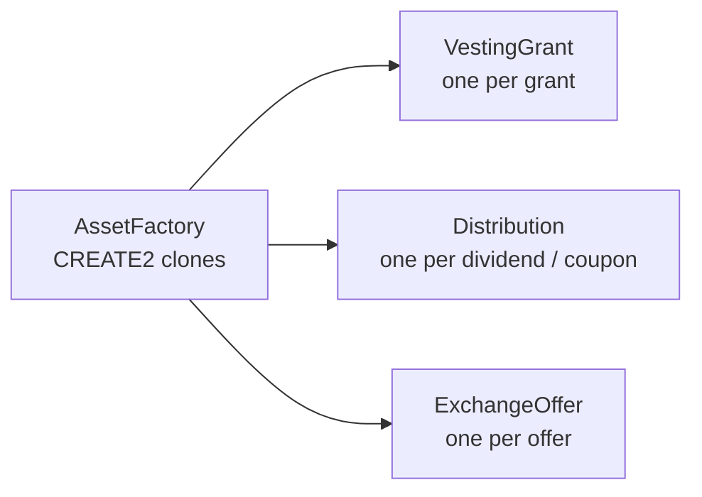
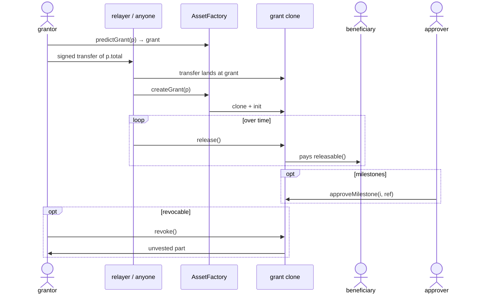
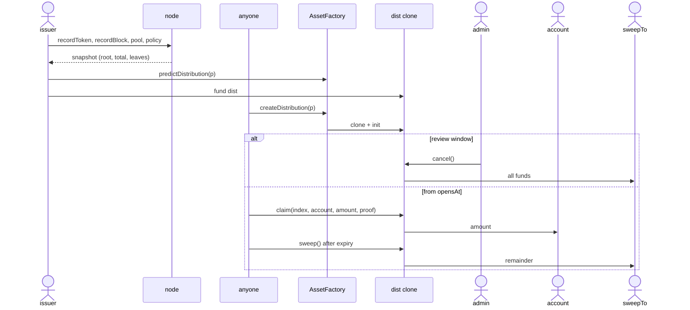

# Asset suite: regulated tokens, vesting, distributions, corporate actions, templates

The asset suite turns the open factory into a tokenization toolkit: optional **regulated controls** (creation-time flags on every non-confidential token kind:
freeze, forced transfer against a recorded order, bounded pause, receiver allowlist), a `ComplianceRegistry`
of eligibility attestations, and three permissionless **action contracts** — `VestingGrant`, `Distribution` and
`ExchangeOffer` — plus off-chain **templates** and **managed markets** on the existing DEX. Status: **SPECIFIED**
(EVM and Hedera); nothing is built; the primitives it reuses (token tiers, the factory, `OrderBookDex`) are BUILT.

## Scope

<a id="scope"></a>

EVM / Hedera (Solidity), all clones of never-upgraded implementations. The four regulated controls are creation-time
flags of the ordinary token kinds ([CTR-AS-17](#CTR-AS-17), [CTR-TOK-22](token-wrappers.md#CTR-TOK-22)); there are no
regulated kinds or contracts of their own.



| Component | Role |
|---|---|
| `ComplianceRegistry` | address-keyed attestations (flags, `validUntil`, attester); no personal data |
| `AssetFactory` | CREATE2 clones of the three action contracts, counterfactual funding |
| `VestingGrant` | one per grant: linear + cliff + interval, or tranches/milestones |
| `Distribution` | one per dividend/coupon: Merkle root over a node-indexed snapshot |
| `ExchangeOffer` | one per offer: redemption at maturity, buyback, split/reverse-split exchange |
| Templates | equity, bond, loyalty, voucher: off-chain presets over the above |
| Managed markets | `OrderBookDex` unchanged; node intake + gossip rules |

Not covered: confidential (Zether) regulated tokens — a confidential balance can be frozen (stuck) but not seized on
public chains, and no Zether code changes; non-fungible assets (ERC-721/1155, PLANNED); rebasing, scaled balances or
balance checkpoints in any token (balances never rebase); on-chain coupon schedules, interest accrual or oracles
(coupons are funded distributions); escrow with an arbiter and the sealed-bid tender (separate, [tender.md](tender.md));
gasless wrap (PLANNED); HTS-native regulated tokens on Hedera (owner: HSCS contracts only); any country-specific rule
(eligibility is expressed as attestation flags whose meaning the issuer defines); a new DEX contract (managed markets
are node policy over `OrderBookDex` plus token-level enforcement).

Measured runtime sizes of the base tiers (existing artifacts): `SingleUnderlyingToken` 21 637, `MultiUnderlyingToken`
22 561, `HederaMultiUnderlyingToken` 23 885 bytes — 2.9 k (Single), 2.0 k (Multi) and 0.7 k (Hedera Multi) bytes of
headroom below 24 576, less than the control surface; hence the controls live in `AdminLib`, an external library
([CTR-TOK-24](token-wrappers.md#CTR-TOK-24)).

## Regulated controls

<a id="regulated"></a>
<a id="regulated-kinds"></a>
<a id="CTR-AS-17"></a>**CTR-AS-17** — **Regulated controls are flags 5–8 (`FREEZE`, `FORCE`, `PAUSE`, `ALLOWLIST`) on the
ordinary kinds, code in `AdminLib`; refused on confidential kinds** (owner, T8, T11). They are creation-time flags of
[CTR-TOK-22](token-wrappers.md#CTR-TOK-22), chosen per token and locked or disableable per flag; their roles are held and
administered as that bullet says. The rules of [CTR-AS-03](#CTR-AS-03)…[CTR-AS-09](#CTR-AS-09) apply to any token with
one of the flags. A token with none carries no active control and is fully permissionless. A confidential kind refuses
flags 5–8 in `initialize` (`FeatureInvalidForKind`; the token validates, not the factory), because a confidential balance
can be frozen (stuck) but not seized on public chains. Otherwise every control combination would need its own
implementation.

<a id="regulated-exception"></a>
<a id="CTR-AS-02"></a>**CTR-AS-02** — **Third exception to "Nobody alters a deployed token"** (owner;
[CTR-TOK-10](token-wrappers.md#CTR-TOK-10)). Besides the rate admin and the guardian, the **regulated controls** of a
token with flags 5–8 is a creation-time, visible exception. Its powers are those flags (`FREEZE`, `FORCE`, `PAUSE`,
`ALLOWLIST`, part of the features of [CTR-TOK-22](token-wrappers.md#CTR-TOK-22)), chosen at creation and never added
later; each is locked or disableable.
`termsHash` (non-zero) commits to the issuer's disclosure document; disclosure is **mandatory**
([disclosure](#disclosure)). No regulated power can mint, change a rate, touch the token's own reserve or add a power.
Otherwise holders would have to read code to learn a token can be seized.

<a id="roles"></a>
<a id="CTR-AS-03"></a>**CTR-AS-03** — **Two roles** (owner), granted at creation (and later by the token's owner, [CTR-TOK-22](token-wrappers.md#CTR-TOK-22)), each **a contract** (a multisig with an
external seat is recommended, default 3-of-5, which the contract cannot prove): `issuer` executes (freeze, unfreeze,
forced transfer, pause, unpause); `compliance` records and revokes orders. Neither role is
transferable; a holder may `renounceRole` and the owner may revoke it ([CTR-TOK-22](token-wrappers.md#CTR-TOK-22)),
and losing a role **relaxes**: when no `issuer` holder is left, `FREEZE|FORCE|PAUSE` stop being active (every freeze and
pause ends at once); when no `compliance` holder is left, `FORCE` stops. Wallets compare the holders (`hasRole`, a role may have several, [CTR-TOK-22](token-wrappers.md#CTR-TOK-22)) to show whether the roles are separated. Without the relaxation a renounced or dead issuer would leave
frozen balances frozen forever.

<a id="forced-transfer"></a>
<a id="CTR-AS-04"></a>**CTR-AS-04** — **Forced transfer only against a recorded order** (owner). `compliance` records
an **order record** `{subject, beneficiary, maxAmount, freezeUntil}` under `recordId = keccak256(abi.encode(orderId,
subject, beneficiary))` (`orderId` = keccak256 of the authority's canonical order identifier; `documentHash` = hash of
the order document, kept off chain; both only in the event). `issuer` may force-transfer only (a) against a live
record, (b) **from the recorded subject while it is frozen**, (c) **to the recorded beneficiary**, (d) cumulatively ≤
`maxAmount`. There is **no court-ordered burn** (no `courtOrderBurn`): a burn is a forced transfer to a beneficiary
that burns (tier 1) or unwraps (wrapper tiers) itself — one power fewer, one audit path fewer, no capability lost.

<a id="freeze"></a>
<a id="CTR-AS-05"></a>**CTR-AS-05** — **Freeze semantics.** A frozen account cannot send (transfer, `transferFrom`,
burn, unwrap), cannot be the `from` of any meta-tx op, and cannot receive a relayer fee (owner). It **can** receive
this token (credits are never refused because of a freeze). The **unwrap recipient is not checked**: it receives a
different asset, and an unfrozen holder could unwrap to itself and forward it anyway. **Duration:** the issuer alone
may freeze an account for ≤ 30 days, extendable within the same episode to ≤ 60 days from its start, and may not
start another issuer-only episode on that account until 30 days after the last one ended; a longer or open-ended
freeze needs a live compliance record naming the account, lasts until that record's `freezeUntil`, and ends when the
record is revoked. Every freeze/unfreeze carries a non-zero `ref`. Otherwise a compromised issuer alone could freeze
every holder with no end date.

<a id="pause"></a>
<a id="CTR-AS-06"></a>**CTR-AS-06** — **Global pause, 7 days on / 7 days cooldown** (owner). `pause(ref, until)`:
`until ≤ now + 7 days`, no extension while paused, and a **cooldown of 7 days** after any pause ends before the next
may start. Paused: transfers, `transferFrom`, mints, wraps, every meta-tx op except a **fee-less** unwrap op, and
therefore every `ExchangeOffer` exchange into the token (redemptions, buybacks, split migration). **Never paused:**
unwrap (direct, or the meta-tx op with fee `NONE`, which the node sponsors during a pause), holder burn, forced
transfer. There is no automatic reopening (an earlier draft would "reopen redeem automatically"); back-to-back pauses would otherwise be an indefinite freeze of
everyone.

<a id="compliance-registry"></a>
<a id="CTR-AS-07"></a>**CTR-AS-07** — **Allowlist through a separate `ComplianceRegistry`** (address → `{uint64 flags,
uint64 validUntil, uint32 attesterId}` in one slot; an immutable `admin` contract manages attesters; disabling an
attester voids its attestations at once; no personal data). The UA registry is **not** extended (it is monotonic and
admin-free by design, [CTR-UA-15](accounts.md#CTR-UA-15)); compliance flags live only here (an earlier
`attributes(UA)` registry extension was withdrawn and its flag bits reused below). A regulated
token pins one registry and one `requiredFlags` mask at creation. **Only receivers of this token are checked** (`to`
of a transfer or mint, fee recipient): a holder whose attestation lapsed can still send to an eligible party, burn and
unwrap. The owner may `disableFeature(ALLOWLIST)` one-way when the flag is not locked ([CTR-TOK-22](token-wrappers.md#CTR-TOK-22)), so a dead registry never locks a token that left it disableable. A sender-side
check would trap holders when an attester is slow.

<a id="step6-checks"></a>
<a id="CTR-AS-08"></a>**CTR-AS-08** — **Regulated checks run at the shape step** (owner) through an override of the
pipeline's shape check (step 3, [metatx.md](metatx.md#execution-pipeline); built: step 6, `_checkOp`), so a failing
transfer or payment costs the relayer only the cheap prefix; an `_update` override enforces the same rules again on
every direct path, self-call and `mtxTrade`. A frozen `from` reverts every shape, including `approve`; a frozen or
ineligible resolved fee recipient reverts (also on `payWithFee`, whose override copies the base body, since an external
function cannot call `super`; an event-equality test pins it). The allowance rule is unchanged and orthogonal.
Regulated templates default to `MODE_FEE_NONE` (sponsored), because a fee-earning relayer would itself need an
attestation. The shape check is a hook in the base that `AdminLib` extends; the module's code-check hook is named `_regIsContract`
to avoid a clash with the non-virtual `ERC20MetaTx._isContract`. Every source edit changes the CBOR
metadata hash of all implementations, acceptable only because none is deployed.

<a id="reserves-untouched"></a>
<a id="CTR-AS-09"></a>**CTR-AS-09** — **No regulated power touches the token's own reserves, rates or legs** (owner):
forced transfer moves wrapped units only, so its `collateralValue() ≥ totalSupply()` is untouched. A frozen holder
**cannot unwrap**; the beneficiary of a forced transfer can. Unwrap is open during a pause. Guardian and rate admin
keep exactly their tier powers. A token with flags 5–8 used as the **underlying** of a wrapper is refused by the wizard (a
blocking warning when forced): the regulated issuer could freeze or seize that wrapper's leg (breaking the wrapper's
reserve rule, [CTR-TOK-05](token-wrappers.md#CTR-TOK-05)), and an attested wrapper would let its units bypass the
allowlist. Otherwise a seizure could drain a leg other holders rely on.

<a id="eligible-contract"></a>
<a id="CTR-AS-16"></a>**CTR-AS-16** — `ELIGIBLE_CONTRACT` (the registry flag that satisfies any `requiredFlags`) may be
set **only by the registry admin**, only on **pass-through** contracts whose every outflow is re-checked by the token
or goes only to a committed party (`VestingGrant`, `Distribution`, `ExchangeOffer` clones, `OrderBookDex`), with
`validUntil = type(uint64).max`. Never on a wrapper, a Safe, a venue fee recipient or an EOA: those get ordinary flags
for their controller. Otherwise one attestation would be a master key across every token on the registry.

| | Controlled-token rules in short |
|---|---|
| 1 | Two roles, each held by a **contract** (multisig, default 3-of-5 with an external seat recommended): `issuer` executes (freeze, unfreeze, forced transfer, pause), `compliance` records and revokes orders. The token's owner grants and revokes them, a holder may `renounceRole`, the owner may `disableFeature` unless the flag is locked ([CTR-TOK-22](token-wrappers.md#CTR-TOK-22)); losing a role **relaxes** powers |
| 2 | A forced transfer needs a live compliance **order record** `{subject, beneficiary, maxAmount, freezeUntil}` (`orderId` = keccak256 of the authority's canonical order identifier, the document off chain), moves only from the frozen subject to the recorded beneficiary, cumulatively ≤ `maxAmount`. There is **no court-ordered burn** |
| 3 | A frozen account cannot send, be a meta-tx `from` or receive a relayer fee; it can still receive. Issuer-only freezes last ≤ 30 days (≤ 60 days per episode); longer ones need a compliance record |
| 4 | `pause(ref, until)`: `until ≤ now + 7 days`, no extension, 7-day cooldown; a fee-less unwrap, holder burn and forced transfer are never paused |
| 5 | Transfer eligibility through a separate `ComplianceRegistry` (address → flags, `validUntil`, attester; no personal data); only **receivers** are checked; checks run at the pipeline's shape step |
| 6 | Confidential tokens: a confidential balance can be frozen (stuck) but not seized on public chains |

### Shape

- **In the token** (every non-confidential kind): the overrides of `_update`, the shape check and `payWithFee`, the
  cheap getters, one-line external stubs for every control function, and `forceTransfer` (it needs `ERC20._update`,
  internal to the token).
- **`AdminLib`** ([CTR-TOK-24](token-wrappers.md#CTR-TOK-24)): `recordOrder`, `revokeOrder`, `freeze`, `unfreeze`,
  `pause`, `unpause`, `canReceive`, with the role and flag administration of [CTR-TOK-22](token-wrappers.md#CTR-TOK-22).
  Each stub `DELEGATECALL`s it (a Solidity external library call), so it runs on the clone's storage. Hedera is the
  per-chain `IS_HEDERA` variant ([CTR-TOK-23](token-wrappers.md#CTR-TOK-23)), not a regulated child.
- **Storage**: the controls live in the `scaas.admin` ERC-7201 namespace ([CTR-TOK-24](token-wrappers.md#CTR-TOK-24)).
- The build gates on `forge build --sizes` within the per-implementation cap of CTR-TOK-24.

### Configuration and init

**P1-open:** the placement of the parameters below in `TokenConfig` ([CTR-TOK-25](token-wrappers.md#CTR-TOK-25)) is decided in P1; the field list is the requirement of what must be configurable. The flags and roles
are `features`, `lockedFeatures` and `roles`. `initialize` validates them through `AdminLib` ([CTR-TOK-22](token-wrappers.md#CTR-TOK-22)),
**before** the initial-supply mint, so that mint already sees the allowlist. The initial supply goes to `creator`, the
factory caller: an issuer whose treasury is a Safe makes the Safe call `createToken`.

```solidity
struct RegulatedParams {
    address registry;      // IComplianceRegistry; ≠ 0 iff ALLOWLIST
    uint64  requiredFlags; // receivers must hold all of these; ≠ 0 iff ALLOWLIST
    bytes32 termsHash;     // hash of the issuer's terms/disclosure document; ≠ 0 when any of flags 5–8 is set
}
```

| Init check | Error |
|---|---|
| any of flags 5–8 on a confidential kind | `FeatureInvalidForKind(bit)` |
| `FORCE ⇒ FREEZE` (a forced transfer needs a frozen subject) | `RegulatedConfigInvalid()` |
| `issuer`, `compliance` holders have code (`_regIsContract`; 7702 designators are EOAs) | `RoleNotContract(a)` |
| `ALLOWLIST` ⇔ `registry ≠ 0 && requiredFlags ≠ 0`; registry has code | `RegulatedConfigInvalid()` |
| `termsHash ≠ 0` | `RegulatedConfigInvalid()` |
| initial-supply recipient (`creator`) passes the receiver check | `NotEligible(creator, reason)` |

Storage (namespace): **hot slot** `registry (20) ‖ active controls u8 ‖ pausedUntil u64` (29 bytes, read on every transfer);
`requiredFlags u64 ‖ cooldownUntil u64`; `issuer`; `compliance`; `termsHash`; `mapping(address ⇒ FreezeState)`,
`FreezeState = {slot a: until u64 ‖ episodeStart u64 ‖ issuerCooldownUntil u64; slot b: recordId bytes32}` (the hot path
reads slot a only); `mapping(bytes32 ⇒ OrderRecord)`.

### Interface

In the token, `disableControls(bits)` is `disableFeature(bit)` (owner) and `renounceRole()` is `renounceRole(bit)`, and the events
`ControlsDisabled` and `RoleRenounced` are `FeatureDisabled` and `RoleRevoked` ([CTR-TOK-22](token-wrappers.md#CTR-TOK-22)); the names below are the control surface.

```solidity
interface IRegulatedToken {
    struct OrderRecord { address subject; address beneficiary; uint64 freezeUntil; bool revoked;
                         uint256 maxAmount; uint256 executed; }
    // recordId = keccak256(abi.encode(orderId, subject, beneficiary))
    event OrderRecorded(bytes32 indexed recordId, bytes32 indexed orderId, address indexed subject,
                        address beneficiary, uint256 maxAmount, uint64 freezeUntil, bytes32 documentHash);
    event OrderRevoked(bytes32 indexed recordId, bytes32 reasonRef);
    event AccountFrozen(address indexed account, bytes32 indexed ref, bytes32 recordId, uint64 until);
    event AccountUnfrozen(address indexed account, bytes32 indexed ref);
    event ForcedTransfer(bytes32 indexed recordId, address indexed from, address indexed to, uint256 amount);
    event Paused(bytes32 indexed ref, uint64 until);
    event Unpaused(bytes32 indexed ref);
    event ControlsDisabled(uint8 bits, uint8 remaining);
    event RoleRenounced(uint8 role);                              // 1 issuer, 2 compliance

    error Frozen(address account);
    error TokenPaused(uint64 until);
    error NotEligible(address account, uint8 reason);             // 1 not attested/flags missing, 2 expired, 3 attester disabled
    error FeeRecipientFrozen(address account);
    error NotIssuer(); error NotCompliance(); error ControlDisabled(uint8 control);
    error RefRequired(); error RoleNotContract(address a); error RegulatedConfigInvalid();
    error OrderExists(bytes32 recordId); error OrderUnknown(bytes32 recordId); error OrderInactive(bytes32 recordId);
    error SubjectNotFrozen(address subject); error OrderExceeded(uint256 remaining);
    error FreezeTooLong(uint64 maxUntil); error FreezeCooldown(uint64 until); error NotFrozen(address a);
    error PauseTooLong(uint64 until); error PauseCooldown(uint64 until);

    // views
    function controls() external view returns (uint8);
    function issuer() external view returns (address);
    function compliance() external view returns (address);
    function registry() external view returns (address);
    function requiredFlags() external view returns (uint64);
    function termsHash() external view returns (bytes32);
    function frozenUntil(address account) external view returns (uint64); // > now ⇔ frozen (and CTRL_FREEZE set)
    function isFrozen(address account) external view returns (bool);
    function pausedUntil() external view returns (uint64);
    function pauseCooldownUntil() external view returns (uint64);
    function canReceive(address account) external view returns (bool ok, uint8 reason);
    function order(bytes32 recordId) external view returns (OrderRecord memory);

    // compliance role
    function recordOrder(bytes32 orderId, bytes32 documentHash, address subject, address beneficiary,
                         uint256 maxAmount, uint64 freezeUntil) external returns (bytes32 recordId);
    function revokeOrder(bytes32 recordId, bytes32 reasonRef) external;   // ends a freeze backed by this record
    // issuer role
    function freeze(address account, bytes32 ref, bytes32 recordId) external; // recordId 0 ⇒ issuer-only (≤ 30 d)
    function unfreeze(address account, bytes32 ref) external;
    function forceTransfer(bytes32 recordId, uint256 amount) external;
    function pause(bytes32 ref, uint64 until) external;
    function unpause(bytes32 ref) external;
    function disableControls(uint8 bits) external;                        // one-way relaxation
    // either role, for itself, one-way (relaxations)
    function renounceRole() external;
}
```

The node, venue and wallet compose a transfer pre-check from `isFrozen`, `canReceive`, `pausedUntil` and `balanceOf`
(one table of reason codes in the node: `1`/`2`/`3` receiver, `4` sender frozen, `5` paused, `6` balance); there is no
on-chain `checkTransfer` (size). This interface replaces an earlier `IRegulatedToken` proposal (court-ruling ids,
`courtOrderBurn`, automatic reopening after a pause).

### Semantics per path

`R(a)` = receiver check (`ALLOWLIST` off ⇒ true; else `registry.hasFlags(a, requiredFlags)`). `F(a)` = `CTRL_FREEZE`
set and `frozenUntil(a) > now`. `P` = `CTRL_PAUSE` set and `pausedUntil > now`.

| Path | Reverts when |
|---|---|
| `transfer`, `transferFrom` (outside-token DEX legs), meta-tx transfer / `pay`, `mtxTrade` (to `dex`, then the DEX's payouts) | `P`; `F(from)`; `!R(to)` |
| `approve` (contract callers only) | `P`; `F(from)` (`transferFrom` checks `F(from)` again) |
| relayer fee (meta-tx fee transfer, `payWithFee`) | `F(feeRecipient)` ⇒ `FeeRecipientFrozen`; `!R(feeRecipient)` |
| mint (`minter`, wrap) | `P`; `!R(to)` |
| holder `burn` (tier 1), the burn inside unwrap | `F(from)` (not `P`) |
| unwrap (direct, multi, gasless) | `F(from)` via the burn row; a gasless unwrap with a fee during `P` refused at the shape step (`TokenPaused`), because its fee leg is a transfer; the recipient is not checked |
| `forceTransfer` | the order rules below only (not `P`, not `F(from)`) |
| `addReserve` (wrapper tiers) | unchanged |

Shape-step placement: the override computes the resolved fee recipient and fee amount exactly as the shape step does
(`m.feeRecipient == 0 ? msg.sender : m.feeRecipient`, `FeePolicy.compute`), applies the table for the shape or selector
in `m.data`, then calls `super` (built: `super._checkOp(m)`). The `_update` override re-applies the transfer/mint/burn
rows for direct paths, self-calls and `mtxTrade`; on the meta-tx path its reads are warm.

### Freeze, order records and forced transfer

```
issuer:     freeze(account, ref, 0)            issuer-only episode: ref ≠ 0; not frozen ⇒ now ≥ issuerCooldownUntil
                                               (FreezeCooldown), episodeStart = now; until = min(now + 30 d,
                                               episodeStart + 60 d) (FreezeTooLong when no extension is left)
compliance: recordOrder(orderId, docHash, subject, beneficiary, maxAmount, freezeUntil)
                                               orderId, docHash ≠ 0; subject ≠ beneficiary, both ≠ 0; maxAmount > 0
                                               (0 allowed only with freezeUntil > now: a freeze-only order);
                                               recordId unused (OrderExists)
issuer:     freeze(subject, ref, recordId)     record live and names `subject`: until = record.freezeUntil
                                               (type(uint64).max = open-ended), FreezeState.recordId = recordId
issuer:     forceTransfer(recordId, amount)    CTRL_FORCE; record live (OrderUnknown/OrderInactive); F(subject)
                                               (SubjectNotFrozen); executed + amount ≤ maxAmount (OrderExceeded);
                                               !F(beneficiary), R(beneficiary); executed += amount, then _forceMove
issuer:     unfreeze(account, ref)             until = now; an issuer-only episode sets issuerCooldownUntil = now + 30 d
compliance: revokeOrder(recordId, reasonRef)   revoked = true; if FreezeState(subject).recordId == recordId the
                                               freeze ends now (issuer cooldown starts as above)
```

- Episode end by expiry is passive (`until ≤ now`); `issuerCooldownUntil` is written when the episode is set
  (`until + 30 d`) and refreshed on unfreeze, so no transaction is needed for the cooldown either.
- An amended order is a new `orderId`; a record is never edited. One order against several accounts = several
  records.
- Seizing a wrapper's backing: force-transfer wrapped units to a beneficiary, which unwraps
  ([CTR-AS-09](#CTR-AS-09)). Seizing to destroy: a beneficiary that burns or unwraps ([CTR-AS-04](#CTR-AS-04)).
- Contract holders are subjects like any other: a grant, distribution or offer clone can be frozen and seized from
  exactly; the vesting and distribution sections define how those clones degrade.

Pause:

```
pause(ref, until)   issuer; CTRL_PAUSE; ref ≠ 0; now < until ≤ now + 7 days (PauseTooLong);
                    now ≥ cooldownUntil (PauseCooldown; this also refuses a pause while paused)
                    pausedUntil = until; cooldownUntil = until + 7 days; Paused(ref, until)
unpause(ref)        issuer; paused; pausedUntil = now; cooldownUntil = now + 7 days; Unpaused(ref)
```

Expiry is passive. Integrators read `pausedUntil()`.

### `ComplianceRegistry`

```solidity
interface IComplianceRegistry {
    event AttesterSet(address indexed attester, uint32 indexed attesterId, bool enabled);
    event Attested(address indexed account, uint64 flags, uint64 validUntil, uint32 indexed attesterId);
    error NotAdmin(); error NotAttester(); error AdminNotContract(address a); error LengthMismatch();
    error EligibleContractAdminOnly();

    function admin() external view returns (address);                 // immutable, a contract (multisig recommended)
    function setAttester(address attester, bool enabled) external;     // admin; ids assigned once, never reused
    function attesterId(address attester) external view returns (uint32);
    function attesterEnabled(uint32 id) external view returns (bool);
    function attest(address[] calldata accounts, uint64[] calldata flags, uint64[] calldata validUntil) external;
        // enabled attester, or admin (id 0); flags 0 = revoke; ELIGIBLE_CONTRACT only by admin
    function attestationOf(address account) external view returns (uint64 flags, uint64 validUntil, uint32 attesterId);
    function hasFlags(address account, uint64 required) external view returns (bool);
        // attesterEnabled(id) && validUntil ≥ now && ((flags & required) == required || flags & ELIGIBLE_CONTRACT != 0)
}
```

Flag bits (meaning set by the issuer's policy, market-neutral): `KYC_DONE = 1`, `ACCREDITED = 2`,
`SANCTIONS_CLEAR = 4`, `ELIGIBLE_CONTRACT = 8` ([CTR-AS-16](#CTR-AS-16)); bits 16–63 issuer-defined. One registry may
serve many tokens; anyone may deploy one (a plain deployment). Disabling an attester voids every attestation it made in
the same block (one extra SLOAD per check, `attesterEnabled`). The registry holds no personal data: the client system
is the system of record for identity evidence and pushes only flags. The node alerts 30 days before any protocol
clone's attestation would expire (it should not: [CTR-AS-16](#CTR-AS-16) mandates `type(uint64).max`). Credentials
from the optional verifiable-credential layer reach contracts only as these flags
([CTR-UA-20](accounts.md#CTR-UA-20)).

### Interactions

| With | Rule |
|---|---|
| Meta-tx pipeline | the path table at the shape step; step order, digest, typehash, nonces, named functions and `mtxBatch` unchanged; a failing batch item reverts the batch ([CTR-MTX-11](metatx.md#CTR-MTX-11)), so the node re-checks the parties of every regulated item it batches |
| Node simulation and grief score | a post-simulation revert with `Frozen`, `TokenPaused`, `NotEligible` or `FeeRecipientFrozen` is exempt from the origin's grief score only if the node's re-simulation at the inclusion block's **parent** succeeds and the inclusion block contains a transaction from the token's `issuer`/`compliance` or from the registry (admin or attester) touching the failing account; attester-caused exemptions are capped at 3 per origin per day (a colluding attester buys at most that). The node refuses at intake intents whose `validUntil` exceeds the receiver's attestation `validUntil` |
| Allowance lockdown | unchanged: spenders are contracts; the regulated check binds `from`/`to`, so an allowance to any contract cannot move tokens to an ineligible party |
| Single/multi wrappers (own reserves) | [CTR-AS-09](#CTR-AS-09); `wrap` is a mint (paused ⇒ refused; receiver check on `msg.sender`); `disableWrap` and the rate timelock unchanged; a pending rate change and a pause can overlap; fee-less unwrap stays open in both |
| Flags 5–8 on an underlying | refused by the wizard; if forced, freezing the wrapper blocks only that leg and a seizure breaks that wrapper's reserve rule (a test documents it) |
| `OrderBookDex` | each leg's pull into the DEX and each payout runs the regulated check, so the DEX is attested `ELIGIBLE_CONTRACT` by the registry admin; a failing leg fails only its settlement (`MatchFailed`); intake reads do not see freezes or eligibility, so the venue adds the pre-check above ([NODE-DEX-11](../node/dex-venue.md#NODE-DEX-11)); fee-split recipients on a regulated leg need `R` |
| `MandateWallet` | it calls `payWithFee`; the wallet is the `from` and must not be frozen; payees need `R` |
| Vesting / distribution / offer clones | holders like any other; attested `ELIGIBLE_CONTRACT` before funding (the address is known in advance) |
| Zether | none (not covered) |

### Disclosure

<a id="disclosure"></a>

Disclosure is mandatory ([CTR-AS-02](#CTR-AS-02)). The wizard refuses to create, and wallets show a blocking notice
before a first receive, with: kind and flags, each enabled control in plain words, `issuer`, `compliance` and whether
they are the same contract, the registry, its admin and `requiredFlags`, `termsHash` with a link to the document, and
these statements, kept to the enabled bits:

- *"The issuer can freeze any account for up to 30 days, extendable to 60, and not again for 30 days after. Longer or
  open-ended freezes require an order recorded by the compliance role, and end when that order is revoked."*
- *"With a recorded order naming an account, the issuer can move tokens out of that frozen account to the beneficiary
  named in the order, up to the recorded amount."*
- Wrapper kind (`UNDERLYING`): *"The issuer can pause transfers for up to 7 days at a time, with at least 7 days between pauses.
  Unwrapping is never paused, and frozen accounts cannot unwrap."* Kind `NONE`: *"The issuer can pause transfers for up to
  7 days at a time, with at least 7 days between pauses. Redemption, buyback and exchange offers are paused too; only
  burning stays open."*
- *"Receiving requires an attestation from the registry above; its admin chooses the attesters. The owner can switch
  this check off for good, unless the token locked it; never on."*
- *"The issuer cannot mint outside the minter rules, change rates beyond the rate rules, or touch the reserve."*

Wallets mark accounts named in a live `OrderRecorded`.

### Security

Invariants (each an invariant test):

- I1 `Σ balances == totalSupply` (forced transfer is a move); wrapper tiers keep `collateralValue() ≥ totalSupply()`
  and per-leg conservation across every regulated call.
- I2 Every `ForcedTransfer` has a live record, a subject frozen at execution, `to == beneficiary`, and cumulative
  `executed ≤ maxAmount`.
- I3 No balance of a frozen account decreases except by `ForcedTransfer`.
- I4 While paused, no transfer, mint or meta-tx op other than a fee-less unwrap succeeds; unwrap and burn always do
  (absent freeze and tier limits); no two pauses are closer than 7 days; no pause exceeds 7 days.
- I5 Every receiver of a balance increase passed `R` at that block, while `ALLOWLIST` is on.
- I6 No regulated call changes the token's own `reserve_i`, `num_i/den_i`, `wrapEnabled_i` or `minter`; `controls()`
  only loses bits.
- I7 No issuer-only freeze episode exceeds 60 days, and two issuer-only episodes on one account are ≥ 30 days apart.

| # | Abuse | Outcome |
|---|---|---|
| A1 | Compromised `issuer` alone | freezes anyone for ≤ 60 days (then a 30-day gap), pauses ≤ 7 of every 14 days, can only relax (renounce its role); **cannot move funds or freeze longer** without a compliance record. Every call emits |
| A2 | Compromised `compliance` alone | records fake orders; cannot execute. Node and client alert on every `OrderRecorded` |
| A3 | Both compromised, or `issuer == compliance` | open-ended freezes and seizure up to recorded amounts: the nature of a regulated token. Mitigation: separate multisigs with an external seat, alerts, disclosure |
| A4 | Subject front-runs a freeze | moves funds first. Mitigation: private submission (as for the guardian, [token-wrappers.md](token-wrappers.md#CTR-TOK-07)); moot on private chains |
| A5 | Replay / over-execution of an order | cumulative `executed ≤ maxAmount`; records immutable; revocation stops it |
| A6 | Wrong beneficiary | impossible without a new record by `compliance` |
| A7 | Registry admin compromised | attests anyone (allowlist bypass) or voids attesters (receives fail); no fund movement; the owner can `disableFeature(ALLOWLIST)` unless the token locked it. Disclosed; registry pinned at creation |
| A8 | Attestation lapse | receivers fail; holders still send to eligible parties, burn and unwrap |
| A9 | Fee griefing with a frozen/ineligible fee recipient | fails at the shape step (cheap) |
| A10 | Unwrap to a frozen accomplice | out of scope: the underlying is a different asset; the holder itself must be unfrozen to unwrap |
| A11 | Rolling pauses | bounded by the cooldown; wrapper exits stay open; `NONE` tokens with `PAUSE` are disclosed as pausable half of the time, offers included |
| A12 | Frozen holder escapes via DEX | `transferFrom` checks `F(from)`; the pair fails; the venue drops the maker's orders on `AccountFrozen` |
| A13 | Forced transfer from a protocol clone | address-exact; the clone degrades as defined below |
| A14 | Renounced or dead issuer | no `issuer` holder left stops `FREEZE|FORCE|PAUSE` (all freezes end); a dead issuer multisig leaves issuer-only freezes ending within 60 days and record-backed ones at `freezeUntil` or when compliance revokes |
| A15 | Dead registry | `disableFeature(ALLOWLIST)` by the owner (flag not locked); migration offers then work again |

Gas (estimates; measured numbers replace them in `test/as/RegulatedGas.t.sol`): per transfer on top of the tier row:
hot-slot SLOAD (2 100 cold) + `FreezeState(from)` slot a (2 100 cold) ≈ **+4.3 k** without allowlist; with allowlist,
per checked receiver a registry call (cold account 2 600 + attestation slot 2 100 + `attesterEnabled` 2 100 + call
overhead) ≈ **+8 k**; a meta-tx with a fee checks two receivers ≈ +16 k. The `_update` re-check on the meta-tx path is
warm (≈ +0.5 k). Control calls add one library `DELEGATECALL` (≈ 2.6 k cold). Unregulated kinds: **0**. `recordOrder`
≈ 95 k (4 new slots), `forceTransfer` ≈ 60 k, `freeze` ≈ 27–50 k.

### Tests (`test/as/`)

| Area | Tests |
|---|---|
| Init | every init refusal; EOA and 7702 roles refused; `FORCE` without `FREEZE`; config stored before the initial-supply mint (allowlist refuses an unattested `creator`) |
| Factory | `FactoryV2.t.sol`: flags 5–8 on `NONE` and `UNDERLYING` with counts 0/1/2/8/9; flags 5–8 refused on both confidential kinds in `initialize`, including through `createTokenUnregistered` |
| Paths | each row of the path table on both kinds, direct and meta-tx (generic, named, `mtxBatch`), refused at the shape step (gas of a refused intent < 40 k); `payWithFee` override emits exactly the base events |
| Freeze | issuer-only 30 d, extension to 60 d from episode start, `FreezeTooLong`, `FreezeCooldown` after expiry and after unfreeze, record-backed freeze to `freezeUntil`, ended by `revokeOrder`, open-ended record |
| Orders | record/revoke/execute; `SubjectNotFrozen`; `OrderExceeded` at the exact edge; beneficiary frozen/ineligible; same `orderId` with two subjects |
| Pause | 7-day bound, cooldown from actual end, passive expiry, refused while paused (`PauseCooldown`), fee-less gasless unwrap and burn during pause, fee-bearing gasless unwrap refused at the shape step, forced transfer during pause |
| Relaxations | freeze then every `issuer` holder renounces or is revoked ⇒ holder transfers and unwraps; no `compliance` holder stops `FORCE`; `disableFeature(ALLOWLIST)` with a reverting registry |
| Wrappers | frozen holder unwrap refused (direct, multi, gasless); a holder with a lapsed attestation unwraps; unwrap works while the registry reverts; reserves untouched by every regulated call; guardian/rate flows unchanged; flags 5–8 on an underlying: freezing the wrapper blocks only that leg |
| DEX | `OrderBookDex.mtxSettle` with a frozen maker, an ineligible taker, an ineligible fee recipient: only that settlement fails |
| Keywords | the kind gas table and layout pins identical after the shape-check hook change |
| Registry | admin contract only; attester add/remove; disable voids its attestations; batch attest; revoke by flags 0; expiry; `ELIGIBLE_CONTRACT` by admin only |
| Hedera | the `IS_HEDERA` variants of `NONE` and `UNDERLYING` with flags 5–8 sign via HIP-632; HTS fail-closed checks and association on `UNDERLYING` |
| Sizes | `--sizes` within the cap of CTR-TOK-24 with flags 5–8 compiled in |
| Invariant | handlers: transfers, meta-tx with fees, wraps/unwraps, freezes (both kinds), records, forced transfers, pauses with `warp`, role grants, revokes and renounces, `disableFeature`, attester disable and attestation expiry by the registry admin; invariants I1–I7 |

## Vesting and streaming

<a id="vesting"></a>
<a id="CTR-AS-10"></a>**CTR-AS-10** — **One EIP-1167 clone per grant** (`VestingGrant`, owner), not a vault. Funding
is **counterfactual**: the clone address is `CREATE2(keccak256(abi.encode(params)))`; `predictGrant(p)` **reverts**
unless `p` passes every state-independent check, and clients fund only an address `predict*` (`predictGrant(params)`) returned; the grantor
funds it with an ordinary (gasless) transfer or `pay` op; anyone then deploys it, and init can revert only with
`Underfunded` (fixed by a top-up). Schedules: linear with cliff and optional step `interval`, or ≤ 16 tranches,
optionally gated per tranche by an `approver` (milestones). Revocable option (the grantor reclaims the unvested part).
Claim is a permissionless `release()` that pays only the beneficiary: gasless through any relayer, no signature, no
nonce, no allowance. Per-grant isolation makes freeze and forced transfer of a regulated grant address-exact and
needs no allowance, for ≈ 15 k gas (≈ 11 %) more per grant, once. It replaces an earlier single-vault
(`IVestingVault`) design. Uses: streaming payroll, equity incentive vesting (e.g. 12-month cliff, 48-month linear),
milestone grants.

Roles: `grantor` (funds, may revoke if `revocable`), `beneficiary` (receives; should be a `SubjectAccount` so a lost
key is recoverable), `approver` (optional, milestones only; a Safe or `SubjectAccount` approves through a sponsored
call), relayer (submits anything; earns nothing on chain).



1. Client builds `GrantParams p`; `grant = AssetFactory.predictGrant(p)` (reverts on any invalid `p`).
2. Grantor signs a gasless transfer (or pay op with `entryRef = p.ref`) of `p.total` to `grant`; relayer submits
   (regulated token: registry admin attests `grant` `ELIGIBLE_CONTRACT` first).
3. Anyone: `AssetFactory.createGrant(p)` → clone at `grant`; init reverts only `Underfunded(balance, total)`.
4. Over time: anyone calls `release()` → pays `releasable()` to beneficiary.
5. Milestones: approver calls `approveMilestone(i, ref)`.
6. Optional: grantor `revoke()` → unvested part to grantor; vested part stays releasable.

```solidity
interface IVestingGrant {
    struct Tranche { uint64 at; uint192 amount; }
    struct GrantParams {
        address token; address grantor; address beneficiary; uint256 total;
        uint64 start; uint64 cliff; uint64 end; uint32 interval;   // linear; all zero when tranches are used
        Tranche[] tranches;                                         // ≤ 16, Σ amount == total; `at` strictly
                                                                    //   increasing without approver, non-decreasing with one
        address approver;                                           // tranches only; 0 ⇒ time-only tranches
        bool revocable;
        bytes32 ref;                                                // grant id in the client system (salt and reconciliation)
    }
    event Released(uint256 amount, uint256 releasedTotal);
    event Revoked(uint256 vestedAtRevoke, uint256 returned);
    event RevocationRenounced();
    event MilestoneApproved(uint8 indexed index, bytes32 ref);
    event ExcessSwept(uint256 amount);
    event Rescued(address indexed token, uint256 amount);
    error Underfunded(uint256 balance, uint256 total); error ScheduleInvalid(); error NotGrantor();
    error NotRevocable(); error AlreadyRevoked(); error NotApprover(); error AlreadyApproved(); error NothingToRelease();
    error OwnToken();

    function release() external returns (uint256 amount);              // anyone
    function revoke() external;                                         // grantor, if revocable
    function renounceRevocation() external;                             // grantor, one-way
    function approveMilestone(uint8 index, bytes32 ref) external;       // approver, one-way
    function sweepExcess() external returns (uint256);                  // anyone; pays grantor
    function rescue(address token) external returns (uint256);          // anyone; any token ≠ p.token, to grantor
    function vestedAmount(uint64 at) external view returns (uint256);
    function releasable() external view returns (uint256);
    function params() external view returns (GrantParams memory);
    function released() external view returns (uint256);
}
```

`AssetFactory.predictGrant(p)` runs every schedule check and `token ≠ 0`, `grantor ≠ 0`, `beneficiary ∉ {0, grant}`,
`total > 0`, and reverts `ScheduleInvalid` otherwise; `createGrant` runs the same checks.

Schedule math. Linear (`tranches` empty): `start ≤ cliff ≤ end`, `start < end`, `interval ≤ end − start`,
`approver == 0`.

```
vested(t) = 0                                   if t < cliff
          = total                               if t ≥ end
          = mulDiv(total, e, end − start)       otherwise, e = interval == 0 ? t − start
                                                                   : ⌊(t − start)/interval⌋ · interval
```

Tranches: `vested(t) = Σ amount_i` over tranches with `at_i ≤ t` and (no approver or approved_i). "Fixed periods" are
tranches without an approver, "milestones" tranches with one (`at` = earliest date, may be 0). After `revoke()`,
`vested(t) = cap` (the value at revocation) for all `t`. `releasable() = min(vested(now) − released, balance)`.

- `revoke()`: `cap = vested(now)`; returns `min(total − cap, balance)` to `grantor`; the vested remainder stays
  releasable (pull-style for the beneficiary). The grantor can front-run a pending milestone approval with a revoke
  (that milestone is then unvested): disclosed as part of the revocable bargain. With a regulated token, `F(grant)` is
  what matters, not whether the grantor is frozen: a frozen grantor does not block revoke; a frozen grant blocks every
  outflow.
- `renounceRevocation()`: one-way; turns a revocable grant into an irrevocable one.
- `approveMilestone`: approver only, one-way (`AlreadyApproved` on repeat). Approvers that are agents use a
  `SubjectAccount` or `MandateWallet`-style contract and a sponsored call job; there is no grant-level signature type.
- `sweepExcess()`: pays the grantor `balance − (obligation − released)`, saturating at 0 (`obligation = cap` after
  revoke, else `total`).
- **After a seizure** (a forced transfer from the grant): the **beneficiary bears it first** — `release` pays
  `min(releasable, balance)` and, at revocation, the grantor is paid its unvested part from what is left. A court
  order names the grant address because of the beneficiary's entitlement ("beneficiary-first"). No path reverts on a short balance.
- Checks-effects-interactions: `released` and `cap` are written before every transfer; tests use a token with a
  transfer hook.

Meta-tx, node and clients: no new typehash anywhere. Funding uses the existing gasless transfer/`pay` (an `entryRef` =
`p.ref` lets the client reconcile the funding as a normal payment). `release()`, `createGrant`, `approveMilestone`
(through the approver's account contract) are sponsored `call` jobs; "release every N days" is a client-pushed `call`
job, not node logic. The node normaliser adds `GrantCreated`, `Released`, `Revoked`, `RevocationRenounced`,
`MilestoneApproved`, `ExcessSwept`, `Rescued`. Clients keep a grant register (beneficiary, schedule, vested/released
mirrors), book the funding as a payment and a revocation as a reversal of the unvested part; the app shows a
beneficiary page (schedule chart, releasable, a release button that posts a sponsored job) and a grantor page.

Security invariants: `released ≤ vested(now) ≤ total` (or `≤ cap`); without seizure `token.balanceOf(grant) ≥
obligation − released` for a well-behaved token; only the beneficiary receives `release`; only the grantor receives
`revoke`/`sweepExcess`/`rescue`; `vested` is monotone in `t`; no call reverts because the balance is short.

| Abuse | Outcome |
|---|---|
| Someone deploys a different grant at the funded address | impossible: the address commits to every parameter |
| Funds sent to an address for invalid params | `predictGrant` refuses invalid `p`; the client library funds only returned addresses |
| Funds sent, never deployed / partial funding | anyone can deploy; `Underfunded` until topped up |
| Third party calls `release()` early | pays the beneficiary what is vested; nothing else |
| Approver compromised | approves milestones whose date has passed; cannot redirect funds |
| Grantor revokes before the cliff or ahead of an approval | the revocable bargain; disclosed |
| Stray tokens (a dividend paid to the grant) | `rescue` to the grantor; the snapshot policy attributes grants anyway |
| Token with transfer fee / rebasing | unsupported (v2 tokens have neither); the wizard refuses non-v2 tokens without an override flag |

| Operation (gas, estimates) | Grant clone (chosen) | Vault (rejected) |
|---|---|---|
| create | clone ≈ 41 k + init ≈ 5 slots × 22.1 k ≈ 110 k (+22 k per tranche) ⇒ ≈ 155 k | ≈ 110 k + `transferFrom` ≈ 30 k ⇒ ≈ 140 k, plus an allowance first |
| fund | one transfer (≈ 35–60 k as meta-tx) | inside create |
| release | ≈ 45–60 k (token transfer + 1 SSTORE) | similar |

Streaming payroll per short pay period is cheaper as an `mtxBatch` of `pay` ops; grants suit periods of a quarter or
more and incentive vesting. Tests: schedule edges (`t = cliff − 1, cliff, end`), interval steps, tranche ordering
(strict vs non-decreasing) and Σ checks, `predictGrant` refusing every invalid shape, approver gating, revoke
before/after cliff and after full vesting, `renounceRevocation`, `sweepExcess` saturation, `rescue` (refuses
`p.token`), counterfactual funding then deploy, `Underfunded`, regulated token (grant frozen ⇒ release reverts;
beneficiary frozen ⇒ release credits; seize half, then release, revoke and sweep), hook token. Fuzz: `vested` monotone
and ≤ total; `Σ released + returned + swept ≤ funded`. Invariant: handlers release/revoke/approve/warp/stray
transfers/seizure.

## Dividend and coupon distribution

<a id="distributions"></a>
<a id="CTR-AS-11"></a>**CTR-AS-11** — **Merkle distribution off a node-indexed snapshot** (owner), no balance
checkpoints in tokens. One clone per distribution, counterfactual funding with `predict*` validation as for grants;
init never reverts on time: claims open at `opensAt = max(claimStart, createdAt + 1 hour)` and `admin` may `cancel`
until then, so a late deploy shortens nothing below one hour of review. Permissionless claims pay only the leaf's
account; `sweep()` of the remainder to `sweepTo` after `expiry` (or never). The snapshot is deterministic, must
classify every contract leaf, and is recomputable by anyone. It replaces an earlier `CouponPayer` design. A wrong root
can be published; the review window, recomputation and `cancel` bound it.



1. Issuer picks `recordToken`, `recordBlock` (final), payout pool and policy (exclusions, protocol-clone attribution).
2. Node builds the snapshot → `root`, `total`, `leafCount`, `leaves`; anyone can recompute.
3. Client builds `DistParams p`; `dist = AssetFactory.predictDistribution(p)` (reverts on invalid `p`); issuer funds `dist`.
4. Anyone: `AssetFactory.createDistribution(p)` → init reverts only `Underfunded`; `opensAt = max(claimStart, now + 1 h)`.
5. Review window `[createdAt, opensAt)`: `admin` may `cancel()` → all funds to `sweepTo`.
6. Claims from `opensAt`: anyone submits `claim(index, account, amount, proof)` → pays `account`.
7. After `expiry` (if any): anyone `sweep()` → remainder to `sweepTo`.

```solidity
interface IDistribution {
    struct DistParams {
        address payoutToken; bytes32 root; uint256 total; uint32 leafCount;
        address admin; address sweepTo; uint64 claimStart; uint64 expiry;    // expiry 0 ⇒ never
        address recordToken; uint64 recordBlock; bytes32 policyHash;          // provenance (events, salt)
        bytes32 ref;                                                          // client declaration id
    }
    struct Claim { uint256 index; address account; uint256 amount; bytes32[] proof; }
    event Claimed(uint256 indexed index, address indexed account, uint256 amount);
    event Cancelled(uint256 returned);
    event Swept(uint256 amount);
    event Rescued(address indexed token, uint256 amount);
    error NotOpen(uint64 opensAt); error ClaimsClosed(uint64 expiry); error AlreadyClaimed(uint256 index);
    error BadProof(); error NotAdmin(); error ReviewOver(); error NotExpired(); error IndexOutOfRange();
    error TotalExceeded(); error OwnToken(); error ParamsInvalid();

    function claim(uint256 index, address account, uint256 amount, bytes32[] calldata proof) external;
    function claimMany(Claim[] calldata cs) external;  // skips already-claimed items, reverts on a bad proof
    function cancel() external;                          // admin, now < opensAt
    function sweep() external;                           // anyone, expiry ≠ 0 && now > expiry
    function rescue(address token) external returns (uint256); // anyone; any token ≠ payoutToken, to sweepTo
    function opensAt() external view returns (uint64);
    function isClaimed(uint256 index) external view returns (bool);
    function claimedTotal() external view returns (uint256);
}
```

`predictDistribution` checks (state-independent, `ParamsInvalid`): `root ≠ 0`, `total > 0`, `leafCount > 0`,
`expiry == 0 || expiry ≥ claimStart + 30 days`, `sweepTo ≠ 0`, `payoutToken ≠ 0`. Init adds only the balance check. A
distribution deployed after its `expiry` opens and is immediately sweepable: funds return to `sweepTo`, never lost.
Claimed bitmap `mapping(uint256 ⇒ uint256)`; the bit is set before the transfer. `claimedTotal ≤ total` is checked on
every claim (`TotalExceeded`), so a root whose leaves exceed `total` never overpays. **After a seizure** from the
distribution clone, claims are first-come until the balance runs out; the last claimants lose (disclosed; the order
names the clone, so the issuer refunds off chain).

Coupons and dividends:

- Dividend: pool `D` over eligible balance `S`: `amount_i = ⌊D·b_i/S⌋`; dust stays and is swept.
- Coupon: per-unit amount `num/den` (payout raw units per bond raw unit): `amount_i = ⌊b_i·num/den⌋`;
  `total = Σ amount_i`.
- One distribution per payment date; the client system schedules them from the bond terms. Funding remains the
  issuer's obligation: the contracts make payment automatic **once funded**.

<a id="snapshot"></a>**Snapshot** (node, deterministic). Input: `(chain_key, recordToken, recordBlock, policy)` with
`recordBlock` final under the chain's finality gate. Balances = replay of every finalized `Transfer` of `recordToken`
from its creation block (the node indexer's watch list) to the end of `recordBlock`; it must equal `balanceOf(a)` at
`recordBlock` for a sampled set (archive RPC quorum) or the build fails. Policy (canonical JSON, `policyHash =
keccak256` of its RFC 8785 bytes): excluded addresses (issuer treasury, DEX, offers) and attribution of protocol clones
(`VestingGrant` balances to their beneficiary, to the grantor, or excluded — the issuer's choice). The builder **must**
classify every leaf that has code: every `AssetFactory` clone (known from its events, including counterfactual grant
addresses funded before `GrantCreated`, detected by `predictGrant` of pending client grants) and the token's own
address are excluded or attributed, and any other contract leaf **fails the build** unless the policy lists it. Frozen
holders stay in (a freeze does not seize entitlement; payment credits them). Tree: **OpenZeppelin `StandardMerkleTree`
v1** with leaf encoding `["uint256","address","uint256"]` = `(index, account, amount)`, leaf =
`keccak256(bytes.concat(keccak256(abi.encode(index, account, amount))))`, `sortLeaves = true` (the tree's own hash
order), complete-tree array layout, commutative (sorted-pair) node hashing as `MerkleProof.verify`. `index` is the
position in the list sorted by `account` ascending with zero amounts dropped; it appears only inside the leaf. Vectors
`test/vectors/merkle_dist_vectors.json` (Solidity, Rust node, Python client) include 1, 2, 3, 7 and 2¹⁰ + 1 leaves.
Output: root, total, leafCount, leaves file (CSV + JSON), proofs. The node service and its routes are
[node/indexer-feeds.md](../node/indexer-feeds.md) (`POST /v1/snapshots {chain, token, block, policy}` → `{id}`; `GET
/v1/snapshots/{id}` → `{state, root, total, leaf_count, policy_hash}`; `GET /v1/snapshots/{id}/leaves`; `GET /v1/snapshots/{id}/proof?account=` (public data). CLI `scaas-node snapshot
verify <file>` recomputes a root from chain without trusting the store). The node is not trusted for the root: the
review window and independent recomputation are the control.

Claims and `claimMany` are sponsored `call` jobs (≤ 100 claims per transaction); no signature is needed because a
claim pays only the leaf's account. Clients book a declared distribution as a payable; `Claimed` reduces it;
`Cancelled`/`Swept` reverse the remainder; the app lists claimable distributions with a claim button.

Security invariants: each index paid once; `claimedTotal ≤ total ≤ funded`; nothing leaves except to a leaf account
(claims) or `sweepTo` (cancel before `opensAt`, sweep after `expiry`, rescue of foreign tokens).

| Abuse | Outcome |
|---|---|
| Wrong root (issuer or node error, lying node) | ≥ 1 h review + recompute + `cancel`; after `opensAt` the `total` cap bounds the loss to the pool |
| Funds sent to an address for invalid params / deploy after `claimStart` | `predict*` refuses invalid `p`; init never reverts on time |
| Second-preimage of an inner node as a leaf | double-hashed leaves |
| Admin cancels after claims open | `ReviewOver` |
| Early sweep | `NotExpired`; with `expiry = 0` never |
| Griefing claims | pay the rightful account only |
| Leaf that is a protocol clone (cannot move `payoutToken`) | build fails unless classified; `rescue` recovers stray payouts to grants/offers |

Gas (estimates): a claim ≈ 30 k + 0.4 k × ⌈log₂ leafCount⌉ + the payout transfer (≈ 30–55 k): ≈ 65–95 k for 10⁵
holders; `claimMany` saves the 21 k intrinsic per item. Create ≈ clone 41 k + 6 slots ≈ 175 k. Tests: proof vectors
(odd counts), duplicate index, bad proof, `claimMany` skip semantics, `predictDistribution` refusals, deploy after
`claimStart` (opens at `now + 1 h`) and after `expiry`, time edges, cancel window, sweep, over-`total` root, rescue,
seizure then claims (first-come), hook token, regulated payout token (frozen account credited, ineligible account
refused — the policy must exclude or the issuer attest), fuzz over random trees (≤ 2¹⁰ leaves), invariant handlers
claim/cancel/sweep/warp.

## Corporate actions: `ExchangeOffer`

<a id="corporate-actions"></a>
<a id="CTR-AS-12"></a>**CTR-AS-12** — **Split and reverse split are a migration to a new token** through an
`ExchangeOffer` (owner; balances never rebase). A scaled view is rejected: every integrator (DEX limits, vesting
totals, Merkle leaves, allowances, client books) holds raw amounts. Bond redemption at maturity and fixed-price
buybacks are `ExchangeOffer`s too; a buyback at market is a DEX bid. Every holder acts once (gaslessly); dust stays in
the old token, buyable by a cash offer.

<a id="exchange-offer"></a>
<a id="CTR-AS-13"></a>**CTR-AS-13** — `ExchangeOffer` is gasless through a `TradeOrder` leg it pulls as its `dex` (as
`mtxWrap`, [CTR-TOK-20](token-wrappers.md#CTR-TOK-20)), plus a direct `transferFrom` path. Exact multiples only
(`in·num % den == 0`, else `NotExactMultiple`). A **non-closable** offer must burn what it receives, requires
`tokenIn.minter() == 0` at exchange time, and its `sweep()` never takes `tokenOut` below the live obligation
`quote(tokenIn.totalSupply())` before `closesAt`; a non-zero `closesAt` on it is ≥ `opensAt + 365 days` (prescription is
the issuer's terms, disclosed with a blocking notice). Otherwise a short window or a live minter would let the issuer
take unexchanged holders' new shares or redemption money.

| Use | `tokenIn` | `tokenOut` | `num/den` | Window | `closable` | `sink` |
|---|---|---|---|---|---|---|
| Bond redemption at maturity | bond (kind `NONE` with flags 5–8, minter renounced) | payout stablecoin | face value per unit | `opensAt = maturity`, `closesAt = 0` or ≥ `opensAt + 365 d` per the terms | no | 0 (burn) |
| Buyback (tender at a fixed price) | equity | stablecoin | price | issuer's choice, `capIn` | yes | issuer treasury or 0 |
| Split `1 : k` | old equity (minter renounced) | new equity (pre-minted `k × supply` to the offer) | `k/1` | `closesAt = 0` (default) or ≥ 365 d | no | 0 (burn) |
| Reverse split `k : 1` | old equity (minter renounced) | new equity | `1/k` | as split | no | 0 (burn) |

A buyback at market is a bid on a managed market, not an offer. Wrapper tokens are not split (an adjustable-rate token
re-pegs through its rate rules).

```solidity
interface IExchangeOffer {
    struct OfferParams {
        address tokenIn; address tokenOut; uint96 num; uint96 den;  // out = in·num/den, exact
        uint256 capIn;                                               // 0 ⇒ no cap
        uint64 opensAt; uint64 closesAt;                             // closesAt 0 ⇒ never
        address admin; bool closable; address sweepTo; address sink; // sink 0 ⇒ burn (tier-1 tokenIn only)
        bytes32 termsHash; bytes32 ref;
    }
    event Exchanged(address indexed holder, uint256 amountIn, uint256 amountOut);
    event Closed(uint64 at);
    event Swept(uint256 amountOut);
    event Rescued(address indexed token, uint256 amount);
    error NotOpen(); error ClosedOffer(); error CapExceeded(uint256 remaining); error NotExactMultiple();
    error InsufficientOut(uint256 have, uint256 need); error NotATradeLeg(); error LegNotRoutedHere();
    error CounterTokenMismatch(); error PriceNotMet(uint256 out, uint256 min);
    error DeltaMismatch(uint256 got, uint256 expected); error NotAdmin(); error NotClosable(); error SinkRequired();
    error MinterLive(address minter); error ParamsInvalid(); error OwnToken();

    function exchange(TradeOrder calldata leg, bytes calldata sig) external returns (uint256 out);
    function exchangeDirect(uint256 amountIn, uint256 minOut) external returns (uint256 out);
    function close() external;                 // admin, only if closable
    function sweep() external returns (uint256); // anyone; tokenOut → sweepTo, bounded by the obligation (below)
    function rescue(address token) external returns (uint256); // any token ∉ {tokenIn, tokenOut}, to sweepTo
    function quote(uint256 amountIn) external view returns (uint256 out);
    function obligation() external view returns (uint256); // non-closable, before closesAt: quote(tokenIn.totalSupply())
    function filledIn() external view returns (uint256);
}
```

`exchange` (gasless): `leg` is a `TradeOrder` on `tokenIn` signed by the holder with `dex = this` (`LegNotRoutedHere`),
`receiveToken = tokenOut` (`CounterTokenMismatch`), `receiveAmount` = its minimum out, `minFill = amount`, `flags` 0
(`NotATradeLeg`), `relayer ∈ {0, msg.sender}`. The offer computes `out`, requires `out ≥ receiveAmount` (`PriceNotMet`),
`filledIn + amount ≤ capIn`, the window open, non-closable ⇒ `tokenIn.minter() == 0` (`MinterLive`),
`tokenOut.balanceOf(this) ≥ out`; calls `tokenIn.mtxTrade(leg, sig, TradeFill(amount, out, fee, msg.sender))` with `fee
= ⌈out · leg.fee / 10⁶⌉`, requires the measured delta `== amount`; writes `filledIn`, burns (`NoUnderlyingToken.burn`)
or forwards to `sink`, pays `out − fee` to `destination` (or `from`) and `fee` to `msg.sender`, the relayer.
`exchangeDirect`: the same with `transferFrom(msg.sender)`. (Replaced: a `trade`-op leg, `tokenIn.executeMetaTransaction(leg,
sig)`, `MetaTxDex._terms`/`_checkRouting`, `feeRecipient ∉ {0, this}`, `out ≥ minCounterValue`, `filledIn + in ≤ capIn`,
`== leg.value`, payout to `leg.from`.)

`predictOffer` checks (`ParamsInvalid`/`SinkRequired`): `num, den ∈ [1, 2⁹⁶)`; `tokenIn ≠ tokenOut`; `closesAt == 0 ||
closesAt > opensAt`; `sweepTo ≠ 0`; `closable == false` ⇒ `sink == 0` and (`closesAt == 0 || closesAt ≥ opensAt + 365
days`); `sink == 0` ⇒ `tokenIn.kind() == NONE`. Offers need not be funded at creation (a
redemption offer is created at issuance and funded at maturity); an exchange that cannot be paid reverts
`InsufficientOut`.

`sweep()`: a closable offer after `close()` or `closesAt` — all `tokenOut` to `sweepTo`. A non-closable offer — before
`closesAt` (or forever with `closesAt == 0`) only `balance − obligation()` (saturating); after `closesAt` all of it.
With a burn sink, `tokenIn.totalSupply()` is exactly the unexchanged supply, so no holder's entitlement can be swept
before the disclosed prescription date. A seizure is not possible from the offer's `tokenOut` balance without a forced
transfer by `tokenOut`'s own issuer, which then reduces what late holders get (first-come).

Splits in practice:

1. The issuer renounces the old token's minter, creates the new token with the same template (same regulated config;
   a new `termsHash` referencing the action) and `initialSupply = ⌈S_old·num/den⌉` to itself, then transfers it to the
   offer (or funds the counterfactual address).
2. Holders exchange (gaslessly) multiples of `den/gcd(num, den)`; the wallet computes the amount and shows the dust.
3. Dust stays in the old token; a buyback offer (cash in lieu) can absorb it.
4. The old token remains valid. A pause of the old token also pauses the exchange, so issuers do not pause during the
   window. Unexchanged holders keep their claim until `closesAt` (never, by default).
5. DEX: the venue delists the old market and lists the new one; resting orders on the old token expire or are
   cancelled.

Security, gas, tests. Invariants: `filledIn ≤ capIn`; every `Exchanged` paid exactly `in·num/den`; no `tokenOut` leaves
except to a holder or to `sweepTo` within the sweep rule; a non-closable offer's balance never drops below
`obligation()` through `sweep` before `closesAt`; `tokenIn` is burned or at `sink`. Abuse: a leg replayed (token
nonce), a leg routed to another offer (`LegNotRoutedHere`), a fake token delta (measured), reentrancy via hooks
(transient guard, checks-effects-interactions), early close of a non-closable redemption (`NotClosable`), the issuer
sweeping unexchanged entitlement (bounded by `obligation`), a live minter diluting the pool (`MinterLive`), a rate typo
(bounded by the funded balance; the wizard shows the human rate). Gas (estimate): ≈ `mtxTrade` leg (≈ 60 k) + burn
(≈ 8 k) + minter read (2.1 k) + payout (≈ 30–55 k) ≈ 110–130 k. Tests: both paths, exact-multiple edges, cap edge,
window edges, sink vs burn, `predictOffer` refusals, `SinkRequired` for a wrapper `tokenIn`, `MinterLive`, sweep bounded
by `obligation` before `closesAt` and full after, rescue, regulated `tokenIn` (offer `ELIGIBLE_CONTRACT`; frozen holder
refused by the shape check; paused ⇒ refused) and regulated `tokenOut` (ineligible holder refused), fuzz `num/den` ∈ [1, 2⁹⁶)
with the rate vectors' edge set.

## Action contracts

<a id="action-contracts"></a>
<a id="CTR-AS-15"></a>**CTR-AS-15** — Action contracts (grants, distributions, offers) have **no owner and no
upgrade**; their only privileged calls are `revoke`/`renounceRevocation` (grantor, if chosen), `approveMilestone`
(approver, if chosen), `cancel` before `opensAt` (distribution admin), `close` (offer admin, only if `closable`).
Remainders and stray tokens (`rescue(token)` for any token other than the contract's own) go only to a creation-time
`sweepTo`/grantor, never to the caller. Every payout follows checks-effects-interactions (bit, `released` or
`filledIn` written before the transfer). A permissionless sweep could otherwise redirect funds.

`AssetFactory` is a separate contract (action contracts are not tokens): `predictGrant/createGrant`,
`predictDistribution/createDistribution`, `predictOffer/createOffer`; each `predict*` reverts on invalid params;
CREATE2 salt `keccak256(abi.encode(kindTag, params))`; implementations immutable in the constructor, no registrar, no
catalogue (a new implementation = a new `AssetFactory`); events `GrantCreated`, `DistributionCreated`, `OfferCreated`.
Deploy scripts: `AdminLib` is deployed and linked per chain ([CTR-TOK-24](token-wrappers.md#CTR-TOK-24)); `AssetFactory` and one `ComplianceRegistry` per operator are
deployed separately.

## Templates

<a id="templates"></a>
<a id="CTR-AS-14"></a>**CTR-AS-14** — **Templates are off-chain presets** (owner): versioned JSON in the client library
and the wizard that maps to one factory call plus optional action contracts; there is no on-chain preset factory, which
would freeze defaults that issuers must be able to change. Presets live in `sdk/asset_templates.json` (the wizard, the
app and client systems read the same file) with a vector per preset (`initData` bytes for given inputs). Each preset
names its kind, `initData` builder, required inputs, defaults, follow-up actions and disclosure text.

| Template | Kind | Defaults | Follow-ups |
|---|---|---|---|
| **Equity** (shares, units of a fund) | `NONE` + flags 5–8 | `decimals 0`; `initialSupply` to the issuer treasury Safe (the Safe calls `createTiered`); `minter` = issuance multisig or 0 (fixed); `features` include `FREEZE|FORCE|PAUSE|ALLOWLIST`; `requiredFlags = KYC_DONE|SANCTIONS_CLEAR` (+ `ACCREDITED` for restricted offerings); fee `NONE` | dividends, splits/buybacks, managed market, vesting of employee grants |
| **Bond** | `NONE` + flags 5–8 | `decimals 0` (1 unit = 1 denomination); supply minted at issuance, **minter renounced** after (required by the redemption offer); controls as equity; `termsHash` covers face, coupon dates and rate, maturity, redemption offer address and any prescription date | one `Distribution` per coupon date; one `ExchangeOffer` (redemption, burn, `opensAt = maturity`) created at issuance |
| **Loyalty points** | `META_NONE` | `decimals 0`; `minter` = the issuer's mint contract (rate limits live there); fee `NONE`; no regulated module. Prepaid points: `META_SINGLE` with a rate (1 USDC → 100 points, [token-wrappers.md](token-wrappers.md#CTR-TOK-08)) | campaigns as `Distribution` of points; redemption = `pay` to the merchant |
| **Voucher** (gift card, coupon) | `META_NONE` (or `META_SINGLE` for prepaid value) | `decimals 0`, 1 unit = 1 voucher of the stated face value; issuer minter; validity = the redemption offer's window | issuance by mint or `Distribution` (campaign); merchants accept by `pay`; the issuer redeems merchants' vouchers by a **closable** `ExchangeOffer` (voucher → payout, burn) whose `closesAt` is the expiry |

Points and vouchers do not expire on chain (balances never change); expiry is the end of the issuer's redemption
offer, disclosed as such. A loyalty or voucher issuer who needs freeze or allowlist sets flags 5–8 on the same kind;
the wizard then applies the mandatory disclosure. The wizard refuses a token with flags 5–8 as the underlying of any
wrapper template.

The configuration wizard (in the app and any client system) works over `IOpenFactory`:

| Template | Factory call | Parameters | Status of primitive |
|---|---|---|---|
| Loyalty / rewards | `createTiered(META_NONE, 1, [], initData, salt)` (built: `createMetaToken(1, 0, initData, salt)`) | name, symbol, decimals, `minter` = issuer's mint contract or treasury multisig, fee 0 | **BUILT** |
| Internal 1:1 money | `createTiered(META_SINGLE, 1, [underlying], …)` with `num = den = 1` (built: `createMetaToken(1, underlying, …)`) | underlying stablecoin; wrap/unwrap through the clone | **BUILT** |
| Wrapper with a rate | `createTiered(META_SINGLE, …)` | underlying, `num/den`, fixed or adjustable (admin, delay, step) | **BUILT** |
| Confidential money | `createZetherToken(1, underlying, verifier, initData, salt)` | `registry`, `shieldScale`, `maxDecryptableShielded ≤ 2^54`, `confidentialFee`, auditor key | **BUILT** (dev chains only) |
| Multi-underlying money (e.g. xDAI/USDC/USDT) | `createTiered(META_MULTI, …)` | 2–8 underlyings, per-leg rates, guardian | **BUILT** |
| Vesting / streaming | `VestingGrant` clone per grant | cliff, duration, interval or tranches, approver, revocability | **SPECIFIED** |
| Controlled / security / bond | `createToken` with flags 5–8 + `Distribution` / `ExchangeOffer` | issuer and compliance contracts, the flags, `ComplianceRegistry` + `requiredFlags`, `termsHash` | **SPECIFIED** |
| Non-fungible in-app assets (ERC-721/1155 with meta-tx) | new kinds | — | **PLANNED** |

Provenance metadata published for every asset: `creator`, `underlying`, `version`, `implementation`, creation block
(issuance timestamp), and for wrappers the live reserve `underlying.balanceOf(token)` — readable by anyone for free.

## Managed markets

Securities on a licensed venue trade on a managed market of `OrderBookDex` ([CTR-DEX-12](dex.md#CTR-DEX-12)); on chain
the regulated token's own checks are the arbiter, and the node venue enforces home-bound orders, `NONE` relayer fees on
regulated legs and eligibility at intake ([NODE-DEX-11](../node/dex-venue.md#NODE-DEX-11)).

## Touchpoints

- Node: the event normaliser adds `OrderRecorded`, `OrderRevoked`, `AccountFrozen`, `AccountUnfrozen`,
  `ForcedTransfer`, `Paused`, `Unpaused`, `FeatureDisabled`, `RoleGranted`, `RoleRevoked`, `Attested`, `AttesterSet`,
  `GrantCreated`, `Released`, `Revoked`, `RevocationRenounced`, `MilestoneApproved`, `ExcessSwept`,
  `DistributionCreated`, `Claimed`, `Cancelled`, `Swept`, `OfferCreated`, `Exchanged`, `Closed`, `Rescued`;
  `TokenCreated` ([CTR-TOK-25](token-wrappers.md#CTR-TOK-25)) with the flags. The token table's `features` and
  `lockedFeatures` are cached with the roles and registry (refreshed on `FeatureDisabled`/`RoleGranted`/`RoleRevoked`).
  Intake applies the receiver-attestation expiry rule and the
  grief-score exemption test; during a pause the node sponsors fee-less unwrap ops. Alerts: any `OrderRecorded`,
  `ForcedTransfer`, `Paused`, `FeatureDisabled`, `RoleRevoked`, `AttesterSet`, a role contract's code-hash change, and a protocol
  clone's attestation within 30 days of expiry. Control actions are ordinary `call` jobs (a Safe's `execTransaction`
  with its owners' signatures, or a `SubjectAccount.executeAsOwner`); the node holds no role key.
- Client systems: an asset register (kind, template, terms document, `termsHash`), a cap table mirrored from the feed,
  compliance cases (order id, document, `documentHash`, records, freezes with their end dates, forced transfers),
  attestation sync (the client's KYC process is the system of record; it pushes `attest` `call` jobs signed by the
  attester contract's owners), grants, distributions (payables), offers (redemptions, buybacks); personal data never
  goes on chain ([integration.md](../integration.md)).
- App: issuer wizard (templates, inputs, human-rate preview, mandatory disclosure), a compliance console that **builds**
  Safe transactions for orders, freezes, forced transfers, pauses and relaxations (signed by the user's own Safe owner
  key; the app never holds a role key), holder pages (regulated status with freeze end dates, vesting, claimable
  distributions, open offers with their prescription dates, managed markets).

## Storage layout pins

<a id="storage"></a>

New implementations get `test/as/layout/*.json` pins. The controls live in the `scaas.admin` namespace
([CTR-TOK-24](token-wrappers.md#CTR-TOK-24)), so the kind's own slots are unchanged by flags 5–8; `VestingGrant`, `Distribution`,
`ExchangeOffer` pinned in full. Indexers that read `reserve` by slot keep working on wrappers with flags 5–8.

## Families

| Component | EVM | Hedera | Cosmos | Soroban (Stellar, Pi) | Move (Aptos, Sui) | TON | Solana |
|---|---|---|---|---|---|---|---|
| Regulated controls | this file | this file (HSCS contracts + HIP-632 + HTS fail-closed underlying checks; HTS-native tokens not used, owner) | PLANNED: CW20 variant with the same rules | PLANNED: SEP-41 variant; candidate native flags (auth-required, clawback) to be assessed | PLANNED: candidate native mechanisms (Aptos FA `TransferRef` freeze/transfer; Sui regulated coin deny list) | PLANNED: jetton master + wallet with order records | PLANNED: candidate Token-2022 extensions (permanent delegate, default frozen state, transfer hook) |
| ComplianceRegistry | this file | this file | PLANNED | PLANNED | PLANNED | PLANNED | PLANNED |
| VestingGrant, Distribution, ExchangeOffer | this file | this file | PLANNED | PLANNED | PLANNED (subject account holds any asset; contracts as Move modules) | PLANNED | PLANNED |
| Snapshot builder | this file | this file (same indexer) | with each family's token | 〃 | 〃 | 〃 | 〃 |
| Managed markets | this file | this file | where an order book exists | — | — | — | — |

Each non-EVM family gets its own design after the EVM + Hedera build and after that family's wrapper work, and must
satisfy every rule of this file or amend it explicitly ([NET-ALL-17](../networks/README.md#NET-ALL-17)). Candidate
native mechanisms are named for that assessment only; none is relied on here.
