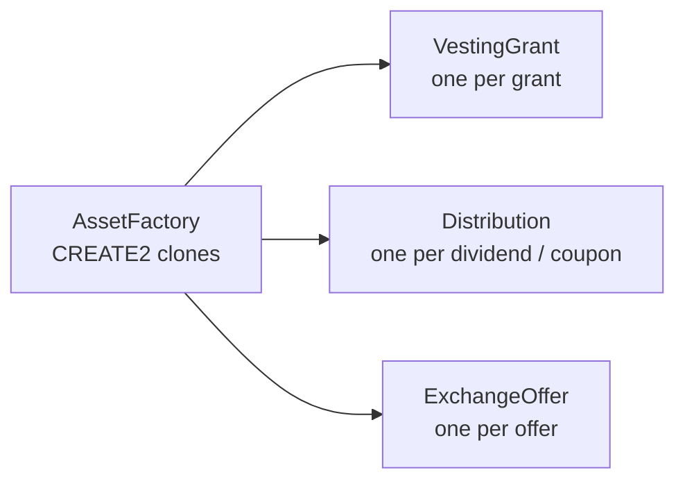
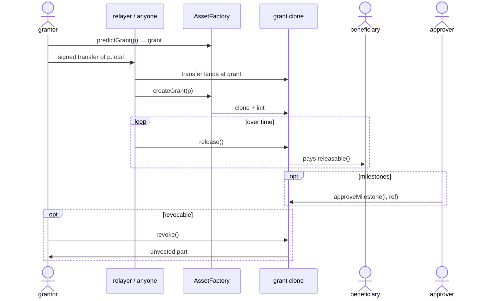
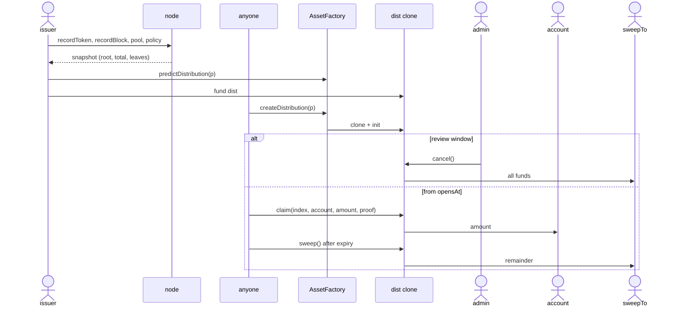

# Asset suite: regulated tokens, vesting, distributions, corporate actions, templates

The asset suite turns the open factory into a tokenization toolkit: optional **regulated controls** (creation-time flags of the six regulated kinds 8–13, one regulated implementation per
kind: freeze, forced transfer against a recorded order, bounded pause, receiver allowlist and denylist), a `ComplianceRegistry`
of eligibility attestations, and three permissionless **action contracts** — `VestingGrant`, `Distribution` and
`ExchangeOffer` — plus off-chain **templates** and **managed markets** on the existing DEX. Status: §2, the regulated
controls and `ComplianceRegistry`, **BUILT** on EVM and Hedera (`IS_HEDERA`) (branch `ua-mtx-merge`, T24–T36, UNAUDITED;
[§2.1](#21-shape)); §3–§8 **SPECIFIED** unless a line says otherwise; the primitives it reuses (token tiers, the factory,
`SCaaSDex`) are BUILT.

**Contents**

1. [Scope](#1-scope)
2. [Regulated controls](#2-regulated-controls)
   - 2.1 [Shape](#21-shape)
   - 2.2 [Configuration and init](#22-configuration-and-init)
   - 2.3 [Interface](#23-interface)
   - 2.4 [Semantics per path](#24-semantics-per-path)
   - 2.5 [Freeze, order records and forced transfer](#25-freeze-order-records-and-forced-transfer)
   - 2.6 [`ComplianceRegistry`](#26-complianceregistry)
   - 2.7 [Interactions](#27-interactions)
   - 2.8 [Disclosure](#disclosure)
   - 2.9 [Security](#29-security)
   - 2.10 [Tests (`test/as/`)](#210-tests-testas)
   - 2.11 [Rules of the regulated build](#regulated-rules)
   - 2.12 [Tax on the regulated kinds](#tax)
3. [Vesting and streaming](#3-vesting-and-streaming)
4. [Dividend and coupon distribution](#4-dividend-and-coupon-distribution)
5. [Corporate actions: `ExchangeOffer`](#5-corporate-actions-exchangeoffer)
6. [Action contracts](#6-action-contracts)
7. [Templates](#templates)
8. [Managed markets](#8-managed-markets)
9. [Touchpoints](#9-touchpoints)
10. [Storage layout pins](#10-storage-layout-pins)
11. [Families](#11-families)

## 1. Scope

<a id="scope"></a>

EVM / Hedera (Solidity), all clones of never-upgraded implementations. The five regulated controls are creation-time
flags 5–9 ([CTR-AS-17](#CTR-AS-17), [CTR-TOK-22](token-wrappers.md#CTR-TOK-22)); each kind has at most one regulated
implementation; there is none per feature.



| Component | Role |
|---|---|
| `ComplianceRegistry` | UA-keyed compliance rows (flags, `validUntil`, KYC provider); no personal data |
| `AssetFactory` | CREATE2 clones of the three action contracts, counterfactual funding |
| `VestingGrant` | one per grant: linear + cliff + interval, or tranches/milestones |
| `Distribution` | one per dividend/coupon: Merkle root over a node-indexed snapshot |
| `ExchangeOffer` | one per offer: redemption at maturity, buyback, split/reverse-split exchange |
| Templates | equity, bond, loyalty, voucher: off-chain presets over the above |
| Managed markets | `SCaaSDex` unchanged; node intake + gossip rules |

Not covered: confidential (Zether) regulated tokens, which follow
[CTR-GOV-17](../decisions.md#ctr-gov-17--regulated-confidential-kinds-the-rules); non-fungible assets (ERC-721/1155, PLANNED); rebasing, scaled balances or
balance checkpoints in any token (balances never rebase); on-chain coupon schedules, interest accrual or oracles
(coupons are funded distributions); escrow with an arbiter and the sealed-bid tender (separate, [tender.md](tender.md));
gasless wrap (PLANNED); HTS-native regulated tokens on Hedera (owner: HSCS contracts only); any country-specific rule
(eligibility is expressed as attestation flags whose meaning the issuer defines); a new DEX contract (managed markets
are node policy over `SCaaSDex` plus token-level enforcement).

Measured runtime sizes of the base tiers (before `WrappedToken` replaced them): `SingleUnderlyingToken` 21 637, `MultiUnderlyingToken`
22 561, `HederaMultiUnderlyingToken` 23 885 bytes — 2.9 k (Single), 2.0 k (Multi) and 0.7 k (Hedera Multi) bytes of
headroom below 24 576, less than the control surface; hence the controls live in an external library (`AdminLib` then, `GovernanceLib` since [CTR-GOV-01](../decisions.md#ctr-gov-01--governancebase-on-every-token-kind-and-the-dex))
([CTR-TOK-24](token-wrappers.md#CTR-TOK-24)).

## 2. Regulated controls

<a id="regulated"></a>
<a id="regulated-kinds"></a>
<a id="CTR-AS-17"></a>**CTR-AS-17** — **Regulated controls are flags 5–9 (`FREEZE`, `FORCE`, `PAUSE`, `ALLOWLIST`,
`DENYLIST`), on the ABI of a kind's regulated implementation, code in `GovernanceLib`; one regulated implementation per
kind, never per feature; a plain `transfer` and `mtxTransfer` add no storage read, on every kind, pinned by a test**
(owner, T8, T11; owner 2026-11-02, CTR-GOV-03, CTR-GOV-11; applied 2026-11-04). The flags stay creation-time flags of
[CTR-TOK-22](token-wrappers.md#CTR-TOK-22), chosen per token and locked or disableable per flag; their holders are UA ids
([CTR-GOV-01](../decisions.md#ctr-gov-01--governancebase-on-every-token-kind-and-the-dex)), administered as that bullet
says; the rules of [CTR-AS-03](#CTR-AS-03)…[CTR-AS-09](#CTR-AS-09) apply to any token with one of the flags. What changes
is where the hook lives: the plain implementation of a kind carries no hook in `_update` or `_uaMove` and refuses flags
5–9, so its holders pay nothing for a control their token does not have; the regulated implementation of the same kind is
the same source with the hook compiled in, and takes the combinations of flags 5–9 that §2.2's init checks accept. So a
control combination still needs no implementation of its own, the reason this rule exists. Ids 8–13 are real members of
`TokenKind`, off until published
([CTR-GOV-16](../decisions.md#ctr-gov-16--regulated-kinds-are-real-enum-members-before-the-factory-freezes)). The four
regulated confidential kinds 10–13 follow
[CTR-GOV-17](../decisions.md#ctr-gov-17--regulated-confidential-kinds-the-rules) (built; bit 8 is outside their mask, so
`ALLOWLIST` there is `FeatureInvalidForKind(8)`). A plain kind 0–5 refuses flags 5–10, 21 and 22 with
`FeatureInvalidForKind` (the token validates, not the factory; regulated-kinds spec Q3).

**BUILT** (branch `ua-mtx-merge`, T24–T36, UNAUDITED): the six regulated kinds of [§2.1](#21-shape) with `RegulatedBase`,
`RegulatedLib` and `ComplianceRegistry` (`smartcontracts/evm/src/regulated/`), the eight empty hooks in the base sources
with the plain kinds' "+0" pinned in slots and gas (T26 `f55f43c0`, `test/governance/PlusZero.t.sol`), the controls and
their router ops (T28 `3a0c99fb`, T32 `e46cdb71`), the registry (T29 `7411a468`), the confidential kinds 10–13 (T30
`da66a98b`, T31 `65caf46f`), the releases and the registry deploy (T33 `63aa8696`), the vectors (T34 `e1a1baba`), the node
rows and venue (T35 `7f0251fc`) and the invariants I1–I13 (T36 `ba40f0cc`); the rules of the build are
[§2.11](#regulated-rules). Before it, bits 5–9 were refused `FeatureNotBuilt` on `NORMAL` and `WRAPPED` (branch
`governance`, T3 `7825361b`).

<a id="regulated-exception"></a>
<a id="CTR-AS-02"></a>**CTR-AS-02** — **Third exception to "Nobody alters a deployed token"** (owner;
[CTR-TOK-10](token-wrappers.md#CTR-TOK-10)). Besides the rate admin and the guardian, the **regulated controls** of a
token with flags 5–9 is a creation-time, visible exception. Its powers are those flags (`FREEZE`, `FORCE`, `PAUSE`,
`ALLOWLIST`, `DENYLIST`, part of the features of [CTR-TOK-22](token-wrappers.md#CTR-TOK-22)), chosen at creation and never added
later; each is locked or disableable. Bit 21 `MODERATE` joins this disclosure and `termsHash` when it is built ([CTR-GOV-08](../decisions.md#ctr-gov-08--moderate-later-with-flags-5-8)).
`termsHash` (non-zero) commits to the issuer's disclosure document; disclosure is **mandatory**
([disclosure](#disclosure)). No regulated power can mint, change a rate, touch the token's own reserve or add a power.
Otherwise holders would have to read code to learn a token can be seized.

<a id="roles"></a>
<a id="CTR-AS-03"></a>**CTR-AS-03** — **Holders per bit** (owner; [CTR-GOV-01](../decisions.md#ctr-gov-01--governancebase-on-every-token-kind-and-the-dex)). `issuer` names the holders of bits 5–7, `compliance` the holders of bit 10 `RECORD`, each **a contract** (a multisig with an external seat is recommended, default 3-of-5, which the contract cannot prove), granted at creation and later by the token's owner under `grantDelay`. `issuer` executes (freeze, unfreeze, forced transfer, pause, unpause); `compliance` records and revokes orders; one holder is refused both `FORCE` and `RECORD`. Neither is transferable; a holder may `renounceRole` and the owner may revoke it, and losing a role **relaxes**: when no live root of a bit is left, that bit stops being active, whatever dead leaves stay listed and an expired root counting until it is revoked: `FREEZE` and `PAUSE` end at once, `FORCE` stops, and `FORCE` stops too when no live root of `RECORD` is left. [CTR-GOV-09](../decisions.md#ctr-gov-09--delayed-relaxing-and-record-later-with-the-asset-suite) replaces "at once" with `grantDelay` when `_delayedRelaxBits()` is built, on every path that relaxes. Bits 5–7, 10 and 21 are contract-only: a holder is a native id whose address has code or a threshold (`msig`) UA, on every family (owner 2026-11-05, [decisions](../decisions.md#ctr-as-03--issuer-and-compliance-roles-renouncing-relaxes)). Bit 22 `OPERATOR_TRANSFER` is not contract-only ([CTR-AS-20](#CTR-AS-20)). BUILT (T24 `295e073b`: the holders and the
relaxation of [CTR-AS-21](#CTR-AS-21); `test/governance/GovRelax.t.sol`). Wallets compare the holders (`hasRole`, a role may have several, [CTR-TOK-22](token-wrappers.md#CTR-TOK-22)) to show whether the roles are separated. Without the relaxation a renounced or dead issuer would leave
frozen balances frozen forever.

<a id="forced-transfer"></a>
<a id="CTR-AS-04"></a>**CTR-AS-04** — **Forced transfer only against a recorded order** (owner). `compliance` records
an **order record** `{subject, beneficiary, maxAmount, freezeUntil}` under `recordId = keccak256(abi.encode(orderId,
subject, beneficiary))` (`orderId` = keccak256 of the authority's canonical order identifier; `documentHash` = hash of
the order document, kept off chain; both only in the event). `issuer` may force-transfer only (a) against a live
record, (b) **from the recorded subject while it is frozen**, (c) **to the recorded beneficiary**, (d) cumulatively ≤
`maxAmount`. There is **no court-ordered burn** (no `courtOrderBurn`): a burn is a forced transfer to a beneficiary
that burns (tier 1) or unwraps (wrapper tiers) itself — one power fewer, one audit path fewer, no capability lost.

<a id="freeze"></a>
<a id="CTR-AS-05"></a>**CTR-AS-05** — **Freeze semantics.** A frozen account cannot send (transfer, `transferFrom`,
burn, unwrap), cannot be the `from` of any meta-tx op, and cannot receive a relayer fee (owner). It **can** receive
this token (credits are never refused because of a freeze). The **unwrap recipient is not checked**: it receives a
different asset, and an unfrozen holder could unwrap to itself and forward it anyway. **Duration:** the issuer alone
may freeze an account for ≤ 30 days, extendable within the same episode to ≤ 60 days from its start, and may not
start another issuer-only episode on that account until 30 days after the last one ended; a longer or open-ended
freeze needs a live compliance record naming the account, lasts until that record's `freezeUntil`, and ends when the
record is revoked. Every freeze/unfreeze carries a non-zero `ref`. Otherwise a compromised issuer alone could freeze
every holder with no end date.

<a id="pause"></a>
<a id="CTR-AS-06"></a>**CTR-AS-06** — **Global pause, 7 days on / 7 days cooldown** (owner). `pause(ref, until)`:
`until ≤ now + 7 days`, no extension while paused, and a **cooldown of 7 days** after any pause ends before the next
may start. Paused: transfers, `transferFrom`, mints, wraps, every meta-tx op except a **fee-less** unwrap op, and
therefore every `ExchangeOffer` exchange into the token (redemptions, buybacks, split migration). **Never paused:**
unwrap (direct, or the meta-tx op with fee `NONE`, which the node sponsors during a pause), holder burn, forced
transfer. There is no automatic reopening (an earlier draft would "reopen redeem automatically"); back-to-back pauses would otherwise be an indefinite freeze of
everyone.

<a id="compliance-registry"></a>
<a id="CTR-AS-07"></a>**CTR-AS-07** — **Receiver check through a separate `ComplianceRegistry`: bit 28 `KYC`, off by default** (group 3s, [CTR-GOV-24](../decisions.md#CTR-GOV-24); bits 8 and 9 are the token's lists, [CTR-AS-31](#CTR-AS-31)) (owner, [CTR-GOV-18](../decisions.md#ctr-gov-18--receiver-check-two-feature-bits-allowlist-and-denylist-off-by-default)). (`bytes32` account → `{uint64 flags, uint64 validUntil, uint32 providerId}` in one slot; its admin (a UA id, CTR-GOV-23) manages the KYC providers; disabling an attester voids its attestations at once; no personal data.) The UA registry is **not** extended (it is monotonic and
admin-free by design, [CTR-UA-15](accounts.md#CTR-UA-15)); compliance flags live only here (an earlier
`attributes(UA)` registry extension was withdrawn and its flag bits reused below). `KYC`, bit 28, reads both masks (group 3s; before it, bit 8 read `requiredFlags` and bit 9 `deniedFlags`); a regulated token pins one `complianceRegistry` and its masks at creation (a registry iff a mask; `KYC` needs one; `requiredFlags` 0 on 10–13): `R(a) = !KYC || ((flags(a) & requiredFlags) == requiredFlags && (flags(a) & deniedFlags) == 0)`, where `flags(a)` is the compliance row's word while its KYC provider is enabled and `validUntil` has not passed, else 0. Both off, nobody is stopped, and a token with both off adds no read. Both on means known, and not denied. Each bit is disabled and locked on its own. **Features only lose bits after creation, so a token created with a bit off never gets it: the issuer chooses at creation.** Money for general use turns on `DENYLIST`; a security needing known holders turns on `ALLOWLIST`. **Only receivers of this token are checked** (`to` of a transfer or mint, fee recipient): a denied account can still send, burn and unwrap, and a holder whose attestation lapsed can still send to an eligible party. A sanctioned account takes `FREEZE` as well, which stops a sender and expires. The owner may `disableFeature` either bit one-way when it is not locked ([CTR-TOK-22](token-wrappers.md#CTR-TOK-22)), so a dead registry never locks a token that left it disableable. A sender-side check would trap holders when a KYC provider is slow. BUILT (T29 `7411a468`; `test/as/Registry.t.sol`, `Receiver.t.sol`, `RegistryFailure.t.sol`): bit 8 on kinds 8 and 9, bit 9
on 8–13; the call is bounded ([CTR-AS-28](#CTR-AS-28)). **Universal Accounts** (owner 2026-10-13,
[CTR-UA-27](accounts.md#CTR-UA-27); built so): the registry keys accounts by `bytes32` (a native address zero-padded), the
freeze set likewise, and the per-transfer checks hook the UA ledger's `_uaMove` too, the UA → UA branch included
(`_regMove`).

<a id="step6-checks"></a>
<a id="CTR-AS-08"></a>**CTR-AS-08** — **Regulated checks run before the pipeline's signature check and again on every move**
(owner; as built, regulated-kinds spec §2.2). Eight `internal view virtual` hooks with empty bodies sit in the base sources
(`UAMetaTxBase`, `ERC20MetaTx`, `ZetherLayer`); only `RegulatedBase` and the regulated kinds override them, so a plain kind
compiles each to nothing ("+0", pinned). `_regPre(from, inner selector, mode)` runs `P` and `F(from)` before
`MtxPipelineLib.pre*` ([CTR-AS-27](#CTR-AS-27)), so a failing op costs the relayer only the cheap prefix; `_regFeeTo` checks
every fee leg's recipient before effects ([CTR-AS-25](#CTR-AS-25)); `_regMove` re-applies the transfer, mint and burn rows in
`_update` and `_uaMove` on every direct path, self-call and `mtxTrade` (never in `_poolMove`, which reaches `ERC20._update`
qualified: it carries the confidential payouts and the decoy fee, and `forceTransfer` runs on it); `_regPayer`, `_regSender`,
`_regName`, `_regReceiver` and `_regZetherSender` cover the wrap payer and the confidential sites. A frozen `from` reverts
every shape, including `approve`; a frozen or ineligible fee recipient reverts. The allowance rule is unchanged and orthogonal.
Regulated templates default to `MODE_FEE_NONE` (sponsored), because a fee-earning relayer would itself need an attestation.
Every source edit changes the CBOR metadata hash of all implementations, acceptable only because none is deployed with value.

<a id="reserves-untouched"></a>
<a id="CTR-AS-09"></a>**CTR-AS-09** — **No regulated power touches the token's own reserves, rates or legs** (owner):
forced transfer moves wrapped units only, so its `collateralValue() ≥ totalSupply()`, on a non-hybrid, is untouched. A frozen holder
**cannot unwrap**; the beneficiary of a forced transfer can. Unwrap is open during a pause. Guardian and rate admin
keep exactly their tier powers. A SCaaS token whose `features()` carry bit 6 `FORCE` or bit 21 `MODERATE` is refused as the **underlying** of a wrapped kind at `_addLeg`, read through the factory's `isRegisteredToken` ([CTR-GOV-05](../decisions.md#ctr-gov-05--a-wrapped-kind-refuses-a-scaas-leg-with-force-or-moderate); BUILT on branch `governance`, T8, `233b874b`): its issuer could seize that wrapper's leg (breaking the wrapper's
reserve rule, [CTR-TOK-05](token-wrappers.md#CTR-TOK-05)). Bits 5, 7, 8, 9 on a leg stay allowed and are disclosed: a freeze or pause of the leg blocks only that leg, and an attested wrapper would let its units bypass the receiver check. An unregistered leg is an outside leg, disclosed as one. Otherwise a seizure could drain a leg other holders rely on.

<a id="eligible-contract"></a>
<a id="CTR-AS-16"></a>**CTR-AS-16** — `ELIGIBLE_CONTRACT` (the registry flag that satisfies any `requiredFlags`, never `deniedFlags`) may be
set **only by the registry admin**, only on **pass-through** contracts whose every outflow is re-checked by the token
or goes only to a committed party (`VestingGrant`, `Distribution`, `ExchangeOffer` clones, `SCaaSDex`), with
`validUntil = type(uint64).max`. Never on a wrapper, a Safe, a venue fee recipient or an EOA: those get ordinary flags
for their controller. Otherwise one attestation would be a master key across every token on the registry.

| | Controlled-token rules in short |
|---|---|
| 1 | Holders per bit, each a **contract** or an `msig` UA (multisig, default 3-of-5 with an external seat recommended): `issuer` holds bits 5–7 and executes (freeze, unfreeze, forced transfer, pause), `compliance` holds bit 10 `RECORD` and records and revokes orders; one holder is refused both `FORCE` and `RECORD`. The token's owner grants and revokes them, a holder may `renounceRole`, the owner may `disableFeature` unless the flag is locked ([CTR-TOK-22](token-wrappers.md#CTR-TOK-22)); losing a role **relaxes** powers |
| 2 | A forced transfer needs a live compliance **order record** `{subject, beneficiary, maxAmount, freezeUntil}` (`orderId` = keccak256 of the authority's canonical order identifier, the document off chain), moves only from the frozen subject to the recorded beneficiary, cumulatively ≤ `maxAmount`. There is **no court-ordered burn** |
| 3 | A frozen account cannot send, be a meta-tx `from` or receive a relayer fee; it can still receive. Issuer-only freezes last ≤ 30 days (≤ 60 days per episode); longer ones need a compliance record |
| 4 | `pause(ref, until)`: `until ≤ now + 7 days`, no extension, 7-day cooldown; a fee-less unwrap, holder burn and forced transfer are never paused |
| 5 | Receiver check through a separate `ComplianceRegistry` (account → flags, `validUntil`, KYC provider; no personal data): `ALLOWLIST` (`requiredFlags`) and `DENYLIST` (`deniedFlags`), both off by default; only **receivers** are checked; checks run at the pipeline's shape step |
| 6 | Confidential tokens: a confidential balance can be frozen (stuck) but not seized on public chains; the regulated confidential kinds 10–13 follow [CTR-GOV-17](../decisions.md#ctr-gov-17--regulated-confidential-kinds-the-rules) (built) |

### 2.1 Shape

One regulated implementation per kind ([CTR-GOV-03](../decisions.md#ctr-gov-03--a-plain-transfer-stays-0-one-regulated-implementation-per-kind-never-per-feature)),
each its base kind's source with the hooks overridden (BUILT, `smartcontracts/evm/src/regulated/`):

| Id | Kind | Contract | Base kind | Bits added to the base kind's mask |
|---|---|---|---|---|
| 8 | `NORMAL_REGULATED` | `NormalRegulatedToken` | `NormalToken` | 5, 6, 7, 8, 9, 10, 21, 22 |
| 9 | `WRAPPED_REGULATED` | `WrappedRegulatedToken` | `WrappedToken` | 5, 6, 7, 8, 9, 10, 21, 22 |
| 10 | `NORMAL_ZETHER_REGULATED` | `NormalZetherRegulatedToken` | `NormalZetherToken` | 5, 6, 7, 9, 10, 21, 22 |
| 11 | `WRAPPED_ZETHER_REGULATED` | `WrappedZetherRegulatedToken` | `WrappedZetherToken` | 5, 6, 7, 9, 10, 21, 22 |
| 12 | `NORMAL_PQZ_REGULATED` | `NormalPqzRegulatedToken` | `NormalPqzToken` | 5, 6, 7, 9, 10, 21, 22 |
| 13 | `WRAPPED_PQZ_REGULATED` | `WrappedPqzRegulatedToken` | `WrappedPqzToken` | 5, 6, 7, 9, 10, 21, 22 |

Bit 23 `TAX` joins kinds 8–13 with pay-meta-tax ([§2.12](#tax)). Each kind is a forwarding core
with its modules (`*RegulatedTokenCore`, `*RegulatedTokenModules`, the T66b split of every kind), on `RegulatedBase`
(abstract over `MetaTokenBase`: the masks, the ledger and fee hooks, `disableFeature`, `supportsInterface`, the checks `F`,
`P`, `R`) and the external `RegulatedLib` (the controls' bodies, `DELEGATECALL`ed so they run on the clone's storage; the
subject comes in as a word, never read inside the library). `forceTransfer` and `operatorTransfer` move in the token
(`_poolMove`, `_uaMove`), which the library cannot reach. A regulated kind answers `type(IRegulatedToken).interfaceId` in
ERC-165; kinds 0–5 do not. Hedera is the per-chain `IS_HEDERA` variant ([CTR-TOK-23](token-wrappers.md#CTR-TOK-23),
`test/as/RegulatedHedera.t.sol`), not a regulated child. No user-facing token entry is added or changes form: a regulated
kind's `mtxSelectors()`, `_uaAllowed`, typed structs, domain and nonce space are its base kind's, hooked; the controls are
direct entries, relayed through the `GovernanceRouter` ([§2.3](#23-interface)). Sizes and deploy gas per release:
[CTR-TOK-24](token-wrappers.md#CTR-TOK-24) and the size baseline (T33).

### 2.2 Configuration and init

The parameters are the field `reg` of `TokenConfig` ([CTR-TOK-25](token-wrappers.md#CTR-TOK-25); field 6: a plain kind with a
non-zero `reg` reverts `ConfigFieldForOtherKind(6)`). The flags and roles are `features`, `lockedFeatures` and `roles`.
`initialize` validates them through `GovernanceLib` and `RegulatedLib.init` ([CTR-TOK-22](token-wrappers.md#CTR-TOK-22)),
**before** the initial-supply mint, so that mint already sees the receiver check. The initial supply goes to `creator`, the
factory caller: an issuer whose treasury is a Safe makes the Safe call `createToken`.

```solidity
struct RegulatedParams {
    address complianceRegistry; // ≠ 0 iff ALLOWLIST or DENYLIST; extcodehash == the release's REGISTRY_CODEHASH
    uint64  requiredFlags;      // ≠ 0 iff ALLOWLIST
    uint64  deniedFlags;        // ≠ 0 iff DENYLIST
    bytes32 termsHash;          // ≠ 0 iff any of 5-10, 21
    bytes32 taxRecipient;       // ≠ 0 iff bit 23 TAX (CTR-AS-19)
}
```

| Init check (before the initial-supply mint) | Error |
|---|---|
| a bit outside the kind's mask (bit 8 on 10–13; any of 5–10, 21, 22 on 0–5) | `FeatureInvalidForKind(bit)` |
| `FORCE ⇒ FREEZE ∧ RECORD`; `RECORD ⇒ FREEZE` | `RegulatedConfigInvalid()` |
| `ALLOWLIST ⇔ requiredFlags ≠ 0`; `DENYLIST ⇔ deniedFlags ≠ 0`; `complianceRegistry ≠ 0 ⇔` either; `termsHash ≠ 0` iff any of 5–10, 21 | `RegulatedConfigInvalid()` |
| `complianceRegistry`'s `extcodehash` is the release's `REGISTRY_CODEHASH` ([CTR-AS-28](#CTR-AS-28)) | `RegistryCodeMismatch(registry, codehash)` |
| `roles.issuer` (bits 5–7) and `roles.compliance` (bit 10) are native ids with code or `msig` UAs ([CTR-AS-20](#CTR-AS-20)) | `RoleNotContract(bit, account)` |
| one id holding `FORCE` and `RECORD` | `RoleConflict(bit, account)` |
| the initial-supply recipient passes `R` | `NotEligible(account, reason)` |

With regulated role bits set and `owner == 0`, `init` refuses `OwnerHasHolders` unless those bits are locked. Tests:
`test/as/RegulatedInit.t.sol`, `RegConfig.t.sol`.

Storage (namespace `scaas.regulated`, ERC-7201, pinned in `test/v2/layout/namespaces.json`):

| Slot | Content |
|---|---|
| +0, hot | `complianceRegistry (20) ‖ controls u8 (bits 5–10 of features, shifted) ‖ pausedUntil u64` |
| +1 | `requiredFlags u64 ‖ deniedFlags u64 ‖ pauseCooldownUntil u64` |
| +2 | `termsHash` |
| +3 | `mapping(bytes32 account ⇒ FreezeState)`: slot a `until u64 ‖ episodeStart u64 ‖ issuerCooldownUntil u64 ‖ recordBacked bool`, slot b `recordId` (the hot path reads slot a only) |
| +4 | `mapping(bytes32 recordId ⇒ OrderRecord)` |
| +5, +6 | `taxRecipient`; `TaxRate {ratePpm, pendingPpm, eta}` ([CTR-AS-19](#CTR-AS-19)) |

### 2.3 Interface

`IRegulatedToken` (`smartcontracts/evm/src/regulated/IRegulatedToken.sol`). Every control is a **direct entry** on the token,
`nonReentrant`, gated by `GovernanceUse.use(bit, _govSubject(), scalar)`: a direct contract caller is its native id; a relayed
holder arrives through the `GovernanceRouter`, which carries one merged entry per control, `mtx<Op>(UAEnvelope, address target,
<params>, UASig)` signing `UA<Op>` at fee mode `NONE` (relayable at fee 0; no `mtx` twin on the token). Ids are `bytes32`.

| Op | Direct entry on the token | Bit, holder | Router entry | Event |
|---|---|---|---|---|
| Freeze | `freeze(bytes32 account, bytes32 ref, bytes32 recordId)` (`recordId` 0: issuer-only, ≤ 30 d) | 5, issuer | `mtxFreeze` | `AccountFrozen(bytes32 indexed account, bytes32 indexed ref, bytes32 recordId, uint64 until)` |
| Unfreeze | `unfreeze(bytes32 account, bytes32 ref)` | 5, issuer | `mtxUnfreeze` | `AccountUnfrozen(bytes32 indexed account, bytes32 indexed ref)` |
| Forced transfer | `forceTransfer(bytes32 recordId, uint256 amount)` | 6, issuer, scalar | `mtxForceTransfer` | `ForcedTransfer(bytes32 indexed recordId, bytes32 indexed from, bytes32 indexed to, uint256 amount)` |
| Pause, unpause | `pause(bytes32 ref, uint64 until)`, `unpause(bytes32 ref)` | 7, issuer | `mtxPause`, `mtxUnpause` | `Paused(bytes32 indexed ref, uint64 until)`, `Unpaused(bytes32 indexed ref)` |
| Record order | `recordOrder(bytes32 orderId, bytes32 documentHash, bytes32 subject, bytes32 beneficiary, uint256 maxAmount, uint64 freezeUntil)` | 10, compliance | `mtxRecordOrder` | `OrderRecorded(bytes32 indexed recordId, bytes32 indexed orderId, bytes32 indexed subject, bytes32 beneficiary, uint256 maxAmount, uint64 freezeUntil, bytes32 documentHash)` |
| Revoke order | `revokeOrder(bytes32 recordId, bytes32 reasonRef)` (with `RECORD` disabled, the role alone, [CTR-AS-24](#CTR-AS-24)) | 10, compliance | `mtxRevokeOrder` | `OrderRevoked(bytes32 indexed recordId, bytes32 reasonRef)`, and `AccountUnfrozen` when it ends a freeze |
| Operator transfer | `operatorTransfer(bytes32 from, bytes32 to, uint256 amount, bytes32 ref)`, public balances only | 22, any holder, scalar ([CTR-GOV-20](../decisions.md#ctr-gov-20--operator_transfer-bit-22-any-holder-the-regulated-kinds)) | `mtxOperatorTransfer` (the moved account named `account`) | `OperatorTransfer(bytes32 indexed from, bytes32 indexed to, uint256 amount, bytes32 indexed ref)` |

`recordId = keccak256(abi.encode(orderId, subject, beneficiary))`. Views: `regulatedConfig()` (one struct: `complianceRegistry`,
`controls`, `requiredFlags`, `deniedFlags`, `termsHash`, `pausedUntil`, `pauseCooldownUntil`), `freezeOf(bytes32)`,
`isFrozen(bytes32)` (`F`), `canReceive(bytes32) returns (bool ok, uint8 reason)` (1 not attested or flags missing, 2 expired,
3 KYC provider disabled, 4 denied), `order(bytes32)`; `registry()` stays the UA registry. Errors: `Frozen`, `TokenPaused`,
`NotEligible(bytes32 account, uint8 reason)` (0 refused by `hasFlags` on the hot path), `FeeRecipientFrozen`, `RefRequired`,
`RegulatedConfigInvalid`, `RegistryCodeMismatch`, `RegistryUnavailable`, `RegistryGasStarved`, `OrderExists`, `OrderUnknown`,
`OrderInactive`, `SubjectNotFrozen`, `OrderExceeded`, `FreezeTooLong`, `FreezeCooldown`, `NotFrozen`, `AlreadyRecordFrozen`,
`RecordFreezeShorter`, `FreezeTargetRefused`, `PauseTooLong`, `PauseCooldown`, `ForceTargetRefused`, `OperatorTargetRefused`,
`AmountZero`, `NotPaused`; the role and pending errors are `IGovernance`'s. Owner relaxations are the governance entries
`disableFeature(bit)`, `revokeRole`, `renounceRole` ([CTR-AS-21](#CTR-AS-21)); the draft's `ControlsDisabled` and
`RoleRenounced` events are `FeatureDisabled` and `RoleRevoked` ([CTR-TOK-22](token-wrappers.md#CTR-TOK-22)). The tax entries
(`mtxPayWithTax`, `payWithTax`, `setTaxRate`, `setTaxRecipient`) are [§2.12](#tax).

The node, venue and wallet compose a transfer pre-check from `isFrozen`, `canReceive`, `regulatedConfig().pausedUntil` and
`balanceOf` (one table of reason codes in the node: `1`/`2`/`3` receiver, `4` sender frozen, `5` paused, `6` balance); there
is no on-chain `checkTransfer` (size). This interface replaces an earlier `IRegulatedToken` proposal (court-ruling ids,
`courtOrderBurn`, automatic reopening after a pause) and the address-keyed draft of this section.

### 2.4 Semantics per path

`R(a)` = receiver check (`complianceRegistry.hasFlags(a, ALLOWLIST on ? requiredFlags : 0, DENYLIST on ? deniedFlags : 0)`; both off ⇒ true, no call; before `DENYLIST` it read `registry.hasFlags(a, requiredFlags)`). `F(a)` = `CTRL_FREEZE`
set and `frozenUntil(a) > now`. `P` = `CTRL_PAUSE` set and `pausedUntil > now`.

| Path | Reverts when |
|---|---|
| `transfer`, `transferFrom` (outside-token DEX legs), meta-tx transfer / `pay`, `mtxTrade` (to `dex`, then the DEX's payouts) | `P`; `F(from)`; `!R(to)` |
| `approve` (contract callers only) | `P`; `F(from)` (`transferFrom` checks `F(from)` again) |
| relayer fee (meta-tx fee transfer, `payWithFee`) | `F(feeRecipient)` ⇒ `FeeRecipientFrozen`; `!R(feeRecipient)` |
| mint (`minter`, wrap) | `P`; `!R(to)` |
| holder `burn` (tier 1), the burn inside unwrap | `F(from)` (not `P`) |
| unwrap (direct, multi, gasless) | `F(from)` via the burn row; a gasless unwrap with a fee during `P` refused at the shape step (`TokenPaused`), because its fee leg is a transfer; the recipient is not checked |
| `forceTransfer` | the order rules below only (not `P`, not `F(from)`) |
| `addReserve` (non-hybrid and hybrid wrapper tiers) | unchanged |

Placement (as built, [CTR-AS-08](#CTR-AS-08)): `_regPre` applies the pre row (`P` unless the inner selector is in the
pause-open set at fee mode `NONE`, [CTR-AS-26](#CTR-AS-26); `F(from)`) before `MtxPipelineLib.pre*`; `_regFeeTo` the fee row
after it, before the self-call or move; `_regMove` re-applies the transfer, mint and burn rows in `_update` and `_uaMove` for
direct paths, self-calls and `mtxTrade`; on the meta-tx path its reads are warm.

### 2.5 Freeze, order records and forced transfer

```
issuer:     freeze(account, ref, 0)            issuer-only episode: ref ≠ 0; not frozen ⇒ now ≥ issuerCooldownUntil
                                               (FreezeCooldown), episodeStart = now; until = min(now + 30 d,
                                               episodeStart + 60 d) (FreezeTooLong when no extension is left)
compliance: recordOrder(orderId, docHash, subject, beneficiary, maxAmount, freezeUntil)
                                               orderId, docHash ≠ 0; subject ≠ beneficiary, both ≠ 0; maxAmount > 0
                                               (0 allowed only with freezeUntil > now: a freeze-only order);
                                               recordId unused (OrderExists)
issuer:     freeze(subject, ref, recordId)     record live and names `subject`: until = record.freezeUntil
                                               (type(uint64).max = open-ended), FreezeState.recordId = recordId
issuer:     forceTransfer(recordId, amount)    CTRL_FORCE; record live (OrderUnknown/OrderInactive); F(subject)
                                               (SubjectNotFrozen); executed + amount ≤ maxAmount (OrderExceeded);
                                               !F(beneficiary), R(beneficiary); executed += amount, then _forceMove
issuer:     unfreeze(account, ref)             until = now; an issuer-only episode sets issuerCooldownUntil = now + 30 d
compliance: revokeOrder(recordId, reasonRef)   revoked = true; if FreezeState(subject).recordId == recordId the
                                               freeze ends now (issuer cooldown starts as above)
```

- Episode end by expiry is passive (`until ≤ now`); `issuerCooldownUntil` is written when the episode is set
  (`until + 30 d`) and refreshed on unfreeze, so no transaction is needed for the cooldown either.
- An amended order is a new `orderId`; a record is never edited. One order against several accounts = several
  records.
- Seizing a wrapper's backing: force-transfer wrapped units to a beneficiary, which unwraps
  ([CTR-AS-09](#CTR-AS-09)). Seizing to destroy: a beneficiary that burns or unwraps ([CTR-AS-04](#CTR-AS-04)).
- Contract holders are subjects like any other: a grant, distribution or offer clone can be frozen and seized from
  exactly; the vesting and distribution sections define how those clones degrade.

Pause:

```
pause(ref, until)   issuer; CTRL_PAUSE; ref ≠ 0; now < until ≤ now + 7 days (PauseTooLong);
                    now ≥ cooldownUntil (PauseCooldown; this also refuses a pause while paused)
                    pausedUntil = until; cooldownUntil = until + 7 days; Paused(ref, until)
unpause(ref)        issuer; paused; pausedUntil = now; cooldownUntil = now + 7 days; Unpaused(ref)
```

Expiry is passive. Integrators read `pausedUntil()`.

### 2.6 `ComplianceRegistry`

```solidity
interface IComplianceRegistry is IAdmin {   // smartcontracts/evm/src/regulated/IComplianceRegistry.sol (CTR-GOV-23)
    event KycProviderSet(bytes32 indexed provider, uint32 indexed providerId, bool enabled);
    event ComplianceSet(bytes32 indexed account, uint64 flags, uint64 validUntil, uint32 indexed providerId);
    error AdminZero(); error AdminUnreachable(bytes32 admin); error RouterNotContract(address govRouter);
    error NotKycProvider(); error KycProviderZero(); error TooManyRows(uint256 n); error LengthMismatch();
    error EligibleContractAdminOnly(); error AdminWrittenSlot(bytes32 account);

    // IAdmin: admin(), pendingAdmin() (UA ids, bytes32), transferAdmin(bytes32), acceptAdmin(); no renounceAdmin (Q2)
    function govRouter() external view returns (address);              // written once by the constructor; 0 = none
    function setKycProvider(bytes32 provider, bool enabled) external;  // admin; ids assigned once, never reused
    function kycProviderId(bytes32 provider) external view returns (uint32);
    function kycProviderEnabled(uint32 id) external view returns (bool); // id 0 (the admin) always
    function setCompliance(bytes32[] calldata accounts, uint64[] calldata flags, uint64[] calldata until) external;
        // the subject (pad(msg.sender) or the router's subject()): the admin (id 0) or an enabled KYC provider; at most
        // 256 rows; flags 0 = revoke; ELIGIBLE_CONTRACT only by the admin, until = max; a slot with providerId == 0 &&
        // flags != 0 only the admin overwrites or revokes (AdminWrittenSlot)
    function complianceOf(bytes32 account) external view returns (uint64 flags, uint64 validUntil, uint32 providerId);
    function hasFlags(bytes32 account, uint64 required, uint64 denied) external view returns (bool);
        // (required == 0 || (active && ((flags & required) == required || flags & ELIGIBLE_CONTRACT != 0)))
        //   && !(active && flags & denied != 0), with active = kycProviderEnabled(id) && validUntil ≥ now
}
```

A token never calls it through a Solidity interface: it makes the bounded `STATICCALL` of [CTR-AS-28](#CTR-AS-28) and pins the
canonical runtime by `extcodehash`. The admin is a UA id in storage ([CTR-GOV-23](../decisions.md#ctr-gov-23--one-admin-per-contract-a-ua-named-admin-on-every-contract)):
its first value the constructor's `(bytes32 admin, address govRouter)`, a derived admin only with a router; it moves by the
two-step `transferAdmin` / `acceptAdmin` and is never renounced (Q2); a derived admin and each derived KYC provider act
through the router's `mtxSetKycProvider` / `mtxSetCompliance`, the provider the subject of its own call (spec
2026-11-10-admin-not-owner.md §5.3.1). A regulated token takes only a registry whose `govRouter()` is 0 or its own
(`ComplianceRegistryRouterMismatch`). BUILT (T29 `7411a468`; CTR-GOV-23; `test/as/Registry.t.sol`,
`test/as/RegistryAdmin.t.sol`); deployed with the regulated releases (T33), `COMPLIANCE_ADMIN` a UA id.

Change (owner 2026-11-06): a slot the admin (id 0) wrote can be overwritten or revoked only by the admin; a KYC
provider gets `AdminWrittenSlot(account)`. An empty slot also reads `providerId == 0`, so a slot is admin-held when
`providerId == 0 && flags != 0`; an admin row of flags 0 is a revoke and stays open to KYC providers, since nothing is left
to protect. KYC providers still overwrite their own and each other's rows. Status: BUILT (branch `ua-mtx-merge`).

Flag bits (meaning set by the issuer's policy, market-neutral): `KYC_DONE = 1`, `ACCREDITED = 2`,
`SANCTIONS_CLEAR = 4`, `ELIGIBLE_CONTRACT = 8` ([CTR-AS-16](#CTR-AS-16)); bits 16–63 issuer-defined. One registry may
serve many tokens; anyone may deploy one (a plain deployment). Disabling a KYC provider voids every row it wrote in
the same block (one extra SLOAD per check, `kycProviderEnabled`). The registry holds no personal data: the client system
is the system of record for identity evidence and pushes only flags. The node alerts 30 days before any protocol
clone's attestation would expire (it should not: [CTR-AS-16](#CTR-AS-16) mandates `type(uint64).max`). Credentials
from the optional verifiable-credential layer reach contracts only as these flags
([CTR-UA-20](accounts.md#CTR-UA-20)).

### 2.7 Interactions

| With | Rule |
|---|---|
| Meta-tx pipeline | the path table at the shape step; step order, digest, typehash, nonces, named functions and `mtxBatch` unchanged; a failing batch item reverts the batch ([CTR-MTX-11](metatx.md#CTR-MTX-11)), so the node re-checks the parties of every regulated item it batches |
| Node simulation and grief score | a post-simulation revert with `Frozen`, `TokenPaused`, `NotEligible` or `FeeRecipientFrozen` is exempt from the origin's grief score only if the node's re-simulation at the inclusion block's **parent** succeeds and the inclusion block contains a transaction from the token's `issuer`/`compliance` or from the registry (admin or attester) touching the failing account; attester-caused exemptions are capped at 3 per origin per day (a colluding attester buys at most that). The node refuses at intake intents whose `validUntil` exceeds the receiver's attestation `validUntil` |
| Allowance lockdown | unchanged: spenders are contracts; the regulated check binds `from`/`to`, so an allowance to any contract cannot move tokens to an ineligible party |
| Single/multi wrappers (own reserves) | [CTR-AS-09](#CTR-AS-09); `wrap` is a mint (paused ⇒ refused; receiver check on `msg.sender`); `disableWrap` and the rate timelock unchanged; a pending rate change and a pause can overlap; fee-less unwrap stays open in both |
| Flags 5–9 on an underlying | bit 6 `FORCE` or bit 21 `MODERATE` on a registered SCaaS leg refused at `_addLeg` ([CTR-AS-09](#CTR-AS-09), [CTR-GOV-05](../decisions.md#ctr-gov-05--a-wrapped-kind-refuses-a-scaas-leg-with-force-or-moderate)); bits 5, 7, 8, 9 allowed and disclosed: freezing the wrapper blocks only that leg |
| `SCaaSDex` | each leg's pull into the DEX and each payout runs the regulated check, so the DEX is attested `ELIGIBLE_CONTRACT` by the registry admin; a failing leg fails only its settlement (`MatchFailed`, whose reason for a failed payout is `SafeERC20FailedOperation(token)`, not the regulated error: review W-O); intake reads do not see freezes or eligibility, so the venue adds the pre-check above ([NODE-DEX-11](../node/dex-venue.md#NODE-DEX-11)); fee-split recipients on a regulated leg need `R` |
| `MandateWallet` | it calls `payWithFee`; the wallet is the `from` and must not be frozen; payees need `R` |
| Vesting / distribution / offer clones | holders like any other; attested `ELIGIBLE_CONTRACT` before funding (the address is known in advance) |
| Zether, PQZ | the regulated confidential kinds 10–13 follow [CTR-GOV-17](../decisions.md#ctr-gov-17--regulated-confidential-kinds-the-rules) (built, T30, T31): the hooks at the confidential sites, before the proof (regulated-kinds spec §4); a confidential balance can be frozen (stuck) but not seized; Zether ≠ PQZ, each in its own document ([zether.md](zether.md), [pq-zero-knowledge.md](pq-zero-knowledge.md)) |

### <a id="disclosure"></a>2.8 Disclosure

<a id="disclosure"></a>

Disclosure is mandatory ([CTR-AS-02](#CTR-AS-02)). The wizard refuses to create, and wallets show a blocking notice
before a first receive, with: kind and flags, each enabled control in plain words, `issuer`, `compliance` and whether
they are the same contract, the registry, its admin and `requiredFlags`, `termsHash` with a link to the document, and
these statements, kept to the enabled bits:

- *"The issuer can freeze any account for up to 30 days, extendable to 60, and not again for 30 days after. Longer or
  open-ended freezes require an order recorded by the compliance role, and end when that order is revoked."*
- *"With a recorded order naming an account, the issuer can move tokens out of that frozen account to the beneficiary
  named in the order, up to the recorded amount."*
- Wrapper kind (`WRAPPED`): *"The issuer can pause transfers for up to 7 days at a time, with at least 7 days between pauses.
  Unwrapping is never paused, and frozen accounts cannot unwrap."* Kind `NORMAL`: *"The issuer can pause transfers for up to
  7 days at a time, with at least 7 days between pauses. Redemption, buyback and exchange offers are paused too; only
  burning stays open."*
- *"Receiving requires an attestation from the registry above; its admin chooses the KYC providers. The owner can switch
  this check off for good, unless the token locked it; never on."*
- *"The issuer cannot mint outside the minter rules, change rates beyond the rate rules, or touch the reserve."*

Wallets mark accounts named in a live `OrderRecorded`.

### 2.9 Security

Invariants (each an invariant test):

- I1 `Σ balances == totalSupply` (forced transfer is a move); non-hybrid wrapper tiers keep `collateralValue() ≥ totalSupply()`
  and per-leg conservation across every regulated call.
- I2 Every `ForcedTransfer` has a live record, a subject frozen at execution, `to == beneficiary`, and cumulative
  `executed ≤ maxAmount`.
- I3 No balance of a frozen account decreases except by `ForcedTransfer`.
- I4 While paused, no transfer, mint or meta-tx op other than a fee-less unwrap succeeds; unwrap and burn always do
  (absent freeze and tier limits); no two pauses are closer than 7 days; no pause exceeds 7 days.
- I5 Every receiver of a balance increase passed `R` at that block, while `ALLOWLIST` or `DENYLIST` is on.
- I6 No regulated call changes the token's own `reserve_i`, `num_i/den_i`, `wrapEnabled_i` or `minter`; `controls()`
  only loses bits.
- I7 No issuer-only freeze episode exceeds 60 days, and two issuer-only episodes on one account are ≥ 30 days apart.

| # | Abuse | Outcome |
|---|---|---|
| A1 | Compromised `issuer` alone | freezes anyone for ≤ 60 days (then a 30-day gap), pauses ≤ 7 of every 14 days, can only relax (renounce its role); **cannot move funds or freeze longer** without a compliance record. Every call emits |
| A2 | Compromised `compliance` alone | records fake orders; cannot execute. Node and client alert on every `OrderRecorded` |
| A3 | Both compromised, or `issuer == compliance` | open-ended freezes and seizure up to recorded amounts: the nature of a regulated token. Mitigation: separate multisigs with an external seat, alerts, disclosure |
| A4 | Subject front-runs a freeze | moves funds first. Mitigation: private submission (as for the guardian, [token-wrappers.md](token-wrappers.md#CTR-TOK-07)); moot on private chains |
| A5 | Replay / over-execution of an order | cumulative `executed ≤ maxAmount`; records immutable; revocation stops it |
| A6 | Wrong beneficiary | impossible without a new record by `compliance` |
| A7 | Registry admin compromised | attests anyone (allowlist bypass), clears a denial, or voids KYC providers (receives fail); no fund movement; the owner can `disableFeature(ALLOWLIST)` or `disableFeature(DENYLIST)` unless the token locked it. Disclosed; registry pinned at creation |
| A8 | Attestation lapse | receivers fail; holders still send to eligible parties, burn and unwrap |
| A9 | Fee griefing with a frozen/ineligible fee recipient | fails at the shape step (cheap) |
| A10 | Unwrap to a frozen accomplice | out of scope: the underlying is a different asset; the holder itself must be unfrozen to unwrap |
| A11 | Rolling pauses | bounded by the cooldown; wrapper exits stay open; `NORMAL` tokens with `PAUSE` are disclosed as pausable half of the time, offers included |
| A12 | Frozen holder escapes via DEX | `transferFrom` checks `F(from)`; the pair fails; the venue drops the maker's orders on `AccountFrozen` |
| A13 | Forced transfer from a protocol clone | address-exact; the clone degrades as defined below |
| A14 | Renounced or dead issuer | no live root of a bit left stops that bit (`FREEZE`, `FORCE`, `PAUSE`; all freezes end; [CTR-AS-03](#CTR-AS-03)); a dead issuer multisig leaves issuer-only freezes ending within 60 days and record-backed ones at `freezeUntil` or when compliance revokes |
| A15 | Dead registry | `disableFeature` of either bit, `ALLOWLIST` or `DENYLIST`, by the owner (flag not locked); migration offers then work again |

Gas (estimates; measured numbers replace them in `test/as/RegulatedGas.t.sol`): per transfer on top of the tier row:
hot-slot SLOAD (2 100 cold) + `FreezeState(from)` slot a (2 100 cold) ≈ **+4.3 k** without allowlist; with allowlist,
per checked receiver a registry call (cold account 2 600 + compliance slot 2 100 + `kycProviderEnabled` 2 100 + call
overhead) ≈ **+8 k**; a meta-tx with a fee checks two receivers ≈ +16 k. The `_update` re-check on the meta-tx path is
warm (≈ +0.5 k). Control calls add one library `DELEGATECALL` (≈ 2.6 k cold). Unregulated kinds: **0**. `recordOrder`
≈ 95 k (4 new slots), `forceTransfer` ≈ 60 k, `freeze` ≈ 27–50 k.

### 2.10 Tests (`test/as/`)

Built (T24–T36; each suite at its build commit's gate, UNAUDITED):

| Area | Tests |
|---|---|
| Init, config | `RegulatedInit.t.sol` (kinds 8, 9, every init refusal, the registry codehash, the holder rules, ERC-165), `RegConfig.t.sol` (`TokenConfig.reg` on every kind, a plain kind refusing it, the wrapped confidential inits taking the kind's masks), `RegulatedSkeleton.t.sol` (masks, releases, every control built, the hook seats) |
| Plain kinds "+0" | `test/governance/PlusZero.t.sol` (slots and gas of every "+0" row, `test/vectors/plus_zero_gas.json`) |
| Controls | `Freeze.t.sol`, `Record.t.sol`, `Force.t.sol`, `Pause.t.sol`, `OperatorTransfer.t.sol`, `Mirror.t.sol` |
| Receiver check, registry | `Receiver.t.sol`, `Registry.t.sol`, `RegistryFailure.t.sol` |
| Fee legs | `FeeLegs.t.sol` |
| Confidential kinds 10–13 | `confidential/Zether{Freeze,Force,Pause,Receiver,Operator}.t.sol`, `confidential/Pqz{Freeze,Force,Pause,Receiver,Operator,Refresh,VerdictKinds,KeyVersionsKinds}.t.sol` |
| Hedera | `RegulatedHedera.t.sol` |
| Vectors | `RegulatedKat.t.sol` (the regulated rows of the shared vectors, T34) |
| Relaxation, holders | `test/governance/GovRelax.t.sol`, `GovDelay.t.sol` |
| Invariants | `invariant/RegulatedInvariants.t.sol` with `RegulatedHandler.t.sol` (I1–I13); the tax invariants J1–J5 in `invariant/PayTaxInvariants.t.sol` |
| Tax | `Tax.t.sol`, `confidential/TaxConfidential.t.sol` ([§2.12](#tax)) |

### <a id="regulated-rules"></a>2.11 Rules of the regulated build (RK-1…RK-11)

The regulated-kinds spec's rules RK-1…RK-11 (`superpowers/specs/2026-11-05-regulated-kinds.md` §13, owner 2026-11-05), each
**BUILT** on EVM (branch `ua-mtx-merge`, T24–T36, UNAUDITED) and held here.

<a id="CTR-AS-20"></a>**CTR-AS-20** — **A threshold (`msig`) UA counts as a contract for the contract-only bits 5–7, 10 and 21,
on every family; bit 22 `OPERATOR_TRANSFER` takes any holder** (RK-1; [CTR-AS-03](#CTR-AS-03),
[CTR-GOV-20](../decisions.md#ctr-gov-20--operator_transfer-bit-22-any-holder-the-regulated-kinds)). `GovernanceLib._check`
accepts on a bit of `GovernanceBits.REGULATED_ROLES` a derived id iff the token's UA registry answers `kindOf(account) ==
MSIG`, read at grant and init only (an `msig` record never changes kind, [CTR-UA-15](accounts.md#CTR-UA-15)); a single-key
derived UA is refused; `RATE_ADJUSTABLE` keeps "a native id with code". One id holding `FORCE` and `RECORD` is
`RoleConflict(bit, account)` at init, `grantRole`, `setGrant` and a leaf. Tests: `test/governance/GovRelax.t.sol`
(`test_msigIssuerGranted`, `test_singleKeyDerivedIssuerRefused`, `test_msigRefusedForRateAdmin`, `test_roleConflictForceRecord_*`,
`test_operatorTransfer*`), `test/as/RegulatedInit.t.sol` `test_holderRules`.

<a id="CTR-AS-21"></a>**CTR-AS-21** — **A relaxation of a delay-masked bit is a pending keyed `(bit, account)`** (RK-2;
[CTR-GOV-09](../decisions.md#ctr-gov-09--delayed-relaxing-and-record-later-with-the-asset-suite)). `_delayedRelaxBits()` is 5,
6, 7 on kinds 8–13. `revokeRole`, `renounceRole`, `disableFeature` (`account = 0`) and a narrowing `setGrant` of such a bit,
with `grantDelay ≠ 0`, propose: `commit = keccak256(abi.encode(action, bit, account, argsHash))` (`GRANT 1`, `SET 2`, `REVOKE
3`, `RENOUNCE 4`, `DISABLE 5`); one live pending per key, another commitment there is `GrantTermsMismatch`; only the proposer
confirms (`NotProposer`), in `[eta, eta + grantDelay]` (`GrantNotReady` before; dead after, a confirm then proposes anew) and in
the same admin generation (`acceptAdmin` and `renounceAdmin` kill every pending); the owner or the proposer cancels
(`cancelGrant`). **The admin's call proposes over a live pending of another proposer** (Change 2026-11-11, Fable review D
P2-1; BUILT on branch `ua-mtx-fix-contracts`, UNAUDITED): a holder's `renounceRole` or a grantor's leaf proposal at the same
key no longer blocks the admin's `revokeRole` / `grantRole` / `setGrant` (before, it reverted `GrantTermsMismatch`, so a
compromised issuer could renounce-propose again after every `cancelGrant` and keep the slot); the reverse stays refused.
**A cut on a masked bit is a relaxation too** (Change 2026-11-11, Fable review D P2-2 and A-4; same branch): a `setGrant`
(admin or grantor path) that lowers the holder's `max` or sets a new or lower `maxUses` proposes like a `validUntil` cut
(a `WHOLE` holder has neither bound; a non-holder nothing to lose). Unmasked bits and `grantDelay = 0` keep one call. Tests:
`test/governance/GovRelax.t.sol` (`test_relax*TakesTwoCalls`, `test_grantThenRevokeExclude`, `test_ownerProposesOverHolderPending`,
`test_holderConfirmsOwnRenounce`, `test_relaxSetGrantMaxUsesAndMaxAreCuts`,
`test_holderCannotConfirmOwnerRevoke`, `test_acceptAdminKillsPendingRelax`, `test_confirmAfterWindowProposesAgain`,
`test_cancelByProposer`, `test_unmaskedBitsOneCallAsToday`, `test_grantDelayZeroOneCall`), `test/governance/GovDelay.t.sol`.

<a id="CTR-AS-22"></a>**CTR-AS-22** — **A relaxation proposal changes nothing** (RK-3): `barred`, `_clear`, `features` and the
`controls` mirror change only at confirm; `RelaxProposed(bit, account, action, proposer, eta)` is the only effect.
`GovernanceLib.disableFeature` returns `applied`, and the regulated `disableFeature` clears the mirror only then, so `controls ==
(features >> 5) & 0x3F` after every call (I12). Tests: `GovRelax.t.sol` `test_proposeChangesNothing`,
`test_disableReturnsAppliedOnlyAtConfirm`, `test_relaxProposedTopics`; `test/as/Mirror.t.sol`.

<a id="CTR-AS-23"></a>**CTR-AS-23** — **A freeze's `until` never decreases except by `unfreeze` and `revokeOrder`** (RK-4). A
record-backed freeze needs `freezeUntil > now` and `≥ until` (`RecordFreezeShorter`, `AlreadyRecordFrozen`); `unfreeze` clears
`recordId`; the transitions T1–T9 of the spec's §3.3. Tests: `test/as/Freeze.t.sol`, `test/as/Record.t.sol`.

<a id="CTR-AS-24"></a>**CTR-AS-24** — **`RECORD` disabled: no record is live** (RK-5): record-backed freezes stop, `FORCE`
stops, and `revokeOrder` still runs on the role alone (`hasRole(10, subject)`, no `use`, no debit), so the audit trail stays
writable. Test: `test/as/Record.t.sol` (T8).

<a id="CTR-AS-25"></a>**CTR-AS-25** — **Every fee leg of a token checks its recipient before effects** (RK-6): `_regFeeTo(feeTo,
fee)` with `fee ≠ 0` refuses `F(feeTo)` (`FeeRecipientFrozen`) and `!R(feeTo)` (`NotEligible`) on the envelope fee,
`payWithFee`, `payWithFeeToUA`, `mtxPayReceiverFee` (a frozen payee cannot pay a receiver fee, owner 2026-11-05),
`mtxRelayFee` (the signed payee) and the wrap-order fee; the DEX relayer share is an ordinary credit (a frozen relayer still
receives it). Test: `test/as/FeeLegs.t.sol`.

<a id="CTR-AS-26"></a>**CTR-AS-26** — **The pause-open set is the inner selectors `unwrap` ×2, `unwrapToUA` and `burn`, at fee
mode `NONE`, on every path** (RK-7): a percent fee that computes to zero stays paused; no confidential selector is in the set.
Tests: `test/as/Pause.t.sol`, `test/as/confidential/ZetherPause.t.sol`, `PqzPause.t.sol`.

<a id="CTR-AS-27"></a>**CTR-AS-27** — **`P` and `F(from)` of a meta-tx op run before `MtxPipelineLib.pre*`** (RK-8): `_regPre(from,
inner selector, mode)` runs before any signature check, so a frozen `from` costs no verify; `mtxCancelNonce` is a meta-tx op
(`_regPre` and `_regFeeTo`, no exception). Tests: `test/as/Freeze.t.sol` (a garbage signature of a frozen `from` stops in
`_regPre`), `test/as/FeeLegs.t.sol` (`mtxCancelNonce`).

<a id="CTR-AS-28"></a>**CTR-AS-28** — **A registry call is a bounded `STATICCALL` whose failure reverts by name and never means
eligible** (RK-9): a gas cap, a 32-byte output read as 0 or 1, `RegistryUnavailable` / `RegistryGasStarved` otherwise; the
registry's runtime is pinned by `extcodehash` at creation (`REGISTRY_CODEHASH` of the release, `RegistryCodeMismatch`). Tests:
`test/as/RegistryFailure.t.sol`, `test/as/RegulatedInit.t.sol` `test_registryOfOtherCodeRefused`.

<a id="CTR-AS-29"></a>**CTR-AS-29** — **Hook arguments are raw** (RK-10): a hook takes a value the base already holds (a calldata
field, a local, a constant); anything that costs a hash, a read or a call (`ZetherLib.uaOf`, `_ticketSubject()`) is computed in
the regulated override, so the plain kinds' empty hooks cost nothing. Tests: the "+0" pins of the plain kinds, slots and gas
(`test/governance/PlusZero.t.sol`, `test/vectors/plus_zero_gas.json`, T26 `f55f43c0`), the hook seats
(`test/as/RegulatedSkeleton.t.sol` `test_hookSeatsWired`).

<a id="CTR-AS-30"></a>**CTR-AS-30** — **A PQZ refresh (`amount = 0`) is open under `FREEZE` and `PAUSE`** (RK-11); its `shieldIn`
payer and beneficiary are still checked. Test: `test/as/confidential/PqzRefresh.t.sol`.

<a id="CTR-AS-31"></a>**CTR-AS-31** — **The allow list and the deny list held in the token** (group 3s, [CTR-GOV-24](../decisions.md#CTR-GOV-24); BUILT, UNAUDITED). `scaas.regulated` +7 `listFlags[bytes32]`: `ALLOWED` 1, `DENIED` 2, one slot per account, written by `setAllowed` / `setDenied` (1–256 accounts, `ListBatchInvalid`, `ListAccountZero`; one `AllowedSet` / `DeniedSet` per account; at once both ways; a holder of bit 8 / 9, any holder, `MissingRole` else, the feature on or off) and by init's row for `initialHolder` under `ALLOWLIST` with an initial supply; `listFlagsOf(account)`. `L(a)`, one `SLOAD` for both lists, refuses `NotAllowed(a)` / `Denied(a)` on every account `F` or `R` checks (senders, payers, meta-tx `from` in `_regPre`, receivers, fee recipients, beneficiaries, a forced transfer's beneficiary, an unshield recipient) and on no other: never a forced transfer's subject, the unwrap recipient, a shielded receiver, a ring member, a leg or its `decoyFee` (I9); order `P`, `F`, `L`, `R`. Contracts are listed like anyone else (the DEX and its puller, wrappers, escrows, `RelayFeeRouter`, fee recipients). `canReceive` answers 5 / 6 first. `enableFeature(8 | 9 | 28)` by the admin, at once (`ListHolderMissing` with no holder root, `ComplianceRegistryNotSet`); 8 and 9 are never disabled (`FeatureNotDisableable`), `KYC` after `grantDelay`; a lock holds 8, 9, 28 on or off; the issuer seat holds each list bit that can still be enabled; `termsHash` is required while one can (the `enableable` predicate). `ALLOWLIST` is outside 10–13. The per-path table, the threats A16–A21 and the invariants I14, I15: spec `superpowers/specs/2026-11-10-token-lists.md` §4.3, §12, §4.5.

### <a id="tax"></a>2.12 Tax on the regulated kinds

**BUILT** on EVM (pay-meta-tax T39 `0d054f65`, T40 `bc6592b1`, T43 `f2cc725d`; UNAUDITED); Hedera on kinds 8, 9. Bit 23 `TAX`
is [CTR-GOV-21](../decisions.md#CTR-GOV-21).

<a id="CTR-AS-18"></a>**CTR-AS-18** — **`mtxPayWithTax` on the regulated kinds 8–13, public balances only** (owner O6–O8, O13,
pay-meta-tax PT-4). `mtxPayWithTax(UAMetaTransfer t, uint8 taxMode, uint256 tax, UASig auth, PayMeta meta)`, signed by the payer
as `UAPayWithTax(UAMetaTransfer payment, uint8 taxMode, uint256 tax)` in the token's domain (the nested struct hash, unbound
`relayer` / `feeRecipient` zeroed); `PAYABLE` and `TAX` gated; the `PayMeta` check of [CTR-MTX-26](metatx.md#CTR-MTX-26).
`taxMode` 1 PERCENT (`tax == floor(value × effectiveRate / 10^6)`, else `TaxMismatch(expected, got)`), 2 AMOUNT (as signed,
unchecked), else `TaxModeInvalid`; `tax ≤ value` (`TaxExceedsAmount`). The recipient is read from the token, never signed:
`taxRecipient ≠ t.to` (`TaxRecipientIsPayee`), and the fee-leg check of [CTR-AS-25](#CTR-AS-25) on it. One split by the payer:
payer → payee `value − tax` and payer → `taxRecipient` `tax`, both hooked (`_regMove`); the payer's fee on top, as `mtxPay`;
then `UAPaymentSettled` (gross), `UAMetaTransactionExecuted`, and `PaymentTaxed(entryRef, payee, taxRecipient, from, taxMode,
tax, digest)`, also at `tax == 0`. A frozen payee does not block the tax leg (its `from` is the payer). The direct twin
`payWithTax(bytes32 to, uint256 amount, uint8 taxMode, uint256 tax, bytes32 entryRef, PayMeta meta)` serves contract payers
(the caller pays; `digest` 0; not allowlisted). No other entry reads tax state and none is blocked (O7(1)); no confidential site
has a tax leg (O8); `mtxBatchTransfer` carries no tax. A PERCENT payment in flight across a rate change reverts `TaxMismatch`:
ERPs use AMOUNT (C7). Reconciliation of a taxed row: `net = value − tax`; a request is final iff `Σ net ≥ amount_base −
expected_tax` and `Σ tax == expected_tax` ([integration.md](../integration.md#payment-references)). Tests: `test/as/Tax.t.sol`,
`confidential/TaxConfidential.t.sol`, `invariant/PayTaxInvariants.t.sol` (J1–J5).

<a id="CTR-AS-19"></a>**CTR-AS-19** — **One token-wide PERCENT rate: an increase after the factory's notice period, a decrease at
once; floor rounding** (owner O10, Q3, Q9, pay-meta-tax PT-5). `setTaxRate(uint32 ratePpm)` (bit 23, `≤ 10^6`, else
`TaxRateInvalid`): a matured pending folds in first; a value at or below the effective rate applies at once and clears the
pending; a higher one waits `eta = now + noticePeriod` (the factory's `noticePeriod()`, 0 possible on a test chain; shown, never
promised) and a later decrease cancels it. `setTaxRecipient(bytes32)` (bit 23, immediate, Q4): not 0, a pool or the token
(`TaxRecipientInvalid`), a derived id registered SIGNING, not frozen and passing `R` at set time. `taxConfig()` is the one view.
Storage `scaas.regulated` +5 `taxRecipient`, +6 `TaxRate {ratePpm, pendingPpm, eta}`; `RegulatedParams.taxRecipient ≠ 0` iff
bit 23 at creation. Router ops `mtxSetTaxRate`, `mtxSetTaxRecipient` (fee 0). **Accepted limitation (O14):** the router's
open-mode relay fee stays on kinds 8–13; a frozen relayer can still collect a fee the router forwards, because the fee-leg check
reads the signed payee (the router). Tests: `test/as/Tax.t.sol` (`test_setTaxRate_*`, `test_setTaxRecipient_*`),
`FeeLegs.t.sol`.

## 3. Vesting and streaming

<a id="vesting"></a>
<a id="CTR-AS-10"></a>**CTR-AS-10** — **One EIP-1167 clone per grant** (`VestingGrant`, owner), not a vault. Funding
is **counterfactual**: the clone address is `CREATE2(keccak256(abi.encode(params)))`; `predictGrant(p)` **reverts**
unless `p` passes every state-independent check, and clients fund only an address `predict*` (`predictGrant(params)`) returned; the grantor
funds it with an ordinary (gasless) transfer or `pay` op; anyone then deploys it, and init can revert only with
`Underfunded` (fixed by a top-up). Schedules: linear with cliff and optional step `interval`, or ≤ 16 tranches,
optionally gated per tranche by an `approver` (milestones). Revocable option (the grantor reclaims the unvested part).
Claim is a permissionless `release()` that pays only the beneficiary: gasless through any relayer, no signature, no
nonce, no allowance. Per-grant isolation makes freeze and forced transfer of a regulated grant address-exact and
needs no allowance, for ≈ 15 k gas (≈ 11 %) more per grant, once. It replaces an earlier single-vault
(`IVestingVault`) design. Uses: streaming payroll, equity incentive vesting (e.g. 12-month cliff, 48-month linear),
milestone grants.

Roles: `grantor` (funds, may revoke if `revocable`), `beneficiary` (receives; should be a `SmartKeyAccount` so a lost
key is recoverable), `approver` (optional, milestones only; a Safe or `SmartKeyAccount` approves through a sponsored
call), relayer (submits anything; earns nothing on chain).



1. Client builds `GrantParams p`; `grant = AssetFactory.predictGrant(p)` (reverts on any invalid `p`).
2. Grantor signs a gasless transfer (or pay op with `entryRef = p.ref`) of `p.total` to `grant`; relayer submits
   (regulated token: registry admin attests `grant` `ELIGIBLE_CONTRACT` first).
3. Anyone: `AssetFactory.createGrant(p)` → clone at `grant`; init reverts only `Underfunded(balance, total)`.
4. Over time: anyone calls `release()` → pays `releasable()` to beneficiary.
5. Milestones: approver calls `approveMilestone(i, ref)`.
6. Optional: grantor `revoke()` → unvested part to grantor; vested part stays releasable.

```solidity
interface IVestingGrant {
    struct Tranche { uint64 at; uint192 amount; }
    struct GrantParams {
        address token; address grantor; address beneficiary; uint256 total;
        uint64 start; uint64 cliff; uint64 end; uint32 interval;   // linear; all zero when tranches are used
        Tranche[] tranches;                                         // ≤ 16, Σ amount == total; `at` strictly
                                                                    //   increasing without approver, non-decreasing with one
        address approver;                                           // tranches only; 0 ⇒ time-only tranches
        bool revocable;
        bytes32 ref;                                                // grant id in the client system (salt and reconciliation)
    }
    event Released(uint256 amount, uint256 releasedTotal);
    event Revoked(uint256 vestedAtRevoke, uint256 returned);
    event RevocationRenounced();
    event MilestoneApproved(uint8 indexed index, bytes32 ref);
    event ExcessSwept(uint256 amount);
    event Rescued(address indexed token, uint256 amount);
    error Underfunded(uint256 balance, uint256 total); error ScheduleInvalid(); error NotGrantor();
    error NotRevocable(); error AlreadyRevoked(); error NotApprover(); error AlreadyApproved(); error NothingToRelease();
    error OwnToken();

    function release() external returns (uint256 amount);              // anyone
    function revoke() external;                                         // grantor, if revocable
    function renounceRevocation() external;                             // grantor, one-way
    function approveMilestone(uint8 index, bytes32 ref) external;       // approver, one-way
    function sweepExcess() external returns (uint256);                  // anyone; pays grantor
    function rescue(address token) external returns (uint256);          // anyone; any token ≠ p.token, to grantor
    function vestedAmount(uint64 at) external view returns (uint256);
    function releasable() external view returns (uint256);
    function params() external view returns (GrantParams memory);
    function released() external view returns (uint256);
}
```

`AssetFactory.predictGrant(p)` runs every schedule check and `token ≠ 0`, `grantor ≠ 0`, `beneficiary ∉ {0, grant}`,
`total > 0`, and reverts `ScheduleInvalid` otherwise; `createGrant` runs the same checks.

Schedule math. Linear (`tranches` empty): `start ≤ cliff ≤ end`, `start < end`, `interval ≤ end − start`,
`approver == 0`.

```
vested(t) = 0                                   if t < cliff
          = total                               if t ≥ end
          = mulDiv(total, e, end − start)       otherwise, e = interval == 0 ? t − start
                                                                   : ⌊(t − start)/interval⌋ · interval
```

Tranches: `vested(t) = Σ amount_i` over tranches with `at_i ≤ t` and (no approver or approved_i). "Fixed periods" are
tranches without an approver, "milestones" tranches with one (`at` = earliest date, may be 0). After `revoke()`,
`vested(t) = cap` (the value at revocation) for all `t`. `releasable() = min(vested(now) − released, balance)`.

- `revoke()`: `cap = vested(now)`; returns `min(total − cap, balance)` to `grantor`; the vested remainder stays
  releasable (pull-style for the beneficiary). The grantor can front-run a pending milestone approval with a revoke
  (that milestone is then unvested): disclosed as part of the revocable bargain. With a regulated token, `F(grant)` is
  what matters, not whether the grantor is frozen: a frozen grantor does not block revoke; a frozen grant blocks every
  outflow.
- `renounceRevocation()`: one-way; turns a revocable grant into an irrevocable one.
- `approveMilestone`: approver only, one-way (`AlreadyApproved` on repeat). Approvers that are agents use a
  `SmartKeyAccount` or `MandateWallet`-style contract and a sponsored call job; there is no grant-level signature type.
- `sweepExcess()`: pays the grantor `balance − (obligation − released)`, saturating at 0 (`obligation = cap` after
  revoke, else `total`).
- **After a seizure** (a forced transfer from the grant): the **beneficiary bears it first** — `release` pays
  `min(releasable, balance)` and, at revocation, the grantor is paid its unvested part from what is left. A court
  order names the grant address because of the beneficiary's entitlement ("beneficiary-first"). No path reverts on a short balance.
- Checks-effects-interactions: `released` and `cap` are written before every transfer; tests use a token with a
  transfer hook.

Meta-tx, node and clients: no new typehash anywhere. Funding uses the existing gasless transfer/`pay` (an `entryRef` =
`p.ref` lets the client reconcile the funding as a normal payment). `release()`, `createGrant`, `approveMilestone`
(through the approver's account contract) are sponsored `call` jobs; "release every N days" is a client-pushed `call`
job, not node logic. The node normaliser adds `GrantCreated`, `Released`, `Revoked`, `RevocationRenounced`,
`MilestoneApproved`, `ExcessSwept`, `Rescued`. Clients keep a grant register (beneficiary, schedule, vested/released
mirrors), book the funding as a payment and a revocation as a reversal of the unvested part; the app shows a
beneficiary page (schedule chart, releasable, a release button that posts a sponsored job) and a grantor page.

Security invariants: `released ≤ vested(now) ≤ total` (or `≤ cap`); without seizure `token.balanceOf(grant) ≥
obligation − released` for a well-behaved token; only the beneficiary receives `release`; only the grantor receives
`revoke`/`sweepExcess`/`rescue`; `vested` is monotone in `t`; no call reverts because the balance is short.

| Abuse | Outcome |
|---|---|
| Someone deploys a different grant at the funded address | impossible: the address commits to every parameter |
| Funds sent to an address for invalid params | `predictGrant` refuses invalid `p`; the client library funds only returned addresses |
| Funds sent, never deployed / partial funding | anyone can deploy; `Underfunded` until topped up |
| Third party calls `release()` early | pays the beneficiary what is vested; nothing else |
| Approver compromised | approves milestones whose date has passed; cannot redirect funds |
| Grantor revokes before the cliff or ahead of an approval | the revocable bargain; disclosed |
| Stray tokens (a dividend paid to the grant) | `rescue` to the grantor; the snapshot policy attributes grants anyway |
| Token with transfer fee / rebasing | unsupported (v2 tokens have neither); the wizard refuses non-v2 tokens without an override flag |

| Operation (gas, estimates) | Grant clone (chosen) | Vault (rejected) |
|---|---|---|
| create | clone ≈ 41 k + init ≈ 5 slots × 22.1 k ≈ 110 k (+22 k per tranche) ⇒ ≈ 155 k | ≈ 110 k + `transferFrom` ≈ 30 k ⇒ ≈ 140 k, plus an allowance first |
| fund | one transfer (≈ 35–60 k as meta-tx) | inside create |
| release | ≈ 45–60 k (token transfer + 1 SSTORE) | similar |

Streaming payroll per short pay period is cheaper as an `mtxBatch` of `pay` ops; grants suit periods of a quarter or
more and incentive vesting. Tests: schedule edges (`t = cliff − 1, cliff, end`), interval steps, tranche ordering
(strict vs non-decreasing) and Σ checks, `predictGrant` refusing every invalid shape, approver gating, revoke
before/after cliff and after full vesting, `renounceRevocation`, `sweepExcess` saturation, `rescue` (refuses
`p.token`), counterfactual funding then deploy, `Underfunded`, regulated token (grant frozen ⇒ release reverts;
beneficiary frozen ⇒ release credits; seize half, then release, revoke and sweep), hook token. Fuzz: `vested` monotone
and ≤ total; `Σ released + returned + swept ≤ funded`. Invariant: handlers release/revoke/approve/warp/stray
transfers/seizure.

## 4. Dividend and coupon distribution

<a id="distributions"></a>
<a id="CTR-AS-11"></a>**CTR-AS-11** — **Merkle distribution off a node-indexed snapshot** (owner), no balance
checkpoints in tokens. One clone per distribution, counterfactual funding with `predict*` validation as for grants;
init never reverts on time: claims open at `opensAt = max(claimStart, createdAt + 1 hour)` and `admin` may `cancel`
until then, so a late deploy shortens nothing below one hour of review. Permissionless claims pay only the leaf's
account; `sweep()` of the remainder to `sweepTo` after `expiry` (or never). The snapshot is deterministic, must
classify every contract leaf, and is recomputable by anyone. It replaces an earlier `CouponPayer` design. A wrong root
can be published; the review window, recomputation and `cancel` bound it.



1. Issuer picks `recordToken`, `recordBlock` (final), payout pool and policy (exclusions, protocol-clone attribution).
2. Node builds the snapshot → `root`, `total`, `leafCount`, `leaves`; anyone can recompute.
3. Client builds `DistParams p`; `dist = AssetFactory.predictDistribution(p)` (reverts on invalid `p`); issuer funds `dist`.
4. Anyone: `AssetFactory.createDistribution(p)` → init reverts only `Underfunded`; `opensAt = max(claimStart, now + 1 h)`.
5. Review window `[createdAt, opensAt)`: `admin` may `cancel()` → all funds to `sweepTo`.
6. Claims from `opensAt`: anyone submits `claim(index, account, amount, proof)` → pays `account`.
7. After `expiry` (if any): anyone `sweep()` → remainder to `sweepTo`.

```solidity
interface IDistribution {
    struct DistParams {
        address payoutToken; bytes32 root; uint256 total; uint32 leafCount;
        address admin; address sweepTo; uint64 claimStart; uint64 expiry;    // expiry 0 ⇒ never
        address recordToken; uint64 recordBlock; bytes32 policyHash;          // provenance (events, salt)
        bytes32 ref;                                                          // client declaration id
    }
    struct Claim { uint256 index; address account; uint256 amount; bytes32[] proof; }
    event Claimed(uint256 indexed index, address indexed account, uint256 amount);
    event Cancelled(uint256 returned);
    event Swept(uint256 amount);
    event Rescued(address indexed token, uint256 amount);
    error NotOpen(uint64 opensAt); error ClaimsClosed(uint64 expiry); error AlreadyClaimed(uint256 index);
    error BadProof(); error NotAdmin(); error ReviewOver(); error NotExpired(); error IndexOutOfRange();
    error TotalExceeded(); error OwnToken(); error ParamsInvalid();

    function claim(uint256 index, address account, uint256 amount, bytes32[] calldata proof) external;
    function claimMany(Claim[] calldata cs) external;  // skips already-claimed items, reverts on a bad proof
    function cancel() external;                          // admin, now < opensAt
    function sweep() external;                           // anyone, expiry ≠ 0 && now > expiry
    function rescue(address token) external returns (uint256); // anyone; any token ≠ payoutToken, to sweepTo
    function opensAt() external view returns (uint64);
    function isClaimed(uint256 index) external view returns (bool);
    function claimedTotal() external view returns (uint256);
}
```

`predictDistribution` checks (state-independent, `ParamsInvalid`): `root ≠ 0`, `total > 0`, `leafCount > 0`,
`expiry == 0 || expiry ≥ claimStart + 30 days`, `sweepTo ≠ 0`, `payoutToken ≠ 0`. Init adds only the balance check. A
distribution deployed after its `expiry` opens and is immediately sweepable: funds return to `sweepTo`, never lost.
Claimed bitmap `mapping(uint256 ⇒ uint256)`; the bit is set before the transfer. `claimedTotal ≤ total` is checked on
every claim (`TotalExceeded`), so a root whose leaves exceed `total` never overpays. **After a seizure** from the
distribution clone, claims are first-come until the balance runs out; the last claimants lose (disclosed; the order
names the clone, so the issuer refunds off chain).

Coupons and dividends:

- Dividend: pool `D` over eligible balance `S`: `amount_i = ⌊D·b_i/S⌋`; dust stays and is swept.
- Coupon: per-unit amount `num/den` (payout raw units per bond raw unit): `amount_i = ⌊b_i·num/den⌋`;
  `total = Σ amount_i`.
- One distribution per payment date; the client system schedules them from the bond terms. Funding remains the
  issuer's obligation: the contracts make payment automatic **once funded**.

<a id="snapshot"></a>**Snapshot** (node, deterministic). Input: `(chain_key, recordToken, recordBlock, policy)` with
`recordBlock` final under the chain's finality gate. Balances = replay of every finalized `Transfer` of `recordToken`
from its creation block (the node indexer's watch list) to the end of `recordBlock`; it must equal `balanceOf(a)` at
`recordBlock` for a sampled set (archive RPC quorum) or the build fails. Policy (canonical JSON, `policyHash =
keccak256` of its RFC 8785 bytes): excluded addresses (issuer treasury, DEX, offers) and attribution of protocol clones
(`VestingGrant` balances to their beneficiary, to the grantor, or excluded — the issuer's choice). The builder **must**
classify every leaf that has code: every `AssetFactory` clone (known from its events, including counterfactual grant
addresses funded before `GrantCreated`, detected by `predictGrant` of pending client grants) and the token's own
address are excluded or attributed, and any other contract leaf **fails the build** unless the policy lists it. Frozen
holders stay in (a freeze does not seize entitlement; payment credits them). Tree: **OpenZeppelin `StandardMerkleTree`
v1** with leaf encoding `["uint256","address","uint256"]` = `(index, account, amount)`, leaf =
`keccak256(bytes.concat(keccak256(abi.encode(index, account, amount))))`, `sortLeaves = true` (the tree's own hash
order), complete-tree array layout, commutative (sorted-pair) node hashing as `MerkleProof.verify`. `index` is the
position in the list sorted by `account` ascending with zero amounts dropped; it appears only inside the leaf. Vectors
`test/vectors/merkle_dist_vectors.json` (Solidity, Rust node, Python client) include 1, 2, 3, 7 and 2¹⁰ + 1 leaves.
Output: root, total, leafCount, leaves file (CSV + JSON), proofs. The node service and its routes are
[node/indexer-feeds.md](../node/indexer-feeds.md) (`POST /v1/snapshots {chain, token, block, policy}` → `{id}`; `GET
/v1/snapshots/{id}` → `{state, root, total, leaf_count, policy_hash}`; `GET /v1/snapshots/{id}/leaves`; `GET /v1/snapshots/{id}/proof?account=` (public data). CLI `scaas-node snapshot
verify <file>` recomputes a root from chain without trusting the store). The node is not trusted for the root: the
review window and independent recomputation are the control.

Claims and `claimMany` are sponsored `call` jobs (≤ 100 claims per transaction); no signature is needed because a
claim pays only the leaf's account. Clients book a declared distribution as a payable; `Claimed` reduces it;
`Cancelled`/`Swept` reverse the remainder; the app lists claimable distributions with a claim button.

Security invariants: each index paid once; `claimedTotal ≤ total ≤ funded`; nothing leaves except to a leaf account
(claims) or `sweepTo` (cancel before `opensAt`, sweep after `expiry`, rescue of foreign tokens).

| Abuse | Outcome |
|---|---|
| Wrong root (issuer or node error, lying node) | ≥ 1 h review + recompute + `cancel`; after `opensAt` the `total` cap bounds the loss to the pool |
| Funds sent to an address for invalid params / deploy after `claimStart` | `predict*` refuses invalid `p`; init never reverts on time |
| Second-preimage of an inner node as a leaf | double-hashed leaves |
| Admin cancels after claims open | `ReviewOver` |
| Early sweep | `NotExpired`; with `expiry = 0` never |
| Griefing claims | pay the rightful account only |
| Leaf that is a protocol clone (cannot move `payoutToken`) | build fails unless classified; `rescue` recovers stray payouts to grants/offers |

Gas (estimates): a claim ≈ 30 k + 0.4 k × ⌈log₂ leafCount⌉ + the payout transfer (≈ 30–55 k): ≈ 65–95 k for 10⁵
holders; `claimMany` saves the 21 k intrinsic per item. Create ≈ clone 41 k + 6 slots ≈ 175 k. Tests: proof vectors
(odd counts), duplicate index, bad proof, `claimMany` skip semantics, `predictDistribution` refusals, deploy after
`claimStart` (opens at `now + 1 h`) and after `expiry`, time edges, cancel window, sweep, over-`total` root, rescue,
seizure then claims (first-come), hook token, regulated payout token (frozen account credited, ineligible account
refused — the policy must exclude or the issuer attest), fuzz over random trees (≤ 2¹⁰ leaves), invariant handlers
claim/cancel/sweep/warp.

## 5. Corporate actions: `ExchangeOffer`

<a id="corporate-actions"></a>
<a id="CTR-AS-12"></a>**CTR-AS-12** — **Split and reverse split are a migration to a new token** through an
`ExchangeOffer` (owner; balances never rebase). A scaled view is rejected: every integrator (DEX limits, vesting
totals, Merkle leaves, allowances, client books) holds raw amounts. Bond redemption at maturity and fixed-price
buybacks are `ExchangeOffer`s too; a buyback at market is a DEX bid. Every holder acts once (gaslessly); dust stays in
the old token, buyable by a cash offer.

<a id="exchange-offer"></a>
<a id="CTR-AS-13"></a>**CTR-AS-13** — `ExchangeOffer` is gasless through a `TradeOrder` leg it pulls as its `dex` (as
`mtxWrap`, [CTR-TOK-20](token-wrappers.md#CTR-TOK-20)), plus a direct `transferFrom` path. Exact multiples only
(`in·num % den == 0`, else `NotExactMultiple`). A **non-closable** offer must burn what it receives, requires
that `tokenIn.features()` has `MINTABLE` clear at exchange time (a cleared flag can never be set again), and its `sweep()` never takes `tokenOut` below the live obligation
`quote(tokenIn.totalSupply())` before `closesAt`; a non-zero `closesAt` on it is ≥ `opensAt + 365 days` (prescription is
the issuer's terms, disclosed with a blocking notice). Otherwise a short window or a live minter would let the issuer
take unexchanged holders' new shares or redemption money.

| Use | `tokenIn` | `tokenOut` | `num/den` | Window | `closable` | `sink` |
|---|---|---|---|---|---|---|
| Bond redemption at maturity | bond (kind `NORMAL` with flags 5–8, minter renounced) | payout stablecoin | face value per unit | `opensAt = maturity`, `closesAt = 0` or ≥ `opensAt + 365 d` per the terms | no | 0 (burn) |
| Buyback (tender at a fixed price) | equity | stablecoin | price | issuer's choice, `capIn` | yes | issuer treasury or 0 |
| Split `1 : k` | old equity (minter renounced) | new equity (pre-minted `k × supply` to the offer) | `k/1` | `closesAt = 0` (default) or ≥ 365 d | no | 0 (burn) |
| Reverse split `k : 1` | old equity (minter renounced) | new equity | `1/k` | as split | no | 0 (burn) |

A buyback at market is a bid on a managed market, not an offer. Wrapper tokens are not split (an adjustable-rate token
re-pegs through its rate rules).

```solidity
interface IExchangeOffer {
    struct OfferParams {
        address tokenIn; address tokenOut; uint96 num; uint96 den;  // out = in·num/den, exact
        uint256 capIn;                                               // 0 ⇒ no cap
        uint64 opensAt; uint64 closesAt;                             // closesAt 0 ⇒ never
        address admin; bool closable; address sweepTo; address sink; // sink 0 ⇒ burn (tier-1 tokenIn only)
        bytes32 termsHash; bytes32 ref;
    }
    event Exchanged(address indexed holder, uint256 amountIn, uint256 amountOut);
    event Closed(uint64 at);
    event Swept(uint256 amountOut);
    event Rescued(address indexed token, uint256 amount);
    error NotOpen(); error ClosedOffer(); error CapExceeded(uint256 remaining); error NotExactMultiple();
    error InsufficientOut(uint256 have, uint256 need); error NotATradeLeg(); error LegNotRoutedHere();
    error CounterTokenMismatch(); error PriceNotMet(uint256 out, uint256 min);
    error DeltaMismatch(uint256 got, uint256 expected); error NotAdmin(); error NotClosable(); error SinkRequired();
    error MinterLive(address tokenIn); error ParamsInvalid(); error OwnToken();

    function exchange(TradeOrder calldata leg, bytes calldata sig) external returns (uint256 out);
    function exchangeDirect(uint256 amountIn, uint256 minOut) external returns (uint256 out);
    function close() external;                 // admin, only if closable
    function sweep() external returns (uint256); // anyone; tokenOut → sweepTo, bounded by the obligation (below)
    function rescue(address token) external returns (uint256); // any token ∉ {tokenIn, tokenOut}, to sweepTo
    function quote(uint256 amountIn) external view returns (uint256 out);
    function obligation() external view returns (uint256); // non-closable, before closesAt: quote(tokenIn.totalSupply())
    function filledIn() external view returns (uint256);
}
```

`exchange` (gasless): `leg` is a `TradeOrder` on `tokenIn` signed by the holder with `dex = this` (`LegNotRoutedHere`),
`receiveToken = tokenOut` (`CounterTokenMismatch`), `receiveAmount` = its minimum out, `minFill = amount`, `flags` 0
(`NotATradeLeg`), `relayer ∈ {0, msg.sender}`. The offer computes `out`, requires `out ≥ receiveAmount` (`PriceNotMet`),
`filledIn + amount ≤ capIn`, the window open, non-closable ⇒ `tokenIn.features()` has `MINTABLE` clear (`MinterLive`),
`tokenOut.balanceOf(this) ≥ out`; calls `tokenIn.mtxTrade(leg, sig, TradeFill(amount, out, fee, msg.sender))` with `fee
= ⌈out · leg.fee / 10⁶⌉`, requires the measured delta `== amount`; writes `filledIn`, burns (`NormalToken.burn`)
or forwards to `sink`, pays `out − fee` to `destination` (or `from`) and `fee` to `msg.sender`, the relayer.
`exchangeDirect`: the same with `transferFrom(msg.sender)`. (Replaced: a `trade`-op leg, `tokenIn.executeMetaTransaction(leg,
sig)`, `MetaTxDex._terms`/`_checkRouting`, `feeRecipient ∉ {0, this}`, `out ≥ minCounterValue`, `filledIn + in ≤ capIn`,
`== leg.value`, payout to `leg.from`.)

`predictOffer` checks (`ParamsInvalid`/`SinkRequired`): `num, den ∈ [1, 2⁹⁶)`; `tokenIn ≠ tokenOut`; `closesAt == 0 ||
closesAt > opensAt`; `sweepTo ≠ 0`; `closable == false` ⇒ `sink == 0` and (`closesAt == 0 || closesAt ≥ opensAt + 365
days`); `sink == 0` ⇒ `tokenIn.kind() == NORMAL`. Offers need not be funded at creation (a
redemption offer is created at issuance and funded at maturity); an exchange that cannot be paid reverts
`InsufficientOut`.

`sweep()`: a closable offer after `close()` or `closesAt` — all `tokenOut` to `sweepTo`. A non-closable offer — before
`closesAt` (or forever with `closesAt == 0`) only `balance − obligation()` (saturating); after `closesAt` all of it.
With a burn sink, `tokenIn.totalSupply()` is exactly the unexchanged supply, so no holder's entitlement can be swept
before the disclosed prescription date. A seizure is not possible from the offer's `tokenOut` balance without a forced
transfer by `tokenOut`'s own issuer, which then reduces what late holders get (first-come).

Splits in practice:

1. The issuer renounces the old token's minter, creates the new token with the same template (same regulated config;
   a new `termsHash` referencing the action) and `initialSupply = ⌈S_old·num/den⌉` to itself, then transfers it to the
   offer (or funds the counterfactual address).
2. Holders exchange (gaslessly) multiples of `den/gcd(num, den)`; the wallet computes the amount and shows the dust.
3. Dust stays in the old token; a buyback offer (cash in lieu) can absorb it.
4. The old token remains valid. A pause of the old token also pauses the exchange, so issuers do not pause during the
   window. Unexchanged holders keep their claim until `closesAt` (never, by default).
5. DEX: the venue delists the old market and lists the new one; resting orders on the old token expire or are
   cancelled.

Security, gas, tests. Invariants: `filledIn ≤ capIn`; every `Exchanged` paid exactly `in·num/den`; no `tokenOut` leaves
except to a holder or to `sweepTo` within the sweep rule; a non-closable offer's balance never drops below
`obligation()` through `sweep` before `closesAt`; `tokenIn` is burned or at `sink`. Abuse: a leg replayed (token
nonce), a leg routed to another offer (`LegNotRoutedHere`), a fake token delta (measured), reentrancy via hooks
(transient guard, checks-effects-interactions), early close of a non-closable redemption (`NotClosable`), the issuer
sweeping unexchanged entitlement (bounded by `obligation`), a live `MINTABLE` flag diluting the pool (`MinterLive`), a rate typo
(bounded by the funded balance; the wizard shows the human rate). Gas (estimate): ≈ `mtxTrade` leg (≈ 60 k) + burn
(≈ 8 k) + `features()` read (2.1 k) + payout (≈ 30–55 k) ≈ 110–130 k. Tests: both paths, exact-multiple edges, cap edge,
window edges, sink vs burn, `predictOffer` refusals, `SinkRequired` for a wrapper `tokenIn`, `MinterLive`, sweep bounded
by `obligation` before `closesAt` and full after, rescue, regulated `tokenIn` (offer `ELIGIBLE_CONTRACT`; frozen holder
refused by the shape check; paused ⇒ refused) and regulated `tokenOut` (ineligible holder refused), fuzz `num/den` ∈ [1, 2⁹⁶)
with the rate vectors' edge set.

## 6. Action contracts

<a id="action-contracts"></a>
<a id="CTR-AS-15"></a>**CTR-AS-15** — Action contracts (grants, distributions, offers) have **no owner and no
upgrade**; their only privileged calls are `revoke`/`renounceRevocation` (grantor, if chosen), `approveMilestone`
(approver, if chosen), `cancel` before `opensAt` (distribution admin), `close` (offer admin, only if `closable`).
Remainders and stray tokens (`rescue(token)` for any token other than the contract's own) go only to a creation-time
`sweepTo`/grantor, never to the caller. Every payout follows checks-effects-interactions (bit, `released` or
`filledIn` written before the transfer). A permissionless sweep could otherwise redirect funds.

`AssetFactory` is a separate contract (action contracts are not tokens): `predictGrant/createGrant`,
`predictDistribution/createDistribution`, `predictOffer/createOffer`; each `predict*` reverts on invalid params;
CREATE2 salt `keccak256(abi.encode(kindTag, params))`; implementations immutable in the constructor, no registrar, no
catalogue (a new implementation = a new `AssetFactory`); events `GrantCreated`, `DistributionCreated`, `OfferCreated`.
Deploy scripts: `GovernanceLib` is deployed and linked per chain ([CTR-TOK-24](token-wrappers.md#CTR-TOK-24)); `AssetFactory` and one `ComplianceRegistry` per operator are
deployed separately.

## <a id="templates"></a>7. Templates

<a id="templates"></a>
<a id="CTR-AS-14"></a>**CTR-AS-14** — **Templates are off-chain presets** (owner): versioned JSON in the client library
and the wizard that maps to one factory call plus optional action contracts; there is no on-chain preset factory, which
would freeze defaults that issuers must be able to change. Presets live in `sdk/asset_templates.json` (the wizard, the
app and client systems read the same file) with a vector per preset (`initData` bytes for given inputs). Each preset
names its kind, `initData` builder, required inputs, defaults, follow-up actions and disclosure text.

| Template | Kind | Defaults | Follow-ups |
|---|---|---|---|
| **Equity** (shares, units of a fund) | `NORMAL` + flags 5–8 | `decimals 0`; `initialSupply` to the issuer treasury Safe (the Safe calls `createToken`); `minter` = issuance multisig or 0 (fixed); `features` include `FREEZE|FORCE|PAUSE|ALLOWLIST`; `requiredFlags = KYC_DONE|SANCTIONS_CLEAR` (+ `ACCREDITED` for restricted offerings); fee `NONE` | dividends, splits/buybacks, managed market, vesting of employee grants |
| **Bond** | `NORMAL` + flags 5–8 | `decimals 0` (1 unit = 1 denomination); supply minted at issuance, **minter renounced** after (required by the redemption offer); controls as equity; `termsHash` covers face, coupon dates and rate, maturity, redemption offer address and any prescription date | one `Distribution` per coupon date; one `ExchangeOffer` (redemption, burn, `opensAt = maturity`) created at issuance |
| **Loyalty points** | `NORMAL` | `decimals 0`; `minter` = the issuer's mint contract (rate limits live there); fee `NONE`; no regulated module. Prepaid points: `WRAPPED` with one leg and a rate (1 USDC → 100 points, [token-wrappers.md](token-wrappers.md#CTR-TOK-08)) | campaigns as `Distribution` of points; redemption = `pay` to the merchant |
| **Voucher** (gift card, coupon) | `NORMAL` (or `WRAPPED` with one leg for prepaid value) | `decimals 0`, 1 unit = 1 voucher of the stated face value; issuer minter; validity = the redemption offer's window | issuance by mint or `Distribution` (campaign); merchants accept by `pay`; the issuer redeems merchants' vouchers by a **closable** `ExchangeOffer` (voucher → payout, burn) whose `closesAt` is the expiry |

Points and vouchers do not expire on chain (balances never change); expiry is the end of the issuer's redemption
offer, disclosed as such. A loyalty or voucher issuer who needs freeze or allowlist sets flags 5–8 on the same kind;
the wizard then applies the mandatory disclosure. A token with bit 6 `FORCE` or bit 21 `MODERATE` cannot be the underlying of any
wrapper template: the wrapped kind refuses it at `_addLeg` ([CTR-AS-09](#CTR-AS-09)); bits 5, 7, 8, 9 on an underlying are disclosed.

The configuration wizard (in the app and any client system) works over `IOpenFactory`:

| Template | Factory call | Parameters | Status of primitive |
|---|---|---|---|
| Loyalty / rewards | `createToken` kind `NORMAL` (built; the v1 factory also has `createMetaToken(1, 0, initData, salt)`) | name, symbol, decimals, `minter` = issuer's mint contract or treasury multisig, fee 0 | **BUILT** |
| Internal 1:1 money | `createToken` kind `WRAPPED`, one leg, `num = den = 1` (built; the v1 factory also has `createMetaToken(1, underlying, …)`) | underlying stablecoin; wrap/unwrap through the clone | **BUILT** |
| Wrapper with a rate | `createToken` kind `WRAPPED` (built) | underlying, `num/den`, fixed or adjustable (rate role, delay, step) | **BUILT** |
| Confidential money | `createZetherToken(1, underlying, verifier, initData, salt)` on `OpenFactoryV1` (`createToken` of kind `NORMAL_ZETHER`/`WRAPPED_ZETHER` with P3) | `registry`, `shieldScale`, `maxDecryptableShielded ≤ 2^54`, `confidentialFee`, auditor key | **BUILT** (unaudited) |
| Multi-underlying money (e.g. xDAI/USDC/USDT) | `createToken` kind `WRAPPED` with 2–8 legs (built: 1–8 legs) | 2–8 underlyings, per-leg rates, guardian | **BUILT** |
| Vesting / streaming | `VestingGrant` clone per grant | cliff, duration, interval or tranches, approver, revocability | **SPECIFIED** |
| Controlled / security / bond | `createToken` with flags 5–8 + `Distribution` / `ExchangeOffer` | issuer and compliance contracts, the flags, `ComplianceRegistry` + `requiredFlags`, `termsHash` | **SPECIFIED** |
| Non-fungible in-app assets (ERC-721/1155 with meta-tx) | new kinds | — | **PLANNED** |

Provenance metadata published for every asset: `creator`, `underlying`, `version`, `implementation`, creation block
(issuance timestamp), and for wrappers the live reserve `underlying.balanceOf(token)` — readable by anyone for free.

## 8. Managed markets

Securities on a licensed venue trade on a managed market of `SCaaSDex` ([CTR-DEX-12](dex.md#CTR-DEX-12)); on chain
the regulated token's own checks are the arbiter, and the node venue enforces home-bound orders, `NONE` relayer fees on
regulated legs and eligibility at intake ([NODE-DEX-11](../node/dex-venue.md#NODE-DEX-11)).

## 9. Touchpoints

- Node: the event normaliser adds `OrderRecorded`, `OrderRevoked`, `AccountFrozen`, `AccountUnfrozen`,
  `ForcedTransfer`, `Paused`, `Unpaused`, `FeatureDisabled`, `RoleGranted`, `RoleRevoked`, `Attested`, `AttesterSet`,
  `GrantCreated`, `Released`, `Revoked`, `RevocationRenounced`, `MilestoneApproved`, `ExcessSwept`,
  `DistributionCreated`, `Claimed`, `Cancelled`, `Swept`, `OfferCreated`, `Exchanged`, `Closed`, `Rescued`;
  `TokenCreated` ([CTR-TOK-25](token-wrappers.md#CTR-TOK-25)) with the flags. The token table's `features` and
  `lockedFeatures` are cached with the roles and registry (refreshed on `FeatureDisabled`/`RoleGranted`/`RoleRevoked`).
  Intake applies the receiver-attestation expiry rule and the
  grief-score exemption test; during a pause the node sponsors fee-less unwrap ops. Alerts: any `OrderRecorded`,
  `ForcedTransfer`, `Paused`, `FeatureDisabled`, `RoleRevoked`, `AttesterSet`, a role contract's code-hash change, and a protocol
  clone's attestation within 30 days of expiry. Control actions are ordinary `call` jobs (a Safe's `execTransaction`
  with its owners' signatures, or a `SmartKeyAccount.executeAsOwner`); the node holds no role key.
- Client systems: an asset register (kind, template, terms document, `termsHash`), a cap table mirrored from the feed,
  compliance cases (order id, document, `documentHash`, records, freezes with their end dates, forced transfers),
  attestation sync (the client's KYC process is the system of record; it pushes `attest` `call` jobs signed by the
  attester contract's owners), grants, distributions (payables), offers (redemptions, buybacks); personal data never
  goes on chain ([integration.md](../integration.md)).
- App: issuer wizard (templates, inputs, human-rate preview, mandatory disclosure), a compliance console that **builds**
  Safe transactions for orders, freezes, forced transfers, pauses and relaxations (signed by the user's own Safe owner
  key; the app never holds a role key), holder pages (regulated status with freeze end dates, vesting, claimable
  distributions, open offers with their prescription dates, managed markets).

## 10. Storage layout pins

<a id="storage"></a>

New implementations get `test/as/layout/*.json` pins. The controls live in the `scaas.regulated` namespace
([CTR-TOK-24](token-wrappers.md#CTR-TOK-24)), holders and features in `scaas.governance` (pinned in `test/v2/layout/namespaces.json`), so the kind's own slots are unchanged by flags 5–9; `VestingGrant`, `Distribution`,
`ExchangeOffer` pinned in full. Indexers that read `reserve` by slot keep working on wrappers with flags 5–9 and on a hybrid (`maxSupply` sits in `scaas.underlying`, `reserve` keeps its offset).

## 11. Families

| Component | EVM | Hedera | Cosmos | Soroban (Stellar, Pi) | Move (Aptos, Sui) | GRAM | Solana |
|---|---|---|---|---|---|---|---|
| Regulated controls | this file | this file (HSCS contracts + HIP-632 + HTS fail-closed underlying checks; HTS-native tokens not used, owner) | PLANNED: CW20 variant with the same rules | PLANNED: SEP-41 variant; candidate native flags (auth-required, clawback) to be assessed | PLANNED: candidate native mechanisms (Aptos FA `TransferRef` freeze/transfer; Sui regulated coin deny list) | PLANNED: jetton master + wallet with order records | PLANNED: candidate Token-2022 extensions (permanent delegate, default frozen state, transfer hook) |
| ComplianceRegistry | this file | this file | PLANNED | PLANNED | PLANNED | PLANNED | PLANNED |
| VestingGrant, Distribution, ExchangeOffer | this file | this file | PLANNED | PLANNED | PLANNED (subject account holds any asset; contracts as Move modules) | PLANNED | PLANNED |
| Snapshot builder | this file | this file (same indexer) | with each family's token | 〃 | 〃 | 〃 | 〃 |
| Managed markets | this file | this file | where an order book exists | — | — | — | — |

Each non-EVM family gets its own design after the EVM + Hedera build and after that family's wrapper work, and must
satisfy every rule of this file or amend it explicitly ([NET-ALL-17](../networks/README.md#NET-ALL-17)). Candidate
native mechanisms are named for that assessment only; none is relied on here.
