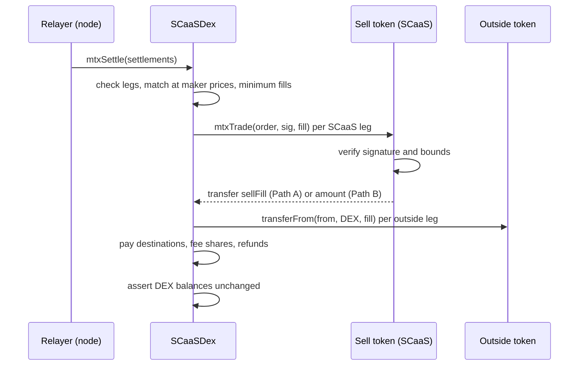

# Order-book DEX

SCaaS runs an order-book exchange whose book lives off chain in the node ([node/dex-venue.md](../node/dex-venue.md))
and whose settlement contract settles signed orders on chain. Users never pay gas: orders and cancels are signed
messages that a relayer submits, and a SCaaS token needs **no allowance** to trade — its order is verified by the token
itself, which moves funds only into the DEX the signer named. Status: the target of this file (token-verified
`TradeOrder`s, `SCaaSDex.mtxSettle`, outside-token legs, one signed fee rate, the exchange path against AMMs
`mtxExchange`, the `DexPuller`) **SPECIFIED**; the built
`SCaaSDex` (DEX-signed maker/taker orders over allowances, `smartcontracts/evm/src/dex/SCaaSDex.sol`) and the
legacy `MetaTxDex` are **BUILT** and described under [Transitional (BUILT)](#transitional-built); non-EVM settlement
programs **BUILT** with the fixes below **SPECIFIED**.

**Contents**

1. [Overview](#1-overview)
2. [Signed orders](#2-signed-orders)
3. [The token's side: `mtxTrade`](#3-the-tokens-side-mtxtrade)
   - 3.1 [Cancel](#31-cancel)
4. [The DEX's side: `mtxSettle`](#4-the-dexs-side-mtxsettle)
5. [Fees and admin](#5-fees-and-admin)
6. [Outside-token legs](#6-outside-token-legs)
7. [Exchange settlement](#7-exchange-settlement)
8. [The named `dex`](#8-the-named-dex)
9. [Signature checks](#9-signature-checks)
10. [Intake reads and invariants](#10-intake-reads-and-invariants)
11. [Non-EVM DEX programs](#11-non-evm-dex-programs)
12. [Managed markets](#12-managed-markets)
13. [Transitional (BUILT)](#transitional-built)
14. [Conformance](#14-conformance)

## 1. Overview

<a id="scaasdex"></a>
<a id="CTR-DEX-01"></a>**CTR-DEX-01** — **A complete DEX** (owner): an off-chain **persistent** book, markets per pair,
price-time priority, limit + IOC/FOK, partial fills above the minimum fill ([CTR-DEX-14](#CTR-DEX-14)), signed expiry,
cancel by off-chain signature plus on-chain cancel and lane invalidation, a public read API. On chain, a leg in a
**SCaaS** token is a role-free `TradeOrder` ([CTR-DEX-13](#CTR-DEX-13)) checked by **its own token** against the fill
figures the DEX passes, and the token moves funds **only into the DEX** — no allowance ([CTR-DEX-15](#CTR-DEX-15)); a leg
in an **outside** token is the same order checked by the DEX and pulled under an allowance ([CTR-DEX-18](#CTR-DEX-18)).
One settlement call matches one taker against many makers, pulls every leg into the DEX, pays every party, fee share
and refund in the same call, and ends with the DEX's balance of every token unchanged ([CTR-DEX-16](#CTR-DEX-16)). The
same orders can instead be executed against AMM pools — multi-hop routes, cycles X→…→X — with the surplus above each
signed limit paid to its signer ([exchange settlement](#exchange), [CTR-DEX-20](#CTR-DEX-20)). The
fee **rate** is the order's signed `fee` (≤ 1 %, on the received part); the DEX distributes it per its admin's split and
can never change the amount ([CTR-DEX-17](#CTR-DEX-17)). Every user action is a signature; client systems configure
markets, read the book and book the fees.

| Layer | What it does |
|---|---|
| Sell token (SCaaS) | verifies the `TradeOrder` signature, expiry, nonce lane, closed state, and on Path A the fill against every signed bound; moves exactly the pulled amount **to `dex`**; keeps `pulled[orderHash]` and `minNonce` |
| `SCaaSDex` | checks the match (tokens, listing, self-trade, relayer), computes fills at each maker's price, pulls every leg, enforces Path B and outside-token legs, pays out, splits fees, asserts conservation; on the exchange path runs the route's interactions or executor and pays the surplus ([CTR-DEX-20](#CTR-DEX-20)) |
| Node | the book per market, price-time priority, partial fills, settlement through `call` jobs, its own final-event watcher, intake fee policy per role ([NODE-DEX-01](../node/dex-venue.md#NODE-DEX-01)); the TradeEngine for AMM routes ([NODE-DEX-17](../node/dex-venue.md#NODE-DEX-17)) |



## 2. Signed orders

<a id="CTR-DEX-13"></a>**CTR-DEX-13** — **One struct, `TradeOrder`, for every leg** (owner). A signed order is one blob
with **no role** in it: whether it acts as taker or maker is decided at settlement time by the node or whoever submits
the settlement, so the same order can rest as a maker and later take, or the reverse. Hence `from` (the signer), never
`maker`/`taker`, and no counterparty field: who may match an order is the job of `relayer`.

```solidity
struct TradeOrder {
    address from;          // signer; this token's balance is sold
    address receiveToken;  // what the signer receives
    uint256 amount;        // at most this much of THIS token in total
    uint256 receiveAmount; // signed price limit: `amount` for at least `receiveAmount` (gross, before the DEX fee)
    uint256 minFill;       // signer's minimum fill per settlement; effective = max(minFill, ceil(amount/2)); = amount ⇒ fill-or-kill
    uint256 fee;           // DEX fee rate in ppm the signer agrees to pay on what it receives; ≤ 10 000 (1 %)
    address relayer;       // the matching party allowed to submit the settlement (0 = anyone)
    address dex;           // the only contract that may pull this order's funds, and the only place they go; a contract
    address destination;   // receives the proceeds in receiveToken; 0 = from
    uint8   flags;         // IOC 1 | ESCROW 2 (Path B; implies IOC) | LISTED_POOLS 4 (exchange path, CTR-DEX-23)
    uint256 batch;         // order lane (minNonce), not the meta-tx lane of the same name
    uint256 nonce;         // valid while nonce ≥ minNonce[from][batch]
    uint256 validUntil;
}
// "TradeOrder(address from,address receiveToken,uint256 amount,uint256 receiveAmount,uint256 minFill,uint256 fee,"
// "address relayer,address dex,address destination,uint8 flags,uint256 batch,uint256 nonce,uint256 validUntil)"
// CancelOrder(bytes32 orderHash)
// InvalidateNonces(address from,uint256 batch,uint256 minNonce)
```

It is signed in the **sell token's own** domain — `("SCaaS MetaToken","1",…)` or `("SCaaS ZetherToken","1",…)`, with
`chainId`, `verifyingContract` = the token and `salt` = `chain_uid` ([CTR-MTX-02](metatx.md#CTR-MTX-02)) — so the
token, chain and contract need no fields of their own. It is a different struct from `MetaTransaction`, not a second
hash of it ([CTR-MTX-11](metatx.md#CTR-MTX-11)). The signer is an EOA (ECDSA low-s) or a contract (ERC-1271, e.g. a
passkey `SmartKeyAccount`), told apart as in the token pipeline (an EIP-7702 designator is an EOA). `nonce` is not
consumed per fill: it is the cancel handle of its lane. `relayer ≠ 0` means only that address may submit the
settlement — the meaning of `MetaTransaction.relayer`. Clients show `dex`, `relayer`, `destination` and the effective
minimum fill before signing, warn when `destination ≠ from`, default `relayer` to the venue node, and label the order
lane and the meta-tx lane (both called `batch`; they live in different maps).

<a id="CTR-DEX-14"></a>**CTR-DEX-14** — **Minimum fill: the signer's `minFill` over a 50 % floor, for every order in a
settlement** (owner). `MIN_FILL_PPM = 500_000`; the effective minimum is

```text
m = max(minFill, ceil(amount · MIN_FILL_PPM / 10⁶))          // = max(minFill, ceil(amount / 2))
```

and in one settlement call **every** order — the taker and each maker alike — must satisfy

```text
sellFill ≥ m                                       or  sellFill == amount − pulled[h]   (the remainder closes)
receiveFill · 10⁶ ≥ receiveAmount · MIN_FILL_PPM   or  sellFill == amount − pulled[h]   (received side)
```

`minFill > amount` is refused (`BadMinFill`); an order signed with `minFill` below 50 % is **treated as 50 %**, not
refused (clients show the effective value before signing, so orders built by outside tools still work).
`minFill = amount` is fill-or-kill (with `pulled == 0` the remainder clause cannot apply). The received-side line
follows from the sold-side line and the price limit and is asserted anyway. Purpose: no junk fills — a maker matched
for 1 % would have to re-create its order. Consequences: a Path A order fills in at most two settlements, and an order
can only be matched against counterparts that take at least half of it; the last remainder of a Path A order may close
below the minimum.

## 3. The token's side: `mtxTrade`

<a id="CTR-DEX-15"></a>**CTR-DEX-15** — **The sell token verifies the order and moves funds only into `dex`.** In the
base `ERC20MetaTx` ([CTR-MTX-07](metatx.md#CTR-MTX-07)):

```solidity
struct TradeFill { uint256 sellFill; uint256 receiveFill; uint256 dexFee; address submitter; }
function mtxTrade(TradeOrder calldata o, bytes calldata sig, TradeFill calldata f) external nonReentrant;
function mtxCancelOrder(TradeOrder calldata o, bytes calldata sig) external nonReentrant;   // CancelOrder(bytes32 orderHash)
function mtxInvalidateNonces(address from, uint256 batch, uint256 newMin, bytes calldata sig) external nonReentrant;
mapping(bytes32 => uint256) public pulled;                         // orderHash => amount pulled (amount = closed)
mapping(address => mapping(uint256 => uint256)) public minNonce;   // from => order lane => min valid nonce
function tradeOrderDigest(TradeOrder calldata o) external view returns (bytes32);
```

`mtxTrade` checks, in order (error in brackets; every error carries the order hash where it has one):

1. Caller and identities: `msg.sender == o.dex` (`NotDex`) and `_isContract(o.dex)` (`DexNotContract`);
   `o.from ≠ address(this)`, `o.dex ≠ address(this)` (`SelfOrder`); `o.receiveToken == address(this)` is allowed — a
   cycle order sells X for more X on the exchange path ([CTR-DEX-20](#CTR-DEX-20)). The DEX implements no ERC-1271, so it
   can never be an order's `from`.
2. `o.relayer == 0 || o.relayer == f.submitter` (`WrongRelayer`; the DEX reports its own `msg.sender`).
3. Order shape: `block.timestamp ≤ validUntil` (`OrderExpired`); `o.nonce ≥ minNonce[from][batch]`
   (`NonceInvalidated`); known flags (`IOC`, `ESCROW`, `LISTED_POOLS`; the token does not interpret `LISTED_POOLS`), `ESCROW` requires `IOC`
   (`BadFlags`); `amount > 0`, `receiveAmount > 0`
   (`ZeroAmount`); `minFill ≤ amount` (`BadMinFill`); `fee ≤ 10 000` (`FeeAboveCap`).
4. Signature over `h` = the order's digest through the virtual `_requireValidSignature` (EOA low-s, ERC-1271 with the
   50 k/400 k cap; Hedera's override adds HIP-632).
5. With `p = pulled[h]`: `p < amount` (`OrderClosed` — covers filled, cancelled and already-pulled IOC orders).
6. **Path A** (`ESCROW` clear) — the token enforces every bound the signer set, against the figures the DEX passes:
   `f.sellFill > 0` (`ZeroFill`); `p + f.sellFill ≤ amount` (`Overfill`); the effective minimum and the received-side
   floor of [CTR-DEX-14](#CTR-DEX-14) (`BelowMinFill`); price `f.sellFill · receiveAmount ≤ f.receiveFill · amount`,
   checked multiplication (`PriceLimit`); `f.dexFee ≤ ceil(f.receiveFill · fee / 10⁶)` (`FeeAboveSigned`). It moves
   exactly `f.sellFill` from `from` **to `o.dex`**.
7. **Path B** (`ESCROW` set): `p == 0`; `f.sellFill == amount`; `f.receiveFill == 0` and `f.dexFee == 0`
   (`EscrowFillShape`); it moves `amount` from `from` **to `o.dex`**. The DEX enforces price, the effective minimum and
   the fee on the matched part.
8. Effects before the transfer: `pulled[h] = IOC ? amount : p + f.sellFill`. Emit `TradeFilled(h, from, sellFill,
   receiveFill, dexFee)` (a Path B leg shows `sellFill = amount`, `receiveFill = 0`; the DEX's `LegSettled` is the
   accounting record of what was matched and refunded).

The token has exactly one recipient, `o.dex`; it splits nothing and pays no fee itself. With `sellFill > 0` and
`receiveAmount > 0` the price and received-side checks force `receiveFill > 0`. `mtxTrade` is not in any allowlist
(`msg.sender` must be a contract other than the token) and stays a direct read of `msg.sender`
([CTR-MTX-18](metatx.md#CTR-MTX-18)); a wrapper calls it to wrap by signature ([CTR-TOK-20](token-wrappers.md#CTR-TOK-20)).

<a id="CTR-DEX-04"></a>**CTR-DEX-04** — **IOC is closed on chain at its single pull.** An `IOC` order is pulled **once**:
the token (or, for an outside leg, the DEX) sets `pulled[h] = amount` at that pull, whatever was matched, so an IOC
order means "only in this settlement", even when it meets several makers in one call; Path B (`ESCROW`) implies IOC. A
short `validUntil` is the second layer. The Move and Solana DEX programs close IOC at the first match (one maker)
instead; the book handles that per family ([NODE-DEX-01](../node/dex-venue.md#NODE-DEX-01)).

<a id="CTR-DEX-05"></a>**CTR-DEX-05** — **FOK is checked on chain** as `minFill = amount` with `pulled == 0`: the token
(Path A) or the DEX (Path B, outside legs) refuses any smaller fill. Partial fills, each at least the effective minimum,
are the default.

### 3.1 Cancel

<a id="cancel-no-expiry"></a>
<a id="CTR-DEX-02"></a>**CTR-DEX-02** — **Cancel signatures never expire** (`CancelOrder`, `InvalidateNonces`) — a
deliberate exception to "every signature expires": a cancel only moves one way, in the signer's favour, and replay is
a no-op; a `validUntil` would only create a window in which an order removed from the off-chain book could still
settle until its expiry because the on-chain cancel job expired. On the token: `mtxCancelOrder` sets `pulled[h] =
amount` (closed forever, even through another relayer that holds the signed order; emit `OrderCancelled(h, from)`; an
already-closed order is a no-op, not an error); `mtxInvalidateNonces` raises `minNonce[from][batch]`, strictly
increasing and capped at `2^128` (emit `NoncesInvalidated(from, batch, minNonce)`), so one mistaken signature cannot
lock an address out forever. A signer with orders on several tokens cancels per token; the off-chain book drops them
at once. For outside-token orders the DEX keeps the same state and entry points ([CTR-DEX-18](#CTR-DEX-18)).

## 4. The DEX's side: `mtxSettle`

<a id="CTR-DEX-16"></a>**CTR-DEX-16** — **Everything goes through the DEX, and the DEX ends every settlement with
unchanged balances** (owner).

```solidity
struct Leg { address sellToken; TradeOrder o; bytes sig; uint256 fill; }  // fill = sellFill of this leg in this call
struct Settlement { bytes32 ref; Leg taker; Leg[] makers; }               // ref: chosen by the submitter, echoed in events only
function mtxSettle(Settlement[] calldata s) external nonReentrant returns (bool[] memory ok); // each settlement atomic (try)
```

`taker`/`makers` is a call-time arrangement — one taker against many makers — chosen by the node or the submitter, not
a property of the orders. Each settlement runs atomically (a failing one reverts only itself and emits `MatchFailed(ref,
reason)`); if none succeeds the whole call reverts, so the relayer's simulation catches it.

1. **Check.** Every leg's `relayer` is 0 or `msg.sender` (`WrongRelayer`); each maker's `sellToken` is the taker's
   `receiveToken` and vice versa (`TokenMismatch`); no self-trade, `from`s differ (`SelfTrade`); the market is listed
   (`MarketNotListed`).
2. **Match first.** Fills at each maker's signed price, rounded in that maker's favour; **every** order meets its
   effective minimum and the received-side floor ([CTR-DEX-14](#CTR-DEX-14), `BelowMinFill`); each order is pulled at
   most once per call.
3. **Pull** every leg into the DEX: SCaaS sell tokens through their `mtxTrade` (Path A with the exact fill and fee
   figures, Path B whole); outside sell tokens per [CTR-DEX-18](#CTR-DEX-18). The DEX decides which is which from its
   listing, never from the leg.
4. **Pay** out of what was pulled, in the same call: each party's `destination` (or `from`) receives `receiveFill −
   dexFee` in its `receiveToken`; each `dexFee` is split per [CTR-DEX-17](#CTR-DEX-17); Path B remainders are refunded
   to `from`. Emit `LegSettled(ref, orderHash, from, destination, sold, received, dexFee, refund, relayerShare,
   treasuryShare)` per leg.
5. **Invariant**, asserted at the end of each settlement: the DEX's balance of every token touched is unchanged
   (`ConservationBroken(token)`).

| Leg | Pulled into the DEX | Bounds checked by |
|---|---|---|
| SCaaS token, Path A, any role | exactly `sellFill` | the signer's token, against the fill figures the DEX passes (amount, effective minimum, price, `fee`) |
| SCaaS token, Path B, any role | all of `amount`; the remainder refunded in the same call | the DEX, on the matched part, against the signed order |
| outside token, any role | exactly the fill, by `DexPuller.pull` under the party's allowance to the puller ([CTR-DEX-22](#CTR-DEX-22)) | the DEX, against the `DexOrder` ([CTR-DEX-18](#CTR-DEX-18)) |

Why everything goes through the DEX: (a) one choke point — a single contract sees every unit that enters and leaves a
settlement and makes every payment, instead of a token trusting a `receiveFill` it cannot see arrive elsewhere; (b) one
simple invariant — no dust, no donated tokens paid out, nothing stuck; (c) the token stays minimal — one recipient, no
fee splitting, no route chosen by the caller; a signer reads one address to know where its funds can go. The cost is
two transfers per leg instead of one. In Path A the signer relies on the named DEX for delivery; in Path B, chosen by
`ESCROW`, for price as well. There is no per-party proceeds check: its expected figure would come from the same code
that pays (it adds nothing against a DEX bug), and per-party balance deltas misfire when addresses are shared (two
makers with one `destination`, a relayer or treasury that is also a `destination`). A token that credits less than it
was told to move is caught by conservation plus listing only **exact-transfer** tokens: SCaaS tokens are exact by
construction; fee-on-transfer, rebasing and hook (ERC-777) outside tokens are not listed, and if one slips through the
DEX's own balance moves and conservation reverts the settlement. `SCaaSDex` keeps its book semantics (price-time
priority, limit + IOC/FOK, partial fills above the effective minimum); the execution price is each maker's signed
price, rounded in the maker's favour, and the node only emits matches that pass the same checks as the contract.

## 5. Fees and admin

<a id="relayer-fee"></a>
<a id="CTR-DEX-17"></a>**CTR-DEX-17** — **One fee: the signed `fee` rate, collected and distributed by the DEX in the
same call** (owner). `fee` is the DEX fee rate (ppm, ≤ 1 %) the signer agrees to pay on what it receives, whatever
role the order plays. The DEX charges `dexFee = ceil(receiveFill · fee / 10⁶)` ([CTR-DEX-11](#CTR-DEX-11)) — never
more — **once per order per settlement, on its aggregate `receiveFill`** (a taker filled by several makers is charged
once on the total; a sum of per-maker ceilings could exceed the bound its token checks), in the `receiveToken`, deducts
it before paying `destination`, and splits it at once: `relayerShare = floor(dexFee · relayerSharePpm / 10⁶)` to the
relayer that submitted the settlement (`msg.sender`), the rest to `treasury`. There is **no separate relayer fee**: the
relayer is paid from its share. With `relayer = 0`, whoever submits earns the share of **every** fee in the
settlement — a taker that submits its own match is rebated part of the maker's fee, and a pending `mtxSettle` can be
copied from the mempool for the share; clients therefore default `relayer` to the venue node. Role-based pricing (maker
vs taker rates) is the node's intake policy — it does not match an order whose signed `fee` is below its venue's rate
for the role the order would play — not an on-chain setting. Fees never stay in the DEX (`FeeWouldStick` if the split
would leave a remainder there).

<a id="CTR-DEX-11"></a>**CTR-DEX-11** — **The DEX fee rounds up.** `dexFee = Math.mulDiv(receiveFill, fee, PPM,
Math.Rounding.Ceil)` (non-EVM: `(fill·ppm + PPM − 1) / PPM` on a double-width integer), and the token's
`FeeAboveSigned` bound uses the same ceiling. A floor lets an order split into fills `< PPM/ppm` units (e.g. ≤ 333
units at 0.3 %) pay a fee of 0, and on a private chain with zero gas price splitting costs nothing. The signed `fee`
bounds the **rate**; rounding up adds less than one smallest unit per order and settlement — that is the cap's meaning,
stated in NatSpec. `fee ≤ MAX_FEE_PPM` (1 %) < `PPM` ⇒ `dexFee ≤ receiveFill`, so `receiveFill − dexFee` cannot
underflow; a 1-unit receive pays a fee of 1 (its receiver gets 0) — the price of a dust order. Non-EVM programs round
their per-fill DEX fee the same way (today a floor: Sui `dex.move:250-251`, Aptos `dex.move:247-248`, Solana
`dex.rs:208-210`, TON `dex.tact:208`). Tests: `fee = 3_000`, receive 333 ⇒ fee 1 (was 0); receive 1 ⇒ fee 1, receiver
0; an exact multiple ⇒ fee as before; one fill of 1 000 vs ten fills of 100 ⇒ the ten fees total ≥ the one; fuzz
`receiveFill`, `fee ≤ MAX_FEE_PPM` ⇒ `dexFee ≤ receiveFill` and `dexFee · PPM ≥ receiveFill · fee`; `dexFee` in
`LegSettled` equals the amount split; each non-EVM family gets the equivalent test (a dust fill pays fee 1). Status
**SPECIFIED** (EVM: with the rebuild; non-EVM: new program versions).

<a id="admin"></a>
<a id="CTR-DEX-03"></a>**CTR-DEX-03** — `admin` is set once at creation ([CTR-DEX-24](#CTR-DEX-24)) and has no setter; in production a Safe/multisig
(changing signers happens inside the Safe). The admin can do exactly four things: list or delist a market
(`setMarket(base, quote, listed)`, which also records each token's kind, [CTR-DEX-18](#CTR-DEX-18); emit
`MarketSet(base, quote, listed)`), set the fee split (`setFeeSplit(relayerSharePpm, treasury)`, `treasury ∉ {0,
DEX}` unless the share is 100 %; emit `FeeSplitSet(relayerSharePpm, treasury)`), list or delist an exchange target or
executor (`setExchangeTarget(target, listed)`; emit `ExchangeTargetSet`), and switch the DEX-wide listed-only mode
(`setListedOnly(on)`, default off; emit `ListedOnlySet`) ([CTR-DEX-23](#CTR-DEX-23)). It changes who receives fees and in
what proportion, **never the amount**: the amount comes only from the signed `fee`. No access to funds, no upgrade, no
sweep, no global pause (delisting a market stops that pair). No timelock: there is nothing to wait for — no signed
order can be charged more than it signed.

<a id="CTR-DEX-24"></a>**CTR-DEX-24** — **`OpenFactory.createDex(version, DexConfig, salt)` makes an `SCaaSDex` clone; `admin` is written once by
`initialize`; the `DexPuller` is deployed by `initialize`; `isDex(addr)` is advisory: tokens never consult it** (owner).

```solidity
struct DexConfig { address admin; uint32 relayerSharePpm; address treasury; bool listedOnly; }
function createDex(uint64 version, DexConfig calldata cfg, bytes32 salt) external returns (address);
// event DexCreated(address dex, address creator, uint64 version, address implementation, address admin)
```

- **Clone.** `CREATE2` of an EIP-1167 clone and `initialize(cfg)` in the same call, as for tokens
  ([CTR-TOK-25](token-wrappers.md#CTR-TOK-25)); the implementation locks its own `initialize`. `admin` moves from an
  immutable to storage written once by `initialize` (same behaviour: no setter, [CTR-DEX-03](#CTR-DEX-03)); the
  `DexPuller` is deployed by `initialize`; the EIP-712 `verifyingContract` is the clone.
- **Registry.** The factory keeps `isDex(addr)` and `versionOf(addr)`. Clients and the node use them with the
  implementation version to warn about or refuse an unlisted `dex`; tokens do not consult them.

**Transitional (BUILT).** The built `SCaaSDex` has a constructor and an immutable `admin`, and is deployed directly;
replaced in P2.

## 6. Outside-token legs

<a id="CTR-DEX-18"></a>**CTR-DEX-18** — **A leg in a token that is not a SCaaS token is the same `TradeOrder`, checked
by the DEX** (a contract SCaaS does not control cannot verify it):

| Item | Rule |
|---|---|
| Classification | at `setMarket` the DEX records each token's kind: **SCaaS** iff the chain's `OpenFactory` reports it was made from a registered, non-deprecated implementation (`versionOf`, as [CTR-TND-07](tender.md#CTR-TND-07)), else **outside**. Never taken from the leg: a submitter-chosen kind could send a fallback-only "token" down the `mtxTrade` path |
| Signed struct | the same `TradeOrder`, signed in the **DEX's** domain `("SCaaS Dex","1", chainId, DEX, chain_uid)` as `DexOrder(address sellToken,TradeOrder order)TradeOrder(…)`; `o.dex == address(this)` is required (the domain already binds the DEX; a different `dex` field would be a second, conflicting truth) |
| Fill state | on the DEX: `pulled[h]` and `minNonce[from][batch]`, `h` = the `DexOrder` digest |
| Checks | the full [CTR-DEX-15](#CTR-DEX-15) list, enforced by the DEX: relayer binding, expiry, nonce, flags, zero amounts, `minFill ≤ amount`, fee cap, signature (`_validSig` with the ERC-1271 cap, [CTR-DEX-08](#CTR-DEX-08)), `p < amount`, `sellFill > 0`, overfill, effective minimum, price, fee bound |
| Flags | `IOC` allowed; **`ESCROW` refused** (`BadFlags`) — the fill is already pulled exactly into the DEX |
| Pull | `DexPuller.pull(token, from, sellFill)` = `safeTransferFrom(from, DEX, sellFill)` under the party's allowance to the **puller**, never to the DEX ([CTR-DEX-22](#CTR-DEX-22)); an EOA may approve a contract on a token SCaaS does not control |
| Cancel | `mtxCancelOrders(DexOrder[] orders, bytes[] sigs)` (`CancelOrder(bytes32 orderHash)` in the DEX domain; closed or bad-signature items skipped, no revert of the batch) and `mtxInvalidateNonces(from, batch, newMin, sig)` (`InvalidateNonces(address from,uint256 batch,uint256 minNonce)` in the DEX domain) |
| Backstop | conservation ([CTR-DEX-16](#CTR-DEX-16)) |

## 7. Exchange settlement

<a id="exchange"></a>
<a id="CTR-DEX-20"></a>**CTR-DEX-20** — **`mtxExchange` executes `TradeOrder`s against outside liquidity — AMM pools,
multi-hop routes, cycles — instead of `makers[]`; the same order, no new signature** (owner). Beside `mtxSettle`:

```solidity
struct ExchangeLeg  { address sellToken; TradeOrder o; bytes sig; uint256 sellFill; uint256 receiveFill; } // receiveFill = floor
struct Interaction  { address target; bytes data; }                       // no value: the DEX holds no native coin
struct ExchangePlan { bytes32 ref; ExchangeLeg[] legs; address[] extraTokens; } // extraTokens: intermediate hop tokens
function mtxExchange(ExchangePlan calldata p, Interaction[] calldata interactions) external nonReentrant;  // (a) DEX calls
function mtxExchangeVia(ExchangePlan calldata p, address executor, bytes calldata data) external nonReentrant; // (b) executor
interface IExchangeExecutor { function exchangeCallback(bytes32 ref, address[] calldata tokensOut, uint256[] calldata
    amountsOut, address[] calldata tokensIn, uint256[] calldata amountsIn, bytes calldata data) external; }
```

A plan is atomic (no `try`: one plan is one route). Steps: (1) **check** each leg — `relayer` 0 or `msg.sender`
(`WrongRelayer`); `sellToken` and `o.receiveToken` both **known** (a side of a listed market, kind as `setMarket`
recorded, `TokenNotKnown`); distinct `from`s (`SelfTrade`); price `sellFill · receiveAmount ≤ receiveFill · amount`
(`PriceLimit`); the minimum fill of [CTR-DEX-14](#CTR-DEX-14) (`BelowMinFill`); `dexFee = ceil(receiveFill · fee / 10⁶)`
on the floor ([CTR-DEX-11](#CTR-DEX-11)); (2) **snapshot** the DEX's balance of every leg token and `extraTokens`;
(3) **pull** each leg as in `mtxSettle` (SCaaS: `mtxTrade` with the floor figures, Path A or B; outside: the puller,
[CTR-DEX-22](#CTR-DEX-22)); (4) **execute** — (a) each interaction under [CTR-DEX-23](#CTR-DEX-23), then
`target.call(data)`, a failure reverts with its data; (b) `transfer` the pulled sell tokens to `executor` and call
`exchangeCallback` with, per receive token, the minimum it must send back (Σ floors); the executor may do anything
(pool callbacks, flash swaps, its own inventory) and pays the DEX before returning; (5) distribute the surplus
([CTR-DEX-21](#CTR-DEX-21)), pay each `destination` `receiveFill − dexFee + share`, split each fee per
[CTR-DEX-17](#CTR-DEX-17) (relayer share to `msg.sender`), refund Path B remainders; (6) **conservation** over every
snapshotted token (`ConservationBroken`) and per leg `ExchangeLegSettled(ref, orderHash, from, destination, sold,
receivedFloor, surplus, dexFee, refund, limitReceive)`, `limitReceive = ceil(sellFill · receiveAmount / amount)`, so a
client checks what the signer got against what it signed without trusting the submitter. Not to be confused with
`ExchangeOffer.exchange` ([CTR-AS-13](asset-suite.md#CTR-AS-13)), another contract. EVM only. Status **SPECIFIED**.

<a id="CTR-DEX-21"></a>**CTR-DEX-21** — **The surplus goes to the signers, on chain** (owner). After step 4, for each
receive token `T`: `excess_T = balance_T − snapshot_T − Σ receiveFill(legs receiving T) − Σ refund(Path B legs
selling T)`; `< 0` ⇒ `InsufficientOutput(T)`; otherwise leg `i` receiving `T` gets `floor(excess_T · receiveFill_i /
Σ receiveFill)`, the last such leg also the rounding remainder. Any other snapshotted token (sold only, intermediate)
must end at its snapshot plus the refunds still to pay, else `ConservationBroken` — a leftover is a route bug, not
something to assign. The surplus carries no DEX fee; with (b) everything the executor sends is distributed the same
way. What the contract cannot see is a swap whose recipient was set outside the DEX: that part is the submitter's
policy ([NODE-DEX-18](../node/dex-venue.md#NODE-DEX-18)), measurable through `ExchangeLegSettled`.

<a id="puller"></a>
<a id="CTR-DEX-22"></a>**CTR-DEX-22** — **`DexPuller`: the DEX holds no user allowance.** An immutable contract deployed
by the DEX's constructor, `pull(token, from, amount)` callable only by the DEX (`safeTransferFrom(from, dex, amount)`).
Holders of an **outside** token approve the puller, never the DEX; the DEX calls `pull` only after its own checks of the
`DexOrder`, for `mtxSettle` and the exchange path alike. Why: an interaction runs as the DEX, so any allowance the DEX
held could be spent by `outsideToken.transferFrom(victim, attacker, x)`. SCaaS tokens need no allowance at all.

<a id="CTR-DEX-23"></a>**CTR-DEX-23** — **What an interaction may call; listed targets** (owner). (a) refuses an
interaction unless `target ∉ {DEX, puller}` (`ForbiddenTarget`), `data.length ≥ 4` and `bytes4(data) ≠
mtxTrade.selector` for **every** target (`ForbiddenSelector`; else an interaction could pull a victim's resting order
that names this DEX with an invented `receiveFill` and move the same amount out, and conservation would balance), and,
when any leg sets `LISTED_POOLS` **or** the admin's listed-only mode is on, `exchangeTarget[target]`
(`TargetNotListed`). (b) needs no blocklist — an executor that re-enters hits `nonReentrant`, calls `mtxTrade` is not
`o.dex`, calls the puller is not the DEX — and the same listing condition applies to `executor`. Default: any target
(owner). Interactions may `approve` routers (both are contracts, [CTR-TOK-01](token-wrappers.md#CTR-TOK-01)); a
residual allowance moves nothing, because between calls the DEX holds no user funds. Grief (a target that reverts or
burns gas) fails only its own plan.

## 8. The named `dex`

<a id="CTR-DEX-19"></a>**CTR-DEX-19** — **`dex` must be a contract, nothing more: an owner-accepted residual risk with
off-chain mitigations** (owner). The token checks only `msg.sender == o.dex` and `_isContract(o.dex)`; the token consults no DEX registry and no codehash allowlist (the factory's `isDex`, [CTR-DEX-24](#CTR-DEX-24), is advisory, for clients and the node). A phishing contract named as `dex` can report any `receiveFill` and
take the signed `amount`. Mitigations: the app, `clientkeys` and the portal warn about, and **by default refuse to build
or sign**, a `TradeOrder` whose `dex` is not on the chain profile's DEX list (for `mtxWrap`: not a registered wrapper of
that underlying); the wallet's EIP-712 view shows `dex`; the node routes orders only to DEXes on the chain profile's
DEX list and never for an unlisted `dex` ([node/dex-venue.md](../node/dex-venue.md)). A contract is not proof of
honesty; the rule only guarantees that an EOA can never be granted a pull ([CTR-TOK-01](token-wrappers.md#CTR-TOK-01)).
`isDex` ([CTR-DEX-24](#CTR-DEX-24)) feeds the client and node checks; tokens do not consult it, so the factory admin gains no power over trades (owner).

## 9. Signature checks

<a id="erc1271-cap"></a>
<a id="CTR-DEX-08"></a>**CTR-DEX-08** — **`SCaaSDex` caps the ERC-1271 call by codehash.** `_validSig`'s contract
branch (outside-token legs and DEX-domain cancels) is an assembly `staticcall` with cap `_erc1271Gas(signer)` = 400 k
if `signer.codehash` is the `SmartKeyAccount` clone codehash (immutable at deployment, as the token's `_erc1271Gas`
does, [CTR-ACC-05](accounts.md#CTR-ACC-05)), else 50 k; at most 32 bytes of returndata are copied; before the call it
requires `gasleft() ≥ cap · 64/63 + margin`, otherwise the whole transaction reverts (EIP-150: a relayer must not
starve the call to turn a valid signature into an invalid one). `mtxCancelOrders` needs no `try`: a capped `_validSig`
only returns `false` ⇒ the item is skipped. The node does not restore an ERC-1271 order whose settlement failed out of
gas. Why: the built contract calls `SignatureChecker` without a cap (`SCaaSDex.sol:383-384`), so a contract maker
that answers correctly under `eth_call` but burns gas or returns huge returndata in the real block breaks a whole
`settle` batch (the remaining 1/64 gas is not enough for the next pairs) and **every** `cancel` batch. SCaaS legs get
the same cap inside their token. Status **SPECIFIED**.

## 10. Intake reads and invariants

Intake reads one `eth_call` per order: for a SCaaS leg the sell token's `tradeOrderDigest`, `pulled`, `minNonce` and
`balanceOf` (no allowance exists to read); for an outside leg the DEX's `pulled`/`minNonce` and the party's balance and
allowance to the DEX's puller. The DEX never reads or writes the token's meta-tx nonces, and the token's meta-tx lanes never
touch order lanes: a hanging or cancelled order never blocks a `pay`, and `pay`/`cancelNonce` never invalidate an order.

Invariants: `pulled[h] ≤ amount` always; the DEX's balance of every token is unchanged across one settlement; each
token's Σ balances is unchanged; a settlement that violates price, minimum fill, overfill, expiry, cancel, nonce or
signature ⇒ only that settlement fails; per leg `received + dexFee == receiveFill` and `relayerShare + treasuryShare ==
dexFee`.

## 11. Non-EVM DEX programs

The book, matcher, client booking and gateway are shared (nothing EVM-specific beyond addresses and hashes). Each
family provides a settlement program with the same invariants and keeps its own leg shape ([networks/README.md](../networks/README.md)):
orders signed with domain separation (network + DEX contract + every order field), checked on chain with the subject's
key (no account sequence; nonce/`filled` kept by the DEX program); `filled[orderHash]`, no overfill, cross-multiplied
price, `maxFeePpm` in the order, cap 1 %; cancel closes `filled` by the owner's signature and raises `minNonce`; funds
move person → person in the same transaction (Soroban two `require_auth`; Sui two `Account<T>` legs; Cosmos CW20
`TransferFrom` with an allowance to the DEX contract; TON escrow — the only one that holds funds briefly, because
jettons have no `transferFrom`); events equivalent to `OrderFilled/Matched/MatchFailed`.

<a id="bound-settler"></a>
<a id="CTR-DEX-09"></a>**CTR-DEX-09** — **Non-EVM settlement is bound to the relayer.** An order carries `relayer`
(0 = open) and the program checks the submitter. Sui, Aptos and Solana already do; **Cosmos** (`Settle` does not check
`info.sender`, `OrderParams` has no relayer), **Soroban** (`require_auth_for_args((order,))` binds only the order, not
the counterparty, `maker_fill` or the submitter) and **TON** (`receive(Match)` is open) do not, so a mempool observer
can copy an auth entry, insert its own pair and take the taker's price improvement. Fix: Cosmos adds `relayer` to
`OrderParams` and requires `info.sender == relayer` when set; Soroban adds `relayer: Address` to `Order` +
`relayer.require_auth()`; TON adds an optional `relayer` to `TradeParams`, compared with `sender()` at `Match` and on
the hint path. **Soroban has no open form** ([NET-SOR-10](../networks/soroban.md#NET-SOR-10)): `Order.relayer: Address`
is mandatory, because with an open form anyone who sees a pending `settle` can resubmit the two auth entries with
`maker_fill = 1` ⇒ two nonces burnt for a dust fill and the real `settle` fails. Tests: a third party settling on
Cosmos/Soroban/TON fails; a Soroban order without `relayer` cannot be built / is refused. Status **SPECIFIED**.

<a id="min-nonce-cap"></a>
<a id="CTR-DEX-10"></a>**CTR-DEX-10** — **`min_nonce` is capped by the family's nonce width**: `min_nonce < 2^(w−1)` with
`w` = the nonce width (Sui/Aptos `u128`, `w = 128`; Solana `u64`, `w = 64`), as on EVM. Today those three accept
`u128::MAX`/`u64::MAX`, so one mistaken signature locks a maker out of the market forever. Test per family. Status
**SPECIFIED**.

Accepted differences that the adapter, the matcher and clients must know:

| Difference | Family |
|---|---|
| No partial fills (FOK orders only) | Cosmos, TON |
| No `minNonce` (bulk cancel) | Cosmos, Soroban, TON |
| IOC closed at the first match (one maker) | Sui, Aptos, Solana |
| One fee recipient for the whole DEX, not per market | Cosmos (`InstantiateMsg`), Soroban (`Key::FeeRecipient`) |
| One `fee_ppm`, no maker/taker split | Solana |
| Minimum received computed **after** the DEX fee (EVM: `receiveAmount` gross) | Cosmos, TON |
| No on-chain self-trade check (the node still skips them) | Cosmos, Soroban |
| DEX-signed maker/taker orders over allowances or escrow, a separate relayer fee, no 50 % minimum fill | every non-EVM family |

## 12. Managed markets

<a id="managed-markets"></a>
<a id="CTR-DEX-12"></a>**CTR-DEX-12** — **A managed market is a market on an `SCaaSDex` instance whose `admin` is
the licensed venue operator's multisig** ([CTR-DEX-03](#CTR-DEX-03)): the operator deploys its own instance and lists
only managed pairs; its listing power covers only its venue; the contract is unchanged. On chain the regulated
token's own checks are the arbiter ([asset-suite.md](asset-suite.md#regulated)): a settlement that slipped through
intake fails alone (`MatchFailed`). The node side (home-bound orders only, the fee rules on regulated legs, eligibility of both parties at intake, no gossip by default) is
[NODE-DEX-11](../node/dex-venue.md#NODE-DEX-11).

- Node configuration per market: `dex_market.managed = 1`, `unbound = 0` (forced), `gossip = 0` (default),
  `eligibility_tokens` (the regulated legs; read from `versionOf(token).kind`). A venue-level registry for pairs of
  two unregulated tokens is PLANNED only (no requester).
- Wallets show managed markets with the venue name, the regulated legs' disclosures and the user's eligibility result
  before signing.
- Securities on such a market are regulated tokens; coupons and dividends are Merkle distributions; redemptions,
  buybacks and splits are exchange offers ([asset-suite.md](asset-suite.md)). The DEX already provides signed limit
  orders, price-time priority off chain, partial fills, IOC/FOK, `pulled[orderHash]` and fees capped at 1 %.

## <a id="transitional-built"></a>13. Transitional (BUILT)

<a id="transitional-built"></a>
<a id="legacy-metatxdex"></a>
<a id="relayer-fee-rounding"></a>

What runs today, until the rebuild replaces it (a new deployment; users re-sign their resting orders):

- **Orders.** The built `SCaaSDex` signs orders on the DEX, `name = "SCaaS Dex"`, `version = "1"`,
  `chainId`, `verifyingContract = DEX`, no salt: `Order(address maker,address taker,address sellToken,address
  buyToken,uint256 sellAmount,uint256 buyAmount,uint256 nonce,uint256 expiry,uint32 maxFeePpm,uint8 flags,address
  relayer,uint8 feeMode,uint256 fee,address feeToken,address feeRecipient)` — `maker` the signer, `taker` 0 = anyone or
  only this counterparty (RFQ), `nonce` unique per maker (clients use `unix_ms·2^20 + random20`), valid while `nonce >=
  minNonce[maker]`, `maxFeePpm` the highest market fee accepted in any role, flags bit0 `FOK`, bit1 `IOC`.
- **`settle(Match[]) returns (bool[])`**, `Match = {ref, maker, makerSig, taker, takerSig, makerFill, takerFill}`
  (`makerFill` of `maker.sellToken`, `takerFill` of `taker.sellToken`), one pair per `try this.settleOne(m,
  msg.sender)` — atomic per pair, a failing pair emits `MatchFailed`, none ⇒ `NothingSettled`; the real relayer is
  passed in because inside the self-call `msg.sender == DEX`. Checks before any transfer: flags valid,
  `block.timestamp <= expiry`, nonce, relayer, `taker` ∈ {0, counterparty}, signature; `M.sellToken == T.buyToken`,
  `M.buyToken == T.sellToken`, `sellToken != buyToken`, `M.maker != T.maker`, market listed; `makerFill > 0`,
  `takerFill > 0`, `filled[h] + fill <= sellAmount`, FOK ⇒ `filled[h] == 0 && fill == sellAmount`; price
  `takerFill · M.sellAmount >= makerFill · M.buyAmount` and `makerFill · T.sellAmount >= takerFill · T.buyAmount`;
  `feeOn ⇒ makerPpm <= M.maxFeePpm && takerPpm <= T.maxFeePpm`. Then direct `transferFrom(payer → payee)`: M → T
  `makerFill − takerDexFee`, T → M `takerFill − makerDexFee`, `takerDexFee = makerFill · takerPpm / 1e6` and
  `makerDexFee = takerFill · makerPpm / 1e6` to the market fee recipient, each order's relayer fee on top; events
  `emit OrderFilled(ref, hash, owner, Fill)` per side and `emit Matched(ref, makerHash, takerHash)`. The book fills at
  the maker's price, `takerFill = ceil(makerFill · M.buy / M.sell)`. IOC remainders are closed after the loop (`filled = sellAmount`).
- **Fees.** `setMarket(base, quote, listed, feeOn, makerPpm, takerPpm, feeRecipient)`, cap `FeePolicy.MAX_FEE_PPM`,
  `feeRecipient ∉ {0, DEX}`; the market fee per fill rounds down, `fill * ppm / PPM` (`SCaaSDex.sol:216-217`;
  with `ppm > 0` the fix is `Math.mulDiv(fill, ppm, PPM, Math.Rounding.Ceil)`, `ppm ≤ MAX_FEE_PPM` ⇒ `fee ≤ fill`
  and `fee · PPM ≥ fill · ppm`, tested with `ppm = 3_000` and `feeOn = false`; the floor test
  `test_feeOnSplitsReceivedAmountsWithoutDust`, `SCaaSDex.t.sol:439-454`, changes to round up). The relayer fee
  uses `FeeMode`: `PERCENT` in `sellToken` (`feeToken ∈ {0, sellToken}`, `FeePolicy.compute(PERCENT, fill, fee)`),
  `FIXED` pro-rata `fee · fill / sellAmount` rounded down (paid in `sellToken` it needs `fee <= 1 % · sellAmount`,
  `FeePolicy.compute(FIXED, sellAmount, fee)`); recipient `feeRecipient` or the sender; `feeRecipient = DEX` reverts
  `FeeWouldStick`. Invariants: `filled[h] <= sellAmount`; `received + fee == fill` per leg.
- **Allowance.** The DEX is the only spender; users approve it gaslessly with the token's meta-tx op `approve(address spender,uint256)`, `data =
  approve(address spender,uint256 amount)` (68 bytes; `m.value == 0`, `m.to == spender`, spender a contract; executed as
  `_approve(from, spender, amount)`), on a random lane (`keccak("scaas.dex.approve" ‖ rand)`), relayer fee forced to 0
  (`test_approveOpRelayerFeeIsCappedToZero`). Intake read `checkOrder(Order o, bytes sig) view returns (bytes32 hash,
  uint8 status, uint256 remaining, uint256 fundable, uint256 feeFundable)`, `fundable = min(balanceOf,
  allowance(DEX))`, `status` ∈ `OK, BAD_FLAGS, EXPIRED, NONCE_INVALID, BAD_SIG, CLOSED, NOT_LISTED, BAD_FEE`
  (`SCaaSDex.sol:93-100`); the node compares `maxFeePpm` with the market fee (`dex.rs:565, 616-624`).
- **Cancel.** `cancel(CancelReq[])` — `cancel(CancelReq[] reqs)`, `CancelReq = {Order order; bytes sig}`: a `CancelOrder(hash(o))` signature
  sets `filled[h] = o.sellAmount`; `invalidateNonces(maker, newMin, sig)` (signed as `invalidateNonces(maker, minNonce, sig)`) with
  `minNonce <= 2^128 − 1` (`type(uint128).max`, `SCaaSDex.sol:89`). The 1271 branch has no cap (`MetaToken.sol:141-143` caps the token side only).
- **Legacy `MetaTxDex`** (no gateway route, `ReentrancyGuardTransient`, no owner or sweep): two `MetaTransaction` legs
  with `data = trade(counterToken, minCounterValue, counterparty)`, `to = relayer = MetaTxDex`,
  `MODE_RESTRICT_RELAYER`, so the token executes a leg only when `relayer == to == msg.sender`. `settle(Leg a, Leg b)`,
  `Leg = {IERC20MetaTx token; MetaTransaction m; bytes sig}`: `a.token != b.token`, `a.m.from != b.m.from`,
  `termsA.counterToken == b.token`, `b.m.value >= termsA.minCounterValue` (and symmetrically); a leg with
  `feeMode != NONE` needs `feeRecipient != 0` and `!= this` (else the default `feeRecipient = msg.sender` would strand
  it); `executeMetaTransaction` on both tokens, the measured delta must equal `m.value`; it pays `a.m.value` to
  `b.m.from` and `b.m.value` to `a.m.from` with `SafeERC20.safeTransfer` and `emit TradeSettled(a.m.from, b.m.from, a.token, b.token, a.m.value,
  b.m.value)`. Fill-or-kill; the surplus `b.m.value > minCounterValue` belongs to the seller of leg A.

The rebuild deletes `MetaTxDex` and the trade and approve ops, renames `settle`/`cancel`/`invalidateNonces` to
`mtxSettle`/`mtxCancelOrders`/`mtxInvalidateNonces`, keeps the DEX-domain `Order` only as `DexOrder`, keeps allowances
only for outside tokens (moved to the `DexPuller`) and turns the relayer fee into the relayer's share of the signed DEX fee; the exchange path ([CTR-DEX-20](#CTR-DEX-20)…[CTR-DEX-23](#CTR-DEX-23)) is not built.

## 14. Conformance

| Layer | Tests |
|---|---|
| forge | Path A and Path B, one taker × many makers; `mtxTrade` on a closed, cancelled or IOC-pulled order and with `sellFill = 0` reverts; Path B `sellFill ≠ amount` reverts; `dex` = EOA refused; caller ≠ `dex` refused; every `mtxTrade` error; effective minimum fill for taker and makers incl. the remainder close and `minFill > amount`; FOK via `minFill = amount`; taker fee charged once on the aggregate; split rounding; conservation (unit + invariant: the DEX holds 0 after every handler sequence); `DexOrder` legs incl. a fallback-only "token" classified outside and `ESCROW` refused; cancel per token and per DEX (signature, replay, lane cap); ERC-1271 maker under the 400 k cap; a 1271 maker that burns gas or returns a returndata bomb inside a multi-settlement call (the others still settle) and inside a cancel batch; replay of an order on another token, another DEX or another chain fails; salted-domain KATs for `TradeOrder`, `DexOrder`, `CancelOrder`, `InvalidateNonces` → `test/vectors/dex_kat.json`; the fee round-up cases above; exchange path: an interaction calling `mtxTrade` of a resting order, targeting the DEX or the puller, or `transferFrom(victim, …)` (all refused or failing); surplus split over several legs receiving one token, remainder to the last; a sold-only or intermediate leftover reverts; `InsufficientOutput`; a profitable cycle X→X; multi-hop through mock Uniswap v2/v3 and a fork test with real Uniswap bytecode on anvil; `LISTED_POOLS` × `setListedOnly` on both entry points; an executor returning less (revert) or more (distributed), re-entering, calling `mtxTrade` or the puller; `receiveToken == this` on the token; a Path B leg; an outside leg through the puller in `mtxSettle` and `mtxExchange`; a reverting and a gas-burning target; invariant: between calls the DEX holds 0 of every token and residual allowances move nothing |
| non-EVM | a third party settling on Cosmos/Soroban/TON fails; `min_nonce` above the cap refused; a dust fill pays fee 1 |
| e2e (anvil 31950–31959, gateway 18650–18659) | two orders through the gateway → partial match → settle job → balances, no `approve` for SCaaS tokens; cancel ⇒ settle never runs; venue restart ⇒ book intact |
| managed markets (forge) | one e2e with a regulated equity and an unregulated stablecoin: frozen maker, ineligible taker, ineligible fee recipient, an eligible pair settles |
