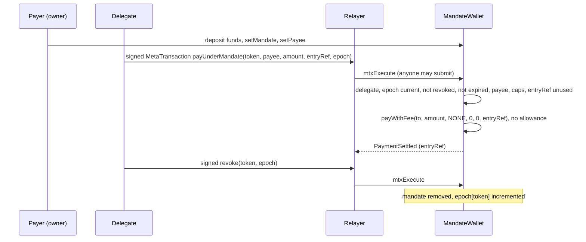

# Mandates

A mandate lets a delegate pay from a payer's own wallet within limits the chain enforces: per payment, per period,
to approved payees, until an expiry, revocable at any time. It is a payment authority, not an account: the payer keeps
its own account ([accounts.md](accounts.md)) and the funds sit in its `MandateWallet`. Status: **BUILT**
(`smartcontracts/evm/src/wallet/`, on `MetaTxBase` since P4; the typed-struct wallet before it is in `legacy/p4/`);
a UA owner, delegate or payee ([CTR-ACC-12](#CTR-ACC-12)) is **SPECIFIED** (UA-5c).

## 1. `MandateWallet`

**CTR-ACC-06** — **Delegated payment uses a dedicated `MandateWallet`, never an allowance.** One
smart wallet per payer, owned by the payer's EOA: it holds the funds (the payer deposits into it), implements ERC-1271
for its owner (so the owner can still pay by hand from it with a meta-tx, ECDSA owners), and stores per-token mandates
`{delegate, expiry, periodSeconds, periodStart, maxPerPayment, maxPerPeriod, spentInPeriod}` plus allowed payees. The
owner sets the payees — the partner's approved receiving addresses. The wallet is a `MetaTxBase` contract
([CTR-MTX-22](metatx.md#CTR-MTX-22)): every signed action is a `MetaTransaction` self-call, fee mode `NONE`. The
delegate signs `MetaTransaction{from: delegate, data: payUnderMandate(token, payee, amount, entryRef, epoch), …}`; the
function checks on chain `_msgSender() == mandate.delegate`, `epoch == epoch[token]` (`StaleEpoch`), not revoked, not expired, payee allowed, ≤ the per-payment
cap, ≤ the per-period cap and `entryRef` unused (it stays the payment reference and single-use per wallet), then pays
through `IERC20Payment.payWithFee(to, amount, NONE, 0, 0, entryRef)` — the direct payment path that `IERC20Payment` already
has, `msg.sender` = the wallet — no allowance. Kill switch: `revoke(token)` by the owner (directly or signed with
`from` = the owner), or `revoke(token, epoch)` signed by the delegate (so a platform revokes at once through a relayer,
[CTR-ACC-07](#CTR-ACC-07)).

**Named entry points.** `mtxPayUnderMandate(token, payee, amount, entryRef, epoch, validUntil, sig)`,
`mtxRevoke(token, epoch, validUntil, sig)` and `mtxExecuteAsOwner(data, nonce, validUntil, sig)` keep their signatures
and only build the matching `MetaTransaction`; their signatures carry no lane, so they derive it as `mtxPay` does:
`mtxPayUnderMandate` → `batch = uint256(keccak256("scaas.mandate.pay" ‖ entryRef))`, `nonce = 0` (one payment per
`entryRef`); `mtxRevoke` → `batch = uint256(keccak256("scaas.mandate.revoke" ‖ token ‖ epoch))`, `nonce = 0`;
`mtxExecuteAsOwner` → `batch = 0` (`‖` is `abi.encodePacked`, the epoch 8 bytes; views `mandatePayLane`,
`mandateRevokeLane`). Each builder reverts `NoMandate` when the token has no delegate. The lane nonce replaces the replay checks of the earlier typed structs. `PaymentSettled` still carries `entryRef`, so
reconciliation is exactly that of a manual payment (the design sketch was `payUnderMandate(order, delegateSig)`).

**Why a wallet per payer** rather than an allowance to one shared mandate contract: a
bug in one mandate touches only the funds deposited in that wallet, and no `approve` step for which the EOA would pay
gas is needed; the cost is that the payer deposits into the wallet instead of keeping funds in its EOA. Equivalent
mandates exist on Cosmos, Soroban, Sui, Aptos, GRAM and Solana. The wallet is deployed outside the client system (for
example `forge create … --constructor-args <owner> <chain_uid>`); clients record only its address.

**Domain.** Its EIP-712 domain
is `("SCaaS MandateWallet","1", chainId, wallet, salt = chain_uid)` with `chain_uid` a constructor argument from the
chain profile ([CTR-GEN-05](README.md#CTR-GEN-05)); because the deployer chooses that value per wallet, the node checks
the wallet's `chainUid()` against the chain profile before relaying anything for it.

**Errors** (besides the base's): `NotOwner`, `NotDelegate` (`_msgSender()` is not the mandate's delegate), `NoMandate`,
`MandateExpired`, `PayeeNotAllowed`, `OverPaymentCap`, `OverPeriodCap`, `RefAlreadyPaid`, `StaleEpoch(current, signed)`,
`BadMandate`, `PayFailed` (a token answering false: the whole payment reverts), `CallFailed`, `ZeroOwner`.

Delegated payment and the kill switch, as a sequence:

**CTR-ACC-07** — **A signed mandate revocation is bound to the mandate's epoch.** `MandateWallet`
keeps `epoch[token]` (uint64), incremented by every `setMandate` and every revoke; the delegate's signed revoke is a
`MetaTransaction` with `data = revoke(token, epoch)` on the lane `keccak256("scaas.mandate.revoke" ‖ token ‖ epoch)`,
and `revoke(address,uint64)` requires `epoch == epoch[token]`, so a public revoke signature cannot be replayed until
its `validUntil` to delete a mandate the owner re-established. **The delegate's pay names the epoch too** (controller ruling, pending the owner; the spec tied only the revoke to it):
`payUnderMandate(token, payee, amount, entryRef, epoch)` (selector `0x781fc8a8`) reverts `StaleEpoch(current, signed)` when `epoch != epoch[token]`; the
argument is in the signed `data`, so it binds every relay path (a lane would not: `mtxExecute` and `mtxBatch` accept any lane), and a relayer cannot restamp it (`MetaTxBadSignature`). A revoke, and any `setMandate` — also a plain expiry extension — void every queued delegate pay; the pay job re-reads `epoch(token)` and re-signs on `StaleEpoch`, and the kill-switch revoke job re-reads it after a `setMandate`. **`setMandate` keeps the running period** (same ruling): `periodStart` and `spentInPeriod` carry over when the delegate and `periodSeconds` are unchanged, otherwise both reset; expiry and caps always take the new values, so an extension does not double the window's allowance (revoke, then set, is the deliberate reset; so re-enabling the same delegate after a kill-switch starts a fresh period budget). **Periods are fixed windows on a grid** (controller proposal, review W-L, 2026-10-19; owner may override): when a payment finds the period over, `periodStart` moves on by whole periods to the window that holds `now` (`periodStart += ⌊(now − periodStart) / periodSeconds⌋ · periodSeconds`), never to `now`, so an idle stretch does not let the delegate choose where a window begins; the grid starts where `setMandate` (or a reset) started the period. A fixed window still admits `maxPerPeriod` just before and again just after a boundary: at most `2 · maxPerPeriod` within any `periodSeconds`, at boundaries the owner can compute from `periodStart`; an owner who needs a hard bound per `periodSeconds` sets `maxPerPeriod` to half of it (a rolling window would need the payment history on chain). Test `test_period_windows_stay_on_the_grid`. **The epoch is predictable**: a delegate can pre-sign a pay for a future epoch, so a compromised delegate key is handled by setting a NEW delegate (`NotDelegate` kills every signature), not revoke + re-set of the same one. **An owner hand-pay and a delegate pay of the same `entryRef` can both pay**: `RefAlreadyPaid` covers only the wallet's delegate pays, so pay one way per invoice. Forge KATs `mandate_pay_kat.json` and `mandate_revoke_kat.json`, read by
clientkeys. EVM only in P4: the Solana mandate binds a generation, and the Sui/Aptos/Cosmos mandates are one-shot; the other families keep their rules (TODO). Tests:
revoke, `setMandate` again, replay ⇒ `StaleEpoch`; a stale pay ⇒ `StaleEpoch`; a current-epoch revoke works; client digest == forge
vector. Status **BUILT** (P4).

**Hedera** (controller ruling, pending the owner): `HederaMandateWallet` checks HIP-632 64-byte signatures from accounts without code on every entry, for the owner and the delegate, over the `MetaTransaction` digest; `mtxExecuteAsOwnerRaw` is the owner entry under its Hedera name. ERC-1271 stays ECDSA (STATICCALL halts HIP-632), so an ED25519 owner pays by hand with an owner call `execute(token, payWithFee…)` ([NET-HED-03](../networks/hedera.md#NET-HED-03)).

| Entry point | Rule |
|---|---|
| `setMandate(token, delegate, maxPerPayment, maxPerPeriod, periodSeconds, expiry)`, `setPayee`, `execute` | owner (directly, or signed: `mtxExecute`, `mtxExecuteAsOwner`) |
| `revoke` | owner; bumps `epoch[token]` |
| `payUnderMandate(token, payee, amount, entryRef, epoch)` | delegate-signed `MetaTransaction` (`mtxExecute`, or the named `mtxPayUnderMandate(token, payee, amount, entryRef, epoch, validUntil, sig)`); anyone submits |
| `revoke(token, epoch)` | delegate-signed `MetaTransaction` (`mtxExecute`, or the named `mtxRevoke`) |
| `mtxExecuteAsOwner` (owner-signed `MetaTransaction`), `isValidSignature` | owner |

**CTR-ACC-12** — **A UA may own, delegate and receive under a `MandateWallet`** (owner 2026-10-13,
[CTR-UA-27](accounts.md#CTR-UA-27); SPECIFIED, UA-5c). The wallet's ids become `bytes32` (a native address
zero-padded): constructor `(bytes32 owner, bytes32 chainUid, address registry)`, `Mandate.delegate` `bytes32`,
`payeeAllowed[token][bytes32]`. Every authority check compares the subject of the call as an id (`_subjectId()`: the
ticket's subject inside a self-call, else `pad(msg.sender)`) with the stored id. A UA signs through the generic UA
pipeline of `MetaTxBase` ([CTR-MTX-22](metatx.md#CTR-MTX-22)): `uaExecute` with the wallet's own allowlist, fee `NONE`
only; the named builders `uaPayUnderMandate`, `uaRevoke`, `uaExecuteAsOwner` mirror the `mtx*` ones and derive the same
lanes. A native payee is paid by `payWithFee`, a derived one by `payWithFeeToUA`
([CTR-UA-28](accounts.md#CTR-UA-28)). **ERC-1271:** a native owner keeps today's `isValidSignature` (ECDSA); a derived
owner gets none (`0xffffffff`): token and DEX callers cap ERC-1271 at 50 k gas (a PQ check needs up to 5.95 M), and a
1271 answer would be a generic "sign this digest" for a UA key, which [CTR-UA-10](accounts.md#CTR-UA-10) layer 1
forbids; a derived owner acts through `uaExecute(execute(…))` on the wallet. `HederaMandateWallet` follows (HIP-632 on
the native branch).

### 1.1 Client integration (auto-pay)

How a client system uses mandates (the reference ERP implements it; the contract does not depend on it):

- Paying-wallet modes: `manual` (default; the user signs each payment from its own wallet), `custodial` (the platform
  signs through a custody adapter that holds the key — for a payer that is not the operating company itself this is
  holding someone else's keys and needs the appropriate licence reference), `delegated` (the platform's delegate key
  signs **within on-chain limits**; the address is the payer's `MandateWallet`; the payer keeps the owner key). Every
  wallet goes through four-eyes approval; a custodial wallet of a payer that is not a company needs a licence reference
  (`license_ref`).
- The custody adapter is a socket keyed by the scheme of a `signer_ref` with the interface `address(ref)`,
  `sign_digest(ref, digest32) -> 65 byte`; the `env:` scheme is dev-only (a flag plus a dev chain; it signs through OpenSSL via `cryptography`); production
  adapters (`broker:` — a custody broker over mTLS — KMS, HSM) plug into the same registry. No field, parameter or attachment ever holds a key.
- An auto-pay policy (payer, paying wallet, trigger on invoice posted or due, caps per payment/day/month, four-eyes
  state, kill switch) creates exactly one run per (policy, invoice, event) under a uniqueness constraint, so a retry
  never pays twice; it checks the caps, takes the payee from the issuing company's approved receiving wallet on the
  same chain and token, and then follows **the manual payment path**: custodial signs the meta-tx through the
  adapter, delegated signs the `payUnderMandate` `MetaTransaction` (with the current `epoch(token)`) and pushes a `call` job to `MandateWallet.mtxPayUnderMandate`. Every signature
  passes the signing-policy checks (target token, `pay` op, caps, `validUntil − now ≤ 300 s`; the signing-policy service, `SigningPolicyService`, applies `validUntil ≤ 300 s`). A failure marks the
  run `failed` and is raised, never silent; the kill switch also queues a `mtxRevoke` job for delegated wallets. The node executes such `call` jobs only for
  allowlisted selectors and targets ([NODE-JOB-01](../node/job-api.md#NODE-JOB-01)), so it is never a "blind signer" of
  client-built calldata.
