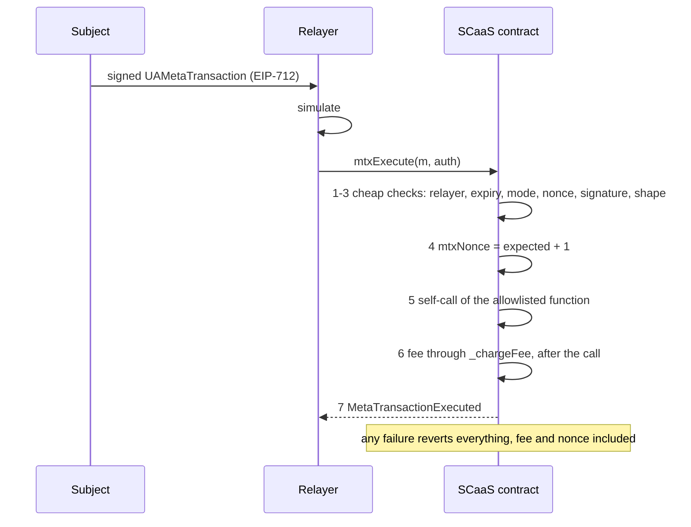
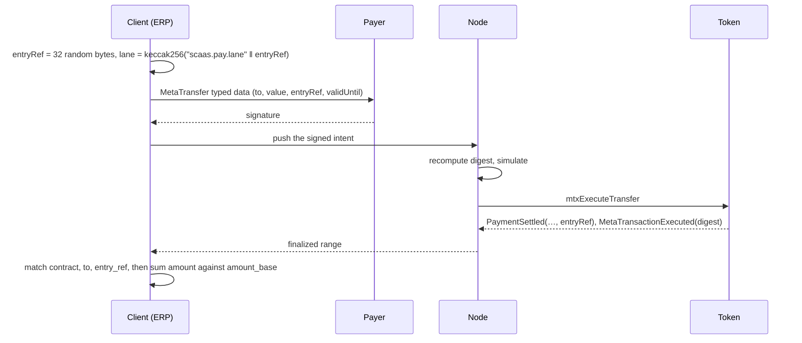
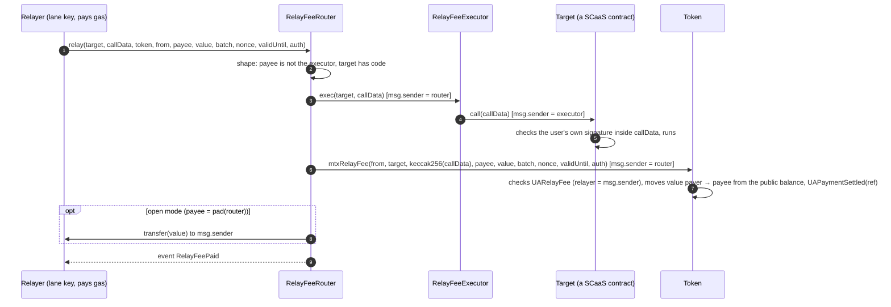

# Meta-transactions

Every SCaaS contract is gasless: the subject signs a call of one of the contract's functions, anyone may submit it,
and the submitter — usually a sponsor's or the company's relayer — pays the gas. A token transfer is a special case of
that call, not its definition (owner). This file specifies the EVM meta-transaction layer: the generic base
`MetaTxBase` that any SCaaS contract inherits (tokens, `MandateWallet`, `SmartKeyAccount`, and contracts built on SCaaS
later, such as a family-tree registry), and its token form `ERC20MetaTx` under the token kinds ([CTR-TOK-21](token-wrappers.md#CTR-TOK-21)), the Zether and
PQ Zether tokens and the Universal Account ledger path. Two signed structs: the generic `MetaTransaction` (a call of
an allowlisted function) and, on tokens, the typed `MetaTransfer` (transfer or payment). Other families implement the
same model natively ([networks/README.md](../networks/README.md)).

Status: the target layer of this file (two bases, two structs, the generic self-call `mtxExecute`, the typed
`mtxExecuteTransfer`, the selector allowlist, fee classes, `mtx` names, salted domains) is **BUILT**
(`smartcontracts/evm/src/metatx/`), receiver-pays too (`mtxPayReceiverFee`, P1b/P1c, on ids since the merge, [CTR-MTX-05](#CTR-MTX-05)). The v1
line with its hand-written op dispatch left the build in P5 (`legacy/p5/`); how the tree was built is under
[Transitional (BUILT)](#transitional-built) at the end. Nothing is deployed outside test chains, so there is no version
coexistence and no migration.

Since typed-signing (C2-C6, owner option B, 2026-10-31) every operation also has a **named entry point** with its own EIP-712 struct ([CTR-MTX-28](#CTR-MTX-28), [CTR-MTX-29](#CTR-MTX-29)). **What stands:** the generic path stays beside them (owner 2026-10-31 and 2026-11-01): `mtxExecute(UAMetaTransaction, UASig)`, `mtxBatch`, the `UAMetaTransaction` struct, its typehash and `mtxDigest`, `mtxSelectors()`, the selector allowlist, and `executeMetaTransaction` over the address `MetaTransaction` (the `ua*` names merged into these, [CTR-MTX-30](#CTR-MTX-30)). Only `mtxExecuteWithFee` and the flat `uaUnwrap(bytes32 from, …)` went to `smartcontracts/evm/legacy/typed-signing/`. Clients and the node build the named entry by default; the generic path serves a mixed batch and an operation with no named entry.

**Contents**

1. [Native mixin, no forwarder](#1-native-mixin-no-forwarder)
2. [`MetaTransaction`, `MetaTransfer` and the pinned typehashes](#2-metatransaction-metatransfer-and-the-pinned-typehashes)
3. [`mode`: constraint flags and fee mode](#3-mode-constraint-flags-and-fee-mode)
4. [`mtxExecute`](#4-mtxexecute)
5. [`mtxExecuteTransfer`: transfers and payments (tokens)](#5-mtxexecutetransfer-transfers-and-payments-tokens)
6. [2D nonces and lanes](#6-2d-nonces-and-lanes)
7. [Pay-once horizon](#7-pay-once-horizon)
8. [Gas](#gas)
9. [FeePolicy](#9-feepolicy)
10. [Names](#10-names)
11. [Interfaces](#11-interfaces)
12. [Payers](#payers)
13. [Receiver-pays](#receiver-pays)
14. [Security](#security)
15. [Conformance](#15-conformance)
16. [Transitional (BUILT)](#transitional-built)

## 1. Native mixin, no forwarder

<a id="CTR-MTX-16"></a>**CTR-MTX-16** — Meta-transaction logic is embedded in every SCaaS contract (`MetaTxBase`,
[CTR-MTX-22](#CTR-MTX-22)), not in a forwarder. The subject signs EIP-712 typed data whose `verifyingContract` **is the
contract**, and the contract runs the signed call **on itself only**: `mtxExecute` calls one of the contract's own
allowlisted functions ([CTR-MTX-17](#CTR-MTX-17)); on a token, `mtxExecuteTransfer` moves this token's balance
(transfer, payment, [CTR-MTX-23](#CTR-MTX-23)); a named entry ([CTR-MTX-28](#CTR-MTX-28)) runs one operation the same way, under its own struct. There is no ERC-2771 trusted forwarder (no
calldata sender suffix, no 63/64 gas rule, no return bomb, no swallow mode), no call **out** to another contract with
the signer's calldata, and no ERC-4337 bundler/paymaster dependency for token operations. A `GovernanceRouter` calls
out, by typed entries only, with named parameters the signer signed, each to a `target` it names ([CTR-GOV-01](../decisions.md#ctr-gov-01--governancebase-on-every-token-kind-and-the-dex),
[CTR-GOV-15](../decisions.md#ctr-gov-15--no-operator-delay-on-a-governance-holder)); no generic forwarder exists, there as anywhere.

The signer travels in a
transient slot, never in calldata ([CTR-MTX-18](#CTR-MTX-18)); what may run is a fixed **selector** allowlist per
implementation ([CTR-MTX-19](#CTR-MTX-19)), never a target allowlist. A contract that does not support gasless
operation is wrapped into a meta-tx token (an `WrappedToken`, [token-wrappers.md](token-wrappers.md)); a generic forwarder is
never added. `RelayFeeRouter` ([CTR-MTX-27](#CTR-MTX-27)) is not one: no target trusts it (each target checks its own
signer, as above), it calls targets from an unprivileged executor, and it only binds a token payment to a call that
anyone could submit directly. **All or nothing, and the user never pays for an operation that did not happen:** transfer and payment
check everything before the fee and cannot fail afterwards; a self-call runs **first** and pays its fee **after**
(so a wrap can pay from the units it mints), and any failure — of the call or of the fee transfer — reverts the whole
transaction with the inner revert data, fee and nonce included. No `try/catch`, no mode switch. Smart-contract wallets
(ERC-1271) are first-class signers.

<a id="CTR-MTX-14"></a>**CTR-MTX-14** — Signatures are EIP-712 typed data, never `personal_sign`: wallets display the
fields instead of 32 opaque bytes. The pinned typehash below is the only payment-intent type; there is no raw
`ecrecover` helper (it would not stop `s` malleability) — EOAs are verified with OpenZeppelin `ECDSA.tryRecover`
(65 bytes, low-s).

<a id="CTR-MTX-07"></a>**CTR-MTX-07** — **One meta-tx tree: `MetaTxBase`, `ERC20MetaTx`, `MetaTokenBase`.** The meta-transaction base of
every SCaaS EVM and Hedera token is the abstract contract `ERC20MetaTx` (P1b: a new file on `MetaTxBase`; `MetaTxCore` is removed, its text is in `legacy/`) on the
generic `MetaTxBase` ([CTR-MTX-22](#CTR-MTX-22)): it adds the fee in this token (`_chargeFee`, `FeePolicy`), the typed
`MetaTransfer` path (`mtxExecuteTransfer`, `mtxBatchTransfer`, [CTR-MTX-23](#CTR-MTX-23), [CTR-MTX-24](#CTR-MTX-24)),
`mtxTrade`/cancels ([dex.md](dex.md#CTR-DEX-15)), the allowance rule
([CTR-TOK-01](token-wrappers.md#CTR-TOK-01)) and the `ua*` Universal Account path ([CTR-UA-19](accounts.md#CTR-UA-19),
[CTR-UA-26](accounts.md#CTR-UA-26)).

**The split (metatx-split, T2-T8, BUILT).** The relayed pipeline's checks sit once in `src/metatx/MtxPipelineLib.sol`, a
linked library every token calls by DELEGATECALL (`preCall`, `preTransfer`, `requireSignature`, `authorize`, `callDigest`,
`transferDigest`); `MetaTxBase` calls the same internals inlined, so `SmartKeyAccount`, `MandateWallet` and
`HederaMandateWallet` link nothing. The library has no state of its own (it writes only the nonce slot `scaas.metatx` of
the caller), no SELFDESTRUCT or CALLCODE; `test_libraryOpcodes` allows one DELEGATECALL in it (to `HederaLib`, a linked
library it names) and two in `WrappedLib` (to `GovernanceLib`: `init`, and `useLimited` through `GovernanceUse`, governance B-26). Selectors, digests, events and the allowlist are unchanged
(the parity fixture `test/vectors/metatx-parity.json`, 1,822 cases, replays them). Cost, measured on the final bytecode
(`smartcontracts/evm/runs/2026-10-27-metatx-split-overhead-final.txt`, baseline `...-baseline.txt`): +7.4 k to +7.6 k
gas per relayed call (+8.9 k for `unwrap`, 0 for cancel), and about +550 gas per call permanently on the wallets that
stay on `MetaTxBase` (`_envelopeOf` pads and hashes the envelope). Sizes: `NormalToken` 38,195 B ... `WrappedPqzToken`
61,137 B (runtime; headroom 27,341 to 4,399 B under 65,536; `smartcontracts/evm/size-baseline.json`, measured at T8 `69fce983`; the gate log `runs/2026-10-27-metatx-split-sizes.txt` holds only the gate's verdict).

The tree is `MetaTxBase → ERC20MetaTx → MetaTokenBase`
([CTR-TOK-21](token-wrappers.md#CTR-TOK-21)): `MetaTxBase` holds the `MetaTransaction`, nonce lanes, signature check
(`SigCheck`, [CTR-MTX-25](#CTR-MTX-25)), the transient sender and ticket, the selector allowlist and
`mtxExecute`/`mtxBatch`/`cancelNonce`; `ERC20MetaTx` holds the ERC-20, `MetaTransfer` (`entryRef`), the fee,
the approve rule and the UA ledger; `ERC20MetaTx` also holds trade (`TradeLib`: `mtxTrade`, `mtxCancelOrder`, `mtxInvalidateNonces`; [CTR-DEX-15](dex.md#CTR-DEX-15); built in P2a, controller ruling, pending the owner), so every kind has it; `MetaTokenBase` holds receiver-pays (`mtxPayReceiverFee`, beside `mtxPay` and
`payLane`, which it uses), pay behind `PAYABLE`
(inline: no external `PayLib` built, controller ruling pending the owner), governance (`GovernanceBase`: owner, features, roles, grants in namespace `scaas.governance`, bodies in `GovernanceLib`, [CTR-GOV-01](../decisions.md#ctr-gov-01--governancebase-on-every-token-kind-and-the-dex)), init and provenance.

Pay lives in `MetaTokenBase`, **not** in
`ERC20MetaTx`; trade lives in `ERC20MetaTx`. The kinds (`NormalToken`, `WrappedToken`, and the two Zether kinds) sit on `MetaTokenBase`;
Hedera is the immutable `IS_HEDERA` ([CTR-TOK-23](token-wrappers.md#CTR-TOK-23)), not a child contract.
The v1 line (the built `ERC20MetaTxV1` mixin, `MetaToken`, `HederaMetaToken` and factory v1) is removed from the product; kept for reference under the tag `ref/pre-token-tree` and `smartcontracts/evm/legacy/` (not built): issuer tokens
use `NormalToken`, 1:1 wrappers use an `WrappedToken` with one leg and `num = den = 1`; Zether's separate mixin
`ZetherMetaTx` disappears into the base, and so does `PqzToken`'s `PqzMetaTx` ([CTR-PQZ-21](pq-zero-knowledge.md#CTR-PQZ-21)).
One domain version, `"1"`, for every token.

<a id="CTR-MTX-25"></a>**CTR-MTX-25** — One internal `SigCheck` (ECDSA low-s, ERC-1271 with the gas-cap rule, the HIP-632
hook) is used by `MetaTxBase`, `SCaaSDex`, `MandateWallet` and `SmartKeyAccount`; `SigLib` is deleted. An EIP-7702
delegated EOA follows [CTR-UA-24](accounts.md#CTR-UA-24) on the address path as on the UA path (owner ruling D1,
2026-10-30, built in `5ddc577d`; it supersedes the 2026-10-28 ruling "delegate-only signatures on both paths"):
`SigCheck.isValid` takes no code or a designator (`!SigCheck.isContract(signer)`) as an EOA, ECDSA by its own key only, and
never asks the delegate's ERC-1271; other code is ERC-1271 only, under the cap. `SigCheck.isDesignator` (exactly 23 bytes
starting `0xef0100`), `isContract` (code, not a designator) and `requireNotDelegated` (reverts
`CallerDelegated(address caller)`) are the one helper set for the caller and code checks below.

<a id="metatxbase"></a>
<a id="CTR-MTX-22"></a>**CTR-MTX-22** — **`MetaTxBase`: the generic base of every SCaaS contract** (owner). It holds
the generic `MetaTransaction` ([CTR-MTX-15](#CTR-MTX-15)), its digest, the 2D nonces and `cancelNonce`, the transient
sender and the ticket ([CTR-MTX-18](#CTR-MTX-18)), the per-implementation selector allowlist with fee classes and
`mtxSelectors()` ([CTR-MTX-19](#CTR-MTX-19)), the alias `executeMetaTransaction` (which stays, owner 2026-11-01), `chainUid()` and
`supportedModes()`. Since the merge ([CTR-MTX-30](#CTR-MTX-30)) the public entries sit in two bases on it: `UAMetaTxBase`
(tokens, mandate wallets: `mtxExecute`, `mtxBatch`, `mtxCancelNonce` (the named entry of `cancelNonce`), `mtxDigest`, `mtxNonce` on
`bytes32` ids) and `MetaTxAddressBase` (`SmartKeyAccount` through `WalletExecute`: the same names on `address from`, `IMetaTxAddress`). The fee is a virtual `_chargeFee(from, basis, m)` that **reverts unless the fee
mode is `NONE`**; a contract that does not override it reports `supportedModes() = 0x03` (flags only).

Only a contract
that holds the charged balance overrides it — every token, through `ERC20MetaTx` ([CTR-MTX-07](#CTR-MTX-07)). A
contract outside the token set (`MandateWallet`, `SmartKeyAccount`, a family-tree registry built on SCaaS) inherits
`MetaTxBase`, declares its allowlist and its domain name, reads the caller through `_msgSender()` and accepts fee mode
`NONE` only: the relayer — a sponsor's node lane or the company's own — pays native gas, who may be sponsored is node
policy ([NODE-SPN-01](../node/sponsorship.md#NODE-SPN-01)) and the node's call table
([NODE-JOB-20](../node/job-api.md#NODE-JOB-20)), and any charge to the user is settled off chain. Why: a token
transfer is one kind of gasless call, not the only one (owner); a fee field the contract cannot collect would only
mislead signers.

**The generic UA path lives in `UAMetaTxBase`** (owner 2026-10-13, [CTR-UA-27](accounts.md#CTR-UA-27); owner ruling 2026-11-01, built in typed-signing C2). The merged `mtxExecute` is a general entry, so a contract that is not a token must be able to take UA-signed calls. `abstract contract UAMetaTxBase is MetaTxBase` (`src/metatx/UAMetaTxBase.sol`) holds the UA registry as an implementation immutable (0 = off: `UALedgerOff`), `_mtxCtx`, `mtxExecute(UAMetaTransaction, UASig)`, `mtxBatch`, `mtxCancelNonce`, `mtxDigest`, `mtxNonce(bytes32, uint256)` (the `ua*` names before the merge), the UA allowlist (`_uaAllowed`), the used `metatx-cancel` digests and the envelope and digest helpers of the UA path. Its fee is a hook `_uaChargeFee` whose default refuses every mode but `NONE` (`MetaTxUnknownMode`), so a contract with no ledger runs a UA-signed call at fee 0 (the relayable rule); `ERC20MetaTx is UAMetaTxBase` overrides it with `_uaMove`. `MetaTxBase` itself carries no UA code; `SmartKeyAccount` stays without a registry, and the mandate wallets are on `UAMetaTxBase` since the merge (MD-11, [mandates.md](mandates.md#mandatewallet)). A non-token contract on `UAMetaTxBase` reads the signer through `_ticketSubject()`, since `_msgSender()` is `UA_POOL` for every derived subject. The UA balances, `_uaMove`, `transferToUA` and the typed `UAMetaTransfer` path stay in `ERC20MetaTx`. A pure move: no storage, selector or ABI change for tokens (`test_uaBaseRefusesFee`).

## 2. `MetaTransaction`, `MetaTransfer` and the pinned typehashes

<a id="CTR-MTX-15"></a>**CTR-MTX-15** — **Two structs, one nonce space** (owner). The generic signed call of a SCaaS contract is
`MetaTxLib.UAMetaTransaction` on tokens and the mandate wallets since the merge ([CTR-MTX-30](#CTR-MTX-30)), and the address
`MetaTxLib.MetaTransaction` on `SmartKeyAccount` and for a token's `executeMetaTransaction` alias: `data` is one call of one of the contract's own
allowlisted functions (a self-call, [CTR-MTX-17](#CTR-MTX-17)). `MetaTxLib.UAMetaTransfer` exists on tokens only and is the typed transfer or
payment that outside wallets display field by field ("send `value` to `to`") ([CTR-MTX-23](#CTR-MTX-23)). Ids are `bytes32`: a native id is the
address zero-padded (top 96 bits zero), a derived id a registered SIGNING UA ([accounts.md](accounts.md#CTR-UA-26)). The address `MetaTransfer`
left `MetaTxLib` for `smartcontracts/evm/legacy/ua-mtx-merge/` (the merge; its typehash pin stays on the test copy `LegacyMetaTransfer`).
`smartcontracts/evm/src/common/MetaTxLib.sol` is normative; a struct argument also keeps EIP-712 hashing clear of
Solidity's "Stack too deep" limit. The fee, where a contract charges one, is paid in **this** token (no `feeToken`
field: another token lies outside this contract and this contract holds no allowance of it; a contract that holds no
balance accepts fee mode `NONE` only, [CTR-MTX-22](#CTR-MTX-22)); there is no `innerGasLimit` (it only means something
for a forwarder that swallows failures); no opaque `op` + `args`; `mode` stays and is split into two nibbles.

```solidity
struct MetaTransaction {   // every SCaaS contract: a signed call of one of this contract's allowlisted functions
    address from;          // signer; the authority the call runs under
    bytes   data;          // a call of THIS contract, allowlisted selector
    uint256 batch;         // nonce dimension 1: lane
    uint256 nonce;         // nonce dimension 2: sequence inside the lane
    uint256 validUntil;    // unix seconds
    uint32  mode;          // constraint flags + fee mode
    address relayer;       // bound relayer when MODE_RESTRICT_RELAYER
    uint256 fee;           // only where the contract charges it (tokens); elsewhere fee mode NONE
    address feeRecipient;  // bound fee recipient when MODE_RESTRICT_FEE_RECIPIENT
}

struct UAMetaTransaction { // tokens, mandate wallets: MetaTransaction with `bytes32 from` (a native or derived id)
    bytes32 from; bytes data;
    uint256 batch; uint256 nonce; uint256 validUntil; uint32 mode; address relayer; uint256 fee; address feeRecipient;
}

struct UAMetaTransfer {    // tokens only: the typed transfer or payment; fields as above, plus:
    bytes32 from; bytes32 to; uint256 value;
    bytes32 entryRef;      // 0 = transfer; ≠ 0 = payment (UAPaymentSettled with this reference)
    uint256 batch; uint256 nonce; uint256 validUntil; uint32 mode; address relayer; uint256 fee; address feeRecipient;
}

bytes32 constant METATX_TYPEHASH = keccak256(
  "MetaTransaction(address from,bytes data,uint256 batch,uint256 nonce,uint256 validUntil,uint32 mode,"
  "address relayer,uint256 fee,address feeRecipient)");
bytes32 constant UAMETATX_TYPEHASH = keccak256(
  "UAMetaTransaction(bytes32 from,bytes data,uint256 batch,uint256 nonce,uint256 validUntil,uint32 mode,"
  "address relayer,uint256 fee,address feeRecipient)");
bytes32 constant UAMETATRANSFER_TYPEHASH = keccak256(
  "UAMetaTransfer(bytes32 from,bytes32 to,uint256 value,bytes32 entryRef,uint256 batch,uint256 nonce,"
  "uint256 validUntil,uint32 mode,address relayer,uint256 fee,address feeRecipient)");

hashStruct(m) = keccak256(abi.encode(METATX_TYPEHASH, m.from, keccak256(m.data), m.batch, m.nonce,
                                     m.validUntil, m.mode, canonRelayer, m.fee, canonFeeRecipient))
hashStruct(t) = keccak256(abi.encode(UAMETATRANSFER_TYPEHASH, t.from, t.to, t.value, t.entryRef, t.batch, t.nonce,
                                     t.validUntil, t.mode, canonRelayer, t.fee, canonFeeRecipient))
digest        = keccak256(0x1901 ‖ domainSeparator(name, "1", chainId, contract, salt = chain_uid) ‖ hashStruct(·))
```

(`hashStruct` of a `UAMetaTransaction` is that of `MetaTransaction` with `UAMETATX_TYPEHASH` and the `bytes32 from`.) The structs of a
contract consume the **same** lane `mtxNonce(from, batch)`: a lane is spent once whichever struct spent it.
**One intent, one digest** ([CTR-MTX-11](#CTR-MTX-11)): on a token a transfer or payment is signed only as a `UAMetaTransfer`; no
`transfer`/`pay` selector is ever allowlisted for `UAMetaTransaction` or `MetaTransaction`. `data` is always hashed (`keccak256(m.data)`) —
encoding dynamic bytes directly would break injectivity. The typehashes are pinned by tests
(`test_metaTxTypehashIsPinned`, `test_uaTypehashesArePinned`; the retired `MetaTransfer` by `test_metaTransferTypehashIsPinned`).

**Named structs (typed-signing).** A third family of structs sits beside these two: one struct per named entry (`Unwrap`, `Burn`, `PqzTransfer`, `CancelOrder`, `ReceiverFee`, `RelayFee`, …; 74 rows in `smartcontracts/vectors/typed/typed_ops.json`, [CTR-MTX-28](#CTR-MTX-28)). They consume the same `(from, batch)` lane `mtxNonce` as `MetaTransaction` and `MetaTransfer`, so a lane is spent once whichever struct spent it and one operation cannot run through both entries (`test_namedEntryReplayRefused`). `MetaTransaction`, its typehash, `mtxDigest` and the generic builders are unchanged. The node no longer asks `mtxDigest`: it computes the typed digest of the op itself and that digest is its in-flight key ([NODE-JOB-20](../node/job-api.md#NODE-JOB-20)); the views stay for other callers.

<a id="digest"></a>**One rule, four places.** `MetaTxLib.hashStruct` (Solidity, one per struct) is the reference. Three copies must
match it byte for byte: the client library's EIP-712 builder (the reference ERP client keeps it in
`lib/eip712.py`), `scaas-node` (an alloy `sol!` struct) and the typed-data JSON handed to the wallet (the wallet
hashes it itself). Canonical zeroing (`relayer`/`feeRecipient` = 0 when their flag is off) applies in all of them.

They are locked by known-answer vectors generated by forge (`vm.writeJson`):
`smartcontracts/evm/test/vectors/metatx_kat.json` (`UAMetaTransaction` through the merged `mtxExecute`) and `metatransfer_kat.json` (`UAMetaTransfer`
through the merged `mtxExecuteTransfer`, `auth` = `UASig{signature}`), written by `TokenKat.t.sol` since ua-mtx-merge T2;
the v1 vector `metatx_v1_kat.json` is in `legacy/p5/` (P5), the two v3 vectors written by `TokenKat.t.sol` on a `NormalToken` clone, each with domain (with `salt`), struct, `structHash`, digest and the signature of key `0xA11CE`; the `MandateWallet` and
`SmartKeyAccount` vectors are `MetaTransaction` vectors in their own domains (`mandate_pay_kat.json`, `mandate_revoke_kat.json`, `smart_key_account_kat.json`, P4). The contract, node and client tests read
the same files; changing a typehash turns three tests red. Clients decode `MetaTransaction.data` against the
contract's published allowlist (`mtxSelectors()`) and show the selector and its arguments before asking for a
signature; a `UAMetaTransfer` shows its typed fields.

<a id="CTR-MTX-02"></a>**CTR-MTX-02** — The EIP-712 domain of a clone is the implementation's name and version plus
`verifyingContract` = the clone and `salt` = the chain's `chain_uid`: `("SCaaS MetaToken", "1", chainId, clone,
chain_uid)` for every kind, `("SCaaS ZetherToken", "1", chainId, clone, chain_uid)` for Zether; every other SCaaS
contract on `MetaTxBase` uses `("SCaaS <Contract>", "1", chainId, contract, chain_uid)` (e.g. `"SCaaS MandateWallet"`,
`"SCaaS SmartKeyAccount"`; a contract built on SCaaS names its own); both structs of a contract share its domain; `eip712Domain()`
(ERC-5267) reports fields `0x1f`. `chain_uid` is the implementation's constructor immutable, so a clone (which runs the
implementation's code by `DELEGATECALL`) uses it with no storage and cannot declare another value
([CTR-GEN-05](README.md#CTR-GEN-05)). There is no cross-token replay because `verifyingContract` differs, and no
cross-chain replay because `chainId` and `salt` differ. Clients read the domain through `eip712Domain()` and store
`domain_name`/`domain_version` per token (`domain_name/version`); they fill `salt` from the chain profile and refuse a
token whose `chainUid()` differs. The cost: wallets show "SCaaS MetaToken" rather than the token's own name (they read
`name()` for that).

## 3. `mode`: constraint flags and fee mode

```text
bit  31 ........................ 8 | 7  6  5  4 | 3  2  1  0
     reserved (must be 0)           | FEE MODE   | FLAGS
```

| Name | Value | Kind | Meaning |
|---|---|---|---|
| `MODE_OPEN` | `0x00` | — | No constraints, no fee |
| `MODE_RESTRICT_RELAYER` | `0x01` | flag | Only `msg.sender == m.relayer` may execute |
| `MODE_RESTRICT_FEE_RECIPIENT` | `0x02` | flag | The fee must go to `m.feeRecipient` |
| bits 2–3 | `0x04`, `0x08` | flags | Reserved, must be 0 |
| `MODE_FEE_NONE` | `0x00` | enum (bits 4–7) | No fee |
| `MODE_FEE_PERCENT` | `0x10` | enum | `fee` in ppm of the fee basis ([CTR-MTX-20](#CTR-MTX-20)) |
| `MODE_FEE_FIXED` | `0x20` | enum | `fee` in token units |
| `MODE_FLAGS_MASK` / `MODE_FEE_MASK` / `MODE_KNOWN_MASK` | `0x0F` / `0xF0` / `0xF3` | masks | `supportedModes()` returns `0xF3` on tokens, `0x03` on a contract that charges no fee ([CTR-MTX-22](#CTR-MTX-22)) |

The low nibble holds independent **flags** (`mode & FLAG`); the high nibble holds an **enumerated** fee mode
(mutually exclusive, mask + shift). `mode & MODE_FEE_PERCENT` is a bug (a future value `0x30` would contain bit
`0x10`); use `feeModeOf(mode)` (values 0/1/2, otherwise `ModeFeeInvalid`). `validateMode` checks both unknown flag
bits (`ModeUnknownBits`, surfaced as `MetaTxUnknownMode`) and fee values above 2: accepting `0x30` today would freeze
its meaning through signatures already issued. `FeeMode` stays the canonical type of `FeePolicy`; only the separate
struct field was dropped. `mode` is part of the hash, so a bitmask creates no cross-mode replay.

**Canonical zeroing:** when `MODE_RESTRICT_RELAYER` is off, `relayer` is hashed as `address(0)`; when
`MODE_RESTRICT_FEE_RECIPIENT` is off, `feeRecipient` is hashed as `address(0)` (`MetaTxLib.canon`). The struct keeps
both fields (removing them would change the typehash). The rule is identical in contract, node and client libraries.

**Submitter normalization.** Unbound fields are not signed, yet the token pays a non-zero `m.feeRecipient`, so
every submitter rewrites unbound fields before it builds the outer transaction: unbound
`feeRecipient := chains.fee_recipient` (the operator's cold wallet) or `0` (then the fee goes to `msg.sender`, the
lane); unbound `relayer := 0`. Wire values of unbound fields are never submitted; the `intent_id` is unchanged
([NODE-LANE-10](../node/submit-lanes.md#NODE-LANE-10)).

## 4. `mtxExecute`

<a id="execution-pipeline"></a>
<a id="CTR-MTX-17"></a>**CTR-MTX-17** — **`mtxExecute` runs the signer's calldata on the contract itself** (owner).
One entry point serves every subject-signed call of a SCaaS contract; `data` is always a self-call of an allowlisted
function (on a token transfers and payments are `UAMetaTransfer`s, [CTR-MTX-23](#CTR-MTX-23)). `executeMetaTransaction` is its alias
under the EIP-1776 name for outside tools and returns `bool` (the return type that tender and other integrators
decode); only `mtxExecute` returns the inner call's bytes.

**What stands (owner 2026-10-31 and 2026-11-01).** `executeMetaTransaction` stays in `MetaTxBase` and `IMetaTx` beside `mtxExecute`, on every contract as before (it replaces the plan's removal): it signs `address from`, so it is not part of `UAMetaTxBase`. It shares the EIP-1776 name only: its selector `0x47aea5b5` is not the `0x0c53c51c` of the common `executeMetaTransaction(address,bytes,bytes32,bytes32,uint8)`, and ERC-1776 itself defines no such function. The generic `MetaTransaction` path and its allowlist were not replaced: `mtxExecute` is no longer the only way to run an operation (a named entry runs the same self-call under its own struct, [CTR-MTX-28](#CTR-MTX-28)), and it stays for a mixed batch and for an operation with no named entry.

```solidity
// tokens and mandate wallets since the merge (UAMetaTxBase; CTR-MTX-30)
function mtxExecute(UAMetaTransaction calldata m, IUARegistry.UASig calldata auth) external returns (bytes memory ret);
// MetaTxBase: the EIP-1776 alias on address `from`; IMetaTxAddress (SmartKeyAccount's address path) keeps this mtxExecute form
function executeMetaTransaction(MetaTransaction calldata m, bytes calldata signature) external returns (bool); // alias
function mtxExecute(MetaTransaction calldata m, bytes calldata signature) external returns (bytes memory ret);
```

The flow from signature to event:



The pipeline is one transaction, all or nothing; cheap checks first, so a relayer that loses a race pays only the
prefix:

| Step | Check / action | Error |
|---|---|---|
| 1 | `MODE_RESTRICT_RELAYER` ⇒ `msg.sender == m.relayer`, and that relayer is not an EIP-7702 designator (owner ruling D3, 2026-10-30); `block.timestamp ≤ m.validUntil`; `validateMode(m.mode)`; `m.nonce == mtxNonce(from, batch)`; the fee-recipient binding; `from ≠ address(this)` (the `_selfSender` hook; overridden by `SmartKeyAccount`, which signs as itself, [CTR-ACC-10](accounts.md#CTR-ACC-10)) | `MetaTxUnauthorizedRelayer`, `CallerDelegated(relayer)`, `MetaTxExpired`, `MetaTxUnknownMode`, `MetaTxBadNonce(expected, got)`, `SelfSender()` |
| 2 | Signature over the digest (`_hashTypedDataV4(hashStruct(m))`) through the virtual `_requireValidSignature`: EOA (no code, or an EIP-7702 designator) ⇒ `ECDSA.tryRecover` (65 bytes, low-s); contract ⇒ ERC-1271 `isValidSignature` staticcall (50 000 gas; 400 000 for `SmartKeyAccount` clones, which verify P-256 in Solidity when no precompile, [CTR-ACC-05](accounts.md#CTR-ACC-05)) | `MetaTxBadSignature` |
| 3 | Shape: `data.length ≥ 4`; `bytes4(data)` allowlisted; `data.length` equals the selector's static ABI length where it has one; the fee mode is allowed by the selector's fee class ([CTR-MTX-20](#CTR-MTX-20)) and by `supportedModes()` | `MtxSelectorNotAllowed(bytes4)`, `MtxDataShape(bytes4)`, `MtxFeeClass(bytes4, uint32 mode)`, `MetaTxUnknownMode` |
| 4 | Write `mtxNonce = expected + 1` | — |
| 5 | Execute: store the ticket (`sender = from`, `ticket = 1`, `binding = envelopeBinding(m)`), `address(this).call(data)`, clear the ticket, sender and binding (the binding is written on every self-call, 0 included, and cleared on exit, so a `mtxBatch` item never reads the previous item's; review C5-5); a failed call reverts **with its revert data** | inner errors, bubbled raw |
| 6 | Fee through `_chargeFee`, **after** the call: a token transfers it from `from` in this token; any other contract has already refused every mode but `NONE`; a failing fee transfer reverts everything | ERC-20 errors |
| 7 | Emit `MetaTransactionExecuted(from, relayer, batch, nonce, digest, feeRecipient, fee)` (the selector is in the transaction input) | — |

On a token, steps 1-4 and the fee checks of step 3 (class, amount argument, `FeeExceedsCap`, mode) run in `MtxPipelineLib.preCall` by DELEGATECALL (the order of every revert is pinned by `test_preCall_orderAddressPath` / `test_preCall_orderUaPath`); step 6 moves the fee from the `Out` the library returned, after the call, in the token. `SmartKeyAccount`, `MandateWallet` and `HederaMandateWallet` run the same internals inlined from `MetaTxBase`. The ERC-1271 call of a `SmartKeyAccount` signer therefore runs two frames below the token; the least relayer call gas of a `SmartKeyAccount`-signed `mtxExecute` is 446,904 (`runs/2026-10-27-metatx-split-node-floor.txt`).

No error is swallowed: the user never pays for an operation that did not happen. The relayer simulates before
broadcasting and bears gas only for a transaction whose state changed between simulation and inclusion; the node's
breaker per `(from, selector)` covers repeat offenders ([node/submit-lanes.md](../node/submit-lanes.md)).

### Named entries (typed-signing)

<a id="named-entries"></a>
<a id="CTR-MTX-28"></a>**CTR-MTX-28** — **A named entry per operation: the signed struct is `from` + the operation's own explicit parameters + the envelope** (owner option B,
2026-10-31: "a named entry point per operation, everything explicit"; shapes controller call, owner may override). Status: **BUILT** (typed-signing C2 base and public
tokens, C3 Zether, C4 PQZ, C5 wallets, C6 trade / DEX / fees; the node builds them since N1). Every operation that was allowlisted for `mtxExecute` gets one entry `mtx<Op>`: since the merge
([CTR-MTX-30](#CTR-MTX-30)) `mtx<Op>(MetaTxLib.UAEnvelope e, <explicit op parameters>, UASig auth)`, or, for an entry with no id form (the wraps), `mtx<Op>(MetaTxLib.Envelope e, <parameters>, bytes sig)`:

```solidity
struct Envelope   { address from; uint256 batch; uint256 nonce; uint256 validUntil; uint32 mode; address relayer; uint256 fee; address feeRecipient; }
struct UAEnvelope { bytes32 from; /* the same seven fields */ }
// <Op>(address from,<op params>,uint256 batch,uint256 nonce,uint256 validUntil,uint32 mode,address relayer,uint256 fee,address feeRecipient)
// UA<Op>(bytes32 from,<op params>, …same envelope words…)       e.g. Unwrap(address from,uint256 wrapped,address recipient,uint256 minOut,uint256 batch,…)
```

- **One typehash per struct**, a single string literal (never `string.concat`), pinned in Solidity (`test_*TypehashIsPinned`), clientkeys, `zether-prover` and the node; the 74
  rows of `smartcontracts/vectors/typed/typed_ops.json` give type string, typehash, a domain per contract kind, a message, struct hash, digest and the entry's calldata, and every
  contract kind runs its rows (`NamedEntry.t.sol`, `ZetherTypedRowsTest`, `PqzTypedRowsTest`, `TradeTyped.t.sol`). `relayer` and `feeRecipient` are hashed as 0 when their mode
  bit is off (`MetaTxLib.canon`, nested `MetaTransfer` too), every envelope word ABI-encoded (never `encodePacked` on `uint32 mode`).
- **Mechanism.** `MtxPipelineLib.preNamed` (`preNamedUA` for a `UASig`) hashes the struct, runs steps 1-4 of [CTR-MTX-17](#CTR-MTX-17), and the entry builds the operation's call and runs
  the existing ticket self-call (`_selfCall`), fee after the call, then the event: the operation bodies and `_msgSender()` semantics are unchanged, and the nonce lane is the generic
  path's (`(from, batch)`, one lane, so one signature runs once through either entry).
- **Names.** Entry = `mtx` + the operation's name, one per operation; the struct is `<Op>` for an `Envelope` entry and `UA<Op>` for a `UAEnvelope` entry (`UAUnwrap` signs `mtxUnwrap`). Where the operation function already carries that name (`mtxShield`, `mtxConfidentialTransfer*`, `mtxUnshield*`, `mtxRollOver`,
  `mtxPrepareAcc`, `mtxWrapShield`), the signed entry is an overload whose first parameter is the envelope, `UAEnvelope` since the merge (distinct selector; owner: open question 2 default). The wrap-by-signature entries
  are `mtxWrapOrder` (one entry, `UAWrapOrder` + `UASig`), so `mtxWrap(Envelope, uint256 amount, bytes sig)` is the named entry of `wrap(uint256)` ([CTR-TOK-20](token-wrappers.md#CTR-TOK-20)).
- **Signatures.** Since the `ua*` / `mtx*` merge ([CTR-MTX-30](#CTR-MTX-30)) every signed entry on tokens, the router and the mandate wallets takes `UASig`
  (`{keyData, signature, members}`, [CTR-UA-36](accounts.md#CTR-UA-36)), the generic `mtxExecute(UAMetaTransaction, UASig)`, `mtxBatch(UAMetaTransaction[], UASig[])` and
  `mtxShield(…, UASig)` included (the merge reverses the `bytes auth` these kept as `uaExecute` / `uaBatch` / `uaShield`); a native id's `UASig` has empty `keyData` and
  `members`, else `MetaTxBadSignature` (a controller call of the merge spec). The wrap entries without a twin stay on `Envelope` + `bytes sig`; `executeMetaTransaction` keeps `bytes signature`. `SmartKeyAccount`'s own entries take `AccountSig` ([CTR-ACC-10](accounts.md#CTR-ACC-10)). Fee classes follow [CTR-MTX-20](#CTR-MTX-20).
- **Kept as they are** (owner 2026-10-31 / 2026-11-01): the generic `mtxExecute` and `mtxBatch` (since the merge in today's `ua*` form, [CTR-MTX-30](#CTR-MTX-30)), their structs and
  typehashes, `mtxSelectors()`, `_mtxRule`, `_uaAllowed`, `executeMetaTransaction` and the direct (non-meta) functions; the four flat wallet builders went to
  `smartcontracts/evm/legacy/ua-mtx-merge/` (MD-11 (a), [mandates.md](mandates.md#mandatewallet)). Gone to `smartcontracts/evm/legacy/typed-signing/`:
  `mtxExecuteWithFee` and the flat `uaUnwrap(bytes32 from, …)`. No typed mixed batch ([CTR-MTX-11](#CTR-MTX-11)).
- **Relay.** The relay-fee router and its executor run a named entry with fee 0 (`test_relayFeeRouterRunsNamedEntry`); every state-changing named entry is relayable (owner 2026-10-20), its fee
  may be 0. Clients and the node build the named entry by default and use the generic path only for a mixed batch or an operation with no named entry.
- **Size.** The only ceiling is 65,536 B (EIP-7954). With the size levers (owner 2026-11-01: lever 2 `_enter` / `_exit`, lever 1 init path and selector table behind external library
  calls) `WrappedPqzToken` is 63,423 B and `WrappedZetherToken` 62,169 B (`smartcontracts/evm/size-baseline.json`); the task reports and `docs/research/evm-size-levers.md` have the rest.
  Since the Zether bodies run in the libraries ([CTR-ZTH-94](zether.md#CTR-ZTH-94)), `WrappedZetherToken` is 58,407 B and `NormalZetherToken` 47,470 B.

<a id="CTR-MTX-29"></a>**CTR-MTX-29** — **Every parameter is explicit** (owner 2026-10-31, general rule, the owner's text): "every parameter is explicit, as in a REST / JSON / RPC API — no packed / opaque
`bytes` that bundle several fields". A genuine cryptographic blob stays `bytes`, "but as its own named parameter (`proof`, `ciphertext`, `kemPk`, `pqzKey`, `signature`, …)". "The statement / digest
bytes that pqz-stmt and the verifiers hash stay byte-identical (the contract assembles them from the explicit params)", and what is stored is exactly what the packed bytes were: a PQZ or Zether
ciphertext, key or proof never exists only as a hash plus calldata or events ([CTR-PQZ-13](pq-zero-knowledge.md#CTR-PQZ-13)). Applied in the contracts: the Zether and PQZ ops
([CTR-ZTH-37](zether.md#CTR-ZTH-37), [CTR-PQZ-21](pq-zero-knowledge.md#CTR-PQZ-21), Appendix X.3 of the plan), the registry
([CTR-UA-36](accounts.md#CTR-UA-36)), `UASig`, `DexLeg`, the order and cancel structs; in the node's job API (explicit named JSON per operation, hex refused, [NODE-JOB-20](../node/job-api.md#NODE-JOB-20));
in every family's UA spec ([NET-ALL-84](../networks/README.md#NET-ALL-84)). Exceptions, each by ruling: the packed `register(kind, bytes keyData, …)` stays open for `webauthn-p256` and the MuSig2 / FROST kinds
(owner 2026-10-31); a kind-specific signature stays one `bytes signature` (open question 3 default); `Execute.data`
of a wallet is the call it makes; ERC-1271 `isValidSignature(bytes32, bytes)` and the Uniswap callbacks keep the standards' ABI. The former exception
"`uaExecute` / `uaBatch` / `uaShield` keep `bytes auth`" is reversed by the merge ([CTR-MTX-30](#CTR-MTX-30)).

<a id="CTR-MTX-30"></a>**CTR-MTX-30** — **One signed entry per operation: the `ua*` / `mtx*` merge** (owner 2026-11-04, the merge spec
[§10 Q1–Q7](../superpowers/specs/2026-11-04-ua-mtx-merge.md); the decision record, the reversals and the build's plan decisions MD-1 to MD-11
are in [decisions.md](../decisions.md)). Status: **BUILT** on branch `ua-mtx-merge`, UNAUDITED. Per operation a SCaaS EVM contract has its
direct entry and at most one contract-verified signed entry, `mtx<Op>`. On tokens, `RelayFeeRouter`, the DEX's SCaaS legs, the mandate
wallets and `GovernanceRouter` that entry takes `bytes32` ids (a native id zero-padded, signing with its own key; a derived id through the
registry) and `UASig`: `mtxExecute(UAMetaTransaction, UASig)` and `mtxBatch`, `mtxExecuteTransfer(UAMetaTransfer, UASig)` and
`mtxBatchTransfer` ([CTR-MTX-15](#CTR-MTX-15), [CTR-MTX-23](#CTR-MTX-23)), and the named `mtx<Op>(UAEnvelope, …, UASig)`
([CTR-MTX-28](#CTR-MTX-28)). A token keeps the EIP-1776 alias `executeMetaTransaction(MetaTransaction, bytes)` (owner 2026-11-01);
`SmartKeyAccount` keeps its address path (`IMetaTxAddress`, [CTR-MTX-22](#CTR-MTX-22)). The address `MetaTransfer` and the `ua*` entries
moved to `smartcontracts/evm/legacy/ua-mtx-merge/`.

<a id="CTR-MTX-18"></a>**CTR-MTX-18** — **The signer travels in a transient slot, and one ticket admits exactly one
self-call.** Transient slots `keccak256("scaas.mtx.guard")`, `"scaas.mtx.sender"`, `"scaas.mtx.ticket"`,
`"scaas.mtx.binding"` (written as literals: assembly takes no `keccak256` constant). One contract-wide guard covers
every entry point — every state-changing `external` function of a contract on `MetaTxBase` is `nonReentrant`, the
pay (`payWithFee`, `payWithFeeToUA`), mint, role, owner, rate and guardian functions included (review W-Q,
2026-10-19), except `initialize` (factory-only, once) and the plain ERC-20 `transfer`, `approve` and `transferFrom`,
which make no outside call (the `WrappedZetherToken` / `WrappedPqzToken` overrides of `disableFeature` and
`executeRate` carry it too since the 5g integration); `nonReentrant` admits the self-call of step 5 once and consumes the ticket:

```solidity
modifier nonReentrant() {
    if (tload(GUARD) != 0) {
        // the one self-call issued by step 5 may enter, once
        if (msg.sender != address(this) || tload(TICKET) != 1) revert Reentrancy();
        tstore(TICKET, 2);            // consumed: any further entry reverts, whoever calls
        _;
    } else {
        tstore(GUARD, 1); _; tstore(GUARD, 0);
    }
}
```

`_msgSender()` returns the stored sender when `msg.sender == address(this)` and the ticket is live, else
`msg.sender`, after `SigCheck.requireNotDelegated(msg.sender)`: **a direct caller that is an EIP-7702 designator is
refused** with `CallerDelegated(address caller)` (owner ruling D2 (a), 2026-10-30, [CTR-UA-24](accounts.md#CTR-UA-24),
`6bb05818`; ≈ 313 gas per read for a warm caller, `test_requireNotDelegated_gas`). While delegated, an account acts through
relayed `mtx*` signed by its own key (the fee may be 0), for an owner or holder operation through the chain's
`GovernanceRouter` ([CTR-GOV-15](../decisions.md#ctr-gov-15--no-operator-delay-on-a-governance-holder)), or clears its delegation first. The step-5 ticket branch is
unchanged; the ticket is live while it is non-zero (1 before the guarded entry, 2 inside the allowlisted body), so an
allowlisted body must never call `this` or forward calldata (anything it reaches through `this` sees the signer). The signer is never read from calldata, so no function can be fooled by 20 trailing bytes, and the only
self-call path is step 5. Every allowlisted function is `nonReentrant` (a test pins it), so the one entry always
consumes the ticket, a re-entry from an underlying's hook during the self-call reverts (`msg.sender` is the underlying,
or the ticket is spent), and no allowlisted function runs with a live ticket; `mtxBatch` sets a fresh ticket per item.

Authority and balance owners are read through `_msgSender()` everywhere; the reads that **stay** `msg.sender` are
exactly: the reentrancy guard, `_msgSender()` and `_ticketSubject()` themselves (with the designator refusal); the relayer
binding (with its designator refusal), the default fee recipient and the event `relayer` of every pipeline; the factory
check in `initialize`; the callers that must be the order's DEX: `mtxTrade`'s, `restorePulled`'s and `mtxLiquidityPull`'s
([CTR-DEX-15](dex.md#CTR-DEX-15), [CTR-DEX-25](dex.md#CTR-DEX-25), [CTR-DEX-27](dex.md#CTR-DEX-27),
[CTR-DEX-30](dex.md#CTR-DEX-30)); the relayer of `mtxRelayFee`, which is the router ([CTR-MTX-27](#CTR-MTX-27));
`mtxWrapOrder`'s submitter ([CTR-TOK-20](token-wrappers.md#CTR-TOK-20)); and the governance subject and the router's target
compare ([CTR-GOV-15](../decisions.md#ctr-gov-15--no-operator-delay-on-a-governance-holder)). A lint test reads the sources
and pins that set per file (`test/metatx/MsgSenderLint.t.sol` `test_msgSenderReadsArePinned`): `msg.sender` appears 8 times
in `MetaTxBase` (the guard, the event, `_msgSender()` ×3 with the designator refusal, the fee default, the ticket binding,
`_ticketSubject`), 5 in `MtxPipelineLib` (the relayer binding ×3 with its designator refusal, the fee default ×2), 5 in
`ERC20MetaTx` (the event relayer ×2, the `mtxTrade`, `restorePulled` and `mtxLiquidityPull` callers), 2 in `UAMetaTxBase`
(the event relayer of `_uaSettle` and `mtxCancelNonce`), 3 in `MetaTokenBase` (the factory check, `mtxRelayFee`'s relayer
×2), 3 in `WrappedTokenCore` (`mtxWrapOrder`'s submitter: the pull, the fee mint, the fee leg's hook), 1 in `WrappedLib`
(the factory in `_addLeg`'s leg check), 4 in `RelayFeeRouter`, 12 in `SCaaSDex` and 2 in `SCaaSDexAdmin`, 2 each in
`GovernanceBase` and `GovernanceRouterBase`; never in `TradeLib` (its caller is a parameter), `MetaTxAddressBase`, the PQZ
and Zether token cores and libraries, the mandate wallets (they read `_subject()`) or the regulated layer and kinds. Defence in
depth: `from ≠ address(this)` (step 1), and `_update` refuses transfers and mints **to** `address(this)`
(`TransferToSelf()`), because tokens parked at the token's own address are what a spoofed self-call would spend.

<a id="CTR-MTX-19"></a>**CTR-MTX-19** — **A fixed selector allowlist per implementation** (owner). Each implementation
declares its allowlist as constants — exact selectors, overloads listed one by one, each with a fee class — and
publishes it through `mtxSelectors() returns (bytes4[] selectors, uint8[] feeClass, uint8[] amountArg)`; a test pins
it. Nothing else is reachable through `mtxExecute`. The named entries ([CTR-MTX-28](#CTR-MTX-28)) are not in the list: each is its own external function. The allowlist and `mtxSelectors()` stay for the generic path; since typed-signing N1 the node no longer reads them, its own table of entries decides what it relays ([NODE-JOB-20](../node/job-api.md#NODE-JOB-20)). The confidential rows below list the direct ops' explicit signatures ([CTR-MTX-29](#CTR-MTX-29)), not the packed `payload` ones.

**General rule (owner 2026-10-20): every state-changing `mtx*` function is relayable, even with no fee.** It is either itself
a meta-tx entry point (`mtxExecute`, `mtxBatch`, `mtxTransfer`, the named builders that carry their own signature, `mtxPay` included: none of these is in `mtxSelectors()`) or an
allowlisted self-call whose outer fee may be 0 (`NONE` or `FIXED` 0). So the confidential tokens list their roll-overs
(Zether: `mtxRollOver`, `mtxRollOverBatch`, `mtxRollOverSigned`, `mtxSetRollOverMode`; PQZ: `mtxRollOver`, `mtxPrepareAcc`), whatever
the function's own authority is (none, or an owner signature checked inside). BUILT for the confidential tokens, commit `b5e61c96`.
**One exception (review C0-18, controller proposal 2026-10-27, owner may override):** `mtxWrapShield` with the native coin as the leg is not relayable. It is
`payable` and takes the leg from `msg.value`, and a relayer cannot supply the signer's native coin (the self-call carries no value). The holder
wraps directly, then relays `mtxShield`; an ERC-20 leg is relayable. A value-carrying relay path (payable
envelope, `msg.value` bound to the authorization, relayer reimbursed) was the other option and is not built.

| Implementation | Self-call selector | Fee class |
|---|---|---|
| every token | `cancelNonce(uint256)` | `ABSOLUTE` |
| `NormalToken` | `burn(uint256)` | `AMOUNT(0)` |
| `WrappedToken` | `wrap(uint256)` (fee from minted units; reverts `UnderlyingRequired` unless one leg) | `ABSOLUTE` |
| | `unwrap(uint256,address,uint256)` (reverts `UnderlyingRequired` unless one leg) | `AMOUNT(0)` |
| | `wrap(address,uint256)` | `ABSOLUTE` |
| | `unwrap(address,uint256,address,uint256)` | `AMOUNT(1)` |
| | `addReserve(address,uint256)` | `ABSOLUTE` |
| | `wrapToUA(address,uint256,bytes32)` (BUILT, UA-5a; [CTR-UA-28](accounts.md#CTR-UA-28)) | `ABSOLUTE` |
| | `unwrapToUA(address,uint256,bytes32,uint256)` (BUILT, UA-5a; also on the UA allowlist) | `AMOUNT(1)` |
| `NORMAL_ZETHER` / `WRAPPED_ZETHER` (built, P3) | the kind's public entries (`burn`; or `WrappedToken`'s six, without `unwrap(uint256,address)`) | as above |
| | `mtxShield(bytes32,uint256)`, `mtxWrapShield(address,uint256,bytes32)` (`WRAPPED_ZETHER`) | `ABSOLUTE` |
| | `mtxConfidentialTransfer(ZetherMulti,bytes proof)`, `…Compact`, `mtxConfidentialTransferSingle(ZetherSingle,bytes proof)` (`…NoBundle` retired: review C0-3), `mtxUnshield(ZetherBurn,uint256 amount,bytes32 recipient,bytes proof)`, `mtxUnshieldUnwrap(ZetherBurn,Unwrap,bytes proof)` ([CTR-ZTH-45](zether.md#CTR-ZTH-45); Zether takes no `pqzAuth` or `accHint`, Appendix X.3) | `ABSOLUTE`; envelope binding through the ticket ([CTR-ZTH-34](zether.md#CTR-ZTH-34)) |
| | `mtxUnshield` / `mtxUnshieldUnwrap` with a derived-UA recipient (one selector each; the former `…ToUA` names are gone; BUILT, plan 5h Task 3b, [CTR-ZTH-51](zether.md#CTR-ZTH-51)) | `ABSOLUTE`; envelope binding as above |
| `PqzToken` | `mtxConfidentialTransfer(PqzMultiArgs,bytes proof,UASig pqzAuth,bytes accHint)`, `…Compact`, `mtxConfidentialTransferSingle(PqzTransferArgs,…)`, `…SingleCompact`, `mtxUnshield(PqzBurnArgs,uint256 amount,bytes32 recipient,bytes proof,UASig pqzAuth,bytes accHint)`, `mtxShield(bytes32,uint256)` (`WRAPPED_PQZ`: also `mtxWrapShield`, `mtxUnshieldUnwrap`); `mtxRollOver` and `mtxPrepareAcc` too (Task R) | `ABSOLUTE`; not batchable ([CTR-PQZ-21](pq-zero-knowledge.md#CTR-PQZ-21)) |
| `MandateWallet` | delegate: `payUnderMandate(address,address,uint256,bytes32,uint64)`, `revoke(address,uint64)`; owner: `setMandate`, `setPayee`, `revoke(address)`, `execute` ([CTR-ACC-06](mandates.md#CTR-ACC-06)) | fee `NONE` only |
| `SmartKeyAccount` | `addKey`, `removeKey`, `rotateKey`, `setGuardian`, `cancelRecovery`, `execute`, signed by the account itself ([CTR-ACC-10](accounts.md#CTR-ACC-10)) | fee `NONE` only |

Transfer and payment are `MetaTransfer`s ([CTR-MTX-23](#CTR-MTX-23)); neither `transfer` nor `pay` is ever
allowlisted, so one transfer has one encoding and one digest. `WrappedToken`'s two-argument `unwrap(uint256,address)` is not listed (the same intent with a
second digest and no `minOut`). **Never allowlisted:**
`approve` and `transferFrom` (contract accounts approve and spend through their own call path,
[CTR-TOK-01](token-wrappers.md#CTR-TOK-01)); every role function — `mint`, `mintToUA`, the `IGovernance` functions (`grantRole`, `revokeRole`, `renounceRole`, `setGrant`, `cancelGrant`, `disableFeature`, the ownership functions), `proposeRate`,
`cancelRate`, `executeRate`, `disableWrap`, the DEX's `setMarket`, `setExchangeTarget`, `setListedOnly`, `setFeeSplit` (a governance operation is no allow-list row on a governed contract, pinned by the selector audit `test/vectors/selector_audit.json`, governance T13 `d8f2e492`; role holders act through their own
contract, or a gas-less or derived UA through the chain's `GovernanceRouter`, whose own `mtxSelectors()` is empty ([CTR-GOV-15](../decisions.md#ctr-gov-15--no-operator-delay-on-a-governance-holder)), [NODE-JOB-01](../node/job-api.md#NODE-JOB-01); a signature check would skip a minter contract's caps or a
Safe's guards; the holder still acts gaslessly through its own contract account, [CTR-UA-27](accounts.md#CTR-UA-27)); `transfer` and `pay` (they are `MetaTransfer`s); `payWithFee` and `payWithFeeToUA` (they charge their own fee); `mtxExecute`, its alias and every other `mtx…` entry
(no nesting); `initialize`; views; Zether `mtxRollOverSigned`/`mtxSetRollOverMode` (they carry their
own signature). For selectors with dynamic arguments (Zether) the contract cannot cheaply pin one encoding: the node
re-encodes the decoded arguments and refuses non-canonical `data` before it computes the mesh `intent_id`; a
non-canonical duplicate on chain is harmless, because only the signer can produce one (`data` is signed) and the
sequential nonce lets only one variant execute.

<a id="CTR-MTX-12"></a>**CTR-MTX-12** — **Gasless unwrap** is the named entry `mtxUnwrap` / `mtxUnwrapLeg` ([CTR-MTX-28](#CTR-MTX-28); `UAEnvelope` + `UASig`, a native or a derived id) or, still, `mtxExecute` with the wrapper's real `unwrap` calldata:
`unwrap(uint256 wrapped, address recipient, uint256 minOut)` on `WrappedToken` with one leg, `unwrap(address underlying,
uint256 wrapped, address recipient, uint256 minOut)` with one or several legs, `unwrap(uint256, address)` (public
balance) on `WRAPPED_ZETHER` (built in P3 with `WrappedToken`'s `minOut` forms only). The function runs exactly as a direct call by `from` (checks, burn
`⌈out·q⌉`, reserve debit, the underlying's exact-amount transfer, `Unwrapped`), and `minOut` protects the signer
against rate moves between signing and execution. Its fee class is `AMOUNT` with the wrapped amount as basis, taken
in wrapped units after the call. The underlying's transfer failing reverts everything, fee and nonce included. The fee
never goes to the payee rule does not apply (there is no payee). Fee-on-transfer-out underlyings stay unsupported. It
works on disabled multi-underlying legs (exits stay open) and during a pending rate change (at the current rate). The
node side (simulation, no batching, the narrowed grief exemption) is
[NODE-LANE-22](../node/submit-lanes.md#NODE-LANE-22).

## 5. `mtxExecuteTransfer`: transfers and payments (tokens)

<a id="CTR-MTX-23"></a>**CTR-MTX-23** — **The typed path: `mtxExecuteTransfer(UAMetaTransfer t, UASig auth)`** (owner; since the merge, [CTR-MTX-30](#CTR-MTX-30),
one form for a native id signing with its own key and a derived UA through the registry; the address `MetaTransfer` forms are in
`legacy/ua-mtx-merge/`). A token's transfer and payment are signed as a `UAMetaTransfer` ([CTR-MTX-15](#CTR-MTX-15)) so outside wallets show
"send `value` to `to`" field by field, and they run through their own pipeline in `ERC20MetaTx`; the named functions
build the same struct ([CTR-MTX-09](#CTR-MTX-09)). `mtxExecuteTransfer` takes the struct as given — any lane, either
shape — and returns `bool`. Steps, all or nothing and cheap first as [CTR-MTX-17](#CTR-MTX-17):

| Step | Check / action | Error |
|---|---|---|
| 1 | as [CTR-MTX-17](#CTR-MTX-17) step 1 on `t` (`from ≠ address(this)` always) | as there |
| 2 | `auth` over the `UAMetaTransfer` digest (`mtxTransferDigest`), as step 2 there | `MetaTxBadSignature` |
| 3 | `to ≠ 0`, `to` and a non-zero fee's recipient ∉ {`UA_POOL`, `SHIELD_POOL`} (before the nonce, as the UA twin; review C5-3); fee on `value` (`FeePolicy.compute`, `validateRecipient`, the payee check of [CTR-MTX-08](#CTR-MTX-08) with payee = `t.to`; `to`, fee recipient ≠ the token); balance ≥ value + fee | `PayToZero`, `TransferToSelf`, `UAPoolNotPayable`, `ShieldPoolNotPayable`, `FeeExceedsCap`, `FeeRecipientRequired`, `FeeRecipientIsPayee`, `MetaTxInsufficientForFee` |
| 4 | write `mtxNonce = expected + 1` | — |
| 5 | transfer the fee, then the value (cannot fail after step 3); `entryRef ≠ 0` ⇒ `UAPaymentSettled(from, to, value, feeAmount, feeRecipient, entryRef)` | — |
| 6 | `UAMetaTransactionExecuted(from, relayer, batch, nonce, digest, feeRecipient, fee)` | — |

These are the transfer and `pay` shapes of the earlier single struct, moved out of `data` into typed fields.

<a id="service-pull"></a><a id="CTR-MTX-32"></a>**CTR-MTX-32** — **Service pull: a contract takes a payer's tokens into its
custody by the payer's one signed transfer, never by an allowance** (owner 2026-11-09, service-pull spec Q1–Q5 as
recommended). Status: **BUILT** for the token side (no token change: `mtxExecuteTransfer` with `MODE_RESTRICT_RELAYER`
on every EVM kind 0–13 and Hedera) and as the reference service `test/metatx/helpers/RefServiceEscrow.sol` with its tests
(test only, never deployed; group 3i T77); **SPECIFIED** for every third-party service, whose rule this is. UNAUDITED.

The payer signs one `UAMetaTransfer` in the pulled token's own domain: `to` = `pad(S)`, `relayer` = `S` with
`MODE_RESTRICT_RELAYER`, fee mode `NONE`, `fee` 0, no `feeRecipient`, and `entryRef` = the EIP-712 digest of the one
service operation in S's own domain (`keccak256(0x1901 ‖ domainSeparator(S) ‖ hashStruct(<Op>, op))`). Anyone submits
`S.<op>(op, t, auth)`; only S can make the token execute `t`, once, before `validUntil` ([CTR-MTX-15](#CTR-MTX-15)). A
service contract S follows these rules:

- **Entry shape.** One external function per operation, `<op>(<Op> calldata op, MetaTxLib.UAMetaTransfer calldata t,
  IUARegistry.UASig calldata auth)`; `<Op>` a struct of named fields, the first `bytes32 payer`, its EIP-712 type that
  struct exactly; every value S reads is a field of `<Op>` or S's own state, never of `t` alone ([CTR-MTX-29](#CTR-MTX-29)).
  A node-relayable `<Op>` has at most 16 fields of EIP-712 atomic types plus `bytes` and `string`, no array, no nested
  struct (C3). No entry of S ever verifies a signature over an `<Op>` type (`entryRef` is a full signing digest).
- **Permissionless.** The signed transfer is the entry's only authority; S never reads `msg.sender` for it.
- **Discovery.** `servicePullEntries() returns (bytes4[] selectors, string[] opTypes, address[] tokens)` (`address(0)`:
  `<Op>` names it in `address token`) and ERC-5267 `eip712Domain()`.
- **The checks, in order** (a shape check reverts `ServicePullShape(code)`): 1 `t.to == pad(this)`; 2 `t.mode ==
  MODE_RESTRICT_RELAYER`, `t.relayer == this`, `t.fee == 0`, `t.feeRecipient == 0`; 3 `t.entryRef` = the digest of `op`;
  4 `t.from == op.payer`; 5 `t.value` = the amount the operation requires, above 0; 6 the `entryRef` not seen
  (`ServicePullReplayed`), on a regulated token S not frozen (`ServicePullFrozen`), the operation's own checks; 7 record
  the `entryRef` and the operation; 8 `token.mtxExecuteTransfer(t, auth)` (no `try`), then `balanceOf(this)` grew by
  exactly `t.value` (`ServicePullNotReceived`); 9 the rest of the logic.
- **The token is S's own** (immutable, or an `op` field checked against S's list or the factory's provenance,
  [CTR-TND-07](tender.md#CTR-TND-07)), never one named only by the caller.
- **Custody** is S's ledger, credited after step 8; `balanceOf(S) ≥ Σ owed` except after a recorded `forceTransfer`.
  Payout destinations are fixed at pull time; a payout the token refuses stays owed, never redirected. On the regulated
  kinds 8–13 a recorded `forceTransfer` on a frozen S drains the pooled balance: the shortfall equals the forced amount,
  falls on the last claimants, and their payouts fail closed; a service on a regulated kind states it in its own
  documentation (owner Q5). Reentrancy: checks-effects-interactions with a transient guard (EIP-1153).
- **The relayer fee** is [`RelayFeeRouter`](#CTR-MTX-27) or nothing: every pull is at fee `NONE` (owner Q3). Through
  `relay(target = S, …)` the router runs S first, so with the fee in the pulled token on the pull's lane the pull takes
  nonce `n` and the fee `n + 1`.
- **Out of scope:** confidential balances (PQZ, Zether: a keeper would be a decryption oracle,
  [ARCH-POS-13](../decisions.md#ARCH-POS-13)), standing authority (one signed pull per charge, or a `MandateWallet`),
  several payers or tokens in one entry.

Tests (T77): `test/metatx/ServicePull.t.sol` (a native EOA, a derived single-key UA, an `msig`, a `SmartKeyAccount`, a
Hedera 64-byte payer; direct and through `RelayFeeRouter`; N1–N20 with N14b, each by its named error),
`ServicePullKinds.t.sol` (kinds 0–5, 8–13), `ServicePullInvariant.t.sol`, `ServicePullVectors.t.sol`
(`smartcontracts/vectors/metatx/servicepull.json`); 16 mutants of the reference service, each killed. The node's kind:
[NODE-JOB-25](../node/job-api.md#NODE-JOB-25); every family: [NET-ALL-85](../networks/README.md#NET-ALL-85).

<a id="CTR-MTX-01"></a>**CTR-MTX-01** — A payment is a `MetaTransfer` with `entryRef ≠ 0` (`entryRef` = the payment
reference, [CTR-MTX-03](#CTR-MTX-03)), run through `mtxExecuteTransfer` or built by `mtxPay`
([CTR-MTX-10](#CTR-MTX-10)) and `mtxPayReceiverFee` ([CTR-MTX-05](#CTR-MTX-05)); `entryRef = 0` is a plain transfer.
One pinned struct per intent means one type that wallets display. It emits `PaymentSettled(from, to, value, feeAmount,
feeRecipient, entryRef)` with the real fee. Tender's deposit ([CTR-TND-01](tender.md#CTR-TND-01)) and every service pull
([CTR-MTX-32](#CTR-MTX-32), group 3i) are this shape: there `entryRef` is the operation's digest in the service's domain.

<a id="CTR-MTX-24"></a>**CTR-MTX-24** — **`mtxBatchTransfer(UAMetaTransfer[] ts, UASig[] auths)`** is the batch of the
typed path, beside `mtxBatch` for `UAMetaTransaction`s, with the rules of [CTR-MTX-11](#CTR-MTX-11): atomic, items in
order, `msg.sender` the relayer of every item, `ts.length == auths.length` (`MtxBatchLengthMismatch`), `≥ 1`
(`MtxBatchEmpty`), no explicit cap, items of one token. A batch never mixes the two structs; the node batches
payments through it ([NODE-LANE-11](../node/submit-lanes.md#NODE-LANE-11)).

## 6. 2D nonces and lanes

Storage `_metaNonce[from][batch]` (BUILT: keyed by `bytes32`, a native address zero-padded, shared with the UA
ledger's `bytes32` path, [CTR-UA-26](accounts.md#CTR-UA-26)); an intent — a `UAMetaTransaction`, a `UAMetaTransfer`, a named entry or an address `MetaTransaction` — is valid iff its `nonce ==
mtxNonce(from, batch)`; execution increments it. Both structs share the one map. Independent lanes remove head-of-line blocking between agents and between business flows of the same subject.

| Lane derivation | Rule | Status |
|---|---|---|
| Payment request | `batch = keccak256("scaas.pay.lane" ‖ entryRef)`, `nonce = 0` ⇒ each request is payable at most once and the client can build typed data without reading the chain; `mtxPay` derives the same lane on chain (`payLane(payId)`) | **BUILT** |
| Agent × purpose | `batch = uint256(keccak256(agentId ‖ purpose))` (e.g. procurement settlement, logistics milestones, payout distribution, treasury rebalance), sequential nonce inside | **SPECIFIED** (client convention) |
| Non-EVM | `(subject, lane: bytes32) → nonce: u64` in the subject's account object/wallet/PDA | **BUILT** |

`cancelNonce(batch)` increments `mtxNonce[sender][batch]` by one and so invalidates the one intent signed for the
current nonce, including a copy circulating on the mesh, without a dummy transfer. It is not a lane reset: with
intents E5 and E6 signed ahead, one cancel kills E5 and makes E6 executable at once, so k pending intents need k
cancels (every intent is signed and bounded by its `validUntil`). It emits `MetaNonceCancelled(from, batch,
newNonce)`. It is a direct call **or** a signed self-call through `mtxExecute` on another lane (so a subject without
gas can cancel). First use of a lane costs ≈ +17 k gas on the pre-Amsterdam figures (a new storage slot); under Amsterdam (EIP-8038 write prices, EIP-8037 state gas) it is ≈ +98 k (§8). An anti-lock test is mandatory per family:
X stuck on contract 1 never blocks Y on contract 2 ([networks/README.md](../networks/README.md#head-of-line)). Trade
orders have their own **order lane** (`minNonce`, [CTR-DEX-15](dex.md#CTR-DEX-15)); clients label the two.

<a id="entryref"></a>
<a id="CTR-MTX-03"></a>**CTR-MTX-03** — **Payment references.** `entryRef` is 32 random bytes; the lane of a
payment request is `keccak256("scaas.pay.lane" ‖ entryRef)` with nonce 0. A random value is unlinkable by
construction (better than a salted hash of business data) and needs no salt management; a fixed lane per request
lets the client build typed data without reading the chain and makes each request payable at most once (under
[CTR-MTX-04](#CTR-MTX-04)). Accepted cost: the first use of the lane costs +17 k gas on the pre-Amsterdam figures (`MetaTxGas`) and ≈ +98 k under Amsterdam (`MetaTxGasV2`: 178,157 against 80,249 for a warm lane, §8), and `mtxPay`, which always opens a fresh lane, ≈ 182 k in all (181,810).
Tokens also derive the lane on chain ([CTR-MTX-10](#CTR-MTX-10)).

```text
entryRef = 32 bytes from a CSPRNG                     # carries no information; unlinkable by construction
batch    = keccak256("scaas.pay.lane" ‖ entryRef)     # lane of this request (on chain: payLane(entryRef))
nonce    = 0
```

- One `entryRef` per **payment request** (an invoice may have several requests over time; each request is payable at
  most once because its lane has nonce 0).
- Pay-once holds only if every signature a client issues on a pay lane has `validUntil ≤ t_first_issue + 30 d`.
  Re-issuing terms on the same lane later than that, or signing an op with `valid_until > now + 30 d` on a pruning
  family (GRAM, Aptos, Solana, Sui), gives no pay-once guarantee — issue a new request (new `entryRef`, new lane)
  instead. Wallet connectors and `clientkeys` refuse such ops.
- The client stores `entryRef` with a UNIQUE constraint on the request, together with `chain`, `token`,
  `receiving_address`, `payer_address` (locked at start), `amount_base`, `issued_valid_until`.
- Do **not** derive `entryRef` from business identifiers (`keccak256(company ‖ move ‖ amount ‖ salt)` as in older
  drafts): a random value needs no salt management and cannot be brute-forced from known invoice numbers.
- Splitting: classical Zether with `n_v = 64` removed the need to split large payments; for transparent tokens one
  payment per request. If a business case needs partial payments, issue one request (one `entryRef`) per
  instalment.



Two-way verification. **Client → chain** (before signing and at push): (1) the `MetaTransfer` typed data is built server-side
from the request: `to = receiving_address`, `value = amount_base`, `entryRef`, `batch` as above, `validUntil =
issued_valid_until` (server-chosen, e.g. now + 300 s); (2) after signing the client recomputes the digest; a 65-byte
signature must recover `payer_address` (EOA); a contract wallet (ERC-1271) is accepted unverified and judged by the
node's simulation; (3) the node recomputes the digest and simulates before broadcast.

**Chain → client** (on each
finalized range): (1) filter `PaymentSettled` by `contract == request.token` **and** `from == request.payer_address` **and** `to == request.receiving_address`
**and** `entry_ref == request.entryRef`; (2) `amount_settled = Σ amount` of matching events; `amount_settled ≥
amount_base` ⇒ request final; more than due ⇒ final + needs attention (refund manually); less ⇒ partial; (3)
cross-check `MetaTransactionExecuted(digest)` to mark the job final; (4) drift checks: an unmatched inbound
`Transfer` to a watched wallet ⇒ a drift record; hourly `balances` vs the ledger balance of the token's journal. A
third party paying 1 unit with someone else's `entryRef` is not counted at all (`from` is not the request's payer), so it can neither complete a request nor push it into "needs attention";
it is just money received (review C5-10: one rule, the key `(token, payer, payee, entryRef)`, in every document). The full client procedure is in
[integration.md](../integration.md#payment-references).

## 7. Pay-once horizon

<a id="CTR-MTX-04"></a>**CTR-MTX-04** — **Pay-once is conditional and is a protocol rule.** "Each payment request is
payable at most once" holds iff (1) every signature issued on a pay lane has `validUntil ≤ t_first_issue + H`,
`H = LANE_HORIZON = 30 d`, and (2) every family that prunes lane state keeps an executed lane for ≥ `H` after the
executed op's `validUntil` ([NET-ALL-01](../networks/README.md#NET-ALL-01): GRAM two `LANE_TTL` generations; Aptos and
Solana `PRUNE_DELAY_S`; Sui `prune` after `valid_until + LANE_HORIZON_S`). Issuers that sign terms on a lane beyond
`H` get no pay-once guarantee; a node chain on a pruning family must have `max_valid_for_secs ≤ H`. Obligations:

| Who | Obligation | Status |
|---|---|---|
| Issuer (ERP, app) | Sign one op per pay lane, or keep every op on that lane inside `H` of the first; terms signed beyond `H` get no pay-once guarantee | reference ERP client complies (**BUILT**) |
| Every signing client (connectors, `clientkeys`, app) | Refuse to sign an op with `valid_until > now + LANE_HORIZON_S` on a pruning family ([NET-APT-24](../networks/aptos.md#NET-APT-24), [NET-SOL-25](../networks/solana.md#NET-SOL-25), [NET-SUI-12](../networks/sui.md#NET-SUI-12)) | **SPECIFIED** |
| Contract | Sui `relay_pay` refuses `valid_until > now + LANE_HORIZON_S` on chain; Solana caps `valid_until` and order `expiry` at `MAX_TTL_S = 31 d` ([NET-SOL-22](../networks/solana.md#NET-SOL-22)) | **SPECIFIED** |
| Node | Refuses `max_valid_for_secs > LANE_HORIZON` on a pruning family ([NODE-STO-01](../node/store.md#NODE-STO-01)); constants pinned equal in tests (GRAM `LANE_TTL`, Aptos/Solana `PRUNE_DELAY_S`, node `LANE_TTL_S`, client `LANE_HORIZON_S`) | **SPECIFIED** |

## <a id="gas"></a>8. Gas

<a id="gas"></a>Measured gas of the **built v1 path** (Foundry `MetaTxGas.t.sol`, `evm_version = prague`, execution
gas; full-transaction `gasUsed` from receipts after deploying the same contracts on the private Nethermind reference
chain, Nethermind 1.39.0, Fusaka + BPO2; 2026-08-31). Transfer and payment keep this path's work in the target
pipeline; the table is re-measured when the base changes. **These rows predate Amsterdam** (review C5-9); the Amsterdam rows follow the table:

| Scenario | Execution gas | Full tx gas |
|---|---|---|
| Warm lane, `MODE_OPEN`, no fee | 35 241 | 58 702 |
| New lane (nonce 0 → 1), no fee | 52 341 | 75 802 |
| Warm, `FIXED` fee | 43 565 | 67 362 |
| Warm, `PERCENT` fee | 43 511 | 67 260 |
| Warm, `FIXED` + restricted relayer + fee recipient | 43 763 | 67 560 |
| Warm lane, recipient that never held the token | 52 341 | — |
| ERC-1271 signature (trivial verifier), new lane | 54 530 | — |
| `cancelMetaNonce` (new lane) | 27 579 | — |
| Baseline ERC-20 `transfer` | 20 081 | 41 181 |
| Outer-transaction calldata | 580 B → 4 180 gas (425 zero / 155 non-zero bytes) | |

Derived: envelope = warm meta-tx − baseline = **+15 160** execution gas (≈ 17.5 k full tx), first use of a lane
**+32 260**, ERC-1271 path **+2 189** (a floor: a real Safe or passkey wallet adds its own verification), collecting a
fee **+8 324**, `PERCENT` vs `FIXED` **−54**, both restrictions **+198**. A gasless public transfer therefore costs
1.76 × a plain transfer, and the fee transfer is the most expensive part of the envelope after the signature — the
fee-0 sponsored path is the cheapest configuration. Method notes: one scenario per test function (EIP-2929 warm
state carries over inside one test), and accounts are created and funded in `setUp`; a gas measurement that changes
with execution order measures the access list, not the code.

**Amsterdam (Foundry 1.8.5 `isolate`, each call its own transaction: intrinsic gas, the EIP-7976 calldata floor, EIP-8038 write prices and EIP-8037 state gas for a new slot; the bounds in `test/v2/MetaTxGasV2.t.sol`, `AMS_*`).** Total gas per transaction, in the table's order: warm lane, `MODE_OPEN`, no fee 80,249 (A); new lane 178,157 (B); warm `FIXED` fee 95,950 (C); warm `PERCENT` fee 95,889 (D); warm `FIXED` + restricted relayer and fee recipient 95,993 (E); warm lane, recipient that never held the token 178,157 (F); ERC-1271, new lane 174,814 (G); the pay op on a fresh lane 181,810 (P). The first write of a lane therefore costs ≈ 98 k (178,157 − 80,249), not +17 k to +32 k (the same step prices the first credit of a new recipient, F). No contract reads these numbers.

**After the split (T5, T8; measured 2026-10-27, regular gas per transaction, `MetaTxGasV2`).** Warm batch NONE 80,375 to
87,936 (+7,561); cold batch 178,259 to 185,844; warm FIXED fee 96,205 to 103,751; `mtxPay` 183,749 to 191,179; `unwrap`
243,939 to 252,861; cancel 136,853 unchanged. The overhead does not grow with the envelope: for the largest PQZL op 7
(M=8) and PQZH (M=4) envelopes it is 8.9-11.5 k against 7.9-9.1 k for the smallest, at most 2,405 gas more, against a
bound of 8,000 (`runs/2026-10-27-metatx-split-overhead.txt`). Since typed-signing the test subtracts the same op called directly, and
the bound is 8,000 on PQZL and 10,000 on PQZH (owner 2026-11-01): the difference is 6,774–7,726 on PQZL op 7 M = 8 and 8,938–9,807 on
PQZH M = 4, the relayed path's per-byte cost on a larger envelope (`runs/2026-11-01-typed-signing-c4-review-overhead.txt`). The cheapest PQZL debit on `uaExecute` rose by about
6.9 k at every set (`debit_min_gas`: n2048-kmax1024 6,836,182; n2304-kmax4096 7,007,670; n2560-kmax16384 7,177,969;
n2816-kmax65536 7,367,673). The `n2560-kmax16384` rollover at `ROLL_MAX` 64 is 12,418,528 (`mtxExecute`) and 12,576,880
(`uaExecute`), 6,032 under 0.75 · 2^24 = 12,582,912: the next token-path change that adds more than about 6 k forces 48
(`runs/2026-10-27-metatx-split-rollscan-n2560-kmax16384.txt`). Pay-meta adds 37-52 gas to the token paths (PayMeta code).
A `SmartKeyAccount`-signed `mtxExecute` needs 446,904 relayer call gas at least (`runs/2026-10-27-metatx-split-node-floor.txt`).
Regeneration of the pre-split overhead JSON (`test/vectors/metatx-overhead-presplit.json`): check out `2ceda92d`, copy
`smartcontracts/evm/runs/2026-11-01-typed-signing-c4-MtxSplitOverhead-at-2ceda92d.t.sol` to `test/pqz/MtxSplitOverhead.t.sol` there
(today's test does not compile on it), run with `MTX_OV_PRESPLIT=1` at `n2304-kmax4096` and `n2048-kmax1024`, and write each line
`MEAS <set> <kind> <id>` under `<set>` as `"<kind>|<id>"`, `S` included, and each `MEAS <set> direct <id>` as `"direct|<id>"`. The
test reads all of these keys and reverts on a missing one.

## 9. FeePolicy

<a id="CTR-MTX-13"></a>**CTR-MTX-13** — Public fee modes are `NONE`, `PERCENT` and `FIXED`, chosen by the signer per
intent through `mode`; the percent unit is ppm (1e6), because per mille cannot express 0.05 %:

- `enum FeeMode { NONE, PERCENT, FIXED }`; `PPM_DENOMINATOR = 1 000 000`; `MAX_FEE_PPM = 10 000` (1 %) — a protocol
  constant protecting signers, not a governance parameter.
- `compute(PERCENT, amount, fee)`: `fee ≤ MAX_FEE_PPM`, result `amount × fee / 10^6`. `compute(FIXED, amount, fee)`:
  `fee ≤ amount × MAX_FEE_PPM / 10^6`. Over the cap ⇒ `FeeExceedsCap(feeAmount, cap)`. The basis is `value` for a
  `MetaTransfer` and the selector's amount argument for `AMOUNT` self-calls; the fee is charged on top. Fees exist
  only where `_chargeFee` is overridden — every token; any other contract accepts `NONE` only
  ([CTR-MTX-22](#CTR-MTX-22)). Calls
  that move no amount of this token pay an absolute, uncapped `FIXED` fee or none ([CTR-MTX-20](#CTR-MTX-20)).
- `feeRecipient` is the signer's choice only with `MODE_RESTRICT_FEE_RECIPIENT` — usually the value a relayer publishes. Without it the field is not signed and the submitter picks it (§3, submitter normalization); `address(0)`
  means "pay `msg.sender`". `validateRecipient`: non-NONE needs a non-zero resolved recipient (`FeeRecipientRequired`).
- `requireConfidentialSafe`: `PERCENT` on any confidential op ⇒ `PercentFeeForbiddenOnConfidential` (a percentage
  fee would reveal the hidden amount). Confidential outer fees are `NONE` or `FIXED`, and `FIXED` there is **not**
  capped at 1 % because the amount is hidden ([CTR-ZTH-07](zether.md#CTR-ZTH-07)).
- DEX fees are separate: the order's signed `fee` rate ≤ 10 000 ppm ([dex.md](dex.md#CTR-DEX-17)).

<a id="CTR-MTX-20"></a>**CTR-MTX-20** — **Every allowlisted selector has a fee class** (owner). A `MetaTransaction`
carries no amount field, so the fee basis comes from the selector, and the fee is charged after the call (step 6). On
a contract that charges no fee ([CTR-MTX-22](#CTR-MTX-22)) every selector's class admits `NONE` only:

| Class | `PERCENT` | `FIXED` | Basis | Used by |
|---|---|---|---|---|
| `AMOUNT(i)` | yes, ≤ 1 % | yes, ≤ 1 % of the basis | argument `i` of the call, in this token's units | `burn(uint256)`, `unwrap` |
| `ABSOLUTE` | refused (`requireConfidentialSafe`) | yes, the signed amount, **no 1 % cap** | — | `wrap`, `addReserve`, `cancelNonce`, every Zether selector |
| (always) | — | — | `NONE` is allowed for every selector | — |

`ABSOLUTE` extends the confidential rule ([CTR-ZTH-07](zether.md#CTR-ZTH-07): absolute, uncapped, because there is no
public amount to take a percentage of) to public calls that move no amount of this token. The 1 % cap protects a
signer from percentages it cannot recompute; here the wallet shows the exact fee. A fee class that refuses the mode
reverts `MtxFeeClass(selector, mode)` at step 3. Node pricing and wallet display decode `data` with the published
classes (`mtxSelectors()`). A named entry ([CTR-MTX-28](#CTR-MTX-28)) carries the class of its operation (an amount class on `mtxUnwrap` over `wrapped`, absolute on `mtxWrap`; `test_namedEntryFeeClass`); the node prices and a wallet reads the named struct's fields instead of decoding `data`.

<a id="CTR-MTX-08"></a>**CTR-MTX-08** — **The fee never goes to the payee.** For every `MetaTransfer` (transfer and
payment, [CTR-MTX-23](#CTR-MTX-23)) and for `payWithFee`, `feeAmount != 0 && resolvedFeeRecipient == to` reverts
`FeeRecipientIsPayee` at step 3, whether the recipient was bound by the signer or defaulted to `msg.sender` (a payee
self-relaying with a fee is refused). "Payee" = `t.to`. A `MetaTransaction` (self-call) has no payee, so the check does
not apply.
The fee mode and amount stay the signer's choice, and so does the recipient where the signer binds it (`MODE_RESTRICT_FEE_RECIPIENT`, §3); the 1 % cap and "percent of the sender's amount, charged
on top" are unchanged. The check costs ~100 gas. `PaymentSettled` keeps its fee amount and recipient because payment
is the typed path, not a self-call.

## 10. Names

<a id="named-functions"></a>
<a id="CTR-MTX-21"></a>**CTR-MTX-21** — **Every entry point whose authority comes from a subject's signature starts
with `mtx`** (owner); a submitter only relays. `executeMetaTransaction` stays as the alias of `mtxExecute` (the
EIP-1776 name, for outside tools; kept by owner ruling 2026-11-01). EIP-712 type names (`UAMetaTransaction`, `UAMetaTransfer`, `UATradeOrder`, …) name what is
signed, not the entry point, and stay. Non-EVM families follow the same rule in their own case ([NET-ALL-28](../networks/README.md#NET-ALL-28)).

| Contract | Entry points |
|---|---|
| every contract on `MetaTxBase` | `executeMetaTransaction(MetaTransaction, bytes)` (the EIP-1776 alias: on tokens over the address pipeline, [CTR-MTX-17](#CTR-MTX-17); the mandate wallets refuse it); `cancelNonce(uint256 batch)` (direct, or signed); views `mtxSelectors`, `chainUid`, `supportedModes` |
| tokens and the mandate wallets (`UAMetaTxBase`), the router | + one form per operation since the merge ([CTR-MTX-30](#CTR-MTX-30)): `mtxExecute(UAMetaTransaction, UASig)`, `mtxBatch(UAMetaTransaction[], UASig[])`, `mtxCancelNonce(UAEnvelope, lane, UASig)` (Q2, nonce-ordered) |
| tokens | + `mtxExecuteTransfer(UAMetaTransfer, UASig)`, `mtxBatchTransfer`, `mtxTransfer`, `mtxTransferWithFee`, `mtxPay(UAMetaTransfer, UASig, PayMeta)` ([CTR-MTX-26](#CTR-MTX-26); no `mtxPayMeta` / `uaPayMeta` on the EVM), `mtxPayReceiverFee`, `mtxRelayFee` ([CTR-MTX-27](#CTR-MTX-27)), `mtxBurn(UAEnvelope, amount, UASig)`, all with `bytes32` ids and `UASig`; (`mtxExecuteWithFee` went to `legacy/typed-signing/`); views `mtxTransferDigest(UAMetaTransfer)`, `payLane`, `metaPayId(PayMeta)` |
| tokens (trade) | `mtxTrade`, `mtxCancelOrder`, `mtxInvalidateNonces` ([dex.md](dex.md#CTR-DEX-15)); `restorePulled` is called only by the order's `dex`, on no allowlist ([CTR-DEX-27](dex.md#CTR-DEX-27)) |
| wrappers, `WRAPPED_ZETHER`, `WRAPPED_PQZ` | `mtxWrap`, `mtxWrapLeg`, `mtxWrapToUA`, `mtxAddReserve` (no twin: `Envelope` + `bytes sig`); `mtxUnwrap`, `mtxUnwrapLeg`, `mtxUnwrapToUA` (`UAEnvelope` + `UASig`); `mtxWrapOrder(address, UAWrapOrder, UASig)` ([CTR-TOK-20](token-wrappers.md#CTR-TOK-20)) |
| `NORMAL_ZETHER` / `WRAPPED_ZETHER` (built, P3) | `mtxRollOverSigned`, `mtxSetRollOverMode` ([CTR-ZTH-16](zether.md#CTR-ZTH-16)) |
| `MandateWallet`, `HederaMandateWallet` | + the named entries `mtxSetMandate`, `mtxSetPayee`, `mtxRevokeMandate`, `mtxPayUnderMandate(UAEnvelope, …)`, `mtxDelegateRevoke`, `mtxExecute(UAEnvelope, target, value, data, UASig)` ([mandates.md](mandates.md#mandatewallet)); the flat builders are in legacy (MD-11 (a)) |
| `SmartKeyAccount` | + the address generic forms of `MetaTxAddressBase` (`mtxExecute(MetaTransaction, bytes)`, `mtxBatch`, `mtxCancelNonce(Envelope, lane, sig)`, views `mtxNonce`, `mtxDigest`); the named entries `mtxAddKey`, `mtxRemoveKey`, `mtxRotateKey`, `mtxSetGuardian`, `mtxCancelRecovery`, `mtxExecute(Envelope, …)` (`AccountSig`), and the flat `mtxExecuteAsOwner` ([CTR-ACC-10](accounts.md#CTR-ACC-10)) |
| `SCaaSDex` | `mtxSettle`, `mtxCancelOrders`, `mtxInvalidateNonces` ([dex.md](dex.md#CTR-DEX-16)) |

<a id="CTR-MTX-09"></a>**CTR-MTX-09** — The named functions `mtxTransfer`, `mtxTransferWithFee`,
`mtxPay` and the batches `mtxBatch`/`mtxBatchTransfer` live in `MetaTokenBase` (so every kind has them; pay only with `PAYABLE`), take the
merged form since the `ua*` / `mtx*` merge (owner 2026-11-03 / 2026-11-04, [CTR-MTX-30](#CTR-MTX-30); the 2026-10-08 "kept separate,
nothing merged" is reversed): `bytes32` ids and `UASig`, and they **only build the struct of their kind** — `UAMetaTransfer`
for transfers and payments, `UAMetaTransaction` for calls — **and run that struct's pipeline**. Each enforces a mode shape
(`MtxModeShape`), nothing else. The digest of a named call equals the digest of `mtxExecuteTransfer` or `mtxExecute`
with the same struct, so one signature works on both paths and one lane is consumed once. They are ABI sugar; nothing breaks without them. All are `nonReentrant`; mode bits are the
`MetaTxLib` constants:

| Function | Struct it builds | Mode shape required (else `MtxModeShape(mode)`) | Adds |
|---|---|---|---|
| `mtxTransfer(bytes32 from, bytes32 to, amount, batch, nonce, validUntil, mode, relayer, UASig auth)` | `UAMetaTransfer{entryRef: 0, fee: 0, feeRecipient: 0}` | `mode & ~MODE_RESTRICT_RELAYER == 0` (fee `NONE`) | flat ABI |
| `mtxTransferWithFee(bytes32 from, bytes32 to, amount, batch, nonce, validUntil, mode, relayer, fee, feeRecipient, UASig auth)` (short: `mtxTransferWithFee(…, mode, relayer, fee, feeRecipient, auth)`) | `UAMetaTransfer{entryRef: 0}` | fee nibble `PERCENT` or `FIXED`, `MODE_RESTRICT_FEE_RECIPIENT` set, `feeRecipient ≠ 0` (the sender names who is paid) | flat ABI; the payee check applies |
| `mtxPay(UAMetaTransfer t, UASig auth, PayMeta meta)` ([CTR-MTX-26](#CTR-MTX-26)) | `t` as given, `t.entryRef == metaPayId(meta)` (else `PayMetaMismatch`), any lane | any valid mode (fee optional) | `PaymentMeta` before `UAPaymentSettled(…, entryRef)`; the separate `mtxPayMeta` is gone on the EVM |
| `mtxBatch(UAMetaTransaction[] ms, UASig[] auths)` | each `ms[i]` as given | as `mtxExecute` per item | atomic; one outer tx for many items |
| `mtxBatchTransfer(UAMetaTransfer[] ts, UASig[] auths)` | each `ts[i]` as given | as `mtxExecuteTransfer` per item | atomic ([CTR-MTX-24](#CTR-MTX-24)) |
| `payLane(bytes32 payId) view returns (uint256)` | — | — | a client convention, not enforced (pay-meta-tax spec §2.2, O3): the lane a client signs on, at nonce 0, when it wants one payment per request |

Exact equivalences (each is a test):

```text
mtxTransfer(f,t,a,b,n,v,mode,r,s)              ≡ mtxExecuteTransfer({f,t,a,0,b,n,v,mode,r,0,0}, s)
mtxTransferWithFee(f,t,a,b,n,v,mode,r,x,R,s)   ≡ mtxExecuteTransfer({f,t,a,0,b,n,v,mode,r,x,R}, s)
mtxPay(t,s,meta)                               ≡ mtxExecuteTransfer(t, s)   (t.entryRef == metaPayId(meta); plus PaymentMeta)
```

`executeMetaTransaction(m, s)` (returns `true`) runs the address `MetaTransaction` beside these on tokens
([CTR-MTX-17](#CTR-MTX-17)); it shares no digest with the merged `mtxExecute`. (The `ua*` / `mtx*` merge, [CTR-MTX-30](#CTR-MTX-30).)

So: same digest, same events (the `UA…` events on a merged path; `UAPaymentSettled` for `mtxPay`), same nonce space (a
signature consumed through one path fails `MetaTxBadNonce` on the other), same KAT. A named function never accepts an
intent that the generic path would refuse, and refuses some the generic path accepts (wrong shape), never the other
way round. Gas (P1c): named `mtxTransfer` costs +9 execution gas over `mtxExecuteTransfer` (33,681 vs 33,672; logged, not
asserted). `mtxPay` on a fresh lane costs +2.6 k (56,182 vs 53,568), the `PAYABLE` gate's cold SLOAD. The gasless unwrap is the named entry `mtxUnwrap` ([CTR-MTX-12](#CTR-MTX-12), [CTR-MTX-28](#CTR-MTX-28)).

**Typed-signing (TS-D14, TS-D16).** `mtxExecuteWithFee(m, sig)` was a second name of `mtxExecute` with a shape check (fee nibble not `NONE`); owner option B (shape: fee nibble not `NONE`, recipient bound **or** relayer-default, "relayer or a third party"; its point was "a selector that says \"this intent pays a fee\"") gives way to owner option B, which gives every operation its own named entry, so it went to `smartcontracts/evm/legacy/typed-signing/` (controller call, owner may override). The named functions above are the *flat* ABI sugar of `UAMetaTransfer`; the named entry of every other operation takes a `UAEnvelope` (or, for the wraps, an `Envelope`) and its own explicit parameters ([CTR-MTX-28](#CTR-MTX-28)). Entry = `mtx` + the operation's name, one entry per operation since the merge ([CTR-MTX-30](#CTR-MTX-30)); where the operation function already carries that name (the confidential ops) the signed entry is an overload whose first parameter is the envelope.

`fee` is not canonicalised under fee mode `NONE` (only `relayer`/`feeRecipient` are, by `canon`): a struct signed
with fee `NONE` and a leftover `fee ≠ 0` is valid on `mtxExecuteTransfer` but not through `mtxTransfer`, which
puts `fee = 0`. Clients MUST sign `fee = 0` and `feeRecipient = 0` for every no-fee intent.

What the names do not do: no second typehash, no `chainId` or `wrapper` field in the struct (both are met by the
EIP-712 domain: `chainId`, `salt` and `verifyingContract` = the wrapper clone); no decoding of `data` to find "the
amount" for transfer and payment (the amount is `t.value`); no gas promise — they hash the same struct as the struct
entry and save only calldata (for `mtxPay` no `batch`/`nonce`). An earlier estimate of a "≈ 4 k gas"
saving assumed a fast path with its own short typehash and does not apply.

<a id="CTR-MTX-10"></a>**CTR-MTX-10** — In `mtxPay(…, payId, …)`, `payId` **is** the payment reference `entryRef`
(`PaymentSettled.entryRef`), and the lane is derived **on chain**: `batch = payLane(payId) =
uint256(keccak256("scaas.pay.lane" ‖ payId))`, `nonce = 0`, so `mtxPay` pays a given `(payer, payId)` at most once
**through `mtxPay`**. The same `entryRef` can still appear in a `PaymentSettled` from `payWithFee`, from a `MetaTransfer`
on another lane, or after `cancelNonce` on a later nonce: reconcilers match
`(token, payer, payee, entryRef)` (the key of the chain → client rule above: amounts of that key add up), book the first `PaymentSettled` for it and treat a later one as a
reconciliation exception, never as a second payment. A client that wants a different lane for a payment uses
`mtxExecuteTransfer` with `entryRef` set ([CTR-MTX-23](#CTR-MTX-23)).

`payLane(p) = uint256(keccak256(abi.encodePacked("scaas.pay.lane", p)))` (short: `payLane(p) = uint256(keccak256("scaas.pay.lane" ‖ p))`) — the
same value clients derive off chain, so "at most once" holds per path. The node and the client store the derived lane
with the job, so a pay job never changes lanes after it is signed.

<a id="CTR-MTX-26"></a>**CTR-MTX-26** — **Payment metadata: every pay entry takes `PayMeta` last; the payment id commits to
it; the payer may store the payment's record on chain.** **BUILT** on the EVM (pay-meta-tax T37–T42; plan T83, owner
2026-11-09; UNAUDITED); the non-EVM families keep the v1 form below until their own round, one rule (decision
[CTR-MTX-26](../decisions.md#ctr-mtx-26--payment-metadata-by-commitment-mtxpaymeta--uapaymeta)).

```solidity
struct PayMeta {
    bytes32 salt;    // 32 bytes from a CSPRNG; never 0
    bytes32 payNo;   // the payment request's id; 0 = none; recommended a right-aligned UUIDv7
    bool    save;    // store a PayRecord under payNo after the transfer
    uint16  schema;  // 0 = no body; 1 note, 2 structured reference, 3 bound call, 4 encrypted
    bytes   body;    // the schema's encoding; empty iff schema == 0
}
metaPayId(m) = keccak256(abi.encodePacked("scaas.pay.meta.v3", m.salt, keccak256(abi.encode(m.payNo, m.save, m.schema, m.body))))
event PaymentMeta(bytes32 indexed payId, bytes32 indexed payNo, bool save, uint16 schema, bytes body);
struct PayRecord { bytes32 to; uint192 amount; uint64 blockNumber; }   // two slots
function paymentCount(bytes32 payNo) external view returns (uint256);
function paymentsOf(bytes32 payNo, uint256 offset, uint256 limit) external view returns (PayRecord[] memory);
```

- **Every pay entry** (`mtxPay`, `mtxPayReceiverFee`, `payWithFee`, `payWithFeeToUA`; on the regulated kinds
  `mtxPayWithTax`, `payWithTax`; the mandate wallets' `payUnderMandate` through the token's direct entries) takes `PayMeta`
  last, never empty: a non-zero `salt`, `schema == 0` iff `body` is empty, and no `save` without a `payNo`, else
  `PayMetaShape()`; then `entryRef == metaPayId(meta)`, else `PayMetaMismatch(entryRef, payId)`; then `PaymentMeta`, before
  the payment's events. The payer signs `entryRef` (in `UAMetaTransfer`, `UAPayWithTax`, `UAReceiverFee`'s payment,
  `UAPayUnderMandate`), so `payNo`, `save`, `schema` and `body` are signed through it; no typehash changed
  ([CTR-MTX-11](#CTR-MTX-11)). The separate `mtxPayMeta` / `uaPayMeta` entries are gone on the EVM.
- **`payNo`** is a `bytes32`, never parsed: 0 = none, any other 32-byte id accepted. **Recommended: a UUIDv7, right-aligned**
  (its 128 bits in the low 16 bytes, the high 16 bytes zero, as `MetaTxLib.pad` places an address): unique without
  coordination, time-ordered (a compact index), no business sequence number on chain. A readable document number stays off
  chain or goes in `body` (schema 2, or 4 encrypted). A payee that must match each request issues one `payNo` per request.
- **The tag is `scaas.pay.meta.v3`**: a v2 (`string payNo`) or v1 commitment over the same bytes is refused
  `PayMetaMismatch`.
- **The pay records** (`scaas.pay.records`, ERC-7201, per token): `mapping(bytes32 payNo => PayRecord[])`. Every public pay
  entry whose `PayMeta.save` is set appends `PayRecord(to, amount, block.number)` after its transfer: `to` the payee id,
  `amount` what the payee received (the fee on top for `mtxPay`, `payWithFee`, `payWithFeeToUA`; `value - fee` for
  receiver-pays; `value - tax` for the tax entries); `amount ≥ 2^192` reverts `PayRecordAmount(amount)`. `save` is the
  payer's choice per payment, usually set by the payee's request; `save == false` costs what a pay cost before and still puts
  `payNo` in the event. Confidential pays (PQZ, Zether) are never recorded. No sum on chain: the reader keeps the records
  whose `to` is one of its own addresses. Anyone may append (a 1-wei pay with any `payNo`): the reader filters by `to`, the
  spammer pays the gas, reads are paged. Why on chain: logs are not kept for ever (EIP-4444), so an ERP asks the chain by
  `payNo` alone with `eth_call`; keyed by `payNo` only, because an ERP may roll its receiving addresses. No node API.
- **Views:** `paymentCount(payNo)`; `paymentsOf(payNo, offset, limit)` returns records `[offset, offset + limit)` cut at the
  end, an empty page from the end on.
- **Cost** (forge `MetaTxGasV2.test_gasP_paySave_logOnly`, fresh lane, relayer bound, fee `NONE`, Amsterdam): `mtxPay` with
  a `payNo` and `save` off 202,814 gas; `save` on, the first payment of a `payNo` 534,203 (+331,389: three new slots), a later
  one 436,300 (+233,486: two new slots).
- **Body encodings** (fixed and family-neutral, one rule for every chain kind): 1, note: the raw UTF-8 bytes; 2, structured
  reference: `abi.encode(string creditorRef, string invoiceNo, uint64 dueDate)`, `dueDate` in Unix seconds; 3, a bound
  on-chain call: `abi.encode(uint256 chainId, bytes32 target, bytes32 callHash)` (`target` 32 bytes, `callHash =
  keccak256(callData)`, the call hash of [CTR-MTX-27](#CTR-MTX-27)'s `ref`); 4, any of these encrypted to the payee (a KEM
  wrap to the payee's `UARegistry` KEM key ‖ AES-256-GCM; the inner layout is a later client item). The contract parses no
  body.
- **Vectors:** `smartcontracts/vectors/metatx/paymeta.json` (v3 rows; the v2 rows in `legacy/ua-mtx-merge/t83/`),
  `payrecords.json` (one `payNo`, two records, the slots, the views' calldata and return data).
- **Privacy:** a `body` emitted in clear is public forever ([CTR-MTX-03](#CTR-MTX-03)'s warning about business identifiers
  applies); `payId` stays unlinkable (the salt is random). Private metadata uses schema 4 or the off-chain path (a plain pay
  whose `PayMeta` the payee receives on its own channel).
- **Wallets:** EIP-712 shows `entryRef` only. Connectors and `clientkeys` recompute `payId` from the `PayMeta`, show the
  decoded fields next to the typed data, and refuse to sign on a mismatch.
- **Non-EVM families (v1, BUILT on each, owner 2026-10-26; metatx-split T10–T16):** `meta = abi.encode(uint16 schema, bytes
  body)`, `payId = metaPayId(salt, meta) = keccak256(abi.encodePacked("scaas.pay.meta", salt, keccak256(meta)))`, run as
  the family's pay with that id and `PaymentMeta(payId, meta)`; NEAR `mtx_pay_meta(op, auth, salt, meta)` in the token, node
  cap 2,048 B ([NET-NEAR-07](../networks/near.md#NET-NEAR-07)); Algorand ABI `mtx_pay_meta(op, auth, salt, meta)`, `meta` ≤
  507 B by the 1,024 B log limit ([algorand.md](../networks/algorand.md#paymeta-relayfee)). Each family moves to `PayMeta`
  and the pay records in its own round.

<a id="CTR-MTX-11"></a>**CTR-MTX-11** — **One intent, one digest; no second typehash for the same struct.** A transfer
or payment is signed only as a `UAMetaTransfer` and a call only as a `UAMetaTransaction` ([CTR-MTX-15](#CTR-MTX-15); the
address `MetaTransaction` of `executeMetaTransaction` and `SmartKeyAccount` is the one address form left); there
is no `PAY_TYPEHASH` and no `batchMtxPay` with a partial-success bitmap: one type per intent means one wallet display.
`mtxBatch` (and `mtxBatchTransfer`, [CTR-MTX-24](#CTR-MTX-24)) is **atomic** (all items or
none) — partial success would need a non-reverting copy of the pipeline. One failing item costs the relayer the whole
batch's gas, so the node batches only items bound to its own lane ([NODE-LANE-11](../node/submit-lanes.md#NODE-LANE-11)):
items whose `relayer` is bound (`MODE_RESTRICT_RELAYER`) to the submitting lane, per `(chain_key, token)`, flushed at
50 items or 3 s; unwrap items are never batched.

**Typed-signing (TS-D15, owner 2026-10-31): the batch is kept.** `mtxBatch` and `mtxBatchTransfer` stay (the former `uaBatch` / `uaBatchTransfer` merged into them, [CTR-MTX-30](#CTR-MTX-30)). There is no typed mixed batch: an EIP-712 array is homogeneous, so a batch of different operations stays a generic `UAMetaTransaction[]`. A homogeneous `mtx<Op>Batch` would be built only for a named use case (none today; owner ruling on open question 1: the default stands). A named entry and the generic call of one operation share the `(from, batch)` lane, so one signature cannot run through both.

Rules: `ms.length == sigs.length` (`MtxBatchLengthMismatch`), `≥ 1`
(`MtxBatchEmpty`), no explicit cap (the binding limit is EIP-7825's 2^24 regular gas per transaction plus the EIP-7976 calldata floor, not the block gas limit; [NODE-LANE-11](../node/submit-lanes.md#NODE-LANE-11) bounds a node batch further); items run in order through the pipeline, each
with a fresh ticket; `msg.sender` is the relayer for every item (restricted-relayer intents keep working); any item
reverting reverts the batch, so all-or-nothing holds per item and per batch; items may mix selectors and payers but
never structs, contracts or chains (it is a function of one contract). Different structs signed in the token's domain
are not a second hash of one intent: `UAMetaTransfer` beside `UAMetaTransaction` ([CTR-UA-19](accounts.md#CTR-UA-19),
[CTR-UA-26](accounts.md#CTR-UA-26)), and trading has `UATradeOrder`, `CancelUAOrder` and `UAInvalidateNonces`
([CTR-DEX-13](dex.md#CTR-DEX-13), [CTR-DEX-25](dex.md#CTR-DEX-25)); the address `TradeOrder` is signed only in the
DEX's domain, for its outside legs.

`mtxBatch` saves the 21 000 intrinsic gas per item after the first, plus warm re-reads of shared slots, minus the ABI
overhead of `MetaTransaction[]`/`bytes[]` (the token address is pre-warmed as `tx.to` anyway). Measured on the built
v2 path before the merge (`test/v2/MetaTxGasV2.t.sol`, clones, warm lane): `mtxTransferWithFee` 42,302 vs `mtxExecuteTransfer` 41,799
execution gas (≈ +370 net after its ~32 calldata bytes); `mtxPay` 53,868 vs 53,613 execution but ≈ −400 net with
calldata (57,344 vs 57,741). Every v2 row is still ≤ v1 + 300.

## 11. Interfaces

```solidity
interface IMetaTx {                       // MetaTxBase: every SCaaS contract
    event MetaTransactionExecuted(address indexed from, address indexed relayer, uint256 indexed batch,
                                  uint256 nonce, bytes32 digest, address feeRecipient, uint256 fee);
    event MetaNonceCancelled(address indexed from, uint256 indexed batch, uint256 newNonce);
    error MetaTxExpired(uint256 validUntil, uint256 nowTs);
    error MetaTxBadNonce(uint256 expected, uint256 got);
    error MetaTxBadSignature();
    error MetaTxUnauthorizedRelayer(address allowed, address caller);
    error MetaTxUnknownMode(uint32 mode);
    error MtxSelectorNotAllowed(bytes4 selector); error MtxDataShape(bytes4 selector);
    error MtxFeeClass(bytes4 selector, uint32 mode); error Reentrancy(); error SelfSender();
    error MtxBatchEmpty(); error MtxBatchLengthMismatch();

    function executeMetaTransaction(MetaTxLib.MetaTransaction calldata m, bytes calldata signature) external returns (bool success);
    function mtxSelectors() external view returns (bytes4[] memory selectors, uint8[] memory feeClass, uint8[] memory amountArg);
    function chainUid() external view returns (bytes32);
    function supportedModes() external view returns (uint32);   // 0xF3 on tokens, 0x03 elsewhere
    function cancelNonce(uint256 batch) external;
}

// UAMetaTxBase (tokens, the mandate wallets): the merged generic entries (CTR-MTX-30), native and derived ids
function mtxNonce(bytes32 from, uint256 batch) external view returns (uint256);
function mtxDigest(MetaTxLib.UAMetaTransaction calldata m) external view returns (bytes32);
function mtxExecute(MetaTxLib.UAMetaTransaction calldata m, IUARegistry.UASig calldata auth) external returns (bytes memory);
function mtxBatch(MetaTxLib.UAMetaTransaction[] calldata ms, IUARegistry.UASig[] calldata auths) external returns (bool);
function mtxCancelNonce(MetaTxLib.UAEnvelope calldata e, uint256 lane, IUARegistry.UASig calldata auth) external returns (bytes memory);

interface IMetaTxAddress {               // MetaTxAddressBase: SmartKeyAccount only (MD-1)
    function mtxNonce(address from, uint256 batch) external view returns (uint256);
    function mtxDigest(MetaTxLib.MetaTransaction calldata m) external view returns (bytes32);
    function mtxExecute(MetaTxLib.MetaTransaction calldata m, bytes calldata signature) external returns (bytes memory);
    function mtxBatch(MetaTxLib.MetaTransaction[] calldata ms, bytes[] calldata signatures) external returns (bool);
    function mtxCancelNonce(MetaTxLib.Envelope calldata e, uint256 lane, bytes calldata sig) external returns (bytes memory);   // typed-signing C2: id 0x2f1aa7fe
}

interface IERC20MetaTx is IERC20, IMetaTx {  // ERC20MetaTx: every token
    error MetaTxInsufficientForFee(uint256 needed, uint256 available); error PayToZero(); error TransferToSelf();
    error FeeRecipientIsPayee();
    error SpenderNotContract(address spender);   // allowance rule
    error CallerNotContract(address caller);     // allowance rule

    function mtxTransferDigest(MetaTxLib.UAMetaTransfer calldata t) external view returns (bytes32);
    function mtxExecuteTransfer(MetaTxLib.UAMetaTransfer calldata t, IUARegistry.UASig calldata auth) external returns (bool);
    function mtxBatchTransfer(MetaTxLib.UAMetaTransfer[] calldata ts, IUARegistry.UASig[] calldata auths) external returns (bool);
}

interface IERC20Payment is IERC20MetaTx {
    event PaymentSettled(address indexed from, address indexed to, uint256 amount, uint256 feeAmount,
                         address feeRecipient, bytes32 indexed entryRef);
    function payWithFee(address to, uint256 amount, FeeMode feeMode, uint256 fee, address feeRecipient,
                        bytes32 entryRef) external returns (bool);   // msg.sender pays; fee on top of amount
}

// MetaTokenBase (all kinds); since the ua* / mtx* merge (CTR-MTX-30) bytes32 ids and UASig
error MtxModeShape(uint32 mode);
function mtxTransfer(bytes32 from, bytes32 to, uint256 amount, uint256 batch, uint256 nonce, uint256 validUntil,
                     uint32 mode, address relayer, IUARegistry.UASig calldata auth) external returns (bool);
function mtxTransferWithFee(bytes32 from, bytes32 to, uint256 amount, uint256 batch, uint256 nonce,
                            uint256 validUntil, uint32 mode, address relayer, uint256 fee, address feeRecipient,
                            IUARegistry.UASig calldata auth) external returns (bool);
function mtxPay(MetaTxLib.UAMetaTransfer calldata t, IUARegistry.UASig calldata auth,
                MetaTxLib.PayMeta calldata meta) external returns (bool);   // entryRef == metaPayId(meta)
function payLane(bytes32 payId) external pure returns (uint256);
// CTR-MTX-26 (v3, plan T83); no mtxPayMeta / uaPayMeta on the EVM
event PaymentMeta(bytes32 indexed payId, bytes32 indexed payNo, bool save, uint16 schema, bytes body);
function metaPayId(MetaTxLib.PayMeta calldata meta) external pure returns (bytes32);
```

`RelayFeeRouter` (CTR-MTX-27, `src/metatx/RelayFeeRouter.sol`; stateless, no owner, `DeployBase` CREATE2) and its executor:

```solidity
event RelayFeePaid(bytes32 indexed ref, address indexed target, address indexed token, bytes32 payer, bytes32 payee, uint256 amount);
error RelayFeeShape();
error RelayTargetNoCode(address target);
function relay(address target, bytes calldata callData, address token, bytes32 from, bytes32 payee, uint256 value, uint256 batch, uint256 nonce, uint256 validUntil, IUARegistry.UASig calldata auth) external;
function relayRef(address target, bytes calldata callData) public view returns (bytes32);
    // keccak256(abi.encodePacked("scaas.relayfee", block.chainid, target, keccak256(callData)))
// RelayFeeExecutor (created by the router's constructor): error NotRouter(); exec(address target, bytes callData) router-only
```

`MtxPipelineLib` (`src/metatx/MtxPipelineLib.sol`, linked; DELEGATECALL only, no state of its own) exposes `preCall`,
`preTransfer`, `requireSignature`, `authorize`, `callDigest` and `transferDigest` over the structs `Ctx`, `Envelope`,
`CallFacts` and `Out`; it is an internal interface of the tokens, not part of any token's ABI.

`MetaTokenBase` adds `NotFactory()`, `AlreadyInitialized()` and the provenance getters (the pay functions work only with `PAYABLE`, [CTR-TOK-22](token-wrappers.md#CTR-TOK-22)); the trade entry points and
their errors are in [dex.md](dex.md#CTR-DEX-15); the kind functions (wrap, unwrap, rates, legs) are in
[token-wrappers.md](token-wrappers.md#interfaces). The node's event normaliser decodes `MetaNonceCancelled`;
`PaymentSettled` and `MetaTransactionExecuted` keep their fields, so payment reconciliation needs no change.

## <a id="payers"></a>12. Payers

<a id="payers"></a>

| Model | How | Who pays gas | Status |
|---|---|---|---|
| Sponsored (company relayer) | Subject signs with `MODE_FEE_NONE` + `MODE_RESTRICT_RELAYER` = company lane | Company (OPEX) | **BUILT** (portal default, [INT-ERP-06](../integration.md#INT-ERP-06)) |
| Fee in token | `MODE_FEE_PERCENT`/`FIXED`, fee ≤ 1 % to `feeRecipient` (absolute for `ABSOLUTE` selectors) | Relayer, reimbursed in token | **BUILT** |
| **Payee self-relay / direct settlement** | Payer signs offline (`fee = 0`, relayer unbound or bound to the payee); hands the signature to the payee by QR, NFC, message or file; the payee's wallet submits it, paying gas itself; `PaymentSettled` identical. The signature is an expiring electronic cheque (`validUntil`) | Payee | **BUILT** at contract level (any `msg.sender` may submit an unbound intent); QR (EIP-681-style) tooling and a user `cancelNonce` screen **PLANNED** |
| **Receiver pays the fee** | Payer signs `pay` of `N`; payee co-signs a fee authorization (`fee`, `feeRecipient`) from its own balance; relayer submits both in one transaction (payer sends `N`, payee receives `N`, pays `fee`) | Relayer, reimbursed by payee | **BUILT** in the contracts (`mtxPayReceiverFee` on ids, the payee co-signs `UAReceiverFee` nesting the payer's `UAMetaTransfer`; [receiver-pays](#receiver-pays)); the node refuses `receiver_fee` jobs until its receiver-pays job is built |
| Gas sponsorship policy | Node policy: e.g. "inbound to wallet W, value ≥ X ⇒ accept with fee 0, book gas to account Y" | Sponsor (contract outside the chain) | **SPECIFIED** ([NODE-SPN-01](../node/sponsorship.md#NODE-SPN-01)); on-chain `SponsorshipPool` **PLANNED** later |
| `fee = 0` B2B | Company relayer, `MODE_FEE_NONE`; gas is OPEX | Company | **BUILT** |
| **Token fee for a fee-less call** | The payer signs a token payment bound to one call on another contract (a PqChat record, a `UARegistry` write); `RelayFeeRouter` runs the call, then the payment, atomically ([CTR-MTX-27](#CTR-MTX-27)) | Relayer, paid in token by the payer | **BUILT** |
| Enterprise inbound gateway | Partners post signed intents to the company's gateway (`POST /v1/metatx`); the company relays with its lanes | Company | **BUILT** (EVM door A); intake rules that stop door A being a free gas faucet **SPECIFIED** ([NODE-GW-01](../node/gateway.md#NODE-GW-01)) |

Per-family equivalents (the subject never pays, a relayer lane submits): Hedera — the same Solidity on HSCS, no
payer-account sponsorship of subject transactions; Cosmos — the relayer lane sends `Relay{payload, auth}`, feegrant
only as a seam for subject-sent deposits, authz never; Soroban — native authorization entries, the relayer is the
source and may fee-bump other lanes; Sui — relayer lane PTB, sponsored transactions only for subject-sent deposits;
Aptos — relayer lane sequence-number transaction, fee-payer/orderless only as a seam for passkey/keyless subjects;
GRAM — a relayer W5 lane sends `SignedOp` to the payer's jetton wallet, subject W5 gasless extensions are not used;
Solana — the relayer lane is the fee payer, the subject signature is checked through the Ed25519/Secp256r1 precompile
instruction; NEAR — the relayer lane (an implicit account) calls the token and attaches the storage deposit, NEP-366
delegate actions are not used; Algorand — the relayer lane sends the group, pays every fee by pooling and the exact MBR
by a payment, the executor LogicSig sends only the target call with fee 0 ([networks/README.md](../networks/README.md)).

The token fee for a fee-less call ([CTR-MTX-27](#CTR-MTX-27)) per family: Soroban — the `relay-fee` contract (payer auth rooted at its `relay` call, node adds a `SourceAccount` entry) with the `relay-executor` executor; Solana — static `relay_fee_<entry>` wrappers plus a generic `relay_fee` CPI router; Cosmos — `relayfee` router with the `relayexec` executor, no admin; Sui and Aptos — the `scaas::relayfee` module, one static wrapper per fee-less signed entry; GRAM — an escrow released only on a positive acknowledgment from a known SCaaS target; NEAR — static `relay_fee_<entry>` wrappers in the token plus an escrow router with an executor and a callback; Algorand — the `relayfee` app in one atomic group, the target sent by the executor LogicSig. Each is in the family's network document, section "Pay-meta and relay fee".

<a id="CTR-MTX-27"></a>**CTR-MTX-27** — **`RelayFeeRouter`: a token fee to the relayer for a fee-less mtx call.**
**BUILT** on the EVM and every non-EVM family (owner 2026-10-26; metatx-split T9-T16; node T17, clients T18; decision [CTR-MTX-27](../decisions.md#ctr-mtx-27--relayfeerouter-token-fee-for-a-fee-less-call)). NEAR: near-algorand T9-T10, node T16 ([NET-NEAR-14](../networks/near.md#NET-NEAR-14), [NET-NEAR-15](../networks/near.md#NET-NEAR-15)). Algorand: near-algorand T15, node T17 ([NET-ALG-12](../networks/algorand.md#NET-ALG-12)).
Two payers: the relayer pays the native gas, and the payer pays the relayer, or another payee, in a token, for one call
that has no fee of its own: a PqChat record, a `UARegistry` write, a `MandateWallet` action, or any SCaaS contract's
entry with fee `NONE`. The call and its contract are unchanged: no token logic in them, records stay chain-independent
(UA-7 / UA-8).

**Two ways to submit the same call** (owner 2026-11-09):
- **No fee:** the relayer sends the call straight to the target. The router is not involved; the target checks the
  payer's signature inside the call as always.
- **A token fee:** the relayer sends `relay` to the router. Every `relay` carries a token payment (`UARelayFee`, signed by
  the payer): the router exists only for that, and there is no `relay` without one.

A service pull (a service contract taking the payer's tokens into its custody, [CTR-MTX-32](#CTR-MTX-32)) follows the same two ways: the target is the service and its
pull is the service's own operation, never the router's fee. The two compared (who pulls, what the signature binds, where
the funds go): [service-pull spec §2.5](../superpowers/specs/2026-11-09-service-pull.md#25-the-relay-fee-and-a-service-pull-compared).

**Deployment.** One stateless contract with no owner, no stored state and no constructor argument. `DeployBase`
deploys it through the deterministic CREATE2 deployer, as `UARegistry` and the verifiers, so it has the same address
on every EVM chain. Its constructor creates its executor (`CREATE`, so the executor's address is fixed too). No token
and no target needs to know either address: the payer's signature names the router (`relayer = router`).

```solidity
// the router (`RelayFeeRouter`): one entry on ids (ua-mtx-merge T2, R28), the payer's lane `batch` / `nonce`
// (pay-meta-tax spec §4, O4); the address forms `relay` / `uaRelay`, `RelayFee`, `uaRelayFee` are in legacy/ua-mtx-merge/
function relay(address target, bytes calldata callData, address token, bytes32 from, bytes32 payee, uint256 value,
               uint256 batch, uint256 nonce, uint256 validUntil, IUARegistry.UASig calldata auth) external; // nonReentrant
function relayRef(address target, bytes calldata callData) external view returns (bytes32);
event RelayFeePaid(bytes32 indexed ref, address indexed target, address indexed token, bytes32 payer, bytes32 payee,
                   uint256 amount);
error RelayFeeShape();
error RelayTargetNoCode(address target);
// on the token (IERC20MetaTx): relayer = msg.sender = the router, the payer's lane (from, batch) at nonce, fee NONE
function mtxRelayFee(bytes32 from, address target, bytes32 callDataHash, bytes32 payee, uint256 value, uint256 batch,
                     uint256 nonce, uint256 validUntil, IUARegistry.UASig calldata auth) external;
```

**The call path.** The relayer sends one transaction to the router and talks to nothing else; the router drives the rest
in this order (steps, not branches; the last one only in open mode), and any failure reverts all of it:



Who signs what: the user signs the call itself (its own record, inside `callData`) and the payment `UARelayFee` with
`relayer = router`; the relayer signs only the outer transaction. The target sees the executor as `msg.sender` and
trusts only the user's signature inside `callData`.

**Roles.**

| Party | What it is | What it does | What it never does |
|---|---|---|---|
| **Payer** (the user) | the account that wants the call run and pays for it | signs the call (inside `callData`) and `UARelayFee` (payer, target, call hash, payee, value, lane, expiry, `relayer = router`) | sends a transaction or holds native gas |
| **Relayer** | whoever submits the transaction (a node's lane key) | sends `relay` to the router, pays the native gas, is paid the fee in open mode | talks to the executor, the target or the token directly |
| **Relay-fee router** (`RelayFeeRouter`) | the entry point: one stateless contract, no owner, no stored state, the same CREATE2 address on every EVM chain | runs the call through its executor, then makes the token collect the payment whose signed `relayer` it is, then forwards the fee to the relayer in open mode | calls a target itself, holds funds between transactions, grants authority to anyone |
| **Executor** (`RelayFeeExecutor`) | a minimal contract the router creates in its constructor | `target.call(callData)`, only on its router's order (`NotRouter` otherwise) | holds funds or privileges, or is anyone's signed relayer: it exists so the router's identity, which payers sign as `relayer`, is never lent to the call. Never pay it or approve it |
| **Target** | the SCaaS contract whose fee-less entry the payer wants run (a `UARegistry` write, a PqChat record, a `MandateWallet` action, any entry with fee `NONE`) | verifies the payer's own signature inside `callData` and runs, all or nothing ([CTR-MTX-16](#CTR-MTX-16)) | knows about the fee or trusts its caller; it must be a contract (code, not an EIP-7702 designator) |
| **Token** | the token the fee is paid in | `mtxRelayFee`: checks `UARelayFee` with `relayer = msg.sender`, moves the fee from the payer's public balance to the payee, emits `UAPaymentSettled(…, ref)` | pays from a confidential balance |

The payment is its own typed struct, `UARelayFee(bytes32 from,address target,bytes32 callDataHash,bytes32 payee,uint256 value,uint256 batch,uint256 nonce,uint256 validUntil,address relayer)` (`MetaTokenBase.sol` `UA_RELAY_FEE_TYPEHASH`), signed in the token's domain: a native payer with its own key, a derived UA through the token's registry. The token builds `UAMetaTransfer{from, to: payee, value, entryRef: ref, batch, nonce, validUntil, mode: MODE_RESTRICT_RELAYER, relayer: msg.sender}` with fee `NONE` and `ref = keccak256("scaas.relayfee" ‖ chainid ‖ target ‖ callDataHash)` (= `relayRef`). A caller other than the router therefore hashes itself as `relayer` and fails the signature (`MetaTxBadSignature`); `test_relayFeeDirectCallRefused`. A payment for another target, call or chain fails at the signature, after the target call ran, and the revert unwinds it. `mtxRelayFee` is in `IERC20MetaTx` (its ERC-165 id moved) and is not `PAYABLE`-gated, as `mtxExecuteTransfer` is not.

Steps (`relay`):
1. `ref = keccak256(abi.encodePacked("scaas.relayfee", block.chainid, target, keccak256(callData)))`.
2. Shape, else `RelayFeeShape`: the payee is not the executor (`payee != pad(EXECUTOR)`; controller call 2026-10-27, owner may
   override). Everything else the struct signs: `ref`, fee `NONE` and `relayer = router` are built by the token, the lane and nonce are the payer's (above).

   Then `target` must be a contract (`SigCheck.isContract`: code, and not an EIP-7702 designator), else
   `RelayTargetNoCode(target)` (controller call 2026-10-27; the designator half is owner ruling D4, 2026-10-30,
   `955f5337`): a call to an address without code (a counterfactual target not yet deployed, an EOA, a precompile)
   succeeds, so the payer would pay for an operation that did not happen (CTR-MTX-13). Before D4 a designator passed the
   check: one pointing at a code-less address made the call succeed empty (the same bug), one pointing at code ran the
   delegate as the executor's callee.
3. The executor calls `target` with `callData` (no value). A failure reverts the whole transaction with the inner
   revert data.
4. `token.mtxRelayFee(from, target, keccak256(callData), payee, value, batch, nonce, validUntil, auth)`. The token checks the payer's signature and
   moves `value` from the payer's **public** balance (never a confidential one), then emits
   `UAPaymentSettled(…, entryRef = ref)`.
5. **Open mode** (`payee == pad(address(this))`, the client default, owner 2026-10-26): the router transfers `value` to
   `msg.sender`, so any relayer may take the job. **Bound payee** (any other `payee`: one relayer, a service treasury,
   a session creator): the payment goes straight there, and the router forwards nothing.
6. Emit `RelayFeePaid`: `payer` and `payee` are ids (an address zero-padded, or the UA id), `payee` the one paid
   (`pad(msg.sender)` in open mode, else `payee`; controller call 2026-10-27, owner may override: `bytes32` like `payer`,
   so a derived UA payee is named).

Why it holds:
- **Bound.** The payer's signature covers `ref`, that is the chain, the target and the exact call bytes (the call's own
  signature included). A different but valid signature over the same record changes `ref`, so the payment no longer
  matches and the transaction reverts; it fails safe.
- **Only through the router.** The relayer binding means only the router can execute the payment, and the router does
  so only right after executing exactly that call.
- **The executor.** The router never calls a target itself. If it did, `callData` could be a token's
  `mtxExecuteTransfer` of another router-bound payment, and the token would see the router as its bound relayer. The
  executor has no privilege, holds nothing, and only the router may call it.
- **Atomic.** Steps 3–5 are one transaction, and any failure reverts all of them.
- **The call first, the payment after.** Either order is safe, because one failure reverts both. The call comes first
  so that a call which credits the payer (a withdrawal or refund from a service, an unwrap to the public balance) can
  fund its own fee, as a self-call pays its fee after it runs ([CTR-MTX-16](#CTR-MTX-16)). A payer without the fee makes
  the whole `relay` revert; the relayer simulates the whole `relay` before it submits (below), so a failing one is not
  sent. What the order costs: a `relay` that still reverts on chain (state moved between simulation and inclusion)
  burns the target call's gas before the payment fails, which a payment-first order would save (the owner asked
  2026-11-09; the order is unchanged).
- **One payment per signature** (pay-meta-tax spec §4, O4, F-29): a `UARelayFee` signature runs at most once (its
  nonce on the lane `(from, batch)`). A second signature for the same call pays only if the target call runs again,
  which a target with its own nonce or guard refuses, so the second `relay` reverts and pays nothing.
- **Copying a record.** A record copied to another chain is either submitted free there, or paid by a new payment on
  that chain (`ref` includes the chain id).

**Scope.** Targets are SCaaS contracts, whose entries are all or nothing (CTR-MTX-16: no `try/catch`, no swallowed
failure). A payment for a call on a contract that swallows failures is at the payer's risk, because a relayer could
starve an inner call. Clients build relay payments only for SCaaS targets.

**The router does not check the token.** The payer signed in the token's own domain, so a fake `token` moves nothing
real. Whoever relies on being paid (a bound payee) reads `PaymentSettled` of the token it expects.

**PQ-signing UA payers sign twice** (owner 2026-10-26, option (a)): the call's record and the payment, each verified by
its own consumer.

**No budget mode** (owner 2026-10-26): one payment signature per call. A standing, capped authorisation for calls not
yet signed may be added later without changing these steps.

**Clients:**
- build the call with its own signature, then `ref = relayRef(target, callData)`;
- build the `UARelayFee` `{from: payer, target, callDataHash: keccak256(callData), payee: pad(router) (open) or the payee, value: fee, batch, nonce, validUntil, relayer: router}`
  (clientkeys `buildRelayFee`; the call as the named `call` object on the node, [NODE-JOB-20](../node/job-api.md#NODE-JOB-20));
- show both intents (the call and its fee) in one prompt;
- never pay or approve the executor: it holds nothing and anyone can make it call anything (the router refuses
  `t.to == EXECUTOR`; an approval to it would be spendable by any relay).

**Nodes:** a relayer node quotes `(token, amount, validUntil)`, simulates the whole `relay`, and submits only if the
fee covers the gas at its price. In open mode a mempool copy is an ordinary race for the fee.

**Non-EVM** (owner 2026-10-26: must work too). Every family has the same rule: an on-chain check that the payment's
reference commits to the call, and that the payment is consumed only together with the call.

| Family | Shape |
|---|---|
| Soroban, Solana, Cosmos | a router contract / program invokes the target (cross-contract call, CPI, sub-message with reply), then the token's relay pay with the reference check; atomic. Soroban and Cosmos run the target through an executor, never as the router |
| Sui, Aptos | a router module's entry function calls the target's entry and the token's pay in one transaction; the pay checks the reference and the router as relayer |
| GRAM | no cross-contract atomicity: the payment goes into the router's escrow; it is released to the relayer once the call provably ran (the target bounces a probe sent right after the call), and refunded to the payer on the call's bounce or after a timeout (as the GRAM DEX escrow) |
| Hedera | the EVM contract |
| NEAR | the token's own fee-less entries: static wrappers `relay_fee_<entry>`, entry then pay in one receipt, atomic; other contracts: an escrow router (`relayfee`) whose executor (`relayexec`) calls the target, released on the target's own success, refunded otherwise or at the timeout (refund wins) |
| Algorand | one atomic group, no escrow: the target call sent by a keyless executor LogicSig, then `router.relay`, which runs the token's pay by inner call |

Soroban: the router (`relay-fee`) runs the target through its executor (`relay-executor`, `exec` accepts only the router: `router.require_auth()`), never as itself. Soroban grants a contract's authority to every contract it calls directly, so a target called by the router would see `router.require_auth()` satisfied: a target `token.transfer(router, attacker, n)` drained any balance on the router, for example a victim's signed plain `pay` to the router used as the target of an attacker's open-mode `relay`. Each constructor names the other, and the router's constructor checks `executor.router() == self` (`BadExecutor`); a payee equal to the router or the executor is `BadPayee`; the node refuses plain `pay` / `pay_meta` / `transfer` jobs and relay-fee jobs whose payee is the router or its executor, and UA pays, mandate pays, a mandate delegate (`mtx_set_mandate`: an executor delegate is anyone's through `relay`) and `settle` destinations naming either ([NET-SOR-21](../networks/soroban.md#NET-SOR-21)) (controller ruling 2026-10-31 after the UA-Soroban T8 review, EVM executor parity).

Solana: `scaas`'s own fee-less signed entries are fee-paid through static wrappers `relay_fee_<entry>` (owner 2026-10-27, as Sui / Aptos), which run the entry in-process and then the router payment; the generic `relay_fee` (CPI) serves external programs only (`scaas` as its target is refused). The generic router's CPI forwards the outer transaction's signer privileges, so the target's accounts are never signers (refused on chain, `RelayFeeShape`): the router lends no signature, of the relayer or of anyone else, to the payer's call.

Cosmos: the router (`relayfee`) and its executor (`relayexec`) have no admin, because a migrated router would be the bound relayer of every payment signed to it and could settle one without running the call ([CTR-MTX-13](#CTR-MTX-13)). `Relay` refuses while the router's own `ContractInfo.admin` is set (`relayfee: the router has an admin`), deployments instantiate it with `--no-admin`, and clients check `ContractInfo.admin == None` before they sign `relayer = router` (T12 fix 1, controller call 2026-10-27, owner may override).

Sui: `scaas::relayfee` wraps `meta::manage`, `mandate::revoke_with_sig`, `dex::cancel` and `dex::invalidate_nonces` as `relay_<entry>`, each running the entry and then `meta::pay_routed` (package-only), with `ref = keccak256("scaas.relayfee" ‖ network ‖ package ‖ keccak256(call) ‖ salt)`, `call` = BCS of the entry's name and every argument (its `Auth` included), `salt` = the payment's `extra`; the marker is the shared `RelayFee` object, never a sender and never paid (open mode pays `ctx.sender()`); a refused `dex::cancel` aborts the relay. `relayfee` is a module of the token's own package, so its upgrade authority is the token's (`UpgradeCap`; NET-SUI-15) and the router's trust equals the token's (T13, controller call 2026-10-27, owner may override).

Aptos: `scaas::relayfee` wraps `meta::manage_signed`, `mandate::open`, `mandate::revoke_signed`, `dex::cancel_signed` and `dex::invalidate_nonces_signed` as `package entry` `relay_<entry>`, each running the entry and then `meta::pay_routed` (`package`), with `ref = keccak256("scaas.relayfee" ‖ chain_id (1 byte) ‖ @scaas ‖ keccak256(call) ‖ salt)`, `call` = BCS of the entry's name and every argument (its signature included, the lane signer excluded), `salt` = the payment's `extra`; the marker is `object::create_object_address(&@scaas, b"scaas.relayfee")`, never a sender and never paid (open mode pays the submitting lane); a cancel that changes nothing aborts the relay; any Account may pay. `relayfee` is stateless and a module of the token's own package, so its upgrade authority is the code object's owner and the router's trust equals the token's (NET-APT-20; T14, controller call 2026-10-27, owner may override).

TON: `ScaasRelayFee` (`relayfee.tact`) escrows the payer's router-bound `OP_PAY` under `(payer, ref)`, `ref = keccak256("scaas.relayfee" ‖ global id ‖ target ‖ cellHash(call) ‖ salt)` (the call by its representation hash, every ref; `salt` signed through `payRef`). It serves only known SCaaS targets: the `RelayCall` carries the target's StateInit, which must derive the target and whose code must be the SCaaS jetton wallet's or the Mandate's, and the call must be a served fee-less entry (wallet `set_key` / `revoke`, Mandate owner `revoke`) whose excess goes to the payer's executor. A one-shot `RelayExecutor` sends the call and right after it a probe; the served entry acknowledges its successful handling with `RelayAck` (a failed action phase sends nothing), and TON's in-order delivery per account pair puts that ack before the probe's bounce: ack then probe bounce → release (`RelayFeePaid`); no ack, or the call's bounce → refund (`RelayFeeRefunded`); no outcome by `deadline` (≤ 3,600 s) → anyone's `RelayRefund`. Every TON amount is priced from the config at the time; a bounced settlement transfer restores the escrow for another `RelayRefund`. Release and refund are exclusive and the escrow holds nothing once settled; the target sees the executor, never the router, and `RelayCall` refuses a `call` that is a `SignedOp` naming the router. No admin, no upgrade path (spec §7.2 TON row; T16 fix 1, controller call 2026-10-28 on the owner's delegation).

NEAR: the token wraps its 13 fee-less signed entries (the key ops, `mandate_open`, `revoke`, `cancel`, `invalidate_nonces`) as `relay_fee_<entry>`, each running the entry and then the shared pay body with the token's own id as the marker; cross-contract targets (the DEX, listed third-party contracts) go through the escrow router: `relay` holds the payment in the token (`relay_hold`), the executor calls the target with the relayer's `target_deposit`, and `on_call` releases on the target's own success or refunds; `relay_timeout` after 3,600 s refunds; no admin, no access key ([near.md](../networks/near.md#paymeta-relayfee); near-algorand T9-T10, controller calls 2026-10-28 on the owner's delegation).

Algorand: `relayfee` takes `[MBR]? [target, sender = executor] [relay(token, op, auth)]` in one group; the executor LogicSig (derived from the router id and a creation-time salt that keeps its address off-curve) approves only a NoOp call followed by `relay` on its router; the router recomputes `ref` from the target call's arguments and runs `token.mtx_pay` by inner call; a failure rejects the whole group, so [CTR-MTX-16](#CTR-MTX-16) holds with no residual ([algorand.md](../networks/algorand.md#paymeta-relayfee); near-algorand T15, controller calls 2026-10-28 / 29).

**Cost [measured, Amsterdam, `smartcontracts/evm/runs/2026-10-27-metatx-split-t9-fix1-relaygas.txt`, `test_relayGas_ecdsaAndMldsa65`].**
Over the bare relayed call (`mtxExecute`, 63,205 regular + 195,840 state = 259,045): +109,276 regular gas with an ECDSA
payer in open mode, +92,718 with an ECDSA payer and a bound payee, +246,963 with an `mldsa65` UA payer (open mode; measured on the pre-merge `uaRelay`, now `relay` on ids); in each case 195,840 more state gas (391,680 against 195,840: the new slots, among them the payment's first-use pay lane). The whole transaction is
564,161 gas (172,481 regular + 391,680 state) against 259,045 for the bare call; 547,603 bound; 701,848 for the `mldsa65`
UA payer. It covers the token's payment path, the payer's signature check, the new slots, the open-mode forward and the
two events. (The plan's estimate was ≈ +200–230 k on Amsterdam.)

**Conformance:**
- a payment bound to another target, other call bytes or another chain is refused;
- the token refuses the payment submitted directly by an EOA (relayer binding);
- a `callData` that tries to execute another router-bound payment through the executor fails;
- a target revert leaves no payment;
- a second `relay` with the same signature fails (the payer's nonce, `test_relay_payOnce`); a second signature for the
  same call pays only if the target runs again (`test_relayFee_twoSignaturesReplayableTargetPaysTwice`,
  `test_relayFee_guardedTargetSecondReverts`);
- open mode pays `msg.sender`, and a bound payee is paid directly;
- a target without code or with an EIP-7702 designator (to code or to a code-less address) is refused
  (`RelayTargetNoCode`, `test_relay_targetDesignatorRefused`);
- a derived UA payer works through the same `relay` (`test_uaRelay_mldsa65Payer`);
- re-entry into the router is refused;
- the target must exist as code / an executable program / an instantiated contract at relay time, on every family: a
  relay to a target that does not exist yet (a counterfactual address) is refused and leaves the payment unspent
  (controller call 2026-10-27, owner may override).

## <a id="receiver-pays"></a>13. Receiver-pays

<a id="receiver-pays"></a>
<a id="CTR-MTX-05"></a>**CTR-MTX-05** — A named function `mtxPayReceiverFee(t, payerAuth, fee, feeRecipient, rfValidUntil,
payeeAuth, meta)` in `MetaTokenBase` carries the payee's EIP-712 co-signature `UAReceiverFee(UAMetaTransfer payment, uint256
fee, address feeRecipient, uint256 validUntil)` in the token's own domain, where `payment` is the payer's **whole
`UAMetaTransfer` struct, nested** ([CTR-MTX-23](#CTR-MTX-23); typed-signing C6, TS-D19: a wallet shows the payment's fields,
not a digest). Payer and payee are ids, a native address zero-padded or a derived UA, in one form since the `ua*` / `mtx*`
merge ([CTR-MTX-30](#CTR-MTX-30); the address `ReceiverFee` over `MetaTransfer` and the twin
`uaPayReceiverFee` are in `legacy/ua-mtx-merge/`). The event `UAReceiverFeePaid` names the payer's `UAMetaTransfer` digest
as `paymentDigest`. The payer's struct and typehash are unchanged; the payer runs the typed pipeline untouched; then `fee`
moves from the payee to the co-signed fee recipient in the same transaction. The payer's digest is consumed once by the
payer's nonce, so the co-signature is single-use with no new storage, and it is bound to one token, chain, payer, lane,
amount and `entryRef`. The "no second typehash" rule concerns the **payment intent**; `UAReceiverFee` is a different
message signed by a different party (as `MandateWallet` has its own types), so payer wallets still show one transaction
type. Cost: payees sign one more typed message.

<a id="CTR-MTX-06"></a>**CTR-MTX-06** — **Shape and availability.** The payer shape is a `UAMetaTransfer` with `entryRef ==
metaPayId(meta)` (so `entryRef ≠ 0`, [CTR-MTX-26](#CTR-MTX-26)), fee mode `NONE` and `fee == 0` (one fee per intent),
`MODE_RESTRICT_RELAYER` set, on any lane: the former `batch = payLane(entryRef)`, `nonce = 0` terms are gone (pay-meta-tax
spec §2.5, O3), and the nested `batch` and `nonce` keep the co-signature single-use. `fee` is an absolute amount, `0 < fee ≤
t.value`; the co-signed `feeRecipient` is non-zero (the named-fee convention), `pad(feeRecipient) ≠ t.to` (the payee check),
not the token, and neither `UA_POOL` nor `SHIELD_POOL` (refused first, before the payer's payment runs; review C5-3). The
payer's `feeRecipient` field is **not** checked (`canon` zeroes it, and the submitter may rewrite it,
[NODE-LANE-10](../node/submit-lanes.md#NODE-LANE-10)). No 1 % cap: the payee signs the exact amount it gives up and can never
lose more than it receives in this call. Events: `PaymentMeta`, then `UAPaymentSettled(…, N, entryRef)` unchanged (gross),
plus `UAReceiverFeePaid(paymentDigest, payee, feeRecipient, fee)`; the payer's books do not change; the payee books receipt
`N` and expense `F` (net `N − F`; a saved pay record holds `N − F`). **Availability:** every kind of the one base with
`PAYABLE` (EVM and Hedera); not in `mtxBatchTransfer`. On the regulated kinds the fee leg is checked like the token's other
fee legs, so a frozen payee cannot pay a receiver fee (regulated-kinds spec §3.2, RK-6; `test/as/FeeLegs.t.sol`). Jobs
carrying a receiver fee travel only on the restricted bus scope (`bus.scope = restricted`)
([NODE-MESH-17](../node/mesh.md#NODE-MESH-17)). A co-signing receiving wallet is a **hot collection wallet**.

Messages. Payer: `UAMetaTransfer{from: payer, to: payee, value: N, entryRef: metaPayId(meta), batch, nonce (any lane),
validUntil, mode (fee NONE | MODE_RESTRICT_RELAYER), relayer: the submitting lane, fee: 0, feeRecipient: any (not
checked)}` in domain `("SCaaS MetaToken", "1", chainId, token, chain_uid)`; `paymentDigest = mtxTransferDigest(t)`. Payee
(same domain):

```solidity
bytes32 constant UA_RECEIVER_FEE_TYPEHASH = keccak256(   // MtxPipelineLib
    "UAReceiverFee(UAMetaTransfer payment,uint256 fee,address feeRecipient,uint256 validUntil)"
    "UAMetaTransfer(bytes32 from,bytes32 to,uint256 value,bytes32 entryRef,uint256 batch,uint256 nonce,uint256 validUntil,uint32 mode,address relayer,uint256 fee,address feeRecipient)");
// hashStruct = keccak256(abi.encode(typehash, hashStruct(payment), fee, feeRecipient, validUntil)); the nested struct hashes with canonical zeros
```

`feeRecipient` must be non-zero: with "0 ⇒ `msg.sender`" a mempool copier could front-run and take the fee; the
payee names the relayer's fee address (the node's `chains.fee_recipient`). No nonce: the payer's digest executes at most
once (payer nonce), and only through this function does the co-signature have any effect.

```solidity
event UAReceiverFeePaid(bytes32 indexed paymentDigest, bytes32 indexed payee, address indexed feeRecipient, uint256 fee);
error ReceiverFeeShape();   // payer fee mode != NONE or fee != 0; relayer unbound; feeRecipient 0
error ReceiverFeeExpired(uint256 validUntil, uint256 nowTs);
error ReceiverFeeAmount(uint256 fee, uint256 value);        // fee == 0 or fee > value

function mtxPayReceiverFee(MetaTxLib.UAMetaTransfer calldata t, IUARegistry.UASig calldata payerAuth,
                           uint256 fee, address feeRecipient, uint256 rfValidUntil, IUARegistry.UASig calldata payeeAuth,
                           MetaTxLib.PayMeta calldata meta) external nonReentrant returns (bool);
function receiverFeeDigest(MetaTxLib.UAMetaTransfer calldata t, uint256 fee, address feeRecipient, uint256 validUntil)
    external view returns (bytes32);          // the nested struct, not a digest (C6)
```

Order:

1. `PAYABLE`; the `PayMeta` shape and `t.entryRef == metaPayId(meta)` (`PayMetaShape`, `PayMetaMismatch`), then
   `PaymentMeta` ([CTR-MTX-26](#CTR-MTX-26)).
2. Shape (`ReceiverFeeShape`): `feeModeOf(t.mode) == NONE`, `t.fee == 0`, `t.mode & MODE_RESTRICT_RELAYER ≠ 0`,
   `feeRecipient ≠ 0`; `t.feeRecipient` is deliberately not checked (`canon` zeroes it; a submitter may set it). Then
   `block.timestamp ≤ rfValidUntil` (`ReceiverFeeExpired`); `0 < fee ≤ t.value` (`ReceiverFeeAmount`).
3. `pad(feeRecipient) == t.to` ⇒ `FeeRecipientIsPayee`; `feeRecipient` the token ⇒ `TransferToSelf`; `UA_POOL` ⇒
   `UAPoolNotPayable`, `SHIELD_POOL` ⇒ `ShieldPoolNotPayable`; on the regulated kinds the fee recipient's check.
4. `d =` the unchanged typed pipeline on `t` with `payerAuth` (payer → payee `N`, `UAPaymentSettled`,
   `UAMetaTransactionExecuted`).
5. The payee's co-signature over `receiverFeeDigest(t, fee, feeRecipient, rfValidUntil)`: a native `t.to` signs it itself
   (ECDSA, ERC-1271 by [CTR-UA-24](accounts.md#CTR-UA-24), HIP-632 on Hedera), a derived one through the registry under
   the purpose `receiver-fee` ([accounts.md](accounts.md#purposes)).
6. `fee` moves from `t.to` to `feeRecipient` (cannot fail: the payee just received `N ≥ fee`); emit `UAReceiverFeePaid(d,
   t.to, feeRecipient, fee)`; with `meta.save` the pay record `(t.to, N − fee)`.

Equivalence: the payer side is exactly `mtxPay` / `mtxExecuteTransfer` with the same struct — same digest, events and
nonce. A payer signature landed through any other path makes the co-signature dead (no fee is taken).

Invariants: **RP1** the payee's net change from the call is `N − fee ≥ 0`; the payer's is `−N`; the fee recipient's
`+fee`. **RP2** A co-signature takes effect at most once and only together with the exact payer intent it names.
**RP3** No signed field can be changed by the relayer. **RP4** Fee collected ⇔ payment completed (one transaction).

| Threat | Defence |
|---|---|
| Relayer raises the fee or redirects it | `fee`, `feeRecipient` signed by the payee |
| Payee signature replayed on another payment | bound to the nested payment, lane and nonce included (domain = token + chain) |
| Payer forces a fee on the payee | needs `payeeAuth` |
| Race: someone lands the payer intent alone, or copies the call to take the fee | payer relayer bound (required) and `feeRecipient` non-zero (required) |
| Co-sign key compromised | it controls the receiving wallet: use a hot collection wallet with an automated sweep |
| Fee leaves the payee negative | `fee ≤ t.value` (RP1) |
| Malicious ERC-1271 payee wallet | `staticcall` with the token's gas cap; failure reverts the whole call (payer intent stays valid elsewhere) |

The co-signing key controls the receiving wallet (a `SmartKeyAccount` key validates any digest and authorizes
`mtxExecuteAsOwner`; there is no scoped key kind), so the receiving wallet for this mode is a dedicated hot collection
wallet (EOA, `SmartKeyAccount` or a derived UA) holding only incoming receiver-pays funds, swept automatically to a cold
treasury; a cold receiving wallet cannot co-sign and must not offer this mode. A scoped key kind that validates only
`UAReceiverFee` preimages with a fee cap is a planned `SmartKeyAccount` change
([accounts.md](accounts.md#smart-account-limitations)). Bytecode size: the `UAReceiverFee` hashing lives in the external
`MtxPipelineLib`; the CI size gate ([CTR-TOK-24](token-wrappers.md#CTR-TOK-24)) covers every kind. Node and client
touchpoints (job field `receiver_fee`, `token.features`, booking): [node/sponsorship.md](../node/sponsorship.md#receiver-pays),
[integration.md](../integration.md#inbound).

Tests: `test/ua/UAReceiverFee.t.sol` (each shape error, fee 0, fee = value, fee > value, recipient = payee, the token and
the pools, purpose separation, a co-signature over another digest, a payer intent landed elsewhere, ERC-1271 and EIP-7702
payees, RP1 under fuzz), `test/metatx/PayLanes.t.sol` (a free lane, the co-signature dead after the payer's nonce was used
elsewhere, a metadata mismatch), `test/metatx/PayRecords.t.sol` (the net record), `test/hedera/HederaV2.t.sol` (a HIP-632
payee), `test/merge/TransferGroup.t.sol` (the payer leg's fee `NONE`, no entry for the address form), `test/as/FeeLegs.t.sol`
(a frozen payee). Families: EVM and Hedera only; non-EVM families do not have it (no fee fields off EVM) — there the options
are payee self-relay and sponsorship.

Gas, measured before the merge on the UA twin `uaPayReceiverFee` (UA-5a, forge, osaka; the figures were not re-run on the
merged entry): a native payer and payee 103,349 cold (the address `mtxPayReceiverFee` 103,876); with the real verifiers
(`UAMetaTx3Vectors.t.sol`, warm token) a native payer × a `p256` payee 98,052 … × an `ed25519` payee 256,335, `p256` ×
`bip340` 85,175. Two `mldsa65` signatures (`UAMetaTx3Pq.t.sol` `test_receiverFee_twoMldsa65_underCap`): calldata 7,492 B
(110,644 gas), execution 11,743,018, transaction **11,874,662** (asserted under 16,777,216; also under Hedera's 15 M, not run
on a Hedera profile); an `msig` payer at its 12 M budget with any PQ payee does not fit one transaction.

## <a id="security"></a>14. Security

<a id="security"></a>

| Threat | Defence |
|---|---|
| A client prices its own payment (sends a small amount) | `value` is built from the business document server-side; the client only returns a signature |
| A third party pays 1 unit with someone else's `entryRef` | not counted: the match requires `from == request.payer_address`; a stranger's payment is only money received |
| Paying twice | one pay lane with nonce 0 per request ([CTR-MTX-03](#CTR-MTX-03)) |
| A relayer front-runs and changes the recipient | every field of both structs is in the digest (`MetaTransfer.to`/`value`/`entryRef`, `MetaTransaction.data`); `MODE_RESTRICT_RELAYER` |
| Replay across chains or tokens | domain `chainId` + `salt = chain_uid` + `verifyingContract` ([CTR-GEN-05](README.md#CTR-GEN-05)) |
| Sender spoofing (the ERC-2771 + multicall class) | signer in transient storage, never calldata; trusted only for `msg.sender == this` with a live ticket; the "stays `msg.sender`" set pinned by lint; `from ≠ this`; no transfers to `this` ([CTR-MTX-18](#CTR-MTX-18)) |
| Nesting, re-entry through an underlying's hook | no `mtx…` entry in any allowlist; one-shot ticket ([CTR-MTX-18](#CTR-MTX-18)) |
| The gateway calling out | its only outward call is the read-only ERC-1271 `staticcall`; allowlisted wrap/unwrap/fund call their underlying exactly as their direct versions do; neither forwards calldata |
| Role functions made gasless | none allowlisted ([CTR-MTX-19](#CTR-MTX-19)) |
| Opaque `data` in wallets | transfers and payments are typed `MetaTransfer`s that wallets show field by field; for a `MetaTransaction` clients decode `data` against `mtxSelectors()` before asking for a signature |
| Fees on calls that move no amount | per-selector fee class ([CTR-MTX-20](#CTR-MTX-20)) |
| EOA allowances | `approve` needs a contract caller and spender; not allowlisted ([CTR-TOK-01](token-wrappers.md#CTR-TOK-01)) |
| Front-running `initialize()` of a clone | atomic init in the factory + `msg.sender == FACTORY` |
| Someone calls `initialize()` on the implementation | the constructor locks the implementation |
| Grief a relayer with meta-txs that surely revert | the node's simulation gate and its breaker per `(from, selector)`; nonce check before the signature check; expired intents dropped |
| Signature malleability | OpenZeppelin `ECDSA.tryRecover` (low-s) on chain; client verifiers refuse `s > n/2` |
| A wrapper redeems more than its reserve | the solvency invariant, fuzzed ([CTR-TOK-05](token-wrappers.md#CTR-TOK-05)) |
| Trade legs | the token moves funds only into the signed `dex`, a contract ([CTR-DEX-15](dex.md#CTR-DEX-15)) |
| Personal data on chain | on chain there are only wallet addresses, amounts and random `entryRef`s — no names, no order numbers |

Replay protection in short: the domain carries `chainId`, `salt` and `verifyingContract`; the 2D nonce is consumed on
execution; `validUntil` bounds every intent (300 s for portal payments); `cancelNonce(batch)` lets a signer withdraw.
Relayers never hold user funds: tokens grant no allowance to relayers, a `MetaTransfer` moves only the signed `from → to`
and a `MetaTransaction` runs only the signer's own call, and the DEX holds no balance between transactions. Node-side threats are in
[node/threat-model.md](../node/threat-model.md).

## 15. Conformance

Foundry (`forge test`, default profile and `scaas-testnet`):

- Every allowlisted selector through `mtxExecute` and through the alias; `mtxSelectors()` pinned; every allowlisted
  function `nonReentrant`; a non-allowlisted selector (incl. `transfer` and `pay`), a short `data`, a wrong static
  length, and a fee mode outside the class or outside `supportedModes()` each revert with their error; `WrappedToken`'s
  `unwrap(uint256,address)` refused; a contract on `MetaTxBase` without a fee override refuses every fee mode but
  `NONE`.
- Typed path: transfer and payment through `mtxExecuteTransfer`, the named functions and `mtxBatchTransfer`; a
  `MetaTransfer` and a `MetaTransaction` on the same lane consume one nonce; a batch never mixes structs.
- Spoofing: tokens parked at the token's address cannot be spent through a self-call; `from == this` refused; nesting
  refused; a re-entry from an underlying hook during the self-call reverts; the "stays `msg.sender`" lint.
- All-or-nothing: an inner revert bubbles its data and leaves fee and nonce untouched; a fee transfer that fails after
  the call reverts the call's effects; a wrap pays its `ABSOLUTE` fee from minted units.
- Init once, factory only, implementation locked; `NORMAL` mint/minter; wrap/unwrap with a fee-on-transfer token; the
  payment (`entryRef ≠ 0`) emits `PaymentSettled` with the real fee; nonce/expiry/replay/`cancelNonce` (direct and signed);
  ERC-1271; EOA `approve` refused.
- Invariants (`StdInvariant`): `Σ balances == totalSupply`; wrapper solvency; the DEX holds 0 after every handler
  sequence.
- `MetaTxGasV2.t.sol` re-measured; `test_metaTxTypehashIsPinned` and `test_metaTransferTypehashIsPinned` pin the two
  typehashes.
- KAT: `test/vectors/metatx_kat.json` (v3 `MetaTransaction`, `MetaTxBase`) and `metatransfer_kat.json` (`MetaTransfer`), each with its relayed calldata (P5); with the salted
  domain, plus `mtxpay` vectors and `mtxExecute` calldata vectors for every allowlisted selector
  ([token-wrappers.md](token-wrappers.md#conformance)); `MandateWallet` and `SmartKeyAccount` `MetaTransaction` vectors in
  their domains.
- Node (`cargo test`, BUILT P5): digest and calldata == KAT; the allowlist check (`guard.rs`); canonical re-encoding of
  dynamic selectors not built; the integration tests (`--ignored`, need `anvil` + `forge`) deploy, sign, submit, read back.

## <a id="transitional-built"></a>16. Transitional (BUILT)

<a id="transitional-built"></a>
<a id="v1"></a>

The v1 line — the `ERC20MetaTxV1` mixin, `MetaToken`, `HederaMetaToken`, factory v1, `MetaTxDex` — left the build in P5
(`smartcontracts/evm/legacy/p5/`; owner: backup, not delete) with its tests: the 11-field `LegacyMetaTransaction`
(vector `metatx_v1_kat.json`), the unsalted domain `("SCaaS MetaToken", "1", chainId, clone)`, `executeMetaTransaction`
with the hand-written op dispatch (`pay`, `trade`, `approve`, `unwrap`), `cancelMetaNonce` / `metaNonce` /
`metaTxDigest`, the guard slot without a ticket, the 1 % cap on `FIXED`, and `initialize(creator, underlying, verifier,
version, initData)` of kind `META`. `SigCheck` serves every live base; `SigLib` is deleted. Below, how the token tree
was built (P1b–P1d).

- **Removed with the legacy v2 pipeline (P1b).** `executeMetaTransactionWithFee`, `mtxUnwrap` and `mtxUnwrapWithFee`
  (gasless unwrap is `mtxExecute(unwrap…)`); the v2 domain `name = "SCaaS MetaToken"` with `eip712Domain().version == "2"`
  (now version 1 plus the salt); its note "At most once through `mtxPay` holds per path" ([CTR-MTX-10](#CTR-MTX-10)
  keeps the rule); the hand-decoded ops refused an address word with any of its upper 96 bits set, as `abi.decode`
  does; the earlier gas deltas (≈ 660, 140, 85) are replaced by the measurements in §10.
- **P1b (BUILT):** the v2 tiers run on `ERC20MetaTx` / `MetaTxBase` — typed path, allowlists, fee classes,
  receiver-pays (`TransferToSelf` refuses the token as fee recipient before the payer pipeline); not yet:
  `WrappedToken` (P1d), factory/deployer (P1e), UA ledger (UA F-stream, owner ruling).
  Wrapper tiers `Single`/`Multi` and their Hedera children exceeded EIP-170 until P1d (controller ruling 2026-10-09,
  pending the owner, HANDOFF); the deploy scripts deploy only the `NORMAL` kind (P1e: `OpenFactory` with `NormalToken`).
- **P1c (BUILT):** `MetaTokenBase` on `AdminLib` (namespace `scaas.token`; `ITokenAdmin` carries the admin functions, events
  and errors; since the governance build `GovernanceLib` and `IGovernance` in namespace `scaas.governance`, [CTR-GOV-01](../decisions.md#ctr-gov-01--governancebase-on-every-token-kind-and-the-dex)): flags, owner and roles on kind `NORMAL`; `mtxPay`, `payWithFee` and `mtxPayReceiverFee` are gated by `PAYABLE`
  and stay inline (no `PayLib`, controller ruling, pending the owner); `MetaTransfer` is never gated; `IS_HEDERA` with
  `HederaLib` replaces the `NORMAL` Hedera child.
- **P1d (BUILT):** one `WrappedToken` (kind `WRAPPED`) replaces the tiers; its allowlist is six selectors
  `cancelNonce`, `wrap(uint256)`, `unwrap(uint256,address,uint256)`, `wrap(address,uint256)`,
  `unwrap(address,uint256,address,uint256)`, `addReserve(address,uint256)`, and `_mtxRule` falls back to the base rule
  (closes P1c note (c)). `WrappedToken` is 25,408 B, over EIP-170 until the size work (controller ruling, pending the
  owner); the deploy scripts still deploy only the `NORMAL` kind.
