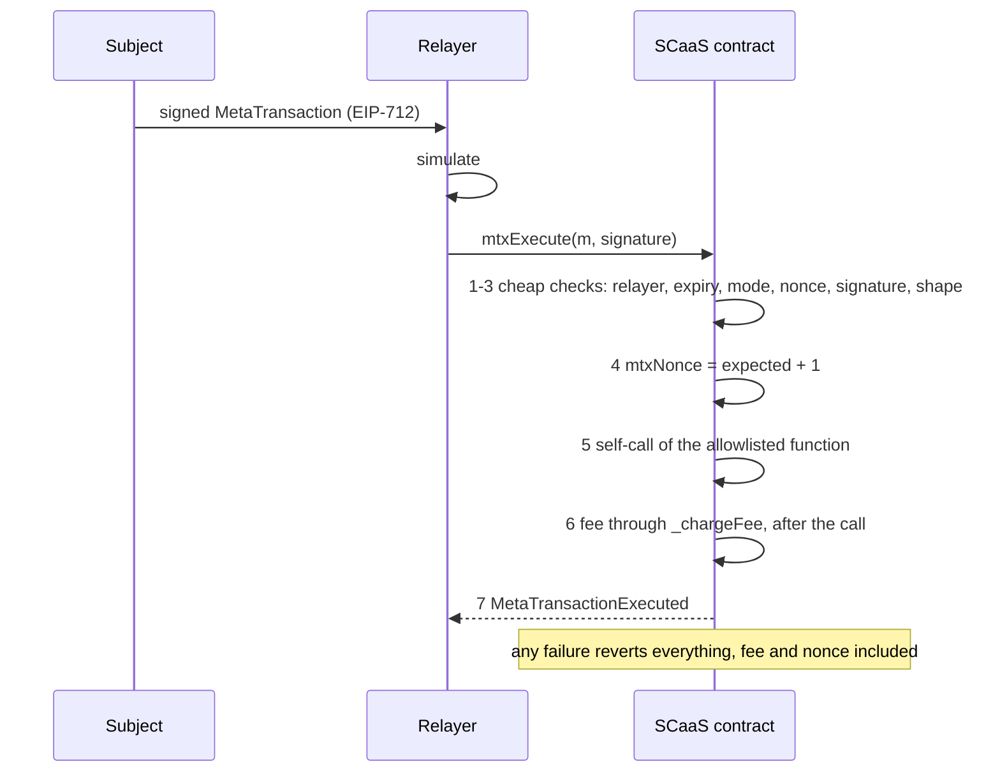
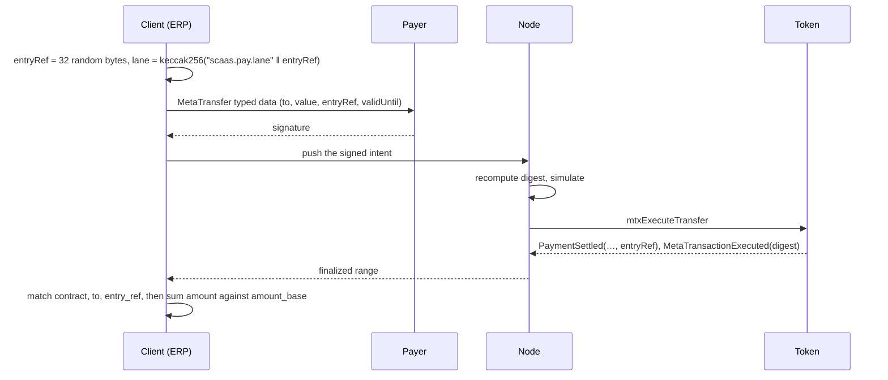

# Meta-transactions

Every SCaaS contract is gasless: the subject signs a call of one of the contract's functions, anyone may submit it,
and the submitter — usually a sponsor's or the company's relayer — pays the gas. A token transfer is a special case of
that call, not its definition (owner). This file specifies the EVM meta-transaction layer: the generic base
`MetaTxBase` that any SCaaS contract inherits (tokens, `MandateWallet`, `SmartKeyAccount`, and contracts built on SCaaS
later, such as a family-tree registry), and its token form `ERC20MetaTx` under the token kinds ([CTR-TOK-21](token-wrappers.md#CTR-TOK-21)), the Zether and
PQ Zether tokens and the Universal Account ledger path. Two signed structs: the generic `MetaTransaction` (a call of
an allowlisted function) and, on tokens, the typed `MetaTransfer` (transfer or payment). Other families implement the
same model natively ([networks/README.md](../networks/README.md)).

Status: the target layer of this file (two bases, two structs, the generic self-call `mtxExecute`, the typed
`mtxExecuteTransfer`, the selector allowlist, fee classes, `mtx` names, salted domains) is **BUILT**
(`smartcontracts/evm/src/metatx/`), receiver-pays too (`mtxPayReceiverFee`, P1b/P1c; its UA twin `uaPayReceiverFee`, UA-5a). The v1
line with its hand-written op dispatch left the build in P5 (`legacy/p5/`); how the tree was built is under
[Transitional (BUILT)](#transitional-built) at the end. Nothing is deployed outside test chains, so there is no version
coexistence and no migration.

**Contents**

1. [Native mixin, no forwarder](#1-native-mixin-no-forwarder)
2. [`MetaTransaction`, `MetaTransfer` and the pinned typehashes](#2-metatransaction-metatransfer-and-the-pinned-typehashes)
3. [`mode`: constraint flags and fee mode](#3-mode-constraint-flags-and-fee-mode)
4. [`mtxExecute`](#4-mtxexecute)
5. [`mtxExecuteTransfer`: transfers and payments (tokens)](#5-mtxexecutetransfer-transfers-and-payments-tokens)
6. [2D nonces and lanes](#6-2d-nonces-and-lanes)
7. [Pay-once horizon](#7-pay-once-horizon)
8. [Gas](#gas)
9. [FeePolicy](#9-feepolicy)
10. [Names](#10-names)
11. [Interfaces](#11-interfaces)
12. [Payers](#payers)
13. [Receiver-pays](#receiver-pays)
14. [Security](#security)
15. [Conformance](#15-conformance)
16. [Transitional (BUILT)](#transitional-built)

## 1. Native mixin, no forwarder

<a id="CTR-MTX-16"></a>**CTR-MTX-16** — Meta-transaction logic is embedded in every SCaaS contract (`MetaTxBase`,
[CTR-MTX-22](#CTR-MTX-22)), not in a forwarder. The subject signs EIP-712 typed data whose `verifyingContract` **is the
contract**, and the contract runs the signed call **on itself only**: `mtxExecute` calls one of the contract's own
allowlisted functions ([CTR-MTX-17](#CTR-MTX-17)); on a token, `mtxExecuteTransfer` moves this token's balance
(transfer, payment, [CTR-MTX-23](#CTR-MTX-23)). There is no ERC-2771 trusted forwarder (no
calldata sender suffix, no 63/64 gas rule, no return bomb, no swallow mode), no call **out** to another contract with
the signer's calldata, and no ERC-4337 bundler/paymaster dependency for token operations.

The signer travels in a
transient slot, never in calldata ([CTR-MTX-18](#CTR-MTX-18)); what may run is a fixed **selector** allowlist per
implementation ([CTR-MTX-19](#CTR-MTX-19)), never a target allowlist. A contract that does not support gasless
operation is wrapped into a meta-tx token (an `UnderlyingToken`, [token-wrappers.md](token-wrappers.md)); a generic forwarder is
never added. `MtxRelayFee` ([CTR-MTX-27](#CTR-MTX-27)) is not one: no target trusts it (each target checks its own
signer, as above), it calls targets from an unprivileged executor, and it only binds a token payment to a call that
anyone could submit directly. **All or nothing, and the user never pays for an operation that did not happen:** transfer and payment
check everything before the fee and cannot fail afterwards; a self-call runs **first** and pays its fee **after**
(so a wrap can pay from the units it mints), and any failure — of the call or of the fee transfer — reverts the whole
transaction with the inner revert data, fee and nonce included. No `try/catch`, no mode switch. Smart-contract wallets
(ERC-1271) are first-class signers.

<a id="CTR-MTX-14"></a>**CTR-MTX-14** — Signatures are EIP-712 typed data, never `personal_sign`: wallets display the
fields instead of 32 opaque bytes. The pinned typehash below is the only payment-intent type; there is no raw
`ecrecover` helper (it would not stop `s` malleability) — EOAs are verified with OpenZeppelin `ECDSA.tryRecover`
(65 bytes, low-s).

<a id="CTR-MTX-07"></a>**CTR-MTX-07** — **One meta-tx tree: `MetaTxBase`, `ERC20MetaTx`, `MetaTokenBase`.** The meta-transaction base of
every SCaaS EVM and Hedera token is the abstract contract `ERC20MetaTx` (P1b: a new file on `MetaTxBase`; `MetaTxCore` is removed, its text is in `legacy/`) on the
generic `MetaTxBase` ([CTR-MTX-22](#CTR-MTX-22)): it adds the fee in this token (`_chargeFee`, `FeePolicy`), the typed
`MetaTransfer` path (`mtxExecuteTransfer`, `mtxBatchTransfer`, [CTR-MTX-23](#CTR-MTX-23), [CTR-MTX-24](#CTR-MTX-24)),
`mtxTrade`/cancels ([dex.md](dex.md#CTR-DEX-15)), the allowance rule
([CTR-TOK-01](token-wrappers.md#CTR-TOK-01)) and the `ua*` Universal Account path ([CTR-UA-19](accounts.md#CTR-UA-19),
[CTR-UA-26](accounts.md#CTR-UA-26)).

The tree is `MetaTxBase → ERC20MetaTx → MetaTokenBase`
([CTR-TOK-21](token-wrappers.md#CTR-TOK-21)): `MetaTxBase` holds the `MetaTransaction`, nonce lanes, signature check
(`SigCheck`, [CTR-MTX-25](#CTR-MTX-25)), the transient sender and ticket, the selector allowlist and
`mtxExecute`/`mtxBatch`/`cancelNonce`; `ERC20MetaTx` holds the ERC-20, `MetaTransfer` (`entryRef`), the fee,
the approve rule and the UA ledger; `ERC20MetaTx` also holds trade (`TradeLib`: `mtxTrade`, `mtxCancelOrder`, `mtxInvalidateNonces`; [CTR-DEX-15](dex.md#CTR-DEX-15); built in P2a, controller ruling, pending the owner), so every kind has it; `MetaTokenBase` holds receiver-pays (`mtxPayReceiverFee`, beside `mtxPay` and
`payLane`, which it uses), pay behind `PAYABLE`
(inline: no external `PayLib` built, controller ruling pending the owner), features and roles (`AdminLib`), init and provenance.

Pay lives in `MetaTokenBase`, **not** in
`ERC20MetaTx`; trade lives in `ERC20MetaTx`. The kinds (`NoUnderlyingToken`, `UnderlyingToken`, and the two Zether kinds) sit on `MetaTokenBase`;
Hedera is the immutable `IS_HEDERA` ([CTR-TOK-23](token-wrappers.md#CTR-TOK-23)), not a child contract.
The v1 line (the built `ERC20MetaTxV1` mixin, `MetaToken`, `HederaMetaToken` and factory v1) is removed from the product; kept for reference under the tag `ref/pre-token-tree` and `smartcontracts/evm/legacy/` (not built): issuer tokens
use `NoUnderlyingToken`, 1:1 wrappers use an `UnderlyingToken` with one leg and `num = den = 1`; Zether's separate mixin
`ZetherMetaTx` disappears into the base, and so does `PqzToken`'s `PqzMetaTx` ([CTR-PQZ-21](pq-zero-knowledge.md#CTR-PQZ-21)).
One domain version, `"1"`, for every token.

<a id="CTR-MTX-25"></a>**CTR-MTX-25** — One internal `SigCheck` (ECDSA low-s, ERC-1271 with the gas-cap rule, the HIP-632
hook) is used by `MetaTxBase`, `SCaaSDex`, `MandateWallet` and `SmartKeyAccount`; `SigLib` is deleted.

<a id="metatxbase"></a>
<a id="CTR-MTX-22"></a>**CTR-MTX-22** — **`MetaTxBase`: the generic base of every SCaaS contract** (owner). It holds
the generic `MetaTransaction` ([CTR-MTX-15](#CTR-MTX-15)), its digest, the 2D nonces and `cancelNonce`, the transient
sender and the ticket ([CTR-MTX-18](#CTR-MTX-18)), the per-implementation selector allowlist with fee classes and
`mtxSelectors()` ([CTR-MTX-19](#CTR-MTX-19)), `mtxExecute` with its alias `executeMetaTransaction`, `mtxBatch`,
`chainUid()` and `supportedModes()`. The fee is a virtual `_chargeFee(from, basis, m)` that **reverts unless the fee
mode is `NONE`**; a contract that does not override it reports `supportedModes() = 0x03` (flags only).

Only a contract
that holds the charged balance overrides it — every token, through `ERC20MetaTx` ([CTR-MTX-07](#CTR-MTX-07)). A
contract outside the token set (`MandateWallet`, `SmartKeyAccount`, a family-tree registry built on SCaaS) inherits
`MetaTxBase`, declares its allowlist and its domain name, reads the caller through `_msgSender()` and accepts fee mode
`NONE` only: the relayer — a sponsor's node lane or the company's own — pays native gas, who may be sponsored is node
policy ([NODE-SPN-01](../node/sponsorship.md#NODE-SPN-01)) and the node's call table
([NODE-JOB-20](../node/job-api.md#NODE-JOB-20)), and any charge to the user is settled off chain. Why: a token
transfer is one kind of gasless call, not the only one (owner); a fee field the contract cannot collect would only
mislead signers.

**The generic UA path lives here too** (owner 2026-10-13, [CTR-UA-27](accounts.md#CTR-UA-27); SPECIFIED, UA-5c; BUILT
today in `ERC20MetaTx`): `uaExecute`, `uaBatch`, `uaCancelNonce`, `uaDigest`, `uaNonce`, the UA allowlist
(`_uaAllowed`), the used `metatx-cancel` digests and the UA registry as an implementation immutable (0 = off:
`UALedgerOff`) move down into `MetaTxBase`, so every contract on it — `MandateWallet`, a contract built on SCaaS —
takes UA signers. Its fee is a virtual `_chargeUAFee` that refuses every mode but `NONE` unless the contract overrides
it, as `_chargeFee`; a token overrides it to charge its UA ledger. The UA balances, `_uaMove`, `transferToUA` and the
typed `UAMetaTransfer` path stay in `ERC20MetaTx`. `SmartKeyAccount` inherits the path with registry 0 (off): it is
option (b), not a UA consumer.

## 2. `MetaTransaction`, `MetaTransfer` and the pinned typehashes

<a id="CTR-MTX-15"></a>**CTR-MTX-15** — **Two structs, one nonce space** (owner). `MetaTxLib.MetaTransaction` is the
generic signed call of **any** SCaaS contract: `data` is one call of one of the contract's own allowlisted functions
(a self-call, [CTR-MTX-17](#CTR-MTX-17)). `MetaTxLib.MetaTransfer` exists on tokens only and is the typed transfer or
payment that outside wallets display field by field ("send `value` to `to`") ([CTR-MTX-23](#CTR-MTX-23)).
`smartcontracts/evm/src/common/MetaTxLib.sol` is normative; a struct argument also keeps EIP-712 hashing clear of
Solidity's "Stack too deep" limit. The fee, where a contract charges one, is paid in **this** token (no `feeToken`
field: another token lies outside this contract and this contract holds no allowance of it; a contract that holds no
balance accepts fee mode `NONE` only, [CTR-MTX-22](#CTR-MTX-22)); there is no `innerGasLimit` (it only means something
for a forwarder that swallows failures); no opaque `op` + `args`; `mode` stays and is split into two nibbles.

```solidity
struct MetaTransaction {   // every SCaaS contract: a signed call of one of this contract's allowlisted functions
    address from;          // signer; the authority the call runs under
    bytes   data;          // a call of THIS contract, allowlisted selector
    uint256 batch;         // nonce dimension 1: lane
    uint256 nonce;         // nonce dimension 2: sequence inside the lane
    uint256 validUntil;    // unix seconds
    uint32  mode;          // constraint flags + fee mode
    address relayer;       // bound relayer when MODE_RESTRICT_RELAYER
    uint256 fee;           // only where the contract charges it (tokens); elsewhere fee mode NONE
    address feeRecipient;  // bound fee recipient when MODE_RESTRICT_FEE_RECIPIENT
}

struct MetaTransfer {      // tokens only: the typed transfer or payment; fields as above, plus:
    address from; address to; uint256 value;
    bytes32 entryRef;      // 0 = transfer; ≠ 0 = payment (PaymentSettled with this reference)
    uint256 batch; uint256 nonce; uint256 validUntil; uint32 mode; address relayer; uint256 fee; address feeRecipient;
}

bytes32 constant METATX_TYPEHASH = keccak256(
  "MetaTransaction(address from,bytes data,uint256 batch,uint256 nonce,uint256 validUntil,uint32 mode,"
  "address relayer,uint256 fee,address feeRecipient)");
bytes32 constant METATRANSFER_TYPEHASH = keccak256(
  "MetaTransfer(address from,address to,uint256 value,bytes32 entryRef,uint256 batch,uint256 nonce,"
  "uint256 validUntil,uint32 mode,address relayer,uint256 fee,address feeRecipient)");

hashStruct(m) = keccak256(abi.encode(METATX_TYPEHASH, m.from, keccak256(m.data), m.batch, m.nonce,
                                     m.validUntil, m.mode, canonRelayer, m.fee, canonFeeRecipient))
hashStruct(t) = keccak256(abi.encode(METATRANSFER_TYPEHASH, t.from, t.to, t.value, t.entryRef, t.batch, t.nonce,
                                     t.validUntil, t.mode, canonRelayer, t.fee, canonFeeRecipient))
digest        = keccak256(0x1901 ‖ domainSeparator(name, "1", chainId, contract, salt = chain_uid) ‖ hashStruct(·))
```

Both structs consume the **same** lane `mtxNonce(from, batch)`: a lane is spent once whichever struct spent it.
**One intent, one digest** ([CTR-MTX-11](#CTR-MTX-11)): a transfer or payment is signed only as a `MetaTransfer`; no
`transfer`/`pay` selector is ever allowlisted for `MetaTransaction`. `data` is always hashed (`keccak256(m.data)`) —
encoding dynamic bytes directly would break injectivity. Both typehashes are pinned by tests
(`test_metaTxTypehashIsPinned`, `test_metaTransferTypehashIsPinned`).

<a id="digest"></a>**One rule, four places.** `MetaTxLib.hashStruct` (Solidity, one per struct) is the reference. Three copies must
match it byte for byte: the client library's EIP-712 builder (the reference ERP client keeps it in
`lib/eip712.py`), `scaas-node` (an alloy `sol!` struct) and the typed-data JSON handed to the wallet (the wallet
hashes it itself). Canonical zeroing (`relayer`/`feeRecipient` = 0 when their flag is off) applies in all of them.

They are locked by known-answer vectors generated by forge (`vm.writeJson`):
`smartcontracts/evm/test/vectors/metatx_kat.json` (v3 `MetaTransaction`, `MetaTxBase`) and `metatransfer_kat.json` (`MetaTransfer`);
the v1 vector `metatx_v1_kat.json` is in `legacy/p5/` (P5), the two v3 vectors written by `TokenKat.t.sol` on a `NoUnderlyingToken` clone, each with domain (with `salt`), struct, `structHash`, digest and the signature of key `0xA11CE`; the `MandateWallet` and
`SmartKeyAccount` vectors are `MetaTransaction` vectors in their own domains (`mandate_pay_kat.json`, `mandate_revoke_kat.json`, `smart_key_account_kat.json`, P4). The contract, node and client tests read
the same files; changing a typehash turns three tests red. Clients decode `MetaTransaction.data` against the
contract's published allowlist (`mtxSelectors()`) and show the selector and its arguments before asking for a
signature; a `MetaTransfer` shows its typed fields.

<a id="CTR-MTX-02"></a>**CTR-MTX-02** — The EIP-712 domain of a clone is the implementation's name and version plus
`verifyingContract` = the clone and `salt` = the chain's `chain_uid`: `("SCaaS MetaToken", "1", chainId, clone,
chain_uid)` for every kind, `("SCaaS ZetherToken", "1", chainId, clone, chain_uid)` for Zether; every other SCaaS
contract on `MetaTxBase` uses `("SCaaS <Contract>", "1", chainId, contract, chain_uid)` (e.g. `"SCaaS MandateWallet"`,
`"SCaaS SmartKeyAccount"`; a contract built on SCaaS names its own); both structs of a contract share its domain; `eip712Domain()`
(ERC-5267) reports fields `0x1f`. `chain_uid` is the implementation's constructor immutable, so a clone (which runs the
implementation's code by `DELEGATECALL`) uses it with no storage and cannot declare another value
([CTR-GEN-05](README.md#CTR-GEN-05)). There is no cross-token replay because `verifyingContract` differs, and no
cross-chain replay because `chainId` and `salt` differ. Clients read the domain through `eip712Domain()` and store
`domain_name`/`domain_version` per token (`domain_name/version`); they fill `salt` from the chain profile and refuse a
token whose `chainUid()` differs. The cost: wallets show "SCaaS MetaToken" rather than the token's own name (they read
`name()` for that).

## 3. `mode`: constraint flags and fee mode

```text
bit  31 ........................ 8 | 7  6  5  4 | 3  2  1  0
     reserved (must be 0)           | FEE MODE   | FLAGS
```

| Name | Value | Kind | Meaning |
|---|---|---|---|
| `MODE_OPEN` | `0x00` | — | No constraints, no fee |
| `MODE_RESTRICT_RELAYER` | `0x01` | flag | Only `msg.sender == m.relayer` may execute |
| `MODE_RESTRICT_FEE_RECIPIENT` | `0x02` | flag | The fee must go to `m.feeRecipient` |
| bits 2–3 | `0x04`, `0x08` | flags | Reserved, must be 0 |
| `MODE_FEE_NONE` | `0x00` | enum (bits 4–7) | No fee |
| `MODE_FEE_PERCENT` | `0x10` | enum | `fee` in ppm of the fee basis ([CTR-MTX-20](#CTR-MTX-20)) |
| `MODE_FEE_FIXED` | `0x20` | enum | `fee` in token units |
| `MODE_FLAGS_MASK` / `MODE_FEE_MASK` / `MODE_KNOWN_MASK` | `0x0F` / `0xF0` / `0xF3` | masks | `supportedModes()` returns `0xF3` on tokens, `0x03` on a contract that charges no fee ([CTR-MTX-22](#CTR-MTX-22)) |

The low nibble holds independent **flags** (`mode & FLAG`); the high nibble holds an **enumerated** fee mode
(mutually exclusive, mask + shift). `mode & MODE_FEE_PERCENT` is a bug (a future value `0x30` would contain bit
`0x10`); use `feeModeOf(mode)` (values 0/1/2, otherwise `ModeFeeInvalid`). `validateMode` checks both unknown flag
bits (`ModeUnknownBits`, surfaced as `MetaTxUnknownMode`) and fee values above 2: accepting `0x30` today would freeze
its meaning through signatures already issued. `FeeMode` stays the canonical type of `FeePolicy`; only the separate
struct field was dropped. `mode` is part of the hash, so a bitmask creates no cross-mode replay.

**Canonical zeroing:** when `MODE_RESTRICT_RELAYER` is off, `relayer` is hashed as `address(0)`; when
`MODE_RESTRICT_FEE_RECIPIENT` is off, `feeRecipient` is hashed as `address(0)` (`MetaTxLib.canon`). The struct keeps
both fields (removing them would change the typehash). The rule is identical in contract, node and client libraries.

**Submitter normalization.** Unbound fields are not signed, yet the token pays a non-zero `m.feeRecipient`, so
every submitter rewrites unbound fields before it builds the outer transaction: unbound
`feeRecipient := chains.fee_recipient` (the operator's cold wallet) or `0` (then the fee goes to `msg.sender`, the
lane); unbound `relayer := 0`. Wire values of unbound fields are never submitted; the `intent_id` is unchanged
([NODE-LANE-10](../node/submit-lanes.md#NODE-LANE-10)).

## 4. `mtxExecute`

<a id="execution-pipeline"></a>
<a id="CTR-MTX-17"></a>**CTR-MTX-17** — **`mtxExecute` runs the signer's calldata on the contract itself** (owner).
One entry point serves every subject-signed call of a SCaaS contract; `data` is always a self-call of an allowlisted
function (transfers and payments are `MetaTransfer`s, [CTR-MTX-23](#CTR-MTX-23)). `executeMetaTransaction` is its alias
under the EIP-1776 name for outside tools and returns `bool` (the return type that tender and other integrators
decode); only `mtxExecute` returns the inner call's bytes.

```solidity
function mtxExecute(MetaTransaction calldata m, bytes calldata signature) external returns (bytes memory ret);
function executeMetaTransaction(MetaTransaction calldata m, bytes calldata signature) external returns (bool); // alias
```

The flow from signature to event:



The pipeline is one transaction, all or nothing; cheap checks first, so a relayer that loses a race pays only the
prefix:

| Step | Check / action | Error |
|---|---|---|
| 1 | `MODE_RESTRICT_RELAYER` ⇒ `msg.sender == m.relayer`; `block.timestamp ≤ m.validUntil`; `validateMode(m.mode)`; `m.nonce == mtxNonce(from, batch)`; the fee-recipient binding; `from ≠ address(this)` (the `_selfSender` hook; overridden by `SmartKeyAccount`, which signs as itself, [CTR-ACC-10](accounts.md#CTR-ACC-10)) | `MetaTxUnauthorizedRelayer`, `MetaTxExpired`, `MetaTxUnknownMode`, `MetaTxBadNonce(expected, got)`, `SelfSender()` |
| 2 | Signature over the digest (`_hashTypedDataV4(hashStruct(m))`) through the virtual `_requireValidSignature`: EOA ⇒ `ECDSA.tryRecover` (65 bytes, low-s); contract ⇒ ERC-1271 `isValidSignature` staticcall (50 000 gas; 400 000 for `SmartKeyAccount` clones, which verify P-256 in Solidity when no precompile, [CTR-ACC-05](accounts.md#CTR-ACC-05)) | `MetaTxBadSignature` |
| 3 | Shape: `data.length ≥ 4`; `bytes4(data)` allowlisted; `data.length` equals the selector's static ABI length where it has one; the fee mode is allowed by the selector's fee class ([CTR-MTX-20](#CTR-MTX-20)) and by `supportedModes()` | `MtxSelectorNotAllowed(bytes4)`, `MtxDataShape(bytes4)`, `MtxFeeClass(bytes4, uint32 mode)`, `MetaTxUnknownMode` |
| 4 | Write `mtxNonce = expected + 1` | — |
| 5 | Execute: store the ticket (`sender = from`, `ticket = 1`, `binding = envelopeBinding(m)`), `address(this).call(data)`, clear the ticket, sender and binding (the binding is written on every self-call, 0 included, and cleared on exit, so a `mtxBatch` item never reads the previous item's; review C5-5); a failed call reverts **with its revert data** | inner errors, bubbled raw |
| 6 | Fee through `_chargeFee`, **after** the call: a token transfers it from `from` in this token; any other contract has already refused every mode but `NONE`; a failing fee transfer reverts everything | ERC-20 errors |
| 7 | Emit `MetaTransactionExecuted(from, relayer, batch, nonce, digest, feeRecipient, fee)` (the selector is in the transaction input) | — |

No error is swallowed: the user never pays for an operation that did not happen. The relayer simulates before
broadcasting and bears gas only for a transaction whose state changed between simulation and inclusion; the node's
breaker per `(from, selector)` covers repeat offenders ([node/submit-lanes.md](../node/submit-lanes.md)).

<a id="CTR-MTX-18"></a>**CTR-MTX-18** — **The signer travels in a transient slot, and one ticket admits exactly one
self-call.** Transient slots `keccak256("scaas.mtx.guard")`, `"scaas.mtx.sender"`, `"scaas.mtx.ticket"`,
`"scaas.mtx.binding"` (written as literals: assembly takes no `keccak256` constant). One contract-wide guard covers
every entry point — every state-changing `external` function of a contract on `MetaTxBase` is `nonReentrant`, the
pay (`payWithFee`, `payWithFeeToUA`), mint, role, owner, rate and guardian functions included (review W-Q,
2026-10-19), except `initialize` (factory-only, once) and the plain ERC-20 `transfer`, `approve` and `transferFrom`,
which make no outside call (the `UnderlyingZetherToken` / `UnderlyingPqzToken` overrides of `disableFeature` and
`executeRate` carry it too since the 5g integration); `nonReentrant` admits the self-call of step 5 once and consumes the ticket:

```solidity
modifier nonReentrant() {
    if (tload(GUARD) != 0) {
        // the one self-call issued by step 5 may enter, once
        if (msg.sender != address(this) || tload(TICKET) != 1) revert Reentrancy();
        tstore(TICKET, 2);            // consumed: any further entry reverts, whoever calls
        _;
    } else {
        tstore(GUARD, 1); _; tstore(GUARD, 0);
    }
}
```

`_msgSender()` returns the stored sender when `msg.sender == address(this)` and the ticket is live, else
`msg.sender`; the ticket is live while it is non-zero (1 before the guarded entry, 2 inside the allowlisted body), so an
allowlisted body must never call `this` or forward calldata (anything it reaches through `this` sees the signer). The signer is never read from calldata, so no function can be fooled by 20 trailing bytes, and the only
self-call path is step 5. Every allowlisted function is `nonReentrant` (a test pins it), so the one entry always
consumes the ticket, a re-entry from an underlying's hook during the self-call reverts (`msg.sender` is the underlying,
or the ticket is spent), and no allowlisted function runs with a live ticket; `mtxBatch` sets a fresh ticket per item.

Authority and balance owners are read through `_msgSender()` everywhere; the reads that **stay** `msg.sender` are
exactly: the relayer binding, the default fee recipient and the event `relayer` of the pipeline; the factory check in
`initialize`; `mtxTrade`'s and `uaTrade`'s `msg.sender == o.dex` ([CTR-DEX-15](dex.md#CTR-DEX-15),
[CTR-DEX-25](dex.md#CTR-DEX-25)); and `mtxWrap`'s and `uaWrap`'s relayer binding and fee payee
([CTR-TOK-20](token-wrappers.md#CTR-TOK-20); the `ua*` reads BUILT, UA-5b). A lint test greps the sources and pins that set
(`MsgSenderLint`, as of UA-5b: `msg.sender` appears 8 times in `ERC20MetaTx` — the event relayer ×3, the default fee
recipient ×3, the `mtxTrade` and `uaTrade` callers —, 4 times in `UnderlyingToken` for the `mtxWrap` and `uaWrap`
submitter, never in `TradeLib`, whose caller is a parameter). Defence in
depth: `from ≠ address(this)` (step 1), and `_update` refuses transfers and mints **to** `address(this)`
(`TransferToSelf()`), because tokens parked at the token's own address are what a spoofed self-call would spend.

<a id="CTR-MTX-19"></a>**CTR-MTX-19** — **A fixed selector allowlist per implementation** (owner). Each implementation
declares its allowlist as constants — exact selectors, overloads listed one by one, each with a fee class — and
publishes it through `mtxSelectors() returns (bytes4[] selectors, uint8[] feeClass, uint8[] amountArg)`; a test pins
it. Nothing else is reachable through `mtxExecute`.

**General rule (owner 2026-10-20): every state-changing `mtx*` function is relayable, even with no fee.** It is either itself
a meta-tx entry point (`mtxExecute`, `mtxBatch`, `mtxTransfer`, the named builders that carry their own signature, `mtxPay` / `mtxPayMeta` and their `ua*` twins included: none of these is in `mtxSelectors()`) or an
allowlisted self-call whose outer fee may be 0 (`NONE` or `FIXED` 0). So the confidential tokens list their roll-overs
(Zether: `mtxRollOver`, `mtxRollOverBatch`, `mtxRollOverSigned`, `mtxSetRollOverMode`; PQZ: `mtxRollOver`, `mtxPrepareAcc`), whatever
the function's own authority is (none, or an owner signature checked inside). BUILT for the confidential tokens, commit `b5e61c96`.
**One exception (review C0-18, controller proposal 2026-10-27, owner may override):** `mtxWrapShield` with the native coin as the leg is not relayable. It is
`payable` and takes the leg from `msg.value`, and a relayer cannot supply the signer's native coin (the self-call carries no value). The holder
wraps directly, then relays `mtxShield`; an ERC-20 leg is relayable. A value-carrying relay path (payable
envelope, `msg.value` bound to the authorization, relayer reimbursed) was the other option and is not built.

| Implementation | Self-call selector | Fee class |
|---|---|---|
| every token | `cancelNonce(uint256)` | `ABSOLUTE` |
| `NoUnderlyingToken` | `burn(uint256)` | `AMOUNT(0)` |
| `UnderlyingToken` | `wrap(uint256)` (fee from minted units; reverts `UnderlyingRequired` unless one leg) | `ABSOLUTE` |
| | `unwrap(uint256,address,uint256)` (reverts `UnderlyingRequired` unless one leg) | `AMOUNT(0)` |
| | `wrap(address,uint256)` | `ABSOLUTE` |
| | `unwrap(address,uint256,address,uint256)` | `AMOUNT(1)` |
| | `addReserve(address,uint256)` | `ABSOLUTE` |
| | `wrapToUA(address,uint256,bytes32)` (BUILT, UA-5a; [CTR-UA-28](accounts.md#CTR-UA-28)) | `ABSOLUTE` |
| | `unwrapToUA(address,uint256,bytes32,uint256)` (BUILT, UA-5a; also on the UA allowlist) | `AMOUNT(1)` |
| `NONE_ZETHER` / `UNDERLYING_ZETHER` (built, P3) | the kind's public entries (`burn`; or `UnderlyingToken`'s six, without `unwrap(uint256,address)`) | as above |
| | `mtxShield(bytes32,uint256)`, `mtxWrapShield(address,uint256,bytes32)` (`UNDERLYING_ZETHER`) | `ABSOLUTE` |
| | `mtxConfidentialTransfer`, `…Compact`, `…Single` (`…NoBundle` retired: review C0-3) `(bytes payload,bytes proof,bytes auth,bytes32 beneficiary,bytes accHint)`, `mtxUnshield(…, uint256 amount, bytes32 recipient)`, `mtxUnshieldUnwrap` (the shared signature of the 5h interface, [CTR-ZTH-45](zether.md#CTR-ZTH-45); Zether takes empty `auth` and `accHint`) | `ABSOLUTE`; envelope binding through the ticket ([CTR-ZTH-34](zether.md#CTR-ZTH-34)) |
| | `mtxUnshield` / `mtxUnshieldUnwrap` with a derived-UA recipient (one selector each; the former `…ToUA` names are gone; BUILT, plan 5h Task 3b, [CTR-ZTH-51](zether.md#CTR-ZTH-51)) | `ABSOLUTE`; envelope binding as above |
| `PqzToken` | `mtxConfidentialTransfer`, `…Compact`, `…Single`, `…SingleCompact` `(bytes payload,bytes proof,bytes auth,bytes32 beneficiary,bytes accHint)`, `mtxUnshield(…, uint256 amount, bytes32 recipient)`, `mtxShield(bytes32,uint256)` (`UNDERLYING_PQZ`: also `mtxWrapShield`, `mtxUnshieldUnwrap`); `mtxRollOver` and `mtxPrepareAcc` too (Task R) | `ABSOLUTE`; not batchable ([CTR-PQZ-21](pq-zero-knowledge.md#CTR-PQZ-21)) |
| `MandateWallet` | delegate: `payUnderMandate(address,address,uint256,bytes32,uint64)`, `revoke(address,uint64)`; owner: `setMandate`, `setPayee`, `revoke(address)`, `execute` ([CTR-ACC-06](mandates.md#CTR-ACC-06)) | fee `NONE` only |
| `SmartKeyAccount` | `addKey`, `removeKey`, `rotateKey`, `setGuardian`, `cancelRecovery`, `execute`, signed by the account itself ([CTR-ACC-10](accounts.md#CTR-ACC-10)) | fee `NONE` only |

Transfer and payment are `MetaTransfer`s ([CTR-MTX-23](#CTR-MTX-23)); neither `transfer` nor `pay` is ever
allowlisted, so one transfer has one encoding and one digest. `UnderlyingToken`'s two-argument `unwrap(uint256,address)` is not listed (the same intent with a
second digest and no `minOut`). **Never allowlisted:**
`approve` and `transferFrom` (contract accounts approve and spend through their own call path,
[CTR-TOK-01](token-wrappers.md#CTR-TOK-01)); every role function — `mint`, `mintToUA`, the `ITokenAdmin` functions (`grantRole`, `revokeRole`, `renounceRole`, `disableFeature`, the ownership functions), `proposeRate`,
`cancelRate`, `executeRate`, `disableWrap` (role holders act through their own
contract, [NODE-JOB-01](../node/job-api.md#NODE-JOB-01); a signature check would skip a minter contract's caps or a
Safe's guards; the holder still acts gaslessly through its own contract account, [CTR-UA-27](accounts.md#CTR-UA-27)); `transfer` and `pay` (they are `MetaTransfer`s); `payWithFee` and `payWithFeeToUA` (they charge their own fee); `mtxExecute`, its alias and every other `mtx…` entry
(no nesting); `initialize`; views; Zether `mtxRollOverSigned`/`mtxSetRollOverMode` (they carry their
own signature). For selectors with dynamic arguments (Zether) the contract cannot cheaply pin one encoding: the node
re-encodes the decoded arguments and refuses non-canonical `data` before it computes the mesh `intent_id`; a
non-canonical duplicate on chain is harmless, because only the signer can produce one (`data` is signed) and the
sequential nonce lets only one variant execute.

<a id="CTR-MTX-12"></a>**CTR-MTX-12** — **Gasless unwrap** is `mtxExecute` with the wrapper's real `unwrap` calldata:
`unwrap(uint256 wrapped, address recipient, uint256 minOut)` on `UnderlyingToken` with one leg, `unwrap(address underlying,
uint256 wrapped, address recipient, uint256 minOut)` with one or several legs, `unwrap(uint256, address)` (public
balance) on `UNDERLYING_ZETHER` (built in P3 with `UnderlyingToken`'s `minOut` forms only). The function runs exactly as a direct call by `from` (checks, burn
`⌈out·q⌉`, reserve debit, the underlying's exact-amount transfer, `Unwrapped`), and `minOut` protects the signer
against rate moves between signing and execution. Its fee class is `AMOUNT` with the wrapped amount as basis, taken
in wrapped units after the call. The underlying's transfer failing reverts everything, fee and nonce included. The fee
never goes to the payee rule does not apply (there is no payee). Fee-on-transfer-out underlyings stay unsupported. It
works on disabled multi-underlying legs (exits stay open) and during a pending rate change (at the current rate). The
node side (simulation, no batching, the narrowed grief exemption) is
[NODE-LANE-22](../node/submit-lanes.md#NODE-LANE-22).

## 5. `mtxExecuteTransfer`: transfers and payments (tokens)

<a id="CTR-MTX-23"></a>**CTR-MTX-23** — **The typed path: `mtxExecuteTransfer(MetaTransfer t, bytes sig)`** (owner). A
token's transfer and payment are signed as a `MetaTransfer` ([CTR-MTX-15](#CTR-MTX-15)) so outside wallets show
"send `value` to `to`" field by field, and they run through their own pipeline in `ERC20MetaTx`; the named functions
build the same struct ([CTR-MTX-09](#CTR-MTX-09)). `mtxExecuteTransfer` takes the struct as given — any lane, either
shape — and returns `bool`. Steps, all or nothing and cheap first as [CTR-MTX-17](#CTR-MTX-17):

| Step | Check / action | Error |
|---|---|---|
| 1 | as [CTR-MTX-17](#CTR-MTX-17) step 1 on `t` (`from ≠ address(this)` always) | as there |
| 2 | signature over the `MetaTransfer` digest, as step 2 there | `MetaTxBadSignature` |
| 3 | `to ≠ 0`, `to` and a non-zero fee's recipient ∉ {`UA_POOL`, `SHIELD_POOL`} (before the nonce, as the UA twin; review C5-3); fee on `value` (`FeePolicy.compute`, `validateRecipient`, the payee check of [CTR-MTX-08](#CTR-MTX-08) with payee = `t.to`; `to`, fee recipient ≠ the token); balance ≥ value + fee | `PayToZero`, `TransferToSelf`, `UAPoolNotPayable`, `ShieldPoolNotPayable`, `FeeExceedsCap`, `FeeRecipientRequired`, `FeeRecipientIsPayee`, `MetaTxInsufficientForFee` |
| 4 | write `mtxNonce = expected + 1` | — |
| 5 | transfer the fee, then the value (cannot fail after step 3); `entryRef ≠ 0` ⇒ `PaymentSettled(from, to, value, feeAmount, feeRecipient, entryRef)` | — |
| 6 | `MetaTransactionExecuted(from, relayer, batch, nonce, digest, feeRecipient, fee)` | — |

These are the transfer and `pay` shapes of the earlier single struct, moved out of `data` into typed fields.

<a id="CTR-MTX-01"></a>**CTR-MTX-01** — A payment is a `MetaTransfer` with `entryRef ≠ 0` (`entryRef` = the payment
reference, [CTR-MTX-03](#CTR-MTX-03)), run through `mtxExecuteTransfer` or built by `mtxPay`
([CTR-MTX-10](#CTR-MTX-10)) and `mtxPayReceiverFee` ([CTR-MTX-05](#CTR-MTX-05)); `entryRef = 0` is a plain transfer.
One pinned struct per intent means one type that wallets display. It emits `PaymentSettled(from, to, value, feeAmount,
feeRecipient, entryRef)` with the real fee. Tender's deposit ([CTR-TND-01](tender.md#CTR-TND-01)) is this shape.

<a id="CTR-MTX-24"></a>**CTR-MTX-24** — **`mtxBatchTransfer(MetaTransfer[] ts, bytes[] sigs)`** is the batch of the
typed path, beside `mtxBatch` for `MetaTransaction`s, with the rules of [CTR-MTX-11](#CTR-MTX-11): atomic, items in
order, `msg.sender` the relayer of every item, `ts.length == sigs.length` (`MtxBatchLengthMismatch`), `≥ 1`
(`MtxBatchEmpty`), no explicit cap, items of one token. A batch never mixes the two structs; the node batches
payments through it ([NODE-LANE-11](../node/submit-lanes.md#NODE-LANE-11)).

## 6. 2D nonces and lanes

Storage `_metaNonce[from][batch]` (BUILT: keyed by `bytes32`, a native address zero-padded, shared with the UA
ledger's `ua*` path, [CTR-UA-26](accounts.md#CTR-UA-26)); an intent — a `MetaTransaction` or a `MetaTransfer` — is valid iff its `nonce ==
mtxNonce(from, batch)`; execution increments it. Both structs share the one map. Independent lanes remove head-of-line blocking between agents and between business flows of the same subject.

| Lane derivation | Rule | Status |
|---|---|---|
| Payment request | `batch = keccak256("scaas.pay.lane" ‖ entryRef)`, `nonce = 0` ⇒ each request is payable at most once and the client can build typed data without reading the chain; `mtxPay` derives the same lane on chain (`payLane(payId)`) | **BUILT** |
| Agent × purpose | `batch = uint256(keccak256(agentId ‖ purpose))` (e.g. procurement settlement, logistics milestones, payout distribution, treasury rebalance), sequential nonce inside | **SPECIFIED** (client convention) |
| Non-EVM | `(subject, lane: bytes32) → nonce: u64` in the subject's account object/wallet/PDA | **BUILT** |

`cancelNonce(batch)` increments `mtxNonce[sender][batch]` by one and so invalidates the one intent signed for the
current nonce, including a copy circulating on the mesh, without a dummy transfer. It is not a lane reset: with
intents E5 and E6 signed ahead, one cancel kills E5 and makes E6 executable at once, so k pending intents need k
cancels (every intent is signed and bounded by its `validUntil`). It emits `MetaNonceCancelled(from, batch,
newNonce)`. It is a direct call **or** a signed self-call through `mtxExecute` on another lane (so a subject without
gas can cancel). First use of a lane costs ≈ +17 k gas on the pre-Amsterdam figures (a new storage slot); under Amsterdam (EIP-8038 write prices, EIP-8037 state gas) it is ≈ +98 k (§8). An anti-lock test is mandatory per family:
X stuck on contract 1 never blocks Y on contract 2 ([networks/README.md](../networks/README.md#head-of-line)). Trade
orders have their own **order lane** (`minNonce`, [CTR-DEX-15](dex.md#CTR-DEX-15)); clients label the two.

<a id="entryref"></a>
<a id="CTR-MTX-03"></a>**CTR-MTX-03** — **Payment references.** `entryRef` is 32 random bytes; the lane of a
payment request is `keccak256("scaas.pay.lane" ‖ entryRef)` with nonce 0. A random value is unlinkable by
construction (better than a salted hash of business data) and needs no salt management; a fixed lane per request
lets the client build typed data without reading the chain and makes each request payable at most once (under
[CTR-MTX-04](#CTR-MTX-04)). Accepted cost: the first use of the lane costs +17 k gas on the pre-Amsterdam figures (`MetaTxGas`) and ≈ +98 k under Amsterdam (`MetaTxGasV2`: 178,157 against 80,249 for a warm lane, §8), and `mtxPay`, which always opens a fresh lane, ≈ 182 k in all (181,810).
Tokens also derive the lane on chain ([CTR-MTX-10](#CTR-MTX-10)).

```text
entryRef = 32 bytes from a CSPRNG                     # carries no information; unlinkable by construction
batch    = keccak256("scaas.pay.lane" ‖ entryRef)     # lane of this request (on chain: payLane(entryRef))
nonce    = 0
```

- One `entryRef` per **payment request** (an invoice may have several requests over time; each request is payable at
  most once because its lane has nonce 0).
- Pay-once holds only if every signature a client issues on a pay lane has `validUntil ≤ t_first_issue + 30 d`.
  Re-issuing terms on the same lane later than that, or signing an op with `valid_until > now + 30 d` on a pruning
  family (GRAM, Aptos, Solana, Sui), gives no pay-once guarantee — issue a new request (new `entryRef`, new lane)
  instead. Wallet connectors and `clientkeys` refuse such ops.
- The client stores `entryRef` with a UNIQUE constraint on the request, together with `chain`, `token`,
  `receiving_address`, `payer_address` (locked at start), `amount_base`, `issued_valid_until`.
- Do **not** derive `entryRef` from business identifiers (`keccak256(company ‖ move ‖ amount ‖ salt)` as in older
  drafts): a random value needs no salt management and cannot be brute-forced from known invoice numbers.
- Splitting: classical Zether with `n_v = 64` removed the need to split large payments; for transparent tokens one
  payment per request. If a business case needs partial payments, issue one request (one `entryRef`) per
  instalment.



Two-way verification. **Client → chain** (before signing and at push): (1) the `MetaTransfer` typed data is built server-side
from the request: `to = receiving_address`, `value = amount_base`, `entryRef`, `batch` as above, `validUntil =
issued_valid_until` (server-chosen, e.g. now + 300 s); (2) after signing the client recomputes the digest; a 65-byte
signature must recover `payer_address` (EOA); a contract wallet (ERC-1271) is accepted unverified and judged by the
node's simulation; (3) the node recomputes the digest and simulates before broadcast.

**Chain → client** (on each
finalized range): (1) filter `PaymentSettled` by `contract == request.token` **and** `from == request.payer_address` **and** `to == request.receiving_address`
**and** `entry_ref == request.entryRef`; (2) `amount_settled = Σ amount` of matching events; `amount_settled ≥
amount_base` ⇒ request final; more than due ⇒ final + needs attention (refund manually); less ⇒ partial; (3)
cross-check `MetaTransactionExecuted(digest)` to mark the job final; (4) drift checks: an unmatched inbound
`Transfer` to a watched wallet ⇒ a drift record; hourly `balances` vs the ledger balance of the token's journal. A
third party paying 1 unit with someone else's `entryRef` is not counted at all (`from` is not the request's payer), so it can neither complete a request nor push it into "needs attention";
it is just money received (review C5-10: one rule, the key `(token, payer, payee, entryRef)`, in every document). The full client procedure is in
[integration.md](../integration.md#payment-references).

## 7. Pay-once horizon

<a id="CTR-MTX-04"></a>**CTR-MTX-04** — **Pay-once is conditional and is a protocol rule.** "Each payment request is
payable at most once" holds iff (1) every signature issued on a pay lane has `validUntil ≤ t_first_issue + H`,
`H = LANE_HORIZON = 30 d`, and (2) every family that prunes lane state keeps an executed lane for ≥ `H` after the
executed op's `validUntil` ([NET-ALL-01](../networks/README.md#NET-ALL-01): GRAM two `LANE_TTL` generations; Aptos and
Solana `PRUNE_DELAY_S`; Sui `prune` after `valid_until + LANE_HORIZON_S`). Issuers that sign terms on a lane beyond
`H` get no pay-once guarantee; a node chain on a pruning family must have `max_valid_for_secs ≤ H`. Obligations:

| Who | Obligation | Status |
|---|---|---|
| Issuer (ERP, app) | Sign one op per pay lane, or keep every op on that lane inside `H` of the first; terms signed beyond `H` get no pay-once guarantee | reference ERP client complies (**BUILT**) |
| Every signing client (connectors, `clientkeys`, app) | Refuse to sign an op with `valid_until > now + LANE_HORIZON_S` on a pruning family ([NET-APT-24](../networks/aptos.md#NET-APT-24), [NET-SOL-25](../networks/solana.md#NET-SOL-25), [NET-SUI-12](../networks/sui.md#NET-SUI-12)) | **SPECIFIED** |
| Contract | Sui `relay_pay` refuses `valid_until > now + LANE_HORIZON_S` on chain; Solana caps `valid_until` and order `expiry` at `MAX_TTL_S = 31 d` ([NET-SOL-22](../networks/solana.md#NET-SOL-22)) | **SPECIFIED** |
| Node | Refuses `max_valid_for_secs > LANE_HORIZON` on a pruning family ([NODE-STO-01](../node/store.md#NODE-STO-01)); constants pinned equal in tests (GRAM `LANE_TTL`, Aptos/Solana `PRUNE_DELAY_S`, node `LANE_TTL_S`, client `LANE_HORIZON_S`) | **SPECIFIED** |

## <a id="gas"></a>8. Gas

<a id="gas"></a>Measured gas of the **built v1 path** (Foundry `MetaTxGas.t.sol`, `evm_version = prague`, execution
gas; full-transaction `gasUsed` from receipts after deploying the same contracts on the private Nethermind reference
chain, Nethermind 1.39.0, Fusaka + BPO2; 2026-08-31). Transfer and payment keep this path's work in the target
pipeline; the table is re-measured when the base changes. **These rows predate Amsterdam** (review C5-9); the Amsterdam rows follow the table:

| Scenario | Execution gas | Full tx gas |
|---|---|---|
| Warm lane, `MODE_OPEN`, no fee | 35 241 | 58 702 |
| New lane (nonce 0 → 1), no fee | 52 341 | 75 802 |
| Warm, `FIXED` fee | 43 565 | 67 362 |
| Warm, `PERCENT` fee | 43 511 | 67 260 |
| Warm, `FIXED` + restricted relayer + fee recipient | 43 763 | 67 560 |
| Warm lane, recipient that never held the token | 52 341 | — |
| ERC-1271 signature (trivial verifier), new lane | 54 530 | — |
| `cancelMetaNonce` (new lane) | 27 579 | — |
| Baseline ERC-20 `transfer` | 20 081 | 41 181 |
| Outer-transaction calldata | 580 B → 4 180 gas (425 zero / 155 non-zero bytes) | |

Derived: envelope = warm meta-tx − baseline = **+15 160** execution gas (≈ 17.5 k full tx), first use of a lane
**+32 260**, ERC-1271 path **+2 189** (a floor: a real Safe or passkey wallet adds its own verification), collecting a
fee **+8 324**, `PERCENT` vs `FIXED` **−54**, both restrictions **+198**. A gasless public transfer therefore costs
1.76 × a plain transfer, and the fee transfer is the most expensive part of the envelope after the signature — the
fee-0 sponsored path is the cheapest configuration. Method notes: one scenario per test function (EIP-2929 warm
state carries over inside one test), and accounts are created and funded in `setUp`; a gas measurement that changes
with execution order measures the access list, not the code.

**Amsterdam (Foundry 1.8.5 `isolate`, each call its own transaction: intrinsic gas, the EIP-7976 calldata floor, EIP-8038 write prices and EIP-8037 state gas for a new slot; the bounds in `test/v2/MetaTxGasV2.t.sol`, `AMS_*`).** Total gas per transaction, in the table's order: warm lane, `MODE_OPEN`, no fee 80,249 (A); new lane 178,157 (B); warm `FIXED` fee 95,950 (C); warm `PERCENT` fee 95,889 (D); warm `FIXED` + restricted relayer and fee recipient 95,993 (E); warm lane, recipient that never held the token 178,157 (F); ERC-1271, new lane 174,814 (G); the pay op on a fresh lane 181,810 (P). The first write of a lane therefore costs ≈ 98 k (178,157 − 80,249), not +17 k to +32 k (the same step prices the first credit of a new recipient, F). No contract reads these numbers.

## 9. FeePolicy

<a id="CTR-MTX-13"></a>**CTR-MTX-13** — Public fee modes are `NONE`, `PERCENT` and `FIXED`, chosen by the signer per
intent through `mode`; the percent unit is ppm (1e6), because per mille cannot express 0.05 %:

- `enum FeeMode { NONE, PERCENT, FIXED }`; `PPM_DENOMINATOR = 1 000 000`; `MAX_FEE_PPM = 10 000` (1 %) — a protocol
  constant protecting signers, not a governance parameter.
- `compute(PERCENT, amount, fee)`: `fee ≤ MAX_FEE_PPM`, result `amount × fee / 10^6`. `compute(FIXED, amount, fee)`:
  `fee ≤ amount × MAX_FEE_PPM / 10^6`. Over the cap ⇒ `FeeExceedsCap(feeAmount, cap)`. The basis is `value` for a
  `MetaTransfer` and the selector's amount argument for `AMOUNT` self-calls; the fee is charged on top. Fees exist
  only where `_chargeFee` is overridden — every token; any other contract accepts `NONE` only
  ([CTR-MTX-22](#CTR-MTX-22)). Calls
  that move no amount of this token pay an absolute, uncapped `FIXED` fee or none ([CTR-MTX-20](#CTR-MTX-20)).
- `feeRecipient` is the signer's choice only with `MODE_RESTRICT_FEE_RECIPIENT` — usually the value a relayer publishes. Without it the field is not signed and the submitter picks it (§3, submitter normalization); `address(0)`
  means "pay `msg.sender`". `validateRecipient`: non-NONE needs a non-zero resolved recipient (`FeeRecipientRequired`).
- `requireConfidentialSafe`: `PERCENT` on any confidential op ⇒ `PercentFeeForbiddenOnConfidential` (a percentage
  fee would reveal the hidden amount). Confidential outer fees are `NONE` or `FIXED`, and `FIXED` there is **not**
  capped at 1 % because the amount is hidden ([CTR-ZTH-07](zether.md#CTR-ZTH-07)).
- DEX fees are separate: the order's signed `fee` rate ≤ 10 000 ppm ([dex.md](dex.md#CTR-DEX-17)).

<a id="CTR-MTX-20"></a>**CTR-MTX-20** — **Every allowlisted selector has a fee class** (owner). A `MetaTransaction`
carries no amount field, so the fee basis comes from the selector, and the fee is charged after the call (step 6). On
a contract that charges no fee ([CTR-MTX-22](#CTR-MTX-22)) every selector's class admits `NONE` only:

| Class | `PERCENT` | `FIXED` | Basis | Used by |
|---|---|---|---|---|
| `AMOUNT(i)` | yes, ≤ 1 % | yes, ≤ 1 % of the basis | argument `i` of the call, in this token's units | `burn(uint256)`, `unwrap` |
| `ABSOLUTE` | refused (`requireConfidentialSafe`) | yes, the signed amount, **no 1 % cap** | — | `wrap`, `addReserve`, `cancelNonce`, every Zether selector |
| (always) | — | — | `NONE` is allowed for every selector | — |

`ABSOLUTE` extends the confidential rule ([CTR-ZTH-07](zether.md#CTR-ZTH-07): absolute, uncapped, because there is no
public amount to take a percentage of) to public calls that move no amount of this token. The 1 % cap protects a
signer from percentages it cannot recompute; here the wallet shows the exact fee. A fee class that refuses the mode
reverts `MtxFeeClass(selector, mode)` at step 3. Node pricing and wallet display decode `data` with the published
classes (`mtxSelectors()`).

<a id="CTR-MTX-08"></a>**CTR-MTX-08** — **The fee never goes to the payee.** For every `MetaTransfer` (transfer and
payment, [CTR-MTX-23](#CTR-MTX-23)) and for `payWithFee`, `feeAmount != 0 && resolvedFeeRecipient == to` reverts
`FeeRecipientIsPayee` at step 3, whether the recipient was bound by the signer or defaulted to `msg.sender` (a payee
self-relaying with a fee is refused). "Payee" = `t.to`. A `MetaTransaction` (self-call) has no payee, so the check does
not apply.
The fee mode and amount stay the signer's choice, and so does the recipient where the signer binds it (`MODE_RESTRICT_FEE_RECIPIENT`, §3); the 1 % cap and "percent of the sender's amount, charged
on top" are unchanged. The check costs ~100 gas. `PaymentSettled` keeps its fee amount and recipient because payment
is the typed path, not a self-call.

## 10. Names

<a id="named-functions"></a>
<a id="CTR-MTX-21"></a>**CTR-MTX-21** — **Every entry point whose authority comes from a subject's signature starts
with `mtx`** (owner); a submitter only relays. `executeMetaTransaction` stays as the alias of `mtxExecute` (the
EIP-1776 name, for outside tools). EIP-712 type names (`MetaTransaction`, `MetaTransfer`, `TradeOrder`, …) name what is
signed, not the entry point, and stay. Non-EVM families follow the same rule in their own case ([NET-ALL-28](../networks/README.md#NET-ALL-28)).

| Contract | Entry points |
|---|---|
| every contract on `MetaTxBase` | `mtxExecute` (+ alias `executeMetaTransaction`), `mtxBatch`; `cancelNonce(uint256 batch)` (direct, or signed through `mtxExecute`); views `mtxNonce`, `mtxDigest`, `mtxSelectors`, `chainUid`, `supportedModes` |
| tokens | + `mtxExecuteWithFee`, `mtxExecuteTransfer`, `mtxBatchTransfer`, `mtxTransfer`, `mtxTransferWithFee`, `mtxPay`, `mtxPayMeta` ([CTR-MTX-26](#CTR-MTX-26)), `mtxPayReceiverFee`; views `mtxTransferDigest`, `payLane`, `metaPayId` |
| tokens (trade) | `mtxTrade`, `mtxCancelOrder`, `mtxInvalidateNonces` ([dex.md](dex.md#CTR-DEX-15)) |
| wrappers, `UNDERLYING_ZETHER` (built on `UnderlyingToken`, inherited in P3) | `mtxWrap` ([CTR-TOK-20](token-wrappers.md#CTR-TOK-20)) |
| `NONE_ZETHER` / `UNDERLYING_ZETHER` (built, P3) | `mtxRollOverSigned`, `mtxSetRollOverMode` ([CTR-ZTH-16](zether.md#CTR-ZTH-16)) |
| `MandateWallet` | + `mtxPayUnderMandate`, `mtxRevoke`, `mtxExecuteAsOwner`, named builders of a `MetaTransaction` ([mandates.md](mandates.md#mandatewallet)) |
| `SmartKeyAccount` | + `mtxExecuteAsOwner`, named builder of a `MetaTransaction` ([CTR-ACC-10](accounts.md#CTR-ACC-10)) |
| `SCaaSDex` | `mtxSettle`, `mtxCancelOrders`, `mtxInvalidateNonces` ([dex.md](dex.md#CTR-DEX-16)) |

<a id="CTR-MTX-09"></a>**CTR-MTX-09** — The named functions `mtxTransfer`, `mtxTransferWithFee`, `mtxExecuteWithFee`,
`mtxPay` and the batches `mtxBatch`/`mtxBatchTransfer` live in `MetaTokenBase` (so every kind has them; pay only with `PAYABLE`), keep their
signatures (owner: kept separate, nothing merged) and **only build the struct of their kind** — `MetaTransfer` for
transfers and payments, `MetaTransaction` for calls — **and run that struct's pipeline**. Each enforces a mode shape
(`MtxModeShape`), nothing else. The digest of a named call equals the digest of `mtxExecuteTransfer` or `mtxExecute`
with the same struct, so one signature works on both paths and one lane is consumed once. They are ABI sugar; nothing breaks without them. All are `nonReentrant`; mode bits are the
`MetaTxLib` constants:

| Function | Struct it builds | Mode shape required (else `MtxModeShape(mode)`) | Adds |
|---|---|---|---|
| `mtxTransfer(from, to, amount, batch, nonce, validUntil, mode, relayer, sig)` | `MetaTransfer{entryRef: 0, fee: 0, feeRecipient: 0}` | `mode & ~MODE_RESTRICT_RELAYER == 0` (fee `NONE`) | flat ABI |
| `mtxTransferWithFee(from, to, amount, batch, nonce, validUntil, mode, relayer, fee, feeRecipient, sig)` (short: `mtxTransferWithFee(…, mode, relayer, fee, feeRecipient, sig)`) | `MetaTransfer{entryRef: 0}` | fee nibble `PERCENT` or `FIXED`, `MODE_RESTRICT_FEE_RECIPIENT` set, `feeRecipient ≠ 0` (the sender names who is paid) | flat ABI; the payee check applies |
| `mtxExecuteWithFee(m, sig)` returns `bytes` | `MetaTransaction` `m` as given | fee nibble ≠ `NONE`; recipient bound **or** relayer-default ("relayer or a third party") | a selector that says "this intent pays a fee" |
| `mtxPay(from, to, amount, payId, validUntil, mode, relayer, fee, feeRecipient, sig)` | `MetaTransfer{entryRef: payId, batch: payLane(payId), nonce: 0}` | any valid mode (fee optional) | on-chain lane derivation; `PaymentSettled(…, entryRef = payId)` |
| `mtxPayMeta(from, to, amount, salt, meta, validUntil, mode, relayer, fee, feeRecipient, sig)` ([CTR-MTX-26](#CTR-MTX-26)) | as `mtxPay` with `payId = metaPayId(salt, meta)` | as `mtxPay` | `PaymentMeta(payId, meta)` before `PaymentSettled` |
| `mtxBatch(MetaTransaction[] ms, bytes[] sigs)` | each `ms[i]` as given | as `mtxExecute` per item | atomic; one outer tx for many items |
| `mtxBatchTransfer(MetaTransfer[] ts, bytes[] sigs)` | each `ts[i]` as given | as `mtxExecuteTransfer` per item | atomic ([CTR-MTX-24](#CTR-MTX-24)) |
| `payLane(bytes32 payId) view returns (uint256)` | — | — | the lane clients must use for `payId` on this token |

Exact equivalences (each is a test):

```text
mtxTransfer(f,t,a,b,n,v,mode,r,s)              ≡ mtxExecuteTransfer({f,t,a,0,b,n,v,mode,r,0,0}, s)
mtxTransferWithFee(f,t,a,b,n,v,mode,r,x,R,s)   ≡ mtxExecuteTransfer({f,t,a,0,b,n,v,mode,r,x,R}, s)
mtxPay(f,t,a,p,v,mode,r,x,R,s)                 ≡ mtxExecuteTransfer({f,t,a,p,payLane(p),0,v,mode,r,x,R}, s)
mtxPayMeta(f,t,a,salt,meta,v,mode,r,x,R,s)     ≡ mtxPay(f,t,a,metaPayId(salt,meta),v,mode,r,x,R,s)   (plus PaymentMeta)
mtxExecuteWithFee(m,s)                         ≡ mtxExecute(m,s)                         (plus the shape check)
executeMetaTransaction(m,s)                    ≡ mtxExecute(m,s)                         (returns true)
```

So: same digest, same events (`MetaTransactionExecuted`; `PaymentSettled` for `mtxPay`), same nonce space (a
signature consumed through one path fails `MetaTxBadNonce` on the other), same KAT. A named function never accepts an
intent that the generic path would refuse, and refuses some the generic path accepts (wrong shape), never the other
way round. Gas (P1c): named `mtxTransfer` costs +9 execution gas over `mtxExecuteTransfer` (33,681 vs 33,672; logged, not
asserted). `mtxPay` on a fresh lane costs +2.6 k (56,182 vs 53,568), the `PAYABLE` gate's cold SLOAD. The gasless unwrap has no named function: it is `mtxExecute` with the real `unwrap` calldata
([CTR-MTX-12](#CTR-MTX-12)).

`fee` is not canonicalised under fee mode `NONE` (only `relayer`/`feeRecipient` are, by `canon`): a struct signed
with fee `NONE` and a leftover `fee ≠ 0` is valid on `mtxExecuteTransfer` but not through `mtxTransfer`, which
puts `fee = 0`. Clients MUST sign `fee = 0` and `feeRecipient = 0` for every no-fee intent.

What the names do not do: no second typehash, no `chainId` or `wrapper` field in the struct (both are met by the
EIP-712 domain: `chainId`, `salt` and `verifyingContract` = the wrapper clone); no decoding of `data` to find "the
amount" for transfer and payment (the amount is `t.value`); no gas promise — they hash the same struct as the struct
entry and save only calldata (for `mtxPay` no `batch`/`nonce`). An earlier estimate of a "≈ 4 k gas"
saving assumed a fast path with its own short typehash and does not apply.

<a id="CTR-MTX-10"></a>**CTR-MTX-10** — In `mtxPay(…, payId, …)`, `payId` **is** the payment reference `entryRef`
(`PaymentSettled.entryRef`), and the lane is derived **on chain**: `batch = payLane(payId) =
uint256(keccak256("scaas.pay.lane" ‖ payId))`, `nonce = 0`, so `mtxPay` pays a given `(payer, payId)` at most once
**through `mtxPay`**. The same `entryRef` can still appear in a `PaymentSettled` from `payWithFee`, from a `MetaTransfer`
on another lane, or after `cancelNonce` on a later nonce: reconcilers match
`(token, payer, payee, entryRef)` (the key of the chain → client rule above: amounts of that key add up), book the first `PaymentSettled` for it and treat a later one as a
reconciliation exception, never as a second payment. A client that wants a different lane for a payment uses
`mtxExecuteTransfer` with `entryRef` set ([CTR-MTX-23](#CTR-MTX-23)).

`payLane(p) = uint256(keccak256(abi.encodePacked("scaas.pay.lane", p)))` (short: `payLane(p) = uint256(keccak256("scaas.pay.lane" ‖ p))`) — the
same value clients derive off chain, so "at most once" holds per path. The node and the client store the derived lane
with the job, so a pay job never changes lanes after it is signed.

<a id="CTR-MTX-26"></a>**CTR-MTX-26** — **Payment metadata: `mtxPayMeta` / `uaPayMeta`, the payment id commits to
its metadata.** **SPECIFIED** (owner 2026-10-26; decision [CTR-MTX-26](../decisions.md#ctr-mtx-26--payment-metadata-by-commitment-mtxpaymeta--uapaymeta)). The
payment id is a commitment, so the payer's signature over `entryRef` binds the metadata with no new struct field and no
new typehash ([CTR-MTX-11](#CTR-MTX-11)):

```text
salt  = 32 bytes from a CSPRNG
meta  = abi.encode(uint16 schema, bytes body)
payId = metaPayId(salt, meta) = keccak256(abi.encodePacked("scaas.pay.meta", salt, keccak256(meta)))
```

- **On chain:** `mtxPayMeta(from, to, amount, salt, meta, validUntil, mode, relayer, fee, feeRecipient, signature)` and
  its UA twin `uaPayMeta(bytes32 from, bytes32 to, amount, salt, meta, validUntil, mode, relayer, fee, feeRecipient,
  auth)` compute `payId = metaPayId(salt, meta)` and then run exactly `mtxPay` / `uaPay` with it: the same
  `MetaTransfer` / `UAMetaTransfer`, lane `payLane(payId)`, nonce 0, the same digest, signature and `PAYABLE` gate. They
  emit `PaymentMeta(bytes32 indexed payId, bytes meta)` before `PaymentSettled`. View: `metaPayId(salt, meta)`.
- **Off chain:** plain `mtxPay` / `uaPay` with `payId = metaPayId(salt, meta)`. The payee receives `(salt, meta)` on
  its own channel and checks the commitment; nothing is published.
- **Every tier** (owner 2026-10-26): every `MetaTokenBase` kind, and every non-EVM family's pay relay with the same
  derivation (owner: non-EVM must work too).
- The contract does not parse `meta`. The body encodings are fixed and family-neutral, one rule for every chain kind
  (controller call 2026-10-27, owner may override; [decision](../decisions.md#ctr-mtx-26--payment-metadata-by-commitment-mtxpaymeta--uapaymeta)),
  always inside the envelope `meta = abi.encode(uint16 schema, bytes body)`:
  - 1, note: the raw UTF-8 bytes;
  - 2, structured reference: `abi.encode(string creditorRef, string invoiceNo, uint64 dueDate)`, `dueDate` in Unix
    seconds;
  - 3, a bound on-chain call: `abi.encode(uint256 chainId, bytes32 target, bytes32 callHash)`; `target` is 32 bytes
    (an EVM address left-padded with zeros, another family's native 32-byte id), `callHash = keccak256(callData)`
    (the same call hash as [CTR-MTX-27](#CTR-MTX-27)'s `ref`);
  - 4, any of these encrypted to the payee (a KEM wrap to the payee's `UARegistry` KEM key ‖ AES-256-GCM); the
    inner layout is not defined yet (a later client item).
- **Vectors:** `smartcontracts/vectors/metatx/paymeta.json` (`[{name, schema, salt, meta, payId, payLane}]`, hex), read
  by the EVM forge test, `clientkeys` and every family's tests. The hashes do not depend on how a body is encoded (only
  on the `meta` bytes); the schema 4 bodies are illustrative filler. `long_body_4096` (4,192 B of `meta`) is a hash
  vector only: above the node's 2,048 B cap and Solana's transaction size, never submitted on chain.
- **Privacy:** a `meta` emitted in clear is public forever, so [CTR-MTX-03](#CTR-MTX-03)'s warning about business
  identifiers applies to it. `payId` stays unlinkable (the salt is random). Private metadata uses schema 4 or the
  off-chain path.
- **Wallets:** EIP-712 shows `entryRef` only. Connectors and `clientkeys` recompute `payId` from `(salt, meta)`, show
  the decoded meta next to the typed data, and refuse to sign on a mismatch.

<a id="CTR-MTX-11"></a>**CTR-MTX-11** — **One intent, one digest; no second typehash for the same struct.** A transfer
or payment is signed only as a `MetaTransfer` and a call only as a `MetaTransaction` ([CTR-MTX-15](#CTR-MTX-15)); there
is no `PAY_TYPEHASH` and no `batchMtxPay` with a partial-success bitmap: one type per intent means one wallet display.
`mtxBatch` (and `mtxBatchTransfer`, [CTR-MTX-24](#CTR-MTX-24)) is **atomic** (all items or
none) — partial success would need a non-reverting copy of the pipeline. One failing item costs the relayer the whole
batch's gas, so the node batches only items bound to its own lane ([NODE-LANE-11](../node/submit-lanes.md#NODE-LANE-11)):
items whose `relayer` is bound (`MODE_RESTRICT_RELAYER`) to the submitting lane, per `(chain_key, token)`, flushed at
50 items or 3 s; unwrap items are never batched.

Rules: `ms.length == sigs.length` (`MtxBatchLengthMismatch`), `≥ 1`
(`MtxBatchEmpty`), no explicit cap (the binding limit is EIP-7825's 2^24 regular gas per transaction plus the EIP-7976 calldata floor, not the block gas limit; [NODE-LANE-11](../node/submit-lanes.md#NODE-LANE-11) bounds a node batch further); items run in order through the pipeline, each
with a fresh ticket; `msg.sender` is the relayer for every item (restricted-relayer intents keep working); any item
reverting reverts the batch, so all-or-nothing holds per item and per batch; items may mix selectors and payers but
never structs, contracts or chains (it is a function of one contract). Different structs signed in the token's domain
are not a second hash of one intent: `MetaTransfer` beside `MetaTransaction`, the Universal Account path's
`UAMetaTransaction` and `UAMetaTransfer` ([CTR-UA-19](accounts.md#CTR-UA-19), [CTR-UA-26](accounts.md#CTR-UA-26)),
and trading has `TradeOrder`, `CancelOrder` and `InvalidateNonces` ([CTR-DEX-13](dex.md#CTR-DEX-13)) and, for UAs,
`UATradeOrder` and `UAInvalidateNonces` ([CTR-DEX-25](dex.md#CTR-DEX-25)).

`mtxBatch` saves the 21 000 intrinsic gas per item after the first, plus warm re-reads of shared slots, minus the ABI
overhead of `MetaTransaction[]`/`bytes[]` (the token address is pre-warmed as `tx.to` anyway). Measured on the built
v2 path (`test/v2/MetaTxGasV2.t.sol`, clones, warm lane): `mtxTransferWithFee` 42,302 vs `mtxExecuteTransfer` 41,799
execution gas (≈ +370 net after its ~32 calldata bytes); `mtxPay` 53,868 vs 53,613 execution but ≈ −400 net with
calldata (57,344 vs 57,741). Every v2 row is still ≤ v1 + 300.

## 11. Interfaces

```solidity
interface IMetaTx {                       // MetaTxBase: every SCaaS contract
    event MetaTransactionExecuted(address indexed from, address indexed relayer, uint256 indexed batch,
                                  uint256 nonce, bytes32 digest, address feeRecipient, uint256 fee);
    event MetaNonceCancelled(address indexed from, uint256 indexed batch, uint256 newNonce);
    error MetaTxExpired(uint256 validUntil, uint256 nowTs);
    error MetaTxBadNonce(uint256 expected, uint256 got);
    error MetaTxBadSignature();
    error MetaTxUnauthorizedRelayer(address allowed, address caller);
    error MetaTxUnknownMode(uint32 mode);
    error MtxSelectorNotAllowed(bytes4 selector); error MtxDataShape(bytes4 selector);
    error MtxFeeClass(bytes4 selector, uint32 mode); error Reentrancy(); error SelfSender();
    error MtxBatchEmpty(); error MtxBatchLengthMismatch();

    function mtxNonce(address from, uint256 batch) external view returns (uint256);
    function mtxDigest(MetaTxLib.MetaTransaction calldata m) external view returns (bytes32);
    function mtxExecute(MetaTxLib.MetaTransaction calldata m, bytes calldata signature) external returns (bytes memory);
    function executeMetaTransaction(MetaTxLib.MetaTransaction calldata m, bytes calldata signature) external returns (bool success);
    function mtxBatch(MetaTxLib.MetaTransaction[] calldata ms, bytes[] calldata signatures) external returns (bool);
    function mtxSelectors() external view returns (bytes4[] memory selectors, uint8[] memory feeClass, uint8[] memory amountArg);
    function chainUid() external view returns (bytes32);
    function supportedModes() external view returns (uint32);   // 0xF3 on tokens, 0x03 elsewhere
    function cancelNonce(uint256 batch) external;
}

interface IERC20MetaTx is IERC20, IMetaTx {  // ERC20MetaTx: every token
    error MetaTxInsufficientForFee(uint256 needed, uint256 available); error PayToZero(); error TransferToSelf();
    error FeeRecipientIsPayee();
    error SpenderNotContract(address spender);   // allowance rule
    error CallerNotContract(address caller);     // allowance rule

    function mtxTransferDigest(MetaTxLib.MetaTransfer calldata t) external view returns (bytes32);
    function mtxExecuteTransfer(MetaTxLib.MetaTransfer calldata t, bytes calldata signature) external returns (bool);
    function mtxBatchTransfer(MetaTxLib.MetaTransfer[] calldata ts, bytes[] calldata signatures) external returns (bool);
}

interface IERC20Payment is IERC20MetaTx {
    event PaymentSettled(address indexed from, address indexed to, uint256 amount, uint256 feeAmount,
                         address feeRecipient, bytes32 indexed entryRef);
    function payWithFee(address to, uint256 amount, FeeMode feeMode, uint256 fee, address feeRecipient,
                        bytes32 entryRef) external returns (bool);   // msg.sender pays; fee on top of amount
}

// MetaTokenBase (all kinds)
error MtxModeShape(uint32 mode);
function mtxTransfer(address from, address to, uint256 amount, uint256 batch, uint256 nonce, uint256 validUntil,
                     uint32 mode, address relayer, bytes calldata signature) external returns (bool);
function mtxTransferWithFee(address from, address to, uint256 amount, uint256 batch, uint256 nonce, uint256 validUntil,
                            uint32 mode, address relayer, uint256 fee, address feeRecipient, bytes calldata signature)
    external returns (bool);
function mtxExecuteWithFee(MetaTxLib.MetaTransaction calldata m, bytes calldata signature) external returns (bytes memory);
function mtxPay(address from, address to, uint256 amount, bytes32 payId, uint256 validUntil, uint32 mode,
                address relayer, uint256 fee, address feeRecipient, bytes calldata signature) external returns (bool);
function payLane(bytes32 payId) external view returns (uint256);
// CTR-MTX-26 (EVM: metatx split T7; `meta` is `bytes memory` in the implementation, the same ABI type)
event PaymentMeta(bytes32 indexed payId, bytes meta);
function mtxPayMeta(address from, address to, uint256 amount, bytes32 salt, bytes calldata meta, uint256 validUntil,
                    uint32 mode, address relayer, uint256 fee, address feeRecipient, bytes calldata signature)
    external returns (bool);
function uaPayMeta(bytes32 from, bytes32 to, uint256 amount, bytes32 salt, bytes calldata meta, uint256 validUntil,
                   uint32 mode, address relayer, uint256 fee, address feeRecipient, bytes calldata auth)
    external returns (bool);
function metaPayId(bytes32 salt, bytes calldata meta) external pure returns (bytes32);
```

`MetaTokenBase` adds `NotFactory()`, `AlreadyInitialized()` and the provenance getters (the pay functions work only with `PAYABLE`, [CTR-TOK-22](token-wrappers.md#CTR-TOK-22)); the trade entry points and
their errors are in [dex.md](dex.md#CTR-DEX-15); the kind functions (wrap, unwrap, rates, legs) are in
[token-wrappers.md](token-wrappers.md#interfaces). The node's event normaliser decodes `MetaNonceCancelled`;
`PaymentSettled` and `MetaTransactionExecuted` keep their fields, so payment reconciliation needs no change.

## <a id="payers"></a>12. Payers

<a id="payers"></a>

| Model | How | Who pays gas | Status |
|---|---|---|---|
| Sponsored (company relayer) | Subject signs with `MODE_FEE_NONE` + `MODE_RESTRICT_RELAYER` = company lane | Company (OPEX) | **BUILT** (portal default, [INT-ERP-06](../integration.md#INT-ERP-06)) |
| Fee in token | `MODE_FEE_PERCENT`/`FIXED`, fee ≤ 1 % to `feeRecipient` (absolute for `ABSOLUTE` selectors) | Relayer, reimbursed in token | **BUILT** |
| **Payee self-relay / direct settlement** | Payer signs offline (`fee = 0`, relayer unbound or bound to the payee); hands the signature to the payee by QR, NFC, message or file; the payee's wallet submits it, paying gas itself; `PaymentSettled` identical. The signature is an expiring electronic cheque (`validUntil`) | Payee | **BUILT** at contract level (any `msg.sender` may submit an unbound intent); QR (EIP-681-style) tooling and a user `cancelNonce` screen **PLANNED** |
| **Receiver pays the fee** | Payer signs `pay` of `N`; payee co-signs a fee authorization (`fee`, `feeRecipient`) from its own balance; relayer submits both in one transaction (payer sends `N`, payee receives `N`, pays `fee`) | Relayer, reimbursed by payee | **BUILT** in the contracts (`mtxPayReceiverFee`, payee co-signs `ReceiverFee` over the payer digest; [receiver-pays](#receiver-pays)); the node refuses `receiver_fee` jobs until its receiver-pays job is built; the UA twin `uaPayReceiverFee` **BUILT** (UA-5a) |
| Gas sponsorship policy | Node policy: e.g. "inbound to wallet W, value ≥ X ⇒ accept with fee 0, book gas to account Y" | Sponsor (contract outside the chain) | **SPECIFIED** ([NODE-SPN-01](../node/sponsorship.md#NODE-SPN-01)); on-chain `SponsorshipPool` **PLANNED** later |
| `fee = 0` B2B | Company relayer, `MODE_FEE_NONE`; gas is OPEX | Company | **BUILT** |
| **Token fee for a fee-less call** | The payer signs a token payment bound to one call on another contract (a PqChat record, a `UARegistry` write); `MtxRelayFee` runs the call, then the payment, atomically ([CTR-MTX-27](#CTR-MTX-27)) | Relayer, paid in token by the payer | **SPECIFIED** |
| Enterprise inbound gateway | Partners post signed intents to the company's gateway (`POST /v1/metatx`); the company relays with its lanes | Company | **BUILT** (EVM door A); intake rules that stop door A being a free gas faucet **SPECIFIED** ([NODE-GW-01](../node/gateway.md#NODE-GW-01)) |

Per-family equivalents (the subject never pays, a relayer lane submits): Hedera — the same Solidity on HSCS, no
payer-account sponsorship of subject transactions; Cosmos — the relayer lane sends `Relay{payload, auth}`, feegrant
only as a seam for subject-sent deposits, authz never; Soroban — native authorization entries, the relayer is the
source and may fee-bump other lanes; Sui — relayer lane PTB, sponsored transactions only for subject-sent deposits;
Aptos — relayer lane sequence-number transaction, fee-payer/orderless only as a seam for passkey/keyless subjects;
GRAM — a relayer W5 lane sends `SignedOp` to the payer's jetton wallet, subject W5 gasless extensions are not used;
Solana — the relayer lane is the fee payer, the subject signature is checked through the Ed25519/Secp256r1 precompile
instruction ([networks/README.md](../networks/README.md)).

<a id="CTR-MTX-27"></a>**CTR-MTX-27** — **`MtxRelayFee`: a token fee to the relayer for a fee-less mtx call.**
**SPECIFIED** (owner 2026-10-26; decision [CTR-MTX-27](../decisions.md#ctr-mtx-27--mtxrelayfee-token-fee-for-a-fee-less-call)).
Two payers: the relayer pays the native gas, and the payer pays the relayer, or another payee, in a token, for one call
that has no fee of its own: a PqChat record, a `UARegistry` write, a `MandateWallet` action, or any SCaaS contract's
entry with fee `NONE`. The call and its contract are unchanged: no token logic in them, records stay chain-independent
(UA-7 / UA-8). The payment is optional: the same call can always be submitted without it.

**Deployment.** One stateless contract with no owner, no stored state and no constructor argument. `DeployBase`
deploys it through the deterministic CREATE2 deployer, as `UARegistry` and the verifiers, so it has the same address
on every EVM chain. Its constructor creates its executor (`CREATE`, so the executor's address is fixed too). No token
and no target needs to know either address: the payer's signature names the router (`relayer = router`).

```solidity
function relay(address target, bytes calldata callData, address token,
               MetaTxLib.MetaTransfer calldata t, bytes calldata sig) external;          // nonReentrant
function uaRelay(address target, bytes calldata callData, address token,
                 MetaTxLib.UAMetaTransfer calldata t, bytes calldata auth) external;     // nonReentrant
function relayRef(address target, bytes calldata callData) external view returns (bytes32);
event RelayFeePaid(bytes32 indexed ref, address indexed target, address indexed token, bytes32 payer, bytes32 payee,
                   uint256 amount);
error RelayFeeShape();
error RelayTargetNoCode(address target);
```

Steps (`relay`; `uaRelay` is the same with the UA struct and `uaExecuteTransfer`):
1. `ref = keccak256(abi.encodePacked("scaas.relayfee", block.chainid, target, keccak256(callData)))`.
2. Shape, else `RelayFeeShape`:
   - `t.entryRef == ref`, `t.batch == payLane(ref)` (CTR-MTX-10's formula), `t.nonce == 0`;
   - `MODE_RESTRICT_RELAYER` set and `t.relayer == address(this)`;
   - fee mode `NONE`, `t.fee == 0` (the payment's `value` is the fee);
   - `t.to` is not the executor (`to != EXECUTOR`; UA: `to != pad(EXECUTOR)`; controller call 2026-10-27, owner may
     override).

   Then `target` must have code, else `RelayTargetNoCode(target)` (controller call 2026-10-27, owner may override): a
   call to an address without code (a counterfactual target not yet deployed, an EOA, a precompile) succeeds, so the
   payer would pay for an operation that did not happen (CTR-MTX-13).
3. The executor calls `target` with `callData` (no value). A failure reverts the whole transaction with the inner
   revert data.
4. `token.mtxExecuteTransfer(t, sig)` (UA: `uaExecuteTransfer(t, auth)`). The token checks the payer's signature and
   moves `t.value` from the payer's **public** balance (never a confidential one), then emits
   `PaymentSettled(…, entryRef = ref)`.
5. **Open mode** (`t.to == address(this)`, the client default, owner 2026-10-26): the router transfers `t.value` to
   `msg.sender`, so any relayer may take the job. **Bound payee** (any other `t.to`: one relayer, a service treasury,
   a session creator): the payment goes straight there, and the router forwards nothing.
6. Emit `RelayFeePaid`: `payer` and `payee` are ids (an address zero-padded, or the UA id), `payee` the one paid
   (`pad(msg.sender)` in open mode, else `t.to`; controller call 2026-10-27, owner may override: `bytes32` like `payer`,
   so a derived UA payee is named).

Why it holds:
- **Bound.** The payer's signature covers `ref`, that is the chain, the target and the exact call bytes (the call's own
  signature included). A different but valid signature over the same record changes `ref`, so the payment no longer
  matches and the transaction reverts; it fails safe.
- **Only through the router.** The relayer binding means only the router can execute the payment, and the router does
  so only right after executing exactly that call.
- **The executor.** The router never calls a target itself. If it did, `callData` could be a token's
  `mtxExecuteTransfer` of another router-bound payment, and the token would see the router as its bound relayer. The
  executor has no privilege, holds nothing, and only the router may call it.
- **Atomic and pay-once.** Steps 3–5 are one transaction, and any failure reverts all of them. The pay lane gives each
  `ref` at most one payment per chain.
- **Copying a record.** A record copied to another chain is either submitted free there, or paid by a new payment on
  that chain (`ref` includes the chain id).

**Scope.** Targets are SCaaS contracts, whose entries are all or nothing (CTR-MTX-16: no `try/catch`, no swallowed
failure). A payment for a call on a contract that swallows failures is at the payer's risk, because a relayer could
starve an inner call. Clients build relay payments only for SCaaS targets.

**The router does not check the token.** The payer signed in the token's own domain, so a fake `token` moves nothing
real. Whoever relies on being paid (a bound payee) reads `PaymentSettled` of the token it expects.

**PQ-signing UA payers sign twice** (owner 2026-10-26, option (a)): the call's record and the payment, each verified by
its own consumer.

**No budget mode** (owner 2026-10-26): one payment signature per call. A standing, capped authorisation for calls not
yet signed may be added later without changing these steps.

**Clients:**
- build the call with its own signature, then `ref = relayRef(target, callData)`;
- build `t = {from: payer, to: router (open) or the payee, value: fee, entryRef: ref, batch: payLane(ref), nonce: 0,
  validUntil, mode: RESTRICT_RELAYER, relayer: router}`;
- show both intents (the call and its fee) in one prompt;
- never pay or approve the executor: it holds nothing and anyone can make it call anything (the router refuses
  `t.to == EXECUTOR`; an approval to it would be spendable by any relay).

**Nodes:** a relayer node quotes `(token, amount, validUntil)`, simulates the whole `relay`, and submits only if the
fee covers the gas at its price. In open mode a mempool copy is an ordinary race for the fee.

**Non-EVM** (owner 2026-10-26: must work too). Every family has the same rule: an on-chain check that the payment's
reference commits to the call, and that the payment is consumed only together with the call.

| Family | Shape |
|---|---|
| Soroban, Solana, Cosmos | a router contract / program invokes the target (cross-contract call, CPI, sub-message with reply), then the token's relay pay with the reference check; atomic |
| Sui, Aptos | a router module's entry function calls the target's entry and the token's pay in one transaction; the pay checks the reference and the router as relayer |
| GRAM | no cross-contract atomicity: the payment goes into the router's escrow; it is released to the relayer on the target's confirmation message, and refunded to the payer on a bounce or after a timeout (as the GRAM DEX escrow) |
| Hedera | the EVM contract |

Solana: `scaas`'s own fee-less signed entries are fee-paid through static wrappers `relay_fee_<entry>` (owner 2026-10-27, as Sui / Aptos), which run the entry in-process and then the router payment; the generic `relay_fee` (CPI) serves external programs only (`scaas` as its target is refused). The generic router's CPI forwards the outer transaction's signer privileges, so the target's accounts are never signers (refused on chain, `RelayFeeShape`): the router lends no signature, of the relayer or of anyone else, to the payer's call.

Cosmos: the router (`relayfee`) and its executor (`relayexec`) have no admin, because a migrated router would be the bound relayer of every payment signed to it and could settle one without running the call ([CTR-MTX-13](#CTR-MTX-13)). `Relay` refuses while the router's own `ContractInfo.admin` is set (`relayfee: the router has an admin`), deployments instantiate it with `--no-admin`, and clients check `ContractInfo.admin == None` before they sign `relayer = router` (T12 fix 1, controller call 2026-10-27, owner may override).

Sui: `scaas::relayfee` wraps `meta::manage`, `mandate::revoke_with_sig`, `dex::cancel` and `dex::invalidate_nonces` as `relay_<entry>`, each running the entry and then `meta::pay_routed` (package-only), with `ref = keccak256("scaas.relayfee" ‖ network ‖ package ‖ keccak256(call) ‖ salt)`, `call` = BCS of the entry's name and every argument (its `Auth` included), `salt` = the payment's `extra`; the marker is the shared `RelayFee` object, never a sender and never paid (open mode pays `ctx.sender()`); a refused `dex::cancel` aborts the relay. `relayfee` is a module of the token's own package, so its upgrade authority is the token's (`UpgradeCap`; NET-SUI-15) and the router's trust equals the token's (T13, controller call 2026-10-27, owner may override).

Aptos: `scaas::relayfee` wraps `meta::manage_signed`, `mandate::open`, `mandate::revoke_signed`, `dex::cancel_signed` and `dex::invalidate_nonces_signed` as `package entry` `relay_<entry>`, each running the entry and then `meta::pay_routed` (`package`), with `ref = keccak256("scaas.relayfee" ‖ chain_id (1 byte) ‖ @scaas ‖ keccak256(call) ‖ salt)`, `call` = BCS of the entry's name and every argument (its signature included, the lane signer excluded), `salt` = the payment's `extra`; the marker is `object::create_object_address(&@scaas, b"scaas.relayfee")`, never a sender and never paid (open mode pays the submitting lane); a cancel that changes nothing aborts the relay; any Account may pay. `relayfee` is stateless and a module of the token's own package, so its upgrade authority is the code object's owner and the router's trust equals the token's (NET-APT-20; T14, controller call 2026-10-27, owner may override).

**Cost [estimate; measured in the plan].** On top of the call: the token's payment path (`mtxPay` 53,868 measured),
the payer's signature check, the pay lane's first-use slot (+17 k pre-Amsterdam, ≈ +98 k under Amsterdam, and `mtxPay` measures 181,810 in all on Amsterdam), the open-mode forward (≈ +10–30 k), and two events.
With an ECDSA payer that is ≈ +80–100 k gas on the pre-Amsterdam figures and ≈ +200–230 k on Amsterdam (the old estimate is about 2 × low: review C5-9); with a PQ payer, one more PQ verification.

**Conformance:**
- a payment bound to another target, other call bytes or another chain is refused;
- the token refuses the payment submitted directly by an EOA (relayer binding);
- a `callData` that tries to execute another router-bound payment through the executor fails;
- a target revert leaves no payment;
- a second `relay` with the same `ref` fails (pay lane);
- open mode pays `msg.sender`, and a bound payee is paid directly;
- a UA payer works through `uaRelay`;
- re-entry into the router is refused;
- the target must exist as code / an executable program / an instantiated contract at relay time, on every family: a
  relay to a target that does not exist yet (a counterfactual address) is refused and leaves the payment unspent
  (controller call 2026-10-27, owner may override).

## <a id="receiver-pays"></a>13. Receiver-pays

<a id="receiver-pays"></a>
<a id="CTR-MTX-05"></a>**CTR-MTX-05** — A named function `mtxPayReceiverFee(m, payerSig, fee, feeRecipient,
rfValidUntil, payeeSig)` in `MetaTokenBase` carries the payee's EIP-712 co-signature `ReceiverFee(bytes32
paymentDigest, uint256 fee, address feeRecipient, uint256 validUntil)` in the token's own domain, where
`paymentDigest` is the **full EIP-712 digest** of the payer's `MetaTransfer` ([CTR-MTX-23](#CTR-MTX-23)). The payer's
struct and typehash are unchanged; the payer runs the typed pipeline untouched; then `fee` moves from the payee to the resolved fee recipient in the
same transaction. `paymentDigest` is consumed once by the payer's nonce, so the co-signature is single-use with no new
storage, and it is bound to one token, chain, payer, amount and `entryRef`. The "no second typehash" rule concerns the
**payment intent**; `ReceiverFee` is a different message signed by a different party (as `MandateWallet` has its own
types), so payer wallets still show one transaction type. Cost: payees sign one more typed message.

<a id="CTR-MTX-06"></a>**CTR-MTX-06** — **Shape and availability.** The payer shape is a `MetaTransfer` with `entryRef ≠
0` and fee mode `NONE` (one fee per intent), `MODE_RESTRICT_RELAYER` set, `batch = payLane(entryRef)`, `nonce = 0` (as
`mtxPay`, so "once per `(payer, entryRef)`" holds); `fee` is an absolute amount, `0 < fee ≤ t.value`; the co-signed
`feeRecipient` is non-zero (the named-fee convention), `≠ t.to` (the payee check) and neither `UA_POOL` nor `SHIELD_POOL` (refused first, before the payer's payment runs; review C5-3). The payer's `feeRecipient`
field is **not** checked (`canon` zeroes it, and the submitter may rewrite it, [NODE-LANE-10](../node/submit-lanes.md#NODE-LANE-10)).
No 1 % cap: the payee signs the exact amount it gives up and can never lose more than it receives in this call.
Events: `PaymentSettled(…, N, entryRef)` unchanged (gross), plus `ReceiverFeePaid(paymentDigest, payee, feeRecipient,
fee)`; the payer's books do not change; the payee books receipt `N` and expense `F` (net `N − F`). **Availability:**
every kind of the one base (EVM and Hedera); not in `mtxBatchTransfer`. Jobs carrying a receiver fee travel only on
the restricted bus scope (`bus.scope = restricted`) ([NODE-MESH-17](../node/mesh.md#NODE-MESH-17)). A co-signing
receiving wallet is a **hot collection wallet**.

Messages. Payer: `MetaTransfer{from: payer, to: payee, value: N, entryRef, batch: payLane(entryRef), nonce: 0,
validUntil, mode (fee NONE | MODE_RESTRICT_RELAYER), relayer: the submitting lane, fee: 0, feeRecipient: any (not
checked)}` in domain `("SCaaS MetaToken", "1", chainId, token, chain_uid)`; `paymentDigest =
_hashTypedDataV4(hashStruct(t))`. Payee (new, same domain):

```solidity
bytes32 constant RECEIVER_FEE_TYPEHASH =
    keccak256("ReceiverFee(bytes32 paymentDigest,uint256 fee,address feeRecipient,uint256 validUntil)");
```

`feeRecipient` must be non-zero: with "0 ⇒ `msg.sender`" a mempool copier could front-run and take the fee; the
payee names the relayer's fee address (the node's `chains.fee_recipient`). No nonce: `paymentDigest` executes at most
once (payer nonce), and only through this function does the co-signature have any effect.

```solidity
event ReceiverFeePaid(bytes32 indexed paymentDigest, address indexed payee, address indexed feeRecipient, uint256 fee);
error ReceiverFeeShape();   // not pay; payer fee mode != NONE or fee != 0; relayer unbound; lane/nonce not payLane/0; feeRecipient 0
error ReceiverFeeExpired(uint256 validUntil, uint256 nowTs);
error ReceiverFeeAmount(uint256 fee, uint256 value);        // fee == 0 or fee > value

function mtxPayReceiverFee(MetaTxLib.MetaTransfer calldata t, bytes calldata payerSig,
                           uint256 fee, address feeRecipient, uint256 rfValidUntil, bytes calldata payeeSig)
    external nonReentrant returns (bool);
function receiverFeeDigest(bytes32 paymentDigest, uint256 fee, address feeRecipient, uint256 validUntil)
    external view returns (bytes32);
```

Order:

1. Shape (`ReceiverFeeShape`): `t.entryRef = p ≠ 0`, `feeModeOf(t.mode) == NONE`, `t.fee == 0`,
   `t.mode & MODE_RESTRICT_RELAYER ≠ 0`, `t.batch == payLane(p)`, `t.nonce == 0`, `feeRecipient ≠ 0`; `t.feeRecipient`
   is deliberately not checked (`canon` zeroes it; a submitter may set it). Then `block.timestamp ≤ rfValidUntil`;
   `0 < fee ≤ t.value`.
2. `feeRecipient == t.to` ⇒ `FeeRecipientIsPayee`.
3. `bytes32 d = _executeTransfer(t, payerSig)` — the unchanged typed pipeline (payer → payee `N`, `PaymentSettled`,
   `MetaTransactionExecuted`); it returns its digest (internal change only).
4. `_requireValidSignature(t.to, receiverFeeDigest(d, fee, feeRecipient, rfValidUntil), payeeSig)` (EOA, ERC-1271 with
   `_erc1271Gas(t.to)`, HIP-632 on Hedera children).
5. `_transfer(t.to, feeRecipient, fee)` (cannot fail: the payee just received `N ≥ fee`); emit `ReceiverFeePaid(d,
   t.to, feeRecipient, fee)`.

Equivalence: the payer side is exactly `mtxPay`/`mtxExecuteTransfer` with the same struct — same digest, events and nonce. A
payer signature landed through any other path makes the co-signature dead (no fee is taken).

Invariants: **RP1** the payee's net change from the call is `N − fee ≥ 0`; the payer's is `−N`; the fee recipient's
`+fee`. **RP2** A co-signature takes effect at most once and only together with the exact payer intent it names.
**RP3** No signed field can be changed by the relayer. **RP4** Fee collected ⇔ payment completed (one transaction).

| Threat | Defence |
|---|---|
| Relayer raises the fee or redirects it | `fee`, `feeRecipient` signed by the payee |
| Payee signature replayed on another payment | bound to `paymentDigest` (domain = token + chain) |
| Payer forces a fee on the payee | needs `payeeSig` |
| Race: someone lands the payer intent alone, or copies the call to take the fee | payer relayer bound (required) and `feeRecipient` non-zero (required) |
| Co-sign key compromised | it controls the receiving wallet: use a hot collection wallet with an automated sweep |
| Fee leaves the payee negative | `fee ≤ t.value` (RP1) |
| Malicious ERC-1271 payee wallet | `staticcall` with the token's gas cap; failure reverts the whole call (payer intent stays valid elsewhere) |

The co-signing key controls the receiving wallet (a `SmartKeyAccount` key validates any digest and authorizes
`mtxExecuteAsOwner`; there is no scoped key kind), so the receiving wallet for this mode is a dedicated hot collection
wallet (EOA or `SmartKeyAccount`) holding only incoming receiver-pays funds, swept automatically to a cold treasury; a
cold receiving wallet cannot co-sign and must not offer this mode. A scoped key kind that validates only
`ReceiverFee` preimages with a fee cap is a planned `SmartKeyAccount` change ([accounts.md](accounts.md#smart-account-limitations)).
Bytecode size: the CI size gate (20,480 B per implementation, 24,576 B per library, [CTR-TOK-24](token-wrappers.md#CTR-TOK-24)) covers every kind; if one exceeds it, the
`ReceiverFee` hashing and check move to an external library (`ReceiverFeeLib`, public functions). Node and client
touchpoints (job field `receiver_fee`, `token.features`, booking): [node/sponsorship.md](../node/sponsorship.md#receiver-pays),
[integration.md](../integration.md#inbound).

Gas (estimate): `mtxPay` + payee signature (~4 k EOA, ERC-1271 up to its cap) + `ReceiverFee` hashing (~1 k) + one
transfer (~7 k warm, ~25 k new recipient) + event (~2 k): **+14 to +32 k** over `mtxPay`. Tests: each shape error
(unbound payer relayer, wrong lane or nonce, zero `feeRecipient`); a payer intent with a non-zero unbound
`m.feeRecipient` succeeds; fee 0, fee = value, fee > value; recipient = payee; co-signature over another digest;
expired co-signature; replay after the payer intent landed through `mtxExecuteTransfer` (bad nonce); ERC-1271 payee
(`SmartKeyAccount`) and Hedera HIP-632 payee; RP1/RP4 under fuzz; event fields; node accept rules and the forced
`restricted` scope. Families: EVM and Hedera only; non-EVM families do not have it (no fee fields off EVM) — there the
options are payee self-relay and sponsorship.

<a id="ua-receiver-pays"></a>**The UA twin: `uaPayReceiverFee`** (owner 2026-10-13, [CTR-UA-27](accounts.md#CTR-UA-27);
BUILT, UA-5a). Payer and payee are ids (**U**); the payee co-signs the same `ReceiverFee` over the payer's
`UAMetaTransfer` digest:

```solidity
function uaPayReceiverFee(MetaTxLib.UAMetaTransfer calldata t, bytes calldata payerAuth, uint256 fee,
                          address feeRecipient, uint256 rfValidUntil, bytes calldata payeeAuth)
    external nonReentrant returns (bool);
event UAReceiverFeePaid(bytes32 indexed paymentDigest, bytes32 indexed payee, address indexed feeRecipient, uint256 fee);
```

Order: `PAYABLE`; step 1's shape on `t` (`ReceiverFeeShape`: `entryRef ≠ 0`, fee `NONE` and `fee == 0`, relayer bound,
`batch == payLane(entryRef)`, `nonce == 0`, `feeRecipient ≠ 0`), `ReceiverFeeExpired`, `ReceiverFeeAmount`; `pad(feeRecipient) ==
t.to` ⇒ `FeeRecipientIsPayee`, `feeRecipient` the token ⇒ `TransferToSelf`, `UA_POOL` ⇒ `UAPoolNotPayable`; then `d =`
the unchanged typed UA pipeline on `t` with `payerAuth` (payer → payee `N`, `UAPaymentSettled`,
`UAMetaTransactionExecuted`); then the payee's co-signature over `receiverFeeDigest(d, fee, feeRecipient,
rfValidUntil)` — a native `t.to` signs it itself (ECDSA, ERC-1271 by [CTR-UA-24](accounts.md#CTR-UA-24), HIP-632 on
Hedera), a derived one through `requireAuthorized(t.to, receiver-fee, digest, payeeAuth)` (the purpose exists for this,
[accounts.md](accounts.md#purposes)); then `fee` moves from `t.to` to `feeRecipient` in the UA ledger; emit
`UAReceiverFeePaid(d, t.to, feeRecipient, fee)`. RP1–RP4 and the threat table above hold with ids for addresses.
Measured (forge, osaka): a native payer and payee 103,349 cold (`mtxPayReceiverFee` 103,876); with the real verifiers
(`UAMetaTx3Vectors.t.sol`, warm token) a native payer × a `p256` payee 98,052 … × an `ed25519` payee 256,335, `p256` ×
`bip340` 85,175. Two `mldsa65` signatures (`UAMetaTx3Pq.t.sol`): calldata 7,492 B (110,644 gas), execution 11,743,018,
transaction **11,874,662** (asserted under 16,777,216; also under Hedera's 15 M, not run on a Hedera profile); an `msig` payer at its 12 M budget with any PQ
payee does not fit one transaction. Not in `uaBatchTransfer` (as the address path).

## <a id="security"></a>14. Security

<a id="security"></a>

| Threat | Defence |
|---|---|
| A client prices its own payment (sends a small amount) | `value` is built from the business document server-side; the client only returns a signature |
| A third party pays 1 unit with someone else's `entryRef` | not counted: the match requires `from == request.payer_address`; a stranger's payment is only money received |
| Paying twice | one pay lane with nonce 0 per request ([CTR-MTX-03](#CTR-MTX-03)) |
| A relayer front-runs and changes the recipient | every field of both structs is in the digest (`MetaTransfer.to`/`value`/`entryRef`, `MetaTransaction.data`); `MODE_RESTRICT_RELAYER` |
| Replay across chains or tokens | domain `chainId` + `salt = chain_uid` + `verifyingContract` ([CTR-GEN-05](README.md#CTR-GEN-05)) |
| Sender spoofing (the ERC-2771 + multicall class) | signer in transient storage, never calldata; trusted only for `msg.sender == this` with a live ticket; the "stays `msg.sender`" set pinned by lint; `from ≠ this`; no transfers to `this` ([CTR-MTX-18](#CTR-MTX-18)) |
| Nesting, re-entry through an underlying's hook | no `mtx…` entry in any allowlist; one-shot ticket ([CTR-MTX-18](#CTR-MTX-18)) |
| The gateway calling out | its only outward call is the read-only ERC-1271 `staticcall`; allowlisted wrap/unwrap/fund call their underlying exactly as their direct versions do; neither forwards calldata |
| Role functions made gasless | none allowlisted ([CTR-MTX-19](#CTR-MTX-19)) |
| Opaque `data` in wallets | transfers and payments are typed `MetaTransfer`s that wallets show field by field; for a `MetaTransaction` clients decode `data` against `mtxSelectors()` before asking for a signature |
| Fees on calls that move no amount | per-selector fee class ([CTR-MTX-20](#CTR-MTX-20)) |
| EOA allowances | `approve` needs a contract caller and spender; not allowlisted ([CTR-TOK-01](token-wrappers.md#CTR-TOK-01)) |
| Front-running `initialize()` of a clone | atomic init in the factory + `msg.sender == FACTORY` |
| Someone calls `initialize()` on the implementation | the constructor locks the implementation |
| Grief a relayer with meta-txs that surely revert | the node's simulation gate and its breaker per `(from, selector)`; nonce check before the signature check; expired intents dropped |
| Signature malleability | OpenZeppelin `ECDSA.tryRecover` (low-s) on chain; client verifiers refuse `s > n/2` |
| A wrapper redeems more than its reserve | the solvency invariant, fuzzed ([CTR-TOK-05](token-wrappers.md#CTR-TOK-05)) |
| Trade legs | the token moves funds only into the signed `dex`, a contract ([CTR-DEX-15](dex.md#CTR-DEX-15)) |
| Personal data on chain | on chain there are only wallet addresses, amounts and random `entryRef`s — no names, no order numbers |

Replay protection in short: the domain carries `chainId`, `salt` and `verifyingContract`; the 2D nonce is consumed on
execution; `validUntil` bounds every intent (300 s for portal payments); `cancelNonce(batch)` lets a signer withdraw.
Relayers never hold user funds: tokens grant no allowance to relayers, a `MetaTransfer` moves only the signed `from → to`
and a `MetaTransaction` runs only the signer's own call, and the DEX holds no balance between transactions. Node-side threats are in
[node/threat-model.md](../node/threat-model.md).

## 15. Conformance

Foundry (`forge test`, default profile and `private7622`):

- Every allowlisted selector through `mtxExecute` and through the alias; `mtxSelectors()` pinned; every allowlisted
  function `nonReentrant`; a non-allowlisted selector (incl. `transfer` and `pay`), a short `data`, a wrong static
  length, and a fee mode outside the class or outside `supportedModes()` each revert with their error; `UnderlyingToken`'s
  `unwrap(uint256,address)` refused; a contract on `MetaTxBase` without a fee override refuses every fee mode but
  `NONE`.
- Typed path: transfer and payment through `mtxExecuteTransfer`, the named functions and `mtxBatchTransfer`; a
  `MetaTransfer` and a `MetaTransaction` on the same lane consume one nonce; a batch never mixes structs.
- Spoofing: tokens parked at the token's address cannot be spent through a self-call; `from == this` refused; nesting
  refused; a re-entry from an underlying hook during the self-call reverts; the "stays `msg.sender`" lint.
- All-or-nothing: an inner revert bubbles its data and leaves fee and nonce untouched; a fee transfer that fails after
  the call reverts the call's effects; a wrap pays its `ABSOLUTE` fee from minted units.
- Init once, factory only, implementation locked; `NONE` mint/minter; wrap/unwrap with a fee-on-transfer token; the
  payment (`entryRef ≠ 0`) emits `PaymentSettled` with the real fee; nonce/expiry/replay/`cancelNonce` (direct and signed);
  ERC-1271; EOA `approve` refused.
- Invariants (`StdInvariant`): `Σ balances == totalSupply`; wrapper solvency; the DEX holds 0 after every handler
  sequence.
- `MetaTxGasV2.t.sol` re-measured; `test_metaTxTypehashIsPinned` and `test_metaTransferTypehashIsPinned` pin the two
  typehashes.
- KAT: `test/vectors/metatx_kat.json` (v3 `MetaTransaction`, `MetaTxBase`) and `metatransfer_kat.json` (`MetaTransfer`), each with its relayed calldata (P5); with the salted
  domain, plus `mtxpay` vectors and `mtxExecute` calldata vectors for every allowlisted selector
  ([token-wrappers.md](token-wrappers.md#conformance)); `MandateWallet` and `SmartKeyAccount` `MetaTransaction` vectors in
  their domains.
- Node (`cargo test`, BUILT P5): digest and calldata == KAT; the allowlist check (`guard.rs`); canonical re-encoding of
  dynamic selectors not built; the integration tests (`--ignored`, need `anvil` + `forge`) deploy, sign, submit, read back.

## <a id="transitional-built"></a>16. Transitional (BUILT)

<a id="transitional-built"></a>
<a id="v1"></a>

The v1 line — the `ERC20MetaTxV1` mixin, `MetaToken`, `HederaMetaToken`, factory v1, `MetaTxDex` — left the build in P5
(`smartcontracts/evm/legacy/p5/`; owner: backup, not delete) with its tests: the 11-field `LegacyMetaTransaction`
(vector `metatx_v1_kat.json`), the unsalted domain `("SCaaS MetaToken", "1", chainId, clone)`, `executeMetaTransaction`
with the hand-written op dispatch (`pay`, `trade`, `approve`, `unwrap`), `cancelMetaNonce` / `metaNonce` /
`metaTxDigest`, the guard slot without a ticket, the 1 % cap on `FIXED`, and `initialize(creator, underlying, verifier,
version, initData)` of kind `META`. `SigCheck` serves every live base; `SigLib` is deleted. Below, how the token tree
was built (P1b–P1d).

- **Removed with the legacy v2 pipeline (P1b).** `executeMetaTransactionWithFee`, `mtxUnwrap` and `mtxUnwrapWithFee`
  (gasless unwrap is `mtxExecute(unwrap…)`); the v2 domain `name = "SCaaS MetaToken"` with `eip712Domain().version == "2"`
  (now version 1 plus the salt); its note "At most once through `mtxPay` holds per path" ([CTR-MTX-10](#CTR-MTX-10)
  keeps the rule); the hand-decoded ops refused an address word with any of its upper 96 bits set, as `abi.decode`
  does; the earlier gas deltas (≈ 660, 140, 85) are replaced by the measurements in §10.
- **P1b (BUILT):** the v2 tiers run on `ERC20MetaTx` / `MetaTxBase` — typed path, allowlists, fee classes,
  receiver-pays (`TransferToSelf` refuses the token as fee recipient before the payer pipeline); not yet:
  `UnderlyingToken` (P1d), factory/deployer (P1e), UA ledger (UA F-stream, owner ruling).
  Wrapper tiers `Single`/`Multi` and their Hedera children exceeded EIP-170 until P1d (controller ruling 2026-10-09,
  pending the owner, HANDOFF); the deploy scripts deploy only the `NONE` kind (P1e: `OpenFactory` with `NoUnderlyingToken`).
- **P1c (BUILT):** `MetaTokenBase` on `AdminLib` (namespace `scaas.token`; `ITokenAdmin` carries the admin functions, events
  and errors): flags, owner and roles on kind `NONE`; `mtxPay`, `payWithFee` and `mtxPayReceiverFee` are gated by `PAYABLE`
  and stay inline (no `PayLib`, controller ruling, pending the owner); `MetaTransfer` is never gated; `IS_HEDERA` with
  `HederaLib` replaces the `NONE` Hedera child.
- **P1d (BUILT):** one `UnderlyingToken` (kind `UNDERLYING`) replaces the tiers; its allowlist is six selectors
  `cancelNonce`, `wrap(uint256)`, `unwrap(uint256,address,uint256)`, `wrap(address,uint256)`,
  `unwrap(address,uint256,address,uint256)`, `addReserve(address,uint256)`, and `_mtxRule` falls back to the base rule
  (closes P1c note (c)). `UnderlyingToken` is 25,408 B, over EIP-170 until the size work (controller ruling, pending the
  owner); the deploy scripts still deploy only the `NONE` kind.
