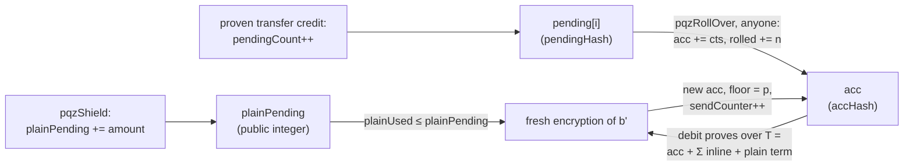

# PQZ — Post-Quantum Zero-knowledge — on private/PoA chains

**Name (owner 2026-10-15):** PQZ stands for **Post-Quantum Zero-knowledge**: a post-quantum zero-knowledge proof engine (two proof systems, PQZL on lattices and PQZH on hashes, behind one precompile). Its first application is the confidential token specified here, which follows the Zether model (encrypted balances and amounts, visible identities); "PQ Zether" was the historical name. The proof system is not a general-purpose ZK system: each operation has its own fixed relation. This file will be renamed `pq-zero-knowledge.md` together with the pqz-core layout move.

Status: **SPECIFIED, UNAUDITED — NOT FOR PRODUCTION FUNDS**; nothing of PQZ is deployed; the proof engine (`pqz-core`,
both proof systems), the precompile boundary `pqz-ffi` and the frozen vectors are built (P6d, P6e; byte layouts in
[serialization v1](#serialization)), the contracts, node integration and clients are not (classical Zether is BUILT on
dev chains, [zether.md](zether.md)). Every size, proof length and gas figure below marked *estimate* is replaced by
measurement before the parameters freeze. Notation: `R = Z[X]/(X^64 + 1)`, `R_q = R/qR`; `s`, `r`, `e` are vectors in
`R^32` (2048 integer coefficients); `a^T b` for vectors in `R_q^32` is `Σ_j a_j·b_j ∈ R_q`; `x[i]` is coefficient `i`
of a ring element; `‖·‖` is the ℓ2 norm over all integer coefficients (centred representatives); `be8(x)` = 8-byte
big-endian; everything else as in [zether.md](zether.md) (`‖`, `be32`, `u8`, ASCII strings without terminator).

**Contents**

1. [Overview](#1-overview)
2. [Scope and gate](#2-scope-and-gate)
3. [Constraints and research](#3-constraints-and-research)
4. [Encryption scheme MLWE-BFV-add](#4-encryption-scheme-mlwe-bfv-add)
   - 4.1 [Parameters](#parameters)
   - 4.2 [Algorithms](#42-algorithms)
   - 4.3 [Noise and digit budget (worst case)](#43-noise-and-digit-budget-worst-case)
   - 4.4 [Sizes](#44-sizes)
   - 4.5 [Shared randomness against malicious recipients](#45-shared-randomness-against-malicious-recipients)
5. [Encodings shared by contract, precompile and clients](#5-encodings-shared-by-contract-precompile-and-clients)
6. [Keys, UA kind and authorization](#6-keys-ua-kind-and-authorization)
7. [Protocol](#7-protocol)
   - 7.1 [State (per `(UA, token)`)](#71-state-per-ua-token)
   - 7.2 [Register (the UA registry)](#72-register-the-ua-registry)
   - 7.3 [Fund](#73-fund)
   - 7.4 [Transfer](#transfer)
   - 7.5 [Burn and refresh](#75-burn-and-refresh)
   - 7.6 [Rollover](#76-rollover)
   - 7.7 [Statement layout](#77-statement-layout)
   - 7.8 [Events and indexing](#78-events-and-indexing)
   - 7.9 [Disclosure](#disclosure)
   - 7.10 [Authorization check](#authorization-check)
   - 7.11 [Meta-transactions](#711-meta-transactions)
8. [Proof engine `pqz-core`](#8-proof-engine-pqz-core)
   - 8.1 [Serialization v1](#serialization)
9. [On-chain verifier](#9-on-chain-verifier)
   - 9.1 [Precompile `PQZ`](#91-precompile-pqz)
   - 9.2 [Precompiles `MLDSA44` and `MLDSA65`](#92-precompiles-mldsa44-and-mldsa65)
   - 9.3 [Gas model](#93-gas-model)
   - 9.4 [Contracts](#94-contracts)
10. [Chain integration (Nethermind precompile on chain 7622)](#10-chain-integration-nethermind-precompile-on-chain-7622)
11. [Provers](#11-provers)
12. [Threats](#threats)
13. [Hybrid path and migration](#13-hybrid-path-and-migration)
14. [Vectors and tests](#14-vectors-and-tests)
15. [References](#15-references)

## 1. Overview

<a id="overview"></a>

**What it is.** A second confidential-token class, `PqzToken`, with the classical Zether *shape* (identity visible,
ring size 2, amounts and balances encrypted, fee as a public scalar, sender/receiver/auditor disclosure), rebuilt on
module-lattice assumptions:

| Layer | Classical Zether (BUILT) | PQZ (this file) |
|---|---|---|
| Balance encryption | lifted ElGamal on bn254 / BLS12-381 G1 | additive module-LWE, BFV-style scaling `Δ`, digit-packed plaintext ([encryption](#encryption)) |
| Validity proofs | Σ-protocol + 2 Bulletproofs (`n_v = n_b = 64`) | one LNP22 lattice proof per op ([proof engine](#proof-engine)): key, encryption, decryption and integer-carry relations with exact norms |
| Verification | Solidity + bn254/BLS precompiles | native precompile on chain 7622 (`PQZ`, `0x5caa5…0f01`), same C core as the prover ([CTR-PQZ-09](#CTR-PQZ-09), [CTR-PQZ-10](#CTR-PQZ-10)) |
| Authorization | 8 `AuthScheme`s in the legacy registry (`legacy/ua3/`); the UA registry replaces them by `authRef` | UA `authRef` = `mldsa65` UA (default) or a PQ-dominant UA `msig` (hybrid, t-of-n), verified via precompile `0x…0F10` ([CTR-PQZ-12](#CTR-PQZ-12)) |
| Relaying | ERC-20 on the one base `ERC20MetaTx`: allowlisted self-calls through `mtxExecute`, outer fee `NONE`/`FIXED` from the public balance, `envelopeBinding` in the statement ([CTR-ZTH-34](zether.md#CTR-ZTH-34); built: `ZetherMetaTx` with `OP_ZTRANSFER`/`OP_ZBURN`) | the same base, self-call and rules ([CTR-PQZ-15](#CTR-PQZ-15), [CTR-PQZ-21](#CTR-PQZ-21)), plus the UA path's `UAMetaTransaction` so a PQ UA pays the outer fee |
| Decryption | BSGS discrete log, device cache, `zether-read-balance` | direct rounding, microseconds, exact; no BSGS, no cache needed ([CTR-PQZ-16](#CTR-PQZ-16)) |
| State | points in storage | ciphertext **hashes** in storage, bytes in calldata + events; public amounts (`pqzShield`, fees) as a public `plainPending` integer; public keys in SSTORE2 ([CTR-PQZ-07](#CTR-PQZ-07), [CTR-PQZ-06](#CTR-PQZ-06)) |
| Chains | dev allowlist 31337/1337 | allowlist 31337/1337/**7622** **and** a constructor self-test through the precompile **and** the registry's `chain_uid` in every statement ([CTR-PQZ-01](#CTR-PQZ-01), [NET-ALL-22](../networks/README.md#NET-ALL-22)) |

**Cost.** Ciphertext 16,512 B, public key 16,384 B, transfer proof 42,762 B in PQZL and ≈ 231 KB in PQZH (the
frozen vectors, [sizes](#44-sizes)). A PQZL transfer is ≈ 77 KB of
calldata and ≈ **2.8 M gas** while the p99 verify time stays under ≈ 11 ms (the EIP-7623 calldata floor binds,
[gas](#gas)), rising to ≈ 7.5 M at the former 50 ms kill threshold (the limit is 60 ms since 2026-10-14; gas is
recalibrated in P6f) — the same order as classical Zether's measured 3.29–3.36 M.
Consuming each received credit later costs ≈ 0.52 M gas more (its ciphertext enters calldata once more,
[rollover](#rollover-op)). Security of the encryption: primal-uSVP block size β ≈ 476 (core-SVP 139 classical / 126
quantum; Kyber-512 is 406 → 118 / 107 under the same script, [parameters](#parameters)).

**What it protects.** Amounts and balances stay confidential against a future quantum adversary (no
harvest-now-decrypt-later (HNDL) on ciphertexts, [threats](#threats)), and validity (no money printing) rests on
MSIS/MLWE instead of discrete log — a quantum adversary against classical Zether does not only *read* balances, it can
*forge* Σ/Bulletproof proofs and mint. What stays classical is listed under [threats](#what-stays-classical) (Clique
block signer, relayer lane keys, public ERC-20 legs, and a v1 envelope signer, which can only spend its public balance
and nonces).

## 2. Scope and gate

<a id="scope"></a>
<a id="scope-gate"></a>
<a id="CTR-PQZ-01"></a>**CTR-PQZ-01** — **Scope and gate** (owner). PQZ is a separate token class (`PqzToken`, plus kind
`0x0142` in the [UA registry](accounts.md#registry)), never an upgrade of `ZetherToken`.
`PqzSafety.requireAllowedChain()`: `chainid ∈ {31337, 1337, 7622}` — a hard-coded list, like the classical dev gate
([CTR-ZTH-02](zether.md#CTR-ZTH-02)); adding a chain is a code change with review. **And** every
constructor/`initialize` runs the precompile self-test ([self-test](#self-test)); a chain without the precompile (every
public chain) fails it. **And** the chain is identified by `(chainid, chain_uid)` ([NET-ALL-22](../networks/README.md#NET-ALL-22)):
`PqzToken.initialize` copies `registry.chainUid()` (the genesis hash, a registry constructor immutable, `≠ 0`) into an
immutable `chainUid`, which enters every statement and `entryRef`, so no proof, authorization or disclosure verifies on
another chain with the same chain id; the UA PoPs bind it through `popDigest` ([CTR-UA-07](accounts.md#CTR-UA-07)).

The node binds registry, `chainUid()` and the RPC genesis hash per chain profile and refuses a mismatch.
`OpenFactory.pqzEnabled` defaults to `false`. NatSpec and docs: **UNAUDITED — NOT FOR PRODUCTION FUNDS**. Chain 7622 is
the owner's named target and runs our client. The owner moved the private chain off its former id 9000 because 9000
is also Evmos Testnet, a public chain; 7622 is not assumed unique either, hence `chain_uid`. The self-test is what
keeps PQZ off chains whose client is not ours. **Public chains** (owner, 2026-10-08): PQZ is meant for public
chains too, and the route there is a lattice-verification precompile **on that chain**, which SCaaS waits for — no
Solidity verifier split over transactions, no STARK-wrapped proof and no SCaaS appchain is planned. Until a public chain
offers such a precompile, the allowlist and the self-test stay; adding that chain is then a code change with review, as
above, plus a price calibration of its precompile ([CTR-PQZ-11](#CTR-PQZ-11)).

**Release gates before any production or commercial use** (owner): **licence/patent clearance**, gate **G-LIC** (LaZer is MIT without
an explicit patent grant; LNP22-family techniques come from IBM Research; GMP/MPFR are LGPL and must be absent from
every shipped artifact after the engine rewrite; plus the chosen ML-DSA implementations' licences) **and** an
independent cryptographic audit. Development and research continue without them; nothing deploys outside the
allowlist or holds real funds until both are recorded as passed. Classical Zether's own gate on chain 7622 is
unaffected ([CTR-ZTH-33](zether.md#CTR-ZTH-33)).

The licence gate **G-LIC**: legal review of LaZer (MIT, no patent grant) and any code retained from it; LNP22-family IP (IBM
Research); GMP (LGPLv3/GPLv2) and MPFR (LGPLv3): confirm from link maps that no shipped artifact (`libpqz.so`, WASM
module, iOS/Android libraries) contains them, or else record the static-linking/relinking duties — the CI-only
upstream cross-check runner ships nothing; HEXL Apache-2.0 notice if any of its code is retained; ML-DSA and WASM
toolchain licences; written clearance. It may start any time and does not block development.

Owner requirements addressed here: implement-grade post-quantum confidential balances like Zether, on lattice
homomorphic encryption (BFV/BGV, compared with TFHE/CKKS) plus lattice ZK proofs; target private/PoA chains (gas
limit, block size, precompiles are ours) but keep gas reasonable; gate off public chains like classical Zether, label
UNAUDITED; decide Solidity lattice ops vs a custom precompile vs an off-chain co-processor; a hybrid classical-now +
PQ migration path against HNDL; key, ciphertext, proof sizes and verify cost; an account/key model consistent with
the Universal Account (kind-tagged ids, one key = one purpose, hardened per-kind derivation); authorization by
ML-DSA/Falcon verified on chain by precompile; interaction with existing Zether (curves, `n_v = 64`, registry,
`ITransferDisclosure`, BSGS/balance cache), relayer/meta-tx, node, clientkeys, prover; `PqzToken` follows
`IERC20MetaTx`; per-family availability, private EVM first.

## 3. Constraints and research

<a id="constraints"></a>

**Why classical Zether cannot be patched.** ElGamal and Bulletproofs both rest on discrete log in G1; Shor breaks both,
and breaks every ciphertext already recorded (*"no PQ path; a new protocol is required, not a new signature"*). The
legacy registry's `PQ_COMMITMENT` auth scheme (#6) protects only future control of an account, never past amounts. A
private chain lowers exposure (only participants see state) but does not remove it: any participant that archives the
chain holds the ciphertexts. Hence a new protocol, deployed beside the classical one.

**Homomorphic encryption candidates.** What Zether needs from the encryption is small: `Enc`, `Add` (credits), and a
decryption **relation** a prover can show in zero knowledge. No ciphertext multiplication, no rotations, no
bootstrapping.

| Scheme | Arithmetic | Fit for "owner-key confidential balance" | Why not / why |
|---|---|---|---|
| **BFV** (Brakerski/Fan–Vercauteren, RLWE) | exact mod `t`, MSB encoding `Δ·m + e` | yes | Decryption relation `v − u·s = Δ·M + e` has independent bounds on `M` and `e`: simplest to prove. **Chosen in its additive-only, module form** ([CTR-PQZ-02](#CTR-PQZ-02)) |
| **BGV** (RLWE) | exact mod `t`, LSB encoding `m + t·e` | yes | Equivalent for additions; the relation couples `m` and `e` through `t`, which makes the norm argument and the integer-carry relation less direct. No gain |
| **CKKS** (RLWE) | approximate | **no** | Money must be exact; CKKS decryption leaks noise and is broken in the IND-CPA^D model ([Li–Micciancio](https://eprint.iacr.org/2020/1533)) |
| **TFHE / FHEW** (LWE + bootstrapping) | gate/LUT, comparisons on ciphertexts | **different model** | Enables fhEVM-style tokens: balances under one **network** key held by a threshold KMS, comparisons done homomorphically. Confidentiality then rests on the KMS quorum, not on the owner's key — not Zether. Zama's input ZKPoK (`tfhe-zk-pok`) is pairing-based ([docs.rs](https://docs.rs/crate/tfhe-zk-pok/latest), [fhEVM inputs](https://docs.zama.ai/protocol/solidity-guides/smart-contract/inputs)), so input validity is not PQ-sound; `tfhe-rs` is BSD-3-Clause-Clear and **commercial use needs Zama's patent licence** ([docs.rs/tfhe](https://docs.rs/crate/tfhe/)) |
| ML-KEM (FIPS 203) as-is | KEM with FO transform | no | The FO re-encryption check destroys homomorphism; `q = 3329` leaves no headroom for additions. Its inner K-PKE is exactly our base scheme with a larger modulus |

Exact-FHE implementations with a *noticeable* decryption-failure probability allow key recovery
([Cheon–Choe–Passelègue–Stehlé–Suvanto 2024](https://eprint.iacr.org/2024/127)). PQZ parameters are therefore set by
**worst-case** noise bounds over proven witness norms ([noise](#noise)): decryption of an accepted state **cannot**
fail, so there is no failure oracle ([CTR-PQZ-03](#CTR-PQZ-03)).

**Lattice zero-knowledge proof systems.**

| System | Statement form | Proof size (published) | Prove / verify | Maturity, code | Fit |
|---|---|---|---|---|---|
| **LNP22 "Lantern"** ([ePrint 2022/284](https://eprint.iacr.org/2022/284), CRYPTO 2022) | short `s` with `As = t mod q`, exact ℓ2 norms, binary/quadratic relations, linear relations | ~14 KB reference statement (LaZer abstract); MLWE-secret proof ~29 KB in the TU Graz Sage implementation ([Lantern notebook](https://lattice-zk.isec.tugraz.at/)) | C: fractions of a second (Lether); Sage: ~35 s | **LaZer** C + Python, MIT ([GitHub](https://github.com/lazer-crypto/lazer), [ePrint 2024/1846](https://eprint.iacr.org/2024/1846), CCS 2024); **x86-64 + AVX-512 + AES-NI only**; links GMP, MPFR and Intel HEXL | **Chosen** ([CTR-PQZ-09](#CTR-PQZ-09)): our relations are linear with exact norms, witness ≈ 8 k short coefficients |
| **LaBRADOR** ([ePrint 2022/1341](https://eprint.iacr.org/2022/1341), CRYPTO 2023) | R1CS / dot-product constraints, recursive | ~58 KB for R1CS of 2^20 constraints | verifier linear-ish, recursion-heavy prover | in LaZer | Floor ≈ 50 KB gives nothing for small statements; original is not zero-knowledge. Future: block-level aggregation of many transfers |
| **Greyhound** ([ePrint 2024/1293](https://eprint.iacr.org/2024/1293), CRYPTO 2024) | polynomial commitment (with LaBRADOR) | 53 KB at degree 2^30 | `O(√N)` verifier | research code | A PCS, needs a full SNARK around it; no gain at our size |
| **MatRiCT / MatRiCT+** ([2019/1287](https://eprint.iacr.org/2019/1287), [2021/545](https://eprint.iacr.org/2021/545)) | UTXO RingCT, binary proofs | tens of KB (MatRiCT+ 2–18× shorter than MatRiCT) | sub-second | research | UTXO + ring anonymity; Zether is account-model with ring size 2 |
| **LNS20 integer relations** ([2020/1183](https://eprint.iacr.org/2020/1183), CCS 2020) | additions/multiplications of committed integers with carries | smallest PQ for 512-bit integers (abstract) | fast | research | The digit-carry technique used for `b' + v + fee` ([transfer](#transfer)), expressed inside LNP22 |
| Hash-based (Ligero, STARK) | arbitrary circuits | 100–300 KB class | prover seconds to tens of seconds for ring arithmetic in-circuit | mature Rust (Plonky3, Winterfell) but zero-knowledge is not the default mode | Fallback only (kill criterion, [CTR-PQZ-09](#CTR-PQZ-09)) |
| "PQ inside a pairing SNARK" | — | small | cheap on chain | — | **Rejected**: soundness is pairing-based |

**Prior art for the whole protocol.** **Lether** ([ePrint 2026/076](https://eprint.iacr.org/2026/076), ACM CCS 2026;
Wang, Esgin, Steinfeld, Yiu) is the first practical lattice account-model protocol in the Anonymous Zether paradigm:
verifiable *refreshable* additively-homomorphic multi-message multi-recipient encryption (mmPKE), LNP22 via LaZer,
moduli ≤ 60 bits, ~68 KB per transaction of which ~51 KB proof, refresh overhead ~1.3 % amortized, prove and verify
each a fraction of a second. PQZ is the same family **without anonymity** (no ring, no linkable tags), which is why
its proof should be smaller. Only Lether's abstract was available (the ePrint PDF refused automated download); the full
text is reconciled with these parameters before they freeze. Multi-recipient shared randomness is the mKEM technique
of [Katsumata–Kwiatkowski–Pintore–Prest 2020](https://eprint.iacr.org/2020/1107).

**Signatures for authorization.**

| Scheme | pk | sig | Standard | EVM verification |
|---|---|---|---|---|
| **ML-DSA-65** | 1,952 B | 3,309 B | FIPS 204 (final 2024) | Solidity 1.23 M gas for ML-DSA-44 ([Fireblocks](https://www.fireblocks.com/blog/post-quantum-signatures-ethereum-cheaper-gas)), 8.09 M (ZKNox ETHDILITHIUM); precompile drafts [EIP-8051](https://eips.ethereum.org/EIPS/eip-8051) (0x12/0x13, 4,500 gas, expanded pk) and [EIP-8355](https://eips.ethereum.org/EIPS/eip-8355) (0x12–0x14, ML-DSA-65 9,000 gas, `pk ‖ sig ‖ msg`, pure ML-DSA, empty context) — **both drafts claim 0x12/0x13** |
| ML-DSA-87 | 2,592 B | 4,627 B | FIPS 204 | as above |
| FN-DSA-512 (Falcon) | 897 B | ~666 B | **FIPS 206 still a draft** (submitted for approval 2025-08-28; final expected late 2026/early 2027, [pqc-forum](https://groups.google.com/a/list.nist.gov/g/pqc-forum/c/1HXzjlMUU6Y/m/KNSPqC02BgAJ)); FN-DSA ≠ original Falcon encoding | [EIP-8052](https://eips.ethereum.org/EIPS/eip-8052) draft; floating-point signing is hard to make constant-time |
| SLH-DSA-SHA2-128s | 32 B | 7,856 B | FIPS 205 | ~0.6 M in Solidity |

**Libraries.**

| Library | Language, licence | Scope | Use in PQZ |
|---|---|---|---|
| LaZer | C + Python, MIT; links GMP (LGPLv3/GPLv2), MPFR (LGPLv3), HEXL (Apache-2.0) | LNP22, LaBRADOR, codegen (Sage + lattice-estimator) | **forked** into `pqz-core`: protocol logic and codegen kept, integer, NTT, sampler, rejection, allocator and error layers rewritten ([CTR-PQZ-09](#CTR-PQZ-09)) |
| Lantern notebook (TU Graz) | Python/Sage | LNP22 reference | second oracle for transcript-level tests |
| [fhe.rs](https://github.com/tlepoint/fhe.rs) | Rust, MIT, unaudited | RNS-BFV | reference only — we need ~200 lines of K-PKE-style code, not a BFV stack |
| [OpenFHE](https://github.com/openfheorg/openfhe-development) / [openfhe-rs](https://github.com/fairmath/openfhe-rs) | C++ BSD-2 / Rust bindings (young) | BFV/BGV/CKKS/FHEW | none |
| [Lattigo](https://github.com/tuneinsight/lattigo) | Go, Apache-2.0 | BFV/BGV/CKKS, multiparty | none (Go) |
| tfhe-rs | Rust, BSD-3-Clause-Clear + patent licence | TFHE, fhEVM | none (different trust model, licence) |
| ML-DSA | `pqcrypto`/`fips204`-class Rust crates, liboqs (C) | FIPS 204 | precompile and clients; pick one audited/ACVP-tested implementation |
| [lattice-estimator](https://github.com/malb/lattice-estimator) | Sage | security estimates | parameter freeze |

<a id="why-lazer"></a>
**Why LaZer, and why no equivalent replaces it** (summary of the two tables above; owner asked for it on record,
2026-10-13). PQZ needs additive encryption, a lattice zero-knowledge proof of a valid transfer (non-negative balance,
correct addition, correct key) and proofs small enough for calldata. LNP22 proves exactly those lattice statements
(`As = t mod q`, exact ℓ2 norms, binary/quadratic/linear relations) at tens of KB, and **LaZer is LNP22's reference C
implementation by its authors**, with codegen from relation specifications and lattice-estimator integration, under MIT.
**Lether** (CCS 2026), the closest prior art (account-model lattice Zether), runs LNP22 through LaZer at ~51 KB of proof
and sub-second prove/verify; PQZ drops anonymity, so its proof should be smaller. No other library is a drop-in:
LaBRADOR has a ~50 KB floor and is not zero-knowledge in its original form (kept for later block-level aggregation);
Greyhound is a polynomial commitment needing a SNARK around it; MatRiCT/MatRiCT+ target UTXO ring signatures;
LNS20 is a technique (the digit-carry relation, expressed inside LNP22), not a library; hash-based systems (Plonky3,
Stwo, Winterfell) are mature, and the PQZH design study estimates `R_TX` at ≈ 105–225 KB with sub-second provers and a
hiding mode still to confirm (research note `pqzh-design.md`) — no longer only a fallback: PQZH is the
second proof-system value next to PQZL (owner 2026-10-13, TODO P6-PQZH); a PQ statement inside a pairing SNARK is
rejected (pairing soundness). On the encryption side, OpenFHE / Lattigo / fhe.rs are full FHE stacks where PQZ needs ~200 lines of
K-PKE-style code, and tfhe-rs (fhEVM) is a different trust model (a threshold network key) with a pairing-based input
proof and a patent licence. LaZer is **forked, not linked**: its protocol logic, specifications and codegen are kept,
and the six layers below are rewritten. The landscape was surveyed on 2026-10-06 and re-surveyed on 2026-10-13
(research note `pqz-proof-alternatives.md` §3, §7: prior art and proof backends).

**Hardware fact that drives the build.** LaZer requires AVX-512 and AES-NI and has no portable code path. The
chain-7622 host is an **AMD Ryzen 5 7235HS (Zen 3+): AVX2 and AES-NI, no AVX-512** (`/proc/cpuinfo`, 2026-10-06), as
are most phones and every WASM runtime. A verifier that needs AVX-512 cannot run in the node. Hence the portable fork
instead of linking LaZer. The AVX-512 kernels are not the only problem. LaZer `main` at `3330e48` (2026-09-28), read
through the GitHub API on 2026-10-06, depends on:

| Layer | Upstream | Why it cannot ship as is |
|---|---|---|
| Build | `Makefile`: `LIBS = -lm libhexl.a -lstdc++ -lmpfr -lgmp`; `CFLAGS_DEFAULT … -march=native` | host-specific code; C++ runtime; LGPL libraries |
| Integers | `src/int.c`: `int_t` arithmetic on GMP (`mpn_sec_*`, `mpz_t`), multi-limb | GMP in a consensus path and in WASM; LGPL relinking duties |
| Rejection sampling | `src/rejection.c`: `mpfr_exp((−2⟨z,v⟩ + ⟨v,v⟩)/(2σ²))` | MPFR on a secret-dependent value: not constant-time, not bit-exact across platforms |
| Gaussian sampler | `src/grandom.c`: `double` (`exp_small`, `BerExp`) | floating point: x87/FMA/libm differences break byte-exact proofs |
| NTT | Intel HEXL (C++, AVX-512-oriented, Apache-2.0) | no portable path |
| Errors, memory | `ERR()` = `fprintf(stderr, …); abort();` (`src/lazer-in2.h:1680`); `ASSERT_ERR` empty in release; `malloc`/`realloc` | an abort in the node halts chain 7622 ([CTR-PQZ-10](#CTR-PQZ-10)); no fixed memory bound |

So the fork keeps LaZer's protocol logic, specifications and codegen, and **rewrites** those six layers for the fixed
PQZ parameters.

**Chain 7622 limits that bind the design.**

| Fact | Value | Consequence |
|---|---|---|
| Client | Nethermind 1.39.0, Clique, one signer, 5 s, base fee 0 (chainspec 2026-08-31) | gas is free in money, but still meters block capacity |
| Forks live | through Fusaka + BPO2, incl. EIP-2537, EIP-7951 (secp256r1 at `0x100`), **EIP-7825**, **EIP-7623**, **EIP-7934** | — |
| [EIP-7825](https://eips.ethereum.org/EIPS/eip-7825) tx gas cap | 16,777,216 per transaction, independent of block limit | rules out a Solidity lattice verifier ([verifier](#verifier)) |
| Chain id | **7622** (owner, 2026-10-07; formerly 9000, which is **also Evmos Testnet**, a public chain: [chainlist](https://chainlist.org/chain/9000), [Sequence chainlist](https://docs.sequence.xyz/solutions/chainlist/non-integrated/evmos-testnet)). Chain ids are a registry convention, so 7622 is not assumed unique either | `chainid == 7622` does not prove "our chain"; the precompile self-test, the registry's `chain_uid` (genesis hash) in every statement and the node's genesis-hash binding do |
| Block gas limit | 16,777,216 (Clique signer can move it without reset) | ~5 transfers per block unless raised ([CTR-PQZ-11](#CTR-PQZ-11)) |
| [EIP-7623](https://eips.ethereum.org/EIPS/eip-7623) calldata floor | `10 × tokens`, token = zero byte 1 / non-zero byte 4 ⇒ 40 gas per non-zero byte | dominates PQZ cost once verification is native |
| [EIP-7934](https://eips.ethereum.org/EIPS/eip-7934) | RLP block ≤ 8,388,608 B | a block can carry at most `gasLimit / 10` calldata bytes (all-zero calldata at the floor); the 80 M target keeps that ≤ 8.0 MB, so the limit cannot be hit |
| Tx-pool size limit | 128 KiB is the common client default (geth/reth); Nethermind `TxPool.MaxTxSize` to be confirmed | transfers with inline credits exceed it ([CTR-PQZ-11](#CTR-PQZ-11)) |
| Missing transition keys | Nethermind silently ignores unknown keys; `eip1108Transition` was once missing and made `ecMul` 6.4× dearer with no symptom | every PQZ activation is **probed**, never trusted ([CTR-PQZ-10](#CTR-PQZ-10)) |

## 4. Encryption scheme MLWE-BFV-add

<a id="encryption"></a>
<a id="CTR-PQZ-02"></a>**CTR-PQZ-02** — **Encryption = additive-only module-LWE with BFV-style encoding** ("MLWE-BFV-add"),
implemented in `pqz-core`, not taken from an FHE library. CKKS and TFHE rejected ([constraints](#constraints)). We use
Enc/Add/Dec only; a BFV stack brings relinearization keys and failure probabilities we must not have. The owner's
"BFV/BGV (RLWE)" is met in substance: RLWE `n = 2048` and MLWE `d = 64, k = 32` have the same LWE dimension; the
module form matches the LNP22 proof ring.

### <a id="parameters"></a>4.1 Parameters

<a id="parameters"></a>
<a id="CTR-PQZ-03"></a>**CTR-PQZ-03** — **Parameters**: `d = 64`, `k = 32`, `q = 2^42 − 215` (prime, `q ≡ 9 mod 16`, so
`X^64 + 1` splits into `l = 4` irreducible factors), `Δ = 2^26 − 1 = ⌊q/2^16⌋`, secrets and encryption randomness
CBD(1), errors CBD(20), norm thresholds 36 / 164 / 64, plaintext = 16 digits base 16, credit cap `K_MAX = 1024`.
Security target, pinned cost model: every attack the pinned lattice-estimator runs on the encryption MLWE and on the
proof's MSIS/MLWE instances costs at least Kyber-512's, under core-SVP **classical** (`0.292β`) **and quantum**
(`0.265β`); in block-size terms β ≥ 450 (Kyber-512 is 406). **One owner-accepted exception (2026-10-15):** the shared encryption randomness `(r_g, e1_g)` of a multi-recipient transfer `R_TXM` (op 7) carries up to 80 adversarial hints (4 legs + the auditor copy, 16 per key) and reaches β 446.0 (core-SVP 2^130.2 classical / 2^118.2 quantum) — below the 450 margin, still above Kyber-512's 406; groups of 4 legs per randomness with or without the auditor. Every other instance keeps β ≥ 450 (encryption without hints 476, single-recipient `R_TX` 463.9 with 32 hints, the PQZL proof's MSIS 452–464). Evidence: `pqz-core/pqzl/params/anon/hints-anon.txt`; explanation: `docs/research/pqz-anonymity.md`. Noise bounds are worst-case over proven norms, so an
accepted state never fails to decrypt. An earlier `q = 2^50 − 1791` reached only β ≈ 374 (core-SVP 109 / 99), below
Kyber-512, and split fully, which defeats LNP22's challenge invertibility. Parameters change **only** with a new
`proofSystemId` and a recomputed noise budget.

**Note (2026-10-13): the v2 verifiers did not enforce the MSIS bound the β ≥ 450 above is for, until the z21 fix.**
LaZer's verifier ([lazer#26](https://github.com/lazer-crypto/lazer/issues/26)), and `pqz_verify_fast` with it, never
bounded `z21`, the part of the commitment opening the proof carries; LNP22 (Fig. 18) and the parameters bound the
whole `z2 = (z21, z22)`. Bounded only by `MAX_PROOF`, `z21` let the extracted MSIS solution grow from ≈ 2^35.3–2^36.0
to ≈ 2^41: the proof's MSIS instances fell to β 286–311 (core-SVP classical 2^83.5–2^90.8), below Kyber-512. No known
attack, nothing deployed; the guarantees that rest on the proofs' knowledge soundness (key uniqueness, the noise
budget, no mint) held only at that weaker level. Both verifiers now check `‖z21‖² + ‖w − γ·w1‖² ≤ B²`; honest proofs
and the transcript are unchanged, so the parameters and the β above stand.

| Name | Value | Note |
|---|---|---|
| Ring | `R_q = Z_q[X]/(X^64 + 1)`, module rank `k = 32` | LWE dimension `n = 2048` |
| `q` | `2^42 − 215 = 4,398,046,510,889` (`0x3FFFFFFFF29`), prime, `q ≡ 9 mod 16` (`2l + 1 mod 4l` with `l = 4`) | `X^64 + 1 = Π_{j<4} (X^16 − ζ_j)`, each factor irreducible ([LS18](https://eprint.iacr.org/2017/523) Cor. 1.2); incomplete NTT, below |
| `Δ` | `2^26 − 1 = 67,108,863 = ⌊q / 2^16⌋` | |
| Secret `s`, randomness `r` | CBD(η = 1) per coefficient (values −1, 0, 1 with probability ¼, ½, ¼) | σ² = ½ |
| Errors `e`, `e1`, `e2` | CBD(η = 20) (σ = √10 ≈ 3.16) | HE-standard error width |
| Norm thresholds | `‖s‖, ‖r‖ ≤ β_s = 36`; `‖e‖, ‖e1‖ ≤ β_e = 164`; `‖e2_j‖ ≤ β_2 = 64` (16 coefficients) | key generation and encryption resample above them; proofs show them exactly |
| Plaintext | `L = 16` digits base 16 in coefficients 0..15 of `v` | 64-bit values |
| `K_MAX` | 1024 units per account between refreshes (proven credits, the account's `acc` units and one reserved plain term, [CTR-PQZ-06](#CTR-PQZ-06)) | [noise](#noise) |
| Matrix `A` | global, `A[i][j] ∈ R_q`, from `SHAKE128("SCAAS-PQZ-A-V2" ‖ u8(i) ‖ u8(j))`: read 8-byte BE words, keep the low 42 bits, accept if `< q`, coefficient 0 first | nothing-up-my-sleeve; implementations cache `NTT(A)` (512 KB) at start |

**Multiplication.** `R_q` products use a Kyber-style **incomplete** NTT: two negacyclic layers map a polynomial to its
four residues mod `X^16 − ζ_j`, products there are degree-16 schoolbook (or Karatsuba) mod `X^16 − ζ_j`, and two
inverse layers return. The encryption ring and the proof ring are then the same `R_q`, with no lift to a larger proof
modulus. The challenge-invertibility bound of LS18 Cor. 1.2 is `q^{1/l}/√l ≈ 724` in ℓ∞ for `l = 4`, against the
`‖c − c'‖∞ ≤ 2κ` of LaZer-style challenges (κ a small constant). `l = 2` (`q ≡ 5 mod 8`, bound ≈ 1.5·10^6) and `l = 8`
(`q ≡ 17 mod 32`, bound ≈ 13.5) are the alternatives the engine measurements may choose for proof size or NTT speed. The
primes closest below `2^42` are `2^42 − 11` (`l = 2`) and `2^42 − 143` (`l = 8`); `Δ`, the noise budget and the sizes
are identical for all three. A full split (`l = 64`) gives an empty bound (`q^{1/64}/8 < 1`).

**Security.** The HE-standard tables use the "realistic" BKZ cost `0.265β + 16.4 + log2(8d)`, not core-SVP, and are not
relied on. **Pinned cost model:** core-SVP, classical `2^{0.292β}` and quantum `2^{0.265β}`, primal uSVP in the 2016
estimate ([ADPS16](https://eprint.iacr.org/2015/1092): success when `σ_e·√β ≤ δ_β^{2β−d−1}·Vol^{1/d}`, secret rescaled
by `σ_e/σ_s`, best number of samples `m`). Script output (scratch Python, 2026-10-06), calibrated on Kyber-512:

| Instance | β | Core-SVP classical / quantum |
|---|---|---|
| Kyber-512 (n = 512, q = 3329, CBD(3)/CBD(3)) — reference | 406 (published 406) | 118.6 / 107.6 |
| earlier draft: n = 2048, q = 2^50 | 374 | 109.2 / 99.1 |
| review option A: n = 2560, q = 2^50 | 508 | 148.3 / 134.6 |
| review option B: n = 2048, q = 2^41 | 492 | 143.7 / 130.4 |
| **chosen: n = 2048, q = 2^42 − 215** | **476** | **139.0 / 126.1** |
| chosen with 32 perfect hints on `(r, e1)` ([shared randomness](#shared-randomness)), DDGR20 worst case (maximal-norm mixed forms; the 32-dimensions-removed approximation gave 466) | 463.9 | 135.5 / 122.9 |
| `R_TXM` (op 7): ≤ 80 hints on one `(r_g, e1_g)` (4 legs + the auditor copy), DDGR20 worst case — owner-accepted exception to the 450 margin ([CTR-PQZ-03](#CTR-PQZ-03), 2026-10-15) | 446.0 | 130.2 / 118.2 |

`q ≈ 2^42` rather than `2^41` buys a 4× accounting margin ([noise](#noise)) for 16 β-units. Option A keeps
`K_MAX = 4096` but adds 25 % to every key and ciphertext; with public plain amounts ([CTR-PQZ-06](#CTR-PQZ-06)) the cap
no longer needs that headroom. The margin over Kyber-512 (≥ 60 β-units, ≥ 17 bits) absorbs dual and hybrid attacks
(MATZOV 2022 takes a few bits off for small secrets), CBD(1)'s lower variance than uniform ternary (≈ 0.5 β-units), and
a few percent of estimator generosity. Hybrid meet-in-the-middle does not apply (Hamming weight ≈ 1024 of 2048). The
parameter freeze runs the [lattice-estimator](https://github.com/malb/lattice-estimator) pinned at `53da598` (main,
2026-08-19) with `LWE.estimate` under `RC.ADPS16` classical and quantum on the encryption MLWE (key and `u` instances),
on the proof's MSIS/MLWE instances, and on Kyber-512 through the same commit as the baseline, and records commands and
output in `pqz-core/pqzl/params/estimator.txt`. **Target:** every attack costs ≥ Kyber-512's under both models. A miss is a
parameter ruling before vectors freeze.

### 4.2 Algorithms

```text
CBD_η(stream):           per coefficient: a = Σ_{i<η} bit, b = Σ_{i<η} bit;  coeff = a − b    (bits LSB-first, FIPS 203 style)
KeyGen(seed32):          for ctr = 0,1,…: st = SHAKE256("SCAAS-PQZ-KEYGEN-V1" ‖ seed32 ‖ be4(ctr))
                           s ← CBD_1^{2048}(st), e ← CBD_20^{2048}(st)  (same stream, s first)
                           if ‖s‖ ≤ 36 and ‖e‖ ≤ 164: break         (ctr ≥ 64 ⇒ error; thresholds sit ≥ 10 s.d. above the mean norm)
                         pk = A·s + e ∈ R_q^32;  sk = seed32
Enc({(pk_j, m_j)}, seed_enc):
                         for ctr: st = SHAKE256("SCAAS-PQZ-ENC-V1" ‖ seed_enc ‖ be4(ctr))
                           r ← CBD_1^{2048}, e1 ← CBD_20^{2048}, e2_j ← CBD_20^16 for each j in recipient order
                           accept if ‖r‖ ≤ 36, ‖e1‖ ≤ 164, every ‖e2_j‖ ≤ 64
                         u = A^T·r + e1
                         v_j[i] = (pk_j^T·r)[i] + e2_j[i] + Δ·m_j[i]  mod q,   i < 16
                         output u and (v_j)_j
Add(ct, ct'):            coefficient-wise mod q on u (2048) and v (16)
Sub(ct, ct'):            coefficient-wise mod q
Trivial(m):              u = 0, v[i] = Δ·m[i]                      (built only inside a debit's T, from plainUsed)
Dec(s, (u, v)):          w_i = centre(v[i] − (u^T·s)[i] mod q)  ∈ (−q/2, q/2]
                         M_i = round(w_i / Δ),  noise_i = w_i − Δ·M_i
                         value = Σ_{i<16} M_i · 16^i    (as an integer; M_i may exceed 15 before a refresh)
digits(x):               m[i] = (x >> 4i) & 0xF, i < 16;  x < 2^64
```

`(u^T·s)[i]` for `i < 16` is 16 dot products of length 2048 with negacyclic signs — microseconds. `Dec` is used by the
owner only and its `noise_i` never leaves the device ([CTR-PQZ-14](#CTR-PQZ-14)).

<a id="decryption"></a>
<a id="CTR-PQZ-16"></a>**CTR-PQZ-16** — **Direct decryption.** `Dec` is rounding of 16 coefficients; no BSGS, no discrete
log, no `zether-read-balance`. A balance cache is a UX convenience only (offline display). The single largest UX
simplification over classical Zether.

### 4.3 Noise and digit budget (worst case)

<a id="noise"></a>

For a ciphertext encrypted to `pk_t = A·s_t + e_t`, decryption by `s_t` gives `v − u^T s_t = e_t^T r + e2 − e1^T s_t +
Δ·m`. With norms bounded as proven (registration proves `‖s_t‖ ≤ 36`, `‖e_t‖ ≤ 164`; every encryption proves
`‖r‖ ≤ 36`, `‖e1‖ ≤ 164`, `‖e2‖ ≤ 64`), Cauchy–Schwarz per coefficient gives

```
B_FRESH = β_e·β_s + β_s·β_e + β_2 = 164·36 + 36·164 + 64 = 11,872      (< 2^13.54)
```

B_FRESH needs each bound **per block**: every exact-ℓ2 bound is its own equation of the proof with its own
Schwartz–Zippel challenges (`proofSystemId` v2, [CTR-PQZ-09](#CTR-PQZ-09)). A proof of only the sums
(`‖s_t‖² + ‖e_t‖² ≤ 36² + 164²`, and so on) would let a sender and a recipient under one control reach
`√(28,192 + 1) · √68,672 ≈ 44,001` per credit.

**Note (2026-10-13): PQZL v1 did not enforce the per-block bounds.** v1 (LaZer `tbox` as released,
[lazer#25](https://github.com/lazer-crypto/lazer/issues/25)) gave all exact-ℓ2 equations of a proof one
Schwartz–Zippel challenge domain, so the verifier checked only the sum of the block norms (`R_REG` 28,192, `R_TX`
68,672). For accounts whose keys the attacker controls that allowed ≈ 44,001 of noise per credit (3.7 × B_FRESH) and
≈ 45.0 M over `K_MAX` units, beyond `2^24` and `Δ/2`: such an account could fail to debit or decrypt wrongly. The
mint threshold below was not reached, but its margin fell from 4.1× to ≈ 1.12×; honest accounts stayed inside `2^24`.
v2 checks each bound on its own, so the numbers in this section hold as written; v1 is retired and was never deployed
(analysis and proof of concept: `docs/research/pqz-l2-domain.md`; regression check `pqz-core/pqzl/check_tbox_fixes.sh`).

The trivial plain term has noise 0. A sum of at most `K_MAX = 1024` units has
`|noise| ≤ 1024 · 11,872 = 12,156,928 < 2^24 = 16,777,216`, and digit sums `M_i ≤ 1024 · 15 = 15,360 < 2^14`. Since the plain term has noise 0, the reachable maximum is 1,023 · 11,872 = 12,145,056 (an
attacker-registered key at the norm bounds; `smartcontracts/vectors/pqz/worstcase_noise.json` proves and verifies the
debit over it in both proof systems: 1.38× below `2^24`, 4.14× below the mint threshold below). The debit
proof shows `e_T[i] ∈ [−2^24, 2^24)` and `0 ≤ M_i < 2^14` (complete for every honest state). Honest decryption rounds correctly
because `2^24 < Δ/2`, and `Δ·M_i + e < q/4 + 2^24 < q/2` stays inside the centred range.

**Uniqueness (soundness of the decryption relation).** Suppose `Δ·M + e ≡ Δ·M' + e' (mod q)` with both pairs in the
proven ranges. Then `|Δ(M − M')| ≤ Δ·(2^14 − 1) < q/4` and `|e − e'| ≤ 2^25 − 1 < Δ/2` (the ranges are half-open, `[−2^24, 2^24)`), so the congruence is an integer
equation, `|Δ(M − M')| < Δ`, hence `M = M'`.

**Soundness depends on accounting, not only liveness.** Uniqueness assumes that the *true* noise of `T` is inside the
range the cap guarantees. If an accounting bug let it grow to `|e| ≥ Δ − 2^24 ≈ 3·2^24 ≈ 50.3 M`, a malicious prover
could claim `M' = M + 1` with an in-range `e' = e − Δ`, which mints. That threshold is **4.1×** the cap's bound
(12.16 M) with per-block norm proofs (v2; ≈ 1.12× in v1, note above). The cap is therefore enforced twice: at every credit ([CTR-PQZ-06](#CTR-PQZ-06)) and at every debit
(`unitsOf(T) ≤ K_MAX`, [transfer](#transfer)), and a forge invariant checks that every reachable `T` has ≤ `K_MAX`
units. The key is unique too: two short preimages `(s, e) ≠ (s', e')` of the same `pk` give a non-zero kernel vector
of `[A | I]` of norm ≤ `2·√(36² + 164²) ≈ 336`, while the Gaussian-heuristic shortest vector of that 4096-dimensional
lattice of determinant `q^2048` is ≈ `15.5 · q^{1/2} ≈ 2^25`. That is a statistical fact, not only MSIS: the number of
integer vectors of norm ≤ 336 in dimension 4096 is a negligible fraction of the lattice index `q^2048`, so for all but
a negligible fraction of `A` no such kernel vector exists. The same argument makes `(r, e1)` unique for a given `u`
(sender disclosure). So a proven decryption is **the** decryption, and an accepted state never decrypts wrongly or
fails.

If the relations work finds that a norm proof has extraction slack `γ > 1` for some bound, every `β` above is
multiplied by `γ` in this derivation, `K_MAX` is recomputed, and the change is a new `proofSystemId`.

### 4.4 Sizes

| Object | Bytes | Encoding |
|---|---|---|
| PQZ secret | 32 (seed) | never leaves the device / key oracle |
| PQZ public key `pk` | **16,384** | 32 polys × 64 coeffs × `be8`, coefficient 0 first, poly 0 first; each `< q` |
| Ciphertext `ct = u ‖ v` | **16,512** | `u` as `pk`; `v` = 16 × `be8` |
| Transfer outputs `u ‖ v_t ‖ v_f ‖ v_a` | 16,768 | `v_a` absent (0 bytes, 16,640 in all) when the auditor is off |
| Statements | 83,072 (`R_TX`), 66,560 (`R_TX0`), 50,048 (`R_BURN`), 16,480 (`R_REG`), 33,184 (disclosure) | [serialization v1](#serialization) |
| ML-DSA-65 pk / sig | 1,952 / 3,309 | FIPS 204 |

Proofs ([serialization v1](#serialization)), measured on the frozen vectors (`smartcontracts/vectors/pqz/proof_pqzl.json`,
`proof_pqzh.json`, one proof per form at a fixed `rnd32`; lengths vary slightly with `rnd32`); the bound is what
the verifier accepts:

| Form | PQZL v2 proof | PQZH Ligero v1 proof | PQZH exact maximum |
|---|---|---|---|
| Transfer `R_TX` / auditor off `R_TX0` | 42,762 / 42,431 | 230,946 / 231,480 | 235,470 / 234,744 |
| Burn / refresh `R_BURN` | 41,904 / 41,915 | 232,184 / 230,280 | 234,744 |
| Registration PoP `R_REG` | 28,093 | 186,778 | 190,458 |
| Disclosure `R_DS` / `R_DR` (receiver, auditor) | 28,977 / 28,996, 28,986 | 186,456 / 187,226, 187,194 | 190,458 |
| Limit `MAX_PROOF(id)` | 98,304 (kill criterion 96 KB, [CTR-PQZ-09](#CTR-PQZ-09)) | 262,144 | — |

`be8` coefficients waste 22 bits each (≈ 34 %) against tight 42-bit packing; accepted: the Solidity `Add` works on
aligned 64-bit lanes, and bytes 0–1 of each word are zero (cheap calldata tokens: ≈ 25.2 tokens per coefficient
against 32 for random bytes). Boring wins.

### 4.5 Shared randomness against malicious recipients

<a id="shared-randomness"></a>
<a id="CTR-PQZ-04"></a>**CTR-PQZ-04** — **Multi-recipient shared randomness.** One `(r, e1)` per operation: the transfer's `u` is shared by the receiver's credit, the sender's new balance and the auditor copy; only `v` differs per recipient. This saves two 16 KB `u` per transfer (mKEM). Revealing `r` would reveal the sender's new balance, so disclosure never reveals `r` ([CTR-PQZ-14](#CTR-PQZ-14)). The **auditor** is as classical ([CTR-ZTH-09](zether.md#CTR-ZTH-09)): one immutable registered PQZ UA per token, set at `initialize` (or none, by `auditorMode`, [CTR-PQZ-24](#CTR-PQZ-24)); it reads exactly the per-transfer `v_a`, never anyone's balance. The security of shared `r` against **malicious** recipients is an explicit assumption, not KKPP's honest-key theorem: MLWE with at most 16 adversarially chosen integer linear hints on the **joint** secret `(r, e1)` per recipient key, 32 when receiver and auditor collude. For the multi-recipient transfer `R_TXM` (op 7) the bound is **≤ 80 hints per
`(r_g, e1_g)`** (groups of 4 legs, auditor included): β 446.0 ≥ Kyber-512's 406, the owner-accepted exception to
[CTR-PQZ-03](#CTR-PQZ-03)'s 450 margin (2026-10-15); every other instance keeps β ≥ 450. If the estimate misses the target, the fallback is **split randomness**: `(r, e1)` shared by `v_t` and `v_a` only, and the sender's `v_f` under its own `(r_f, e1_f)` and `u_f` (+16,384 B, ≈ +0.5 M gas per transfer), so hints only open ciphertexts of amounts the hinting parties already know.

KKPP-style mKEM security holds for honestly generated keys. `R_REG` proves only the ℓ2 norms of `(s, e)`, not their
distribution, and every recipient learns its own decryption-noise term. For a registered `pk = A s + e` the recipient
decrypts `d` and computes, per plaintext coefficient `i < 16`, the **integer** (centred, `|·| ≤ B_FRESH`)

```
h_i = (v_t − Δ·d − u^T s)[i] = (e^T r − s^T e1)[i] + e2_t[i]
```

a linear form in the **joint** secret `(r, e1)` (4096 coefficients) with coefficients the recipient chose at
registration, plus fresh `e2_t[i]` (CBD(20), `|e2| ≤ 20`). Counting hints on `r` only and calling this term harmless
was wrong. Examples of malicious keys that pass the norm checks:

- `s = 0`, `e = 164·X^0` in poly `j`: `h_i = 164·r_{j,i} + e2_t[i]`, 16 exact ternary coefficients of `r`;
- `s = 36·X^0` in poly `j`, `e = 0`: `h_i = −36·e1_{j,i} + e2_t[i]`, 16 exact coefficients of `e1` (`|e2| < 18` except
  with probability 1.5·10^-9), each turning one sample of `u = A^T r + e1` into a noise-free equation on `r`;
- mixed or dense `(s, e)`: arbitrary short integer forms on `(r, e1)`.

A colluding receiver and auditor register complementary keys and get 32 forms per operation; recovering `r` would open
`v_f`, the sender's new balance. A distribution proof on keys does not close this: even an ℓ∞ proof (`‖s‖∞ ≤ 1`,
`‖e‖∞ ≤ 20`) leaves `20·r_{j,i} + e2` decodable with probability 0.998 per coefficient. What bounds the leak is the
**count** (16 coefficients per recipient ciphertext), not the key shape.

**Assumption (stated, tracked for the audit):** MLWE on `(A^T, u = A^T r + e1)` stays hard given ≤ 32 adversarially
chosen **perfect** integer linear hints on `(r, e1)`. In the Dachman-Soled–Ducas–Gong–Rossi framework ("LWE with side
information", 2020) a perfect hint on the embedding secret removes one dimension (plus a volume change that depends on
the hint direction), whether it falls on `r`, on `e1` or on a mix. The DDGR20 `leaky-LWE-Estimator` (`0a9caf8`,
pinned beside lattice-estimator `53da598`; `pqz-core/pqzl/params/anon/hints-anon.txt`, P6-ANON S1) gives, for the worst
directions (orthogonal maximal-norm mixed forms allowed by `β_s`/`β_e`; unit hints on `r` or `e1` cost less), β 463.9
at 32 hints (135.5 / 122.9; the 32-dimensions-removed approximation gave 466), 451.9 at 64 and 446.0 at 80 (`R_TXM`,
the [CTR-PQZ-03](#CTR-PQZ-03) exception). `r, e1` are fresh per operation, so hints do not accumulate across transfers. **If any direction misses the target**, PQZ switches to split randomness:
`(r, e1)` shared by `v_t` and `v_a` only (both encrypt the same `d`, which both holders know) and `v_f` under its own
`(r_f, e1_f)`, `u_f`; `R_TX` gains rows 2'/4' for `u_f`, the transfer output grows by 16,384 B (≈ +0.5 M gas), and the
change is a new `proofSystemId`. Hints then open only ciphertexts of amounts the hinting parties already know.

## 5. Encodings shared by contract, precompile and clients

<a id="encodings"></a>

- Integers in statements: `be32` (`uint256` ABI words) unless stated; coefficients `be8`, in normal form (`< q`); any
  other value ⇒ reject (`NonCanonical`). Every byte layout and the canonical rules of the precompile decoder:
  [serialization v1](#serialization).
- `ctHash(ct) = keccak256(ct)` over the 16,512 bytes.
- Polynomial vectors are never compressed. Lengths are fixed by the op; no length fields inside the cryptographic
  objects.
- **Statement prefix (every op):** the first 64 bytes of every statement are `opTag ‖ proofSystemId`, with
  `opTag = keccak256("SCAAS-PQZ-OP-<NAME>-V1")` for `TRANSFER`, `BURN`, `REFRESH`, `REGISTER`, `DISCLOSE-SENDER`,
  `DISCLOSE-RECEIVER`, `DISCLOSE-AUDITOR`. The precompile requires the `opTag` to belong to the input's `op` byte and
  the `proofSystemId` to be one it implements, for every op.
- <a id="transcript"></a>**Transcripts (as implemented; P6e D7, 2026-10-14).** Both proof systems absorb `op` and the
  whole statement (with its `opTag ‖ proofSystemId` prefix) **before** any prover message (strong Fiat–Shamir, as
  classical); challenges are derived, never sent. `op` is the input's op byte (1 for both `R_TX` and `R_TX0`).
  - **PQZL v2** (`pqz_rel.c` `pqz_stmt_hash`, then LaZer's `tbox`): `hash0 = SHAKE128("SCAAS-PQZ-TRANSCRIPT-V1" ‖
    u8(op) ‖ be32(len(stmt)) ‖ stmt)`, 32 bytes (the tag's ASCII bytes, no length prefix). `hash0` seeds LaZer's tbox
    transcript unchanged: each prover message (including the ones the verifier recomputes instead of reading from the
    proof), encoded with LaZer's coder as the proof fields are ([serialization v1](#serialization)), is absorbed as
    `hash ← SHAKE128(hash ‖ encoded message)[0..32)`, first the commitment `tA1 ‖ tB` (`abdlop_hashcomm`), and every
    challenge is expanded from the current `hash`; there are no labels or length fields.
  - **PQZH Ligero v1** (`pqz-core/pqzh/ligero/src/transcript.rs`): a Keccak-256 chain, `state =
    keccak256("SCAAS-PQZH-LIGERO-V1" ‖ u8(op) ‖ be32(len(stmt)) ‖ stmt)`; `absorb(x)`: `state = keccak256(state ‖ x)`;
    squeeze: `keccak256(state ‖ 0xff ‖ be64(ctr))` (`ctr` from 0 after each absorb) gives four 8-byte big-endian
    words, first word first; an `F_q` element is a word masked to 42 bits, drawn again if `≥ q`; an index in
    `[0, n)` is a word masked to `2^⌈log2 n⌉ − 1`, drawn again if `≥ n`. Order: absorb the Merkle root; draw `a_i`,
    `b_i` (one `F_{q^4}` per witness row each), `c_lin`, `c_quad`, `ρ`, `r_t` (one per multiplication triple); absorb
    the bytes of `w ‖ q ‖ h`; grinding: `keccak256(state ‖ "PoW" ‖ be64(nonce))` must start with 16 zero bits; absorb
    the 8 nonce bytes; draw `t` column indices.

  Earlier text here described a labelled SHAKE256 transcript (a 1-byte label length, label and `be32` length per
  message) that was never implemented; the v2 code and the frozen vectors are normative (P6e gap G3: changing the
  code instead would be a `proofSystemId` bump).
- **Round-by-round soundness.** LNP22 has several challenge rounds (commitment, JL projection, the amortization or
  "garbage" challenges, the final challenge). Under Fiat–Shamir a prover can grind each round separately, so the
  soundness of the non-interactive proof is about `Q ×` the **worst single round** error, not the product.
  `estimator.txt` lists the soundness error of each round (with its repetitions), each ≤ `2^-128`; no parameter of the
  fork may rely on multiplying errors across rounds.

## 6. Keys, UA kind and authorization

<a id="keys"></a>
<a id="ua-kind"></a>
<a id="CTR-PQZ-13"></a>**CTR-PQZ-13** — **PQZ UA kind = `0x0142` `pqz-mlwe`** (tag `scaas.ua.pqz-mlwe.v1`, `d = pk`
16,384 B, new keyHash group `pqz-mlwe`), a Zether-family kind ([CTR-UA-16](accounts.md#CTR-UA-16): binds only
the encryption key, immutable `authRef`); `UA = keccak256(keccak256(tag) ‖ pk)` ([CTR-UA-02](accounts.md#CTR-UA-02),
[CTR-UA-04](accounts.md#CTR-UA-04)); PoP over `popDigest(ua, authRef)` binds chain (`chain_key` and
`chain_uid`), registry, UA and `authRef`, not the caller, and the `authRef` co-signs it
([CTR-UA-07](accounts.md#CTR-UA-07)); key seed by the UA PQ rule
`HKDF-SHA256(BIP-39 seed, "scaas.ua.pq.v1", tag ‖ u32 account ‖ u32 i)`, derived **only in the key worker**
([CLI-APP-24](../clients/app.md#CLI-APP-24)) and sealed there as a 32-byte PQZ leaf that the Zether worker and
`pqz-cli` open (`sealPqKey` / `openPqKey`). Signing kinds are the UA's `mldsa65`/`mldsa44`/`fndsa512`; PQZ adds no
signing kind. The UA owns identity; PQZ adds one row and its verifier, as a generation-1 kind on chain 7622.

| No. | Name (tag `scaas.ua.<name>.v1`) | `d` | keyHash group | PoP | Verifier (EVM) | Families |
|---|---|---|---|---|---|---|
| `0x0142` | `pqz-mlwe` | `pk` (16,384) | `pqz-mlwe` (new group) | `R_REG` proof over `uaMessage(0x0142, POP_TAG, popDigest(ua, authRef))` **plus** the `authRef` co-sign | `UAPqzVerifier` → precompile `0x…0F01` op 3 | chain 7622 ([CTR-PQZ-01](#CTR-PQZ-01)) |

`UA = keccak256(keccak256("scaas.ua.pqz-mlwe.v1") ‖ pk)`; `UA >> 160 ≠ 0` ([CTR-UA-03](accounts.md#CTR-UA-03)). The record is the UA `Record{kind, registeredAt, keyPtr}`
with `keyPtr = SSTORE2(pk)` (stored kinds) plus the immutable `authRef`.

<a id="authorization"></a>
<a id="CTR-PQZ-12"></a>**CTR-PQZ-12** — **PQZ authorization is always a separate PQ signing UA** (the UA `authRef`,
tightened; owner). A `pqz-mlwe` record's `authRef` must be a registered `mldsa65` / `mldsa44` UA (`fndsa512` once the
UA registry enables it, FIPS 206), or a UA `msig` whose non-PQ members' total weight is **below** its threshold — so no
classical-only subset can authorize. That `msig` rule is the hybrid (e.g. `mldsa65` w 1 + `p256` w 1, threshold 2) and
the t-of-n ML-DSA form. Refused: `authRef = 0` (self), native ids (EOA/ERC-1271), any classical-only kind
(`UAAuthRef`). BUILT in UA registry generation 1 (P6c, `UARegistry._checkPqzAuthRef`): "PQ" is every PQ signing kind
0x0130–0x0133 — `fndsa512` and `slhdsa128s` included, since the registry enables them with ML-DSA — and the `msig`'s
members are read from the key data in `authPop`, which the co-sign verifies against the id. One key = one purpose: the PQZ key decrypts and proves, the ML-DSA key authorizes; the UA's PQ signing
kinds ([CTR-UA-23](accounts.md#CTR-UA-23)) invite exactly this hybrid. A leaked PQZ key is a read-only breach
(`survivesEncKeyLeak`).

Authorization UAs are UA kinds: `mldsa65` `0x0131` (default), `mldsa44` `0x0130`, `fndsa512` `0x0132` once enabled, or a
PQ-dominant `msig` `0x0120`, e.g. hybrid `{mldsa65 w1, p256 w1}` threshold 2, or treasury `{mldsa65 ×3, w1 each}`
threshold 2. The UA `msig` rules apply (members registered, sorted, one level, `count ≤ 16`); PQZ adds: Σ weight of
members whose kind is not `mldsa*`/`fndsa512` `<` threshold. The UA keeps MuSig2 and FROST as **separate kinds**
(`musig2-*` `0x0110`/`0x0112`, `frost-*` `0x0111`/`0x0113`); they are classical aggregate Schnorr, so they are refused as
a direct `authRef` and count as non-PQ weight inside an `msig`.

**Derivation** (the PQ branch of the UA tree, [CLI-SGN-30](../clients/signers-clientkeys.md#CLI-SGN-30)):

```
PQZ key:     seed32 = HKDF-SHA256(ikm = BIP-39 seed, salt = "scaas.ua.pq.v1",
                                  info = "scaas.ua.pqz-mlwe.v1" ‖ u32(account) ‖ u32(i));   pk = KeyGen(seed32)
ML-DSA auth: ξ = HKDF-SHA256(ikm = BIP-39 seed, salt = "scaas.ua.pq.v1",
                             info = "scaas.ua.mldsa65.v1" ‖ u32(account) ‖ u32(i));         FIPS 204 KeyGen_internal(ξ)
hybrid member (p256 / bip340): the UA tree m/7622'/0'/<account>'/<kindNo>'/<i>'
```

Distinct tags in `info` give distinct keys per kind (one key = one purpose, [CLI-SGN-29](../clients/signers-clientkeys.md#CLI-SGN-29));
no PQ seed equals a BIP-32/SLIP-10/EIP-2333 scalar of the same seed, and the classical Zether trees `…/7`, `…/8` are
untouched. The PQ rule uses the same `account` and `i` indices as the `m/7622'/0'/<account>'/<kindNo>'/<i>'` paths,
with the kind tag in `info` instead of a `kindNo'` level, because PQ seeds are not curve scalars.

**Seed custody.** The BIP-39 seed lives only in the key worker, so `seed32` is derived there and nowhere else:

- `sealPqKey({account, index})` (key worker): derives `seed32` once and seals it as a 32-byte PQZ leaf in vault v2,
  key `vault:pqz:<account>:<index>` (AES-256-GCM with the device key and an AAD label of its own, the `sealConfKey`
  pattern).
- `openPqKey({account, index})` (Zether worker): opens that leaf only, never the seed.
- `pqz-cli` (and `pqz-cli serve`) reads the 32-byte leaf from stdin, exported on the user's own machine, never the
  BIP-39 seed.
- Organizations keep the leaf in the key oracle (`conf_custody`) and the ML-DSA key in an HSM with FIPS 204 firmware
  where available (`auth_custody`).
- `sealPqKey`/`openPqKey` join the vault v2 API next to `sealConfKey`/`openConfKey`
  ([clients/signers-clientkeys.md](../clients/signers-clientkeys.md#zether-keys)).

**Record storage.** The record is the UA `Record` plus `authRef`; `keyPtr = SSTORE2(pk)` (16,384 B, ≈ 3.3 M gas once)
and `UARegistered` carries `pk` (16 KB of log data, ≈ 0.13 M gas). Registration total: [gas](#gas).

## 7. Protocol

<a id="protocol"></a>

### 7.1 State (per `(UA, token)`)

| Slot | Type | Changed by | Role |
|---|---|---|---|
| `accHash` | bytes32 | debit, rollover | `keccak256(acc)`; `acc` of a new account = `Trivial(0)` |
| `accUnits` | uint16 | debit (→ 1 + over-rolled), rollover (+n) | ciphertexts summed into `acc` |
| `pendingCount` | uint64 | every proven credit (+1) | |
| `rolled` | uint64 | rollover, debit | pending indexes `< rolled` are inside `acc` |
| `floor` | uint64 | debit (→ `p`) | pending indexes `< floor` were consumed by the last debit; a debit needs `floor ≤ p` |
| `cleared` | uint64 | debit | `pendingHash[i]` for `i < cleared` is deleted (`cleared ≤ floor`) |
| `pendingHash[i]` | bytes32 | proven credit `i`; deleted below `floor` | `ctHash` of credit `i` |
| `plainPending` | uint256 | `pqzShield` (+amount), fee credit (+fee), debit (−`plainUsed`) | public amounts not yet in `acc` |
| `sendCounter` | uint64 | debit (+1) | in the statement; replay protection; [CTR-PQZ-19](#CTR-PQZ-19) |
| `entry[entryRef]` | bytes32 + memo, or an SSTORE2 pointer | transfer | `bundleHash` and memo, or the bundle ([CTR-PQZ-23](#CTR-PQZ-23)) |

The slots above, as a flow:



Credit cap: a proven credit reverts `RefreshRequired(ua)` when `accUnits + (pendingCount − rolled) + 1 + 1 > K_MAX` (the
new credit and the reserved plain term). `pqzShield` and fee credits never hit the cap. Token globals: `underlying`,
`shieldScale`, `maxShielded ≤ 2^62`, `totalShielded`, `confidentialFee`, `auditorUA` (or 0), `registry`,
`proofSystemId`, `chainUid`. Public ledgers ([CTR-PQZ-15](#CTR-PQZ-15)): the ERC-20 balances (`wrap`/`unwrap` 1:1 in raw
underlying units, as `ZetherToken`), the UA ledger `_uaBalance[bytes32]` with `_uaTotal` shown as `balanceOf(UA_POOL)`
([CTR-UA-18](accounts.md#CTR-UA-18)), and one nonce map `_uaNonce[bytes32][batch]`. Escrow invariant, checked
after every outflow as classical: `underlying.balanceOf(this) ≥ totalSupply() + totalShielded·shieldScale`
(`totalSupply` includes `_uaTotal`).

<a id="credit-cap"></a>
<a id="CTR-PQZ-06"></a>**CTR-PQZ-06** — **Credit cap and public amounts.** Public amounts never become ciphertexts: `pqzShield`
and fee credits add to a public `plainPending[ua]` (uint), and a debit consumes a declared `plainUsed ≤ plainPending` as
**one** trivial term of `T`. Only proven transfer credits take pending slots. Each account's live unit count
`accUnits + (pendingCount − rolled) + 1` (the `+ 1` reserves the plain term) is ≤ `K_MAX = 1024`; a credit beyond it
reverts `RefreshRequired(ua)`. Every debit also asserts `unitsOf(T) ≤ K_MAX`. `REFRESH` = a burn of amount 0 (no
underlying moves) and resets `accUnits` to 1; it frees the cap only once the unrolled credits are rolled to within
`INLINE_MAX` of `pendingCount`. This keeps the worst-case bounds. Counting `pqzShield` and fee dust as 16 KB pending entries
would let `pqzShield(victim, 1)` × 4096 (≈ 0.33 G gas) lock a victim whose recovery cost ≈ 0.83 G, and a relayer's fee UA
would fill by design. Filling a victim now takes proven transfers at ≈ 2.8 M each (≈ 2.9 G for 1022), and recovery
costs ≈ 0.57 G, ≈ 5× less (threat T7). Gas on chain 7622 is free, so rate limiting still rests on permissioned
submitters and node policy.

<a id="calldata-storage"></a>
<a id="CTR-PQZ-07"></a>**CTR-PQZ-07** — **Ciphertexts live in calldata and events, hashes in storage.** `acc` and each
pending credit are stored as `keccak256(ct)`; operations that need them take the bytes in calldata and the contract
checks the hash. Public keys (PQZ and ML-DSA) are written once with SSTORE2 and read with `EXTCODECOPY`. Storage of a
16 KB ciphertext costs 2.6–8.8 M gas per write; calldata 0.52 M; SSTORE2 reads ≈ 10 k. Indexers rebuild state from
events.

<a id="limits"></a>
<a id="CTR-PQZ-17"></a>**CTR-PQZ-17** — **Limits.** `MAX_TOTAL_SHIELDED = 2^62`; transfer and burn amounts `< 2^64` (16
base-16 digits); `confidentialFee < 2^64`; `plainPending ≤ maxShielded` (it is part of `totalShielded`); `shieldScale`
as classical ([CTR-ZTH-04](zether.md#CTR-ZTH-04)). No BSGS bound any more; 2^62 keeps `b' + v + fee < 2^64` for honest
states and values in signed 64-bit for clients. The classical 2^54 rationale (the BSGS decryption bound,
[CTR-ZTH-26](zether.md#CTR-ZTH-26)) does not carry over.

### 7.2 Register (the UA registry)

`register(0x0142, pk, pop, authRef, authPop)` follows the UA register steps ([registry](accounts.md#registry));
PQZ-specific content of each step:

1. Kind enabled only where the registry generation was deployed with `UAPqzVerifier`
   ([CTR-UA-05](accounts.md#CTR-UA-05), [CTR-UA-23](accounts.md#CTR-UA-23)). P6c built the registry slot, the stored
   `pk` (step 8) and step 5; the verifier, and with it the kind on chain 7622, is P6g's.
2. Key data: exactly 16,384 bytes, every coefficient `< q` (`UAKeyData`; P6c checks the length, the coefficient check
   comes with the encoding E-S2 freezes, P6e/P6g).
3. Id: `uaOf(0x0142, pk)`, not in the native space, not registered.
4. `keyHash = keccak256("pqz-mlwe" ‖ pk)` free (`UAKeyInUse`).
5. `authRef` per [CTR-PQZ-12](#CTR-PQZ-12) (`UAAuthRef`); the auth UA registered first with its own PoP.
6. PoP: `UAPqzVerifier.verify(pk, message, pop)` = `PQZ(OP_REGISTER, stmt ‖ pop) == 1` with `stmt = opTag(REGISTER)
   ‖ proofSystemId ‖ message ‖ pk` (prefix as [encodings](#encodings); `proofSystemId` is an immutable of
   `UAPqzVerifier`) and `message = uaMessage(0x0142, POP_TAG, popDigest(ua, authRef))` — relation `R_REG`:
   `pk = A s + e`, `‖s‖ ≤ 36`, `‖e‖ ≤ 164`, the message absorbed into the statement. `popDigest` is
   `keccak256(POP_TAG ‖ chainKeyHash ‖ chainUid ‖ registry_id ‖ ua ‖ authRef)` ([CTR-UA-07](accounts.md#CTR-UA-07)):
   it binds chain (`chain_key` and `chain_uid`), registry, UA and `authRef`, not the caller, so anyone may submit and
   nobody can strip or swap the `authRef`.
7. Co-sign: `requireAuthorized(authRef, PURPOSE_AUTHREF, popDigest(ua, authRef), authPop)` — the ML-DSA (or PQ `msig`)
   authority consents to this exact `(ua, authRef)` on this chain and registry, so nobody can name a victim's ML-DSA UA
   as the authority of their PQZ key — `UAUnauthorized(authRef)`. `authPop` is the UA format
   ([authorization check](#authorization-check)).
8. Store, `keyPtr = SSTORE2(pk)`, emit `UARegistered(ua, 0x0142, pk, authRef)` (16 KB of log data, ≈ 0.13 M gas).

No rotation ([CTR-UA-13](accounts.md#CTR-UA-13)): a new key is a new UA plus a confidential transfer to it.

### 7.3 Fund

`pqzShield(bytes32 ua, uint256 amount)`: `ua` registered, `0 < amount`, `totalShielded + amount ≤ maxShielded`;
`plainPending[ua] += amount`; `amount·shieldScale` **public units of the caller are burned** (the signer's ERC-20
balance, or its `_uaBalance` on the v3 path), exactly as `zetherShield`; `totalShielded += amount`; emit
`PqzPlainCredit(ua, amount, plainPending[ua])`. No ciphertext, no pending slot, no cap check, no proof, no later
rollover. On `UNDERLYING_PQZ`, `pqzWrapShield(u, amountIn, ua)` takes a leg's underlying straight into `plainPending`
(nothing minted). BUILT (P6g plan D1): an earlier text pulled the underlying with `transferFrom`; in the token tree the
public ERC-20 balance is the layer below the confidential one, so a direct call and an envelope op both burn public
units.

### <a id="transfer"></a>7.4 Transfer

<a id="transfer"></a>

Caller: anyone, directly (`envelopeBinding = 0`) or as an envelope op ([CTR-PQZ-15](#CTR-PQZ-15); the outer-fee balance
check then runs before everything below). Inputs: `payload = be32(p) ‖ be32(validUntilBlock) ‖ be32(plainUsed) ‖
fromUA ‖ toUA ‖ beneficiaryUA ‖ salt(16) ‖ out` (a commit-reveal payload appends `memo`) (`out = u ‖ v_t ‖ v_f ‖ v_a`), `acc` (current, 16,512 B), `inline` (ciphertexts
between `p` and `rolled`), `proof`, `authSig`.

Contract checks, cheap first: `block.number ≤ validUntilBlock`; both UAs registered, `from ≠ to`; beneficiary
registered or 0; `plainUsed ≤ plainPending[from]`; `acc.length == 16,512` and `keccak256(acc) == accHash[from]`;
`floor ≤ p ≤ pendingCount`; with `n = (p ≥ rolled ? p − rolled : rolled − p)` and `lo = min(p, rolled)`:
`n ≤ INLINE_MAX` (`InlineTooFar`), **`inline.length == n` exactly**, and for every `i < n` `inline[i].length == 16,512`
and `keccak256(inline[i]) == pendingHash[lo + i]` (`InlineMismatch`: too few entries would let `floor` advance past
credits missing from `T`, burning them; extras would make `T` and `unitsOf(T)` diverge from state); receiver cap check
(the fee goes to `plainPending`, so `beneficiary == toUA` needs no extra slot); every coefficient `< q`. Then

```
T = acc + Σ inline + Trivial(digits(plainUsed))     if p ≥ rolled   (inline = pending[rolled..p))
T = acc − Σ inline + Trivial(digits(plainUsed))     if p < rolled   (inline = pending[p..rolled))
unitsOf(T) = accUnits + (p − rolled) + 1            (signed; p < rolled subtracts)
require unitsOf(T) ≤ K_MAX                          (defence in depth; unreachable if the credit cap holds)
```

The plain term is added even when `plainUsed = 0`; `+ 1` counts it either way. `plainPending` is safe against races
because third parties can only increase it. Clients set `plainUsed = plainPending` at prove time. The contract then
builds the statement ([statement](#statement)), verifies `authSig` ([authorization check](#authorization-check)), calls
`PQZ(OP_TRANSFER, statement ‖ proof)`, then:

```text
acc[from]    = (u, v_f);  accHash[from] = ctHash(u ‖ v_f)
               if p < rolled:  acc[from] += Σ inline  (those credits stay inside acc);  accUnits = 1 + (rolled − p)
               else:           rolled[from] = p;  accUnits = 1
               floor[from] = p
               delete pendingHash[from][cleared .. min(p, cleared + CLEAR_MAX)); cleared = that end   (CLEAR_MAX = 32)
plainPending[from] −= plainUsed
pending[to]  ← (u, v_t)                                       (pendingHash, pendingCount++)
plainPending[ben] += fee                 if fee > 0   (event PqzPlainCredit)
entry[entryRef] = keccak256(R) ‖ memo, R or nothing   (by entry, CTR-PQZ-23)
sendCounter[from]++
emit PqzTransfer(entryRef, fromUA, toUA, out);  emit PqzCredit(toUA, index, entryRef)
```

Deleting dead `pendingHash` slots is nearly free on floor-bound transactions (the refund comes off execution gas, which
sits under the floor) and keeps state from growing by 32 B per credit forever. Slots `< floor` are never read again: a
later debit needs `p' ≥ floor`, and rollover reads indexes `≥ rolled ≥ floor`.

`fee = confidentialFee` if `beneficiary ≠ 0`, else 0 (never a function of `v`). `entryRef =
keccak256(abi.encode(keccak256("SCAAS-PQZ-ENTRY-V1"), chainid, chainUid, token, fromUA, sendCounter))` (counter before
increment; `chainUid` per [CTR-PQZ-01](#CTR-PQZ-01)).

**Relation `R_TX`** (witness `s_f, e_f, r, e1, e2_t, e2_f, e2_a, d, d', M, c, e_T`; all mod `q` unless marked):

| # | Relation | Shows |
|---|---|---|
| 1 | `pk_f = A·s_f + e_f` | the sender holds **the** key of `fromUA` (unique, [noise](#noise)) |
| 2 | `u = A^T·r + e1` | well-formed shared encryption |
| 3 | `v_t[i] = (pk_t^T r)[i] + e2_t[i] + Δ·d_i`, `i < 16` | receiver credit encrypts `v = Σ d_i 16^i` |
| 4 | `v_f[i] = (pk_f^T r)[i] + e2_f[i] + Δ·d'_i` | new balance encrypts `b' = Σ d'_i 16^i` |
| 5 | `v_a[i] = (pk_a^T r)[i] + e2_a[i] + Δ·d_i` (auditor on) | auditor copy encrypts the same `v` |
| 6 | `v_T[i] − (u_T^T s_f)[i] = Δ·M_i + e_T[i]` | `T` decrypts to digits `M` |
| 7 | over Z: `M_i + c_{i−1} = d'_i + d_i + f_i + 16·c_i`, `c_{−1} = c_15 = 0`, `f = digits(fee)` | `Σ M_i 16^i = b' + v + fee` exactly |
| norms | `‖s_f‖, ‖r‖ ≤ 36`; `‖e_f‖, ‖e1‖ ≤ 164`; `‖e2_*‖ ≤ 64`; `d_i, d'_i ∈ [0, 16)`; `M_i ∈ [0, 2^14)`; `c_i + 64 ∈ [0, 2^11)`; `e_T[i] + 2^24 ∈ [0, 2^25)` | exact, via binary decomposition (917 bits = 2·16·4 + 16·14 + 15·11 + 16·25) and ℓ2 proofs |

Honest carries lie in `[−3, 1093]` (`M_i < 2^14`, `d, d', f < 16`), inside the proven `[−64, 1984)`. Row 7 telescopes:
`Σ 16^i M_i = Σ 16^i (d'_i + d_i + f_i) + 2^64·c_15 − c_{−1}`, so with `c_15 = c_{−1} = 0` the balance identity holds over
the integers; every term is `< 2^15`, far below `q`, so the modular proof implies the integer statement. `b' ≥ 0` is a
digit property, so `v + fee ≤ balance` — no overspend, no aliasing (the classical range-bit argument,
[CTR-ZTH-18](zether.md#CTR-ZTH-18), becomes a digit argument).

<a id="fresh-reencryption"></a>
<a id="CTR-PQZ-05"></a>**CTR-PQZ-05** — **Every debit re-encrypts the remaining balance fresh.** The sender proves that the
total ciphertext `T` decrypts to `M` with `Σ M_i·16^i = b' + v + fee` (digit-carry relation, row 7) and publishes a fresh
encryption of `b'`. No homomorphic subtraction on `acc`. This resets noise and digit growth at every spend; the
classical `C_deb` disappears. The proof carries a decryption relation, which the classical transfer statement also had
in another form.

<a id="derived-randomness"></a>
<a id="CTR-PQZ-19"></a>**CTR-PQZ-19** — **Encryption randomness is derived from the seed and a published salt**, so the sender can re-create it for disclosure (owner 2026-10-11: the classical salt rule, [CTR-ZTH-30](zether.md#CTR-ZTH-30), applies to PQZ): `seed_enc = HKDF-SHA256(ikm = pqzKeySeed, salt = "SCAAS-PQZ-ENC-V2" (controller ruling, pending the owner), info = chainUid ‖ token(20) ‖ fromUA ‖ be32(sendCounter) ‖ salt)`, with `salt` = 16 fresh random bytes per build, carried in the payload and the statement header, hence in `PqzTransfer`, the stored bundle, the commitment and the no-bundle calldata; the contract does not check it. A fresh salt per build means a re-proof at the same counter never reuses `r` (reusing `r` across two messages leaks `Δ·(m − m')` up to small noise), and the sender remembers no amount. Masking randomness *inside* the proof is hedged (`H(secret ‖ statement ‖ 32 B CSPRNG)`), as implemented (P6e D6): PQZL seeds the commitment randomness from `SHAKE128("SCAAS-PQZ-PROVER-RND-V2" ‖ rnd32 ‖ wh ‖ hash0)[0..32)` and every mask from the same with `"SCAAS-PQZ-PROVER-SUB-V2"`, `wh = SHAKE128("SCAAS-PQZ-PROVER-WIT-V2" ‖ wit)[0..32)`, `hash0` the statement digest ([transcript](#transcript)); PQZH draws all prover randomness from `SHAKE256("SCAAS-PQZH-LIGERO-RNG-V2" ‖ rnd32 ‖ u8(op) ‖ be32(len(stmt)) ‖ stmt ‖ wit)` (`wit` the prover-API witness bytes, [serialization v1](#serialization)); a repeated `rnd32` with another witness or statement gives unrelated masks, equal inputs give equal proofs. **Burn and refresh are outside this derivation** (owner 2026-10-13): their encryption randomness `r, e1, e2_f` is fresh CSPRNG output (hedging it with `pqzKeySeed` is allowed), never `seed_enc` or any other value fixed by the counter. Their header salt is 0 ([statement](#statement)), so a counter-derived seed would give two burns or refreshes built at one `sendCounter` for different balances `b' ≠ b''` (a re-proof after `InlineTooFar`, another `plainUsed`) the same `r` and `e2_f`, and `v_f − v_f'` would be `Δ·(b' − b'')` exactly. No disclosure re-derives them: the burned amount is public and `v_f` is the sender's own balance. Replaces the message-bound form (`info = be32(chainId) ‖ token ‖ fromUA ‖ be8(sendCounter) ‖ toUA ‖ be8(v) ‖ be8(b') ‖ u8(auditorOn)`, never built). **Op 7 groups** (P6-ANON D13): group 0 uses `seed_enc`; group `g ≥ 1` uses `seed_enc_g = SHAKE256("SCAAS-PQZ-ENC-GROUP-V1" ‖ seed_enc ‖ be4(g))[0..32)`; inside a group `Enc` draws `r_g, e1_g`, then `e2` for the group's legs, then (group 0) `e2_f`, then the group's auditor copies.

<a id="pqz-storage-modes"></a>
<a id="CTR-PQZ-23"></a>**CTR-PQZ-23** — **Storage modes and the sender memo as classical** (owner, 2026-10-11; spec only): `disclosureMode ∈ {BUNDLE, COMPACT}` at `initialize`, immutable ([CTR-ZTH-48](zether.md#CTR-ZTH-48)). The bundle is `R = salt ‖ u ‖ v_t ‖ v_a ‖ toUA` (16,688 B with the auditor, 16,560 B without). Entries as [CTR-ZTH-38](zether.md#CTR-ZTH-38), the plain name being the mode's default: `pqzTransfer` stores `R` with SSTORE2 on a BUNDLE token (≈ 3.4 M gas at 200 gas per code byte, **estimate**, against ≈ 0.52 M of calldata) and is commit-reveal on a COMPACT token; `pqzTransferCompact` is commit-reveal on both (`entry[entryRef] = keccak256(R)` plus the sender memo); `pqzTransferNoBundle` stores nothing and reverts `TransferEntryDisabled` on a COMPACT token. Salt and memo travel inside `payload`. The memo is [CTR-ZTH-50](zether.md#CTR-ZTH-50) with `pqzKeySeed` and `info = "PQZ/memo/v1" ‖ chainUid ‖ token(20) ‖ fromUA ‖ be32(sendCounter) ‖ salt`: `memo = salt ‖ ((flags ‖ be8(v) ‖ toUA) XOR ks)` (`flags` bit0 = `auditorOn`; `ks` of 41 B), 57 B for the one recipient (owner 2026-10-13: `be32` counter, as classical Zether — it only enters the off-chain HKDF, so it costs nothing; `be8` amount, because amounts are `< 2^64` by the plaintext encoding and a wider field would only add calldata) (labels `"PQZ/memo/v1"`, `"SCAAS-PQZ-ENC-V2"`: controller ruling, pending the owner), `memoHash` in the statement header. The sender recovers from storage alone: `sendCounter` → `entryRef` → memo → `seed_enc` → `r, e1, e2_t, e2_a` → `u ‖ v_t ‖ v_a` with `pk_t` from the registry → the hash check → a `SENDER_S` proof. Receiver and auditor read `R` from storage (full record) or from `PqzTransfer` logs / calldata.

<a id="pqz-auditor-mode"></a>
<a id="CTR-PQZ-24"></a>**CTR-PQZ-24** — **Auditor modes as classical** (owner, 2026-10-11; spec only): `auditorMode ∈ {NONE, FULL, OPTIONAL}` at `initialize`, immutable ([CTR-ZTH-49](zether.md#CTR-ZTH-49)), with `auditorUA`. NONE: `auditorUA = 0`, `auditorOn = 0` and no `v_a`. FULL: `auditorOn = 1` on every transfer, else `AuditorRequired`; the auditor reads every transfer from creation and can rebuild balances by bookkeeping. OPTIONAL: the sender's per-transfer choice, publicly visible as `auditorOn = 0` (no `v_a`), statement row 5 skipped. The auditor-off transfer is its own relation `R_TX0` (P6e D8): `R_TX` without `pk_a`, `v_a`, `e2_a`, every other row and norm kept; op 1 with a 66,560-byte statement, and the `auditorOn` word must be what the length says (1 for 83,072 B, 0 for 66,560 B; [serialization v1](#serialization)). The factory refuses FULL or OPTIONAL without `auditorUA`, NONE with one and unknown values (`BadAuditorMode`).

#### <a id="multi-transfer"></a>7.4.1 Multi-recipient transfer (op 7)

Plan: [P6-ANON](../superpowers/plans/2026-10-14-p6-anon.md) (decisions D1–D21 in [decisions.md](../decisions.md)); the
classical design it mirrors: [zether.md CTR-ZTH-37](zether.md#CTR-ZTH-37) (Z1–Z13). Built: PQZL and PQZH relations,
`pqz-stmt`, `pqz-ffi`, vectors, fuzzing, the package (P6-ANON S1–S6); live in the `PQZ` precompile on chain 7622 since
2026-10-17 (S8); the token entry points below are built (P6g op 7, 2026-10-17: `PqzLib.transferMulti`, forge tests
`test/pqz/PqzMulti.t.sol`, e2e on chain 7622).

<a id="CTR-PQZ-25"></a>**CTR-PQZ-25** — **Two transfer paths, no switch** (owner 2026-10-14; classical Z7 / Z8). Every
PQZ token offers both: the **multi-recipient transfer** `pqzTransfer` / `pqzTransferCompact` / `pqzTransferNoBundle`
— always op 7 `R_TXM`, `M ≥ 1` legs, `M` in the built set of the token's `proofSystemId` (PQZL {1, 2, 4, 8}, PQZH
{1, 2, 4}; else `BadRecipientCount`) — and the **single-recipient transfer** `pqzTransferSingle` /
`pqzTransferSingleCompact` / `pqzTransferSingleNoBundle`, today's op 1 `R_TX` / `R_TX0` path of §7.4 renamed, payload,
statement, proof and storage unchanged. `M` counts legs, real and decoy: a decoy is a leg of amount 0 (an `Enc(0)`
credit), indistinguishable on chain from a real leg; 7 real recipients ⇒ `M = 8` with one decoy (owner 2026-10-16).
Decoys are the wallet's choice (D16): no on-chain consent or decoy rule. **`multiLegFee`** (D17; owner 2026-10-17: built
with op 7): an immutable per-token amount, default 0 (then nothing changes), set at `initialize` in
`ConfidentialConfig.multiLegFee` (Zether kinds refuse a non-zero one); on op 7 the statement's public `fee` word is
`confidentialFee` (with a beneficiary) `+ M · multiLegFee`, the beneficiary gets its part and every listed leg, real or
decoy, gets `multiLegFee` in `plainPending` — the same for every leg, so it reveals nothing, and listing a victim as a
decoy costs the sender `multiLegFee` paid to the victim (T22). `confidentialFee + 8 · multiLegFee < 2^64` and
`< maxShielded` (`BadInit`). Op 1 never charges it. The storage mode is the user's per
transfer through the entry they call: the contract never switches it, and a BUNDLE shape that exceeds the per-tx gas
cap simply does not fit (no early revert; the wallet estimates and offers COMPACT or a split; owner 2026-10-16). PQZH
op 7 takes at most 10 inline credits (`INLINE_MAX_PQZH = 10`, under the node's 16 M; PQZL keeps 16; owner 2026-10-16).
One envelope carries one PQZ op; PQZ selectors stay refused in `mtxBatch` / `uaBatch` (`MtxNotBatchable`).

<a id="CTR-PQZ-26"></a>**CTR-PQZ-26** — **`R_TXM` and its contract rules.** Witness `s_f, e_f`; per group `g < G`
`r_g, e1_g`; per leg `j < M` digits `d_j`, `e2_j`; `e2_f`; with the auditor per leg `e2_{a,j}`; `d′`, `M_i`, carries
`c_i`, `e_T`. Legs are encrypted in groups of up to four that share one `(r_g, e1_g)`: `G = ⌈M / 4⌉`, `g(j) = ⌊j / 4⌋`,
`v_f` in group 0 (≤ 80 hints per group with the auditor: β 446.0, the owner-accepted exception of
[CTR-PQZ-03](#CTR-PQZ-03)).

| # | Relation | Rows |
|---|---|---|
| 1 | `pk_f = A·s_f + e_f` | as `R_TX` |
| 2 | `u_g = Aᵀ·r_g + e1_g`, `g < G` | G |
| 3 | `v_j[i] = (pk_jᵀ r_{g(j)})[i] + e2_j[i] + Δ·d_{j,i}`, `i < 16` | M |
| 4 | `v_f[i] = (pk_fᵀ r_0)[i] + e2_f[i] + Δ·d′_i` | as `R_TX` |
| 5 | `v_{a,j}[i] = (pk_aᵀ r_{g(j)})[i] + e2_{a,j}[i] + Δ·d_{j,i}` (auditor on) | M |
| 6 | `v_T[i] − (u_Tᵀ s_f)[i] = Δ·M_i + e_T[i]` | as `R_TX` |
| 7 | over Z: `M_i + c_{i−1} = d′_i + Σ_j d_{j,i} + f_i + 16·c_i`, `c_{−1} = c_15 = 0` | as `R_TX`, with the leg sum |
| norms | `‖s_f‖, ‖r_g‖ ≤ 36`; `‖e_f‖, ‖e1_g‖ ≤ 164`; `‖e2‖ ≤ 64` for **every** e2 vector (each leg, `e2_f`, each auditor copy; owner 2026-10-15); digits, `M_i`, carries, `e_T` as `R_TX` | binary part `917 − 64 + 64·M` bits |

Row 7 over Z as `R_TX` (every term `< 2^15 ≪ q`; honest carries in `[−64, 1984)` for `M ≤ 64`), so `Σ a_j + fee ≤
balance` and each `a_j < 2^64`. `R_TX` is `R_TXM` with `M = 1`: op 7 at `M = 1` uses `R_TX`'s / `R_TX0`'s parameters
with its own ABDLOP tag and the same body as op 1; only `opTag` and header words 192 / 320 differ. Statement layout and
lengths: [serialization v1, op 7](#serialization) (`recipientsHash = keccak256(UA_0 ‖ … ‖ UA_{M−1})` at word 192, `M` at
word 320; `(M, A)` is read from the words, the length alone is ambiguous at 83,072 B).

*Entry and payload:* `pqzTransfer(payload, acc, inline, proof, authSig)` (and `…Compact`, `…NoBundle`), the same
arguments as the single entries, with `payload = be32(p) ‖ be32(validUntilBlock) ‖ be32(plainUsed) ‖ fromUA ‖
beneficiaryUA ‖ be32(M) ‖ salt(16) ‖ UA_0 … UA_{M−1} ‖ out ‖ [memo]` (words as 32 bytes; the plan's separate
`recipients` / `out` arguments folded into the payload, so both families share one ABI shape); views
`transferStatement` (op 7) and `transferSingleStatement` (op 1). Events `PqzTransferMulti(entryRef indexed, fromUA
indexed, recipientsHash, M, salt, out)` and `PqzCredit` per leg in leg order.

*Contract checks, cheap first:* `M` built (`BadRecipientCount`); the length fixes `auditorOn` for that `M` (else
`BadPayload`); recipients pairwise distinct, none = `fromUA`, all registered `pqz-mlwe` UAs (`DuplicateRecipient`,
`SelfTransfer`, `AccountNotRegistered`); each recipient below its cap
(`RefreshRequired(ua)`); then every §7.4 check on the sender (`validUntilBlock`, `acc`, `inline` with `INLINE_MAX` /
`INLINE_MAX_PQZH`, `p`, `plainUsed`, beneficiary); `out` length `16,384·G + 128·(M + 1) + 128·M·A`; every coefficient
`< q`. The contract builds the op 7 statement (keys by SSTORE2, `recipientsHash` from `recipients`), checks `authSig`
as §7.4 and calls `PQZ(7, statement ‖ proof)`.

*Effects:* the sender exactly as §7.4 (`acc ← (u_0, v_f)`, `floor`, `cleared`, `plainPending`, `sendCounter++`); per leg
`pending[recipient_j] ← keccak256(u_{g(j)} ‖ v_j)`, `pendingCount++`; the fee once to the beneficiary; `multiLegFee` (if
`> 0`) to every recipient's `plainPending`; the entry per storage mode; events `PqzTransferMulti(entryRef, fromUA,
recipientsHash, M, out)` and `PqzCredit(ua indexed, index, entryRef)` per leg. Roll-over is the existing
`pqzRollOver` (decoy credits included; keepers roll them, P6i).

*Storage and memo* (CTR-PQZ-23 with `M` legs): bundle `R = salt(16) ‖ u_0 … u_{G−1} ‖ (v_j ‖ [v_{a,j}] ‖ toUA_j)_{j<M}`
(`16 + 16,384·G + 288·M` B with the auditor, `16 + 16,384·G + 160·M` without) — for `M = 1` exactly the single
transfer's bundle, and `(G, M, auditorOn)` follow uniquely from the length for every built `M`; memo `salt ‖ ((flags ‖ M ‖ (be8(a_j) ‖
toUA_j)_{j<M}) XOR ks)`, `ks` from HKDF-SHA256 as CTR-PQZ-23 expanded to `2 + 40·M` bytes; the sender recovers every
leg from storage alone.

*Auditor* (CTR-PQZ-24): FULL = a copy `v_{a,j}` for every leg (the auditor reads every leg, decoys included);
OPTIONAL = the whole transfer in or out (`auditorOn` 0 / 1; per-leg mixes are unrepresentable); NONE = no copies.

*Disclosure by leg* (CTR-PQZ-14): `verifyTransferAmount(entryRef, j, amount, kind, opening)` and
`disclosureStatement(entryRef, j, amount, kind, bundle)` (a leg past `M`, or `AUDITOR` without the copies: false); `SENDER_S` re-derives
`r_{g(j)}, e1_{g(j)}, e2_j` from the seeds, `RECEIVER_X` and `AUDITOR` open leg `j`, with `R_DS` / `R_DR` and the
§7.9 statement unchanged (`(pk_j, v_j)` identifies the leg). A disclosure reveals that leg's recipient and amount,
hence whether it was a decoy (T26). Single entries keep `j = 0`.

*Decoy credits* cannot exhaust the noise budget: each leg is a proven encryption and one unit under the cap
([CTR-PQZ-06](#CTR-PQZ-06)), so `K_MAX · 11,872 < 2^24` holds whatever the decoys. They can fill a victim's cap or bury
real credits behind junk (T22, T23); the owner can always spend `acc` with `p = rolled`, keepers roll, and the
amplification over zero-amount single transfers is at most `M − 1` victims per transfer (P6-ANON plan §5.2).

### 7.5 Burn and refresh

`pqzUnshield(payload, acc, inline, amount, recipient, proof, authSig)` with `payload = be32(p) ‖ be32(validUntilBlock) ‖
be32(plainUsed) ‖ fromUA ‖ beneficiaryUA ‖ u' ‖ v_f`. `0 < amount ≤ maxShielded` (burn) or `amount = 0` and
`recipient = 0` (`refresh`, op tag `REFRESH`). `T`, `unitsOf(T)`, `plainUsed` and every transfer check on `acc` and
`inline` (`inline.length == n`, element lengths, index mapping `lo + i`) as for a transfer. Relation `R_BURN` = `R_TX`
rows 1, 2, 4, 6, 7 with `d = digits(amount)` **public** (no `d` witness, no rows 3/5). Effects: `acc[from]`, `floor`,
`cleared`, `plainPending[from]` as for a transfer; fee to `plainPending[ben]`; `totalShielded −= amount`; underlying
`amount·shieldScale` to `recipient`; `sendCounter++`. The randomness of `u' ‖ v_f` is fresh on every build, never derived
from the counter ([CTR-PQZ-19](#CTR-PQZ-19)).

### 7.6 Rollover

<a id="rollover-op"></a>

`pqzRollOver(bytes32 ua, bytes acc, bytes[] cts)`: anyone; `1 ≤ cts.length ≤ ROLL_MAX = 16`; `rolled + cts.length ≤
pendingCount`; `acc.length == 16,512`, `keccak256(acc) == accHash`; every `cts[j].length == 16,512` and `cts[j]` matches
`pendingHash[rolled + j]`; `acc' = acc + Σ cts` in Solidity (64-bit lanes, one `mod q` per lane at the end — 16
additions of values `< 2^42` cannot overflow a lane); `accHash = ctHash(acc')`; `rolled += n`; `accUnits += n`; emit
`PqzRolled(ua, rolled, accHash)` (clients recompute `acc'`). No proof, no signature: rollover cannot hurt anyone. As an
envelope op it is the same call with an outer fee, so an owner can pay a relayer to roll. Calldata is the cost: ≈ 0.52 M
gas per ciphertext; a relayer batches it off-peak. Only proven credits exist as pending entries, so no rollover carries
an all-zero `u`.

<a id="rollover"></a>
<a id="CTR-PQZ-08"></a>**CTR-PQZ-08** — **Public rollover, race-free debits.** Anyone may roll pending credits into `acc`.
A debit proves over `T = acc + Σ pending[rolled..p)` and the contract rebuilds that **same** `T` whether a rollover
happened in between (`acc' − Σ pending[p..rolled')`) or not, because addition mod `q` is exact and associative. No
`OWNER_ONLY` mode, no `accSeq`. At most `INLINE_MAX = 16` ciphertexts inline. This removes the classical rollover grief
([CTR-ZTH-16](zether.md#CTR-ZTH-16), [CTR-ZTH-17](zether.md#CTR-ZTH-17)) instead of mitigating it. A griefer who rolls
> 16 new credits past `p` forces a re-prove; it needs > 16 proven transfer credits of its own (≈ 2.8 M gas each; `pqzShield`
creates no pending entries). Honest keepers roll only credits older than `KEEPER_AGE = 24` blocks (2 min), and clients
prove at `p = pendingCount` and retry once on `InlineTooFar`, so a busy merchant's in-flight phone proof survives.

### 7.7 Statement layout

<a id="statement"></a>

Header (640 bytes; `salt` and `memoHash` per [CTR-PQZ-23](#CTR-PQZ-23)):

| Offset | Field |
|---|---|
| 0 | `opTag` — `keccak256("SCAAS-PQZ-OP-TRANSFER-V1")`, `…-BURN-V1` or `…-REFRESH-V1` |
| 32 | `proofSystemId` ([CTR-PQZ-09](#CTR-PQZ-09)) |
| 64 | `chainId` |
| 96 | `token` (12 zero bytes ‖ address) |
| 128 | `registry` |
| 160 | `fromUA` |
| 192 | `toUA` (0 for burn/refresh) |
| 224 | `beneficiaryUA` (0 if none) |
| 256 | `fee` |
| 288 | `amount` (burn; else 0) |
| 320 | `recipient` (burn; else 0) |
| 352 | `sendCounter` |
| 384 | `p` |
| 416 | `validUntilBlock` |
| 448 | `auditorOn` (0/1) |
| 480 | `plainUsed` ([CTR-PQZ-06](#CTR-PQZ-06)) |
| 512 | `chainUid` (the token's copy of `registry.chainUid()`, [CTR-PQZ-01](#CTR-PQZ-01)) |
| 544 | `envelopeBinding` ([CTR-PQZ-15](#CTR-PQZ-15)): 0 for a direct call, else the v1 or v3 binding of the envelope that carries the op |
| 576 | `salt` (16 zero bytes ‖ the build salt, [CTR-PQZ-19](#CTR-PQZ-19); burn/refresh 0, their randomness is fresh CSPRNG output) |
| 608 | `memoHash` (`keccak256(memo)` on commit-reveal, else 0) |

Body: `pk_f ‖ [pk_t] ‖ [pk_a] ‖ T ‖ out` (`T` already includes the plain term). Transfer with auditor:
640 + 3·16,384 + 16,512 + 16,768 = **83,072 B**; without auditor: 640 + 2·16,384 + 16,512 + 16,640 = **66,560 B**;
burn: 640 + 16,384 + 16,512 + 16,512 = **50,048 B**. (Before the salt and memo rows, with the 576-byte header: 83,008 B and 49,984 B.) The contract
builds it from storage, SSTORE2 reads and calldata; the prover builds it identically (`smartcontracts/vectors/pqz/statement_*.json`).
Byte offsets of every object and the decoder's rule per header word: [serialization v1](#serialization).

`authDigest = keccak256("SCAAS-PQZ-AUTH-V1" ‖ keccak256(statement))`. The authorization signature is over these 32
bytes, wrapped as the UA `ua_msg` and signed by ML-DSA as `pq_msg` with the empty context, as EIP-8355 requires ([CTR-UA-23](accounts.md#CTR-UA-23), SPECIFIED (P6); transitional: `ua_msg` with `ctx = kind_tag`).

### 7.8 Events and indexing

`PqzCredit(bytes32 indexed ua, uint64 indexed index, bytes32 entryRef)` (the bytes `u ‖ v_t` are in that `PqzTransfer`),
`PqzPlainCredit(bytes32 indexed ua, uint256 amount, uint256 plainPending)`, `PqzTransfer(bytes32 indexed entryRef,
bytes32 indexed fromUA, bytes32 indexed toUA, bytes16 salt, bytes out)` (with the salt, the bundle `R` is rebuildable
from logs; P6g plan D14), `PqzRolled(bytes32 indexed ua, uint64 rolled, bytes32
accHash)`, `PqzBurned(bytes32 indexed ua, uint256 amount, address recipient, bytes newAcc)`, `PqzRegistered(…)`. A
client rebuilds `acc`, the pending list and `plainPending` of its UA from these logs alone and checks each against the
stored hashes and values before proving. Logs cost 8 gas/byte (≈ 134 k per transfer) — the price of not trusting an
indexer for state. The node's indexer normalizes `MetaTransactionExecuted`, `UAMetaTransactionExecuted`, `Transfer` and
`UATransfer` of a PQZ token like any meta token's, beside the `Pqz*` events.

### <a id="disclosure"></a>7.9 Disclosure

<a id="disclosure"></a>
<a id="CTR-PQZ-14"></a>**CTR-PQZ-14** — **Disclosure by zero-knowledge proof**, never by revealing randomness or noise.
`ITransferDisclosure` is kept with **three kinds, `SENDER_S`, `RECEIVER_X`, `AUDITOR`; no `SENDER_CP`** (owner
2026-10-13). Classical Zether added `SENDER_CP` ([CTR-ZTH-40](zether.md#CTR-ZTH-40)) because its `SENDER_S` hands over `s`,
which opens every leg of a multi-recipient transfer, decoys included; PQZ's `SENDER_S` is already a zero-knowledge proof
that reveals neither `r` nor noise, and a PQZ transfer has one recipient, so a one-leg sender proof would add nothing;
`opening = bundle ‖ proof`. `transferCiphertext(entryRef)`
reverts `CiphertextOffState(bundleHash)`; new view `transferCiphertextHash(entryRef)`. Shared randomness and decryption
noise must not leak ([CTR-PQZ-04](#CTR-PQZ-04)); the indexer or the parties supply the bundle bytes.

`verifyTransferAmount(entryRef, leg, amount, kind, opening)` (leg 0 for a single entry; leg `j` of an op 7 entry,
[CTR-PQZ-26](#CTR-PQZ-26)) with `opening = abi.encode(bytes bundle, bytes proof)`,
`bundle = R` ([CTR-PQZ-23](#CTR-PQZ-23)), `keccak256(bundle) == entry[entryRef]` (or the stored `R`), `amount < 2^64`; statement
(33,184 B, every scalar a 32-byte word as [encodings](#encodings), so `pk` starts word-aligned; owner 2026-10-13):

| Offset | Field |
|---|---|
| 0 | `opTag` — `keccak256("SCAAS-PQZ-OP-DISCLOSE-SENDER-V1")`, `…-RECEIVER-V1` or `…-AUDITOR-V1` |
| 32 | `proofSystemId` |
| 64 | `chainId` |
| 96 | `chainUid` |
| 128 | `token` (12 zero bytes ‖ address) |
| 160 | `registry` (12 zero bytes ‖ address) |
| 192 | `entryRef` |
| 224 | `amount` (`< 2^64`) |
| 256 | `kind` (`OpeningKind`: `SENDER_S` 0, `RECEIVER_X` 1, `AUDITOR` 2) |
| 288 | `pk` (16,384) |
| 16,672 | `u` (16,384) |
| 33,056 | `v` (128; 16 coefficients `be8`) |

The contract loads `pk` from the **registry** (`keyPtr` of `toUA` for `SENDER_S`/`RECEIVER_X`, of the
token's `auditorUA` for `AUDITOR`), never from the opening; `v = v_t`, or `v_a` for `AUDITOR`:

| Kind | Prover | Relation |
|---|---|---|
| `SENDER_S` | sender, re-deriving `r, e1, e2_t` ([CTR-PQZ-19](#CTR-PQZ-19)) | `u = A^T r + e1`, `v_t[i] = (pk_t^T r)[i] + e2_t[i] + Δ·digits(amount)_i`, norms as [parameters](#parameters) |
| `RECEIVER_X` | receiver | `pk_t = A s + e`, `v_t[i] − (u^T s)[i] = Δ·digits(amount)_i + e'_i`, `e'_i ∈ [−2^24, 2^24)` |
| `AUDITOR` | auditor | as `RECEIVER_X` with `pk_a`, `v_a` |

Uniqueness by [noise](#noise). `verifyTransferAmount` is a view (the precompile runs in `eth_call`);
there is **no on-chain attestation** — no `attestTransferAmount`, no `AmountAttested` (owner 2026-10-13, as classical
[CTR-ZTH-39](zether.md#CTR-ZTH-39): any contract can call the view, and one that needs a trace records the result
itself). `transferCiphertextHash(entryRef)` returns the bundle hash;
the bundle bytes come from `PqzTransfer` logs. Nothing reveals `r` (which would open `v_f`, the sender's balance) or
decryption noise. Client systems see PQZ like classical Zether: amounts known from their own documents, checked with
the `verifyTransferAmount` view ([integration.md](../integration.md#confidential-payments)).

### <a id="authorization-check"></a>7.10 Authorization check

<a id="authorization-check"></a>

`registry.requireZetherAuthorized(fromUA, authDigest, authSig, zkCovered = true)`. Because [CTR-PQZ-12](#CTR-PQZ-12)
forbids `authRef = 0`, this always runs `requireAuthorized(authRef, PURPOSE_ZETHER_AUTH, authDigest, authSig)` with
`PURPOSE_ZETHER_AUTH = keccak256("scaas.ua.purpose.zether-auth.v1")`: `authSig = abi.encode(bytes keyData, bytes sig)`
with empty `keyData` for stored PQ kinds ([CTR-UA-17](accounts.md#CTR-UA-17)), `msig` member signatures in
the UA format. The signed message is **exactly** the UA tagged message ([CTR-UA-12](accounts.md#CTR-UA-12)),
computed by the registry from the `authRef` record's **actual** kind, never a kind fixed here:

```
ua_msg = keccak256(MSG_TAG ‖ TAG(authKind) ‖ PURPOSE_ZETHER_AUTH ‖ authDigest)
MSG_TAG = keccak256("scaas.ua.msg.v1");   authKind = kindOf(authRef) ∈ {mldsa65, mldsa44, fndsa512, slhdsa128s, msig}
```

`mldsa65`/`mldsa44`/`slhdsa128s` sign `pq_msg = keccak256(TAG(authKind) ‖ ua_msg)` with the empty context ([CTR-UA-23](accounts.md#CTR-UA-23), SPECIFIED (P6); transitional: ML-DSA over `ua_msg` with `ctx = kind_tag`; `slhdsa128s` only where enabled), `fndsa512` as the UA PQ kinds; for an `msig` `authRef` each
member signs the UA `member` purpose over `keccak256(structureUA ‖ ua_msg)` with its own kind (native members inside
`UAAuth`), and the UA threshold rule plus the PQ-weight rule apply. PQZ adds no signing domain of its own: a signature
valid here is valid through `UARegistry.requireAuthorized(authRef, PURPOSE_ZETHER_AUTH, authDigest, authSig)` and vice
versa (vectors). The UA `zether-auth` purpose covers the PQZ digest, which carries its own domain string. Both the
proof (knowledge of the PQZ key) **and** the signature (the auth UA) are required (classical invariant #1).

### 7.11 Meta-transactions

<a id="metatx"></a>
<a id="CTR-PQZ-15"></a>**CTR-PQZ-15** — **`PqzToken` is an ERC-20 + `IERC20MetaTx` token exactly like `ZetherToken`**
(owner, 2026-10-07, replacing an earlier "no meta-tx envelope" design; relaying as Zether, 2026-10-08). A public ERC-20 ledger (`wrap`/`unwrap` of the underlying 1:1,
allowances per [CTR-TOK-01](token-wrappers.md#CTR-TOK-01), escrow invariant) on the one token base `ERC20MetaTx`
([CTR-MTX-07](metatx.md#CTR-MTX-07)): the two structs, the 2D nonce, `cancelNonce`, `mtxExecute` and its alias,
`supportedModes() = MODE_KNOWN_MASK` (`0xF3`), `MetaTransactionExecuted` and the base's errors, EIP-712 domain
`("SCaaS PqzToken", "1", chainId, token, salt = chainUid)` ([CTR-GEN-05](README.md#CTR-GEN-05)).

Every PQZ op —
`pqzShield`, `pqzTransfer`, `pqzUnshield`, refresh, `pqzRollOver` — is reachable as a direct open call **and** as an allowlisted self-call
whose `m.data` is byte-identical to the direct call's calldata ([CTR-PQZ-21](#CTR-PQZ-21)), so a client builds one
calldata and either submits it or wraps it. Envelope ops take outer fee `NONE` or `FIXED` only, absolute; `PERCENT`
reverts (`FeePolicy.requireConfidentialSafe`, [CTR-ZTH-07](zether.md#CTR-ZTH-07)) and stays available only for plain
public transfers and payments, which are `MetaTransfer`s as on every token ([CTR-MTX-23](metatx.md#CTR-MTX-23)). The
outer fee is the base's step 6, after the call; a failing fee reverts everything.

Proof-carrying ops bind their
envelope as classical Zether ([CTR-ZTH-06](zether.md#CTR-ZTH-06)): `envelopeBinding` is a statement header field (0 for
a direct call), read from the ticket, so the proof and the PQ `authSig` cover exactly one envelope. The inner
confidential fee (`beneficiaryUA`, `confidentialFee`) stays beside it, as classical. **Authority is split:**
confidential balances move only on the PQ `authSig` over the statement plus the PQZ proof
([CTR-PQZ-12](#CTR-PQZ-12), unchanged); the envelope signer authorizes only the public-ledger part — the outer fee
from its own public balance, its nonce, and for `pqzShield` the public amount it shields from that balance.

**PQ-complete
path:** the same selectors through `uaExecute` with a `UAMetaTransaction` ([CTR-UA-26](accounts.md#CTR-UA-26)) on
`PqzToken`'s own `bytes32` UA ledger ([CTR-UA-18](accounts.md#CTR-UA-18)), whose UA allowlist holds the four PQZ
selectors, so an `mldsa65`/`mldsa44` UA or a PQ-dominant `msig` pays the outer fee and signs the nonce, and no
classical key signs anything on the op path. Envelopes are not carried on the mesh, exactly as classical Zether
([NODE-MESH-01](../node/mesh.md#NODE-MESH-01)). Relayers, the node, the indexer and client systems handle PQZ with the
existing meta-tx path. An address-path envelope signer is ECDSA/1271, hence the UA path. A broken envelope key can
spend that signer's public balance and burn its nonces; it can never move confidential value. Envelope bytes add
≈ 0.6 KB (address path) / ≈ 4 KB (UA path with ML-DSA) and ≈ 0.2 M execution gas; a changed outer-fee quote needs a
new proof (the binding is in the statement).

**Two paths over one pipeline** (the base's, [CTR-MTX-17](metatx.md#CTR-MTX-17)):

| | Address path ("v1") | UA path ("v3") |
|---|---|---|
| Entry point | `mtxExecute(MetaTxLib.MetaTransaction m, bytes sig)` (alias `executeMetaTransaction`) | `uaExecute(UAMetaTransaction m, bytes auth)` |
| Struct, typehash | `MetaTxLib.MetaTransaction` ([CTR-MTX-15](metatx.md#CTR-MTX-15)) | `UAMetaTransaction` (`bytes32 from`) ([CTR-UA-26](accounts.md#CTR-UA-26)) |
| EIP-712 domain | `("SCaaS PqzToken", "1", chainId, token, salt = chainUid)` — the token shape ([CTR-GEN-05](README.md#CTR-GEN-05)), so the digest code of the SDK, the node ([NODE-JOB-02](../node/job-api.md#NODE-JOB-02)) and client-system builders serves it | the same domain; the typehash separates the structs ([CTR-UA-19](accounts.md#CTR-UA-19), [NET-ALL-22](../networks/README.md#NET-ALL-22)) |
| `from`, signature step | address: ECDSA low-s or ERC-1271 (50 k gas) | native id (`from >> 160 == 0`, classified per [CTR-UA-24](accounts.md#CTR-UA-24)); else a registered SIGNING UA through `registry.requireAuthorized(from, PURPOSE_METATX, digest, auth)`; ZETHER kinds (incl. `pqz-mlwe`) ⇒ `UAKindNotAccepted` |
| Pays the outer fee from | its ERC-20 balance | `_uaBalance[from]` (derived) or the ERC-20 balance (native) |
| Nonce | one map `_uaNonce[bytes32][batch]` for both paths (UA test T-V3-1); `mtxNonce(address, batch)` reads `pad(from)`; `cancelNonce(batch)` by the sender | the same map; `uaNonce(bytes32, batch)`; `uaCancelNonce(ua, batch, validUntil, auth)` for derived UAs (purpose `metatx-cancel`) |
| Event | `MetaTransactionExecuted` | `UAMetaTransactionExecuted` (its `digest` is the `intent_id`, [NODE-MESH-18](../node/mesh.md#NODE-MESH-18)) |
| Binding tag | `SCAAS-PQZ-ENVELOPE-V1` | `SCAAS-PQZ-UA-ENVELOPE-V1` |

Plus the UA ledger's `transferToUA(bytes32, uint256)`, `balanceOfUA(bytes32)`, `UA_POOL` and `UATransfer`, so a PQ UA can
hold the public fee float. Same surface as `ZetherToken` (owner check 2026-10-07): **`wrap`/`unwrap` exist as direct
calls** exactly as classical, and the envelope ops are the confidential ones. **Wrap/unwrap parity:** `wrap` and
`unwrap` are direct calls on both tokens and neither is an envelope op. The **gasless exit is the envelope `pqzUnshield`**,
which pays the underlying straight to `recipient`, so no envelope `unwrap` op is needed.

**Allowlisted selectors** (fee class `ABSOLUTE`, [CTR-MTX-20](metatx.md#CTR-MTX-20)):

| Selector | Effect | Statement binding |
|---|---|---|
| `pqzTransfer(bytes,bytes,bytes[],bytes,bytes)` | [transfer](#transfer) | `envelopeBinding` = this envelope's |
| `pqzUnshield(bytes,bytes,bytes[],uint256,address,bytes,bytes)` (burn and refresh) | burn and refresh | as above |
| `pqzShield(bytes32,uint256)` | shield, source = the signer's public balance | none: no statement; the envelope signature covers `(ua, amount)` |
| `pqzRollOver(bytes32,bytes,bytes[])` | [rollover](#rollover-op) | none (no authority needed) |

Any other selector ⇒ `MtxSelectorNotAllowed`. `supportedModes()` returns `0xF3` on both paths: flag bits
`MODE_RESTRICT_RELAYER` (`0x01`) and `MODE_RESTRICT_FEE_RECIPIENT` (`0x02`) apply to every op; fee nibble `NONE`
(`0x00`) and `FIXED` (`0x20`) apply to every op, `FIXED` absolute (no 1 % cap, the amount is hidden —
[CTR-ZTH-07](zether.md#CTR-ZTH-07)); `PERCENT` (`0x10`) applies to `MetaTransfer`s only and reverts
`MtxFeeClass`/`PercentFeeForbiddenOnConfidential` on the four PQZ selectors. The PQZ functions run their cheap checks
(shape, the signer's public balance `≥ amount·shieldScale` for `pqzShield`) before any SSTORE2 read, statement build or
precompile call; then the op's own checks in transfer/burn order, the statement with `envelopeBinding`,
`requireZetherAuthorized` (the PQ `authSig`) and the `PQZ` verify; burn's underlying transfer last, then the escrow
check. Anything failing ⇒ the whole transaction reverts: no fee, nonce unspent; the relayer loses its gas (free on
chain 7622) and protects itself by simulating on a follower.

<a id="CTR-PQZ-21"></a>**CTR-PQZ-21** — **`PqzToken` relays through the generic self-call, as classical Zether**
(owner 2026-10-08: "why not the same as Zether?"). `pqzTransfer`, `pqzUnshield`, `pqzShield(bytes32,uint256)` and
`pqzRollOver(bytes32,bytes,bytes[])` are allowlisted self-calls through `mtxExecute`/`uaExecute`, and the proof-carrying
ones read the envelope binding from the ticket ([CTR-ZTH-34](zether.md#CTR-ZTH-34)); there is no separate PQZ mixin.
PQZ selectors are refused in `mtxBatch`/`uaBatch` (`MtxNotBatchable(selector)`: one op is ≈ 3 M gas and up to
≈ 340 KB). **Cost of the self-call:** one memory copy of `m.data` for the `CALL`, `3·w + w²/512` gas with `w` = words:
≈ 0.25 M at 340 KB (`w` = 10 625); the callee's arguments are `bytes calldata`, so nothing is decoded into memory
again. An earlier ≈ 2 M estimate, which had motivated a mixin reading `m.data` as calldata slices, assumed three copies
(decode, re-encode, call). A PQZ op is ≈ 3.25 M gas, below the EIP-7825 cap of 16,777,216.

<a id="CTR-PQZ-22"></a>**CTR-PQZ-22** — **PQZ entry-point names mirror classical Zether** (owner,
[CTR-ZTH-45](zether.md#CTR-ZTH-45)). PQZ entry points are `pqzShield`, `pqzWrapShield`, `pqzTransfer`, `pqzUnshield`,
`pqzUnshieldUnwrap`, `pqzRollOver`; kinds `NONE_PQZ`, `UNDERLYING_PQZ` (and `*_ZETHER_PQZ`) are reserved
([CTR-TOK-21](token-wrappers.md#CTR-TOK-21)). There is no `pqzRegister`. Renamed from the earlier specified names
`fund`, `pqzBurn`, `rollOver`. Multi-recipient transfers: [CTR-PQZ-25](#CTR-PQZ-25) / [CTR-PQZ-26](#CTR-PQZ-26) (`pqzTransfer*` = op 7, the single path renamed `pqzTransferSingle*`); Z9 is already PQZ ([CTR-PQZ-14](#CTR-PQZ-14)), Z10 is not needed (`SENDER_S` is per leg), Z12 is [CTR-PQZ-24](#CTR-PQZ-24).

**Binding** ([CTR-ZTH-06](zether.md#CTR-ZTH-06), plus `chainUid`; `m.data` excluded because it contains the proof;
`MetaTransaction` has no `to`/`value`):

```
envelopeBinding = keccak256(abi.encode(keccak256("SCAAS-PQZ-ENVELOPE-V1"), chainid, chainUid, token,
                    m.from, m.batch, m.nonce, m.validUntil, m.mode, canonRelayer, m.fee, canonFeeRecipient))
                  (UA path: tag "SCAAS-PQZ-UA-ENVELOPE-V1", `m.from` as bytes32; direct call: 0)
```

Views `envelopeBinding(m)`, `uaEnvelopeBinding(m)`, `mtxDigest(m)`, `uaDigest(m)` and `transferStatement` /
`burnStatement(…, binding)` let clients cross-check before proving. As classical: stripping the op out of its envelope
and calling directly (binding 0), re-wrapping it in another envelope (other `from`, nonce, validity, fee, relayer or fee
recipient), or using it on another token or chain changes the statement ⇒ `AuthRejected` (the `authSig` is checked
before the precompile; the proof would fail too); a replay after execution meets an advanced `sendCounter` and nonce.
The client fixes every envelope field **before proving**; a relayer quotes its fee first. `entryRef` and `authDigest`
keep their formulas (the binding enters through the statement).

**Who can do what with a broken key** (quantum adversary or leak):

| Broken key | Can | Cannot |
|---|---|---|
| v1 envelope signer (ECDSA EOA, or a 1271 wallet with classical validation) | sign envelopes as `from`: spend its public balance (public transfers, outer fees to a recipient it picks, `pqzShield` that shields that balance into any UA); spend or cancel its nonces, which kills its own bound in-flight PQZ ops (liveness only) | move confidential value (needs the PQ `authSig` and the PQZ proof); change a bound op's fee, relayer, recipient, nonce or validity; re-wrap or strip a signed op; touch another account's balance |
| relayer lane key (gas only) | delay or drop its own submissions; submit an envelope it saw (same effect as the owner's submission; with `feeRecipient` unbound it collects the fee, [NODE-LANE-10](../node/submit-lanes.md#NODE-LANE-10)) | anything else |
| v3 `from` = `mldsa*` UA or PQ-dominant `msig` (PQ-weight rule) | — (no classical key on the path) | — |

So the v1 path's exposure is bounded by the signer's public fee float. **Default (clients):** PQZ accounts relay
through the v3 path with a dedicated `mldsa65` **fee UA** (same derivation, its own index `i`, holding only the float);
the `authRef` key signs only `zether-auth`, one key per role ([CLI-SGN-29](../clients/signers-clientkeys.md#CLI-SGN-29)).
The v1 path serves existing EOA/1271 payers; a 1271 wallet whose own validation is ML-DSA is PQ on the v1 path too.

Choices taken with the owner rulings: one salted domain for both paths (the token shape; an earlier text had the v3
path at `("SCaaS PqzToken", "3", chainId, token, salt = chainUid)`); one `envelopeBinding` field (0 = direct) instead of
classical's tag + binding pair; a dedicated `mldsa65` fee UA, not the `authRef` key; no batching of PQZ ops and no
`unwrap` envelope op. The relaying itself follows classical Zether: the one base, `mtxExecute`, the transient ticket
and the `mtx` names ([CTR-PQZ-21](#CTR-PQZ-21)); an earlier text gave `PqzToken` its own mixin with arguments sliced
from calldata.

Relaying: envelope ops use the **existing** `metatx` (v1) and `ua_metatx` (v3) node jobs, with the node-computed digest
over the token's domain; the token row has `kind = pqz`; never batched ([NODE-LANE-11](../node/submit-lanes.md#NODE-LANE-11));
the job kind `pqz_call` stays for direct open calls only; the bus never exports a `metatx` or `ua_metatx` intent naming
a PQZ token. Node limits and the rollover keeper: [node/ops.md](../node/ops.md#pqz). Client systems push PQZ envelopes
as ordinary `metatx`/`ua_metatx` jobs (`m.data` is opaque to them) and book the outer fee from
`MetaTransactionExecuted`/`UAMetaTransactionExecuted` like any token's.

## 8. Proof engine `pqz-core`

<a id="proof-engine"></a>
<a id="CTR-PQZ-09"></a>**CTR-PQZ-09** — **Proof engine = LNP22 through `pqz-core`, a fork of LaZer whose arithmetic layers
are rewritten**: integer-only, constant-time C99 for the fixed parameters, with one 64-bit modulus (no multi-limb
`int_t`, no GMP), an incomplete negacyclic NTT of our own (no HEXL), an integer discrete-Gaussian or uniform-mask sampler
(no `double`), rejection in fixed-point integer arithmetic (no MPFR), a caller-provided arena (no `malloc`), and error
returns (no `abort`); optional AVX2 backend. LaZer's protocol logic, LaZer-format specifications and codegen are kept.
One implementation serves the prover, the client-side verifier mirror and the precompile.

No Solidity verifier.
LaBRADOR/Greyhound deferred to aggregation work. **Kill criterion**: stop and re-plan with the hash-based fallback if
the transfer proof exceeds 96 KB, if p99 adversarial verify exceeds 60 ms on the chain host (50 ms until 2026-10-14; owner raised it to 60 ms, which also bounds wasm32 verify, so the PQZH Ligero backend's measured 55.9 ms wasm32 p99 passes; the gas figures below quoted "at 50 ms" are the old threshold and are recalibrated on measured p99 in P6f), or if the rewritten layers
cannot reach arithmetic-layer KAT equality with upstream. Single implementation; LaZer is MIT and protocol logic stays
upstream-shaped. We own a C fork with six rewritten layers, a rewrite rather than a kernel swap; upstream protocol
fixes are merged by hand. **Versioning:** two proof systems, one `proofSystemId` word with two values
([serialization v1](#serialization)): PQZL `keccak256("scaas/pqz/lnp22/mlwe-d64k32-q42l4/v2")` (`0x2e07e6ed…798c2f`,
`PQZ_PROOF_SYSTEM_ID` in `pqz-core/pqzl/src/pqz.h`; P6e D2: stays v2 across the auditor-off form and the hedged prover,
frozen at gate A) and PQZH (Ligero over F_q) `keccak256("scaas/pqz/pqzh/ligero-fq-r431-keccak256-zk-proven/v1")`
(`0x0a47a768…2fead4`; P6e D3, frozen at gate B), `MAX_PROOF` 98,304 B and 262,144 B. The token stores its id at
`initialize` and the precompile accepts only ids it implements. **Bump rule** (P6e D4): any change, after a
deployment, to the parameters, presets, relation rows or statement layout of an existing form, the transcript, the
proof encoding or the accepted set ⇒ a new id. Prover-only changes must keep the frozen vectors' proof bytes
(`pqz-vectors --check`, the `proofs_fnv` lines); adding a statement form before the first deployment and tightening
the accepted set before any deployment need no bump (recorded case by case in decisions.md). The precompile may
implement several ids; retiring one is a chain activation (P6f), never silent.
v1 → v2 (2026-10-13): the two LaZer `tbox` Schwartz–Zippel fixes
([lazer#24](https://github.com/lazer-crypto/lazer/issues/24), [lazer#25](https://github.com/lazer-crypto/lazer/issues/25);
`pqz-core/pqzl/sz/README.md`) change the transcript; v1 is retired. lazer#24: v1 drew one challenge pair for all λ/2
evaluation accumulators (2 independent tests, soundness ≈ 2^-84 against the stated 2^-127); lazer#25: v1 used one
challenge domain for all exact-ℓ2 equations, so only the sum of the block norms was checked ([noise](#noise)). A v2
verifier bounds the whole `z2 = (z21, z22)` ([lazer#26](https://github.com/lazer-crypto/lazer/issues/26), 2026-10-13):
it changes which proofs are accepted, not the transcript or any honest proof, and no verifier without it was deployed.
The id stays v2 (owner 2026-10-14: no bump for the z21 fix).

- **Origin.** Fork of LaZer at a pinned commit (`main` was `3330e48`, 2026-09-28; the pin is recorded), MIT, repo path
  `scaas/pqz-core/`. Kept: LNP22 protocol logic, codegen (`scripts/lin-codegen.sage` with lattice-estimator), parameter
  headers. **Rewritten**, for the fixed parameters only:
  - integers: one 64-bit modulus `q < 2^42`, Montgomery/Barrett on `uint64` with 128-bit products (32-bit limbs on
    WASM); no `int_t`, no GMP;
  - NTT: the incomplete negacyclic NTT above in portable C99, optional AVX2; no HEXL, no C++;
  - masking sampler: integer discrete Gaussian (CDT with a constant-time full-table scan), or uniform masks with
    integer rejection if the proof-size cost is acceptable; no `double`;
  - rejection: the acceptance test in fixed-point integer arithmetic with a constant-time exp approximation whose error
    is inside the proof's statistical-distance budget; no MPFR;
  - memory and errors: a caller-provided arena (`pqz_init(arena, len)`; `pqz-ffi` reserves it once at run time,
    512 MiB verify-only, 1 GiB for proving since P6-ANON S3; wasm32 one 512 MiB arena), every `ERR`/`ASSERT` an error return; no `malloc`,
    no `abort`, no stdio;
  - PRNG: AES-NI replaced by a bit-exact constant-time software AES (bitsliced; the T-table form is forbidden for
    secret-keyed streams) or by SHAKE where the fork changes the stream (then all KATs are fork-generated).

  Upstream cannot produce our transcripts once the samplers and PRNG change, so the only cross-check against upstream
  is at the **arithmetic layer** (NTT, ring products, norms on the same inputs), as a **one-shot golden dump** (owner
  2026-10-13): a static x86-64 harness `pqz-core/pqzl/kat/lazer_dump` links upstream LaZer at the pinned commit, runs fixed
  seeded inputs through that layer once — on any AVX-512 machine or under Intel SDE emulation — and writes
  `pqz-core/pqzl/kat/lazer-<commit>.json`; `pqz-core`'s tests check byte equality against that file, so CI needs no
  AVX-512 runner. The dump is regenerated only when the LaZer pin changes (a dump made under SDE gets one cross-check
  on real AVX-512 hardware). CI asserts
  that `libpqz.so`, the WASM module and the mobile libraries link no GMP, MPFR, libstdc++ or libm symbols and contain no
  floating-point instructions on the verify and prove paths (`nm`/`objdump` check).
- **Relations.** `R_TX`, `R_TX0` (transfer without the auditor), `R_BURN` (also REFRESH), `R_REG`, `R_DS`, `R_DR`
  (also AUDITOR) written as LaZer specifications (`pqz-core/pqzl/params/<rel>_params.sage`) → generated
  `pqz_<rel>_params.h` checked in, regenerated only on purpose (`params/regen.sh` reproduces every header byte for
  byte, P6e D1); the statement → equation builders are hand-written in `pqz_rel.c` / `pqz_sv.c` and pinned by the
  KATs and the generic-vs-specialised differential test. PQZH implements the same six as Ligero constraint systems
  (`pqz-core/pqzh/ligero/src/cs.rs`) on the same statement and witness bytes.
- **Proof modulus = `q`.** `q` was chosen for the proof system first: `q ≡ 2l + 1 mod 4l` with `l = 4` keeps differences
  of small challenges invertible, so the relation modulus is the proof modulus and no row is lifted. A lift to `q·q₁`
  would have added ≈ 4096 quotient witnesses of 11–12 bits, each range-proven, growing the binary witness from hundreds
  of bits to ≈ 50 k; it is not used. If `q` proves unusable as the proof modulus, that is a parameter ruling (new `q`,
  new `proofSystemId`), not a lift.
- **API (C ABI, stable):**
  ```c
  int pqz_prove(uint8_t op, const uint8_t *stmt, size_t stmt_len, const uint8_t *wit, size_t wit_len,
                const uint8_t rnd32[32], uint8_t *proof, size_t *proof_len);   /* 0 = ok */
  int pqz_verify(uint8_t op, const uint8_t *stmt, size_t stmt_len, const uint8_t *proof, size_t proof_len);
                                                                               /* 1 = valid, 0 = anything else */
  int pqz_verify_fast(uint8_t op, const uint8_t *stmt, size_t stmt_len, const uint8_t *proof, size_t proof_len);
                                        /* the specialised verifier: accepts exactly what pqz_verify accepts */
  int pqz_keygen(const uint8_t seed32[32], uint8_t pk[16384], int8_t s[2048], int16_t e[2048], unsigned *ctr_used);
  int pqz_enc_seed(const uint8_t *const pks[], unsigned npk, const uint8_t msgs[][16], const uint8_t seed_enc[32],
                   uint8_t u[16384], uint8_t vs[][128], int8_t r[2048], int16_t e1[2048], int16_t e2[][16],
                   unsigned *ctr_used);
  int pqz_dec(const int8_t s[2048], const uint8_t ct[16512], int64_t M[16], int64_t noise[16]);
  ```
  (`pqz-core/pqzl/src/pqz.h`; `pqz_init(arena, len)` first.) The core never sees untrusted bytes directly
  ([CTR-PQZ-10](#CTR-PQZ-10)): the node, the clients and the wallets reach it only through `pqz-ffi`
  (`pqz-core/ffi/`, C ABI `pqz_precompile` for the node, a Rust API, a `prove` feature for clients, wasm32), whose
  bounds-checked decoder `pqz-stmt` accepts exactly the encodings of [serialization v1](#serialization) before any C
  runs; the precompile path verifies PQZL with `pqz_verify_fast` only, and `pqz_verify` stays the reference in tests.
  The core uses a fixed arena reserved once at run time and a fixed stack (`pqz-ffi` runs every core call on one worker
  thread with a 16 MiB stack), has no recursion and no unbounded loop, and returns 0 on any malformed input or
  internal error.
- **Proof serialization v1**: [serialization v1](#serialization) (PQZL = LaZer's coder format, PQZH = the Ligero
  format), versioned by `proofSystemId`. The contract never parses a proof; it bounds its length by the token's id
  (`MAX_PROOF = 98,304` B for PQZL, 262,144 B for PQZH).
- **Fiat–Shamir.** Transcript per [transcripts](#transcript): `op` and the statement (with its `opTag ‖ proofSystemId`
  prefix) are absorbed first; every challenge round must be ≥ 128-bit sound on its own (round-by-round), listed in
  `estimator.txt`. Soundness of multi-round Fiat–Shamir with aborts in the quantum random-oracle model is less settled
  than for 3-move Σ-protocols; this is an explicit assumption of the threat model (T10).

### 8.1 Serialization v1

<a id="serialization"></a>

Every byte the precompile, the contracts and the clients exchange, frozen by P6e (gate A for PQZL, gate B for PQZH).
Normative sources, which agree byte for byte: the precompile decoder `pqz-core/stmt/src/lib.rs` (`pqz-stmt`), the C
core `pqz-core/pqzl/src/pqz.h` / `pqz_rel.c`, the Ligero crate `pqz-core/pqzh/ligero/src/` (`ligero.rs`, `merkle.rs`,
`fq.rs`, `transcript.rs`; design notes `docs/research/pqzh-ligero.md` §4, §13), the vectors
`smartcontracts/vectors/pqz/` and their independent checker `pqz_kat.py`. Where older text in this file disagreed,
the code and the vectors win (changes listed at the end of this section). All integers are big-endian; a *word* is 32
bytes; `be8` and `‖` as in the notation at the top.

**Proof systems** (the `proofSystemId` word, statement bytes 32..63; bump rule: [CTR-PQZ-09](#CTR-PQZ-09)):

| `proofSystemId` | System | `MAX_PROOF(id)` | Verifier on the precompile path | Freeze |
|---|---|---|---|---|
| `keccak256("scaas/pqz/lnp22/mlwe-d64k32-q42l4/v2")` = `0x2e07e6ed1fd303a08c89b3eab6e8423fdfb8f31202958dd682a0619313798c2f` | PQZL v2: LNP22 through LaZer's `tbox` (`pqz-core`, C) | 98,304 B | `pqz_verify_fast` | gate A (P6e D2) |
| `keccak256("scaas/pqz/pqzh/ligero-fq-r431-keccak256-zk-proven/v1")` = `0x0a47a7689250ba178a52ad5972cdd9153358c022cb694c08d2389e82de2fead4` | PQZH Ligero v1: Ligero over F_q, radix-431 domains, Keccak-256 Merkle tree and transcript, zero knowledge, proven preset (`pqzh-ligero`, Rust) | 262,144 B | `pqzh_ligero::verify` | gate B (P6e D3) |

Retired, never deployed: PQZL `…/v1` (2026-10-13) and the STARK's provisional
`keccak256("scaas/pqz/pqzh/stark-d1-goldilocks5-fri-keccak256-zk/v1")` (`0xaa1f92dd…`). Any other id ⇒ `0`.

**Precompile input** (`pqz-stmt` `decode_input`, run by `pqz-ffi` before any proof code):

```text
input = u8(op) ‖ be32(L) ‖ stmt (L bytes) ‖ proof (all remaining bytes)
```

1. `len(input) > MAX_INPUT = 393,216` ⇒ revert (the only revert; `pqz-ffi` status 1, nothing parsed). The largest
   input the decoder can pass is 5 + 215,936 + 98,304 = 314,245 B for PQZL (op 7, `M = 8` with the auditor, at
   `MAX_PROOF`); for PQZH op 7 (`M = 4`, auditor on) only `MAX_INPUT` bounds it (a proof of up to 260,219 B), while an
   honest proof stays within Ligero's exact bound of 236,196 B, i.e. ≤ 369,193 B of input (P6e D5, P6-ANON S3).
2. `len(input) < 5`, or `L > len(input) − 5` ⇒ `0`.
3. `op = 6`: the input must be exactly `06 00000000` (self-test, below); `op = 6` with any statement or proof byte ⇒ `0`.
4. `op ∉ {1, …, 5, 7}` ⇒ `0`; op 7 (`R_TXM`) only for a built `(id, M, auditorOn)` ([CTR-PQZ-26](#CTR-PQZ-26)).
5. The statement must decode under the rules below: its `opTag` one of the op's, its `proofSystemId` one of the two,
   its length the form's, then the canonical rules of the form; else `0`.
6. `1 ≤ len(proof) ≤ MAX_PROOF(id)`, else `0`.
7. Dispatch on the id: PQZL to `pqz_verify_fast(op, stmt, proof)`, PQZH to Ligero, whose first check is its exact
   per-form length bound (below).

**Output** (32 bytes): `0x00…01` valid; `0x00…00` for everything else, including a panic caught in the decode or
verify logic (`pqz-ffi` status 3, the same on every node); for op 6 the self-test hash. A fault of the node itself
(status 4: arena exhaustion, worker or core unavailable) gives no output, and the node stops processing the block
([CTR-PQZ-10](#CTR-PQZ-10)).

**Ops and statement forms.** `opTag = keccak256("SCAAS-PQZ-OP-<NAME>-V1")`; op 1 is `R_TX` or `R_TX0` by the length,
op 2 BURN or REFRESH and op 5 RECEIVER or AUDITOR by the `opTag`.

| op | `<NAME>` | Relation | `opTag` | Statement |
|---|---|---|---|---|
| 1 | `TRANSFER` | `R_TX` (auditor on) / `R_TX0` (off) | `ef22f3d1c1fc2edc565522eb73ca8cb782e8780eaf9b1f677965dd0cd5275414` | 83,072 / 66,560 B |
| 2 | `BURN` | `R_BURN` | `7383374d83fbb89f84ee079bff7a2742e4acb70f64b0b1e2ef40c34fb4cc1407` | 50,048 B |
| 2 | `REFRESH` | `R_BURN` | `f118f2df0f018062e2d4c296a01707dcd7ad7c85f6981d68517ac8b2cd75eede` | 50,048 B |
| 3 | `REGISTER` | `R_REG` | `69562a9cd615eb3d906cb1934ad56c788c30228d2faf7c517e33d65b4a03c088` | 16,480 B |
| 4 | `DISCLOSE-SENDER` | `R_DS` | `868cc07c6ac389251ad6573f65fe35ee4dad66ee305f90c711af904bf5ceef3f` | 33,184 B |
| 5 | `DISCLOSE-RECEIVER` | `R_DR` | `d8356cfbd875acb80fe8a8127a57b5c549d20fd65b9acca8672186a1a4296456` | 33,184 B |
| 5 | `DISCLOSE-AUDITOR` | `R_DR` | `d6019aa47e04fe91c11df386ddc5bda2178a3f2506c46cdd59b16ef1d21daf81` | 33,184 B |
| 6 | `SELFTEST` | — | — | empty |
| 7 | `TRANSFER-MULTI` | `R_TXM`, M legs ([P6-ANON plan](../superpowers/plans/2026-10-14-p6-anon.md) D6) | `6f6a773a4c94af3a446a226ef43f6f5403d6a00b95de446149f484cc02726b90` | `50,048 + 16,640·M + 16,384·⌈M/4⌉` B (auditor on) / `33,664 + 16,512·M + 16,384·⌈M/4⌉` B (off); decoded by `parse_multi`, op 7 ⇒ `0` in `decode_input` until P6-ANON S3 |

**Debit header** (`R_TX`, `R_TX0`, `R_BURN`: 20 words, 640 B; §7.7). "Hashed" = any 32 bytes: the decoder and the core
do not read the word, it binds the proof through the [transcript](#transcript) and the contract writes it (e.g. an
address as 12 zero bytes ‖ address).

| Word | Offset | Field | Decoder rule |
|---|---|---|---|
| 0 | 0 | `opTag` | the op's (table above) |
| 1 | 32 | `proofSystemId` | PQZL v2 or PQZH Ligero v1 |
| 2–5 | 64, 96, 128, 160 | `chainId`, `token`, `registry`, `fromUA` | hashed |
| 6 | 192 | `toUA` | BURN, REFRESH: 0; transfers: hashed |
| 7 | 224 | `beneficiaryUA` | hashed |
| 8 | 256 | `fee` | `< 2^64` (read by every debit relation) |
| 9 | 288 | `amount` | `< 2^64` on every form; transfers and REFRESH: 0; BURN: read by `R_BURN` |
| 10 | 320 | `recipient` | transfers and REFRESH: 0; BURN: hashed |
| 11–13 | 352, 384, 416 | `sendCounter`, `p`, `validUntilBlock` | hashed |
| 14 | 448 | `auditorOn` | op 1: 1 with 83,072 B, 0 with 66,560 B, any other word ⇒ `0` (read by both relations); BURN, REFRESH: 0 |
| 15–17 | 480, 512, 544 | `plainUsed`, `chainUid`, `envelopeBinding` | hashed |
| 18 | 576 | `salt` | bytes 576..591 zero (16 zero bytes ‖ the 16-byte salt); BURN, REFRESH: the whole word 0 |
| 19 | 608 | `memoHash` | hashed |

**Debit bodies** (offsets in the statement; `T = u_T ‖ v_T`):

| Form | Objects at offset | Length |
|---|---|---|
| `R_TX` | `pk_f` 640, `pk_t` 17,024, `pk_a` 33,408, `u_T` 49,792, `v_T` 66,176, `u` 66,304, `v_t` 82,688, `v_f` 82,816, `v_a` 82,944 | 83,072 |
| `R_TX0` | `pk_f` 640, `pk_t` 17,024, `u_T` 33,408, `v_T` 49,792, `u` 49,920, `v_t` 66,304, `v_f` 66,432 | 66,560 |
| `R_BURN` (BURN, REFRESH) | `pk_f` 640, `u_T` 17,024, `v_T` 33,408, `u` 33,536, `v_f` 49,920 | 50,048 |

**Op 7 `R_TXM`** (P6-ANON S2; `pqz-stmt` `parse_multi` / `Multi::encode`, `pqz_kat.py` `build_multi` / `parse`). The
debit header with word 6 (192) = `recipientsHash = keccak256(word(UA_0) ‖ … ‖ word(UA_{M−1}))` in leg order, each UA a
32-byte word (12 zero bytes ‖ address; hashed by the decoder), word 10 (320) = `M`, `amount` = 0, `fee` `< 2^64` (0
allowed); body `pk_f ‖ pk_0 … pk_{M−1} ‖ [pk_a] ‖ T ‖ u_0 … u_{G−1} ‖ v_0 … v_{M−1} ‖ v_f ‖ [v_{a,0} … v_{a,M−1}]`
(`pk_j` at 17,024 + 16,384·j, `u_g` at 33,536 + 16,384·(M + A + g), then the `v`s at 128 B each), `G = ⌈M/4⌉` with or
without the auditor (≤ 80 hints per shared randomness, the [CTR-PQZ-03](#CTR-PQZ-03) exception); leg j in group
`⌊j/4⌋`; at M = 1 the body is `R_TX`'s / `R_TX0`'s byte for byte. Lengths (on / off): M = 1 83,072 / 66,560; 2 99,712 /
83,072; 4 132,992 / 116,096; 8 215,936 / 198,528. Built `M` per id, either auditor mode: PQZL {1, 2, 4, 8}, PQZH {1, 2,
4} (owner D20). Order: `opTag`, id, header present (`< 640` B ⇒ `0`, length), `auditorOn` ∈ {0, 1}, `M` in the id's
set, length = the `(M, auditorOn)` length (the words pick the shape: `(1, on)` and `(2, off)` are both 83,072 B),
`fee`, `amount`, salt, `amount` = 0, coefficients.

**`R_REG`** (16,480 B): `opTag` 0, `proofSystemId` 32, `message` 64 (hashed; §7.2 step 6 fixes its value), `pk` 96.

**Disclosure** (`R_DS`, `R_DR`; 33,184 B; §7.9): `opTag` 0, `proofSystemId` 32, `chainId` 64, `chainUid` 96, `token`
128, `registry` 160, `entryRef` 192 (hashed), `amount` 224 (`< 2^64`, read by both relations), `kind` 256 (hashed: the
contract writes `SENDER_S` 0, `RECEIVER_X` 1, `AUDITOR` 2, as the vectors do; the `opTag` names the relation, and no
decoder compares the two), `pk` 288, `u` 16,672, `v` 33,056.

**Objects** (every polynomial byte of every statement is a coefficient and is checked `< q`):

- `pk`, `u`: 16,384 B = 32 polynomials × 64 coefficients × `be8`, polynomial 0 and coefficient 0 first, each `< q`;
  `v`: 128 B = coefficients 0..15 as `be8`, each `< q`.
- Ciphertext `ct = u ‖ v`, 16,512 B (also `acc`, the inline credits and `T = u_T ‖ v_T`); `ctHash = keccak256(ct)`.
- `out = u ‖ v_t ‖ v_f ‖ v_a`, 16,768 B, 16,640 B without `v_a`; burn / refresh `u ‖ v_f`, 16,512 B.
- Secret: the 32-byte KeyGen seed ([algorithms](#42-algorithms)); never on the wire.
- Disclosure bundle `R = salt(16) ‖ u ‖ v_t ‖ v_a ‖ toUA(word)`, 16,688 B; without `v_a` 16,560 B (the length says
  which); `u`, `v_t`, `v_a` coefficients `< q` (`pqz-stmt` `parse_bundle`).
- Opening `abi.encode(bytes bundle, bytes proof)`, canonical only: `word(64) ‖ word(96 + P1) ‖ word(len(bundle)) ‖
  bundle ‖ zero bytes to P1 ‖ word(len(proof)) ‖ proof ‖ zero bytes to P2`, with `P1`, `P2` the two lengths rounded
  up to a multiple of 32, nothing after (`parse_opening`; `negative.json` has 8 rejected openings).
- `entryRef = keccak256(keccak256("SCAAS-PQZ-ENTRY-V1") ‖ word(chainId) ‖ word(chainUid) ‖ word(token) ‖ word(fromUA)
  ‖ word(sendCounter))` (= the `abi.encode` of §7.4); `authDigest = keccak256("SCAAS-PQZ-AUTH-V1" ‖ keccak256(stmt))`.

**Canonical encodings (P6e D15).** Every decoder accepts exactly one encoding of a given value: fixed lengths per form,
coefficients `< q` as `be8`, the scalars above `< 2^64`, `auditorOn` and the zero words as the tables say, the op's
`opTag`, a known id; the proof rules below; and for every accepted input `encode(decode(x)) = x` (`pqz-stmt`'s round
trip; fuzzed by the P6e Task 10 codec target). **The decoder is stricter than the core**: the C core checks the
form's length, every coefficient, `fee`, a BURN's `amount`, a disclosure's `amount` and `auditorOn` against the
length, but not `opTag`, `proofSystemId`, the salt form or the zero words, and it only hashes them; nothing reaches it
except through `pqz-stmt`. Ligero decodes every statement with `pqz-stmt` (same rules), then checks its own id.
Rejection order (the reason `negative.json` records): framing, op, `opTag`, id, length, `fee`, `amount`, salt, `auditorOn`, the
zero words in header order, coefficients, then the proof length.

**Prover API (not consensus).** Witness bytes are never on chain; `pqz-ffi` `prove` passes the same bytes to both
provers. `int8` and `int16` little-endian, `u8` digits (`pqz.h`): `R_REG` `s` (2,048 × `int8`) ‖ `e` (2,048 ×
`int16`) = 6,144 B; `R_TX` `s_f ‖ e_f ‖ r ‖ e1 ‖ e2_t ‖ e2_f ‖ e2_a` (16 × `int16` each) `‖ d ‖ d'` (16 × `u8`
each) = 12,416 B; `R_TX0` the same without `e2_a` = 12,384 B; `R_BURN` `s_f ‖ e_f ‖ r ‖ e1 ‖ e2_f ‖ d'` = 12,336 B;
`R_DS` `r ‖ e1 ‖ e2_t` = 6,176 B; `R_DR` `s ‖ e` = 6,144 B. `rnd32`: 32 bytes of CSPRNG output, hedged per
[CTR-PQZ-19](#CTR-PQZ-19).

**PQZL proof (v2)** (`pqz_rel.c` `encproof` / `pqz_decproof`, `lazer/coder.c`). One bit string, bits filled from the
least significant bit of each byte; polynomials in order, coefficient 0 first; counts per relation from
`params/pqz_<rel>_params.h`:

1. `tB`, then `h`: each coefficient `< q` in 42 bits;
2. `tA1`: each coefficient in `42 − D` bits (`D` = 9 `R_REG`, 11 `R_TX` / `R_TX0` / `R_BURN`, 7 `R_DS`, 12 `R_DR`);
3. `c`: 64 challenge coefficients in `[−8, 8]`, each as `c mod 17` in 5 bits, `< 17`;
4. `hint`: per coefficient `00` = 0, `01` = 1, `10` = −1 (first bit written first); otherwise `11`, `j` zero bits,
   a one bit: `(j + 4)/2` for even `j`, `−(j + 3)/2` for odd `j`;
5. `z1`, `z21`, `z3`, `z4`: per coefficient `z = 2^(g+1)·z_hi + z_lo` with `z_lo ∈ [−2^g, 2^g)`: `z_hi` in unary
   (`2·z_hi − 1` one bits if `z_hi > 0`, `−2·z_hi` if `z_hi ≤ 0`, then a zero bit), then `z_lo` in `g + 1` bits two's
   complement; `g` = `log2(stdev/1.55)` of the vector: 18 for `z1` and 12 for `z21` in every relation; for `z3` 13
   (`R_REG`, `R_DS`, `R_DR`) or 14 (`R_TX`, `R_TX0`, `R_BURN`); for `z4` 6 (`R_REG`, `R_DR`) or 12 (the others);
6. end: one 1 bit, then zero bits to the byte boundary.

Canonical: fixed-width values `< ` their modulus; the last byte holds the end bit with nothing above it; the proof is
exactly the bytes consumed (no trailing byte); `≤ 98,304` B, which also keeps every decoded `|z|` below `q/2` (at most
786,432 unary bits, `|z| < 2^38`), so the verifier's reduction mod `q` never changes a decoded value.

**PQZH proof (Ligero v1)** (`ligero.rs`). Parameters fixed by the id, never read from the proof: `n = 32,756`,
`k = 817`, `ℓ = 695`, `t = 121`, 16 grinding bits (`Params::proven()`, every op); `m` witness rows per form
(`cs::Layout`) plus 12 blinding rows. `F_q` element: 6 bytes, `< q`; `F_{q^4} = F_q[X]/(X^4 − 3)`: 4 `F_q` elements,
`X^0` first (24 B).

```text
proof = root (32)
      ‖ w: 2k − 1 = 1,633 F_{q^4} coefficients
      ‖ q: 1,633 F_{q^4} coefficients
      ‖ h: 2k − 1 − ℓ = 938 F_{q^4} coefficients
      ‖ nonce (be64)
      ‖ for each distinct queried column j, in increasing j: salt_j (32) ‖ (m + 12) F_q values
      ‖ Merkle multiproof: sibling digests (32 each)
```

Merkle tree: leaf `j = keccak256(salt_j ‖ column j's m + 12 values)`, `n` leaves padded with zero digests to 2^15,
node `= keccak256(left ‖ right)`. The `t` column indices come from the [transcript](#transcript), sorted with
duplicates dropped; the proof carries no index. Multiproof order: level by level from the leaves, within a level by
increasing node index, a sibling sent only when the verifier cannot compute it. Canonical: every element `< q`, the
proof consumed exactly; before parsing, `1 ≤ len ≤` the exact per-form maximum (`max_proof_len`: 190,458 B `R_REG`,
`R_DS`, `R_DR`; 235,470 B `R_TX`; 234,744 B `R_TX0`, `R_BURN`), all below `MAX_PROOF` 262,144.

**`OP_SELFTEST`** (P6e D13; `pqz-core/ffi/src/selftest.rs`): input exactly `06 00000000`; output
`keccak256(kat_digest ‖ u8(pqzl_valid) ‖ u8(pqzl_invalid) ‖ u8(pqzh_valid) ‖ u8(pqzh_invalid))` with `kat_digest =
keccak256(a_digest ‖ keccak256(pk) ‖ keccak256(u ‖ v) ‖ M ‖ keccak256(fft) ‖ u8(fft_ok))`: `a_digest` over `A[i][j]`
row by row (64 `be8` each), `pk` = KeyGen(`0x51` × 32), `u ‖ v` = Enc(`pk`, digits(123,456), `0x52` × 32), `M` = Dec as
16 bytes, `fft` a forward / inverse Ligero FFT over 1,634 points; the four results are the precompile path on
`opTag(REGISTER) ‖ id ‖ keccak256("SCAAS-PQZ-SELFTEST-V1") ‖ pk` with each id's compiled-in `R_REG` proof (the REGISTER
rows of `proof_pqzl.json` / `proof_pqzh.json`, `rnd32` = `0x53` × 32), valid, and under the statement with byte 95
flipped. Frozen value `0xed910a2cf4c8f7845efe524151f68f91074a40ab8f59df687e233ce91333d205` (results 1, 0, 1, 0;
`selftest.json`). Computed once per process, cached.

**Changes against earlier text of this file** (code and vectors win): §5's labelled SHAKE256 transcript → the v2
transcripts; §7.7's "amount (burn; else 0)", "recipient (burn; else 0)", `toUA` and salt notes are decoder rules now
(`pqz-stmt`'s zero words; the core only hashes those words); §8's C API (`pqz_keygen(seed32, pk)`, `pqz_enc(...)`, `pqz_dec(seed32, …)`) → the `pqz.h` signatures, and its
"compile-time arena" → an arena reserved once at run time; §8's "the engine's own" proof format and the one
`MAX_PROOF` → the two formats above and `MAX_PROOF(id)`; §9.1's `MAX_INPUT` 262,144 → 393,216; §14's vector
directories → the one directory `smartcontracts/vectors/pqz/` (P6e D9).

## 9. On-chain verifier

<a id="verifier"></a>

**Where lattice verification runs.**

| Option | Cost per transfer | Trust | Verdict |
|---|---|---|---|
| Solidity LNP22 verifier | `A` expansion with keccak instead of SHAKE ≈ 0.8 M; `A^T z` ≈ 65 k mulmods ≈ 1.5–2 M; commitment checks ≈ 5 M; NTTs, norms, transcript ≈ 1–3 M; plus calldata ⇒ **≈ 10–25 M (estimate)** | public | **No**: at or above the EIP-7825 16.78 M per-transaction cap; a second implementation of the verifier (Solidity + C) doubles audit surface and invites cross-language divergence |
| **Native precompile (chain 7622)** | ≈ 0.12 M per ms of p99 verify time + calldata | every full node re-executes | **Chosen** ([CTR-PQZ-10](#CTR-PQZ-10)) |
| Off-chain co-processor (quorum of verifiers signs ML-DSA attestations; contract checks t-of-n) | ≈ 30–60 k verification + calldata | the quorum, not re-verifiable from chain data | The later path for customer-run private chains (owner); rejected on chain 7622, where the precompile gives the same latency with public verifiability |
| STARK proof of the lattice verifier | multi-M + prover minutes | public, PQ | Disproportionate |

<a id="precompile"></a>
<a id="CTR-PQZ-10"></a>**CTR-PQZ-10** — **On-chain verification is a native precompile on chain 7622**: `PQZ` at
`0x5caa500000000000000000000000000000000f01` (first input byte = op) — one precompile for both proof systems, PQZL and PQZH (Ligero), dispatched on the statement's `proofSystemId` (owner 2026-10-14) — and the ML-DSA precompiles
`MLDSA44` at `0x5caa500000000000000000000000000000000012` and `MLDSA65` at `0x5caa500000000000000000000000000000000013`
(EIP-8355's layout, empty context; [§9.2](#92-precompiles-mldsa44-and-mldsa65)). The addresses lie above `0xffff`
(outside EIP-1352), outside RIP-7587's `0x100`–`0x1ff` and the OP / Taiko / Arbitrum system ranges; the same addresses
on 22776 (P6f D3, controller proposal, owner may override). They come from a Nethermind **plugin** `Nethermind.Pqz`
(no Nethermind patch: P6f D1) in the image `scaas/nethermind-pqz:1.39.0-pqz<n>` (built locally, never pushed: D13).
**Status mapping (D4):** `pqz-ffi` status 0 ⇒ the 32 bytes; 1 ⇒ a failed call (all gas, the §9.1 revert); 3 ⇒ `…00`
plus a `PQZ-INPUT-PANIC keccak(input)` warning; 2, 4 or any other ⇒ `PQZ-NODE-FAULT` (critical) and the process exits
with code 120 — the block in progress is never sealed or imported and nothing is marked invalid; a restart
re-processes it. **v1 runs only on our Nethermind chain** (owner). Other private chains (customer-run Besu/geth/reth)
get the off-chain co-processor attestation seam later; **no client ports in v1**; the co-processor is rejected on chain
7622 itself. **Determinism and probing:** integer-only code, no threads in the computation (`pqz-ffi` runs every core
call serially on one worker thread, only for a fixed stack), no floating point, no CPU-feature-dependent
results, bounded loops (a capped rejection loop that hits its cap ⇒ invalid); any parse error, panic or failed check ⇒
output `0x00…00`; a fault of the node itself, not of the input (arena exhaustion, the worker or the core unavailable,
failure to reserve the arena) gives no result at all: the node aborts processing the block and never treats the input
as invalid (`pqz-ffi` status `PQZ_FFI_NODE_FAULT`, controller 2026-10-14); a failed Rust heap allocation or an OOM kill
aborts the process (not reportable); gas by formula regardless of validity; activation by the chainspec's `engine.Pqz` schedules (the first schedule's
timestamp; [CTR-PQZ-11](#CTR-PQZ-11)); contracts self-test and
the node probes (`has_pqz_precompile`), because a missing transition key looks exactly like an enabled one.

**The verify
path never crashes the node**: `pqz_verify` runs in-process, chain 7622 has one Clique signer, and every
`eth_call`/`eth_estimateGas` reaches the precompile, so one abort, out-of-bounds access or stack overflow on crafted
input is a chain halt, not a split. Requirements: every upstream `ERR`/`ASSERT` becomes `return 0`; a bounds-checked
decoder (Rust, in front of the C core) accepts only the fixed lengths before any C code runs; fixed-size stack, no
recursion, a fixed arena reserved once at run time (`pqz-ffi`: 512 MiB verify-only since op 7, owner 2026-10-16; measured peak 268 MB); no timeouts (non-deterministic), only bounded loops; continuous ASan/UBSan fuzzing in
CI (P6e D12: clang 18 libFuzzer on stable Rust, the C core under ASan + UBSan, `pqz-ffi` and Ligero with sancov;
targets through `pqz_precompile`, over edited honest inputs of every form and id, and the codec round trip; long runs on
the owner's machine under `scripts/capped`, no CI job for now (controller 2026-10-14); P6e Task 10, `pqz-core/fuzz/`). Operationally a follower node serves all public RPC and pre-simulation, so `eth_call` never reaches the signer
process; a crashing input inside a transaction would still reach every node at its block, so never-crash is the
requirement and the follower is only defence in depth. Every node of chain 7622 must run the PQZ client build.

### 9.1 Precompile `PQZ`

Address `0x5caa500000000000000000000000000000000f01` ([CTR-PQZ-10](#CTR-PQZ-10)).

Input `u8(op) ‖ be32(len(stmt)) ‖ stmt ‖ proof`; output 32 bytes, `…01` valid, `…00` otherwise; never reverts on
cryptographic failure; reverts (consumes all gas) only on input `> MAX_INPUT = 393,216` bytes (P6e D5: 5 + 83,072 + 262,144 = 345,221 for a PQZH transfer).

| op | Name | `stmt` |
|---|---|---|
| 1 | `OP_TRANSFER` | [statement](#statement): 83,072 B with the auditor (`R_TX`), 66,560 B without (`R_TX0`), told apart by the length |
| 2 | `OP_BURN` | [statement](#statement) (also REFRESH: `opTag` differs) |
| 3 | `OP_REGISTER` | `opTag ‖ proofSystemId ‖ message ‖ pk` |
| 4 | `OP_DISCLOSE_SENDER` | [disclosure](#disclosure) |
| 5 | `OP_DISCLOSE_RECEIVER` | [disclosure](#disclosure) (also auditor: `opTag` differs) |
| 6 | `OP_SELFTEST` | empty: the whole input is exactly `u8(6) ‖ be32(0)`, anything else ⇒ `0` at the same price; computed at the first call in a process and cached for the process's life (same binary ⇒ same output, so caching keeps determinism and turns repeated calls into a lookup); the first call recomputes the fixed KATs (matrix digest, keygen, enc/dec, one PQZH FFT round trip) **and** verifies two pairs of compiled-in `R_REG` vectors, one valid and one invalid per `proofSystemId` (PQZL, PQZH); returns `keccak256(kat_digest ‖ u8(pqzl_valid) ‖ u8(pqzl_invalid) ‖ u8(pqzh_valid) ‖ u8(pqzh_invalid))` (P6e D13, `pqz-core/ffi/src/selftest.rs`) |

For **every** op except 6 the precompile checks, before any cryptography, that `stmt` starts with an `opTag` that
belongs to `op` and a `proofSystemId` it implements, that the total length is one of the op's fixed lengths, every
canonical rule of [serialization v1](#serialization), and `1 ≤ len(proof) ≤ MAX_PROOF(id)` (98,304 B PQZL, 262,144 B
PQZH); anything else returns `0`. It then dispatches on the `proofSystemId`. `pqz-core` does not repeat these checks (nor the disclosure `kind`): it reads only the
fields its equations use, and `opTag`, `proofSystemId` and `kind` bind the proof because the whole statement is hashed
into the transcript.

### 9.2 Precompiles `MLDSA44` and `MLDSA65`

`MLDSA44` at `0x5caa500000000000000000000000000000000012`, `MLDSA65` at `0x5caa500000000000000000000000000000000013`:
EIP-8355's layout and semantics. Input `pk ‖ sig ‖ msg` (`pk` 1,312 / 1,952 B, `sig` 2,420 / 3,309 B), FIPS 204
`ML-DSA.Verify(pk, msg, sig)` with the **empty context** (pure ML-DSA); a shorter input than `pk ‖ sig` ⇒ `…00`;
output always 32 bytes, `…01` / `…00`. The UA signs the 32-byte `pq_msg` with the empty context
([CTR-UA-23](accounts.md#CTR-UA-23)). Implementation: .NET 10 `MLDsa` on the OpenSSL 3.5 of the pinned base image
(`MLDsa.IsSupported` checked at start-up; P6f D5). The low address bytes repeat EIP-8355's own `0x12` / `0x13`; the
`0x5caa5` prefix keeps them off the contested `0x12`–`0x15` (EIP-8051 / EIP-8355). The UA `mldsa44` / `mldsa65`
verifier for chain 7622 (`UAMldsaVerifier`, an `IUAKindVerifier`) calls it; the address is an immutable constructor
argument checked by self-test, so a later standard precompile means a new verifier in a new registry generation.
Elsewhere the UA PQ kinds use a pure-Solidity verifier ([CTR-UA-23](accounts.md#CTR-UA-23)). Gas:
[CTR-PQZ-11](#CTR-PQZ-11).

### 9.3 Gas model

<a id="gas"></a>
<a id="CTR-PQZ-11"></a>**CTR-PQZ-11** — **Gas.** Precompile prices are deterministic functions of the op and input length,
calibrated on the p99 verify time over adversarial inputs against `ecMul` on the chain host, frozen in the chainspec
(`engine.Pqz.schedules`: per schedule an activation timestamp, the `pqz` rows `(op, id, stmtLen, gas)`, `selftestGas`,
`mldsa44Gas`, `mldsa65Gas`; parsed strictly, a new price or op 7 is a new schedule with a later timestamp: P6f D2);
`OP_SELFTEST` has a fixed price of its own and is computed once per process. EIP-7623 and EIP-7825 stay enabled.
Operator change: Clique `TargetBlockGasLimit` **80,000,000** on chain 7622 (no data reset): at the calldata floor a
block then carries at most 8.0 MB of calldata, under EIP-7934's 8,388,608-byte RLP limit even for all-zero calldata, so
no block the producer builds can be oversized.

Node and client limits on chain 7622: Nethermind `TxPool.MaxTxSize`
1,048,576 and `Blocks.TargetBlockGasLimit` 80,000,000 in the node's `config.json`, JSON-RPC defaults kept (P6f D8), node `max_gas_per_tx = 16_000_000`, gateway body limit 1 MiB on job
submissions to the `pqz` chain profile only (64 KiB elsewhere) — recommendations to node operators
([NODE-OPS-15](../node/ops.md#NODE-OPS-15)). This keeps gas an honest capacity meter: ≈ 28 transfers per 5 s block while
the floor binds, ≈ 10 at the 50 ms verify kill threshold; ≈ 45 GB/day of archive growth at sustained full load. The
node's default `max_gas_per_tx` of 3,000,000 already rejects classical Zether transfers (3.36 M), so a PQZ chain
profile must raise it.

**op 7 rows** (P6-ANON S8, plan D19): an op 7 row adds `(M, auditorOn)`, read from header words 320 / 448 without
validation (a word ≥ 256 or an unbuilt shape is a miss), because the length alone does not fix the shape. Calibrated
once on the chain host (`pqz-core/nethermind/runs/2026-10-17-calib-ops7.txt`, image `pqz2`, 0.357 M gas per ms) and live
on chain 7622 since timestamp 1792205116 as the second `engine.Pqz` schedule:

| `G_7` | M = 1 | M = 2 | M = 4 | M = 8 |
|---|---|---|---|---|
| PQZL, auditor on | 3,625,000 | 3,710,000 | 4,121,000 | 6,177,000 |
| PQZL, auditor off | 3,953,000 | 3,827,000 | 3,972,000 | 5,339,000 |
| PQZH, auditor on | 3,864,000 | 4,001,000 | 4,935,000 | — |
| PQZH, auditor off | 4,314,000 | 4,415,000 | 4,892,000 | — |

Precompile price, frozen per activation:

```
gas(PQZ, op, len) = G_op + 3·⌈len / 32⌉
G_op = 1000·⌈ 6000 · t_op / t_ecMul / 1000 ⌉
```

`t_op` = **p99** verify time on the chain host inside Nethermind over 1,000 runs each of the op's valid KATs and of
**adversarial** inputs that pass decoding and fail only at the last check (the most work a caller can force), not the
median of valid KATs; `t_ecMul` = median of `0x07` (priced 6,000) on the same host and build — so the price is relative
to work the chain already meters. With `t_ecMul ≈ 50 µs` (to be measured) that is ≈ 0.12 M gas per ms. Inputs rejected
by the decoder or the prefix check cost the same formula (gas never depends on validity). **The rows are the
allowlist:** `G_op` is per `(op, proofSystemId, stmtLen)` row of the active schedule; an input with no row (short,
unknown op / id / length) returns `…00` at the smallest row's price without calling `pqz-ffi` (P6f D6). `OP_SELFTEST`
has a **fixed** price `G_6` = `selftestGas` (no length term) = the smallest row's gas, not the cold price: the plugin
computes the self-test at node start-up, so every call in a block is a cache hit; the cold time is measured and recorded
(P6f D6, amended from "cold p99": priced cold it would be 39.0 M gas, above EIP-7825's per-transaction cap).
Contracts call it once at construction. Gas does not protect `eth_call`, which costs the caller nothing on any chain,
so CPU spam through the RPC is bounded by the follower's rate limits, for every op, not only op 6. `MLDSA44` /
`MLDSA65`: `max(EIP-8355 BASE, calibrated) + 6·⌈max(0, L − PK − SIG) / 32⌉`.

**Measured (P6f Task 6, 2026-10-15, one run, owner):** inside the built image on the chain host (AMD Ryzen 5 7235HS,
`--cpus 4`, `pqz1` library `12495e8b…7d87`), through `PqzPrecompile.Run` (the P/Invoke hop included); 1,000 calls per
set; valid = the vectors + 20 fresh proofs per form; adversarial = 1,000 distinct proof bit flips, the form's
`negative.json` rows and (PQZH) the statement's last word changed. `t_ecMul` = **17 µs** (Nethermind's own BN254 mul,
median of 10,000) ⇒ **0.359 M gas per ms** (not the ≈ 0.12 M estimated above). Log `pqz-core/nethermind/runs/2026-10-15-calib.txt`;
chainspec section `pqz-core/nethermind/chain/engine-pqz.json`.

| op | Form | id | `stmtLen` | p99 valid ms | p99 adversarial ms | `G_op` (gas) | Direct tx, largest honest input |
|---|---|---|---|---|---|---|---|
| 1 | TRANSFER | PQZL | 83,072 | 11.50 | 15.05 | 5,409,000 | 7,163,326 |
| 1 | TRANSFER0 | PQZL | 66,560 | 14.54 | 12.26 | 5,223,000 | 6,762,049 |
| 2 | BURN + REFRESH | PQZL | 50,048 | 9.21 | 10.36 | 3,723,000 | 5,044,024 |
| 3 | REGISTER | PQZL | 16,480 | 7.50 | 6.93 | 2,695,000 | 3,373,242 |
| 4 | DISCLOSE-SENDER | PQZL | 33,184 | 7.24 | 6.85 | 2,601,000 | 3,503,653 |
| 5 | DISCLOSE-RECEIVER + AUDITOR | PQZL | 33,184 | 5.36 | 7.14 | 2,567,000 | 3,469,820 |
| 1 | TRANSFER | PQZH | 83,072 | 11.76 | 1.98 | 4,225,000 | 11,670,200 |
| 1 | TRANSFER0 | PQZH | 66,560 | 11.19 | 1.55 | 4,021,000 | 11,111,040 |
| 2 | BURN + REFRESH | PQZH | 50,048 | 10.40 | 1.27 | 3,738,000 | 10,616,430 |
| 3 | REGISTER | PQZH | 16,480 | 9.25 | 1.42 | 3,322,000 | 7,866,080 |
| 4 | DISCLOSE-SENDER | PQZH | 33,184 | 9.14 | 1.00 | 3,283,000 | 8,354,830 |
| 5 | DISCLOSE-RECEIVER + AUDITOR | PQZH | 33,184 | 8.02 | 1.07 | 2,881,000 | 8,386,170 |

Every `t_row` ≤ 60 ms (largest 15.05 ms, PQZL transfer under an adversarial statement); every honest input and every
input at `MAX_PROOF` fits a direct transaction under 16,777,216 (largest honest: PQZH transfer 11.67 M, bound by the
EIP-7623 floor). `selftestGas` = **2,567,000**; `OP_SELFTEST` cold p50 / p99 = 96.8 / 108.6 ms over 200 fresh
processes. ML-DSA p99 0.135 ms (44) / 0.189 ms (65) ⇒ `mldsa44Gas` **49,000**, `mldsa65Gas` **68,000** (EIP-8355 BASE
6,500 / 9,000 is lower). Re-calibrate before chain 22776 or when a later measurement differs by more than 15 %. The
estimates below predate this table.

**Measured on chain 7622 (P6g e2e, 2026-10-16, real PQZL proofs, `gasUsed` of the transaction; log
`smartcontracts/evm/runs/2026-10-16-p6g-7622.txt`).** Proofs from `pqz-ffi` (`examples/pqz_prove.rs`): transfer
42.4–42.8 KB, burn / refresh 41.9 KB, `R_REG` 28.1 KB, disclosure 29.0 KB, each 0.3–1.9 s native.

| Operation | Gas | Note |
|---|---|---|
| `register` `pqz-mlwe` (PoP `R_REG` + `mldsa65` co-sign) | 7,239,088 | 48.2 KB calldata; SSTORE2 of the 16 KB `pk` |
| `register` `mldsa65` / `mldsa44` (PoP on the precompile) | 687,743 / 509,018 | |
| `registry.requireAuthorized` `mldsa65` / `mldsa44` (`eth_estimateGas`) | 301,776 / 287,268 | incl. 21,000 and the 3.3 / 2.4 KB signature calldata |
| `pqzShield` | 97,801 | public units burned |
| `pqzWrapShield` (`UNDERLYING_PQZ`) | 159,757 | |
| `pqzTransfer` BUNDLE, auditor on, fee | 10,720,732 | precompile row 5,409,000 + SSTORE2 of the 16.7 KB bundle + 80 KB calldata |
| `pqzTransfer` BUNDLE, auditor on, 1 inline credit | 11,039,035 | +16.5 KB calldata |
| `pqzTransfer` commit-reveal, auditor off (`R_TX0`) | 7,142,520 | no SSTORE2; the 57-byte memo |
| `pqzTransfer` in a v1 envelope (FIXED outer fee) / v3 envelope (`mldsa65` fee UA) | 11,278,161 / 11,406,642 | both with 1 inline credit |
| `pqzUnshield` burn / refresh | 5,548,745 / 5,529,570 | |
| `pqzUnshieldUnwrap` (leg payout) | 5,594,862 | |
| `pqzRollOver` (1 credit) | 710,370 | |
| `verifyTransferAmount` `SENDER_S` / `RECEIVER_X` / `AUDITOR` (`eth_estimateGas`) | 3,650,832 / 3,616,461 / 3,618,801 | views; op 4 / op 5 rows 2,601,000 / 2,567,000 |
| `setPqzEnabled(true)` (self-test) / `createToken` `NONE_PQZ` / `UNDERLYING_PQZ` | 2,612,253 / 3,022,079 / 3,192,615 | each creation runs the self-test |

A BUNDLE transfer with many inline credits approaches the 16,777,216 cap (≈ +0.32 M per credit); clients roll first or
use the commit-reveal form.

Estimates for a typical transfer (auditor on, no inline credits, 40 KB proof), **to be replaced by measurements**.
Calldata: `out` 16,768 + `acc` 16,512 B at ≈ 25.2 tokens per `be8` coefficient, proof and signature at ≈ 3.99 tokens per
byte, ≈ 1.5 k tokens of ABI and header (scratch Python, 2026-10-06):

| Item | Gas |
|---|---|
| Calldata ≈ 77.2 KB ⇒ ≈ 279 k tokens: standard `4·tokens` | 1.12 M |
| `PQZ` verify, `0.12 M × t_p99[ms]` | ≈ 0.84–1.8 M at 7–15 ms (guess); **6.0 M at the 50 ms kill threshold** |
| Statement build: 3 × SSTORE2 reads, memory ≈ 83 KB, `T` add | ≈ 0.08 M |
| ML-DSA-65 auth | ≈ 0.01 M |
| Storage: `accHash`, `rolled`, `accUnits`, `floor`/`cleared`, `sendCounter`, `pendingHash`, `plainPending` ×2, `entry` | ≈ 0.09 M |
| Events (≈ 16.8 KB) | ≈ 0.13 M |
| Intrinsic | 0.021 M |
| **Total** = `max(standard + execution, EIP-7623 floor 2.81 M)` | **≈ 2.8 M** while `t_p99 ≲ 11 ms`; ≈ 3.3 M at 15 ms; **≈ 7.5 M** at 50 ms |

| Operation | Gas (estimate, floor-bound case) | Note |
|---|---|---|
| `transfer`, +1 / +4 / +16 inline credits | ≈ 3.3 M / ≈ 4.9 M / ≈ 11.1 M | +0.52 M per 16,512 B ciphertext; +16 stays under EIP-7825's 16.78 M even at 50 ms verify |
| `transfer` in a v1 envelope | ≈ 2.82 M while `t_p99 ≲ 9.7 ms`; ≈ 3.5 M at 15 ms; ≈ 7.7 M at 50 ms | +≈ 0.6 KB calldata (struct head, offsets, 65 B ECDSA; ≈ 1 k tokens, +0.01 M floor); +≈ 0.2 M execution (ecrecover, one copy of `m.data` for `keccak256`, nonce, fee transfer, event), which shrinks the floor-bound range |
| `transfer` in a v3 envelope, `mldsa65` fee UA | ≈ 2.95 M while `t_p99 ≲ 10 ms`; ≈ 3.5 M at 15 ms; ≈ 7.7 M at 50 ms | + the ≈ 3.4 KB ML-DSA `auth` (≈ 13.5 k tokens, +0.135 M floor) + verify via `0x…0F10` and the fee UA's SSTORE2 key read ≈ 0.02 M |
| envelope at +16 inline credits | ≤ 16.78 M at 50 ms (requirement) | args sliced in place; a decode-and-self-call copy of ≈ 340 KB would add ≈ 2 M; a forge gas test checks it |
| `pqzRollOver` of 16 credits | ≈ 8.9 M | calldata-bound (17 ciphertexts); amortizes to ≈ 0.55 M per credit |
| `pqzShield` | ≈ 0.07 M | ERC-20 pull, `plainPending` and `totalShielded` updates, small event; nothing to roll later; as an envelope op ≈ 0.1 M (v1) / ≈ 0.2 M (v3, ML-DSA) |
| `pqzUnshield` / `refresh` | ≈ 2.6 M | one recipient, no auditor, ≈ 258 k tokens |
| `register` | ≈ 4.7–5.2 M once | SSTORE2 of a 16 KB pk ≈ 3.3 M + PoP verify + `UARegistered` log ≈ 0.13 M + standard calldata ≈ 0.59 M incl. the ≈ 3.4 KB ML-DSA `authPop` + its verify ≈ 0.01 M (above its ≈ 1.46 M floor) |
| Classical reference (measured) | 3.33 M / 3.41 M transfer, 0.115 M rollover | [zether.md](zether.md#gas-measured) |

**Note (2026-10-14).** Every "50 ms" figure in this section (and the "+16 inline at 50 ms" requirement) is at the
former verify kill threshold; the limit is 60 ms p99 since 2026-10-14 (owner, [CTR-PQZ-09](#CTR-PQZ-09)), and all
prices are recalibrated on measured p99 in P6f. The estimates are for PQZL; a PQZH transfer's ≈ 231 KB proof adds
≈ 9.2 M gas of EIP-7623 calldata floor (P6e D5), so its `INLINE_MAX` is a P6g question.

Per received payment PQZ costs ≈ 3.3 M (transfer plus the later roll of its credit) against classical ≈ 3.4–3.5 M,
while the floor binds. At the 80 M block target: ≈ 28 transfers per 5 s block (≈ 10 at the 50 ms threshold). **Archive
growth** at sustained full load: ≈ 430 KB/s of calldata plus ≈ 95 KB/s of logs, ≈ 45 GB/day; operators size archive
disks for that or prune ([NODE-OPS-15](../node/ops.md#NODE-OPS-15)).

### 9.4 Contracts

| Contract | Role | Notes |
|---|---|---|
| `PqzSafety` (library) | [CTR-PQZ-01](#CTR-PQZ-01) allowlist + self-test helper | BUILT (P6g D2): {31337, 1337, 7622}; `selfTest` = op 6 answers exactly `0xed910a2c…d205` |
| `UAPqzVerifier` | UA `IUAPopVerifier` for `0x0142` | BUILT (P6g D3): stateless; precompile and `proofSystemId` immutable; `pk < q` checked; constructor self-test + `R_REG` probe; also a token's `verifier` (D9) |
| `UAMldsaVerifier` | UA verifier for `mldsa44`/`mldsa65` (BUILT, P6a: EIP-8355 precompile by probe, else Solidity) | stateless; used by the UA `UARegistry` |
| `ERC20MetaTx` (the one token base) | ERC20 + EIP712 + `IERC20MetaTx`, both structs, the address and UA paths, UA ledger | [CTR-MTX-07](metatx.md#CTR-MTX-07); `PqzToken --sizes` ≤ 24,576 B, else the `ua*` entry points move to a `fallback` decoder as MetaToken v3 |
| `PqzToken` | shield, transfer, unshield, refresh, rollover, disclosure, meta-tx, `wrap`/`unwrap` | BUILT (P6g D1) as the kinds `NONE_PQZ` (`NoUnderlyingPqzToken`) and `UNDERLYING_PQZ` (`UnderlyingPqzToken`): `PqzLayer` on `MetaTokenBase` + the external `PqzLib` (`scaas.pqz`); clones via `OpenFactory.createToken` behind `pqzEnabled`; disclosure `verifyTransferAmount` on the token (D11); op 7 entries and `multiLegFee` (P6g op 7); the statement views run in `PqzLib` by DELEGATECALL, so the builders stay out of the tokens: sizes 45,734 / 58,177 B (chain 7622 allows 65,536), `PqzLib` 19,921 B |
| `PqzCt` (library) | `plus`/`minus` on 64-bit lanes, `addTrivial` for the plain term, `reduce`, the `< q` check | BUILT (P6g): pure Solidity, no precompile; checked on the P6e vectors |
| `Sstore2` | existing pattern (classical generator blob) | reused |

Selectors (normative ABI): `pqzShield(bytes32,uint256)`, `pqzTransfer(bytes,bytes,bytes[],bytes,bytes)` (payload, acc, inline,
proof, authSig; op 7, [CTR-PQZ-26](#CTR-PQZ-26)), `pqzTransferCompact` / `pqzTransferNoBundle` (same arguments),
`pqzTransferSingle` / `pqzTransferSingleCompact` / `pqzTransferSingleNoBundle` (same arguments; op 1), `pqzUnshield(bytes,bytes,bytes[],uint256,address,bytes,bytes)`, `pqzRollOver(bytes32,bytes,bytes[])`, views
`accountState(bytes32) returns (bytes32 accHash, uint16 accUnits, uint64 pendingCount, uint64 rolled, uint64 floor,
uint64 cleared, uint64 sendCounter, uint256 plainPending)`, `pendingHash(bytes32,uint64)`, `transferCiphertextHash(bytes32)`;
meta-tx: `executeMetaTransaction`, `metaTxDigest`, `metaNonce`, `cancelMetaNonce`, `supportedModes`, `envelopeBinding`,
`uaExecute`, `uaDigest`, `uaNonce`, `uaCancelNonce`, `uaEnvelopeBinding`, `transferToUA`, `balanceOfUA`, `wrap(uint256)`,
`unwrap(uint256,address)`, the `transferStatement` (op 7) / `transferSingleStatement` (op 1) / `burnStatement` views
taking `binding`, `disclosureStatement(bytes32,uint256,uint256,uint8,bytes)`,
`verifyTransferAmount(bytes32,uint256,uint256,uint8,bytes)`, `multiLegFee()`.

Errors (plus
`IERC20MetaTx`'s, the UA `UA*`, `PercentFeeForbiddenOnConfidential`, `MtxNotBatchable`): `NotAllowedChain`,
`SelfTestFailed`, `NonCanonical`, `StaleSendCounter`, `AccMismatch`, `InlineMismatch`, `InlineTooFar`, `RefreshRequired`,
`UnitsInvariant` (the debit-time `unitsOf(T) > K_MAX` assert; unreachable unless accounting is broken), `PlainOverdraw`
(`plainUsed > plainPending`), `Expired`, `ProofRejected`, `AuthRejected`, `AmountOutOfRange`, `CiphertextOffState`, and for op 7 `BadRecipientCount`, `DuplicateRecipient`.

## 10. Chain integration (Nethermind precompile on chain 7622)

<a id="chain-integration"></a>

**Build.**

- Library `libpqz_ffi.so` = `pqz-ffi` (`pqz-core/ffi/`, both proof systems, C ABI `pqz_precompile`; release build,
  no `prove`, no `test-hooks`, `cargo build --release --locked`), built inside the image from a pinned Rust image. Its
  SHA-256 is an image label (`scaas.pqz.ffi.sha256`) and printed at start (`PQZ-START`). ML-DSA is not in it: .NET 10
  `MLDsa` on the base image's OpenSSL 3.5 (P6f D5).
- **Never crash.** The C core sits behind a Rust decoder (`pqz-ffi`: no `unsafe` except the one FFI call; built with
  `panic = "unwind"` and every entry point wrapped in `catch_unwind` → output 0) that checks op, prefix, every length and
  every coefficient before any C code runs. The C core is built with stack-protector and a fixed arena; release builds
  keep the invariant checks as error returns (upstream's `ASSERT_ERR` compiles to nothing). Fuzzing: P6e Task 10
  (local runs). P/Invoke harness under the .NET host (P6f Task 4): 1 h, 8 threads + a GC-pressure thread, 1 MiB stacks,
  6,955,371 inputs through `PqzPrecompile.Run` / `MlDsa*.Run`, no fault, status 3 = 0, `…01` exactly for the inputs
  byte-equal to an honest one (`pqz-core/nethermind/runs/2026-10-15-harness-1h.txt`).
- Nethermind integration: the **plugin** `Nethermind.Pqz` (`pqz-core/nethermind/`, P6f D1): it registers an
  `IPrecompileProvider` (the Ethereum table + the three addresses) and an `ISpecProvider` (the Taiko pattern), and
  reads the strict chainspec section `engine.Pqz` ([CTR-PQZ-11](#CTR-PQZ-11)); `PQZ` calls `pqz_precompile` through
  P/Invoke, `MLDSA44` / `MLDSA65` call .NET `MLDsa`. No Nethermind patch. It ships as image
  `scaas/nethermind-pqz:1.39.0-pqz<n>` (local only, never pushed): `pqz1` = id
  `sha256:c53359a69bfae32a48412940fa98c744d06f55ab3e8da41e0b5ac82d2e8bea4f` (P6f Task 5,
  `pqz-core/nethermind/runs/2026-10-15-image-pqz1.txt`). A stock Nethermind image ignores `engine.Pqz` (the
  addresses stay empty accounts — shown on the copy), which is why contracts self-test and nodes probe.
- `reth` would make this trivial (Rust, `PrecompilesMap`) but has no Clique; switching clients is not in scope.

**Consensus rules.** Every node of chain 7622 runs the same image ([CTR-PQZ-10](#CTR-PQZ-10)). A node without the
precompile executes a `STATICCALL` to `PQZ` as a call to an empty account: success with empty output. `PqzToken`
requires `returndata.length == 32` and value 1, so such a node reverts where others succeed — a visible state-root
split, never a silent acceptance (fail closed).

**Operational steps.**

1. Build the image; start a throwaway copy of chain 7622 (the same chainspec parameters + `engine.Pqz` with a future
   first timestamp — path A — or from genesis — path B); runbook `pqz-core/nethermind/chain/RUNBOOK.md`.
2. Probe: `eth_getBlockByNumber(0).hash` equals the profile's genesis hash and the registry's `chainUid()` (chain id
   7622 alone is not assumed unique); `eth_call` to `PQZ` with `OP_SELFTEST` returns the KAT hash; `eth_estimateGas`
   matches the gas formula; a valid and a one-bit-flipped transfer vector give 1 / 0; same for `MLDSA44` / `MLDSA65`. Compare with
   the formula, not with "it answered" (the `eip1108` lesson).
3. Roll the signer and every follower to the image before the timestamp (or reset the testnet with `engine.Pqz` from
   genesis, owner 2026-10-15); then repeat step 2 on the live chain.
4. Raise `TargetBlockGasLimit` to 80 M and `TxPool.MaxTxSize` to 1 MiB ([CTR-PQZ-11](#CTR-PQZ-11)).
5. **RPC topology.** The signer exposes no public RPC; a follower node serves all public `eth_call`, `eth_estimateGas`
   and node pre-simulation, and the signer peers only with our followers. A crash on a crafted `eth_call` then takes
   down a follower, not block production (defence in depth only, since an included transaction runs on every node).
   **Rate limits:** `eth_call` and `eth_estimateGas` are free to the caller, so each verify-class call (any op of
   `PQZ`, `MLDSA44`, `MLDSA65`) is CPU the follower gives away. The follower's RPC sits behind a reverse proxy (or the node
   gateway) with per-client rate limits and a concurrency cap on `eth_call`/`eth_estimateGas` (Nethermind's own JSON-RPC
   concurrency and gas-cap keys to be confirmed); public RPC is authenticated where the deployment allows it.
   Rehearsed on the copy (P6f Task 8): nginx `limit_req` 10 r/s, burst 20, `limit_conn` 8 in front of the follower;
   a burst of 200 PQZH-transfer `eth_call`s from 4 clients got 22 answers (all `…01`) and 178 × 429, and the signer kept
   its 5 s interval. **Chainspec for a follower:** with chain 7622's parameters as they are no follower can sync (P6f
   copy, 2026-10-15): `eip4844` from 0 without `eip4895` makes a syncing peer reject every block
   (`InvalidWithdrawalsRoot`), and without `maximumExtraDataSize` (default 32 B) it rejects every Clique header (97 B
   `extraData`); a follower needs `eip4895TransitionTimestamp` and `maximumExtraDataSize` `0xffff` in the chainspec.

<a id="self-test"></a>**Contract self-test.** The constructor of `UAPqzVerifier` and
`PqzToken.initialize` call `OP_SELFTEST` and require the expected hash (a constant compiled into the contract; it folds
in the precompile's own valid and invalid verify results). `UAPqzVerifier`'s constructor and `PqzToken.initialize`
also take a valid `R_REG` vector (≈ 40 KB, too large to compile into code under EIP-170) as an argument, require
`keccak256(vector) == SELFTEST_VECTOR_HASH`, require `OP_REGISTER` on it to return 1, then flip one proof bit in memory
and require 0. `UAMldsaVerifier` probes `MLDSA65` with one valid and one invalid vector and falls back to Solidity on a mismatch; the chain-7622 deploy requires the probe to pass. Any other mismatch ⇒ `SelfTestFailed`.
This, not the allowlist alone, is what keeps PQZ off chains whose client is not ours.

The chain profile, the private-chain runbook and the node's `pqz` profile flag
(`pqz = { genesis_hash = "0x…", registry = "0x…", tokens = ["0x…"] }`, probe `has_pqz_precompile`, genesis hash ==
registry `chainUid()` == each token's `chainUid`) are in [networks/evm.md](../networks/evm.md#private-chain) and
[node/ops.md](../node/ops.md#pqz).

## 11. Provers

<a id="provers"></a>
<a id="prover-platforms"></a>
<a id="CTR-PQZ-18"></a>**CTR-PQZ-18** — **Prover platforms** (owner: retail provers come early): native x86-64
(portable/AVX2) and aarch64 for desktops, servers and the organization key oracle, then **immediately** the
browser/mobile WASM prover: `pqz-core` compiled freestanding to `wasm32-unknown-unknown` and linked into the
`zether-prover` wasm-bindgen module, run in the app's Zether worker under the key-worker rule
([CLI-APP-13](../clients/app.md#CLI-APP-13), [CLI-APP-24](../clients/app.md#CLI-APP-24)), single-threaded, with budgets
and a fallback to a **native prover service run by the user** (`pqz-cli serve`). Native iOS/Android libraries are the
same aarch64 C build. Retail on private chains is a near-term use. WASM lacks a 64×64→128 multiply, which the
single-prime `q < 2^42` needs; it is emulated on 32-bit limbs. The engine measurements fix the `q` form (`l`, the prime)
jointly for proof size and WASM speed before vectors freeze. There is no RNS fallback.

**`zether-prover` (feature `pq`).** New modules behind `--features pq` (native first; the `wasm32-unknown-unknown` build
gains `pq` next): `pq/keys.rs` (derivation), `pq/mlwe.rs` (thin Rust over the `pqz-core` C ABI via `cc` build; plus a
pure-Rust reference `Enc/Add/Dec` used only in tests to cross-check the C), `pq/statement.rs`, `pq/api.rs`
(`prove_transfer`, `prove_burn`, `prove_refresh`, `prove_register`, `prove_disclosure`, `decrypt`, `rebuild_state` from
logs), `pq/vectors.rs`. CLI `pqz-cli`: `keygen`, `register`, `balance` (decrypt from RPC logs, checks hashes), `transfer`,
`burn`, `refresh`, `rollover`, `disclose`, `vectors`; every op takes `--envelope none|v1|v3` (default `v3`): the CLI fixes
the envelope fields, reads `envelopeBinding`/`uaEnvelopeBinding` from the token as a cross-check, proves, and emits the
`metatx`/`ua_metatx` job body; the envelope signature itself comes from clientkeys or the org signer, never from
`pqz-cli`. Keys only from stdin pipes, as `zether-read-balance` (no terminal input, never leaves the machine).
`zether-read-balance` and BSGS stay for classical tokens; PQZ never uses them ([CTR-PQZ-16](#CTR-PQZ-16)).

**clientkeys.** The UA `deriveUAKey(seed, {kind: 'mldsa65', account, index})` / `signUA('zether-auth', authDigest)` with a
vetted JS/WASM ML-DSA package; `sealPqKey`/`openPqKey` as under [keys](#keys); an explicit export of the 32-byte leaf
(never the BIP-39 seed) feeds the native prover or the org key oracle — PQZ proving is **not** in JS. Envelopes: the
existing `MetaTransaction` EIP-712 builder (v1, domain `("SCaaS PqzToken", "1", …)`) and the UA `UAMetaTransaction`
builder (v3, `salt = chainUid`), with `signUA('metatx', digest)` by the dedicated `mldsa65` fee UA; no new signing code.
Details: [clients/signers-clientkeys.md](../clients/signers-clientkeys.md#zether-keys).

**Retail WASM prover.**

*Build target.* `pqz-core` compiled with clang `--target=wasm32-unknown-unknown -O2 -msimd128 -ffreestanding -nostdlib`
(no libc: after the rewrite the fork's portable path uses no stdio, threads, `malloc`, GMP, MPFR or floating point —
upstream LaZer uses all of them; memory comes from a caller-provided arena) and linked by `cc` into `zether-prover
--features pq` built with `wasm-bindgen --target web`, as a separate lazy module `pqz_bg.wasm` next to the classical one.
SIMD128 is a baseline in current browsers; a no-SIMD build is kept for the test matrix. Results are bit-identical to the
native builds (integer-only samplers and rejection, fixed `rnd32` vectors; a WASM/native sampler bit-exactness test).

*Worker isolation.* Proving runs in the app's Zether worker, which opens the sealed PQZ leaf itself (`openPqKey`; the key
worker derived and sealed it with `sealPqKey`), so neither the BIP-39 seed, the PQZ leaf nor the ML-DSA key crosses
`postMessage`; the main thread sends public inputs (statement parts fetched from logs, amount, recipient) and receives
`proof ‖ out`. The ML-DSA signature over `authDigest` comes from the **key worker** (`signUA('zether-auth', authDigest)`),
and so does the envelope signature (`signUA('metatx', uaDigest)` by the fee UA): the envelope fields are fixed before
proving (the binding is in the statement), the signature is made after it (its digest covers `m.data`, which holds the
proof). Both workers terminate on lock, 5 min idle or 5 min hidden. The app's Zether-worker chain list gains 7622 for
configured PQZ tokens; the CSP already allows `'wasm-unsafe-eval'`.

*Budgets* (p95, per transfer; measured on reference devices, enforced in CI):

| Item | Desktop browser | Mid-range phone (2022, 8 GB) | Hard limit |
|---|---|---|---|
| Prove `R_TX` | ≤ 5 s | ≤ 15 s | 30 s ⇒ offer the fallback |
| Peak WASM memory | ≤ 128 MiB | ≤ 128 MiB | 256 MiB (iOS WebKit kills larger tabs) |
| Module size | ≤ 1.0 MB gzip for `pqz_bg.wasm` (the classical module keeps its 1.2 MB app budget) | same | — |
| Decrypt + state rebuild from logs | ≤ 200 ms for 64 ciphertexts | ≤ 1 s | — |
| Upload | ≈ 77 KB per transfer (≈ 81 KB in a v3 envelope) | same | — |

The prover streams commitment-matrix expansion from its seed (no tables beyond `NTT(A)`, 512 KB) and reports
rejection-sampling rounds to the UI; LNP22 retries make prove time variable, hence p95 budgets. Single-threaded in v1:
WASM threads need cross-origin isolation (COOP/COEP), which the app does not set. The engine exit target is prove ≤ 6 s
on a desktop (native; raised from 3 s by the owner on 2026-10-13).

*Fallback: native prover service run by the user.* `pqz-cli serve` holds the user's 32-byte PQZ leaf (stdin; never the
BIP-39 seed) and answers `POST /v1/prove` with the same request/response as the worker. **v1 binds loopback only**,
`127.0.0.1:8547` (a loopback origin is a secure context, so the app may call it); CORS limited to the app origin; a
pairing token printed at start, sent as a bearer header. So the fallback serves desktop browsers; a phone that misses
its budget proves through the user's desktop session or waits. LAN mode (TLS certificate, QR pairing) is PLANNED. The
service is the user's (or the organization's key oracle), never a third party's — a prover learns the balance.

*Parameter and proof-size implications.*

- Proof bytes and sizes are platform-independent. The `q` form is **not** an off-chain detail: `q`, `l` and `Δ` fix the
  contract's coefficient bound and plain-term encoding (`PqzCt`), the precompile, every vector and the `proofSystemId`,
  so any change is an on-chain change.
- The single prime `q < 2^42` needs 42×42→84-bit products, which WASM (no 64×64→128) emulates on 32-bit limbs (≈ 3–4×
  slower Montgomery/Barrett steps). `l ∈ {2, 4, 8}` and the prime are picked jointly for proof size and WASM speed before
  vectors freeze. **No RNS fallback**: two NTT-friendly primes of ≈ 2^21 would split fully again and shrink the
  challenge-invertibility bound and the soundness terms to the smallest prime. If the phone budget is missed with the
  chosen `q`, the phone WASM prover waits and phone users prove from a desktop session.
- The kill criterion (≤ 96 KB proof) also bounds phone upload and memory; a proof that passes native budgets but not
  the phone budget keeps native provers and the fallback, and the WASM prover waits.
- JIT-compiled WASM gives no constant-time guarantee; the code avoids secret-dependent branches and indices, the
  residual timing risk is stated (T11), and the native service is the choice for high-value treasury keys.

## <a id="threats"></a>12. Threats

<a id="threats"></a>

| # | Threat | Control |
|---|---|---|
| T1 | **HNDL on ciphertexts** (archive the chain, decrypt in 2035+) | MLWE ciphertexts at β ≈ 476, core-SVP 139 / 126 (target ≥ Kyber-512 under classical and quantum core-SVP); no classical encryption of amounts in PQZ; transports already X25519MLKEM768 |
| T2 | Quantum forgery of validity proofs (mint) | MSIS/MLWE-based LNP22; no pairing or DL anywhere in PQZ proofs; the verifier enforces the norm bounds the MSIS estimate assumes, incl. the whole `z2` (lazer#26, [parameters](#CTR-PQZ-03)) |
| T3 | Quantum forgery of authorization | ML-DSA-65; a hybrid `msig` only adds a classical check, never replaces it |
| T4 | Malformed ciphertexts (out-of-range coefficients, wrong lengths, huge noise) | `< q` checks in Solidity and precompile; every ciphertext comes with a proof of exact norms; the only trivial term (the plain term of `T`) is built by the contract |
| T5 | Noise growth ⇒ wrong decryption or failure oracle | worst-case bound + `K_MAX`, enforced at credit **and** at debit (`unitsOf(T)`), 4.1× margin before soundness is at risk (per-block ℓ2 bounds, `proofSystemId` v2; v1 checked only their sum, ≈ 1.12×, [noise](#noise)); no bootstrapping needed; a failure is impossible, not merely unlikely ([2024/127](https://eprint.iacr.org/2024/127)) |
| T6 | Decryption-noise leakage (IND-CPA^D style) | noise never leaves `pqz_dec`; disclosure is ZK ([CTR-PQZ-14](#CTR-PQZ-14)); no "decrypt and publish" API |
| T7 | Credit flood to hit `K_MAX` | `pqzShield` and fees go to `plainPending` and take no slot, so only proven transfers fill the cap: ≈ 2.8 M each, ≈ 2.9 G gas for 1022 (≈ 36 full blocks). Recovery = rolling all but the last ≤ 16 credits (64 rollovers ≈ 0.57 G) **plus** a refresh (≈ 2.6 M); a refresh alone does not free the cap while unrolled credits remain. Defender ≈ 5× cheaper; relayer fee UAs never fill. Gas is free on chain 7622, so permissioned submitters and node rate limits remain the real control; rollover is public |
| T8 | Rollover grief against in-flight proofs | impossible by construction ([CTR-PQZ-08](#CTR-PQZ-08)); > 16 attacker transfer credits rolled past `p` force a re-prove only; honest keepers roll only credits older than `KEEPER_AGE`, clients retry once |
| T9 | Replay / proof transplant | `sendCounter`, `chainId`, `chainUid`, `token`, `registry`, `validUntilBlock`, UAs, fee, beneficiary and `envelopeBinding` in the statement; envelope 2D nonce and `validUntil`; strong FS |
| T10 | Fiat–Shamir for multi-round LNP22 (round-by-round grinding; QROM) | `op` and statement absorbed first; every challenge round ≥ 128-bit sound on its own, listed in `estimator.txt`; QROM soundness an assumption, stated; tracked for the audit. PQZH (Ligero): 128-bit classical in the ROM, QROM assumed likewise; a quantum Grover attack on the Fiat–Shamir grinding halves the query term (gate B review 2026-10-17, pqzh-ligero.md §5.1 and §12) |
| T11 | Side channels in the prover (timing of sampling, rejection, Gaussian masks; WASM JIT gives no constant-time guarantee) | constant-time CBD; masking sampler **rewritten** integer-only and constant-time (CDT full-table scan or uniform masks) — upstream uses `double` and MPFR on secret-dependent values; rejection test in constant-time fixed point, since rejected attempts would otherwise leak `⟨z, v⟩` through timing; no secret-indexed tables (software AES bitsliced) |
| T12 | Randomness reuse | salted derivation for transfers, fresh CSPRNG randomness for burn / refresh ([CTR-PQZ-19](#CTR-PQZ-19)); hedged proof masks |
| T13 | Precompile bug ⇒ consensus split or false accept | single C core shared with prover tests; continuous ASan/UBSan fuzzing of `pqz_verify`; fail-closed returndata check; deterministic integer code |
| T13a | Precompile **crash** (abort, OOB, stack overflow) on crafted input ⇒ the single signer dies ⇒ chain halt | never-crash requirement: Rust bounds-checked decoder, error returns instead of `abort`, fixed arena and stack, bounded loops, no timeouts ([CTR-PQZ-10](#CTR-PQZ-10)); follower-only public RPC and pre-simulation |
| T13b | Malicious recipient keys extract hints on the shared `(r, e1)` (forms `e^T r − s^T e1 + e2`) | assumption "MLWE with ≤ 32 adversarial perfect hints on `(r, e1)`" (DDGR20 worst case β 463.9), and for `R_TXM` ≤ 80 hints per `(r_g, e1_g)` with groups of 4 legs, auditor included (β 446.0 ≥ Kyber-512's 406, owner-accepted exception to [CTR-PQZ-03](#CTR-PQZ-03)'s 450 margin; `pqz-core/pqzl/params/anon/hints-anon.txt`); fresh `(r, e1)` per operation; split-randomness fallback ([CTR-PQZ-04](#CTR-PQZ-04)) |
| T13c | Chain-id collision (former id 9000 = Evmos Testnet; 7622 not assumed unique) | owner move to 7622; precompile self-test; `chainUid` (genesis hash) in every statement, `entryRef` and PoP; node binds genesis hash, registry `chainUid()` and token |
| T14 | Rogue / stolen public key registration; naming a victim's ML-DSA UA as `authRef` | `R_REG` PoP over the UA `popDigest(ua, authRef)` (chain key, `chain_uid`, registry, UA, `authRef`) plus the `authRef` co-sign ([CTR-UA-07](accounts.md#CTR-UA-07)); keyHash group `pqz-mlwe`; front-running yields the identical record |
| T15 | Leaked PQZ key | read-only breach (auth key separate, [CTR-PQZ-12](#CTR-PQZ-12)); move funds to a new UA |
| T16 | Leaked ML-DSA key | cannot spend without the PQZ key's proof; no rotation ([CTR-UA-13](accounts.md#CTR-UA-13)): move funds to a new UA |
| T17 | Implementation immaturity (research-grade LaZer, unaudited fork with six rewritten layers) | UNAUDITED label, allowlist, self-test, owner gates (licence clearance and independent audit) before any real funds |
| T18 | Broken v1 envelope key (quantum ECDSA, leaked EOA) | authority split ([CTR-PQZ-15](#CTR-PQZ-15)): the envelope signer authorizes only its public balance and nonces; confidential value needs the PQ `authSig` + proof; bound ops cannot be re-pointed. Residual: loss of that signer's public float and liveness of its own relayed ops; v3 path with an `mldsa65` fee UA removes the classical key |
| T19 | Envelope stripping or re-wrapping (relayer takes the op out, or into an envelope with its own fee/recipient) | `envelopeBinding` in the statement (0 for direct calls), checked through the `authSig` before the precompile, as classical [CTR-ZTH-06](zether.md#CTR-ZTH-06) |
| T20 | Fee griefing: envelopes that fail late to burn relayer gas | outer fee checked before any SSTORE2 read or precompile call; fee and nonce taken only after verify, so a failing op reverts whole; relayers pre-simulate on a follower; gas on chain 7622 is free, the cost is block capacity |
| T21 | Malicious recipient keys extract hints on a multi transfer's shared `(r_g, e1_g)` (16 per leg) | ≤ 4 legs per randomness group, ≤ 80 hints, β 446.0 ≥ Kyber-512's 406 (owner-accepted exception to CTR-PQZ-03's 450); fresh randomness per operation ([CTR-PQZ-26](#CTR-PQZ-26)) |
| T22 | Decoy flood: listing victims as decoys fills their `K_MAX` (`M − 1` victims per transfer) | each unit is a proven leg; the cap keeps the noise budget; optional `multiLegFee`; T7's permissioned submitters and rate limits; wallet load spreading (P6h) |
| T23 | Burying real credits behind junk (ordered roll-over) | the owner can always spend `acc` with `p = rolled`; keepers roll decoy credits (P6i) |
| T24 | Decoy selection and intersection (inactive or fixed decoys, repeated payments with varying decoys, the real recipient's next activity, colluding decoys) | wallet policy (P6h): recently active candidates from the registry's per-kind list ([accounts CTR-UA-29](accounts.md#CTR-UA-29)), stable sets per payee and week, load spreading; anonymity set ≤ `M` minus colluders |
| T25 | Op confusion (op 1 vs op 7, sizes, groupings, auditor on / off) | distinct `opTag`, the length bound to `(id, M, A)`, `M` and `recipientsHash` in the statement; negative vectors |
| T26 | A disclosure reveals that its leg was a decoy (amount 0), narrowing the other recipients' set | by consent of the discloser, as classical |

<a id="what-stays-classical"></a>**What stays classical (stated, not hidden).**

- Clique block signing (secp256k1): a quantum adversary with the signer key could produce blocks; it cannot decrypt PQZ
  amounts or forge PQZ proofs, but it could censor or reorder. Consensus PQ is out of scope.
- Relayer lane keys (gas only) and the public ERC-20 underlying, `pqzShield`/`pqzUnshield` amounts (public by design).
- A v1 envelope signer (ECDSA/1271): it controls only its public `PqzToken` balance and its nonces (T18); the v3 path
  with a PQ fee UA has no classical key on the op path.
- Classical Zether tokens on the same chain keep their HNDL exposure; migration moves pilots off them.
- Metadata: identities and the transaction graph are visible (ring size 2), exactly as classical.

## 13. Hybrid path and migration

<a id="migration"></a>
<a id="CTR-PQZ-20"></a>**CTR-PQZ-20** — **Migration classical → PQZ** is `ZetherToken.zetherUnshield` to the owner's address then
`PqzToken.pqzShield`; the amount is public on chain 7622 once. No cross-system equality proof in v1. Classical Zether holds
no production funds (dev-only gate), so only pilots migrate.

| Phase | What runs | HNDL status |
|---|---|---|
| H0 (today) | classical Zether on dev chains only ([CTR-ZTH-02](zether.md#CTR-ZTH-02)); the owner decides chain 7622 for classical Zether ([CTR-ZTH-33](zether.md#CTR-ZTH-33)) | exposed, but no production funds |
| H1 | PQZ on chain 7622 behind [CTR-PQZ-01](#CTR-PQZ-01), dev and pilot only | amounts PQ-safe from first use |
| H2 | pilots migrate classical → PQZ: `ZetherToken.zetherUnshield(…, ownerAddress)` then `PqzToken.pqzShield(ua, amount)` with `approve(PqzToken)` (spender is a contract, [CTR-TOK-01](token-wrappers.md#CTR-TOK-01)) | each migrated amount is public once on chain 7622 |
| H3 | release gates **G-LIC** (licence/patent clearance) and independent audit ([CTR-PQZ-01](#CTR-PQZ-01)) — both before any production or commercial use | — |

No dual-stack ciphertexts (ElGamal ⊕ lattice secret-sharing of every balance) and no cross-system equality proof: both
would make every transfer carry two proof systems for the benefit of balances that, by gate, do not exist.

Per-family availability: EVM chain 7622 (Nethermind, ours) **v1**; dev chains 31337/1337 tests only (anvil cannot host
the precompile: forge tests mock it with `vm.mockCall` on KAT inputs; end-to-end on a chain-7622 copy); other private
EVM chains not in v1 (later via the co-processor seam); public EVM never without an owner ruling; Cosmos SDK private
chains feasible later (a Go module calling `libpqz` via cgo); Hedera, Soroban, Sui, Aptos, Solana, GRAM no
([networks/README.md](../networks/README.md#availability)).

## 14. Vectors and tests

<a id="vectors"></a>

**KATs** in one canonical directory, `smartcontracts/vectors/pqz/` (P6e D9), read in place by every consumer (the
precompile and its fuzz targets, the forge tests, the clients; no copies). Written by one generator, `pqz-ffi`'s
`pqz-vectors` (`--check` regenerates and compares byte for byte), and checked file by file by the independent
`pqz_kat.py`; the directory's `README.md` documents every field. Built in P6e:

| File | Content |
|---|---|
| `matrix.json` | `keccak256` of `A` coefficient bytes + first/last 8 coefficients of `A[0][0]`, `A[31][31]` |
| `cbd.json` | SHAKE inputs → CBD(1), CBD(20) samples |
| `keygen.json` | seed32 → ctr used, `keccak256(pk)`, norms (no searched-resample row: ≈ 2^-70 per seed; the resample path and the ctr-64 error are pinned by test-hook KATs, `pqz-core/pqzl/test/pqz_keys_kat.c`) |
| `enc.json` | `seed_enc`, recipients, messages → `u`, `v_j`; `Add`/`Sub`/`Trivial`; `Dec` → `M`, value (noise omitted from public vectors) |
| `statement_{transfer,burn,refresh,register,disclose}.json` | header fields and objects → statement bytes ([serialization v1](#serialization); transfer with and without the auditor), `keccak256(statement)`, `authDigest` per id, `entryRef`, the disclosure bundle |
| `proof_pqzl.json`, `proof_pqzh.json` | per id the six relations + REFRESH + AUDITOR: statement, prover-API witness, `rnd32`, proof, `expect: true` (fixed `rnd32`, so byte-exact across native and wasm32), disclosure openings |
| `fee0.json` | fee = 0 (owner 2026-10-14) for `TRANSFER`, auditor off, `BURN`, `REFRESH`, both ids |
| `negative.json` | precompile inputs that must give `0` (or revert at `MAX_INPUT + 1`): every canonical-encoding rule with its decoder reason, op / `opTag` / id confusion, lengths ± 1, the limits, framing, self-test misuse, truncated / extended / bit-flipped proofs, proof-encoding edits; non-canonical openings |
| `selftest.json` | the `OP_SELFTEST` hash and every input of it, including its valid and invalid `R_REG` verify per id |
| `statement_transfer_multi.json` (P6-ANON S4) | op 7 statements for every built `(id, M, auditorOn)` (decoy positions, a two-real-leg row, a group-boundary row); `proof_pqzl.json` / `proof_pqzh.json` carry 11 / 8 op 7 proof rows and `negative.json` 342 op 7 rows |
| `worstcase_noise.json` | completeness KAT: a receiver key at the norm bounds; `K_MAX − 1` credits whose `e2`, `e1`, `r` are aligned to maximise `e_t^T r − s_t^T e1 + e2` within the proven norms (noise 1,023 · 11,872 = 12,145,056); the debit over all of them proves and verifies in both systems |

Later phases add, in the same directory: `derive.json` (P6h), `register_pqz.json`, `auth_*.json`, `metatx_pqz.json`
(P6g), `mldsa65.json`, and the constructor vector with `SELFTEST_VECTOR_HASH` (P6g):

| File | Content |
|---|---|
| `derive.json` | BIP-39 seed → derivation seeds, PQZ pk, ML-DSA pk, UAs, keyHashes (rows also in the UA `kinds.json`) |
| `mldsa65.json` | NIST ACVP-style vectors via the chosen implementation |
| `auth_{mldsa65,mldsa44,msig}.json` | `authDigest` → the UA `ua_msg` (with `MSG_TAG`, `TAG(authKind)`, `PURPOSE_ZETHER_AUTH`) → signature, for an `mldsa65`, an `mldsa44` and a hybrid `msig {mldsa65 w1, p256 w1} t=2` `authRef`; each verifies through `requireZetherAuthorized` **and** directly through `UARegistry.requireAuthorized(authRef, PURPOSE_ZETHER_AUTH, …)`; rows shared with the UA vectors |
| `register_pqz.json` | `popDigest(ua, authRef)` (with `chainKeyHash`, `chainUid`), the `R_REG` PoP and the `authRef` co-sign `authPop` |
| `metatx_pqz.json` | per op and path: envelope fields → `metaTxDigest` (v1 domain, no salt) / `uaDigest` (v3, `salt = chainUid`), `envelopeBinding` / `uaEnvelopeBinding`, the bound statement and `authDigest`, the signature (ECDSA, `mldsa65` fee UA); the direct form with binding 0; typehashes pinned to the classical meta-tx vectors and the UA `metatx3.json` |

The UA `smartcontracts/vectors/ua/kinds.json` gains the `pqz-mlwe` row (seed → pk, UA, keyHash).

**Cross-language and cross-backend.** Same vectors through: `pqz-core` portable, AVX2, aarch64, freestanding `wasm32`
(bit-exact samplers: the same `rnd32` gives the same masks, rejection decisions and proof bytes on native and WASM);
upstream LaZer for the **arithmetic layer only** (NTT, ring products, norms) via the committed golden dump
`pqz-core/pqzl/kat/lazer-<commit>.json` ([CTR-PQZ-09](#CTR-PQZ-09); no AVX-512 runner in CI), since transcripts
differ once samplers and PRNG change; Rust reference `Enc/Dec`; Solidity `PqzCt` (add/sub/hash/`< q` check); JS
clientkeys (derivation, ML-DSA, `authDigest`); a pure-Python `pqz_kat.py` (no numpy) for encoding, `A`, CBD, keygen,
`Enc`/`Dec`, statements (`--check` reports drift, like classical `kat.py`).

**Negative cases** (each must give `0` from the precompile or a named revert):

- any single bit flipped in proof or statement; truncated/extended proof; wrong op for statement; wrong
  `proofSystemId`;
- a coefficient `= q` or `≥ 2^42` in `pk`, `acc`, inline, `out`; wrong lengths;
- **malicious-prover harness** (a debug build of `pqz-core` with checks disabled, never shipped): `v > balance`; digit
  16; `M_i = 2^14`; carry out of range; `e_T` at `2^24`; `‖r‖ = 37`, `‖e1‖ = 165`, `‖e2‖ = 65`; `v_t` and `v_a` with
  different `d`; `T` from a different `acc`; `T` without the plain term or with another `plainUsed`; key of another UA;
- stale `sendCounter`; `validUntilBlock` passed; `acc` hash mismatch; inline ciphertext out of order; `|p − rolled| =
  17`; `p > pendingCount`; `p < floor` (would subtract credits the last debit consumed); proven credit when units would
  exceed `K_MAX` (with the reserved plain unit); `plainUsed > plainPending` (`PlainOverdraw`); a third-party `pqzShield`
  between prove and submit (must still succeed); self-transfer; unregistered receiver; auditor flag mismatch;
  `beneficiary == toUA`; 4096 `pqzShield` calls to one UA leave its transfer path open;
- **inline length**: in transfer, burn and refresh, for both `p ≥ rolled` and `p < rolled`, `inline.length = n − 1` and
  `n + 1` ⇒ `InlineMismatch`; an element of 16,511 or 16,513 bytes ⇒ `InlineMismatch`; entries in the right order but
  shifted by one index ⇒ `InlineMismatch`; `pqzRollOver` past `pendingCount` reverts; invariant (1) holds after every
  accepted debit (no credit below `floor` is missing from `T`);
- **chain uid**: a proof, authorization or disclosure valid on one chain-7622 copy is replayed on a second copy with the
  same chain id, token and registry addresses but another genesis/`chainUid` ⇒ 0 / `AuthRejected`; `initialize` with
  `registry.chainUid() == 0` reverts;
- **op / proofSystemId confusion:** each valid proof submitted under every other `op` byte, under its own op with another
  op's `opTag`, and with a `proofSystemId` the precompile does not implement ⇒ 0; register and disclosure statements
  without the 64-byte prefix ⇒ 0; a disclosure proof replayed against another registry ⇒ 0;
- rollover race: a debit proven at `p`, then `pqzRollOver` of 3 / 16 / 17 credits, then the debit ⇒ ok / ok /
  `InlineTooFar`; then decrypt both accounts and check conservation;
- registry: PoP for another chain/registry/UA; same `pk` twice (`UAKeyInUse`); `authRef` = 0, an EOA, a classical
  `msig` (non-PQ weight ≥ threshold), a Zether UA — all `UAAuthRef`; ML-DSA signature with empty instead of kind-tag
  context; **`authRef` binding**: a PQZ key registered naming a victim's ML-DSA UA as `authRef` without the victim's
  `authPop` ⇒ `UAUnauthorized`; `authPop` replayed with another `authRef`, or the PoP replayed with `authRef` stripped
  or changed ⇒ `UAPoP`/`UAUnauthorized`; an `authSig` over a message without `MSG_TAG`, or with `TAG(mldsa65)` for an
  `mldsa44` or `msig` `authRef` ⇒ `AuthRejected`;
- disclosure: right amount ⇒ true, amount ± 1 ⇒ false, wrong `entryRef`, bundle bytes not matching the hash;
- **burn / refresh randomness** (prover test): two burns, and two refreshes, built at one `sendCounter` for different
  balances (another `plainUsed`) carry different `u'`, and `v_f − v_f'` is not `Δ·(b' − b'')` ([CTR-PQZ-19](#CTR-PQZ-19));
- **meta-tx**, each on the v1 and the v3 path: `PERCENT` on a PQZ op ⇒ `PercentFeeForbiddenOnConfidential` (and accepted
  on a plain public transfer); an unknown selector ⇒ `MtxSelectorNotAllowed`; a PQZ selector in `mtxBatch`/`uaBatch` ⇒ `MtxNotBatchable`; outer fee above
  the payer's public balance ⇒ `MetaTxInsufficientForFee` **with the precompile mock asserting zero calls**; invalid
  proof or `authSig` ⇒ revert, no fee moved, nonce unspent; an op stripped from its envelope and called directly, or
  re-wrapped with another nonce / fee / `validUntil` / bound relayer / bound fee recipient / `from` ⇒ `AuthRejected`; v1
  binding presented on the v3 path (and vice versa) ⇒ `AuthRejected`; `cancelNonce` / `uaCancelNonce` kills a bound
  in-flight op; v1 and v3 share one nonce per native id; v3 `from` = a `pqz-mlwe` UA ⇒ `UAKindNotAccepted`; a broken-key
  simulation (the test owns the v1 envelope key, not the `authRef` key) can drain the public float and burn nonces but
  every confidential op it builds reverts; envelope `pqzShield` debits the public balance and keeps the escrow invariant;
  relayed `+16` inline transfer at the mocked price of the verify limit (50 ms when written, 60 ms since 2026-10-14;
  recalibrated in P6f) stays ≤ 16.78 M gas;
- precompile absent (call an empty address) ⇒ `ProofRejected` / `SelfTestFailed`;
- determinism: 10^4 random valid and invalid inputs give identical outputs on portable, AVX2 and aarch64 builds; gas
  equals the formula for every input length;
- fuzzing (P6e D12): clang 18 libFuzzer on stable Rust (not `cargo fuzz`, which needs nightly; that stays the
  fallback) over ASan + UBSan builds of the C core with `pqz-ffi` and
  Ligero instrumented (sancov), targets through `pqz_precompile`, over edited honest inputs of every form and id (PQZL
  also generic vs specialised verifier) and over the codecs (`encode(decode(x)) = x`), **continuously** (long runs on
  the owner's machine, `pqz-core/fuzz/run.sh`; no CI job for now, controller 2026-10-14; crash inputs committed as
  regression cases, crashes block merges), plus a harness through the .NET P/Invoke boundary (P6f) and forge invariant tests of
  the Solidity decoders; any crash, sanitizer report or non-`0`/`1` output is a release blocker;
- self-test input other than `u8(6) ‖ be32(0)` ⇒ 0 at the same fixed `G_6`; 10^4 repeated self-test `eth_call`s give
  identical output and gas (cache hit), and the cold first call stays within the calibrated `G_6`;
- self-test: a precompile build whose valid-vector verify returns 0 (or whose invalid returns 1) fails `OP_SELFTEST`
  and the constructor check;
- `estimator.txt` reproducible: CI reruns the pinned lattice-estimator commit on the recorded commands and diffs the
  output.

**Invariants** (forge, with mocked precompile and real `PqzCt`): (1) `Σ_ua decrypted(acc + pending) + Σ_ua plainPending
= totalShielded` (decryption computed off-chain by the test harness from the logged ciphertexts and known test keys)
after every random sequence of fund/transfer/rollover/burn/refresh; (2) every reachable `T` has `unitsOf(T) ≤ K_MAX`, and
every account has `accUnits + (pendingCount − rolled) + 1 ≤ K_MAX`; (3) `cleared ≤ floor ≤ rolled ≤ pendingCount`, and no
deleted `pendingHash` slot is ever read; (4) escrow `underlying.balanceOf(token) ≥ totalSupply() +
totalShielded·shieldScale` and `balanceOf(UA_POOL) = Σ _uaBalance`, over random mixes of direct and envelope ops on both
paths.

Build order (serial heavy builds, one at a time): parameter and literature spike (estimator, leaky-LWE, per-round
soundness) → engine rewrite and first measurements (incl. a WASM measurement of a toy relation) → relations, codegen and
frozen vectors → Nethermind precompile → contracts → clients → retail WASM prover → node; the licence gate and reviews
run beside them. Later: LaBRADOR aggregation, FN-DSA when FIPS 206 is final, the co-processor seam for customer-run
chains, `pqz-cli serve` LAN mode.

## 15. References

<a id="references"></a>

- Lether: Wang, Esgin, Steinfeld, Yiu, *Lether: Post-Quantum Private Blockchain Payments*, ACM CCS 2026,
  <https://eprint.iacr.org/2026/076>
- LNP22: Lyubashevsky, Nguyen, Plançon, CRYPTO 2022, <https://eprint.iacr.org/2022/284>
- LS18 (short invertible elements in partially splitting rings, Cor. 1.2): Lyubashevsky, Seiler, EUROCRYPT 2018,
  <https://eprint.iacr.org/2017/523>
- Core-SVP / primal uSVP 2016 estimate: Alkim, Ducas, Pöppelmann, Schwabe (NewHope), <https://eprint.iacr.org/2015/1092>;
  Kyber round-3 specification (Kyber-512 core-SVP 118), <https://pq-crystals.org/kyber/resources.shtml>
- MATZOV, *Report on the Security of LWE: Improved Dual Lattice Attack*, 2022, <https://doi.org/10.5281/zenodo.6412487>
- LWE with side information (hints): Dachman-Soled, Ducas, Gong, Rossi, CRYPTO 2020, <https://eprint.iacr.org/2020/292>;
  code <https://github.com/lducas/leaky-LWE-Estimator>
- LaZer source facts: `Makefile`, `src/int.c`, `src/rejection.c`, `src/grandom.c`, `src/lazer-in2.h` at `3330e48` via the
  GitHub API, 2026-10-06; Intel HEXL licence Apache-2.0 <https://github.com/intel/hexl>; GMP <https://gmplib.org/>
  (LGPLv3/GPLv2), MPFR <https://www.mpfr.org/> (LGPLv3)
- Former chain id 9000 = Evmos Testnet (reason for the move to 7622): <https://chainlist.org/chain/9000>
- LaZer: Lyubashevsky, Seiler, Steuer, CCS 2024, <https://eprint.iacr.org/2024/1846>; code (MIT, AVX-512 required)
  <https://github.com/lazer-crypto/lazer>
- Lantern Sage implementation (TU Graz): <https://lattice-zk.isec.tugraz.at/>
- LaBRADOR: Beullens, Seiler, <https://eprint.iacr.org/2022/1341>
- Greyhound: Nguyen, Seiler, <https://eprint.iacr.org/2024/1293>
- LNS20 integer relations: <https://eprint.iacr.org/2020/1183>
- MatRiCT: <https://eprint.iacr.org/2019/1287>; MatRiCT+: <https://eprint.iacr.org/2021/545>
- mKEM / shared randomness: Katsumata, Kwiatkowski, Pintore, Prest, <https://eprint.iacr.org/2020/1107>
- IND-CPA^D: Li, Micciancio <https://eprint.iacr.org/2020/1533>; Cheon et al. <https://eprint.iacr.org/2024/127>
- HE security standard: <https://homomorphicencryption.org/standard/>; lattice-estimator
  <https://github.com/malb/lattice-estimator>
- FIPS 203/204/205: <https://csrc.nist.gov/pubs/fips/203/final>, <https://csrc.nist.gov/pubs/fips/204/final>,
  <https://csrc.nist.gov/pubs/fips/205/final>; FIPS 206 status:
  <https://groups.google.com/a/list.nist.gov/g/pqc-forum/c/1HXzjlMUU6Y/m/KNSPqC02BgAJ>
- EVM: EIP-8051 <https://eips.ethereum.org/EIPS/eip-8051>, EIP-8355 <https://eips.ethereum.org/EIPS/eip-8355>,
  EIP-8052 <https://eips.ethereum.org/EIPS/eip-8052>, Fireblocks ML-DSA-44 1.23 M gas
  <https://www.fireblocks.com/blog/post-quantum-signatures-ethereum-cheaper-gas>, EIP-7825
  <https://eips.ethereum.org/EIPS/eip-7825>, EIP-7623 <https://eips.ethereum.org/EIPS/eip-7623>, EIP-7934
  <https://eips.ethereum.org/EIPS/eip-7934>
- FHE libraries: tfhe-rs <https://docs.rs/crate/tfhe/>, tfhe-zk-pok <https://docs.rs/crate/tfhe-zk-pok/latest>, Zama
  fhEVM inputs <https://docs.zama.ai/protocol/solidity-guides/smart-contract/inputs>, fhe.rs
  <https://github.com/tlepoint/fhe.rs>, OpenFHE <https://github.com/openfheorg/openfhe-development>, openfhe-rs
  <https://github.com/fairmath/openfhe-rs>, Lattigo <https://github.com/tuneinsight/lattigo>
- Nethermind plugin precedent: <https://github.com/NethermindEth/nethermind-arbitrum>
- Repo: [zether.md](zether.md) (byte-exact classical design and limits), [accounts.md](accounts.md);
  design history in `docs/history/specs/` (`2026-10-03-zether-design.md`, `2026-10-05-zether-limits.md`,
  `2026-10-05-zether-consensys-max.md`); research notes `docs/research/02-account-registry.md` §2.6 (FALCON/PQ,
  HNDL), `docs/research/03-zether-crypto.md` §3.1.3 and the research corrections index
  `docs/research/_MANIFESTS.md`.
