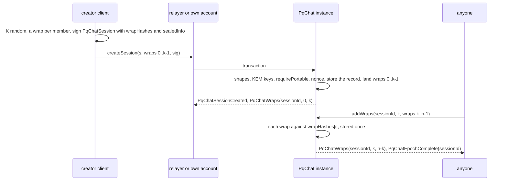
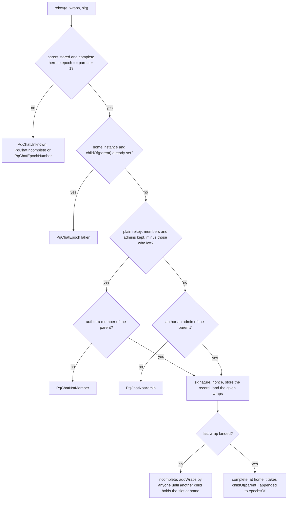
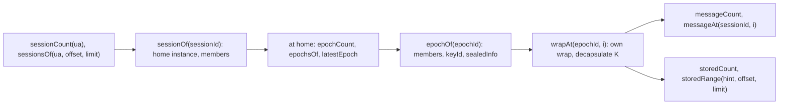

# PqChat

`PqChat` is the chat contract of the Universal Account (UA-7): post-quantum chat sessions whose epoch keys are
KEM-wrapped to each member on chain, signed on-chain and stored messages, and public topics with replies, edits and
votes. The chain holds identity, the KEM key directory and the control plane; messages travel on the stores a session
lists and go on chain only when the user chooses. Every record is signed by its author and checked by the contract; a
relayer only carries it.

Status: **BUILT on branch `ua-mtx-merge` (EVM), UNAUDITED** (`smartcontracts/evm/src/pqchat/{IPqChat,PqChatTypes,PqChatCore,PqChat,PqChatTopics}.sol`,
tests `smartcontracts/evm/test/pqchat/`, plan 3c T84–T92, T96: the deploy's `DEPLOY_PQCHAT`, 40 of 40 mutants); the
on-chain matrix (T95) is **PLANNED**. Clients (UA-7 T11–T14,
T17–T20) are **PLANNED**. Other families: **PLANNED**, each in its own `pqchat-<family>` round. Background and the full
design: the UA-7 spec [`2026-10-25-ua7-pq-e2e-sessions.md`](../superpowers/specs/2026-10-25-ua7-pq-e2e-sessions.md)
(P1–P47) and the topics spec [`2026-11-07-pqchat-public-topics.md`](../superpowers/specs/2026-11-07-pqchat-public-topics.md)
(P33–P46); this page is the normative text of what is built.

**Contents**

1. [Overview](#1-overview)
2. [The release on the factory](#2-the-release-on-the-factory)
3. [Records and typed signing](#3-records-and-typed-signing)
4. [Storage: blobs and events](#4-storage-blobs-and-events)
5. [Sessions and wraps](#5-sessions-and-wraps)
6. [Epochs, the home-instance slot, roles, leave](#6-epochs-the-home-instance-slot-roles-leave)
7. [Messages](#7-messages)
8. [Recovery from state alone](#8-recovery-from-state-alone)
9. [Public topics and votes](#9-public-topics-and-votes)
10. [Every external entry](#10-every-external-entry)
11. [Relaying](#11-relaying)
12. [Gas and size](#12-gas-and-size)
13. [Tests](#13-tests)
14. [Clients and other families](#14-clients-and-other-families)

## 1. Overview

Status: **BUILT** (EVM contract); the transports and the key schedule are client rules, **PLANNED** in clients.

<a id="CTR-CHAT-01"></a>**CTR-CHAT-01** — **PqChat: the chain holds identity, the KEM key directory and the control plane;
messages go to the stores a session lists, and on chain only by the user's choice** (owner 2026-11-04, D1–D13; changed
2026-11-04 to 2026-11-10, D14–D22 and the rulings of 2026-11-10; every decision in full in its
[register entry](../decisions.md#ctr-chat-01--pqchat-ua-7-matrix-carries-messages-the-chain-holds-keys-and-the-control-plane-ordered-epochs-admins-signed-messages-kem-rotation-msig-expansion-devices-metadata-hygiene-calls)).
In the contract, that means:

- **Control plane on chain** (D2): sessions, admins, members, epochs and the KEM wraps of each epoch key `K` are always
  in contract state ([CTR-CHAT-06](#CTR-CHAT-06)–[CTR-CHAT-10](#CTR-CHAT-10)).
- **One order of epochs** (D3): a parent epoch has one child, the first to complete in the session's home instance
  ([CTR-CHAT-08](#CTR-CHAT-08)).
- **Roles** (D4): admins change membership; any member rekeys plainly or leaves ([CTR-CHAT-09](#CTR-CHAT-09),
  [CTR-CHAT-10](#CTR-CHAT-10)).
- **Signed records, no deniability** (D7): every message, on chain or in a store, carries its author's PQ signature over
  the typed record ([CTR-CHAT-03](#CTR-CHAT-03)).
- **Stores** (D15, D17): a session lists its stores inside the encrypted `sealedInfo`; the contract is one of them through
  `storeMessage` ([CTR-CHAT-13](#CTR-CHAT-13)) and checks membership only on `postMessage` ([CTR-CHAT-11](#CTR-CHAT-11)).
- **Metadata hygiene** (D10): no Matrix room id, Matrix user id, HCS topic id or store list on chain in the clear; the
  contract never reads `sealedInfo`.
- **A factory kind** (D22): many instances per chain, each with its own state and an owner UA without power
  ([CTR-CHAT-02](#CTR-CHAT-02)); public topics live in each instance (D18–D21, [section 9](#9-public-topics-and-votes)).
- **Nothing is removed**: every accepted record stays in state; edits are new records.

The contract checks signatures, shapes, membership, the epoch rules and nonces; it runs no KEM, KDF or cipher. The key
schedule (hybrid KEM, wraps, sender chains, padding, envelope) is in the UA-7 spec
[§6](../superpowers/specs/2026-10-25-ua7-pq-e2e-sessions.md#6-key-schedule) and the transports in
[§7](../superpowers/specs/2026-10-25-ua7-pq-e2e-sessions.md#7-transports).

## 2. The release on the factory

Status: **BUILT** (`test/pqchat/PqChat.t.sol`, plan T85; the deploy script's registration, `DEPLOY_PQCHAT`, plan T92,
`test/governance/GovDeploy.t.sol` `test_deployPqChatPath`).

<a id="CTR-CHAT-02"></a>**CTR-CHAT-02** — **`PqChat` is class 3, kind 0 on `OpenFactory`'s generic path; each instance
reads its chain values from its own `ChainEnv`, is initialised once by the factory, and its owner UA has no power**
(owner 2026-11-07, D22 and Q2; the env check 3C-D1 is a controller call, owner may override).

- **Registration** (registrar): the body module `PqChatTopics(factory)` first (below), then
  `publishClassEnv(3, 0, envVersion, env)` with the module pinned in `env.libs` (its code hash in `env.libCodeHashes`,
  checked by the factory at `deployImplementation`), `deployImplementation(ReleaseId(3, 0, v), envVersion, IPqChat.initialize.selector,
  type(IPqChat).interfaceId, initcode, abi.encode(topics))`, `setClassKindEnabled(3, 0, true)` after the notice period. **Creation** (anyone): `createInstance(ReleaseId(3, 0, v), salt, abi.encodeCall(IPqChat.initialize,
  (ownerUA)))`, an EIP-1167 clone ([token-wrappers.md §6](token-wrappers.md#factory); the generic path is the factory
  index spec [`2026-11-07-factory-contract-index.md`](../superpowers/specs/2026-11-07-factory-contract-index.md) §8).
  The factory gets no `PqChat` code.
- **Constructor** `(ReleaseId id, address factory_, bytes implArgs)`: refuses `PqChatEnv` unless `id` is class 3, kind 0,
  version ≥ 1 and `factory_ ≠ 0`, and unless `implArgs = abi.encode(topics)` names code whose `FACTORY()` is `factory_`;
  immutables `FACTORY`, the version and the module. The implementation is locked
  (its `initialize` refuses `PqChatInitialized`) and reads an all-zero env, so every write on it refuses `PqChatEnv`.
- **Chain values** (3C-D1): the registry, `chain_uid` and the chain's code-size limit `params[0]` are the clone's
  `ChainEnv`, appended to its runtime code by the factory and read on every write (chain-neutral spec
  [`2026-11-07-chain-neutral-releases.md`](../superpowers/specs/2026-11-07-chain-neutral-releases.md) §2); none is an
  immutable of the release, so one bytecode serves every chain. `validateEnv(env)`, which the factory runs when it deploys
  a release, refuses `PqChatEnv` for `chainUid == 0`, `registry == 0`, no `params[0]`, or `params[0] < 24,576`
  (EIP-170's limit, the smallest of any EVM chain; one wrap blob needs 1,689 B). `chainEnv()` returns the decoded env.
- **`initialize(bytes32 ownerUA)`**: only `FACTORY` (`PqChatNotFactory`), once (`PqChatInitialized`), only on a clone
  with a well-formed env (`EnvMissing`). `ownerUA` may be 0, is fixed and has no transfer.
- **The owner UA names the instance and nothing more** (Q2): `owner()` returns it; it has no power over sessions, epochs,
  messages, topics, entries or votes, and no entry reads it. The instance has no pause, no admin and no upgrade.
- **Introspection**: `factoryInfo()` returns `(factory, chainUid, contractClass = 3, kind = 0, version, ownerUA,
  initialized)`; `supportsInterface` answers ERC-165 (`0x01ffc9a7`) and `type(IPqChat).interfaceId`.
- **The body module** ([CTR-TOK-30](token-wrappers.md#CTR-TOK-30), applied by 3C-D2 when the release passed the
  33,594 B line at 34,223 B): `PqChatTopics` holds the bodies of the public topics and votes (§9: the six writes and
  fourteen views). The release keeps every entry of `IPqChat` (one ABI, one `interfaceId`) and the bodies of the 1:1
  path (sessions, wraps, epochs, leave, `postMessage`, `storeMessage`, every recovery view); each topic entry forwards its
  calldata unchanged by `DELEGATECALL` to the module, whose revert or return data comes back verbatim, so the module runs
  in the instance's state and env (`PqChatCore`: the namespace, the env read, the signature check, the nonces, the blobs).
  Called directly, the module has no env and refuses every write `PqChatEnv`. `modules()` lists it (an immutable), and the
  factory refuses the release when its env does not pin it (`ModuleNotPinned`, [CTR-TOK-30](token-wrappers.md#CTR-TOK-30):
  every class's release is module-checked). No 1:1 entry pays for the split (§12).
- **Instances share nothing**: each keeps its sessions, epochs, messages, stored messages and topics in its own ERC-7201
  namespace `scaas.pqchat` (no plain slot; layout pinned in `test/v2/layout/PqChat.json` and `PqChatLayout.t.sol`). A
  client and the node take as a `PqChat` only an address the chain's factory lists as class 3 with version ≠ 0
  ([job-api.md](../node/job-api.md#pqchat-calls)).

## 3. Records and typed signing

Status: **BUILT** (`PqChatTypes.sol`, `test/pqchat/PqChatTypes.t.sol` against `smartcontracts/vectors/pqchat/`).

<a id="CTR-CHAT-03"></a>**CTR-CHAT-03** — **Every record is a typed EIP-712 struct in the portable domain `DS_C`, signed as
a `UASig` over `uaMessage(kind, PURPOSE_PQCHAT, typed(record))` and checked by the registry's `requirePortable`**
(owner answer 4 of 2026-10-25, O1 of 2026-11-04).

- **Domain.** `DS_C = keccak256(abi.encode(keccak256("EIP712Domain(string name,string version)"), keccak256("SCaaS PqChat"),
  keccak256("1")))`: no chain id, no contract address, so a record is the same bytes in every instance on every chain.
  `typed(s) = keccak256(0x1901 ‖ DS_C ‖ hashStruct(s))`, `hashStruct` as EIP-712 (arrays of `bytes32` as the keccak of
  their packed words, struct arrays as the keccak of their member hashes, `bytes` and `string` as their keccak).
- **Signature.** `PURPOSE_PQCHAT = keccak256("scaas.ua.purpose.pqchat.v1")`. The contract calls
  `IUARegistry.requirePortable(signer, PURPOSE_PQCHAT, typed(record), sig)`: a single key, or an `msig` in minimal form
  over two levels by its quorum (`UASig.members`; [CTR-UA-07](accounts.md#CTR-UA-07), [CTR-UA-37](accounts.md#CTR-UA-37),
  [CTR-UA-38](accounts.md#CTR-UA-38)). Native ids and unregistered UAs are refused by the registry (`UAUnauthorized`),
  as is a verifier left too little gas (`UAVerifyGas`); those reverts bubble unchanged, except where
  [CTR-CHAT-15](#CTR-CHAT-15) names them `PqTopicNotOwner`. A `PqChat` release deploys only against a registry that has
  `requirePortable`.
- **No fee, no deadline, no submitter** in any record ([CTR-CHAT-19](#CTR-CHAT-19)).
- **The type strings**, exactly as `PqChatTypes.sol` hashes them, pinned by `*TypehashIsPinned` against the vectors. Each
  differs from every other, so a session signature is never a topic record:

| Struct | Type string | Signed by |
|---|---|---|
| `MemberKey` | `MemberKey(bytes32 ua,uint64 keyId,bytes32 via)` | (inside the session and epoch types) |
| `Wrap` | `Wrap(bytes32 member,uint64 keyId,bytes mlkemCt,bytes32 x25519Eph,bytes sealedKey)` | not signed; `wrapHashes[i] = hashStruct(Wrap_i)` |
| `PqChatSession` | `PqChatSession(bytes32 creator,uint64 nonce,bytes32 homeChain,address homeChatContract,bytes32[] admins,MemberKey[] members,bytes32[] wrapHashes,bytes sealedInfo)MemberKey(bytes32 ua,uint64 keyId,bytes32 via)` | `creator` |
| `PqChatEpoch` | `PqChatEpoch(bytes32 sessionId,bytes32 author,uint64 nonce,uint64 epoch,bytes32 parentEpochId,bytes32[] admins,MemberKey[] members,bytes32[] wrapHashes,bytes sealedInfo)MemberKey(bytes32 ua,uint64 keyId,bytes32 via)` | `author` |
| `PqChatLeave` | `PqChatLeave(bytes32 sessionId,bytes32 epochId,bytes32 member,uint64 nonce)` | `member` |
| `PqChatMessage` | `PqChatMessage(bytes32 sessionId,bytes32 epochId,bytes32 sender,bytes16 device,uint64 counter,bytes32[] parents,bytes ciphertext)` | `sender` |
| `PqTopic` | `PqTopic(bytes32 owner,uint64 nonce,bytes32 homeChain,address homeChatContract,string name,bytes about,bool openReplies)` | `owner` |
| `PqTopicUpdate` | `PqTopicUpdate(bytes32 topicId,uint64 seq,string name,bytes about,bool openReplies)` | the topic's owner |
| `PqTopicWriter` | `PqTopicWriter(bytes32 topicId,bytes32 writer,bool granted,uint64 seq)` | the topic's owner |
| `EntryRef` | `EntryRef(bytes32 chainUid,address pqchat,bytes32 entryId,bytes32 contentHash)` | (inside `PqTopicEntry`) |
| `PqTopicEntry` | `PqTopicEntry(bytes32 topicId,bytes32 author,uint64 nonce,bytes32 parentId,EntryRef ref,string mediaType,bytes body)EntryRef(bytes32 chainUid,address pqchat,bytes32 entryId,bytes32 contentHash)` | `author` |
| `PqTopicEdit` | `PqTopicEdit(bytes32 entryId,bytes32 author,uint64 nonce,uint32 version,string mediaType,bytes body)` | the entry's author |
| `PqTopicVote` | `PqTopicVote(bytes32 entryId,bytes32 voter,int8 value,uint64 seq)` | `voter` |

<a id="CTR-CHAT-21"></a>**CTR-CHAT-21** — **`PqChatSession` and `PqTopic` name their home instance by `homeChain` and
`homeChatContract`** (owner 2026-11-10: the address field's new name; `homeChain` keeps its name). The field is part of both
type strings above, so both typehashes moved with it: `PqChatSession` `0xe2c3b4c1…ad1e4d`, `PqTopic` `0x75bed97b…2e1623`
(full values in `test/pqchat/PqChatTypes.t.sol` and `smartcontracts/vectors/pqchat/`). Status: **BUILT**.

<a id="CTR-CHAT-04"></a>**CTR-CHAT-04** — **Ids are hashes of the signer and its nonce; a nonce is a bit in a per-scope
bitmap, used in any order, checked after the signature; a record that replaces a value carries `seq` and lands only at
`seq == stored + 1`** (owner answer 7 of 2026-10-25; the scope tags 3C-D5 are a controller call, owner may override).

```text
sessionId = keccak256(abi.encode(keccak256("scaas/pqchat/v1/session"), creator, nonce))          epoch 0's id too
epochId   = keccak256(abi.encode(keccak256("scaas/pqchat/v1/epoch"), sessionId, author, nonce))  epochs >= 1
topicId   = keccak256(abi.encode(keccak256("scaas/pqchat/v1/topic"), owner, nonce))
entryId   = keccak256(abi.encode(keccak256("scaas/pqchat/v1/entry"), topicId, author, nonce))
messageId = typed(PqChatMessage)

scope(session) = keccak256(abi.encode(keccak256("scaas/pqchat/v1/scope/session"), creator))
scope(epoch)   = keccak256(abi.encode(keccak256("scaas/pqchat/v1/scope/epoch"), sessionId, author))     rekeys and leaves
scope(message) = keccak256(abi.encode(keccak256("scaas/pqchat/v1/scope/message"), epochId, sender, device))  nonce = counter
scope(topic)   = keccak256(abi.encode(keccak256("scaas/pqchat/v1/scope/topic"), owner))
scope(entry)   = keccak256(abi.encode(keccak256("scaas/pqchat/v1/scope/entry"), topicId, author))      entries and edits
```

- **Bitmaps.** Word `nonce >> 8`, bit `nonce & 0xff`, per scope and per instance. Any order (5 may land before 4), never
  locked; a used nonce refuses `PqChatNonceUsed(scope, nonce)`. The signature is checked first, so a forged record
  burns no nonce. Views: `nonceUsed(scope, nonce)`, `topicNonceUsed(owner, nonce)`, `entryNonceUsed(topicId, author,
  nonce)`.
- **`seq` records.** `PqTopicUpdate` per `topicId`, `PqTopicWriter` per `(topicId, writer)`, `PqTopicVote` per `(entryId,
  voter)`: accepted only at the stored `seq + 1` (`PqTopicSeq(expected, got)`), so a `seq` far ahead cannot lock a value.
- **The same record in two instances** gets the same id in each and uses each instance's own bitmap: copying records is
  how replicas and mirrors are made ([CTR-CHAT-08](#CTR-CHAT-08)).

## 4. Storage: blobs and events

Status: **BUILT** (`PqChatMessages.t.sol`, `PqTopics.t.sol`, `PqChatLayout.t.sol`).

<a id="CTR-CHAT-05"></a>**CTR-CHAT-05** — **Every accepted record is kept in full in contract state, in SSTORE2 blobs no
larger than the chain's code-size limit; an event only notifies, and only three events carry a signature's bytes**
(owner D11 of 2026-11-04 and the topics ruling of 2026-11-07; the blob format 3C-D3 and the event set 3C-D4 are controller
calls, owner may override).

- **Signed records.** Stored as `abi.encode(record, sigHash)`, `sigHash = keccak256(abi.encode(UASig))`. A blob's runtime
  is at most `min(params[0], 65,535)` B (65,535 is `SSTORE2.write`'s bound) including the leading `STOP`. A record that
  does not fit one blob is chained: each blob is led by a flag byte, `0x01` and the next blob's 20-byte address, the last
  by `0x00`; readers follow the chain from the head pointer kept in a slot. A `postMessage` record must fit one blob
  ([CTR-CHAT-11](#CTR-CHAT-11)).
- **Stored messages** keep the raw payload `abi.encode(v, hint, env)` in one blob, no flag ([CTR-CHAT-13](#CTR-CHAT-13)).
- **Wraps** are packed per call, `member (32) ‖ keyId (8, big-endian) ‖ mlkemCt (1,568) ‖ x25519Eph (32) ‖ sealedKey (48)`
  = 1,688 B each, as many per blob as the limit holds (`⌊(min(params[0], 65,535) − 1) / 1,688⌋`: 14 at 24,576 B, 38 at
  65,535 B and above), and one slot per wrap (`pointer | offset << 160`) marks it landed ([CTR-CHAT-07](#CTR-CHAT-07)).
- **Events** (D11, 3C-D4): `PqChatMessagePosted(sessionId, messageId, sender, index, sig)`, `PqTopicEntryPosted(topicId,
  entryId, parentId, author, sig)` and `PqTopicEntryEdited(entryId, version, sig)` carry the `UASig`, so a mirror can
  copy the record elsewhere; every other event carries no signature: `PqChatSessionCreated(sessionId, creator,
  homeChain)`, `PqChatEpochAdded(sessionId, epochId, parentEpochId, epoch, author)`, `PqChatWraps(epochId, first, count)`,
  `PqChatEpochComplete(epochId)`, `PqChatLeft(sessionId, epochId, member)`, `PqChatStored(hint, index)`,
  `PqTopicCreated(topicId, owner)`, `PqTopicUpdated(topicId, seq)`, `PqTopicWriterSet(topicId, writer, granted, seq)`,
  `PqTopicVoted(entryId, voter, value, seq)`. No view reads a log and no reader needs one ([CTR-CHAT-14](#CTR-CHAT-14)).
- Ciphertexts (`mlkemCt`, `sealedKey`, `sealedInfo`, a message's `ciphertext`, a stored `env`) stay in state, never only
  a hash with the bytes in calldata or an event.

## 5. Sessions and wraps

Status: **BUILT** (`test/pqchat/PqChat.t.sol`, plan T85).

<a id="CTR-CHAT-06"></a>**CTR-CHAT-06** — **A session is epoch 0: its creator is a member and an admin, its members are
KEM holders strictly sorted, its home instance is named; the 2-member session is the main case** (UA-7 spec P8, P3; the
shapes 3C-D6 are a controller call, owner may override; the main case owner 2026-11-10).

`createSession(PqChatSession s, Wrap[] wraps, UASig sig)` accepts when:

- `members` has at least 2 entries, strictly sorted by `ua`, and `wrapHashes` has one hash per member (`PqChatShape`);
- every `members[i]` holds a KEM key of version `keyId` in this chain's registry (`kemKeyAt(ua, keyId).scheme ≠ 0`,
  [CTR-UA-32](accounts.md#CTR-UA-32); `PqChatKemKey(member, keyId)`); the contract does not read `via` ([`msig` seats
  are expanded by the author's client](../superpowers/specs/2026-10-25-ua7-pq-e2e-sessions.md#3-members-kem-keys-devices));
- `admins` is strictly sorted and each is registered; an admin needs a KEM key only if it is also a member
  (`PqChatShape`);
- `creator` is in `admins` and in `members`, `homeChain ≠ 0`, `homeChatContract ≠ 0` (`PqChatShape`);
- `creator` signed it ([CTR-CHAT-03](#CTR-CHAT-03)) and `(creator, nonce)` is unused ([CTR-CHAT-04](#CTR-CHAT-04));
- the given wraps land ([CTR-CHAT-07](#CTR-CHAT-07)).

The instance is the session's **home** when `homeChain == chainEnv().chainUid` and `homeChatContract == address(this)`, fixed
at creation; anywhere else the record is a replica. `parents`, `sealedInfo` and padding are client rules and not checked.
Anyone may create a session listing any UA: consent is the client's (D5, [CTR-CHAT-14](#CTR-CHAT-14)).

**The main case is a 2-person chat** (owner 2026-11-10): layout and gas are optimised for a 2-member session and its
figures come first in the gas rows; groups stay correct and tested, and no 1:1 gas is traded for a group feature.

<a id="CTR-CHAT-07"></a>**CTR-CHAT-07** — **Wraps may arrive in chunks, by anyone: each must hash to its signed
`wrapHashes[i]` and name `members[i]`, lands once, and the epoch is complete when its last wrap has landed** (UA-7 spec
P11: no block-limit assumption).

- `createSession` and `rekey` take any prefix of the wraps, `wraps[j]` as index `j`; `addWraps(epochId, first, wraps)`
  takes `wraps[j]` as index `first + j`, **unsigned, from anyone**: the signed hashes fix the bytes.
- Each wrap: `first + wraps.length ≤ members.length` (`PqChatShape`); `hashStruct(wrap) == wrapHashes[i]`
  (`PqChatWrapHash(epochId, i)`); `mlkemCt` 1,568 B, `sealedKey` 48 B, `member == members[i].ua`, `keyId ==
  members[i].keyId` (`PqChatShape`); index `i` not landed yet (`PqChatWrapStored(epochId, i)`). `addWraps` on an unknown
  id refuses `PqChatUnknown(epochId)`; on a child whose home slot another child holds, `PqChatEpochTaken`
  ([CTR-CHAT-08](#CTR-CHAT-08)).
- `PqChatWraps(epochId, first, count)` per call; `PqChatEpochComplete(epochId)` when the last wrap lands. `epochComplete(id)`
  and `wrapAt(epochId, i)` (all zero until landed) read it.
- A client puts as many wraps in a transaction as its chain's limits allow (EIP-8037: regular + state gas within the block
  limit) and sends the rest by `addWraps`; group size has no protocol bound.



## 6. Epochs, the home-instance slot, roles, leave

Status: **BUILT** (`test/pqchat/PqChatEpochs.t.sol`, plan T86).

<a id="CTR-CHAT-08"></a>**CTR-CHAT-08** — **An epoch is its parent's number plus one, from a parent stored and complete in
the same instance; in the home instance the first child of a parent to complete takes the parent's slot and no other
child of it can land or complete there; replicas store every complete child** (owner D3 of 2026-11-04, UA-7 spec P9).

`rekey(PqChatEpoch e, Wrap[] wraps, UASig sig)` accepts when:

- `e.parentEpochId` is stored in this instance for `e.sessionId` (`PqChatUnknown(parentEpochId)`), complete
  (`PqChatIncomplete(parentEpochId)`), and `e.epoch == parent.epoch + 1` (`PqChatEpochNumber(expected, got)`);
- at home, `childOf(parentEpochId)` is zero (`PqChatEpochTaken(parentEpochId, child)`);
- `members` (at least 1) and `admins` pass the list checks of a session (sorted, one hash per member, each member's
  `keyId` held here, admins registered: `PqChatShape`, `PqChatKemKey`) and the author's rights hold
  ([CTR-CHAT-09](#CTR-CHAT-09));
- `author` signed it and `(sessionId, author, nonce)` is unused in the epoch scope;
- the given wraps land ([CTR-CHAT-07](#CTR-CHAT-07)).

**The slot.** At home, an epoch ≥ 1 takes `childOf(parent)` when its last wrap lands; from then on `rekey` on that parent
and `addWraps` on any other child of it refuse `PqChatEpochTaken`. An incomplete child never takes the slot, so nobody
locks a session by starting an epoch and never finishing it: anyone may finish it with `addWraps`. **In every other
instance**, on this chain or another, `childOf` reads zero and every complete child is stored; clients follow the home's
`childOf` (and its `epochsOf`, [CTR-CHAT-14](#CTR-CHAT-14)). A removed member's competing child is refused at home by
the slot or by its number:



<a id="CTR-CHAT-09"></a>**CTR-CHAT-09** — **A plain rekey keeps the parent's members and admins, minus those who left the
parent epoch, and may be authored by any member of the parent who has not left it; anything else is a membership change and needs an admin of
the parent** (owner D4 of 2026-11-04, O2 and O4; the exact test 3C-D7 is a controller call, owner may override).

- **Plain rekey**: `members(e)` by `ua` equals `members(parent)` minus entries that left the parent epoch, and `admins(e)`
  equals `admins(parent)` minus entries that left; `keyId` and `via` may change. Its author must be a member of the parent
  that has not left it (`PqChatNotMember(author)`; Fable review 2026-11-10, P1-2 fix (a)).
- **The limit** (UA-7 spec P9): the first complete child wins, so a member about to be removed can keep answering each
  new tip with its own plain rekey that keeps it; the admin rekeys again from that child. Liveness only (the member never
  reads an epoch it is not wrapped into); `leave` ends it for a member who leaves, `remove` (CTR-CHAT-20) for one who
  does not.

<a id="CTR-CHAT-20"></a>**CTR-CHAT-20** — **An admin of an epoch removes members of it with a signed `remove`; a child of
that epoch then completes only without them, and a removed member authors no rekey of it** (owner 2026-11-10, on the Fable
review's P1-2 fix (b); **BUILT** on `ua-mtx-merge`, plan 3c, UNAUDITED; UA-7 spec P48).

- `remove(PqChatRemove r, UASig sig)`, `PqChatRemove(bytes32 sessionId,bytes32 epochId,uint64 nextEpoch,bytes32[] members,
  bytes32 admin,uint64 nonce)`: `epochId` stored for `sessionId` and complete (`PqChatUnknown`, `PqChatIncomplete`), at
  home with no complete child (`PqChatEpochTaken`); `nextEpoch == epoch(epochId) + 1` (`PqChatEpochNumber`); 1 to
  `REMOVE_MAX` = 16 members, strictly sorted (`PqChatShape`), each a member of `epochId` (`PqChatNotMember`); `admin` an
  admin of `epochId` (`PqChatNotAdmin`) who signs it; the nonce in the epoch scope `(sessionId, admin)` (`PqChatNonceUsed`).
  Anyone submits it, relayable with a fee of 0. The record and its `sigHash` are kept in state.
- After it: a child of `epochId` completes (in `rekey` or the last `addWraps`) only if its members and admins hold no
  removed UA (`PqChatRemovedKept(epochId, ua)`), whoever authors it; a removed member's rekey of `epochId` is refused
  `PqChatNotMember`; dropping a removed member is a plain rekey, as dropping a leaver is.
- `leave` stays the member's own flag (a child may keep a leaver); both may hold for one UA.
- Recovery: `removedIn(epochId, ua)`, `removalCount(epochId)`, `removalAt(epochId, i)`; `PqChatRemoved(sessionId, epochId,
  admin, members)` notifies. A 2-person chat is unchanged.
- **Membership change**: any member or admin added, or one dropped without having left. Its author must be an admin of
  the parent (`PqChatNotAdmin(author)`). An `msig` admin signs by its quorum ([CTR-CHAT-03](#CTR-CHAT-03)).
- **O2**: a plain rekey may take a parent's slot before an admin's change; the admin rekeys again from the new epoch, with
  no precedence rule. **O4**: with no admin left, membership is frozen; plain rekeys and messages continue.
- A new `K` is fresh randomness in the client, never derived from the old one, so a removed member cannot read the next
  epoch.

<a id="CTR-CHAT-10"></a>**CTR-CHAT-10** — **A member of an epoch leaves it by a signed `PqChatLeave`; the leave is a flag
that lets the next epoch drop it as a plain rekey, and nothing else** (owner D4 of 2026-11-04, UA-7 spec P12; the flag
and its nonce 3C-D8 are a controller call, owner may override).

`leave(PqChatLeave l, UASig sig)`: `l.epochId` stored for `l.sessionId` (`PqChatUnknown(epochId)`), `l.member` in its
`members` (`PqChatNotMember(member)`), signed by `member`, nonce in the epoch scope `(sessionId, member)` shared with its
rekeys. It sets `leftIn(epochId, member)` and emits `PqChatLeft`; a repeated leave with a fresh nonce is accepted and
changes nothing more. The flag is read only by the plain-rekey test of [CTR-CHAT-09](#CTR-CHAT-09): until the next
epoch, the member stays in the epoch's list, may still post in it and keeps its `sessionsOf` entry. An admin that is not a
member cannot leave, so only a membership change drops it. Consent stays in clients: a member that never accepted a
session leaves it this way (D5).

## 7. Messages

Status: **BUILT** (`test/pqchat/PqChatMessages.t.sol`, plan T87; the device id as `bytes16` per the owner's ruling of
2026-11-10).

<a id="CTR-CHAT-11"></a>**CTR-CHAT-11** — **`postMessage` stores a member's signed message of a complete epoch, the
signature's hash in state and its bytes in the event; the nonce scope is `(epochId, sender, device)` over `counter`**
(owner D2 and D11 of 2026-11-04, UA-7 spec P16).

`postMessage(PqChatMessage m, UASig sig) returns (uint256 index)`: `m.epochId` stored for `m.sessionId`
(`PqChatUnknown(epochId)`) and complete here (`PqChatIncomplete(epochId)`), at home not yet followed by a complete child
(`PqChatEpochTaken(epochId, child)`; UA-7 spec §6.3, Fable review 2026-11-10 P1-1: a member the child dropped cannot post
under the old epoch later; one SLOAD, `childOf` being written at home only, so a replica takes it), `m.sender` in its `members`
(`PqChatNotMember(sender)`), signed by `sender`, `counter` unused in `scope(message)` (`PqChatNonceUsed`), and
`abi.encode(m, sigHash)` fits one blob (`PqChatShape`). The blob is appended to the session's list: `messageCount(sessionId)`,
`messageAt(sessionId, index)` returns the record and `sigHash`. `PqChatMessagePosted(sessionId, messageId, sender, index,
sig)` with `messageId = typed(m)`: the same id as the same record on every other store. The epoch may be any complete
epoch stored in this instance (the home's or a replica's); the contract does not check `parents`, padding or the
1,024-B bucket (client rules, UA-7 spec §6.5). Use it when the contract itself must enforce membership; it costs gas
and is public forever, so a client posts on chain only when its user chooses.

<a id="CTR-CHAT-12"></a>**CTR-CHAT-12** — **The device id is a 16-byte UUID (`bytes16`), v7 or v4 at the client's choice;
nothing checks its version or variant bits** (owner 2026-11-10). It is a field of `PqChatMessage`, its type string and
`messageId`, and a dimension of the nonce scope `(epochId, sender, device)`; in clients it also enters the sender chain,
the AAD and the call keys. The device makes it when it is linked or restored; a restored device always makes a new one,
with no collision check on restore (122 random bits). The contract never parses it: any 16 bytes, zero included, are a
device. Its cost, plainly: **on `postMessage` a v7 id makes the device's creation time (milliseconds) public, while a v4
id hides it; on `storeMessage` it stays inside the envelope either way.**

<a id="CTR-CHAT-13"></a>**CTR-CHAT-13** — **`storeMessage` keeps an opaque store payload in state with no signature,
membership or nonce check; its list per 8-byte hint is read whole or by page** (owner D15 of 2026-11-05, `storedRange`
owner 2026-11-10; keeping it in `PqChat` 3C-D2 is a controller call, owner may override).

- `storeMessage(uint8 v, bytes8 hint, bytes env) returns (uint256 index)`: **anyone**, unsigned; only `v == 1` and that
  `abi.encode(v, hint, env)` plus the `STOP` byte fits one blob (`PqChatShape`). It appends that payload, the same bytes
  as the HCS and Waku payload of the UA-7 spec
  [§7.2](../superpowers/specs/2026-10-25-ua7-pq-e2e-sessions.md#72-chain-postmessage-and-storemessage), to the list of
  `hint` and emits `PqChatStored(hint, index)`. It reads no registry and no epoch, so no epoch replica is needed on that
  chain. Spam pays its own gas; clients open the envelope and drop what fails their checks.
- Views: `storedCount(hint)`, `storedAt(hint, index)` (the payload), and `storedRange(hint, offset, limit)`: the payloads
  `[offset, min(offset + min(limit, STORED_RANGE_MAX), count))`, `STORED_RANGE_MAX = 16` (16 blobs of at most 65,535 B,
  about 1 MiB returned and about 9 M gas of memory in an `eth_call`); an offset past the end gives an empty page, never a
  revert.
- On-chain readers see the hint (which links an epoch's stored messages on every chain they are copied to), the size,
  the submitter and the time; not the session, sender, device or counter.

## 8. Recovery from state alone

Status: **BUILT** (`test/pqchat/PqChatRecovery.t.sol`, plan T96).

<a id="CTR-CHAT-14"></a>**CTR-CHAT-14** — **A client keeps no session list and reads no event: a new or reinstalled device
finds its sessions, their epochs and their messages through views alone; spam is the client's decision, off chain**
(owner 2026-11-10, UA-7 spec P47).

- **Sessions of a UA.** `sessionCount(ua)` and `sessionsOf(ua, offset, limit)`: one entry per member at `createSession`
  and one per member a `rekey` adds to its parent (by `ua`); admins that are not members get none. Append-only: a removed
  or leaving member keeps its entry (clients check `leftIn` and the latest epoch's members), a member added again gets
  another entry; a `rekey` that never completes or loses the slot leaves its entries too, so entries may repeat and clients
  de-duplicate (Fable P3-2).
- **Which instances** (Fable P2-1): `sessionsOf` is per instance, so a client pages the factory's index for class 3
  (`contractsPage(3, …)`, version ≠ 0) on each chain it serves and reads `sessionCount(ua)` on each listed instance.
- **Replicas** (Fable P2-2): a replica's record counts only when it equals the home's (same record and `sigHash` under
  the id); membership is read from the home instance.
- **Epochs of a session.** `epochCount(sessionId)` and `epochsOf(sessionId, offset, limit)`: epoch 0 (the `sessionId`)
  first once complete here, then each epoch ≥ 1 as it completes here. At home a child completes only by taking its
  parent's slot, so the list is the winning chain 0..n; in a replica it is every complete epoch in completion order,
  competing children included (a replica orders nothing: clients follow the home's list). `latestEpoch(sessionId)` is the
  list's last entry, zero while the session is not complete here; it has no slot of its own.
- **Paging.** `[offset, min(offset + min(limit, MAX), count))`, an offset past the end empty, never a revert;
  `SESSIONS_RANGE_MAX = EPOCHS_RANGE_MAX = 128` ids.
- **The rest** is read from the records: `sessionOf`, `epochOf`, `wrapAt`, `leftIn`, `messageCount` / `messageAt`,
  `storedCount` / `storedRange`.
- **Spam**: `sessionsOf` lists every session anyone created naming the UA; there is no on-chain consent or acceptance
  step, and the client decides what to show (D5). A record listing N UAs with no wrap indexes all N for about 0.3 M state
  gas per UA and is never usable (`epochCount` 0): clients skip such a session first (Fable P2-3; the owner's ruling keeps
  the entry at `createSession`). Before its user accepts a session, a client makes no network call and no write derived
  from its wraps or `sealedInfo`, and sends nothing that depends on whether a wrap or message opened (Fable P2-4, UA-7
  spec P12).



## 9. Public topics and votes

Status: **BUILT** (`test/pqchat/PqTopics.t.sol`, `PqTopicVotes.t.sol`, plan T88–T89). Topics share the domain, the
signature check, the nonce bitmaps and the blobs with sessions, and no cryptography: nothing in a topic is encrypted.

<a id="CTR-CHAT-15"></a>**CTR-CHAT-15** — **Any registered UA may create a topic; only its owner updates it and grants or
revokes writers; nothing on chain is hidden and nobody moderates** (owner D18, D19 and Q2 of 2026-11-07; topics spec P37,
P41).

- `createTopic(PqTopic t, UASig sig) returns (bytes32 topicId)`: `name` 1–512 B (owner 2026-11-10; was 1–128 B),
  `homeChain ≠ 0`, `homeChatContract ≠ 0` (`PqTopicShape`; no other rule reads the home), signed by `owner`, `(owner, nonce)` unused in the topic scope. `about`
  is Markdown bytes; `openReplies` is the reply flag (clients create topics with `true`, D19). The owner is fixed for the
  topic's life; an `msig` owner gives shared ownership.
- `updateTopic(PqTopicUpdate u, UASig sig)`: the topic exists (`PqTopicUnknown`), `seq == stored + 1` (`PqTopicSeq`),
  `name` 1–512 B (`PqTopicShape`), signed by the topic's owner. It replaces `name`, `about` and `openReplies`;
  `topicOf(topicId)` returns the create record with the latest values and `seq`. A topic record is stored as every record
  (`_put`): one SSTORE2 blob while it fits the chain's limit, else a chain of blobs; `about` has no bound of its own.
- `setTopicWriter(PqTopicWriter w, UASig sig)`: the topic exists, `writer` is neither 0 nor the owner (`PqTopicShape`),
  `seq == stored + 1` per `(topicId, writer)`, signed by the topic's owner. `writerOf(topicId, ua)` returns `(granted,
  seq)`; `writersOf` lists the writer from its first record.
- The update and writer records name no signer, so a signature the registry refuses as `UAUnauthorized` is reported as
  `PqTopicNotOwner(owner)`; any other registry revert bubbles.
- **No hide flag, no moderator role, no ban list** (D18); the instance's owner UA has no right here
  ([CTR-CHAT-02](#CTR-CHAT-02)). A client may filter locally. Rights are read from this instance's state at submission.

<a id="CTR-CHAT-16"></a>**CTR-CHAT-16** — **Posts and replies are one record with a `parentId`; bodies are kept in full in
state; an edit is a new version by the original's author; a reference to another instance is stored as given and never
checked** (owner D19, D20 and Q1 of 2026-11-07; topics spec P33, P35, P38).

- `postEntry(PqTopicEntry e, UASig sig) returns (bytes32 entryId)`: the topic exists (`PqTopicUnknown`). A **post**
  (`parentId == 0`, depth 0) is by the owner or a granted writer (`PqTopicNotWriter(author)`). A **reply** names an entry
  of the same topic in this instance (`PqTopicParent(parentId)`), depth = the parent's + 1 with no bound; with
  `openReplies` any UA the registry verifies may reply, otherwise only the owner or a writer. `mediaType` 1–64 B and a
  non-empty `body` (`PqTopicShape`); `ref` all zero or with `chainUid`, `pqchat` and `entryId` non-zero (`PqTopicRef`);
  signed by `author`; `(topicId, author, nonce)` unused in the entry scope. A revoked writer's entries stay; its new posts
  are refused.
- **Bodies**: always in state, bounded only by the transaction (EIP-8037); a longer text goes as follow-up replies by the
  same author (Q1). The contract checks only the length of `mediaType`; clients write `text/markdown`.
- **`ref`**: `(chainUid, pqchat, entryId, contentHash)`, `contentHash` zero or the `typed` digest of the referenced
  version. No bridge, no proof, no read across chains: the target may not exist. A reader resolves it on that chain.
- `editEntry(PqTopicEdit d, UASig sig)`: the original exists (`PqTopicUnknown(entryId)`), `author` is the original's
  (`PqTopicNotAuthor`; the topic owner included), `version == count + 1` with the first edit 2 (`PqTopicVersion(expected,
  got)`), `mediaType` and `body` as above, signed by `author`, nonce in the original's topic scope. An edit keeps the
  original's topic, parent, reference, votes and place in every list; replies and votes attach to the original id.
  `entryOf(entryId)` returns the place and the latest version (`versionCount` included), `versionAt(entryId, version)`
  any version, 1 being the original (`PqTopicVersion(count, version)` outside `1..count`).

<a id="CTR-CHAT-17"></a>**CTR-CHAT-17** — **One vote per UA per entry, changeable; the counts `up` and `down` are kept in
state** (owner D21 of 2026-11-07; topics spec P40).

`voteEntry(PqTopicVote v, UASig sig)`: the entry exists in this instance (`PqTopicUnknown`), `value` is −1, 0 or +1
(`PqTopicVoteValue`), `seq == stored + 1` per `(entryId, voter)` (`PqTopicSeq`), signed by `voter`. One slot per `(entry,
voter)` holds `(value, seq)`; a new vote moves the counts (the old value's count − 1, the new one's + 1), 0 withdraws.
`scoreOf(entryId)` returns `(up, down)`, never a combined score; `voteOf(entryId, ua)` returns `(value, seq)`. Votes count
UAs, not people; a client may weigh or filter voters on its own.

<a id="CTR-CHAT-18"></a>**CTR-CHAT-18** — **Every topic list lives in state, append-only, and answers a page as `(ids,
total)`** (owner 2026-11-07, topics spec P42; the shape 3C-D8 is a controller call, owner may override).

`topics(start, count)`, `topicsByOwner(owner, start, count)`, `writersOf(topicId, start, count)`, `posts(topicId, start,
count)`, `replies(parentId, start, count)` and `byAuthor(author, start, count)` (originals only, every topic) return at
most `count` ids from `start`, fewer at the end, empty past it, and the list's length; `count = 0` is the count view. No
clamp: the call's gas bounds a page. The node's indexer may mirror them; the state is the answer.

## 10. Every external entry

Status: **BUILT**. Errors are those of `IPqChat.sol`; "registry" means the bubbled `UAUnauthorized` / `UAVerifyGas` of
`requirePortable`. Every write first reads the env (`PqChatEnv` on the implementation or a clone without a usable env).

| Entry | Who signs / calls | What it checks | Named errors |
|---|---|---|---|
| `constructor(ReleaseId, factory_, implArgs)` | the factory, at `deployImplementation` | class 3, kind 0, version ≥ 1, factory ≠ 0 | `PqChatEnv` |
| `validateEnv(ChainEnv)` | the factory, at `deployImplementation` (view) | `chainUid`, registry, `params[0] ≥ 24,576` | `PqChatEnv` |
| `initialize(bytes32 ownerUA)` | `FACTORY` only, at `createInstance` | the caller, once, a well-formed env | `PqChatNotFactory`, `PqChatInitialized`, `EnvMissing` |
| `createSession(s, wraps, sig)` | anyone submits; `s.creator` signs | shapes, KEM keys, creator in both lists, home named, signature, nonce, wraps | `PqChatShape`, `PqChatKemKey`, registry, `PqChatNonceUsed`, `PqChatWrapHash` |
| `rekey(e, wraps, sig)` | anyone submits; `e.author` signs | parent, number, home slot, shapes, rights, signature, nonce, wraps | `PqChatUnknown`, `PqChatIncomplete`, `PqChatEpochNumber`, `PqChatEpochTaken`, `PqChatShape`, `PqChatKemKey`, `PqChatNotMember`, `PqChatNotAdmin`, registry, `PqChatNonceUsed`, `PqChatWrapHash` |
| `addWraps(epochId, first, wraps)` | anyone, unsigned | epoch known, home slot free, range, hash, shape, landed once | `PqChatUnknown`, `PqChatEpochTaken`, `PqChatShape`, `PqChatWrapHash`, `PqChatWrapStored` |
| `leave(l, sig)` | anyone submits; `l.member` signs | epoch of that session, member of it, signature, nonce | `PqChatUnknown`, `PqChatNotMember`, registry, `PqChatNonceUsed` |
| `remove(r, sig)` | anyone submits; `r.admin` signs | epoch of that session, complete, no complete child at home, `nextEpoch`, 1–16 sorted members of it, admin of it, signature, nonce | `PqChatUnknown`, `PqChatIncomplete`, `PqChatEpochTaken`, `PqChatEpochNumber`, `PqChatShape`, `PqChatNotAdmin`, `PqChatNotMember`, registry, `PqChatNonceUsed` |
| `postMessage(m, sig)` | anyone submits; `m.sender` signs | epoch of that session, complete, at home no complete child, sender a member, signature, nonce, one blob | `PqChatUnknown`, `PqChatIncomplete`, `PqChatEpochTaken`, `PqChatNotMember`, registry, `PqChatNonceUsed`, `PqChatShape` |
| `storeMessage(v, hint, env)` | anyone, unsigned | `v == 1`, one blob | `PqChatShape` |
| `createTopic(t, sig)` | anyone submits; `t.owner` signs | name length, home named, signature, nonce | `PqTopicShape`, registry, `PqChatNonceUsed` |
| `updateTopic(u, sig)` | anyone submits; the topic's owner signs | topic known, `seq`, name length, owner's signature | `PqTopicUnknown`, `PqTopicSeq`, `PqTopicShape`, `PqTopicNotOwner` |
| `setTopicWriter(w, sig)` | anyone submits; the topic's owner signs | topic known, writer not 0 or the owner, `seq`, owner's signature | `PqTopicUnknown`, `PqTopicShape`, `PqTopicSeq`, `PqTopicNotOwner` |
| `postEntry(e, sig)` | anyone submits; `e.author` signs | topic known, parent in the topic, rights, lengths, `ref` shape, signature, nonce | `PqTopicUnknown`, `PqTopicParent`, `PqTopicNotWriter`, `PqTopicShape`, `PqTopicRef`, registry, `PqChatNonceUsed` |
| `editEntry(d, sig)` | anyone submits; the original's author signs | original known, author, version, lengths, signature, nonce | `PqTopicUnknown`, `PqTopicNotAuthor`, `PqTopicVersion`, `PqTopicShape`, registry, `PqChatNonceUsed` |
| `voteEntry(v, sig)` | anyone submits; `v.voter` signs | entry known, value, `seq`, signature | `PqTopicUnknown`, `PqTopicVoteValue`, `PqTopicSeq`, registry |
| `owner()`, `factoryInfo()`, `supportsInterface(id)`, `chainEnv()`, `FACTORY()` | view | — | — |
| `sessionOf(sessionId)` | view | a session id here | `PqChatUnknown` (also for an epoch id) |
| `epochOf(epochId)` | view | an epoch ≥ 1 here | `PqChatUnknown` (also for a session id) |
| `epochComplete(id)`, `childOf(parent)`, `wrapAt(epochId, i)`, `leftIn(epochId, ua)`, `nonceUsed(scope, nonce)` | view | — | none: false or zero when unknown |
| `messageCount(sessionId)`, `messageAt(sessionId, i)` | view | — | `messageAt` past the end: array-bounds panic, no named error |
| `storedCount(hint)`, `storedAt(hint, i)`, `storedRange(hint, offset, limit)`, `STORED_RANGE_MAX()` | view | page clamped to 16 | `storedAt` past the end: array-bounds panic; `storedRange` never reverts |
| `sessionCount(ua)`, `sessionsOf(ua, offset, limit)`, `SESSIONS_RANGE_MAX()` | view | page clamped to 128 | none |
| `epochCount(sessionId)`, `epochsOf(sessionId, offset, limit)`, `latestEpoch(sessionId)`, `EPOCHS_RANGE_MAX()` | view | page clamped to 128; 0 while the session is incomplete here | none |
| `topicOf(topicId)`, `entryOf(entryId)` | view | known id | `PqTopicUnknown` |
| `versionAt(entryId, version)` | view | known id, `1 ≤ version ≤ count` | `PqTopicUnknown`, `PqTopicVersion` |
| `writerOf`, `scoreOf`, `voteOf`, `topicNonceUsed`, `entryNonceUsed` | view | — | none: zero when unknown |
| `topics`, `topicsByOwner`, `writersOf`, `posts`, `replies`, `byAuthor` | view | `(ids, total)`, no clamp | none |

## 11. Relaying

Status: **BUILT** (contract; the node's rows and policy BUILT on `ua-mtx-merge`, plan T93,
[job-api.md](../node/job-api.md#pqchat-calls)).

<a id="CTR-CHAT-19"></a>**CTR-CHAT-19** — **Every write is relayable by anyone, with a fee of 0 too: no record carries a
fee, a deadline or a submitter, and no write reads `msg.sender` except `initialize`** (owner answer 4 of 2026-10-25 and
the rule that every state-changing write is relayable; the unsigned writes' relay policy owner D17 (2) of 2026-11-05).

- The eleven signed writes (with `remove`, CTR-CHAT-20) take the record and its `UASig`; whoever submits them, a relayer lane or the author's own
  account, changes nothing they do. A payer who wants to pay a relayer does it beside the record, through
  `RelayFeeRouter` ([CTR-MTX-27](metatx.md#CTR-MTX-27)); the contract knows no fee.
- The two unsigned writes, `storeMessage` and `addWraps`, can be sent by anyone; whether a relayer pays gas for them is
  the node's policy, not the contract's: the node relays them only when paid or under the operator's lane policy, and by
  default never pays for unsigned spam ([job-api.md](../node/job-api.md#pqchat-calls)). An author whose write finds no
  relayer submits it from its own account.
- Job shapes, the thirteen call-table rows, the instance check (class 3, version ≠ 0) and the refusals are the node's:
  [job-api.md](../node/job-api.md#pqchat-calls).

## 12. Gas and size

Status: **BUILT** (plan T90, `test/pqchat/PqChatGas.t.sol` with `isolate = true`, pins regular ±500 gas, state exact;
the size gate's row `PqChat` in `smartcontracts/evm/size-baseline.json`).

**Size and deployment.** Every deployed piece fits one transaction of 60 M asked (`(regular + state) × 1.05`, regular ×
1.05 < 2^24; [CTR-TOK-30](token-wrappers.md#CTR-TOK-30)): `PqChat` 27,825 B runtime (under 3C-D2's 33,594 B line), its `deployImplementation` 1,908,760
regular + 43,147,530 state = 47.3 M asked; `PqChatTopics` 16,398 B (16,396 before the 512 B name bound), its CREATE2 1,099,442 + 25,272,540 = 27.7 M asked;
`createInstance` 227,583 + 1,523,880. Before the split the release was 34,223 B and asked 58.0 M.

**Per transaction** (regular / state gas; the stand-in verifier, so a real signer adds its verifier's regular gas: about
2.3 M for FN-DSA-512, 5.8 M for ML-DSA-65 on its cached key, 0.2 M for an EIP-8355 precompile):

| Write | Regular | State |
|---|---:|---:|
| `createSession`, 2 members, both wraps | 340,852 | 7,691,310 |
| `createSession`, 2 members, one wrap; then `addWraps` of the other | 293,223; 144,280 | 5,010,750; 2,865,690 |
| `rekey`, 2 members, plain (first epoch-list entry; next) | 366,797; 366,678 | 7,740,270; 7,642,350 |
| `remove` 1 of 3 members; then the rekey dropping it (2 left) | 168,513; 381,828 | 1,067,940; 7,642,350 |
| `postMessage`, 2 members, 1,040 B ciphertext (new list; warm) | 153,744; 153,756 | 2,732,580; 2,536,740 |
| `leave`, 2 members | 107,485 | 97,920 |
| `storeMessage`, 2,400 B envelope (new hint; warm); 5,100 B | 177,048; 351,128 | 4,248,810 (4,150,890 warm); 8,312,490 |
| `createSession`, 10 members, all wraps | 1,356,696 | 32,269,230 |
| `createSession`, 20 members, in two calls (10 wraps; `addWraps` 10) | 1,518,726; 1,231,768 | 34,129,710; 26,990,730 |
| `rekey`, 20 members, plain | 2,648,984 | 59,515,470 |
| `createTopic` (256 B about); `setTopicWriter` | 179,045; 112,920 | 1,851,300; 293,760 |
| `postEntry` 1 KiB post; 256 B reply; `editEntry` 1 KiB | 178,583; 183,285; 144,427 | 3,075,300; 1,900,260; 2,487,780 |
| `voteEntry` first; changed | 101,326; 102,292 | 195,840; 0 |

A 20-member session with all its wraps in one call asks 67.8 M and a 20-member `rekey` 65.3 M, both over 60 M (asserted;
EIP-8037 counts regular + state); the 20-member rows are warm (the 10-member session of the same test wrote 11 of the slots
and a wrap blob; a cold call is about 1.26 M higher, Fable P3-7): a client sends a group that large in chunks
([CTR-CHAT-07](#CTR-CHAT-07)). The topic writes pay the `DELEGATECALL` (`createTopic` 175,092 → 179,045 regular at the
split); the 1:1 rows did not move up at the split (`createSession` 340,953 → 340,852, `postMessage` 151,543 → 151,490).
The Fable fixes cost each `postMessage` and each plain `rekey` one SLOAD (`postMessage` 151,490 → 153,744, `rekey`
364,096 → 366,316 regular; the release 24,771 → 24,883 B). `remove` (CTR-CHAT-20) reads one packed field on the
1:1 path (`rekey` 366,316 → 366,797; `postMessage` unchanged); the release 24,883 → 27,825 B.

## 13. Tests

Status: **BUILT** for the files below, mutants included (T91: `smartcontracts/evm/runs/2026-11-10-ua-mtx-merge-3c/mutants.txt`,
40 of 40 killed at `81734769`); the on-chain matrix (T95) **PLANNED**.

| File | Covers |
|---|---|
| `PqChat.t.sol` | the release and instances ([CTR-CHAT-02](#CTR-CHAT-02)); sessions, wraps in chunks, `addWraps` by a stranger, wrap hash and shape refusals, KEM-key refusals, nonce once, a forged record burns no nonce, unknown ids |
| `PqChatTypes.t.sol` | typehashes, ids, scopes and typed digests pinned against `smartcontracts/vectors/pqchat/` |
| `PqChatEpochs.t.sol` | the removal attack, an incomplete child never takes the slot, replicas, plain rekeys and leavers, admins, O2, O4, an `msig` admin by quorum, leave |
| `PqChatMessages.t.sol` | `postMessage` (hash in state, bytes in the event, device dimension, a device id never parsed, one blob), `storeMessage`, `storedRange` |
| `PqChatRecovery.t.sol` | `sessionsOf`, `epochsOf`, `latestEpoch`: entries, paging, the end, the clamp, home against replica |
| `PqTopics.t.sol`, `PqTopicVotes.t.sol` | the topics spec §8 tests 1–10 |
| `PqChatLayout.t.sol` | the ERC-7201 namespace and field slots |
| `PqChatGas.t.sol` | the gas rows and the deployment figures of §12 (T90) |

## 14. Clients and other families

Status: **PLANNED**.

- **Clients** (UA-7 T11–T14, T17–T20): `ua-rs` first, as the signer of every record, then the other clients. They build
  and sign the typed records, make device ids ([CTR-CHAT-12](#CTR-CHAT-12)), recover from the views
  ([CTR-CHAT-14](#CTR-CHAT-14)), run the key schedule and the envelope of the UA-7 spec
  [§6](../superpowers/specs/2026-10-25-ua7-pq-e2e-sessions.md#6-key-schedule) and
  [§7](../superpowers/specs/2026-10-25-ua7-pq-e2e-sessions.md#7-transports), order messages by
  [§8](../superpowers/specs/2026-10-25-ua7-pq-e2e-sessions.md#8-ordering), and reproduce every row of
  `smartcontracts/vectors/pqchat/`. Their rules land in `docs/clients/` with the client work: what every client does against
  this contract is in [ua-libraries.md](../clients/ua-libraries.md#pqchat-clients) (SPECIFIED). BUILT today: only the JavaScript
  reference `clients/clientkeys/src/pqchat.js`, which writes the vectors (plan 3c T84; test `clients/clientkeys/test/pqchat.test.js`).
- **Other families**: each takes `PqChat` in its own `pqchat-<family>` round (owner 2026-11-04), with the same records,
  ids and epoch rule; until then a family has no `PqChat`.
