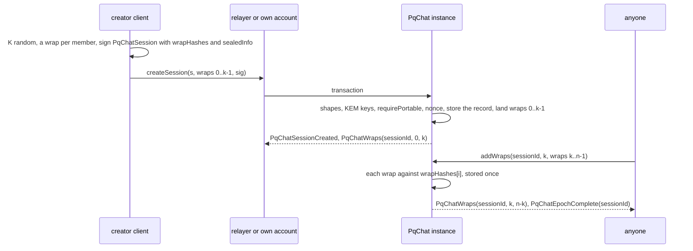
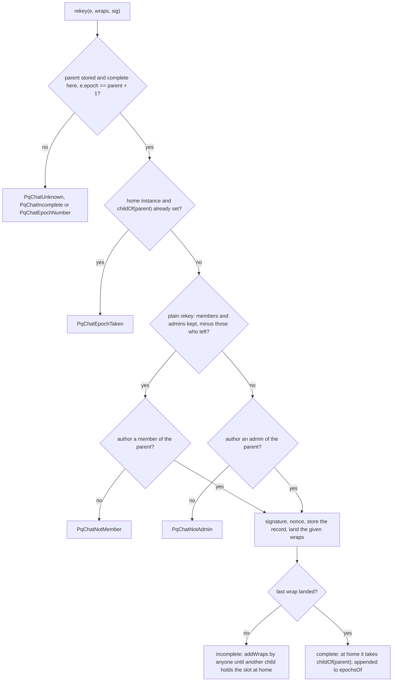
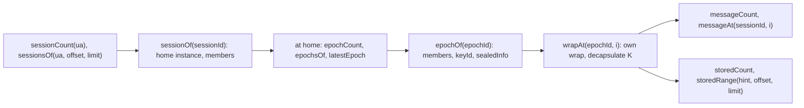

# PqChat

`PqChat` is the chat contract of the Universal Account (UA-7): post-quantum chat sessions whose epoch keys are
KEM-wrapped to each member on chain, signed on-chain and stored messages, and public topics with replies, edits and
votes. The chain holds identity, the KEM key directory and the control plane; messages travel on the stores a session
lists and go on chain only when the user chooses. Every record is signed by its author and checked by the contract; a
relayer only carries it.

Status: **BUILT on branch `ua-mtx-merge` (EVM), UNAUDITED** (`smartcontracts/evm/src/pqchat/{IPqChat,PqChatTypes,PqChatCore,PqChat,PqChatTopics}.sol`,
tests `smartcontracts/evm/test/pqchat/`, plan 3c T84–T92, T96: the deploy's `DEPLOY_PQCHAT`, 40 of 40 mutants); the
on-chain matrix (T95) is **PLANNED**. Clients (UA-7 T11–T14,
T17–T20) are **PLANNED**. Other families: **PLANNED**, each in its own `pqchat-<family>` round. Background and the full
design: the UA-7 spec [`2026-10-25-ua7-pq-e2e-sessions.md`](../superpowers/specs/2026-10-25-ua7-pq-e2e-sessions.md)
(P1–P47) and the topics spec [`2026-11-07-pqchat-public-topics.md`](../superpowers/specs/2026-11-07-pqchat-public-topics.md)
(P33–P46); this page is the normative text of what is built.

**Contents**

1. [Overview](#1-overview)
2. [The release on the factory](#2-the-release-on-the-factory)
3. [Records and typed signing](#3-records-and-typed-signing)
4. [Storage: blobs and events](#4-storage-blobs-and-events)
5. [Sessions and wraps](#5-sessions-and-wraps)
6. [Epochs, the home-instance slot, roles, leave](#6-epochs-the-home-instance-slot-roles-leave)
7. [Messages](#7-messages)
8. [Recovery from state alone](#8-recovery-from-state-alone)
9. [Public topics and votes](#9-public-topics-and-votes)
10. [Every external entry](#10-every-external-entry)
11. [Relaying](#11-relaying)
12. [Gas and size](#12-gas-and-size)
13. [Tests](#13-tests)
14. [Clients and other families](#14-clients-and-other-families)
15. [The standalone store on 24,576-B chains](#15-the-standalone-store-on-24576-b-chains)
16. [The TreeKEM mode (`groupMode = 1`)](#16-the-treekem-mode-groupmode--1)
17. [`PqGroupTree`, the group tree for inheritors](#17-pqgrouptree-the-group-tree-for-inheritors)

## 1. Overview

Status: **BUILT** (EVM contract); the transports and the key schedule are client rules, **PLANNED** in clients.

<a id="CTR-CHAT-01"></a>**CTR-CHAT-01** — **PqChat: the chain holds identity, the KEM key directory and the control plane;
messages go to the stores a session lists, and on chain only by the user's choice** (owner 2026-11-04, D1–D13; changed
2026-11-04 to 2026-11-10, D14–D22 and the rulings of 2026-11-10; every decision in full in its
[register entry](../decisions.md#ctr-chat-01--pqchat-ua-7-matrix-carries-messages-the-chain-holds-keys-and-the-control-plane-ordered-epochs-admins-signed-messages-kem-rotation-msig-expansion-devices-metadata-hygiene-calls)).
In the contract, that means:

- **Control plane on chain** (D2): sessions, admins, members, epochs and the KEM wraps of each epoch key `K` are always
  in contract state ([CTR-CHAT-06](#CTR-CHAT-06)–[CTR-CHAT-10](#CTR-CHAT-10)).
- **One order of epochs** (D3): a parent epoch has one child, the first to complete in the session's home instance
  ([CTR-CHAT-08](#CTR-CHAT-08)).
- **Roles** (D4): admins change membership; any member rekeys plainly or leaves ([CTR-CHAT-09](#CTR-CHAT-09),
  [CTR-CHAT-10](#CTR-CHAT-10)).
- **Signed records, no deniability** (D7): every message, on chain or in a store, carries its author's PQ signature over
  the typed record ([CTR-CHAT-03](#CTR-CHAT-03)).
- **Stores** (D15, D17): a session lists its stores inside the encrypted `sealedInfo`; the contract is one of them through
  `storeMessage` ([CTR-CHAT-13](#CTR-CHAT-13)) and checks membership only on `postMessage` ([CTR-CHAT-11](#CTR-CHAT-11)).
- **Metadata hygiene** (D10): no Matrix room id, Matrix user id, HCS topic id or store list on chain in the clear; the
  contract never reads `sealedInfo`.
- **A factory kind** (D22): many instances per chain, each with its own state and an owner UA without power
  ([CTR-CHAT-02](#CTR-CHAT-02)); public topics live in each instance (D18–D21, [section 9](#9-public-topics-and-votes)).
- **Nothing is removed**: every accepted record stays in state; edits are new records.

The contract checks signatures, shapes, membership, the epoch rules and nonces; it runs no KEM, KDF or cipher. The key
schedule (hybrid KEM, wraps, sender chains, padding, envelope) is in the UA-7 spec
[§6](../superpowers/specs/2026-10-25-ua7-pq-e2e-sessions.md#6-key-schedule) and the transports in
[§7](../superpowers/specs/2026-10-25-ua7-pq-e2e-sessions.md#7-transports).

## 2. The release on the factory

Status: **BUILT** (`test/pqchat/PqChat.t.sol`, plan T85; the deploy script's registration, `DEPLOY_PQCHAT`, plan T92,
`test/governance/GovDeploy.t.sol` `test_deployPqChatPath`).

<a id="CTR-CHAT-02"></a>**CTR-CHAT-02** — **`PqChat` is class 3, kind 0 on `OpenFactory`'s generic path; each instance
reads its chain values from its own `ChainEnv`, is initialised once by the factory, and its owner UA has no power**
(owner 2026-11-07, D22 and Q2; the env check 3C-D1 is a controller call, owner may override).

- **Registration** (registrar): the four body modules first, `PqChatTopics(factory)`, `PqChatTree(factory)`,
  `PqChatTreeViews(factory)` and `PqChatTreeMembers(factory)` (below), then
  `publishClassEnv(3, 0, envVersion, env)` with the modules pinned in `env.libs` (their code hashes in `env.libCodeHashes`,
  checked by the factory at `deployImplementation`), `deployImplementation(ReleaseId(3, 0, v), envVersion, IPqChat.initialize.selector,
  type(IPqChat).interfaceId, initcode, abi.encode(topics, tree, views, members))`, `setClassKindEnabled(3, 0, true, chainUid)` after the notice period. **Creation** (anyone): `createInstance(ReleaseId(3, 0, v), salt, abi.encodeCall(IPqChat.initialize,
  (ownerUA, sigStore)))`, an EIP-1167 clone ([token-wrappers.md §6](token-wrappers.md#factory); the generic path is the factory
  index spec [`2026-11-07-factory-contract-index.md`](../superpowers/specs/2026-11-07-factory-contract-index.md) §8).
  The factory gets no `PqChat` code.
- **Constructor** `(ReleaseId id, address factory_, bytes implArgs)`: refuses `PqChatEnv` unless `id` is class 3, kind 0,
  version ≥ 1 and `factory_ ≠ 0`, and unless `implArgs = abi.encode(topics, tree, views, members)` names four modules,
  each code whose `FACTORY()` is `factory_`; immutables `FACTORY`, the version and the four modules. The implementation is locked
  (its `initialize` refuses `PqChatInitialized`) and reads an all-zero env, so every write on it refuses `PqChatEnv`.
- **Chain values** (3C-D1): the registry, `chain_uid` and the chain's code-size limit `params[0]` are the clone's
  `ChainEnv`, appended to its runtime code by the factory and read on every write (chain-neutral spec
  [`2026-11-07-chain-neutral-releases.md`](../superpowers/specs/2026-11-07-chain-neutral-releases.md) §2); none is an
  immutable of the release, so one bytecode serves every chain. `validateEnv(env)`, which the factory runs when it deploys
  a release, refuses `PqChatEnv` for `chainUid == 0`, `registry == 0`, no `params[0]`, or `params[0] < 24,576`
  (EIP-170's limit, the smallest of any EVM chain; one wrap blob needs 1,689 B). `chainEnv()` returns the decoded env.
- **`initialize(bytes32 ownerUA, uint8 sigStore)`**: only `FACTORY` (`PqChatNotFactory`), once (`PqChatInitialized`), only on a clone
  with a well-formed env (`EnvMissing`); `sigStore` is the instance's signature-storage setting, 0 or 2 ([CTR-CHAT-23](#CTR-CHAT-23);
  `PqChatSigStore` otherwise). `ownerUA` may be 0, is fixed and has no transfer. Otherwise it must be the
  creator, the factory's `creating()` (`PqChatOwnerNotCreator(ownerUA)`; Change 2026-11-11, Fable review D P3-1; BUILT on
  branch `ua-mtx-fix-contracts`): nobody names another UA as the owner of an instance it creates.
- **The owner UA names the instance and nothing more** (Q2): `owner()` returns it; it has no power over sessions, epochs,
  messages, topics, entries or votes, and no entry reads it. The instance has no pause, no admin and no upgrade.
- **Introspection**: `factoryInfo()` returns `(factory, chainUid, contractClass = 3, kind = 0, version,
  initialized)` (CTR-GOV-23: no owner in it; the instance's `owner()` answers its owner UA); `supportsInterface` answers ERC-165 (`0x01ffc9a7`), `type(IPqChat).interfaceId` (`0x7b7acc12`) and the tree views'
  `type(IPqChatTreeViews).interfaceId` (`0xec42e734`).
- **The body module** ([CTR-TOK-30](token-wrappers.md#CTR-TOK-30), applied by 3C-D2 when the release passed the
  33,594 B line at 34,223 B): `PqChatTopics` holds the bodies of the public topics and votes (§9: the six writes and
  fourteen views). The release keeps every entry of `IPqChat` (one ABI, one `interfaceId`) and the bodies of the 1:1
  path (sessions, wraps, epochs, leave, `postMessage`, `storeMessage`, every recovery view); each topic entry forwards its
  calldata unchanged by `DELEGATECALL` to the module, whose revert or return data comes back verbatim, so the module runs
  in the instance's state and env (`PqChatCore`: the namespace, the env read, the signature check, the nonces, the blobs).
  Called directly, the module has no env and refuses every write `PqChatEnv`. `modules()` lists it (an immutable), and the
  factory refuses the release when its env does not pin it (`ModuleNotPinned`, [CTR-TOK-30](token-wrappers.md#CTR-TOK-30):
  every class's release is module-checked). No 1:1 entry pays for the split (§12). **The tree modules** (CTR-CHAT-26,
  owner 2026-11-23 to 2026-11-25), the same way: `PqChatTree` holds a tree session's creation, commit, pieces, Welcome
  wraps and messages (§16); `PqChatTreeViews` the tree's read-only views, reached by the release's `fallback` (a
  selector no entry of the release has goes there; the module writes nothing, its read-only proof a scan of its compiled
  code, §16); `PqChatTreeMembers` the exits: a tree session's `treeLeave` and `treeRemove` (owner 2026-11-24) and mode 0's
  `leave` and `remove` (owner 2026-11-25, moved out of `PqChat` when E-3 took the release over its size line), each at
  home checked and applied at the head (C9, CTR-CHAT-10, CTR-CHAT-20; Change 2026-11-24, E-3). `modules()` lists the four,
  in that order: topics, tree, views, members.
- **Instances share nothing**: each keeps its sessions, epochs, messages, stored messages and topics in its own ERC-7201
  namespace `scaas.pqchat` (no plain slot; layout pinned in `test/v2/layout/PqChat.json` and `PqChatLayout.t.sol`). A
  client and the node take as a `PqChat` only an address the chain's factory lists as class 3 with version ≠ 0
  ([job-api.md](../node/job-api.md#pqchat-calls)).

## 3. Records and typed signing

Status: **BUILT** (`PqChatTypes.sol`, `test/pqchat/PqChatTypes.t.sol` against `smartcontracts/vectors/pqchat/`).

<a id="CTR-CHAT-03"></a>**CTR-CHAT-03** — **Every record is a typed EIP-712 struct in the portable domain `DS_C`, signed as
a `UASig` over `uaMessage(kind, PURPOSE_PQCHAT, typed(record))` and checked by the registry's `requirePortable`**
(owner answer 4 of 2026-10-25, O1 of 2026-11-04).

- **Domain.** `DS_C = keccak256(abi.encode(keccak256("EIP712Domain(string name,string version)"), keccak256("SCaaS PqChat"),
  keccak256("1")))`: no chain id, no contract address, so a record is the same bytes in every instance on every chain.
  `typed(s) = keccak256(0x1901 ‖ DS_C ‖ hashStruct(s))`, `hashStruct` as EIP-712 (arrays of `bytes32` as the keccak of
  their packed words, struct arrays as the keccak of their member hashes, `bytes` and `string` as their keccak).
- **Signature.** `PURPOSE_PQCHAT = keccak256("scaas.ua.purpose.pqchat.v1")`. The contract calls
  `IUARegistry.requirePortable(signer, PURPOSE_PQCHAT, typed(record), sig)`: a single key, or an `msig` in minimal form
  over two levels by its quorum (`UASig.members`; [CTR-UA-07](accounts.md#CTR-UA-07), [CTR-UA-37](accounts.md#CTR-UA-37),
  [CTR-UA-38](accounts.md#CTR-UA-38)). Native ids and unregistered UAs are refused by the registry (`UAUnauthorized`),
  as is a verifier left too little gas (`UAVerifyGas`); those reverts bubble unchanged, except where
  [CTR-CHAT-15](#CTR-CHAT-15) names them `PqTopicNotAdmin`. A `PqChat` release deploys only against a registry that has
  `requirePortable`.
- **No fee, no deadline, no submitter** in any record ([CTR-CHAT-19](#CTR-CHAT-19)).
- **The type strings**, exactly as `PqChatTypes.sol` hashes them, pinned by `*TypehashIsPinned` against the vectors. Each
  differs from every other, so a session signature is never a topic record:

| Struct | Type string | Signed by |
|---|---|---|
| `MemberKey` | `MemberKey(bytes32 ua,uint64 keyId,bytes32 via)` | (inside the session and epoch types) |
| `Wrap` | `Wrap(bytes32 member,uint64 keyId,bytes mlkemCt,bytes32 x25519Eph,bytes sealedKey)` | not signed; `wrapHashes[i] = hashStruct(Wrap_i)` |
| `PqChatSession` | `PqChatSession(bytes32 creator,uint64 nonce,bytes32 homeChain,address homeChatContract,bytes32[] admins,MemberKey[] members,bytes32[] wrapHashes,bytes sealedInfo,uint8 groupMode)MemberKey(bytes32 ua,uint64 keyId,bytes32 via)` | `creator` |
| `PqChatEpoch` | `PqChatEpoch(bytes32 sessionId,bytes32 author,uint64 nonce,uint64 epoch,bytes32 parentEpochId,bytes32[] admins,MemberKey[] members,bytes32[] wrapHashes,bytes sealedInfo)MemberKey(bytes32 ua,uint64 keyId,bytes32 via)` | `author` |
| `PqChatLeave` | `PqChatLeave(bytes32 sessionId,bytes32 epochId,bytes32 member,uint64 nonce)` | `member` |
| `PqChatMessage` | `PqChatMessage(bytes32 sessionId,bytes32 epochId,bytes32 sender,bytes16 device,uint64 counter,bytes32[] parents,bytes ciphertext)` | `sender` |
| `PqTopic` | `PqTopic(bytes32 admin,uint64 nonce,bytes32 homeChain,address homeChatContract,string name,bytes about,bool openReplies)` | `admin` |
| `PqTopicUpdate` | `PqTopicUpdate(bytes32 topicId,uint64 seq,string name,bytes about,bool openReplies)` | the topic's admin |
| `PqTopicWriter` | `PqTopicWriter(bytes32 topicId,bytes32 writer,bool granted,uint64 seq)` | the topic's admin |
| `EntryRef` | `EntryRef(bytes32 chainUid,address pqchat,bytes32 entryId,bytes32 contentHash)` | (inside `PqTopicEntry`) |
| `PqTopicEntry` | `PqTopicEntry(bytes32 topicId,bytes32 author,uint64 nonce,bytes32 parentId,EntryRef ref,string mediaType,bytes body)EntryRef(bytes32 chainUid,address pqchat,bytes32 entryId,bytes32 contentHash)` | `author` |
| `PqTopicEdit` | `PqTopicEdit(bytes32 entryId,bytes32 author,uint64 nonce,uint32 version,string mediaType,bytes body)` | the entry's author |
| `PqTopicVote` | `PqTopicVote(bytes32 entryId,bytes32 voter,int8 value,uint64 seq)` | `voter` |

<a id="CTR-CHAT-21"></a>**CTR-CHAT-21** — **`PqChatSession` and `PqTopic` name their home instance by `homeChain` and
`homeChatContract`** (owner 2026-11-10: the address field's new name; `homeChain` keeps its name). The field is part of both
type strings above, so both typehashes moved with it: `PqChatSession` `0xe2c3b4c1…ad1e4d`, `PqTopic` `0x75bed97b…2e1623`
(full values in `test/pqchat/PqChatTypes.t.sol` and `smartcontracts/vectors/pqchat/`). Status: **BUILT**.

**Change (2026-11-17, the pqvault spec's review r2, its native-member finding; a threat to add to UA-7's table, no rule change):** a
native member of an `msig` signs a record's typed digest itself, so a dapp can phish its signature over a valid `PqChat`
record (one `eth_signTypedData_v4` request per member; the wallet shows "SCaaS PqChat" and, with no chain or contract in
`DS_C`, cannot warn); with the quorum's signatures the record is accepted. Nothing in the contract or the registry can
refuse a valid signature over a valid record; clients show every membership change per epoch and flag an admin `msig` with
native members. The same residual holds for `PqVault` ([pqvault.md](pqvault.md)).

<a id="CTR-CHAT-04"></a>**CTR-CHAT-04** — **Ids are hashes of the signer and its nonce; a nonce is a bit in a per-scope
bitmap, used in any order, checked after the signature; a record that replaces a value carries `seq` and lands only at
`seq == stored + 1`** (owner answer 7 of 2026-10-25; the scope tags 3C-D5 are a controller call, owner may override).

```text
sessionId = keccak256(abi.encode(keccak256("scaas/pqchat/v1/session"), creator, nonce))          epoch 0's id too
epochId   = keccak256(abi.encode(keccak256("scaas/pqchat/v1/epoch"), sessionId, author, nonce))  epochs >= 1
topicId   = keccak256(abi.encode(keccak256("scaas/pqchat/v1/topic"), owner, nonce))
entryId   = keccak256(abi.encode(keccak256("scaas/pqchat/v1/entry"), topicId, author, nonce))
messageId = typed(PqChatMessage)

scope(session) = keccak256(abi.encode(keccak256("scaas/pqchat/v1/scope/session"), creator))
scope(epoch)   = keccak256(abi.encode(keccak256("scaas/pqchat/v1/scope/epoch"), sessionId, author))     rekeys and leaves
scope(message) = keccak256(abi.encode(keccak256("scaas/pqchat/v1/scope/message"), epochId, sender, device))  nonce = counter
scope(topic)   = keccak256(abi.encode(keccak256("scaas/pqchat/v1/scope/topic"), owner))
scope(entry)   = keccak256(abi.encode(keccak256("scaas/pqchat/v1/scope/entry"), topicId, author))      entries and edits
```

- **Bitmaps.** Word `nonce >> 8`, bit `nonce & 0xff`, per scope and per instance. Any order (5 may land before 4), never
  locked; a used nonce refuses `PqChatNonceUsed(scope, nonce)`. The signature is checked first, so a forged record
  burns no nonce. Views: `nonceUsed(scope, nonce)`, `topicNonceUsed(owner, nonce)`, `entryNonceUsed(topicId, author,
  nonce)`.
- **`seq` records.** `PqTopicUpdate` per `topicId`, `PqTopicWriter` per `(topicId, writer)`, `PqTopicVote` per `(entryId,
  voter)`: accepted only at the stored `seq + 1` (`PqTopicSeq(expected, got)`), so a `seq` far ahead cannot lock a value.
- **The same record in two instances** gets the same id in each and uses each instance's own bitmap: copying records is
  how replicas and mirrors are made ([CTR-CHAT-08](#CTR-CHAT-08)).

## 4. Storage: blobs and events

Status: **BUILT** (`PqChatMessages.t.sol`, `PqTopics.t.sol`, `PqChatLayout.t.sol`).

<a id="CTR-CHAT-05"></a>**CTR-CHAT-05** — **Every accepted record is kept in full in contract state, in SSTORE2 blobs no
larger than the chain's code-size limit; an event only notifies, and only three events carry a signature's bytes**
(owner D11 of 2026-11-04 and the topics ruling of 2026-11-07; the blob format 3C-D3 and the event set 3C-D4 are controller
calls, owner may override).

- **Signed records.** Stored as `abi.encode(record, sigHash)`, `sigHash = keccak256(abi.encode(UASig))`; on an instance whose
  setting is `sstore2` ([CTR-CHAT-23](#CTR-CHAT-23)) every session, epoch, leave and removal record and every posted message is
  stored as `abi.encode(record, sigHash, UASig)`, the signature's bytes in the record's own blob (Change 2026-11-23). A blob's runtime
  is at most `min(params[0], 65,535)` B (65,535 is `SSTORE2.write`'s bound) including the leading `STOP`. A record that
  does not fit one blob is chained: each blob is led by a flag byte, `0x01` and the next blob's 20-byte address, the last
  by `0x00`; readers follow the chain from the head pointer kept in a slot. A `postMessage` record must fit one blob
  ([CTR-CHAT-11](#CTR-CHAT-11)), its kept signature included.
- **Stored messages** keep the raw payload `abi.encode(v, hint, env)` in one blob, no flag ([CTR-CHAT-13](#CTR-CHAT-13)).
- **Wraps** are packed per call, `member (32) ‖ keyId (8, big-endian) ‖ mlkemCt (1,568) ‖ x25519Eph (32) ‖ sealedKey (48)`
  = 1,688 B each, as many per blob as the limit holds (`⌊(min(params[0], 65,535) − 1) / 1,688⌋`: 14 at 24,576 B, 38 at
  65,535 B and above), and one slot per wrap (`pointer | offset << 160`) marks it landed ([CTR-CHAT-07](#CTR-CHAT-07)).
- **Events** (D11, 3C-D4): `PqChatMessagePosted(sessionId, messageId, sender, index, sig)`, `PqTopicEntryPosted(topicId,
  entryId, parentId, author, sig)` and `PqTopicEntryEdited(entryId, version, sig)` carry the `UASig`, so a mirror can
  copy the record elsewhere; every other event carries no signature: `PqChatSessionCreated(sessionId, creator,
  homeChain)`, `PqChatEpochAdded(sessionId, epochId, parentEpochId, epoch, author)`, `PqChatWraps(epochId, first, count)`,
  `PqChatEpochComplete(epochId)`, `PqChatLeft(sessionId, epochId, member)`, `PqChatStored(hint, index)`,
  `PqTopicCreated(topicId, admin)`, `PqTopicUpdated(topicId, seq)`, `PqTopicWriterSet(topicId, writer, granted, seq)`,
  `PqTopicVoted(entryId, voter, value, seq)`. No view reads a log and no reader needs one ([CTR-CHAT-14](#CTR-CHAT-14)).
- Ciphertexts (`mlkemCt`, `sealedKey`, `sealedInfo`, a message's `ciphertext`, a stored `env`) stay in state, never only
  a hash with the bytes in calldata or an event.

<a id="CTR-CHAT-23"></a>**CTR-CHAT-23** — **Every `PqChat` instance has a signature-storage setting fixed when it is created,
`none` or `sstore2`, the default `sstore2`: an `sstore2` instance keeps the signature of every accepted control-plane record and
posted message in state, read by views; `none` keeps each record's `sigHash` only** (owner 2026-11-23, the pqchat-core spec's O11:
"by way 2, with SSTORE2 as the default, plus (d) as an option", verbatim in the
[register](../decisions.md#ctr-chat-23--every-pqchat-instance-has-a-signature-storage-setting-fixed-at-creation-none-or-sstore2-the-default-sstore2);
the storage form, the views and the numbering are controller calls, the
owner may override). Status: **BUILT on branch `pqchat-sigs` (EVM), UNAUDITED** (plan
[`2026-11-23-pqchat-signatures.md`](../superpowers/plans/2026-11-23-pqchat-signatures.md); `test/pqchat/PqChatSigs.t.sol`,
`PqChatSigGas.t.sol`; 14 of 14 mutants).

- **The setting.** `initialize(bytes32 ownerUA, uint8 sigStore)`: 0 `none`, 2 `sstore2`, PQZ's numbering of its proof-storage
  setting (`NONE` 0, `LOG` 1, `SSTORE2` 2); 1 (no log mode: recovery is from state alone, [CTR-CHAT-14](#CTR-CHAT-14)) and every
  other value refuse `PqChatSigStore(sigStore)`. No setter: the setting holds for the instance's life. `sigStore()` reads it,
  packed beside `initialized` in the namespace's slot +1. It is per instance, not per session: a per-session setting would be
  reported by the endpoint that serves the session, which could report it off. Every tool that creates an instance passes 2
  unless told otherwise (the deploy scripts, clientkeys' and the node's named config, [job-api.md](../node/job-api.md#pqchat-calls)).
- **What is kept.** On an `sstore2` instance `createSession`, `rekey`, `remove` and `postMessage` store `abi.encode(record, sigHash,
  UASig)` in the record's own blob (chained as any record; a posted message's one blob holds its signature too), and each
  accepted `leave` is kept as `abi.encode(PqChatLeave, sigHash, UASig)` in a list per epoch (on a `none` instance a leave stays the
  `leftIn` flag alone). The record views (`sessionOf`, `epochOf`, `removalAt`, `messageAt`) are unchanged. Topic records are
  outside the setting (the owner's question in the plan).
- **The views.** `sessionSig(sessionId)`, `epochSig(epochId)`, `removalSig(epochId, i)`, `messageSig(sessionId, i)`,
  `leaveSig(epochId, i)` return the `UASig` each record was accepted with (`keccak256(abi.encode(sig))` is its `sigHash`); ids as
  the record views (`PqChatUnknown`), an index past the end the array-bounds panic; on a `none` instance `PqChatSigNotStored()`.
  `leaveCount(epochId)`, `leaveAt(epochId, i)` return the kept leave records and their `sigHash` (0 records on a `none` instance).
- **The check at write is unchanged** in both modes: the signature is verified by `requirePortable` before anything is stored;
  the signature is no signed field, so no typehash moves.
- **Cost** (`PqChatSigGas.t.sol`, the stand-in verifier): `sstore2` adds the encoded signature and one head word to the blob at
  1,530 state gas a byte, ML-DSA-65 3,552 B (5.43 M), FN-DSA-512 896 B (1.37 M), ML-DSA-87 about 4.86 KiB (7.4 M); an `msig`
  author adds each quorum signature. Every signed session write (`createSession`, `rekey`, `leave`, `remove`, `postMessage`)
  reads the setting (one cold `SLOAD`, both modes); `addWraps`, `storeMessage` and the topic writes do not. The figures are in
  [§12](#12-gas-and-size).
- **Readers.** A client reads the setting under trusted reads and pins it per instance; on an `sstore2` home it verifies every
  control-plane record it uses before it trusts it ([CLI-PQC-15](../clients/pqchat-core.md#CLI-PQC-15)).

## 5. Sessions and wraps

Status: **BUILT** (`test/pqchat/PqChat.t.sol`, plan T85).

<a id="CTR-CHAT-06"></a>**CTR-CHAT-06** — **A session is epoch 0: its creator is a member and an admin, its members are
KEM holders strictly sorted, its home instance is named; the 2-member session is the main case** (UA-7 spec P8, P3; the
shapes 3C-D6 are a controller call, owner may override; the main case owner 2026-11-10).

`createSession(PqChatSession s, Wrap[] wraps, UASig sig)` accepts when:

- `members` names at least 2 distinct UAs, strictly sorted by `(ua, keyId)` with at most 8 keys per UA
  ([CTR-CHAT-24](#CTR-CHAT-24)), and `wrapHashes` has one hash per entry (`PqChatShape`);
- every `members[i]` holds a KEM key of version `keyId` in this chain's registry (`kemKeyAt(ua, keyId).scheme ≠ 0`,
  [CTR-UA-32](accounts.md#CTR-UA-32); `PqChatKemKey(member, keyId)`); the contract does not read `via` ([`msig` seats
  are expanded by the author's client](../superpowers/specs/2026-10-25-ua7-pq-e2e-sessions.md#3-members-kem-keys-devices));
- `admins` is strictly sorted and each is registered; an admin needs a KEM key only if it is also a member
  (`PqChatShape`);
- `creator` is in `admins` and in `members`, `homeChain ≠ 0`, `homeChatContract ≠ 0` (`PqChatShape`);
- `creator` signed it ([CTR-CHAT-03](#CTR-CHAT-03)) and `(creator, nonce)` is unused ([CTR-CHAT-04](#CTR-CHAT-04));
- the given wraps land ([CTR-CHAT-07](#CTR-CHAT-07)).

The instance is the session's **home** when `homeChain == chainEnv().chainUid` and `homeChatContract == address(this)`, fixed
at creation; anywhere else the record is a replica. `parents`, `sealedInfo` and padding are client rules and not checked.
Anyone may create a session listing any UA: consent is the client's (D5, [CTR-CHAT-14](#CTR-CHAT-14)).

**The main case is a 2-person chat** (owner 2026-11-10): layout and gas are optimised for a 2-member session and its
figures come first in the gas rows; groups stay correct and tested, and no 1:1 gas is traded for a group feature.

<a id="CTR-CHAT-25"></a>**CTR-CHAT-25** — **`PqChatSession` carries `uint8 groupMode`, its last field, fixed at creation: 0 flat
wraps; this release accepts 0 only and refuses any other value first, `PqChatModeUnsupported(groupMode)`** (owner 2026-11-23,
"add the field now, in pqchat-sigs", verbatim in the
[register](../decisions.md#ctr-chat-25--pqchatsession-carries-uint8-groupmode-fixed-at-creation-this-release-accepts-0-only);
its place last, after the TreeKEM research note, a controller call). Status: **BUILT on branch `pqchat-sigs`, UNAUDITED**
(`test/pqchat/PqChatGroupMode.t.sol`; the vector row `sessionTreeKem`).

- **What it names** (owner 2026-11-23): a protocol id. 0 = flat; 1 = RFC 9420 tree rules over KEM scheme 1; 2–255 later
  variants. Flat (0) is this page: every epoch key wrapped to each member key. Mode 1 comes with a later catalogued release
  that widens the one check below, with the same struct and typehash, so clients and vectors stay stable across releases.
- **Reserved (owner 2026-11-25; PLANNED, after the freeze, with the off-chain ledger service's spec):** `groupMode = 2`, the
  ledger's large tree mode (a TreeKEM tree of depth up to 18, kept by the ledger); `groupMode = 3`, off-chain immutable
  (membership on chain, the KEM bytes off chain). No contract change: this release refuses both, with 4-255,
  `PqChatModeUnsupported` (the vector row `sessionMode2`); a later catalogued release defines them.
- **Fixed at creation:** only the session record names it; no epoch, leave or removal record carries it, so no child can
  change it (there is no field to change). `sessionOf` returns it with the record.
- **Checked first** in `createSession`, before the lists, the KEM keys and the signature: a record of another mode costs no
  registry read.
- **Pins moved:** the `PqChatSession` typehash `0xe2c3b4c1…ad1e4d` → `0x7e832d4c…62d911` (full value in `PqChatTypes.t.sol` and
  the vectors), the selectors of `createSession` and `sessionOf` (`interfaceId` → `0x869305e0`, `selector_audit.json`, the node's
  type row). Cost: one word more in calldata and in the stored record, +48,960 state gas per `createSession`.

<a id="CTR-CHAT-24"></a>**CTR-CHAT-24** — **A member may sit in an epoch with several KEM keys: `members` is strictly sorted
by `(ua, keyId)`, one or more keys per UA and at most `KEYS_PER_UA_MAX` = 8, one wrap per entry, each a KEM key its UA holds
here; every other rule stays per UA** (owner 2026-11-23, (M): "Choose M. It is still an option, isn't it?", yes: optional per member,
verbatim in the [register](../decisions.md#ctr-chat-24--a-member-may-hold-several-kem-keys-in-an-epoch-members-sorted-by-ua-keyid-at-most-8-per-ua);
the cap of 8 a controller call). Status: **BUILT on branch `pqchat-sigs` in `PqGroupBase` (PqChat and PqVault), UNAUDITED**
(`test/pqchat/PqChatDevices.t.sol`, `test/pqvault/PqVaultDevices.t.sol`).

- **Optional.** A member with one `keyId` (the seed-derived key) is exactly as before. A member may add device keys: random per
  device, not seed-derived, each registered as its own KEM version in the registry (`setKemKey`, any unused version, every
  version stays readable by `kemKeyAt`); its client decides which `keyId`s a wrap names. The default of the clients stays one
  key per member.
- **Per entry:** the order, the cap, the KEM-key check (`PqChatKemKey(ua, keyId)`), the wrap (`member == members[i].ua`, `keyId ==
  members[i].keyId`) and its hash.
- **Per UA:** the minimum member count (2 distinct UAs for a session, 1 for an epoch), admins, rights and acceptance, the
  plain-rekey rule of [CTR-CHAT-09](#CTR-CHAT-09) (a member's keys may change in a plain rekey), `leave` and `remove` (removing a
  UA removes all its keys: a child keeping any of them is `PqChatRemovedKept`), `sessionsOf` (one entry per UA, not per key),
  `PqGroupBase._uas`, `_removable`.
- **The bound:** 8 keys of each of 2 members are 16 wraps, the size of a 16-member epoch, landed in chunks as any group
  ([CTR-CHAT-07](#CTR-CHAT-07)); the total member and wrap bound is unchanged (none of its own). Each extra key costs one wrap:
  +108,944 regular and +2,876,400 state gas on a `createSession`, +105,588 / +2,876,400 on a plain `rekey` (`PqChatGas.t.sol`
  `test_gas_deviceKeys`). The `MemberKey` type is unchanged, so no typehash moves.
- **Not here:** the high-forward-secrecy mode (a symmetric ratchet with deletion, its flag in `sealedInfo`, more frequent rekeys)
  is client-only and comes after the freeze; this change only keeps its path open.

<a id="CTR-CHAT-07"></a>**CTR-CHAT-07** — **Wraps may arrive in chunks, by anyone: each must hash to its signed
`wrapHashes[i]` and name `members[i]`, lands once, and the epoch is complete when its last wrap has landed** (UA-7 spec
P11: no block-limit assumption).

- `createSession` and `rekey` take any prefix of the wraps, `wraps[j]` as index `j`; `addWraps(epochId, first, wraps)`
  takes `wraps[j]` as index `first + j`, **unsigned, from anyone**: the signed hashes fix the bytes.
- Each wrap: `first + wraps.length ≤ members.length` (`PqChatShape`); `hashStruct(wrap) == wrapHashes[i]`
  (`PqChatWrapHash(epochId, i)`); `mlkemCt` 1,568 B, `sealedKey` 48 B, `member == members[i].ua`, `keyId ==
  members[i].keyId` (`PqChatShape`); index `i` not landed yet (`PqChatWrapStored(epochId, i)`). `addWraps` on an unknown
  id refuses `PqChatUnknown(epochId)`; on a child whose home slot another child holds, `PqChatEpochTaken`
  ([CTR-CHAT-08](#CTR-CHAT-08)).
- `PqChatWraps(epochId, first, count)` per call; `PqChatEpochComplete(epochId)` when the last wrap lands. `epochComplete(id)`
  and `wrapAt(epochId, i)` (all zero until landed) read it.
- A client puts as many wraps in a transaction as its chain's limits allow (EIP-8037: regular + state gas within the block
  limit) and sends the rest by `addWraps`; group size has no protocol bound.



## 6. Epochs, the home-instance slot, roles, leave

Status: **BUILT** (`test/pqchat/PqChatEpochs.t.sol`, plan T86).

<a id="CTR-CHAT-08"></a>**CTR-CHAT-08** — **An epoch is its parent's number plus one, from a parent stored and complete in
the same instance; in the home instance the first child of a parent to complete takes the parent's slot and no other
child of it can land or complete there; replicas store every complete child** (owner D3 of 2026-11-04, UA-7 spec P9).

`rekey(PqChatEpoch e, Wrap[] wraps, UASig sig)` accepts when:

- `e.parentEpochId` is stored in this instance for `e.sessionId` (`PqChatUnknown(parentEpochId)`), complete
  (`PqChatIncomplete(parentEpochId)`), and `e.epoch == parent.epoch + 1` (`PqChatEpochNumber(expected, got)`);
- at home, `childOf(parentEpochId)` is zero (`PqChatEpochTaken(parentEpochId, child)`);
- `members` (at least 1) and `admins` pass the list checks of a session (sorted, one hash per member, each member's
  `keyId` held here, admins registered: `PqChatShape`, `PqChatKemKey`) and the author's rights hold
  ([CTR-CHAT-09](#CTR-CHAT-09));
- `author` signed it and `(sessionId, author, nonce)` is unused in the epoch scope;
- the given wraps land ([CTR-CHAT-07](#CTR-CHAT-07)).

**The slot.** At home, an epoch ≥ 1 takes `childOf(parent)` when its last wrap lands; from then on `rekey` on that parent
and `addWraps` on any other child of it refuse `PqChatEpochTaken`. An incomplete child never takes the slot, so nobody
locks a session by starting an epoch and never finishing it: anyone may finish it with `addWraps`. **In every other
instance**, on this chain or another, `childOf` reads zero and every complete child is stored; clients follow the home's
`childOf` (and its `epochsOf`, [CTR-CHAT-14](#CTR-CHAT-14)). A removed member's competing child is refused at home by
the slot or by its number:



<a id="CTR-CHAT-09"></a>**CTR-CHAT-09** — **A plain rekey keeps the parent's members and admins, minus those who left the
parent epoch, and may be authored by any member of the parent who has not left it; anything else is a membership change and needs an admin of
the parent** (owner D4 of 2026-11-04, O2 and O4; the exact test 3C-D7 is a controller call, owner may override).

- **Plain rekey**: `members(e)` by `ua` equals `members(parent)` minus entries that left the parent epoch, and `admins(e)`
  equals `admins(parent)` minus entries that left; `keyId` and `via` may change. Its author must be a member of the parent
  that has not left it (`PqChatNotMember(author)`; Fable review 2026-11-10, P1-2 fix (a)).
- **The limit** (UA-7 spec P9): the first complete child wins, so a member can take the slot before an admin's
  membership change (O2) and the admin rekeys again from that child. Liveness only (the member never reads an epoch it is
  not wrapped into). **An exit is not exposed to it (Change 2026-11-24, E-3; owner 2026-11-24: "Yes, both modes"; BUILT on
  branch `review-fix-contract`):** at home `remove` ([CTR-CHAT-20](#CTR-CHAT-20)) and `leave`
  ([CTR-CHAT-10](#CTR-CHAT-10)) name the head or an ancestor of it and apply at the head, so a member about to be removed
  can no longer keep itself in by answering each new tip, and a member's rekey no longer voids another's leave.

<a id="CTR-CHAT-20"></a>**CTR-CHAT-20** — **An admin of an epoch removes members of it with a signed `remove`; a child of
that epoch then completes only without them, and a removed member authors no rekey of it** (owner 2026-11-10, on the Fable
review's P1-2 fix (b); **BUILT** on `ua-mtx-merge`, plan 3c, UNAUDITED; UA-7 spec P48).

- `remove(PqChatRemove r, UASig sig)`, `PqChatRemove(bytes32 sessionId,bytes32 epochId,uint64 nextEpoch,bytes32[] members,
  bytes32 admin,uint64 nonce)`: `epochId` stored for `sessionId` and complete (`PqChatUnknown`, `PqChatIncomplete`), at
  home with no complete child (`PqChatEpochTaken`); `nextEpoch == epoch(epochId) + 1` (`PqChatEpochNumber`); 1 to
  `REMOVE_MAX` = 16 members, strictly sorted (`PqChatShape`), each a member or an admin of `epochId` (`PqChatNotMember`; an
  admin that is no member, an `msig`, is removable: controller call 2026-11-21, the PqVault code review F3); `admin` an
  admin of `epochId` (`PqChatNotAdmin`) who signs it; the nonce in the epoch scope `(sessionId, admin)` (`PqChatNonceUsed`).
  Anyone submits it, relayable with a fee of 0. The record and its `sigHash` are kept in state.
- **At home, applied at the head (Change 2026-11-24, E-3 of the TreeKEM code review, the rule of
  [CTR-CHAT-27](#CTR-CHAT-27)'s C9 in mode 0; owner 2026-11-24: "Yes, both modes"; BUILT on branch
  `review-fix-contract`).** Replaces "at home with no complete child" above:
  - `epochId` is the head or an ancestor of it: stored for `sessionId` and complete (`PqChatUnknown`, `PqChatIncomplete`).
    At home a child completes only by taking its parent's slot ([CTR-CHAT-08](#CTR-CHAT-08)), so every complete epoch is
    on the home's chain and that is the whole ancestor check: three slots of `epochId` (`sessionId`; `epoch` with
    `wraps`; `landed`) and three for the head's number (`epochsOf`'s length and last entry, its `epoch`); a child of
    `epochId` no longer voids the removal (no `PqChatEpochTaken`). `nextEpoch` stays `epoch(epochId) + 1`, a signed lower
    bound;
  - **the lag (the spec check, sc-E-2, sc-F-5):** valid only while `epoch(head) ≤ epoch(epochId) +
    EXIT_LAG_MAX`, `EXIT_LAG_MAX` = 16 ([CTR-CHAT-27](#CTR-CHAT-27)'s C9 gives the reason), else
    `PqChatExitLag(named, head)`. So a delayed, held or reverted removal dies after 16 epochs, and an old removal is not
    replayed after a re-add; a front-runner must complete 17 epochs before one removal lands to void it;
  - the rest is checked **at the home's head** (the last of `epochsOf`): `admin` a live admin of the head, each UA a
    member or an admin of the head **and not already removed from it** (`PqChatNotAdmin`, `PqChatNotMember`; a removal
    that would newly flag nobody is not stored, A-4 and sc-E-5); a removal may name its own signer (a keyless admin goes
    so);
  - it is applied **at the head**: `removedIn(head, ua)`, the record under the head (`removalCount(head)`,
    `removalAt(head, i)`), `PqChatRemoved(sessionId, head, admin, members)`; the head's child completes only without them
    and a removed member's rekey of the head is `PqChatNotMember`, as above;
  - **wraps and epoch keys:** the removed UA keeps the key of the head and of every epoch it was wrapped into (nothing
    takes a key back). The next rekey from the head drops it and draws a fresh `K` wrapped to its own members only, so it
    reads nothing from that epoch on. An epoch a front-runner completed before the removal landed holds it and is read by
    it: that is all a front-run gains. A child staged on the head when the removal lands completes no more
    (`PqChatRemovedKept`);
  - its nonce is spent once, within the lag; there is no withdrawal: a removal that has left the device applies if it
    lands within 16 epochs, and the signing review says so;
  - **in a replica** (the spec check, sc-E-4) there is no slot and no head: the removal flags the epoch it names (complete, its
    UAs newly flagged there), and **in a replica a flag only allows, never refuses**: a child is not refused there for
    keeping a UA flagged at its parent or for its author's flag (`PqChatRemovedKept` and the removed author's
    `PqChatNotMember` are the home's), and a plain rekey may drop a UA flagged at its parent **or at an ancestor at most
    `EXIT_LAG_MAX` epochs above it**, which is where the home may have applied it. So a replica stores the home's chain
    after an exit that named an ancestor, in either copying order; membership is read at home
    ([CTR-CHAT-14](#CTR-CHAT-14)). The extra cost, at most 16 parent reads per dropped UA, is a replica's only.
- After it: a child of the epoch it was applied at (the head at home) completes (in `rekey` or the last `addWraps`) only
  if its members and admins hold no removed UA and its author is none (`PqChatRemovedKept(epoch, ua)`); a removed
  member's rekey of that epoch is refused `PqChatNotMember`; dropping a removed member is a plain rekey, as dropping a leaver is. An admin that was removed from
  `epochId` or left it makes no membership change and removes nobody (`PqChatNotAdmin`) (controller call 2026-11-21, the
  PqVault code review F1, F2, F7, one rule in `PqGroupBase`; BUILT on `pqvault-v`, UNAUDITED).
- `leave` stays the member's own flag (a child may keep a leaver); both may hold for one UA.
- Recovery: `removedIn(epochId, ua)`, `removalCount(epochId)`, `removalAt(epochId, i)`, each keyed by the epoch the
  removal was applied at; `PqChatRemoved(sessionId, epochId, admin, members)` notifies, with that epoch. A 2-person chat is unchanged.
- **Membership change**: any member or admin added, or one dropped without having left. Its author must be an admin of
  the parent (`PqChatNotAdmin(author)`). An `msig` admin signs by its quorum ([CTR-CHAT-03](#CTR-CHAT-03)).
- **O2**: a plain rekey may take a parent's slot before an admin's change; the admin rekeys again from the new epoch, with
  no precedence rule. **O4**: with no admin left, membership is frozen; plain rekeys and messages continue.
- A new `K` is fresh randomness in the client, never derived from the old one, so a removed member cannot read the next
  epoch.

<a id="CTR-CHAT-10"></a>**CTR-CHAT-10** — **A member of an epoch leaves it by a signed `PqChatLeave`; the leave is a flag
that lets the next epoch drop it as a plain rekey, and nothing else** (owner D4 of 2026-11-04, UA-7 spec P12; the flag
and its nonce 3C-D8 are a controller call, owner may override).

`leave(PqChatLeave l, UASig sig)`: `l.epochId` stored for `l.sessionId` (`PqChatUnknown(epochId)`), `l.member` in its
`members` (`PqChatNotMember(member)`), signed by `member`, nonce in the epoch scope `(sessionId, member)` shared with its
rekeys. **At home, applied at the head (Change 2026-11-24, E-3; owner 2026-11-24: "Yes, both modes"; BUILT on branch `review-fix-contract`):**
`l.epochId` is the head or an ancestor of it within `EXIT_LAG_MAX` = 16 epochs (`PqChatExitLag` beyond; the spec check),
complete (`PqChatIncomplete` for a staged or losing child, which was accepted before), `l.member` a member of the head
that has not left it and was not removed from it (`PqChatNotMember`: a repeated leave is refused, the spec check, sc-E-5), and
the flag, the kept record and `PqChatLeft` are the head's (`leftIn(head, member)`), so a plain rekey from the head may
drop the leaver whichever child completed after the epoch it named. In a replica the leave flags the epoch it names
(any stored one, its member not flagged there yet), under the replica rule of [CTR-CHAT-20](#CTR-CHAT-20) (a flag only
allows). The leaver keeps the head's key and every earlier one it was wrapped into; the next epoch that drops it is
wrapped without it. The flag is read only by the plain-rekey test of [CTR-CHAT-09](#CTR-CHAT-09): until the next
epoch, the member stays in the epoch's list, may still post in it and keeps its `sessionsOf` entry. An admin that is not a
member cannot leave, so only a membership change drops it. Consent stays in clients: a member that never accepted a
session leaves it this way (D5).

## 7. Messages

Status: **BUILT** (`test/pqchat/PqChatMessages.t.sol`, plan T87; the device id as `bytes16` per the owner's ruling of
2026-11-10).

<a id="CTR-CHAT-11"></a>**CTR-CHAT-11** — **`postMessage` stores a member's signed message of a complete epoch, the
signature's hash in state and its bytes in the event; the nonce scope is `(epochId, sender, device)` over `counter`**
(owner D2 and D11 of 2026-11-04, UA-7 spec P16).

`postMessage(PqChatMessage m, UASig sig) returns (uint256 index)`: `m.epochId` stored for `m.sessionId`
(`PqChatUnknown(epochId)`) and complete here (`PqChatIncomplete(epochId)`), at home not yet followed by a complete child
(`PqChatEpochTaken(epochId, child)`; UA-7 spec §6.3, Fable review 2026-11-10 P1-1: a member the child dropped cannot post
under the old epoch later; one SLOAD, `childOf` being written at home only, so a replica takes it), `m.sender` in its `members`
(`PqChatNotMember(sender)`), signed by `sender`, `counter` unused in `scope(message)` (`PqChatNonceUsed`), and
`abi.encode(m, sigHash)` fits one blob (`PqChatShape`). The blob is appended to the session's list: `messageCount(sessionId)`,
`messageAt(sessionId, index)` returns the record and `sigHash`. `PqChatMessagePosted(sessionId, messageId, sender, index,
sig)` with `messageId = typed(m)`: the same id as the same record on every other store. The epoch may be any complete
epoch stored in this instance (the home's or a replica's); the contract does not check `parents`, padding or the
1,024-B bucket (client rules, UA-7 spec §6.5). Use it when the contract itself must enforce membership; it costs gas
and is public forever, so a client posts on chain only when its user chooses.

<a id="CTR-CHAT-12"></a>**CTR-CHAT-12** — **The device id is a 16-byte UUID (`bytes16`), v7 or v4 at the client's choice;
nothing checks its version or variant bits** (owner 2026-11-10). It is a field of `PqChatMessage`, its type string and
`messageId`, and a dimension of the nonce scope `(epochId, sender, device)`; in clients it also enters the sender chain,
the AAD and the call keys. The device makes it when it is linked or restored; a restored device always makes a new one,
with no collision check on restore (122 random bits). The contract never parses it: any 16 bytes, zero included, are a
device. Its cost, plainly: **on `postMessage` a v7 id makes the device's creation time (milliseconds) public, while a v4
id hides it; on `storeMessage` it stays inside the envelope either way.**

<a id="CTR-CHAT-13"></a>**CTR-CHAT-13** — **`storeMessage` keeps an opaque store payload in state with no signature,
membership or nonce check; its list per 8-byte hint is read whole or by page** (owner D15 of 2026-11-05, `storedRange`
owner 2026-11-10; keeping it in `PqChat` 3C-D2 is a controller call, owner may override).

- `storeMessage(uint8 v, bytes8 hint, bytes env) returns (uint256 index)`: **anyone**, unsigned; only `v == 1` and that
  `abi.encode(v, hint, env)` plus the `STOP` byte fits one blob (`PqChatShape`). It appends that payload, the same bytes
  as the HCS and Waku payload of the UA-7 spec
  [§7.2](../superpowers/specs/2026-10-25-ua7-pq-e2e-sessions.md#72-chain-postmessage-and-storemessage), to the list of
  `hint` and emits `PqChatStored(hint, index)`. It reads no registry and no epoch, so no epoch replica is needed on that
  chain. Spam pays its own gas; clients open the envelope and drop what fails their checks.
- Views: `storedCount(hint)`, `storedAt(hint, index)` (the payload), and `storedRange(hint, offset, limit)`: the payloads
  `[offset, min(offset + min(limit, STORED_RANGE_MAX), count))`, `STORED_RANGE_MAX = 16` (16 blobs of at most 65,535 B,
  about 1 MiB returned and about 9 M gas of memory in an `eth_call`); an offset past the end gives an empty page, never a
  revert.
- On-chain readers see the hint (which links an epoch's stored messages on every chain they are copied to), the size,
  the submitter and the time; not the session, sender, device or counter.

## 8. Recovery from state alone

Status: **BUILT** (`test/pqchat/PqChatRecovery.t.sol`, plan T96).

<a id="CTR-CHAT-14"></a>**CTR-CHAT-14** — **A client keeps no session list and reads no event: a new or reinstalled device
finds its sessions, their epochs and their messages through views alone; spam is the client's decision, off chain**
(owner 2026-11-10, UA-7 spec P47).

- **Sessions of a UA.** `sessionCount(ua)` and `sessionsOf(ua, offset, limit)`: one entry per member at `createSession`
  and one per member a `rekey` adds to its parent (by `ua`); admins that are not members get none. Append-only: a removed
  or leaving member keeps its entry (clients check `leftIn` and the latest epoch's members), a member added again gets
  another entry; a `rekey` that never completes or loses the slot leaves its entries too, so entries may repeat and clients
  de-duplicate (Fable P3-2).
- **Which instances** (Fable P2-1): `sessionsOf` is per instance, so a client pages the factory's index for class 3
  (`contractsPage(3, …)`, version ≠ 0) on each chain it serves and reads `sessionCount(ua)` on each listed instance.
- **Replicas** (Fable P2-2): a replica's record counts only when it equals the home's (same record and `sigHash` under
  the id); membership is read from the home instance.
- **Epochs of a session.** `epochCount(sessionId)` and `epochsOf(sessionId, offset, limit)`: epoch 0 (the `sessionId`)
  first once complete here, then each epoch ≥ 1 as it completes here. At home a child completes only by taking its
  parent's slot, so the list is the winning chain 0..n; in a replica it is every complete epoch in completion order,
  competing children included (a replica orders nothing: clients follow the home's list). `latestEpoch(sessionId)` is the
  list's last entry, zero while the session is not complete here; it has no slot of its own.
- **Paging.** `[offset, min(offset + min(limit, MAX), count))`, an offset past the end empty, never a revert;
  `SESSIONS_RANGE_MAX = EPOCHS_RANGE_MAX = 128` ids.
- **The rest** is read from the records: `sessionOf`, `epochOf`, `wrapAt`, `leftIn`, `messageCount` / `messageAt`,
  `storedCount` / `storedRange`.
- **Spam**: `sessionsOf` lists every session anyone created naming the UA; there is no on-chain consent or acceptance
  step, and the client decides what to show (D5). A record listing N UAs with no wrap indexes all N for about 0.3 M state
  gas per UA and is never usable (`epochCount` 0): clients skip such a session first (Fable P2-3; the owner's ruling keeps
  the entry at `createSession`). Before its user accepts a session, a client makes no network call and no write derived
  from its wraps or `sealedInfo`, and sends nothing that depends on whether a wrap or message opened (Fable P2-4, UA-7
  spec P12).



## 9. Public topics and votes

Status: **BUILT** (`test/pqchat/PqTopics.t.sol`, `PqTopicVotes.t.sol`, plan T88–T89). Topics share the domain, the
signature check, the nonce bitmaps and the blobs with sessions, and no cryptography: nothing in a topic is encrypted.

<a id="CTR-CHAT-15"></a>**CTR-CHAT-15** — **Any registered UA may create a topic; only its owner updates it and grants or
revokes writers; nothing on chain is hidden and nobody moderates** (owner D18, D19 and Q2 of 2026-11-07; topics spec P37,
P41).

- `createTopic(PqTopic t, UASig sig) returns (bytes32 topicId)`: `name` 1–512 B (owner 2026-11-10; was 1–128 B),
  `homeChain ≠ 0`, `homeChatContract ≠ 0` (`PqTopicShape`; no other rule reads the home), signed by `owner`, `(owner, nonce)` unused in the topic scope. `about`
  is Markdown bytes; `openReplies` is the reply flag (clients create topics with `true`, D19). The admin is fixed for the
  topic's life; an `msig` admin gives shared administration (CTR-GOV-23: the topic's former `owner` is its `admin`).
- `updateTopic(PqTopicUpdate u, UASig sig)`: the topic exists (`PqTopicUnknown`), `seq == stored + 1` (`PqTopicSeq`),
  `name` 1–512 B (`PqTopicShape`), signed by the topic's admin. It replaces `name`, `about` and `openReplies`;
  `topicOf(topicId)` returns the create record with the latest values and `seq`. A topic record is stored as every record
  (`_put`): one SSTORE2 blob while it fits the chain's limit, else a chain of blobs; `about` has no bound of its own.
- `setTopicWriter(PqTopicWriter w, UASig sig)`: the topic exists, `writer` is neither 0 nor the admin (`PqTopicShape`),
  `seq == stored + 1` per `(topicId, writer)`, signed by the topic's admin. `writerOf(topicId, ua)` returns `(granted,
  seq)`; `writersOf` lists the writer from its first record.
- The update and writer records name no signer, so a signature the registry refuses as `UAUnauthorized` is reported as
  `PqTopicNotAdmin(admin)`; any other registry revert bubbles.
- **No hide flag, no moderator role, no ban list** (D18); the instance's owner UA has no right here
  ([CTR-CHAT-02](#CTR-CHAT-02)). A client may filter locally. Rights are read from this instance's state at submission.

<a id="CTR-CHAT-16"></a>**CTR-CHAT-16** — **Posts and replies are one record with a `parentId`; bodies are kept in full in
state; an edit is a new version by the original's author; a reference to another instance is stored as given and never
checked** (owner D19, D20 and Q1 of 2026-11-07; topics spec P33, P35, P38).

- `postEntry(PqTopicEntry e, UASig sig) returns (bytes32 entryId)`: the topic exists (`PqTopicUnknown`). A **post**
  (`parentId == 0`, depth 0) is by the owner or a granted writer (`PqTopicNotWriter(author)`). A **reply** names an entry
  of the same topic in this instance (`PqTopicParent(parentId)`), depth = the parent's + 1 with no bound; with
  `openReplies` any UA the registry verifies may reply, otherwise only the owner or a writer. `mediaType` 1–64 B and a
  non-empty `body` (`PqTopicShape`); `ref` all zero or with `chainUid`, `pqchat` and `entryId` non-zero (`PqTopicRef`);
  signed by `author`; `(topicId, author, nonce)` unused in the entry scope. A revoked writer's entries stay; its new posts
  are refused.
- **Bodies**: always in state, bounded only by the transaction (EIP-8037); a longer text goes as follow-up replies by the
  same author (Q1). The contract checks only the length of `mediaType`; clients write `text/markdown`.
- **`ref`**: `(chainUid, pqchat, entryId, contentHash)`, `contentHash` zero or the `typed` digest of the referenced
  version. No bridge, no proof, no read across chains: the target may not exist. A reader resolves it on that chain.
- `editEntry(PqTopicEdit d, UASig sig)`: the original exists (`PqTopicUnknown(entryId)`), `author` is the original's
  (`PqTopicNotAuthor`; the topic admin included), `version == count + 1` with the first edit 2 (`PqTopicVersion(expected,
  got)`), `mediaType` and `body` as above, signed by `author`, nonce in the original's topic scope. An edit keeps the
  original's topic, parent, reference, votes and place in every list; replies and votes attach to the original id.
  `entryOf(entryId)` returns the place and the latest version (`versionCount` included), `versionAt(entryId, version)`
  any version, 1 being the original (`PqTopicVersion(count, version)` outside `1..count`).

<a id="CTR-CHAT-17"></a>**CTR-CHAT-17** — **One vote per UA per entry, changeable; the counts `up` and `down` are kept in
state** (owner D21 of 2026-11-07; topics spec P40).

`voteEntry(PqTopicVote v, UASig sig)`: the entry exists in this instance (`PqTopicUnknown`), `value` is −1, 0 or +1
(`PqTopicVoteValue`), `seq == stored + 1` per `(entryId, voter)` (`PqTopicSeq`), signed by `voter`. One slot per `(entry,
voter)` holds `(value, seq)`; a new vote moves the counts (the old value's count − 1, the new one's + 1), 0 withdraws.
`scoreOf(entryId)` returns `(up, down)`, never a combined score; `voteOf(entryId, ua)` returns `(value, seq)`. Votes count
UAs, not people; a client may weigh or filter voters on its own.

<a id="CTR-CHAT-18"></a>**CTR-CHAT-18** — **Every topic list lives in state, append-only, and answers a page as `(ids,
total)`** (owner 2026-11-07, topics spec P42; the shape 3C-D8 is a controller call, owner may override).

`topics(start, count)`, `topicsByAdmin(admin, start, count)`, `writersOf(topicId, start, count)`, `posts(topicId, start,
count)`, `replies(parentId, start, count)` and `byAuthor(author, start, count)` (originals only, every topic) return at
most `count` ids from `start`, fewer at the end, empty past it, and the list's length; `count = 0` is the count view. No
clamp: the call's gas bounds a page. The node's indexer may mirror them; the state is the answer.

## 10. Every external entry

Status: **BUILT**. Errors are those of `IPqChat.sol`; "registry" means the bubbled `UAUnauthorized` / `UAVerifyGas` of
`requirePortable`. Every write first reads the env (`PqChatEnv` on the implementation or a clone without a usable env).

| Entry | Who signs / calls | What it checks | Named errors |
|---|---|---|---|
| `constructor(ReleaseId, factory_, implArgs)` | the factory, at `deployImplementation` | class 3, kind 0, version ≥ 1, factory ≠ 0 | `PqChatEnv` |
| `validateEnv(ChainEnv)` | the factory, at `deployImplementation` (view) | `chainUid`, registry, `params[0] ≥ 24,576` | `PqChatEnv` |
| `initialize(bytes32 ownerUA, uint8 sigStore)` | `FACTORY` only, at `createInstance` | the caller, once, a well-formed env, `ownerUA` 0 or `creating()`, `sigStore` 0 or 2 | `PqChatNotFactory`, `PqChatInitialized`, `EnvMissing`, `PqChatOwnerNotCreator`, `PqChatSigStore` |
| `createSession(s, wraps, sig)` | anyone submits; `s.creator` signs | `groupMode` 0 or 1, shapes, KEM keys, creator in both lists, home named, signature, nonce, wraps; `groupMode` 1 (in `PqChatTree`): an `sstore2` instance, the home instance, `sealedInfo` ≤ 4,124 B, ≤ 256 member keys, ≤ 32 admins, each leaf's key admitted and not live as its wrap lands | `PqChatModeUnsupported`, `PqChatShape`, `PqChatKemKey`, registry, `PqChatNonceUsed`, `PqChatWrapHash`, `PqChatTreeSigStore`, `PqChatTreeHome`, `PqChatTreeKeyLive` |
| `rekey(e, wraps, sig)` | anyone submits; `e.author` signs | a flat session (a tree session's epochs are commits), parent, number, home slot, shapes, rights, signature, nonce, wraps | `PqChatModeEntry(1)`, `PqChatUnknown`, `PqChatIncomplete`, `PqChatEpochNumber`, `PqChatEpochTaken`, `PqChatShape`, `PqChatKemKey`, `PqChatNotMember`, `PqChatNotAdmin`, registry, `PqChatNonceUsed`, `PqChatWrapHash` |
| `addWraps(epochId, first, wraps)` | anyone, unsigned | epoch known, home slot free, range, hash, shape, landed once; on a tree session (in `PqChatTree`) epoch 0's wraps with their leaves, or a staged commit's Welcome wraps, then the completion | `PqChatUnknown`, `PqChatEpochTaken`, `PqChatShape`, `PqChatWrapHash`, `PqChatWrapStored`; a tree session's also `PqChatKemKey`, `PqChatTreeKeyLive` and the completion's |
| `commit(c, ctTargets, ctHashes, nodeKeys, cts, wraps, sig)` (in `PqChatTree`) | anyone submits; `c.author` signs | a tree session, its `treeId` and home, the head as parent, its tree hash, signature, nonce, the record's shapes, the walk (spec §8); then the pieces sent with it and the completion when none is missing | `PqChatModeEntry(0)`, `PqChatTreeHome`, `PqChatUnknown`, `PqChatIncomplete`, `PqChatEpochNumber`, `PqChatEpochTaken`, `PqChatTreeParent`, registry, `PqChatNonceUsed`, `PqChatShape`, every `T_*` error of §17, the pieces' |
| `addPathList(epochId, ctTargets, ctHashes)`, `addPathKeys(epochId, nodeKeys)`, `addPath(epochId, firstCt, cts)` (in `PqChatTree`) | anyone, unsigned | a staged commit (not epoch 0) whose slot is free; the list whole, once, its hash the signed one and its targets the walk's; the node keys whole, once, each hashed as signed and admitted; at least one ciphertext, within the list, each against its hash, once (C40); then the completion | `PqChatModeEntry(0)`, `PqChatUnknown`, `PqChatEpochTaken`, `PqChatPathList`, `PqChatTreeTargets`, `PqChatShape`, `PqChatPathStored`, `PqChatPathHash`, `PqChatKemKey`, the completion's |
| `treeLeave(l, sig)` (in `PqChatTreeMembers`) | anyone submits; `l.member` signs | a tree session, its `treeId`; the epoch named complete, of the session, at most `EXIT_LAG_MAX` below the head; the member live at the head (not `gone`); signature, nonce; `gone` from the head's number, the record under the head (C9, E-3) | `PqChatModeEntry(0)`, `PqChatTreeHome`, `PqChatUnknown`, `PqChatIncomplete`, `PqChatExitLag`, `PqChatNotMember`, registry, `PqChatNonceUsed`, `PqChatTreeBacklog` |
| `treeRemove(r, sig)` (in `PqChatTreeMembers`) | anyone submits; `r.admin` signs | as `treeLeave`, and `nextEpoch` the named epoch's plus one, the signer a live admin of the head, 1 or more strictly sorted UAs each a leaf holder or an admin of the head and not `gone` (A-4); C24 with C38 | `PqChatModeEntry(0)`, `PqChatTreeHome`, `PqChatUnknown`, `PqChatIncomplete`, `PqChatExitLag`, `PqChatEpochNumber`, `PqChatNotAdmin`, `PqChatShape`, `PqChatNotMember`, registry, `PqChatNonceUsed`, `PqChatTreeBacklog`, `PqChatTreeAdmins` |
| `leave(l, sig)` (in `PqChatTreeMembers` since owner 2026-11-25) | anyone submits; `l.member` signs | a flat session; epoch of that session; at home complete, the head or an ancestor within `EXIT_LAG_MAX`, the member a member of the head not flagged there yet (in a replica: of the epoch named); signature, nonce (SPECIFIED 2026-11-24, CTR-CHAT-10) | `PqChatUnknown`, `PqChatIncomplete`, `PqChatExitLag`, `PqChatNotMember`, registry, `PqChatNonceUsed`, `PqChatModeEntry(1)` |
| `remove(r, sig)` (in `PqChatTreeMembers` since owner 2026-11-25) | anyone submits; `r.admin` signs | a flat session; epoch of that session, complete; at home the head or an ancestor within `EXIT_LAG_MAX`, checked at the head (in a replica: at the epoch named); `nextEpoch`; 1–16 sorted members of it not removed there yet; a live admin of it; signature, nonce (SPECIFIED 2026-11-24, CTR-CHAT-20; `PqChatEpochTaken` no longer) | `PqChatUnknown`, `PqChatIncomplete`, `PqChatExitLag`, `PqChatEpochNumber`, `PqChatShape`, `PqChatNotAdmin`, `PqChatNotMember`, registry, `PqChatNonceUsed`, `PqChatModeEntry(1)` |
| `postMessage(m, sig)` | anyone submits; `m.sender` signs | epoch of that session, complete, at home no complete child, sender a member, signature, nonce, one blob; on a tree session (in `PqChatTree`) the epoch the head and the sender a live member of it | `PqChatUnknown`, `PqChatIncomplete`, `PqChatEpochTaken`, `PqChatNotMember`, registry, `PqChatNonceUsed`, `PqChatShape` |
| `storeMessage(v, hint, env)` | anyone, unsigned | `v == 1`, one blob | `PqChatShape` |
| `createTopic(t, sig)` | anyone submits; `t.owner` signs | name length, home named, signature, nonce | `PqTopicShape`, registry, `PqChatNonceUsed` |
| `updateTopic(u, sig)` | anyone submits; the topic's admin signs | topic known, `seq`, name length, admin's signature | `PqTopicUnknown`, `PqTopicSeq`, `PqTopicShape`, `PqTopicNotAdmin` |
| `setTopicWriter(w, sig)` | anyone submits; the topic's admin signs | topic known, writer not 0 or the admin, `seq`, admin's signature | `PqTopicUnknown`, `PqTopicShape`, `PqTopicSeq`, `PqTopicNotAdmin` |
| `postEntry(e, sig)` | anyone submits; `e.author` signs | topic known, parent in the topic, rights, lengths, `ref` shape, signature, nonce | `PqTopicUnknown`, `PqTopicParent`, `PqTopicNotWriter`, `PqTopicShape`, `PqTopicRef`, registry, `PqChatNonceUsed` |
| `editEntry(d, sig)` | anyone submits; the original's author signs | original known, author, version, lengths, signature, nonce | `PqTopicUnknown`, `PqTopicNotAuthor`, `PqTopicVersion`, `PqTopicShape`, registry, `PqChatNonceUsed` |
| `voteEntry(v, sig)` | anyone submits; `v.voter` signs | entry known, value, `seq`, signature | `PqTopicUnknown`, `PqTopicVoteValue`, `PqTopicSeq`, registry |
| `rescue(asset)` | anyone, unsigned | none: the whole balance of `asset` (`address(0)`: the native coin) to the constant dev address ([CTR-GOV-26](../decisions.md#CTR-GOV-26)) | `RescueAssetInvalid` (native to a designator) |
| `owner()`, `factoryInfo()`, `supportsInterface(id)`, `chainEnv()`, `FACTORY()`, `modules()` (the four body modules) | view | — | — |
| any other selector: `fallback`, the tree views of `IPqChatTreeViews` in `PqChatTreeViews` (§16) | view (the module writes nothing); not payable | the module's | the module's; a selector it lacks too reverts with empty data |
| `sessionOf(sessionId)` | view | a session id here | `PqChatUnknown` (also for an epoch id) |
| `epochOf(epochId)` | view | an epoch ≥ 1 here, of a flat session (a tree epoch: `commitOf`, §16) | `PqChatUnknown` (also for a session id), `PqChatModeEntry(1)` |
| `epochComplete(id)`, `childOf(parent)`, `wrapAt(epochId, i)`, `leftIn(epochId, ua)`, `nonceUsed(scope, nonce)` | view | — | none: false or zero when unknown |
| `messageCount(sessionId)`, `messageAt(sessionId, i)` | view | — | `messageAt` past the end: array-bounds panic, no named error |
| `sigStore()`, `leaveCount(epochId)`, `leaveAt(epochId, i)` | view | CTR-CHAT-23 | `leaveAt` past the end: array-bounds panic |
| `sessionSig(sessionId)`, `epochSig(epochId)`, `removalSig(epochId, i)`, `messageSig(sessionId, i)`, `leaveSig(epochId, i)` | view | an `sstore2` instance; ids as the record views | `PqChatSigNotStored` (a `none` instance), `PqChatUnknown`, array-bounds panic |
| `storedCount(hint)`, `storedAt(hint, i)`, `storedRange(hint, offset, limit)`, `STORED_RANGE_MAX()` | view | page clamped to 16 | `storedAt` past the end: array-bounds panic; `storedRange` never reverts |
| `sessionCount(ua)`, `sessionsOf(ua, offset, limit)`, `SESSIONS_RANGE_MAX()` | view | page clamped to 128 | none |
| `epochCount(sessionId)`, `epochsOf(sessionId, offset, limit)`, `latestEpoch(sessionId)`, `EPOCHS_RANGE_MAX()` | view | page clamped to 128; 0 while the session is incomplete here | none |
| `topicOf(topicId)`, `entryOf(entryId)` | view | known id | `PqTopicUnknown` |
| `versionAt(entryId, version)` | view | known id, `1 ≤ version ≤ count` | `PqTopicUnknown`, `PqTopicVersion` |
| `writerOf`, `scoreOf`, `voteOf`, `topicNonceUsed`, `entryNonceUsed` | view | — | none: zero when unknown |
| `topics`, `topicsByAdmin`, `writersOf`, `posts`, `replies`, `byAuthor` | view | `(ids, total)`, no clamp | none |

## 11. Relaying

Status: **BUILT** (contract; the node's rows and policy BUILT on `ua-mtx-merge`, plan T93,
[job-api.md](../node/job-api.md#pqchat-calls)).

<a id="CTR-CHAT-19"></a>**CTR-CHAT-19** — **Every write is relayable by anyone, with a fee of 0 too: no record carries a
fee, a deadline or a submitter, and no write reads `msg.sender` except `initialize`** (owner answer 4 of 2026-10-25 and
the rule that every state-changing write is relayable; the unsigned writes' relay policy owner D17 (2) of 2026-11-05).

- The eleven signed writes (with `remove`, CTR-CHAT-20) take the record and its `UASig`; whoever submits them, a relayer lane or the author's own
  account, changes nothing they do. A payer who wants to pay a relayer does it beside the record, through
  `RelayFeeRouter` ([CTR-MTX-27](metatx.md#CTR-MTX-27)); the contract knows no fee.
- The two unsigned writes, `storeMessage` and `addWraps`, can be sent by anyone; whether a relayer pays gas for them is
  the node's policy, not the contract's: the node relays them only when paid or under the operator's lane policy, and by
  default never pays for unsigned spam ([job-api.md](../node/job-api.md#pqchat-calls)). An author whose write finds no
  relayer submits it from its own account.
- Job shapes, the thirteen call-table rows, the instance check (class 3, version ≠ 0) and the refusals are the node's:
  [job-api.md](../node/job-api.md#pqchat-calls).

## 12. Gas and size

Status: **BUILT** (plan T90, `test/pqchat/PqChatGas.t.sol` with `isolate = true`, pins regular ±500 gas, state exact;
the size gate's row `PqChat` in `smartcontracts/evm/size-baseline.json`).

**Size and deployment.** Every deployed piece fits one transaction of 60 M asked (`(regular + state) × 1.05`, regular ×
1.05 < 2^24; [CTR-TOK-30](token-wrappers.md#CTR-TOK-30)), pinned in `PqChatGas.t.sol` (`test_gas_deployImplementation`,
`test_gas_deployModule`; 2026-11-25, after the code review's fixes): `PqChat` 32,891 B runtime, its `deployImplementation`
2,293,654 regular + 50,898,510 state, 55.9 M asked; its body modules each by its own CREATE2, `PqChatTopics` 16,408 B
(1,099,442 + 25,287,840, 27.7 M asked), `PqChatTree` 32,812 B (2,166,743 + 50,385,960, 55.2 M), `PqChatTreeViews`
9,640 B (660,455 + 14,932,800, 16.4 M), `PqChatTreeMembers` 13,506 B (910,116 + 20,847,780, 22.8 M); `createInstance`
189,995 + 1,328,040. Each was measured on its own transaction. Both deployers send the modules through the CREATE2 deployer: the deploy's
`DeployBase._module` (its gate, forge's estimate × 1.05 within 60 M) and the onchain script's `PqChat.s.sol` `_module`,
with an explicit limit of 59 M (that script runs at × 1.3, which for a 33 KB module would ask about 73 M; the code
review's A-11). The history of the release's size is in
the pins' comments; before the first split it was 34,223 B and asked 58.0 M.

**Per transaction** (regular / state gas; the stand-in verifier, so a real signer adds its verifier's regular gas: about
2.3 M for FN-DSA-512, 5.8 M for ML-DSA-65 on its cached key, 0.2 M for an EIP-8355 precompile):

| Write | Regular | State |
|---|---:|---:|
| `createSession`, 2 members, both wraps | 344,756 | 8,082,990 |
| `createSession`, 2 members, one wrap; then `addWraps` of the other | 297,087; 144,280 | 5,402,430; 2,865,690 |
| `rekey`, 2 members, plain (first epoch-list entry; next) | 371,249; 371,131 | 8,131,950; 8,034,030 |
| `remove` 1 of 3 members; then the rekey dropping it (2 left) | 176,666; 389,335 | 1,459,620; 8,034,030 |
| `postMessage`, 2 members, 1,040 B ciphertext (new list; warm) | 157,767; 157,779 | 3,124,260; 2,928,420 |
| `leave`, 2 members | 150,721 | 1,116,900 |
| `storeMessage`, 2,400 B envelope (new hint; warm); 5,100 B | 177,048; 351,128 | 4,248,810 (4,150,890 warm); 8,312,490 |
| `createSession`, 10 members, all wraps | 1,356,696 | 32,660,910 |
| `createSession`, 20 members, in two calls (10 wraps; `addWraps` 10) | 1,525,793; 1,231,768 | 34,521,390; 26,990,730 |
| `rekey`, 20 members, plain | 2,648,984 | 59,907,150 |
| `createTopic` (256 B about); `setTopicWriter` | 179,045; 112,920 | 1,851,300; 293,760 |
| `postEntry` 1 KiB post; 256 B reply; `editEntry` 1 KiB | 178,583; 183,285; 144,427 | 3,075,300; 1,900,260; 2,487,780 |
| `voteEntry` first; changed | 101,326; 102,292 | 195,840; 0 |

Since CTR-CHAT-23 (2026-11-23) the rows above are measured on an `sstore2` instance, the default, with the 32-B stand-in
signature: each keeps 256 B more per record than before (+391,680 state gas), every signed session write reads the setting, and a `leave` keeps
its record (107,485 / 97,920 → 150,721 / 1,116,900). With a real signature's size, at both settings (`PqChatSigGas.t.sol`; the
regular figure is the calldata floor, equal in both modes):

| Write, 2 members | `none` regular | `none` state | `sstore2` state |
|---|---:|---:|---:|
| `createSession`, both wraps, ML-DSA-65 (3,309 B) | 560,024 | 8,278,830 | 13,713,390 |
| `rekey`, plain, ML-DSA-65 | 562,072 | 8,327,790 | 13,762,350 |
| `createSession`, both wraps, FN-DSA-512 (666 B) | 390,040 | 8,278,830 | 9,649,710 |
| `rekey`, plain, FN-DSA-512 | 392,088 | 8,327,790 | 9,698,670 |
| `remove` 1 of 3, ML-DSA-65 | 261,016 | 1,067,940 | 6,502,500 |
| `postMessage` 1,040 B, ML-DSA-65 | 330,648 | 2,634,660 | 8,069,220 |
| `leave`, ML-DSA-65 | 250,776 | 195,840 | 6,257,700 |

The release grew 29,412 → 31,419 B (deployment regular 2,014,866 → 2,145,938, state 45,575,640 → 48,646,350); `PqVault`
30,421 → 30,431 B (the shared `_authorOf` hook); `PqChatTopics` unchanged. [CTR-CHAT-24](#CTR-CHAT-24) (several keys per member,
in the shared base): `PqChat` 31,419 → 31,897 B (regular 2,145,938 → 2,177,145, state 48,646,350 → 49,377,690), `PqVault`
30,431 → 30,825 B; the 2-member rows +1.1 k to +2.5 k regular (the `(ua, keyId)` order and the UA count): `createSession`
344,756 → 345,909, `rekey` 371,249 / 371,131 → 373,424 / 373,306, the removal's rekey 389,335 → 391,869; a device key's wrap
+108,944 / +2,876,400.

A 20-member session with all its wraps in one call asks 67.8 M and a 20-member `rekey` 65.3 M, both over 60 M (asserted;
EIP-8037 counts regular + state). Mode 0 has no member cap of its own: a flat session's or epoch's record (its member list
and wrap hashes) lands in one transaction, so in practice the block bounds it (about 200 member keys at 60 M, as a tree
session's record, §16); its wraps go in chunks; the 20-member rows are warm (the 10-member session of the same test wrote 11 of the slots
and a wrap blob; a cold call is about 1.26 M higher, Fable P3-7): a client sends a group that large in chunks
([CTR-CHAT-07](#CTR-CHAT-07)). The topic writes pay the `DELEGATECALL` (`createTopic` 175,092 → 179,045 regular at the
split); the 1:1 rows did not move up at the split (`createSession` 340,953 → 340,852, `postMessage` 151,543 → 151,490).
The Fable fixes cost each `postMessage` and each plain `rekey` one SLOAD (`postMessage` 151,490 → 153,744, `rekey`
364,096 → 366,316 regular; the release 24,771 → 24,883 B). `remove` (CTR-CHAT-20) reads one packed field on the
1:1 path (`rekey` 366,316 → 366,797; `postMessage` unchanged); the release 24,883 → 27,825 B.

**The base shared with `PqVault`** (BUILT `fcdd83a7e`, [CTR-PQV-12](pqvault.md#CTR-PQV-12), UNAUDITED): the group code is in
`src/pqgroup/PqGroupBase.sol` (epochs, wraps, lists, nonces, blobs, the env read; no state), `PqChatCore` on it over its own
namespace, PqChat's errors and events unchanged. This page's layout, typehashes, ABI (byte-identical, `interfaceId`
`0xa46bb0a4`) and every per-operation row above hold, and the 55 mutants are killed before and after by the same tests;
only the release-size figures moved: the release 28,776 → 29,152 B, its deployment regular 1,973,256 → 1,998,222 and
state 44,602,560 → 45,177,840; `PqChatTopics` 16,398 → 16,449 B.

## 13. Tests

Status: **BUILT** for the files below, mutants included (T91: `smartcontracts/evm/runs/2026-11-10-ua-mtx-merge-3c/mutants.txt`,
40 of 40 killed at `81734769`); the on-chain matrix (T95) **PLANNED**.

| File | Covers |
|---|---|
| `PqChat.t.sol` | the release and instances ([CTR-CHAT-02](#CTR-CHAT-02)); sessions, wraps in chunks, `addWraps` by a stranger, wrap hash and shape refusals, KEM-key refusals, nonce once, a forged record burns no nonce, unknown ids |
| `PqChatTypes.t.sol` | typehashes, ids, scopes and typed digests pinned against `smartcontracts/vectors/pqchat/` |
| `PqChatEpochs.t.sol` | the removal attack, an incomplete child never takes the slot, replicas, plain rekeys and leavers, admins, O2, O4, an `msig` admin by quorum, leave |
| `PqChatMessages.t.sol` | `postMessage` (hash in state, bytes in the event, device dimension, a device id never parsed, one blob), `storeMessage`, `storedRange` |
| `PqChatRecovery.t.sol` | `sessionsOf`, `epochsOf`, `latestEpoch`: entries, paging, the end, the clamp, home against replica |
| `PqTopics.t.sol`, `PqTopicVotes.t.sol` | the topics spec §8 tests 1–10 |
| `PqChatLayout.t.sol` | the ERC-7201 namespace and field slots |
| `PqChatGas.t.sol` | the gas rows and the deployment figures of §12 (T90), the tests' instance at `sstore2` |
| `PqChatDevices.t.sol` | CTR-CHAT-24: two keys of a member, one wrap each and one `sessionsOf` entry; `(ua, keyId)` order and a repeated key refused; 8 keys land, 9 refused; two keys of one UA are one member; a member's keys change in a plain rekey, adding a UA does not; leave and removal take every key of the UA |
| `PqChatSigs.t.sol`, `PqChatSigGas.t.sol` | CTR-CHAT-23: the setting refused outside 0 and 2; a `none` instance stores no signature and its views refuse; an `sstore2` instance's blobs and views hold exactly the signed bytes; a mismatched signature refused at write in both modes; the gas rows of both modes (mutants: `runs/2026-11-23-pqchat-sigs-mutants.py`, 14 of 14 killed) |

## 14. Clients and other families

Status: **PLANNED**.

- **Clients** (UA-7 T11–T14, T17–T20): `ua-rs` first, as the signer of every record, then the other clients. They build
  and sign the typed records, make device ids ([CTR-CHAT-12](#CTR-CHAT-12)), recover from the views
  ([CTR-CHAT-14](#CTR-CHAT-14)), run the key schedule and the envelope of the UA-7 spec
  [§6](../superpowers/specs/2026-10-25-ua7-pq-e2e-sessions.md#6-key-schedule) and
  [§7](../superpowers/specs/2026-10-25-ua7-pq-e2e-sessions.md#7-transports), order messages by
  [§8](../superpowers/specs/2026-10-25-ua7-pq-e2e-sessions.md#8-ordering), and reproduce every row of
  `smartcontracts/vectors/pqchat/`. Their rules land in `docs/clients/` with the client work: what every client does against
  this contract is in [ua-libraries.md](../clients/ua-libraries.md#pqchat-clients) (SPECIFIED). The Rust client core is
  `pqchat-core`, an app core above `scaas-sdk` (owner 2026-11-17): its rules are
  [clients/pqchat-core.md](../clients/pqchat-core.md) ([CLI-PQC-01](../clients/pqchat-core.md#CLI-PQC-01) to
  [CLI-PQC-14](../clients/pqchat-core.md#CLI-PQC-14), SPECIFIED), its spec and plan
  `docs/superpowers/{specs,plans}/2026-11-17-pqchat-core.md`, with a real-crypto end-to-end run as its gate
  ([CLI-PQC-12](../clients/pqchat-core.md#CLI-PQC-12)); today's on-chain runs use stand-in wraps and test the contract only. BUILT today: only the JavaScript
  reference `clients/clientkeys/src/pqchat.js`, which writes the vectors (plan 3c T84; test `clients/clientkeys/test/pqchat.test.js`).
- **Other families**: each takes `PqChat` in its own `pqchat-<family>` round (owner 2026-11-04), with the same records,
  ids and epoch rule; until then a family has no `PqChat`.

## 15. The standalone store on 24,576-B chains

Status: **BUILT on branch `chains-arweave`** for the contract and its tests (`src/pqchat/{IPqChatStore,PqChatStore}.sol`,
`test/pqchat/PqChatStore.t.sol`, the layout pin `test/v2/layout/PqChatStore.json`; plan T5) and for the deploy path
(`script/deploy_pqchatstore.py` and its test, the release data `release-data/PqChatStore.json`, the gate step `chatstore-cancun`:
a local `anvil --hardfork cancun --code-size-limit 24576` deploy with NET-EVM-18's five checks, a second deploy taken as done, the
probes; plan T6), for the gas pins (`test/pqchat/PqChatStoreGas.t.sol`; plan T8) and for the node's row
(contract kind `pqchatstore`, the code-hash check, [job-api.md](../node/job-api.md#pqchatstore-calls); plan T9); the deploys on public chains and their explorer verification are plan
T10, on the owner's word (the [spec](../superpowers/specs/2026-11-21-avax-polkadot-arweave.md) part B; UNAUDITED).

<a id="CTR-CHAT-22"></a>**CTR-CHAT-22** — **`PqChatStore` is a standalone contract with exactly the store part of `PqChat`:
it keeps each payload in state as one SSTORE2 blob of at most 24,576 B, and has no owner, admin, constructor argument or
signature check** (owner 2026-11-21, [ARCH-POS-19](../decisions.md#ARCH-POS-19) Q1: Avalanche serves now as a message and text
store path, as HCS does on Hedera; the contract, its state storage and its bound controller calls of
[ARCH-POS-20](../decisions.md#ARCH-POS-20)).

- **Why a new contract.** `PqChat` (29,111 B) and `OpenFactory` (34,999 B) are above the 24,576-B runtime cap of Avalanche
  C-Chain, Fuji and Polkadot Hub, and `storeMessage` lives in `PqChat` ([CTR-CHAT-13](#CTR-CHAT-13)), so no split store exists
  to reuse.
- **Entries.** `storeMessage(uint8 v, bytes8 hint, bytes env) returns (uint256 index)`, `storedCount(hint)`,
  `storedAt(hint, index)`, `storedRange(hint, offset, limit)`, the event `PqChatStored(bytes8 indexed hint, uint256 index)`
  and the error `PqChatShape`: selectors, topic and behaviour equal `IPqChat`'s (CTR-CHAT-13, a test), so a client reads it with
  the code it reads a `PqChat` store with. The blob bound is the constant 24,576 B (EIP-170), not a chain value: `env` is at most
  24,416 B; `STORED_RANGE_MAX = 16`; an offset past the end is an empty page.
- **Nothing else.** No owner, admin, pause, upgrade, registry, fee or `chainUid` (it binds no digest), no `msg.sender` read;
  ERC-165 for `IPqChatStore`; storage in the ERC-7201 namespace `scaas.pqchatstore`, its layout pinned; runtime ≤ 24,576 B
  asserted by a test and the size gate.
- **State, never events only** ([CTR-CHAT-05](#CTR-CHAT-05)): recovery from state ([CTR-CHAT-14](#CTR-CHAT-14)) and one reader
  for every chain store. Cost, measured (plan T8): at Cancun 1,175,119 gas for a 5,100-B envelope at a new hint (about 8 times
  an event-only store's estimate); at Amsterdam 351,128 regular + 8,410,410 state gas, pinned in `test/pqchat/PqChatStoreGas.t.sol`
  (the spec's §5.2 holds every row).
- **Deployment.** Through the deterministic deployer with salt 0, the `amsterdam` build under
  [NET-EVM-18](../networks/evm.md#NET-EVM-18), so one address on every chain. The release data pins the init-code hash, the
  runtime code hash and the address: the script refuses a local build whose init-code hash differs, and treats the address
  already holding the pinned runtime code as done (anyone may deploy it first; that is harmless, with no constructor argument).
  Before a profile lists the store, probes on that chain: the deployer's code present, an SSTORE2 write and read, and
  `eth_getCode` equal to the pinned bytes. Explorer-verified after every deploy.
- **Clients.** A session lists it in `sealedInfo` as `{"kind": "chainstore", "chainId", "chainUid", "contract"}` (the UA-7 spec
  §4.2, P27); a reader checks the chain pair and the contract's runtime code hash against the pinned release data before it
  reads, and checks every payload as for `storeMessage` (UA-7 P25, P29). Since the same envelope goes to every listed store, a
  session's envelope is bounded by the smallest blob bound among its listed stores (here `env` ≤ 24,416 B). Relaying as
  [CTR-CHAT-19](#CTR-CHAT-19)'s unsigned writes: no SCaaS set (so no `RelayFeeRouter`) is deployed on Avalanche, so the paths
  today are the operator's lane policy or the user's own account, which shows the user's address beside the hint.

## 16. The TreeKEM mode (`groupMode = 1`)

Status: **SPECIFIED**; the cold tree (creation, the leaves with the wraps, the genesis tree hash) and the commits **BUILT** on
branch `pqchat-treekem` (plan T3a-T3d), with the code review's fixes of 2026-11-24 on branch `review-fix-contract`. **UNAUDITED** (spec [`2026-11-23-pqchat-treekem.md`](../superpowers/specs/2026-11-23-pqchat-treekem.md),
plan [`2026-11-23-pqchat-treekem.md`](../superpowers/plans/2026-11-23-pqchat-treekem.md)). It builds on branch `pqchat-sigs`:
the signature-storage setting per home, several `keyId`s per member UA, and `groupMode` in `PqChatSession`.

<a id="CTR-CHAT-26"></a>**CTR-CHAT-26** — **A session with `groupMode = 1` is a TreeKEM session: RFC 9420's tree rules over KEM
scheme 1, in minimal scope (a commit with an UpdatePath, Adds and Removes, Welcome by wraps), in a DELEGATECALL body module
`PqChatTree`; `PqVault` accepts only 0** (owner 2026-11-23, in the
[register](../decisions.md#ctr-chat-26--pqchats-treekem-mode-groupmode--1-is-built-now-in-minimal-scope-in-a-body-module)).

- **The protocol id.** `groupMode` 0 = flat wraps; 1 = RFC 9420 tree rules over KEM scheme 1 (ML-KEM-1024 + X25519); 2–255 later
  variants, refused `PqChatModeUnsupported(groupMode)`. Fixed at creation.
- **Scope.** A tree session is created cold from its signed member list by the unchanged `createSession`: leaf `i` is
  `members[i]`, written when wrap `i` of epoch 0 lands, every parent blank, one wrap per member key. A later epoch is a signed
  `PqChatCommit` through `commit`: the author's path (new node keys, one path ciphertext per entry of each copath resolution),
  `TreeRemove`s, `TreeAdd`s and one Welcome wrap per added key. External commits, pre-shared keys and ReInit are out.
- **Typed records.** `PqChatCommit`, `TreeAdd`, `TreeRemove`, `PathList`, `PathCt`, `PqChatTreeLeave`, `PqChatTreeRemove`,
  EIP-712 in `DS_C`, every field named ([CTR-CHAT-03](#CTR-CHAT-03)); the type strings are the spec's §6. One entry per
  operation: `commit`, `treeLeave`, `treeRemove`, and `addPathList`, `addPathKeys` and `addPath` for the remaining pieces, by
  anyone ([CTR-CHAT-19](#CTR-CHAT-19)).
- **Nothing is lost.** The record, the target list, every node key and every path ciphertext stay in SSTORE2 blobs
  ([CTR-CHAT-05](#CTR-CHAT-05)); pieces land in chunks against their signed hashes ([CTR-CHAT-07](#CTR-CHAT-07)).
- **Order, rights, leave, removal** are this page's: one child per parent in the home instance
  ([CTR-CHAT-08](#CTR-CHAT-08)), the rights of [CTR-CHAT-09](#CTR-CHAT-09) per UA, removal
  ([CTR-CHAT-20](#CTR-CHAT-20)) and leaving ([CTR-CHAT-10](#CTR-CHAT-10)) by the tree's own records, which sign `treeId`; the
  next commit completes only without the leaves of a UA that left or was removed.
- **No return (owner 2026-11-23, mode 1 only).** A UA that left a tree session or was removed from it is never added back
  to it (`PqChatTreeReturn(ua)`). **Keys, at two levels (owner 2026-11-23, after the third review):** a key a UA takes out
  of its own leaves while it stays a member is never added again **by that UA** (the pair `(ua, kemHash)`,
  `PqChatTreeOwnKeyReturn(ua, kemHash)`); when a UA leaves or is removed (`treeRemove`, a forced leave, or an admin's commit
  that leaves it with no leaf), the `kemHash` of every key it held is never added again **under any UA**
  (`PqChatTreeKeyReturn(kemHash)`). So a member that registers another UA's public KEM key as its own, adds it and takes it
  out harms only its own pair, and cannot repeat it to keep that UA out; it burns that key for the session only by going,
  once, and is out for good. **The key half is hygiene (owner 2026-11-23, on the third review):** it stops reuse of
  the same key bytes only. A deliberate equivalent key (an X25519 point shifted by a torsion point, an ML-KEM `ek` shifted
  by a small vector) has another `kemHash` and is not stopped; that falls under the accepted lending residual, because an
  admin must add the new UA. Exclusion rests on the UA roster. The way back is a **new UA** with a fresh KEM key, added by a live admin like any new
  member: another identity, never linked to the old one by a client or on chain, with no history before its join; no entry is
  a "rejoin". A UA's own key changes (a new `keyId` with a new key) are not a return. Mode 0 and `PqVault` keep re-adds.
- **Accepted cost of the joiner without RFC 9420's `init` chain (owner 2026-11-23):** as in mode 0's `rekey`, one UA signature
  lets its holder build the next epoch; the contract cannot check knowledge of the previous one.
- **Recovery** is from state alone ([CTR-CHAT-14](#CTR-CHAT-14)), by replaying the commits since the device's Welcome.
- **Two layers (owner 2026-11-23: "agreed, that is how it should be"; and "or other systems that use a tree"; verbatim in
  the [register](../decisions.md#ctr-chat-26--pqchats-treekem-mode-groupmode--1-is-built-now-in-minimal-scope-in-a-body-module)).** The tree
  is built as `PqGroupBase` and `PqChat` are: `src/pqgroup/PqGroupTree.sol`, an abstract base with no app domain, record
  type or error of its own, for any contract that keeps a group tree (another first-party contract, a later `PqVaultTree`, a
  third-party app, [CTR-UA-45](accounts.md#CTR-UA-45)), holds the tree math, the tree hash, the key admission check, the tree
  storage in a namespace of its own and, from T3b, the no-return sets and the acceptance and completion checks;
  `src/pqchat/PqChatTree.sol`, PqChat's body module, holds PqChat's entries and the glue to `PqChatCore`, which fixes the
  base's hooks for PqChat (the namespace `scaas.pqchat.tree`, the typehashes `TreeLeaf` and `TreeParent`, the bounds, the
  errors). Its interface for inheritors: [§17](#17-pqgrouptree-the-group-tree-for-inheritors).
- **The tree views (owner 2026-11-24, option A; BUILT on branch `pqchat-treekem`, UNAUDITED).** The views of the spec's §6
  (`treeOf`, `treeLeaves`, `treeNodes`, `treeNodeKey`, `commitOf`, `pathListOf`, `pathKeys`, `pathCtAt`, `goneOf`,
  `goneKeyOf`, `goneOwnKeyOf`; interface `IPqChatTreeViews`) are a third body module, `src/pqchat/PqChatTreeViews.sol`,
  read-only: `PqChat`'s `fallback` sends it every selector `PqChat` does not have, by `DELEGATECALL` in the instance's
  state, return and revert data verbatim. The fallback is not payable; the module has no `fallback`, so a selector it lacks
  reverts with empty data, and its runtime holds no writing opcode (`SSTORE`, `TSTORE`, `LOG`, `CREATE`, `CREATE2`, `CALL`,
  `CALLCODE`, `DELEGATECALL`, `SELFDESTRUCT`; scanned by `test/pqchat/PqChatTreeViews.t.sol`), so it cannot be a path to a
  write. `modules()` lists three: `PqChatTopics`, `PqChatTree`, `PqChatTreeViews`.
- **Owner rulings on the first spec's open points (2026-11-23):** the leaf is the registry KEM key, not refreshed per commit; a
  non-admin commits only for its own UA's leaves; no tree session on a `none` home or a replica; ML-KEM-1024 the one node
  scheme; `TREE_LEAVES_MAX` = 256, confirmed: one session record creates up to about 200 keys at a 60 M block, the rest come
  by Adds (raised to 512 on 2026-11-25, below). **On the second review (2026-11-23):** impossible commits are refused at acceptance
  ([CTR-CHAT-27](#CTR-CHAT-27)); no automatic receipts, the freshness rule and the compromise warning are the client's
  ([CLI-PQC-17](../clients/pqchat-core.md#CLI-PQC-17)). **After the third review (2026-11-23):** the key no-return set is
  two-level (above); the admin's client warns before an Add of a key registered to another UA
  ([CLI-PQC-17](../clients/pqchat-core.md#CLI-PQC-17)).

<a id="CTR-CHAT-27"></a>**CTR-CHAT-27** — **The tree mode's checks and bounds: an `sstore2` home only, the home instance only,
scheme-1 node keys that pass the admission check, leaves by reference to registry KEM keys with their key hash, and the landed
signed `treeHash`, counts and removed UAs compared with what the contract computes when a commit's record is accepted**
(controller calls C1–C38 of the spec's §2, revision 3, the owner may override; C1, C2, C4, C5, C6, C8, the cap, C7's check at
acceptance, C22's receipts, C23 and C28's sets are owner rulings; in the
[register](../decisions.md#ctr-chat-27--the-tree-modes-checks-and-bounds-controller-calls)).

- **Where.** `createSession` with `groupMode = 1` is `PqChatTreeSigStore()` on a home whose signature-storage setting is `none`,
  and `PqChatTreeHome()` in an instance that is not the session's home. `rekey`, `leave` and `remove` on a tree session and
  `commit`, `treeLeave` and `treeRemove` on a flat one are `PqChatModeEntry(groupMode)`. A commit, a `treeLeave` and a
  `treeRemove` name `treeId = hashStruct(PqChatSession)`; another session's is `PqChatTreeHome()`. A commit also signs
  `parentTreeHash`, compared with the head's tree hash (`PqChatTreeParent`). Epoch 0 is sealed under `genesisCtx`, the typed
  hash of the session record without `wrapHashes` and `sealedInfo`, so a creator can build it in order.
- **The tree.** RFC 9420's array layout, blanks and resolution without unmerged leaves: an Add blanks the new leaf's direct
  path and the added leaf is in the resolution; the tree never shrinks; every commit carries a path. A leaf is a `(ua, keyId)`
  the registry holds, hashed with `kemHash = keccak256(kemPk)`; a node key is a `kemPk` of 1,601 B. No two live leaves hold the
  same key bytes (`PqChatTreeKeyLive`), and an admitted X25519 point has one encoding (a canonical `pk_X`); that is a rule
  on bytes, not on who can open (the spec's §8). The tree hash is a typed keccak256
  hash (the spec's §4); there is no parent hash.
- **Pieces.** The record signs `ctCount` and `ctListHash`; the list of targets and ciphertext hashes, the node keys, each
  ciphertext and each Welcome wrap land as pieces, each checked when it lands. A tree epoch's `wraps` counter is its piece count
  plus one, and the last unit is added only by the completion, so `epochComplete` and every shared entry see a staged or losing
  tree epoch as incomplete.
- **Checked by the contract:** signatures and nonces; `treeId`; the author's live leaf; the rights per UA (a non-admin changes
  keys of its own UA only); the signed `admins` against the UAs that are gone **and the UAs the commit itself leaves with
  no leaf** (`PqChatRemovedKept`; a UA that gets a replacement key in the same commit stays); an Add's `scheme == 1`, its `kemHash` against the registry and the public-key admission check of
  scheme 1 (also on every node key: `PqChatKemKey`); the no-return sets; shapes and sizes; **and, at acceptance, the tree of
  the commit computed in memory on the head:** an Add's key held by a leaf that a Remove of the same commit takes out is
  free whatever the order of the Adds (C39, Change 2026-11-24, BUILT); no leaf of a UA that left or was removed, the path length and the target count
  of the resolution walk (`PqChatTreeTargets`), and the root after the changes and the new keys against `treeHash`
  (`PqChatTreeHash`); then every piece against its signed hash, once, the list's targets against the expected ones; an `addPath` with no
  ciphertext is `PqChatShape` (C40, Change 2026-11-24, BUILT). So no
  record is staged whose public inputs could not complete on the head it was accepted on; completion checks again only the
  UAs that went since, and writes. A node key or ciphertext is known at acceptance only by its signed hash: an author can
  sign one that no valid piece matches, and that commit never completes; the node relays a commit only when it holds the
  whole set and every piece passes. About 3 M more regular gas at acceptance at the bounds (estimate). **Checked by clients only:** that a node key derives from its path secret and that a ciphertext opens to it; a member
  that cannot follow an epoch shows it and sends nothing by itself.
- **Removal, leaving and admins.** **Exits apply at the head (Change 2026-11-24, E-3, on the owner's ruling that
  chain-level front-running is in the threat model; BUILT on branch `review-fix-contract`):** a
  `treeLeave` or `treeRemove` names a complete epoch of the session, the head or an ancestor of it (in a tree session every
  complete epoch is on the head's chain, so that is three slots of the named epoch and two for the head's number; a staged or losing epoch is `PqChatIncomplete`, an unknown one
  `PqChatUnknown`), and is checked and applied at the head when it lands: a commit that completed first does not void it;
  the UA is gone from the head's number, every leaf it holds there is owed, and the record is kept under the head's epoch
  (`goneOf`, `leave*`, `removal*`, `leftIn`, `removedIn` name that epoch). An exit is valid only within `EXIT_LAG_MAX` = 16 epochs of
  the head (`PqChatExitLag`; the spec check, no withdrawal); its nonce is spent once. A `treeRemove` naming a UA already gone is refused whole (`PqChatNotMember`, A-4). A leave is forced like a removal: the next commit blanks the leaves. A `treeRemove` or a
  `treeLeave` is `PqChatTreeBacklog` when the leaves owed at the head would exceed `TREE_CHANGES_MAX`; a commit that changes
  `admins` otherwise than by dropping UAs that are gone, and a `treeRemove`, leave an admin with a live leaf
  (`PqChatTreeAdmins`). **A closed session:** when no UA that is not gone holds a live leaf (the last member left, or
  the last ones were removed by an admin without a leaf), nobody can author a commit and nothing can be added. The
  record that closes it is accepted; the head, `owed`, the leaves and `goneOf` stay as they are, and no key-set entry is
  written for those leaves; a key on one has its period from `joinEpoch` to the head.
- **The no-return sets.** `gone[ua]`: one slot per UA that left or was removed, written by `treeLeave`, `treeRemove`, or the
  completion that leaves a UA without a leaf **on the tree after its Adds** (a commit that removes a UA's only key and adds
  a new key of that UA keeps it a member). The key sets, one slot per key taken out, in one of the two, written at the
  completion that blanks its leaf and holding that key's one period: `goneOwnKey[ua][kemHash]` (`goneOwnKeyOf`) when the
  leaf's UA still holds a leaf on the tree after the Adds, `goneKey[kemHash]` (`goneKeyOf`) when it is `gone`, for the keys
  its leaves hold then. Each slot is 97,920 of state gas and about 22,100 regular (estimate); an Add reads the three sets
  (6,300 regular). None is ever cleared.
- **Creation.** The creator joins `sessionsOf` with the record, every other member UA when its first wrap lands, so the
  record's transaction carries no per-member index slot. The wraps of epoch 0 are made once and signed by hash: a
  creation is finished only from the prepared pieces ([CLI-PQC-17](../clients/pqchat-core.md#CLI-PQC-17)); an
  incomplete one is usable by nobody.
- **Bounds.** `TREE_LEAVES_MAX` = 512 keys, depth 9 (owner; 256, depth 8, until the owner's change of 2026-11-25, "OK, then raise it to
  512"), `TREE_CHANGES_MAX` = 32 adds plus removes per commit, `TREE_ADMINS_MAX` =
  32, `TREE_INFO_MAX` = 4,124 B (at creation too), 64 leaves per `treeLeaves` call, at most 8 keys per UA. The contract enforces no minimum size; "useful from about 7 keys, where
  several members commit" is a client hint. **Measured at 512 (plan T3d's harness, `test/pqchat/PqChatTreeGas.t.sol`, forge, the verify's gas
  added from [accounts.md](accounts.md): `mldsa65` 5,950,000, `mldsa87` 8,860,000; asked = (regular + state) x 1.05):** the
  completion at its bounds with the held ciphertext 11.62 M regular, 40.41 M state, 54.6 M asked, 384 new slots and the
  ciphertext's own (pinned; 10.66 M, 37.27 M, 352 at 256); codex-r3-6's fixture 8.11 M, 25.03 M, 34.8 M, 227 + 1 (pinned);
  the record at its bounds on a tree of 512 12.93 M / 15.88 M regular with the verify (ML-DSA-65 / -87), 39.7 M / 44.9 M
  asked; the last live leaf's commit at the spec's bounds (32 Removes evicting 32 UAs by the commit alone, the admins 1 -> 32,
  4,124 B of info; the code review's A-8, `test_lastLiveLeafAtTheSpecBound`, now on a tree of 512, pinned), one
  transaction, 15.13 M / **18.09 M** regular with the verify: **over 2^24 by 1.31 M with ML-DSA-87** (open: the controller's
  `TREE_CHANGES_MAX`, C10; the old pin, 15.59 M, was on a tree of 64, and the layout is 17.32 M on a tree of 256); the
  lighter last leaf, 4 UAs evicted and one admin, 11.88 M / 14.83 M; acceptance and completion in one transaction over
  2^24, so the record goes alone; the list of 511 targets 32.2 M asked, the node keys of depth 9 24.9 M; the node keys as
  the last piece at the bound 68.3 M asked, over a 60 M block (C37); the session record at 64 / 128 / 192 keys 22.9 / 37.8 /
  59.5 M asked with the verify, 257 and 512 over, as the spec says; 15 genesis wraps 53.3 M; a `treeLeaves` page of 64
  1.62 M (an `eth_call` well under 2^24; the full tree 12.95 M in eight calls). Every other row fits; the spec's estimates
  are its §13 ("Measured at 512"). The dearest transaction of a commit is the
  completion at its bounds with the last ciphertext (above: 384 new slots, 32 Adds of UAs with no session scattered over
  a tree of 512 with one live leaf). Whichever piece lands last pays the completion, so the pieces are sent in a fixed
  order with one ciphertext held back: with the node keys last that transaction would not fit a 60 M block. The commit of
  the last live leaf has no piece and is one transaction (above). The session record holds about 200 member keys at a
  60 M block (256 keys over it, above), so a tree of 256 keys is reached by Adds.
- **The node.** `scaas-node`'s rows of the six tree writes, their lists and shapes at the bounds above, equal to the contract's
  both directions ([job-api](../node/job-api.md#pqchat-tree-calls); Change 2026-11-24, plan T4's allow-list part, BUILT on
  branch `pqchat-treekem`), with `createSession`'s tree bounds at creation and the empty `addPath` refused (D-4, D-7, BUILT on
  branch `review-fix-contract`). The whole-set guard and the order of C37 at the node are SPECIFIED (plan T4, after the merge).
- **Open with the owner:** nothing (the spec's §16).

<a id="CTR-CHAT-28"></a>**CTR-CHAT-28** — **The tree is app-agnostic: its labels and the app's scope are parameters, PqChat is one
instance** (owner 2026-11-23, in the
[register](../decisions.md#ctr-chat-28--the-tree-is-app-agnostic-its-labels-and-app-scope-are-parameters-pqchat-is-one-instance)).
Status: clientkeys and `ua-rs` **BUILT**, the contract's cold tree **BUILT** (`PqGroupTree`, [§17](#17-pqgrouptree-the-group-tree-for-inheritors)), its commits **BUILT**, **UNAUDITED**.

- **Labels.** Every tree label is `<prefix>/<name>` (`path`, `node`, `commit`, `ct`, `joiner`, `epoch`, `key`, `wrap`, and the
  tags of `path-context` and `context`); PqChat's prefix is `scaas/pqchat/v1/tree`.
- **The app's scope.** The info label above `K`, the records' typed data, the UA purpose and the ids are the scope's; PqChat's
  are mode 0's info label, `DS_C`, `PURPOSE_PQCHAT` and its `scaas/pqchat/v1/*` ids. Another app takes the same tree, the same
  checks and the same records' shapes under its own scope; nothing in the tree's code names PqChat but its one instance.
- **Clients.** clientkeys `treeScope(prefix, …)` and `PQCHAT_TREE` (`src/treekem.js`); `ua-rs` `wallet::tree::TreeScope` and
  `PQCHAT_TREE`, every derivation and the replay taking the scope (plan T2).

## 17. `PqGroupTree`, the group tree for inheritors

Status: **BUILT** (plan 2026-11-23-pqchat-treekem T3a to T3d, branch `pqchat-treekem`; the code review's A-6 and F-5 on
`review-fix-contract`): the cold tree (the tree math, `th`, the admission check, the storage, a leaf set with its key
admitted and its ancestors rehashed, the genesis tree hash) and commits (the acceptance and completion walk `_treeCheck`,
the writes `_treeApply`, the no-return sets, the exits' `_treeGo`). Tests: `test/pqchat/PqChatTree*.t.sol` through PqChat,
`test/pqchat/PqGroupTreeBase.t.sol` on the base alone (a harness with bounds of 512). **UNAUDITED.** Owner
2026-11-23 ([CTR-CHAT-26](#CTR-CHAT-26), two layers; any system that needs a group tree).

`src/pqgroup/PqGroupTree.sol` is abstract and app-agnostic: no record type, domain, purpose or named error of its own, and
no PqChat name. A group is a `bytes32` id the inheritor chooses; a leaf is a registry KEM key `(ua, keyId)` by reference,
its `kemHash = keccak256(scheme ‖ ek ‖ pk_X)` read from the registry wherever a hash needs it. A commit's changes are the
two neutral records of `src/pqgroup/IPqGroupTree.sol`, `TreeAdd` and `TreeRemove`; `IPqChat` inherits them, so
`IPqChat`'s records name them as before and no type string or ABI moved (A-6; code outside the interface writes `IPqGroupTree.TreeAdd`). Everything app-specific comes through five hooks:

| Hook | What the inheritor fixes | PqChat (`PqChatCore`) |
|---|---|---|
| `_treeSlot()` | its storage namespace: ERC-7201 of its own namespace id followed by `.tree`, so two apps with distinct ids never share one, also behind one `DELEGATECALL` | `scaas.pqchat.tree` |
| `_treeTypehashes()` | the leaf and parent typehashes of `th` (fields `uint32 leaf, bytes32 ua, uint64 keyId, bytes32 kemHash` and `bytes32 keyHash, bytes32 left, bytes32 right`): its own type strings are its label, so two apps' trees never share a hash space | `TreeLeaf(…)`, `TreeParent(…)` (spec §4) |
| `_treeBounds()` | the most leaf positions and admins of a group, the most changes in a commit (also leaves owed at a head, C21), the most live leaves per UA | 256, 32, 32, 8 |
| `_treeListedNew(gid, ua)` | what a commit's completion does when it gives `ua` its first leaf in the group (its index) | `sessionsOf` gains the session |
| `_treeFail(code, a, b)` | its named error for each of the fourteen `T_*` codes (`T_SHAPE`, `T_KEM_KEY`, `T_KEY_LIVE`, `T_LEAF`, `T_RETURN`, `T_KEY_RETURN`, `T_OWN_KEY_RETURN`, `T_ADMINS`, `T_BACKLOG`, `T_TARGETS`, `T_HASH`, `T_REMOVED_KEPT`, `T_NOT_MEMBER`, `T_NOT_ADMIN`) | `PqChatShape`, `PqChatKemKey`, `PqChatTreeKeyLive`, `PqChatTreeLeaf`, `PqChatTreeReturn`, `PqChatTreeKeyReturn`, `PqChatTreeOwnKeyReturn`, `PqChatTreeAdmins`, `PqChatTreeBacklog`, `PqChatTreeTargets`, `PqChatTreeHash`, `PqChatRemovedKept`, `PqChatNotMember`, `PqChatNotAdmin` |

Rights, records, signatures, the order of epochs and the indexes of members are the inheritor's. **Change 2026-11-24 (the
code review's A-6, BUILT):** the two record structs a commit's walk reads are the neutral `IPqGroupTree`'s (above), so an
inheritor imports nothing of PqChat; the base serves at most `TREE_LEAVES_LIMIT` = 256 leaf positions (depth 8: its path
array and the 16-bit key offset) whatever `_treeBounds()` says: `_treeOpen` refuses more (`T_SHAPE`) and a commit's Add at
position 256 or above is `T_LEAF`. What the base gives:
`_treeOpen` (a cold tree of `used` positions, `leaves` the next power of two, its admin list), `_treeSetLeaf` (the key
admitted, one live leaf per `kemHash`, `keysOf` and the ancestors' `th` written bottom-up; it returns whether the UA was
not listed yet, `_treeListed` marks one), `_treeGenesis` (the head and the genesis tree hash), `_treeHash` (for a one-leaf tree the leaf's `th`, also in a commit's
walk: Change 2026-11-24, F-5, BUILT; PqChat cannot reach it, its sessions have two UAs at least), RFC 9420
Appendix C's math, and `_admissible`, the public admission check of a scheme-1 `kemPk` (spec §8, C19, C32). The storage
layout is pinned in `test/v2/layout/namespaces.json` (`pqchatTree`): per group `treeId`, `genesisTreeHash`, the head,
`used`, `leaves` and `owed`, per leaf two slots, per parent its `th` and its key, `keysOf`, `liveKey`, `gone`, the pair set
`goneOwnKey[ua][kemHash]` and the group-wide set `goneKey[kemHash]` at distinct slots (the owner's two-level set), the
admin list; and, appended after `trees` in the namespace's root struct, `staged[epochId]` (a staged commit's
`targetsHash`, list blob, node keys' blob, `ctAt[i]`; pinned too since the code review's A-9). A later field is appended
after `staged`, so no pinned slot moves.
