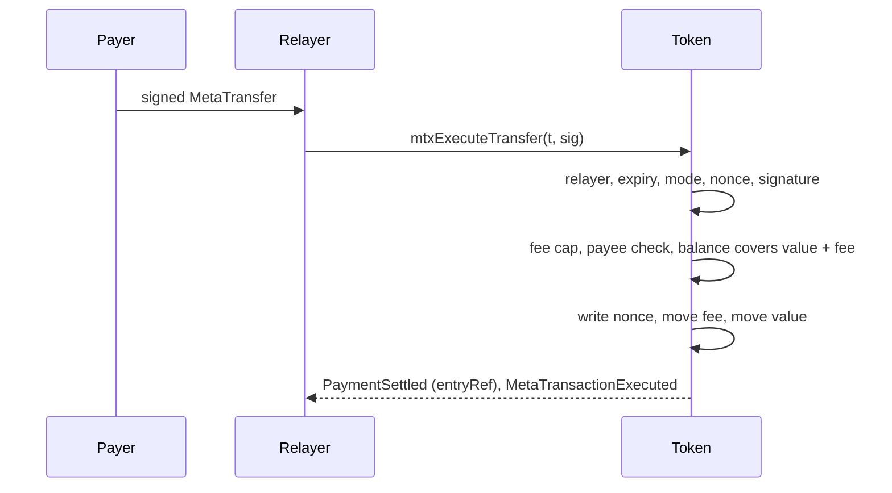
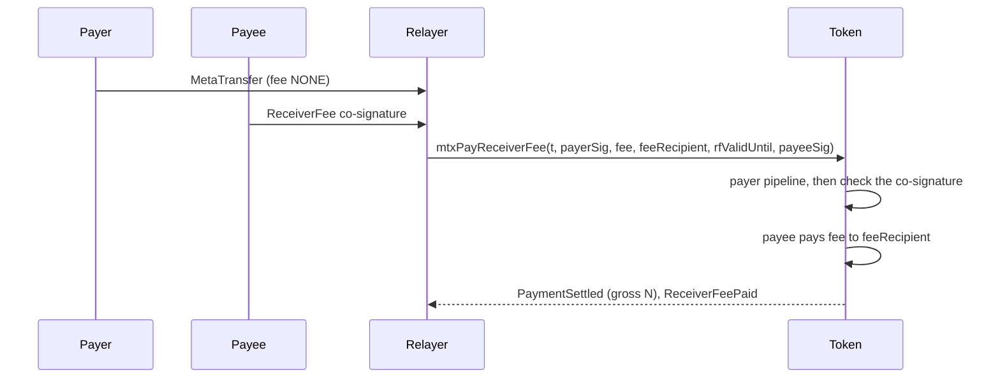
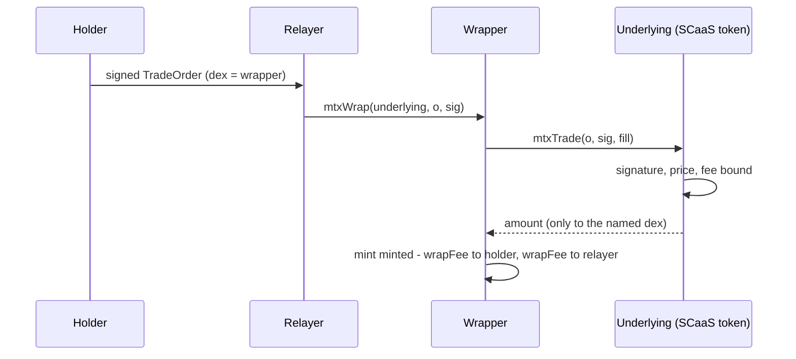
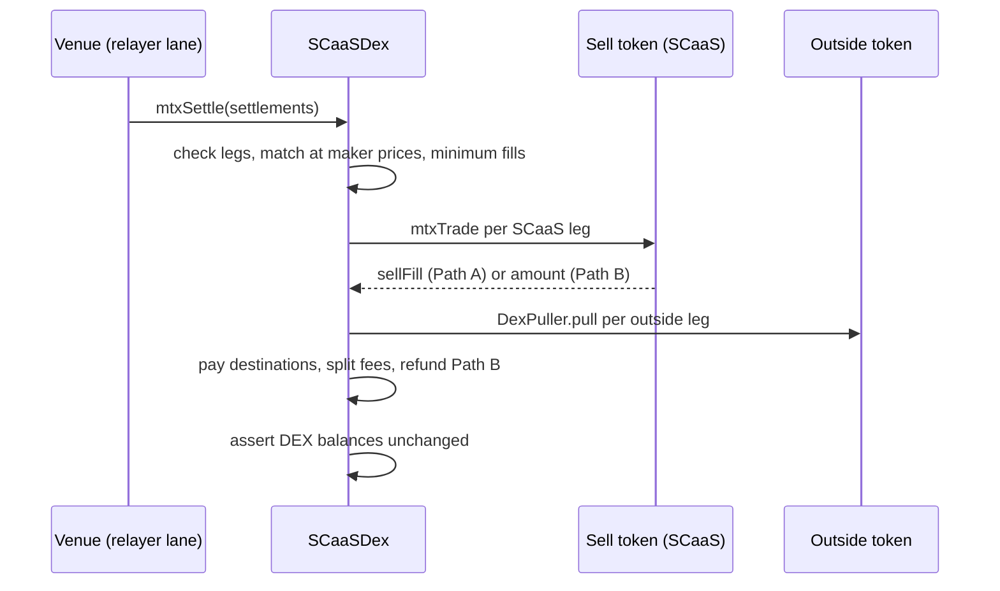

# Settlement — every kind, one page

> [!NOTE]
> This page is a map. It adds no rule and defines no id: each row says where the rule lives and links it, and the
> component doc wins wherever the two differ ([precedence](../README.md#precedence)). Status tags are those of
> [docs/README.md](../README.md#status-tags): **BUILT**, **SPECIFIED**, **PLANNED**, and **Transitional (BUILT)** for
> built code that still differs from the target.

**Contents**

1. [What settlement means here](#1-what-settlement-means-here)
2. [The kinds at a glance](#2-the-kinds-at-a-glance)
3. [The kinds, one by one](#3-the-kinds-one-by-one)
4. [Who checks what](#4-who-checks-what)
5. [Fees](#5-fees)
6. [Finality](#6-finality)

## 1. What settlement means here

A **settlement** is the on-chain transaction that moves value and makes a signed intent final. Before it, a signature
is only a promise that anyone may carry; after it (and after the chain's finality gate, [section 6](#6-finality)) the
intent is a booked fact. Every kind below shares these properties:

- **Signed intents.** The subject signs EIP-712 typed data, never `personal_sign` ([CTR-MTX-14](metatx.md#CTR-MTX-14));
  the contract is the verifier and checks signature, nonce, expiry and limits on every call.
- **Anyone submits, the relayer pays gas.** The subject never pays gas; a relayer lane (a sponsor's, the company's, the
  payee's, a venue's) carries the signed intent ([CTR-MTX-16](metatx.md#CTR-MTX-16)).
- **The fee is in the token** being moved, chosen by the signer within a published cap, or absent
  ([CTR-MTX-13](metatx.md#CTR-MTX-13)); [section 5](#5-fees).
- **All or nothing.** A failure reverts the whole transaction, nonce and fee included, so the user never pays for an
  operation that did not happen ([CTR-MTX-16](metatx.md#CTR-MTX-16)). The one batch exception is the DEX, where each
  settlement inside one call is tried on its own ([CTR-DEX-16](dex.md#CTR-DEX-16)).
- **Expiry.** Every intent carries `validUntil`; the one deliberate exception is a cancel, which never expires
  ([CTR-DEX-02](dex.md#CTR-DEX-02)).
- **Lanes and nonces.** Meta-transactions use 2D nonces `(from, batch) -> nonce`, so one stuck intent never blocks
  another ([CTR-MTX-15](metatx.md#CTR-MTX-15), [metatx.md section 6](metatx.md#6-2d-nonces-and-lanes)); a payment
  request has its own lane and is payable once ([CTR-MTX-03](metatx.md#CTR-MTX-03), [CTR-MTX-04](metatx.md#CTR-MTX-04)).
  Trade orders have a separate order lane (`minNonce`), not the meta-transaction lane of the same name.
- **Salted domains, `chain_uid`.** Every EIP-712 domain is `(name, version, chainId, verifyingContract, salt =
  chain_uid)` ([CTR-GEN-05](README.md#CTR-GEN-05), [CTR-MTX-02](metatx.md#CTR-MTX-02)); `chain_uid` is the chain's genesis
  hash ([NET-ALL-22](../networks/README.md#NET-ALL-22)). There is no cross-token and no cross-chain replay.
- **No allowance for a SCaaS token.** A token grants no allowance to an EOA ([CTR-TOK-01](token-wrappers.md#CTR-TOK-01));
  a trade or a wrap is verified by the token itself, which moves funds only into the contract the signer named.

## 2. The kinds at a glance

"Final when" is the node's gate for the chain ([section 6](#6-finality)); "tx" means the settlement transaction itself.

| Kind | Entry points | Signs / submits | Checked by | Fee, paid by | Final when | Status | Normative |
|---|---|---|---|---|---|---|---|
| Typed transfer / payment | `mtxExecuteTransfer`, `mtxBatchTransfer`, `mtxTransfer`, `mtxTransferWithFee`, `mtxPay` on `payLane(payId)`; direct `payWithFee`; event `PaymentSettled` | payer signs `MetaTransfer`; any relayer | token | NONE / PERCENT / FIXED in the token, on top, signer's choice, never to the payee | tx | **BUILT** (v2 tiers) | [CTR-MTX-23](metatx.md#CTR-MTX-23), [-24](metatx.md#CTR-MTX-24), [-10](metatx.md#CTR-MTX-10), [-08](metatx.md#CTR-MTX-08), [-09](metatx.md#CTR-MTX-09) |
| Receiver pays | `mtxPayReceiverFee` | payer signs `MetaTransfer`, payee co-signs `ReceiverFee`; the bound relayer | token | absolute fee from the payee's balance | tx | **BUILT** (EVM, Hedera) | [CTR-MTX-05](metatx.md#CTR-MTX-05), [-06](metatx.md#CTR-MTX-06) |
| Generic gasless call | `mtxExecute`, `mtxBatch`, `executeMetaTransaction` | subject signs `MetaTransaction`; any relayer | the contract's selector allowlist | per fee class, after the call | tx | **BUILT** | [CTR-MTX-12](metatx.md#CTR-MTX-12), [-19](metatx.md#CTR-MTX-19), [-20](metatx.md#CTR-MTX-20) |
| Signature wrap | `mtxWrap` | holder signs a `TradeOrder` in the underlying's domain; any relayer | underlying and wrapper | order `fee` to the relayer, out of the minted units | tx | **BUILT** (P2a, `UnderlyingToken`) | [CTR-TOK-20](token-wrappers.md#CTR-TOK-20) |
| DEX order book | `SCaaSDex.mtxSettle`, `mtxCancelOrders`, `mtxInvalidateNonces`; token side `mtxTrade` | each party signs a `TradeOrder`; the venue lane | token (Path A) or DEX (Path B, outside legs); DEX conservation | one signed rate, split relayer / treasury by the DEX | tx, then the DEX watcher | token side **BUILT** (P2a); `SCaaSDex` **BUILT** (P2b-1 SCaaS legs, P2b-2 outside legs); `SCaaSDexV1` pair `settle` **BUILT** | [CTR-DEX-13](dex.md#CTR-DEX-13) to [-19](dex.md#CTR-DEX-19), [-22](dex.md#CTR-DEX-22), [-24](dex.md#CTR-DEX-24) |
| Exchange against AMMs | `mtxExchange`, `mtxExchangeVia` | the same signed orders; the venue lane | token or DEX, DEX conservation | signed rate on the floor; surplus to the signers | tx, then the DEX watcher | **BUILT** (P2c, `SCaaSDex`) | [CTR-DEX-20](dex.md#CTR-DEX-20) to [-23](dex.md#CTR-DEX-23) |
| Confidential (Zether) | `zetherTransfer*`, `zetherShield`, `zetherUnshield`, roll-over; `zetherWrapShield`, `zetherUnshieldUnwrap` (`UNDERLYING_ZETHER`) | owner signs the call, the proof binds the envelope; any relayer | token verifier | outer NONE / FIXED (never PERCENT), inner `confidentialFee` | tx (dev chains) | **BUILT, UNAUDITED** (the `*_ZETHER` kinds, P3; dev chains only); PQZ **SPECIFIED** | [zether.md](zether.md), [pq-zether.md](pq-zether.md) |
| Mandate | `payUnderMandate` (named `mtxPayUnderMandate`), `revoke` | delegate signs; any relayer | `MandateWallet` | NONE; relayer pays gas | tx | **BUILT** (P4: epoch, `mtx` names) | [CTR-ACC-06](mandates.md#CTR-ACC-06), [-07](mandates.md#CTR-ACC-07) |
| Asset-suite action | forced transfer, freeze, `VestingGrant.release`, `Distribution` claim, `ExchangeOffer` | issuer / compliance role, or a permissionless claim | token or action contract | by action | tx | **SPECIFIED**, nothing built | [asset-suite.md](asset-suite.md) |
| Tender | `commitBid` (deposit is a `MetaTransfer`), `revealBid`, `withdrawDeposit` | bidder signs only the deposit | tender and token | NONE | tx | **SPECIFIED**, nothing built | [CTR-TND-01](tender.md#CTR-TND-01), [-03](tender.md#CTR-TND-03) |
| Gas sponsorship | node policy; `SponsorshipPool` | the sponsor's node | node | native-gas refund | not on the transfer path | policy **SPECIFIED**, pool **PLANNED** | [NODE-SPN-01](../node/sponsorship.md#NODE-SPN-01), [NODE-SPN-04](../node/sponsorship.md#NODE-SPN-04) |
| Non-EVM families | `mtx_pay`, `mtx_transfer`, `mtx_<name>`, DEX settlement programs | subject signs `MetaCall` / `MetaTransfer`; a relayer lane | the family's contract | none off EVM; lane pays native gas | per family | **BUILT** (as `MetaOp` v1), target **SPECIFIED** | [NET-ALL-26](../networks/README.md#NET-ALL-26), [dex.md section 11](dex.md#11-non-evm-dex-programs) |

## 3. The kinds, one by one

### 3.1 Typed transfer and payment

The payer signs a `MetaTransfer` (`entryRef = 0` is a transfer, `entryRef != 0` a payment); `mtxExecuteTransfer` takes
it as given, the named functions only build the same struct ([CTR-MTX-09](metatx.md#CTR-MTX-09)), so one signature
works on both paths and consumes the lane once. `mtxPay` derives the lane on chain, `payLane(payId) =
keccak256("scaas.pay.lane" || payId)`, nonce 0 ([CTR-MTX-10](metatx.md#CTR-MTX-10)). `payWithFee` is the direct form:
`msg.sender` pays its own gas and the fee is on top. The Universal Account ledger has the twin `uaExecuteTransfer`
(**SPECIFIED**, [CTR-UA-26](accounts.md#CTR-UA-26)).

- **Atomic:** the checks run before the fee and the transfers cannot fail afterwards; `mtxBatchTransfer` is atomic for
  all items ([CTR-MTX-24](metatx.md#CTR-MTX-24), [CTR-MTX-11](metatx.md#CTR-MTX-11)).
- **On failure:** everything reverts, the nonce is not consumed. A lane is spent once whichever struct spent it; a
  second `PaymentSettled` for the same `entryRef` (other lane, `payWithFee`) is a reconciliation exception, never a
  second payment ([CTR-MTX-10](metatx.md#CTR-MTX-10)). Pay-once holds for 30 days of `validUntil`
  ([CTR-MTX-04](metatx.md#CTR-MTX-04)).
- **Node:** a `metatx` job on the relayer lane; simulation before signing, the consumption check when someone else
  lands the intent ([NODE-LANE-23](../node/submit-lanes.md#NODE-LANE-23), [NODE-LANE-09](../node/submit-lanes.md#NODE-LANE-09));
  unbound `relayer` / `feeRecipient` are rewritten by the submitter ([NODE-LANE-10](../node/submit-lanes.md#NODE-LANE-10));
  batching is [NODE-LANE-11](../node/submit-lanes.md#NODE-LANE-11) (**PLANNED**). `PaymentSettled` reaches clients
  only in a final range ([indexer-feeds.md](../node/indexer-feeds.md#event-items)); booking and reconciliation are in
  [integration.md](../integration.md#payment-references).
- **Transitional (BUILT):** the v1 token line still uses the single 11-field struct with `data` ops (Zether left it in P3)
  ([metatx.md Transitional](metatx.md#transitional-built)).

### 3.2 Receiver pays

The payer signs a plain payment (`entryRef != 0`, fee `NONE`, relayer bound, `batch = payLane(entryRef)`, nonce 0); the
payee co-signs `ReceiverFee(paymentDigest, fee, feeRecipient, validUntil)` over the payer's digest. One transaction:
the payer pipeline runs untouched, then `fee` moves from the payee to the fee recipient ([CTR-MTX-05](metatx.md#CTR-MTX-05)).

- **Atomic and single-use:** a failing payee signature reverts the whole call; the co-signature is bound to one
  digest, so the payer's nonce spends it once. Shape rules: [CTR-MTX-06](metatx.md#CTR-MTX-06).
- **Node:** such jobs travel only on the restricted bus scope ([NODE-MESH-17](../node/mesh.md#NODE-MESH-17)); the
  payee books receipt `N` and expense `F` ([sponsorship.md](../node/sponsorship.md#receiver-pays)). EVM and Hedera only.

### 3.3 Generic gasless call

`mtxExecute(m, sig)` runs the signer's calldata as a **self-call** of one selector on the contract's published
allowlist `mtxSelectors()`, then charges the fee **after** the call ([CTR-MTX-17](metatx.md#CTR-MTX-17),
[CTR-MTX-19](metatx.md#CTR-MTX-19)). On the built tokens: `cancelNonce`, `burn` (`NoUnderlyingToken`), and on
`UnderlyingToken` the single- and multi-leg `wrap`, `unwrap` and `addReserve`. Gasless unwrap is `mtxExecute` with the
real `unwrap` calldata and a `minOut` ([CTR-MTX-12](metatx.md#CTR-MTX-12)). Fee classes ([CTR-MTX-20](metatx.md#CTR-MTX-20)):
`AMOUNT(i)` for `burn` and `unwrap`, `ABSOLUTE` for `wrap`, `addReserve`, `cancelNonce` and every Zether selector.
Never allowlisted: `approve`, `transferFrom`, role functions, `transfer` and `pay` (they are `MetaTransfer`s), any
`mtx...` entry.

- **Atomic:** the call runs first, the fee second; any failure, of the call or the fee, reverts all with the inner
  revert data, nonce included. `mtxBatch` is atomic; items may mix selectors, never structs.
- **Node:** the node reads `data` through the cached allowlist table, `422 SELECTOR_NOT_ALLOWED` before simulation
  ([NODE-JOB-20](../node/job-api.md#NODE-JOB-20)); unwrap jobs are simulated in full and never batched
  ([NODE-LANE-22](../node/submit-lanes.md#NODE-LANE-22)). A `call` job is a different thing: a direct call by the lane,
  from a fixed table, never to a token ([NODE-JOB-01](../node/job-api.md#NODE-JOB-01)).

### 3.4 Signature wrap

The holder signs a `TradeOrder` in the **underlying's** domain with `dex` = the wrapper; `UnderlyingToken.mtxWrap`
quotes `minted`, calls `underlying.mtxTrade(...)` and the underlying moves funds only into the wrapper
([CTR-TOK-20](token-wrappers.md#CTR-TOK-20)). The holder never approves anything.

- **Atomic:** the wrapper requires `received == o.amount`; any failure reverts the order's `pulled` state with it.
  `NativeNotGasless` for the native coin; `UnderlyingZetherToken` inherits it (P3).
- **Node:** a `metatx` job entry point. Clients refuse to build an order whose `dex` is not a registered wrapper of the
  underlying ([CTR-DEX-19](dex.md#CTR-DEX-19)).

### 3.5 DEX order book

One settlement call matches **one taker against many makers**; the roles are chosen at settlement time, the order has
none ([CTR-DEX-13](dex.md#CTR-DEX-13), [CTR-DEX-16](dex.md#CTR-DEX-16)).

- **Path A** (default): the token enforces every bound the signer set against the figures the DEX passes and moves
  exactly `sellFill` into the DEX ([CTR-DEX-15](dex.md#CTR-DEX-15)). **Path B** (`ESCROW`, implies IOC): the whole
  `amount` is pulled, the DEX enforces price, minimum and fee on the matched part and refunds the rest in the same
  call. **Outside tokens:** the same order signed in the DEX's domain as `DexOrder`, pulled by `DexPuller` under an
  allowance to the puller, never to the DEX; `ESCROW` refused ([CTR-DEX-18](dex.md#CTR-DEX-18),
  [CTR-DEX-22](dex.md#CTR-DEX-22)). The kind is the DEX's own listing, never the leg's claim.
- **Minimum fill:** every order in a settlement fills at least `max(minFill, ceil(amount/2))` unless it closes its
  remainder ([CTR-DEX-14](dex.md#CTR-DEX-14)); IOC is closed at its single pull, FOK is `minFill = amount`
  ([CTR-DEX-04](dex.md#CTR-DEX-04), [CTR-DEX-05](dex.md#CTR-DEX-05)).
- **Fee split and conservation:** [section 5](#5-fees); the DEX ends each settlement with every token balance
  unchanged, else `ConservationBroken` ([CTR-DEX-16](dex.md#CTR-DEX-16)).
- **Atomic:** each settlement inside the call is atomic; a failing one reverts only itself and emits `MatchFailed`; if
  none succeeds the call reverts, so the relayer's simulation catches it. A reverted settlement consumes nothing.
  What stays consumed: a filled or IOC-pulled order (`pulled[h]`), and a cancel.
- **Cancels:** `mtxCancelOrder` / `mtxInvalidateNonces` on the token, `mtxCancelOrders` on the DEX for outside legs;
  cancel signatures never expire ([CTR-DEX-02](dex.md#CTR-DEX-02)).
- **The named `dex` is a contract and nothing more** ([CTR-DEX-19](dex.md#CTR-DEX-19)); `OpenFactory.createDex` makes
  the clone, `admin` can list markets and set the fee split, never change an amount
  ([CTR-DEX-24](dex.md#CTR-DEX-24), [CTR-DEX-03](dex.md#CTR-DEX-03)). A managed market is an instance whose admin is the
  venue operator ([CTR-DEX-12](dex.md#CTR-DEX-12)).
- **Node:** the book and matcher, `mtxSettle` as a `call` job in `~dex`, intake reads, the DEX watcher with its own
  cursor ([NODE-DEX-15](../node/dex-venue.md#NODE-DEX-15), [NODE-DEX-04](../node/dex-venue.md#NODE-DEX-04),
  [NODE-DEX-16](../node/dex-venue.md#NODE-DEX-16)); `settled` is final, a late settled trade debits a restored order
  ([NODE-DEX-10](../node/dex-venue.md#NODE-DEX-10)).
- **Status and Transitional (BUILT):** the token side (`mtxTrade`, cancels, `TradeLib`) is built in P2a; the
  `SCaaSDex` clone (`createDex`) with SCaaS legs in P2b-1; outside-token legs (`DexOrder`, `DexPuller`), the DEX's
  `mtxCancelOrders` / `mtxInvalidateNonces` and the ERC-1271 cap in P2b-2. `MatchFailed` keeps the first 256 bytes of
  the revert data (controller ruling, pending the owner) and a starved ERC-1271 check reverts the whole call (CTR-DEX-08). What the
  node uses until P5 is the pair `settle(Match[])` of `SCaaSDexV1` (the DEX built before P2b, renamed): DEX-signed
  `Order`s over allowances, one pair per self-call, fees per market, a separate relayer fee, `OrderFilled` / `Matched` /
  `MatchFailed` ([dex.md section 13](dex.md#transitional-built)). The legacy `MetaTxDex` stays until its planned removal (P5).

### 3.6 Exchange against AMM routes

`mtxExchange(plan, interactions)` (the DEX calls routers) and `mtxExchangeVia(plan, executor, data)` (an executor with
a callback) execute the **same signed orders** against pools, multi-hop or cycles X to X, instead of `makers[]`
([CTR-DEX-20](dex.md#CTR-DEX-20)). Steps: check, snapshot balances, pull each leg as in `mtxSettle`, execute, pay the
surplus above each signed limit to its signer ([CTR-DEX-21](dex.md#CTR-DEX-21)), conservation over every snapshotted
token. A plan is atomic with no `try`. Interactions may not call the DEX, the puller or `mtxTrade`; targets may be
listed ([CTR-DEX-23](dex.md#CTR-DEX-23)); the holder approves the puller, never the DEX
([CTR-DEX-22](dex.md#CTR-DEX-22)). Node: the TradeEngine, off unless enabled, EVM only
([NODE-DEX-17](../node/dex-venue.md#NODE-DEX-17)); it keeps no surplus ([NODE-DEX-18](../node/dex-venue.md#NODE-DEX-18)).
Status **BUILT** (P2c, `SCaaSDex`): the DEX also refuses a sell token that arrives inexact, resets every allowance an
`approve` interaction granted and refuses `increaseAllowance` and Permit2 `approve` (controller ruling, pending the owner; [dex.md](dex.md#CTR-DEX-23)).

### 3.7 Confidential settlement (Zether, PQZ)

Confidential tokens are meta-tx tokens: the target is a `ZetherLayer` on `MetaTokenBase`, every confidential entry
point an allowlisted self-call of `mtxExecute` with `ABSOLUTE` fee class ([CTR-ZTH-08](zether.md#CTR-ZTH-08),
[CTR-ZTH-34](zether.md#CTR-ZTH-34)). Kinds of settlement: **shield** from the public balance (`zetherShield`,
[CTR-ZTH-35](zether.md#CTR-ZTH-35)), **transfer** to one or several recipients with decoys and one proof
(`zetherTransfer`, `...Single`, `...Commit` (built: `...Bundle`), `...NoBundle`, [CTR-ZTH-37](zether.md#CTR-ZTH-37),
[CTR-ZTH-38](zether.md#CTR-ZTH-38)), **unshield** (`zetherUnshield`) and **roll-over** of pending credits
([CTR-ZTH-45](zether.md#CTR-ZTH-45)). The proof carries an envelope binding, so a proof lifted out of its envelope
fails ([CTR-ZTH-06](zether.md#CTR-ZTH-06)). PQZ mirrors the names with `pqz` and relays the same way
([CTR-PQZ-21](pq-zether.md#CTR-PQZ-21), [CTR-PQZ-22](pq-zether.md#CTR-PQZ-22)); nothing of PQZ is built.

- **Atomic:** a failed proof or check reverts everything; the relayer simulates first. A direct call carries no outer
  fee ([CTR-ZTH-13](zether.md#CTR-ZTH-13)).
- **Node:** re-encodes the dynamic arguments and refuses non-canonical `data` before computing the mesh `intent_id`
  ([NODE-JOB-20](../node/job-api.md#NODE-JOB-20)).
- **Status:** BUILT (P3), UNAUDITED: the `*_ZETHER` kinds refuse to initialize outside chain ids 31337 and 1337
  ([CTR-ZTH-02](zether.md#CTR-ZTH-02)); chain 7622 is not on that list. The old `ZetherToken` with its own envelope and
  names is backed up in `smartcontracts/evm/legacy/p3/`.

### 3.8 Mandates

A delegate signs `payUnderMandate(token, payee, amount, entryRef, epoch)`; the `MandateWallet` checks delegate, epoch, revocation,
expiry, approved payee, per-payment and per-period caps and single-use `entryRef`, then pays with
`payWithFee(..., NONE, ...)` from its own balance, no allowance ([CTR-ACC-06](mandates.md#CTR-ACC-06)). A revoke signed
by the delegate is bound to the mandate's epoch as well ([CTR-ACC-07](mandates.md#CTR-ACC-07), **BUILT**, P4).

- **Atomic:** a cap or payee failure reverts the payment and `entryRef` stays unused; reconciliation is that of a
  manual payment.
- **Node:** a `call` job to the wallet's named entry point from the call table
  ([NODE-JOB-01](../node/job-api.md#NODE-JOB-01)); the node checks the wallet's `chainUid()` against the chain profile.
- **Built (P4):** the wallet is on `MetaTxBase` with the salted domain; the typed-struct entry points (`revokeWithSig`,
  `executeAsOwner`, a pay without the epoch) are in `legacy/p4/`.

### 3.9 Asset-suite actions

All **SPECIFIED**, nothing built ([asset-suite.md](asset-suite.md)): forced transfer by the issuer only against a
recorded order and from a frozen subject ([CTR-AS-04](asset-suite.md#CTR-AS-04)); freeze ([CTR-AS-05](asset-suite.md#CTR-AS-05));
`VestingGrant.release()` and Merkle `Distribution` claims, permissionless and paying only the beneficiary
([CTR-AS-10](asset-suite.md#CTR-AS-10), [CTR-AS-11](asset-suite.md#CTR-AS-11)); `ExchangeOffer` (redemption, split),
gasless through a `TradeOrder` leg it pulls as its `dex` ([CTR-AS-13](asset-suite.md#CTR-AS-13)). Regulated checks run at
the token's shape step, so a regulated leg that slips through intake fails alone ([CTR-DEX-12](dex.md#CTR-DEX-12)).
EVM and Hedera only ([NET-ALL-17](../networks/README.md#NET-ALL-17)).

### 3.10 Tender and sponsorship

**Tender (SPECIFIED).** The bidder's one signature is the deposit, a `MetaTransfer` to the tender; `commitBid` calls
`token.mtxExecuteTransfer` ([CTR-TND-01](tender.md#CTR-TND-01)). Reveal and refund are permissionless; forfeits go to
the immutable `slashSink` ([CTR-TND-03](tender.md#CTR-TND-03), [CTR-TND-04](tender.md#CTR-TND-04)). **Sponsorship** is node policy for who pays gas
([NODE-SPN-01](../node/sponsorship.md#NODE-SPN-01)); an on-chain pool that refunds the relayer's native gas is **PLANNED**
([NODE-SPN-04](../node/sponsorship.md#NODE-SPN-04)). Neither moves value on the payment path.

### 3.11 Non-EVM families

Every family signs the two kinds `MetaCall` and `MetaTransfer` ([NET-ALL-26](../networks/README.md#NET-ALL-26)); the lane
pays native gas and there is no token fee field. DEX settlement is a per-family program with the same invariants but
its own leg shape: two signed legs, `filled[orderHash]`, cross-multiplied price, cap 1 %, settlement bound to the
relayer ([dex.md section 11](dex.md#11-non-evm-dex-programs), [CTR-DEX-09](dex.md#CTR-DEX-09),
[networks/README.md](../networks/README.md#dex-per-family)). Accepted differences: no partial fills on Cosmos and TON,
IOC closes at the first maker on Sui, Aptos and Solana, TON holds funds briefly in escrow. Family detail: the
pages under [networks/](../networks/README.md).
**Transitional (BUILT):** the token's `relay(op, auth)` checks `MetaOp` v1, not yet the two target kinds.

## 4. Who checks what

| Kind | Token | DEX / settling contract | Node |
|---|---|---|---|
| Typed transfer, payment | relayer binding, expiry, mode, nonce, signature, fee cap, payee check, balance | none | simulates, consumption check, normalizes unbound fields, waits for finality |
| Receiver pays | payer pipeline, then the payee's co-signature and shape | none | restricted bus scope, books receipt and fee |
| Generic call | allowlist, data shape, fee class, ticket (one self-call) | none | reads `data` by the cached allowlist, full simulation of unwrap |
| Signature wrap | underlying: signature, price, fee bound, funds only to `dex` | wrapper: quote, `received == amount`, mint | metatx job; clients refuse unregistered wrappers |
| Order book | SCaaS leg: signature, expiry, lane, closed state, every bound on Path A | match, listing, relayer, self-trade, Path B and outside-leg checks, payout, fee split, conservation | book, matcher, intake rules mirror the contract, simulation, DEX watcher |
| Exchange | as the order book, floor figures | price floors, snapshots, targets, surplus, conservation | TradeEngine quotes, buffer, simulates the whole call |
| Zether | base envelope, then proof, registration, counters | none | canonical re-encoding of `data` |
| Mandate | payment path of the token | `MandateWallet`: delegate, caps, payee, epoch | call-table check, `chainUid()` check |
| Non-EVM | none | the family's contract: signature, lane, relayer | per-family adapter, same gate |

## 5. Fees

Detail: [CTR-MTX-13](metatx.md#CTR-MTX-13) (modes), [CTR-MTX-20](metatx.md#CTR-MTX-20) (classes).

| Where | Modes | Basis and cap | Paid by, to whom |
|---|---|---|---|
| `MetaTransfer` | `NONE`, `PERCENT` (ppm), `FIXED` | `value`; at most 1 % (`MAX_FEE_PPM` 10 000), on top | signer, in the token, to the signed `feeRecipient` or `msg.sender`; never to the payee ([CTR-MTX-08](metatx.md#CTR-MTX-08)) |
| `mtxExecute`, class `AMOUNT(i)` (`burn`, `unwrap`) | `PERCENT`, `FIXED` | argument `i`; at most 1 % | signer, after the call, in the token (wrapped units for unwrap) |
| `mtxExecute`, class `ABSOLUTE` (`wrap`, `addReserve`, `cancelNonce`, Zether) | `FIXED` only | the signed amount, no 1 % cap | signer; for `wrap` out of the minted units |
| Contract without a balance (`MandateWallet`, `SmartKeyAccount`) | `NONE` only | none | the relayer pays gas; any charge is off chain ([CTR-MTX-22](metatx.md#CTR-MTX-22)) |
| Receiver pays | payer fee `NONE`; co-signed absolute fee | `0 < fee <= value`, no 1 % cap | the payee from its own balance, never to itself ([CTR-MTX-06](metatx.md#CTR-MTX-06)) |
| Signature wrap | order `fee` in ppm | `wrapFee = ceil(minted * fee / 10^6)`, rate at most 1 % | the holder, out of the minted units, to the submitting relayer |
| DEX | the order's signed `fee` in ppm | at most 1 % of what the order receives, `ceil`, once per order per settlement ([CTR-DEX-11](dex.md#CTR-DEX-11), [CTR-DEX-17](dex.md#CTR-DEX-17)) | each party, from what it receives; split `relayerSharePpm` to the submitter, rest to `treasury`; no separate relayer fee |
| Exchange | the same signed `fee`, on the floor | surplus above the limit carries no fee | signer pays the fee; surplus goes to the signers ([CTR-DEX-21](dex.md#CTR-DEX-21)) |
| Zether | outer `NONE` or `FIXED`; `PERCENT` refused | outer absolute, uncapped; inner `confidentialFee` is a constant per token | outer from the public balance; inner to the beneficiary UA ([CTR-ZTH-05](zether.md#CTR-ZTH-05), [CTR-ZTH-07](zether.md#CTR-ZTH-07)) |
| Non-EVM | none | none | the lane pays native gas ([NET-ALL-26](../networks/README.md#NET-ALL-26)) |

A sponsor that wants the user to pay nothing uses `NONE` with the relayer bound to its lane
([metatx.md Payers](metatx.md#payers)). With `relayer = 0` on a DEX order, whoever submits earns the relayer share of
every fee in the settlement, which is why clients default `relayer` to the venue node.

## 6. Finality

The node, not the client, decides finality: each chain has `finality = {mode, depth, quorum}`, the indexer sends only
final ranges, and there is no "observed" state, so a non-final log never becomes a booking
([NODE-IDX-02](../node/indexer-feeds.md#NODE-IDX-02)). Final head is the minimum agreed by at least `quorum` endpoints
with the same hash, and the event set must agree too ([NODE-IDX-01](../node/indexer-feeds.md#NODE-IDX-01)). A reorg below
the gate is outside the model ([NODE-IDX-03](../node/indexer-feeds.md#NODE-IDX-03)). The payment-bound flows wait for
hard finality; soft finality is **PLANNED** and never applies to them. The DEX watcher has its own cursor, so a DEX
ingest fault never blocks payment booking ([NODE-DEX-04](../node/dex-venue.md#NODE-DEX-04)).

| EVM chain | Profile | Gate | Status |
|---|---|---|---|
| Private reference chain, id 7622 | `private7622` | depth 1, quorum 1 (single-provider trust, reported as such) | **BUILT** |
| Anvil, 31337 / 1337 | none | depth | **BUILT** (dev only; the only chains Zether accepts) |
| Gnosis Chain, 100 | `gnosis` | tag `finalized`, ~160-240 s, quorum >= 2 | seeded `draft` |
| BNB Smart Chain, 56 | `bsc` | tag `finalized`, ~1 s, quorum >= 2 | seeded `draft` |
| Polygon PoS, 137 | `polygon` | tag `finalized` (milestones, ~3-6 s); `safe` unsupported | seeded `draft` |
| Base, 8453 | `base` | `l1_batch`: `safe` ~90 s, `finalized` ~16 min | seeded `draft`; the `l1_batch` mode is **PLANNED** |
| Celo, 42220 | `celo` | `l1_batch` | seeded `draft`; **PLANNED** |

Source: the table in [networks/evm.md](../networks/evm.md#1-chains) and [NET-EVM-01](../networks/evm.md#NET-EVM-01).
Until `l1_batch` exists the node uses `tag` ([indexer-feeds.md](../node/indexer-feeds.md#finality)). A chain becomes
supported only through a profile with a measured gate, an RPC quorum and a passing deployment.

- **Hedera:** `instant`, depth 0: a transaction in a record file is final (aBFT), read through the mirror node
  ([hedera.md](../networks/hedera.md#5-finality-and-events)). Settlement is the same Solidity as on EVM.
- **Other families:** Cosmos, Soroban, Sui and Aptos finalize at inclusion (`instant`), TON at the masterchain block,
  Solana at commitment `finalized` ([networks/README.md section 9](../networks/README.md#9-finality-per-family)).
- **Per kind:** the transfer, wrap, mandate, Zether and tender kinds are final when their transaction is in a final
  range. An order-book settlement is final when `mtxSettle` is; the venue marks the trade `settled` from the DEX
  watcher's final event and removes closed orders from the book. A consumed intent that landed through another
  relayer is `consumed`, not failed, and is marked final from the feed
  ([NODE-LANE-09](../node/submit-lanes.md#NODE-LANE-09)). Lanes: [submit-lanes.md](../node/submit-lanes.md); feeds:
  [indexer-feeds.md](../node/indexer-feeds.md); venue: [dex-venue.md](../node/dex-venue.md).
