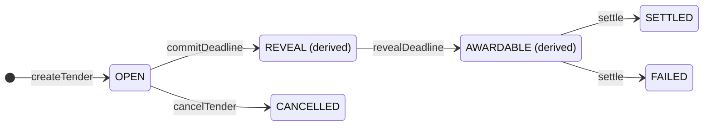
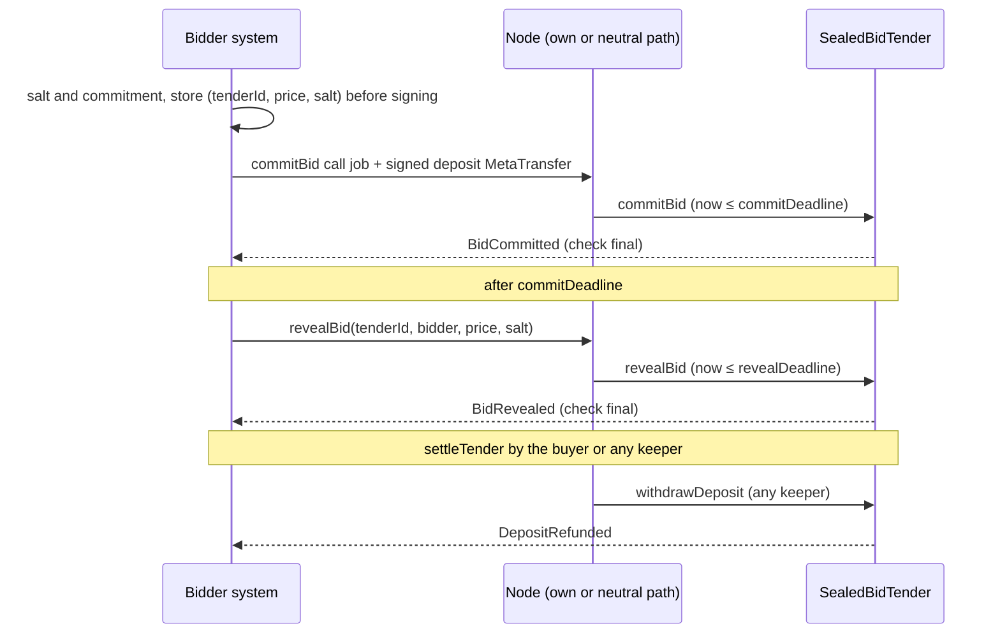

# Sealed-bid tender

On a public ledger an open bid is visible to competitors in the mempool and in blocks (bid sniping, collusion). The
`SealedBidTender` contract separates the **commitment** (hidden, bonded by a deposit) from the **revelation** (after
the deadline), and returns every honest loser's deposit without anyone's approval. Status: **SPECIFIED** (EVM, and
the same bytecode on Hedera); nothing is built.

**Contents**

1. [Scope](#1-scope)
2. [Rules](#2-rules)
3. [Roles and lifecycle](#3-roles-and-lifecycle)
   - 3.1 [Commit (`now ≤ commitDeadline`)](#31-commit-now--commitdeadline)
   - 3.2 [Reveal, disqualify, settle](#32-reveal-disqualify-settle)
   - 3.3 [Payout routing (`withdrawDeposit(tenderId, bidder)`, permissionless, once per bid)](#33-payout-routing-withdrawdeposittenderid-bidder-permissionless-once-per-bid)
   - 3.4 [Invariants](#34-invariants)
4. [Interface](#4-interface)
5. [Storage](#5-storage)
6. [Flows](#6-flows)
   - 6.1 [Buyer](#61-buyer)
   - 6.2 [Bidder](#62-bidder)
7. [Node and client touchpoints](#7-node-and-client-touchpoints)
8. [Security](#8-security)
9. [Gas (estimates, to be measured with the implementation)](#9-gas-estimates-to-be-measured-with-the-implementation)
10. [Conformance](#10-conformance)
11. [Families](#11-families)

## 1. Scope

In scope: the `SealedBidTender` contract (EVM; same bytecode on Hedera), the bidder and buyer flows, and the node and
client touchpoints. The same design family also specifies gas sponsorship ([node/sponsorship.md](../node/sponsorship.md)),
receiver-pays ([metatx.md](metatx.md#receiver-pays)), an on-chain `SponsorshipPool` (rule only, PLANNED) and
crypto-shredding of commitments ([integration.md](../integration.md)). Not in scope: multi-criteria scoring,
multi-lot tenders, other auction types (pre-qualification = the eligibility allowlist); confidential bids, Zether
deposits and anonymous bidders (a fresh `SmartKeyAccount` per tender is possible); hiding the address graph (SCaaS is
not anonymous: bidder identities are public at commit).

## 2. Rules

<a id="deposit-commitment"></a>
<a id="CTR-TND-01"></a>**CTR-TND-01** — **Deposit and commitment are one signature: the deposit token's own payment
`MetaTransfer`** ([CTR-MTX-01](metatx.md#CTR-MTX-01)): `to = tender`, `value = minDeposit`, `entryRef = depositRef`,
fee `NONE`, `MODE_RESTRICT_RELAYER` with `relayer = tender`, `depositRef = keccak256(abi.encode(DEPOSIT_TAG,
block.chainid, tender, tenderId, commitment))`. Anyone submits `commitBid(tenderId, commitment, proof, t, sig)`; the
tender recomputes `depositRef`, checks the shape, calls `token.mtxExecuteTransfer(t, sig)`
([CTR-MTX-23](metatx.md#CTR-MTX-23)) and records the bid. **Transitional (BUILT):** the deposit is the single struct's
`data = pay(depositRef)` shape through `executeMetaTransaction`. The
payment reference binds the deposit to this commitment: no tender-level signature, no allowance, and nobody lands the
deposit outside `commitBid` (every entry point checks the relayer first). Bidders reconcile it as a payment
(`entryRef = depositRef`). Cost: wallets show "pay 1000 to <tender>" rather than "bid".

<a id="commitment-format"></a>
<a id="CTR-TND-02"></a>**CTR-TND-02** — **Commitment** `= keccak256(abi.encode(BID_TAG, block.chainid, address(this),
tenderId, bidder, price, salt))`, `BID_TAG = keccak256("scaas.tender.bid.v1")`, `DEPOSIT_TAG =
keccak256("scaas.tender.deposit.v1")`, `price` `uint128` in base units of the price unit named in the tender
documents, `salt` 32 bytes from a CSPRNG or derived (below). `abi.encode`, never `encodePacked`. Binding chain,
contract, tender and bidder stops copying a commitment into another tender or onto another chain. A format change is a
new `BID_TAG`.

<a id="reveal-withdraw"></a>
<a id="CTR-TND-03"></a>**CTR-TND-03** — **Reveal and withdraw are permissionless; no replacement in v1.**
`revealBid(tenderId, bidder, price, salt)` and `withdrawDeposit(tenderId, bidder)` take no signature: the commitment
binds the bidder, and payouts go only to the destination the rules fix. The tender contract verifies no signature at
all, every bidder action needs at most the one deposit signature, and any node or keeper can run reveals and refunds. A
commitment cannot be replaced (`replaceBid` is deferred: it would be the contract's only signature check — domain,
nonce, KAT, a Hedera child — for a small benefit); a v1 bidder who must change a price abandons the bid (forfeit). A
tender v2 may add `replaceBid`.

<a id="forfeits"></a>
<a id="CTR-TND-04"></a>**CTR-TND-04** — **Forfeited deposits go to `slashSink`**, fixed at creation, immutable,
`∉ {0, tender}`, never a bidder. Client default: the buyer organization's tender-security account; not burned, not
redistributed. The buyer is the party harmed by a non-reveal; burning only destroys value; redistribution breaks I1.
This is acceptable **only because every bidder has a commit and reveal path the buyer does not control** (the
independent path below); otherwise a sponsoring or relaying buyer could withhold a competitor's reveal and keep its
deposit. If that does not hold, name a neutral sink.

<a id="reserve-tiebreak"></a>
<a id="CTR-TND-05"></a>**CTR-TND-05** — **Public reserve only.** `[minPrice, maxPrice]` (inclusive, `maxPrice = 0` ⇒
unbounded) is published; a reveal outside it is **invalid** and forfeits. No sealed reserve in v1 (it would be a
price-informed abort); forfeiting out-of-range reveals closes the "reveal garbage to exit" escape. **Tie-break =
earliest commit `seq`** (a per-tender counter at commit): deterministic, not manipulable after reveals; commit order is
decided by submitters and block producers, so a bidder that cares commits through its own path.

<a id="cancel-disqualify"></a>
<a id="CTR-TND-06"></a>**CTR-TND-06** — **Cancel until `commitDeadline` only**, by the buyer, with a `reasonRef` (a
salted commitment); every deposit then refunds 100 %; prices are still hidden, so a cancel cannot be price-informed.
`minBidders ≥ 1` valid reveals (disqualified ones included) else `FAILED`: valid revealers refunded, others forfeit.
**Award window and disqualification** (owner). During reveals the contract keeps the **top `k = maxDisqualifications
+ 1` (≤ 3) valid bids** sorted by price (`rule`), then `seq`; the head leads. For `dqWindow` seconds after
`revealDeadline` (fixed at creation, `≤ 7 d`, client default 72 h, `0` = off) the buyer may `disqualifyWinner` **the
current leader only**, with a non-zero `reasonRef` (a salted commitment of the document), a violation class, and
**only while a next valid bid exists** (never a price-informed abort); the next bid leads. Only the top `k` can ever
lead, so nothing else is stored. The disqualified deposit refunds in full unless the class is one of the
`forfeitClasses` declared at creation (a bitmask of ≤ 8 classes defined in the tender documents, e.g. forged bid
documents) — then it goes to `slashSink`. At most `maxDisqualifications ≤ 2`; each emits `BidDisqualified`.
**Settlement:** the buyer may settle any time after `revealDeadline` (closing the window), anyone after the window;
`withdrawDeposit` settles lazily; there is no `awardDeadline`. Procurement must be able to pass over a winner that
fails due diligence; leader-only, a short window, a public reason, a cap and the last-candidate rule bound the
discretion. A tender that wants no discretion sets `dqWindow = 0`.

<a id="deposit-token"></a>
<a id="CTR-TND-07"></a>**CTR-TND-07** — **Deposit token** = a token deployed by the chain's one `OpenFactory`
([CTR-TOK-03](token-wrappers.md#CTR-TOK-03)) as kind `NONE` or `UNDERLYING` (regulated = flags 5–8)
through a **registered, non-deprecated** implementation (unregistered clones have version 0 ⇒
`implementationOf == 0` ⇒ refused; Zether kinds refused), checked at `createTender`. `versionOf` is decoded with the
factory's one `TokenKind` enum. **Transitional (BUILT):** two factories exist (`OpenFactory` and the v1 `OpenFactoryV1` with kind `META`, with enums that
differ); the tender is not built yet and follows the one factory. The tender also checks that the
balance delta equals `minDeposit` (redundant for META tokens, kept as defence). Bidders sign an intent on this token;
an attacker-chosen "token" could fake `mtxExecuteTransfer`. Other tokens are wrapped first.

<a id="windows-bonds"></a>
<a id="CTR-TND-08"></a>**CTR-TND-08** — **Windows, bonds, no admin.** `revealDeadline − commitDeadline ∈ [1 h, 30 d]`
(client default 24 h); `commitDeadline ≤ createdAt + 365 d`; bond policies `RETURN_ON_AWARD` | `HOLD_UNTIL_RELEASE`:
under HOLD the winner's deposit is the bond, released by the buyer or by anyone after `bondReleaseTime`
(`≤ revealDeadline + 730 d`), or claimed by the buyer to `slashSink` before then with a `reasonRef` (a standard
procurement instrument; separating it would need a second winner deposit and an escrow that does not exist; its
discretion is declared at creation and stated). Constants change only with a new deployment. **No admin.** One
immutable contract per chain, no owner, pause, upgrade or sweep; stray tokens sent directly are unrecoverable.
`bidder ≠ buyer`. Every refund path must hold without anyone's consent (I1). **Prerequisite: EIP-1153**
(`TLOAD`/`TSTORE`) for the transient reentrancy guard; not a new requirement, because every eligible deposit token
already needs it, so a chain without it cannot hold an eligible deposit token. The deploy script probes `TSTORE` and
refuses the chain; there is no storage-guard fallback.

| Item | Rule |
|---|---|
| Commit = deposit | One signature: the deposit token's own payment `MetaTransfer` (`to = tender`, `value = minDeposit`, `entryRef = depositRef`, fee `NONE`, relayer bound to the tender); anyone submits `commitBid(tenderId, commitment, proof, t, sig)`; no tender-level signature, no allowance |
| Commitment | `keccak256(abi.encode(BID_TAG, chainid, tender, tenderId, bidder, price, salt))`, `BID_TAG = keccak256("scaas.tender.bid.v1")`, `price` `uint128`, 32-byte salt |
| Reveal, withdraw | permissionless, no signature; payouts go only to the destination the rules fix; no replacement in v1 |
| Forfeits | non-reveal, invalid (out-of-range) reveal, a declared violation class, or a HOLD bond claim ⇒ `slashSink`, fixed at creation, never a bidder |
| Reserve and ties | public `[minPrice, maxPrice]` only; tie-break = earliest commit `seq` |
| Cancel | buyer, until `commitDeadline`, with a `reasonRef`; every deposit refunds 100 % |
| Award window | `minBidders` valid reveals else `FAILED`; for `dqWindow` (≤ 7 d) the buyer may disqualify only the current leader, only while a next valid bid exists, with a public `reasonRef`, at most 2 times; buyer settles any time after reveals, anyone after the window; no `awardDeadline` |
| Deposit token | a registered, non-deprecated tier kind from the one factory; Zether refused; balance delta checked |
| Windows, bonds, admin | reveal window 1 h–30 d; `RETURN_ON_AWARD` or `HOLD_UNTIL_RELEASE`; one immutable contract per chain, no owner, pause or upgrade; `bidder ≠ buyer` |
| Families | EVM and Hedera first (same bytecode); others PLANNED ([NET-ALL-18](../networks/README.md#NET-ALL-18)) |

## 3. Roles and lifecycle

Buyer: `msg.sender` of `createTender` (in practice a `SmartKeyAccount`, a `MandateWallet` owner call or a multisig,
submitted as a `call` job). Bidder: `t.from` of the deposit `MetaTransfer`. Keeper: anyone (node, buyer, bidder) running
permissionless steps.



| State | Calls in this state |
|---|---|
| `OPEN` | `commitBid`; `cancelTender` (buyer, `now ≤ commitDeadline`) → `CANCELLED` |
| `REVEAL` | `revealBid` |
| `AWARDABLE` | `disqualifyWinner` (buyer, `≤ dqWindow`); `settle` → `SETTLED` or `FAILED` |
| `SETTLED`, `FAILED` | `withdrawDeposit`; `releaseBond` / `claimBond` |
| `CANCELLED` | `withdrawDeposit` |

Stored states: `OPEN`, `SETTLED`, `FAILED`, `CANCELLED`; `REVEAL` and `AWARDABLE` (the award window
`(revealDeadline, revealDeadline + dqWindow]`, then until someone settles) are derived from `block.timestamp`.

### 3.1 Commit (`now ≤ commitDeadline`)

1. Tender exists and stored state `OPEN`; `bidder = t.from`; `bidder ∉ {buyer, slashSink}`; eligibility proof valid
   when `eligibilityRoot ≠ 0` (OpenZeppelin `MerkleProof`, leaf `keccak256(bytes.concat(keccak256(abi.encode(
   bidder))))`); the bidder has no bid.
2. Intent shape (`BadDepositIntent(code)`): `t.to == address(this)`, `t.value == minDeposit`,
   `t.entryRef == depositRef(tenderId, commitment)`, `feeModeOf(t.mode) == NONE`, `t.mode & MODE_RESTRICT_RELAYER != 0`,
   `t.relayer == address(this)`.
3. Effects: bid `{commitment, seq = nextSeq++, status = COMMITTED}`, `commits++`.
4. Interaction: `b0 = balanceOf(this)`; `IERC20MetaTx(token).mtxExecuteTransfer(t, sig)` (reverts propagate);
   `balanceOf(this) − b0 == minDeposit` else `DepositNotReceived`.
5. Emit `BidCommitted(tenderId, bidder, commitment, seq)`.

The batch/nonce of `m` is the bidder's choice; clients SHOULD use `payLane(depositRef)`, nonce 0 (the pay-lane
convention, [CTR-MTX-03](metatx.md#CTR-MTX-03)). A commit and a cancel in the same block at `now == commitDeadline`
are both valid; their order decides (a cancel after the commit refunds it).

### 3.2 Reveal, disqualify, settle

- `revealBid(tenderId, bidder, price, salt)`: `commitDeadline < now ≤ revealDeadline`, bid `COMMITTED`, the
  recomputed commitment equals the stored one else `CommitmentMismatch`. `valid = minPrice ≤ price ∧ (maxPrice == 0 ∨
  price ≤ maxPrice)`. Stores `price`, status `REVEALED`, `valid`; if valid: `validReveals++` and insert into the sorted
  `top` list (≤ `k = maxDisqualifications + 1` entries; `LOWEST_PRICE`: lower first, `HIGHEST_PRICE`: higher first;
  equal ⇒ lower `seq`), dropping the entry beyond `k`. Emits `BidRevealed(tenderId, bidder, price, valid)`.
- `disqualifyWinner(tenderId, reasonRef, violationClass)`: buyer only; state `OPEN`; `revealDeadline < now ≤
  revealDeadline + dqWindow` else `DisqualifyClosed`; `dqCount < maxDisqualifications` else `DisqualifyCapReached`;
  `topLen ≥ 2` (a next valid bid exists) else `NoNextBid`; `reasonRef ≠ 0`; `violationClass == 0` (no violation) or
  `1 ≤ violationClass ≤ 8` with bit `violationClass − 1` set in `forfeitClasses`, else `ViolationClassNotDeclared`.
  Effects: the head's bid status `DISQUALIFIED`, `forfeit = (violationClass ≠ 0)`, `dqCount++`, pop the head of `top`
  (O(1), ≤ 3 entries). Emits `BidDisqualified(tenderId, bidder, reasonRef, violationClass, forfeit, newLeader)`.
- `settleTender(tenderId)`: state `OPEN`; the caller is the buyer and `now > revealDeadline`, or anyone and `now >
  revealDeadline + dqWindow`. `validReveals ≥ minBidders ∧ topLen ≥ 1` ⇒ `SETTLED` with `winner = top[0]`, else
  `FAILED`; emits `TenderSettled(tenderId, winner, price, validReveals, commits)` (`winner = 0` when `FAILED`;
  `validReveals` includes disqualified bids). A second call reverts `WrongPhase`.

### 3.3 Payout routing (`withdrawDeposit(tenderId, bidder)`, permissionless, once per bid)

It settles first if `now > revealDeadline + dqWindow` and the tender is still `OPEN`; otherwise it requires
`SETTLED`, `FAILED` or `CANCELLED` — except a `DISQUALIFIED` bid, which pays out at once (it can never lead again).

| Tender state | Bid | Destination | Event |
|---|---|---|---|
| `CANCELLED` | any | bidder | `DepositRefunded` |
| `SETTLED`/`FAILED` | revealed, valid, not winner | bidder | `DepositRefunded` |
| `SETTLED` | winner, `RETURN_ON_AWARD` | bidder | `DepositRefunded` |
| `SETTLED` | winner, `HOLD_UNTIL_RELEASE` | revert `BondHeld` (use `releaseBond`/`claimBond`) | — |
| `SETTLED`/`FAILED` | not revealed, or revealed invalid | `slashSink` | `DepositSlashed` |
| any (after disqualification) | `DISQUALIFIED`, `forfeit = false` | bidder | `DepositRefunded` |
| any (after disqualification) | `DISQUALIFIED`, `forfeit = true` (declared class) | `slashSink` | `DepositSlashed` |

The bid status becomes `DONE` before the token transfer (checks-effects-interactions). `releaseBond(tenderId)`: buyer
at any time after settle, anyone after `bondReleaseTime` ⇒ winner (`BondReleased`). `claimBond(tenderId, reasonRef)`:
buyer, `HOLD`, `now < bondReleaseTime` ⇒ `slashSink` (`BondClaimed`). Payouts use the token's plain `transfer` (the
tender is the holder).

### 3.4 Invariants

<a id="invariants"></a>

- **I1** Every bidder of a cancelled tender, every valid non-winning revealer and every bidder disqualified without a
  declared violation class receives exactly `minDeposit`, through a permissionless call, with no expiry.
- **I2** For every token: `balanceOf(tender) ≥ Σ minDeposit over bids with status ≠ DONE`.
- **I3** No bid's price is derivable from chain data before that bidder's own reveal, in particular before
  `commitDeadline` (salt secret and uniformly random).
- **I4** Winner = the best valid, non-disqualified bid by (rule, seq); the buyer's only influence is removing the
  current leader inside the award window, at most `maxDisqualifications` times, never the last candidate, each with a
  public `reasonRef`.
- **I5** `settle` happens once; a bid pays out once (status `DONE`).
- **I6** No **bid deposit** enters the tender except through `commitBid` (relayer bound to the tender); plain transfers
  to the tender are possible and unrecoverable.
- **I7** A deposit is forfeited only for non-reveal, invalid reveal, a declared violation class, or a HOLD bond claim —
  never for an undeclared reason.

## 4. Interface

```solidity
interface ISealedBidTender {
    enum State { NONE, OPEN, REVEAL, AWARDABLE, SETTLED, FAILED, CANCELLED }   // REVEAL/AWARDABLE derived
    enum Rule { LOWEST_PRICE, HIGHEST_PRICE }
    enum BondPolicy { RETURN_ON_AWARD, HOLD_UNTIL_RELEASE }
    enum BidStatus { NONE, COMMITTED, REVEALED, DISQUALIFIED, DONE }

    struct TenderConfig {
        address depositToken; uint128 minDeposit;
        uint64 commitDeadline; uint64 revealDeadline;
        Rule rule; uint128 minPrice; uint128 maxPrice;      // inclusive; maxPrice 0 = unbounded
        uint32 minBidders;                                  // >= 1
        BondPolicy bondPolicy; uint64 bondReleaseTime;      // HOLD only; else 0
        uint32 dqWindow;                                    // award window after revealDeadline, <= 7 d; 0 = off
        uint8 maxDisqualifications;                         // <= MAX_DISQUALIFICATIONS = 2
        uint8 forfeitClasses;                               // bitmask of declared violation classes 1..8
        address slashSink;                                  // forfeits
        bytes32 eligibilityRoot;                            // 0 = open
        bytes32 documentRef;                                // salted commitment of the tender documents
    }
    struct Bid { bytes32 commitment; uint128 price; uint64 seq; BidStatus status; bool valid; bool forfeit; }

    event TenderCreated(uint256 indexed tenderId, address indexed buyer, bytes32 documentRef, TenderConfig config);
    event TenderCancelled(uint256 indexed tenderId, bytes32 reasonRef);
    event BidCommitted(uint256 indexed tenderId, address indexed bidder, bytes32 commitment, uint64 seq);
    event BidRevealed(uint256 indexed tenderId, address indexed bidder, uint256 price, bool valid);
    event BidDisqualified(uint256 indexed tenderId, address indexed bidder, bytes32 reasonRef, uint8 violationClass,
                          bool forfeit, address newLeader);
    event TenderSettled(uint256 indexed tenderId, address indexed winner, uint256 price, uint32 validReveals,
                        uint32 commits);
    event DepositRefunded(uint256 indexed tenderId, address indexed bidder, uint256 amount);
    event DepositSlashed(uint256 indexed tenderId, address indexed bidder, address sink, uint256 amount);
    event BondReleased(uint256 indexed tenderId, address indexed winner, uint256 amount);
    event BondClaimed(uint256 indexed tenderId, bytes32 reasonRef, uint256 amount);

    error BadConfig(uint8 code);   // 1 token, 2 deposit, 3 windows, 4 bounds, 5 minBidders, 6 bond, 7 sink, 8 disqualification
    error WrongPhase(State state); error NotBuyer(); error NotEligible(address bidder); error BidExists(); error NoBid();
    error BidderExcluded(address bidder);   // buyer or slashSink
    error BadDepositIntent(uint8 code);     // 1 to, 2 value, 3 data, 4 fee mode, 5 relayer binding
    error DepositNotReceived(uint256 expected, uint256 got); error CommitmentMismatch();
    error DisqualifyClosed(); error DisqualifyCapReached(); error NoNextBid();
    error ViolationClassNotDeclared(uint8 violationClass); error BondHeld(); error BondNotHeld();

    function createTender(TenderConfig calldata c) external returns (uint256 tenderId);
    function cancelTender(uint256 tenderId, bytes32 reasonRef) external;                  // buyer
    function commitBid(uint256 tenderId, bytes32 commitment, bytes32[] calldata eligibilityProof,
                       MetaTxLib.MetaTransfer calldata t, bytes calldata depositSig) external;   // anyone
    function revealBid(uint256 tenderId, address bidder, uint128 price, bytes32 salt) external;   // anyone
    function disqualifyWinner(uint256 tenderId, bytes32 reasonRef, uint8 violationClass) external;  // buyer
    function settleTender(uint256 tenderId) external;                 // buyer after reveals; anyone after the window
    function withdrawDeposit(uint256 tenderId, address bidder) external;                  // anyone
    function releaseBond(uint256 tenderId) external;
    function claimBond(uint256 tenderId, bytes32 reasonRef) external;                     // buyer, HOLD

    function commitmentOf(uint256 tenderId, address bidder, uint128 price, bytes32 salt) external view
        returns (bytes32);
    function depositRef(uint256 tenderId, bytes32 commitment) external view returns (bytes32);
    function state(uint256 tenderId) external view returns (State);
    function bidOf(uint256 tenderId, address bidder) external view returns (Bid memory);
    function leaders(uint256 tenderId) external view returns (address[] memory);          // current top list
    function configOf(uint256 tenderId) external view returns (TenderConfig memory, address buyer);
}
// constructor(address factoryV1, address factoryV2) — immutable; either may be 0 on a chain without it.
```

## 5. Storage

```
mapping(uint256 => Tender) tenders;     // Tender = TenderConfig (≈ 7 slots packed) + buyer, State, commits/validReveals
                                        //          uint32, nextSeq uint64, createdAt uint64, dqCount, topLen uint8,
                                        //          address[3] top (sorted, head = leader)   (≈ 12 slots)
mapping(uint256 => mapping(address => Bid)) bids;   // 2 slots: commitment | price, seq, status, valid, forfeit
uint256 nextTenderId;                   // starts at 1
// transient reentrancy guard keccak256("scaas.tender.reentrancy.v1") on every state-changing function (EIP-1153)
```

No bidder list: clients enumerate bids from `BidCommitted` events. `createTender` checks (`BadConfig`): deposit token
acceptance (`isToken`, `versionOf`, `implementationOf ≠ 0`, `!isDeprecated`, kind `NONE` or `UNDERLYING`); `minDeposit > 0`; `now < commitDeadline ≤ now + 365 d`; reveal window in `[1 h, 30 d]`; `maxPrice == 0 ∨
minPrice ≤ maxPrice`; `minBidders ≥ 1`; HOLD ⇒ `revealDeadline < bondReleaseTime ≤ revealDeadline + 730 d`, RETURN ⇒
`bondReleaseTime == 0`; `slashSink ∉ {0, this}`; `dqWindow ≤ 7 d`, `maxDisqualifications ≤ 2`, `dqWindow == 0 ⇒
maxDisqualifications == 0 ∧ forfeitClasses == 0`.

## 6. Flows

### 6.1 Buyer

| # | Buyer system | Chain |
|---|---|---|
| 1 | Tender record linked to the request for quotation; documents canonicalized (JCS), `documentRef` = salted commitment; deposit token, `minDeposit`, deadlines, reserve, `minBidders`, bond policy, `slashSink`, allowlist root, `dqWindow`, `maxDisqualifications`, `forfeitClasses` (each class defined in the documents) | — |
| 2 | Chain check: refuses, or warns with a recorded reason, on a chain whose validators the buyer organization controls alone; then a `call` job `createTender(config)` from the buyer account (the namespace needs `allow_call`) | `TenderCreated` (`tenderId` from the event) |
| 3 | Publishes tender id, deadlines, deposit terms, eligibility proofs; may offer a sponsored portal path, never as the bidders' only path | — |
| 4 | Watches commits (count only); may cancel until `commitDeadline` | `BidCommitted`, `TenderCancelled` |
| 5 | Inside the award window: due diligence on the leader; if it fails, `disqualifyWinner(reasonRef, class)` with the reason document committed and retained for audit and dispute | `BidDisqualified` |
| 5b | Then `settleTender` (buyer early, or any keeper after the window) | `TenderSettled` |
| 6 | On the **finalized** `TenderSettled`: purchase order to the winner; non-revealers = committed set − revealed set; keeper jobs `withdrawDeposit` for every bid (refunds and forfeits) | `DepositRefunded`, `DepositSlashed` |
| 7 | Bond: `releaseBond` on contract signature/delivery, or `claimBond(reasonRef)` | `BondReleased`/`BondClaimed` |
| 8 | Supplier invoice paid with `mtxPay` and a **fresh random `entryRef`**; the link tender ↔ purchase order ↔ invoice ↔ `entryRef` stays off chain | `PaymentSettled` |

The payment `entryRef` is never derived from `tenderId`. The buyer system never sees prices before reveal; the
purchase order is created only from the finalized `TenderSettled`; non-revealers are flagged from `DepositSlashed`.

### 6.2 Bidder



0. **Independent path (normative).** Before signing a deposit intent, the bidder's system checks that it can submit
   `commitBid` and `revealBid` on that chain **without the buyer**: its own node namespace (own gas or own sponsor
   policy), a door run by a neutral operator, or a direct transaction from a wallet holding native coin. If none is
   configured it refuses to sign. The buyer's portal may be used as a convenience, never as the only path.
1. The bidder generates `salt`, computes `commitment = commitmentOf(…)` locally, stores `(tenderId, price, salt)` in
   its secret store **before** signing.
2. Build and sign the deposit `MetaTransfer`: `to = tender`, `value = minDeposit`, `entryRef = depositRef`,
   `batch = payLane(depositRef)`, `nonce = 0`, `mode = MODE_RESTRICT_RELAYER`, `relayer = tender`, `fee = 0`,
   `feeRecipient = 0`, `validUntil ≤ now + 3600`.
3. Submit `commitBid` as a `call` job (own path, or the portal). Verify `BidCommitted` is final; if missing before
   `validUntil`/`commitDeadline − margin`, submit the same signed intent through the independent path (any submitter
   works: the intent binds the tender, not a lane).
4. After `commitDeadline`: submit `revealBid` (no signature) through the independent path, or hand `(price, salt)` to
   the portal **and** verify `BidRevealed` before `revealDeadline − margin`, falling back to the independent path. The
   independent path is a namespace other than the portal's: live-call dedupe is per namespace
   ([NODE-JOB-13](../node/job-api.md#NODE-JOB-13)), so a portal's queued, paused or under-capped copy of the same reveal
   never blocks it. On its own namespace a `409 DUPLICATE_CALL {uid}` names the bidder's own live job: follow it, or
   cancel it (never published) and re-push.
5. After settlement: the refund arrives through any keeper's `withdrawDeposit`; the bidder books it from
   `DepositRefunded` (the outgoing deposit was booked from its own `PaymentSettled(entryRef = depositRef)`).

Gas: bidder steps are relayed `call` jobs, so a bidder needs no native coin **if** its independent path pays gas (its
own node, or a neutral sponsor). A buyer may additionally sponsor its tender's `commitBid`/`revealBid`/`withdrawDeposit`/
`settleTender` selectors (a sponsorship policy with `job_kind = call`, [NODE-SPN-01](../node/sponsorship.md#NODE-SPN-01)).
Sponsors size `max_cost_per_tx` for ERC-1271 bidders (gas table below).

Salt generation and backup: a lost salt means a forfeited deposit. Either (a) 32 CSPRNG bytes, with an encrypted
backup kept with the bid record; or (b) derived from a high-entropy secret the bidder already backs up:
`salt = HKDF-SHA256(ikm = secret, info = "scaas.tender.salt.v1" ‖ u256(chainId) ‖ tender ‖ u256(tenderId))`, where
`secret` is a seed-vault key or a passkey PRF output (deterministic). Never an ECDSA/WebAuthn signature as entropy
unless the signer is proven deterministic (passkeys are not). The salt is never sent to anyone before
`commitDeadline`.

## 7. Node and client touchpoints

| Where | What |
|---|---|
| Node store | a `chain_contract` row (`kind = tender`) registers the tender per chain; admin routes manage it |
| Node indexer | indexes the tender's events like token events; a namespace receives them when the contract is in its token subset |
| Node submit | `call` jobs to a registered tender: simulation as usual; no batching; live duplicates in the same namespace refused with the live `uid`; `commitBid` jobs pass the registered-token rule because the inner token is registered. The permissionless selectors `commitBid`, `revealBid`, `withdrawDeposit`, `settleTender` are rows of the call table with target rule `chain_contract.kind = tender`; role-restricted calls (`createTender`, `disqualifyWinner`, bond calls) go through the buyer's own account contract ([NODE-JOB-01](../node/job-api.md#NODE-JOB-01)), so tender jobs are no longer refused with `CALL_TARGET_REFUSED` |
| Clients | bidder view: compute commitment and salt in the client, sign the deposit intent, reveal reminder at `commitDeadline`; buyer: tender and bid records with the secret fields kept server-side only; handlers for the ten events; the independent-path check before signing |

## 8. Security

| Threat | Defence |
|---|---|
| Copying a commitment to another tender/chain, or pairing a deposit with another commitment | commitment binding ([CTR-TND-02](#CTR-TND-02)); `depositRef` inside the signed `pay` data |
| Landing the deposit outside `commitBid` (stranded funds) | relayer bound to the tender (I6) |
| Fake token implementing a no-op `mtxExecuteTransfer` | factory provenance + balance delta ([CTR-TND-07](#CTR-TND-07)) |
| Fee taken from the deposit intent to the tender (`feeRecipient` unbound ⇒ `msg.sender` = tender) | fee mode `NONE` required |
| Last-revealer exit after seeing others | possible at the cost of `minDeposit` (forfeit); an out-of-range reveal is also forfeit |
| Selective reveal by a multi-identity bidder | each unrevealed identity forfeits `minDeposit`; the buyer sizes `minDeposit` ≥ the expected surplus at risk; allowlist |
| Buyer reads prices early | impossible from chain data (I3); the bidder never sends `(price, salt)` before `commitDeadline` |
| Buyer withholds sponsorship, a handed-over commit or reveal ⇒ forfeit to the buyer's sink | independent path required before signing, verify-and-fallback in steps 3–4 |
| Buyer aborts after seeing prices | no cancel after `commitDeadline`; the last candidate cannot be disqualified; remaining: a buyer sybil winning or refusing the purchase order off chain (known limits) |
| Buyer never settles / withholds refunds | settle and withdraw are permissionless after the window |
| Buyer cherry-picks the winner by disqualifying | leader only, inside `dqWindow`, cap ≤ 2, public `reasonRef` and event; residual risk below |
| Buyer seizes deposits with false violation claims | only classes declared at creation; the reason is committed and openable in a dispute; residual risk below |
| Sybil fills the tender to lock out real bidders | no bid cap; each bid costs `minDeposit` and is refunded only to the bidder |
| Deposits locked by extreme windows | window caps ([CTR-TND-08](#CTR-TND-08)) |
| Reentrancy via token | registered META code + transient guard + checks-effects-interactions |
| Censorship near deadlines on a public chain | bidders commit early; reveal window ≥ 1 h floor (24 h default) |
| Buyer controls inclusion or timestamps (own PoA/private chain) | not defended on chain; the buyer system refuses or warns (buyer flow step 2) |

Known limits (stated to users):

- **Chain neutrality.** The tender is fair only on a chain whose transaction inclusion the buyer does not control. On
  a private/PoA chain validated by the buyer organization alone, it can censor competitors' reveals (forfeiting them to
  its own sink), censor commits and move timestamps within consensus rules. Commit ordering (the tie-break) is decided
  by submitters and block producers.
- A buyer can commit and reveal through a sybil identity; if the sybil wins, the tender ends without a real award (the
  sybil's deposit is refunded as winner) — equivalent to refusing the purchase order, which no contract can prevent.
  The award on chain is evidence of a fair procedure, not an enforcement of the purchase.
- **Residual buyer discretion.** Within the award window the buyer can pass over the best `maxDisqualifications` (≤ 2)
  valid bids, so in effect choose among the top three, but never end the tender without a winner. With declared
  violation classes it forfeits those deposits to `slashSink`, and under `HOLD_UNTIL_RELEASE` it may also claim the
  winner's bond: up to three deposits per tender — an incentive to allege violations when the sink is the buyer's own
  organization. The contract cannot judge whether a reason is true: it makes every use public, bounded and bound to a
  committed document the bidder can contest off chain. Tenders that want no discretion set `dqWindow = 0` and
  `RETURN_ON_AWARD`; bidders that distrust the buyer can demand a neutral `slashSink` or `forfeitClasses = 0`.
- Bidder identities are public at commit (addresses), prices at reveal, forever. Revealed prices are personal data only
  through the address ↔ party mapping, which is erasable off chain.

## 9. Gas (estimates, to be measured with the implementation)

| Call | Estimate | Notes |
|---|---|---|
| `createTender` | 240–280 k | ~12 new slots + event with config |
| `commitBid` (EOA bidder) | 120–150 k | token meta-tx with first-use lane (~52 k) + 2 bid slots (44 k) + checks, Merkle proof ~1.5 k/level |
| `commitBid` (ERC-1271 bidder) | + up to 400 k | `SmartKeyAccount` cap; WebAuthn P-256 ≈ 100–300 k. Sponsors size `max_cost_per_tx` for this row, or ERC-1271 bidders die with `SPONSOR_TX_CAP` |
| `revealBid` | 25–50 k | keccak + 1 slot update + sorted insert into `top` (≤ 3) |
| `disqualifyWinner` | 15–30 k | status write + pop head |
| `settleTender` | 8–15 k | state write + event |
| `withdrawDeposit` | 30–45 k | status write + token transfer (cold recipient adds ~20 k) |

## 10. Conformance

Unit: every `BadConfig` code; commit with each `BadDepositIntent` code; each tier kind; the deposit through
`mtxExecuteTransfer`; unregistered and deprecated tokens refused; Zether refused; eligibility proof valid/invalid;
buyer and sink cannot bid; ERC-1271 bidder (`SmartKeyAccount`); reveal mismatch, out-of-range reveal, reveal outside the
window; ties broken by `seq`; both rules; `minBidders` ⇒ `FAILED`; cancel before/after `commitDeadline`, and commit +
cancel in the same block at `now == commitDeadline`; every routing row and double withdraw; bond release by buyer, by
anyone after `bondReleaseTime`, claim before it. **I6 front-running:** a third party submits the deposit intent through
`mtxPay`, `mtxBatchTransfer` and `mtxExecuteTransfer` ⇒ `MetaTxUnauthorizedRelayer`;
the intent replayed into another `tenderId` and another tender contract ⇒ `BadDepositIntent(3)`. Disqualification:
outside the window (before `revealDeadline`, after `revealDeadline + dqWindow`), non-buyer, `dqWindow = 0`, cap
reached, `NoNextBid` on the last candidate, zero `reasonRef`, undeclared class, class 0 ⇒ refund, declared class ⇒
forfeit; next leader correct for both rules with ties, invalid bids never in `top`, `top` truncation at `k`; settle by
the buyer inside the window closes it; a disqualified bid is withdrawable before settle. Invariant fuzz (random
bidders, prices, reveals, disqualifications, timing): I1–I7. KATs (`tests/kat/tender.json`, Python and TypeScript
builders): `commitmentOf`, `depositRef`, the deposit `pay` data. Hedera: the same bytecode on HSCS with a 64-byte
ED25519 deposit intent (HIP-632 on the token). Gas snapshot including an ERC-1271 bidder. Deploy script: the `TSTORE`
probe refuses a chain without EIP-1153.

## 11. Families

| Family | Status | Design notes |
|---|---|---|
| EVM | **SPECIFIED** | this file |
| Hedera | **SPECIFIED** | the same bytecode on HSCS (no child: the tender checks no signature); deposit token = a Hedera v2 meta token; gas limit tight (HSCS charges ≥ 80 % of the limit); EIP-1153 as for the Hedera token children |
| Cosmos (CosmWasm) | PLANNED | the contract holds the deposit; commit = the meta token's signed `Relay` op with a `pay` memo = `depositRef`, executed by the tender via submessage; commitment over `(chain_id, contract, tender, bidder, price, salt)` with SHA-256 |
| Soroban | PLANNED | `require_auth` entries of the bidder for `commit_bid` (deposit = a SAC/token `transfer` sub-invocation in the same auth tree); reveal/withdraw permissionless |
| Sui / Aptos | PLANNED | tender object / resource; the deposit coin moved by the relayer-submitted PTB / entry function under the bidder's signed op; time from `Clock` / `timestamp` |
| TON | PLANNED | async: the deposit arrives as a jetton `transfer_notification` with `forward_payload = (tenderId, commitment)`; reveal/withdraw are internal messages; bounce handling on refunds |
| Solana | PLANNED | program + PDA vault per tender; deposit via the token program CPI under the bidder's Ed25519-precompile-verified op |
