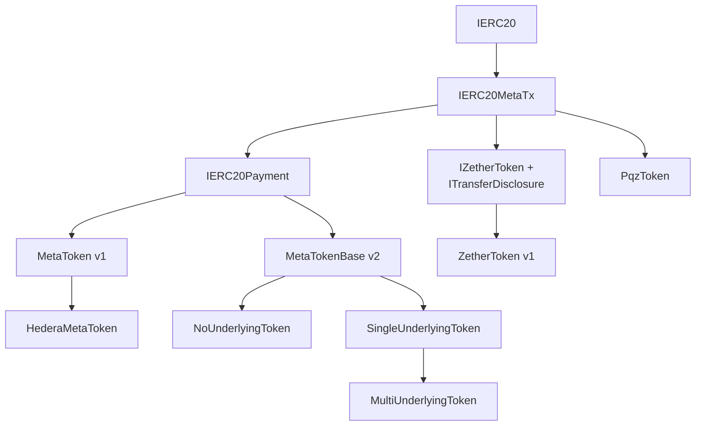
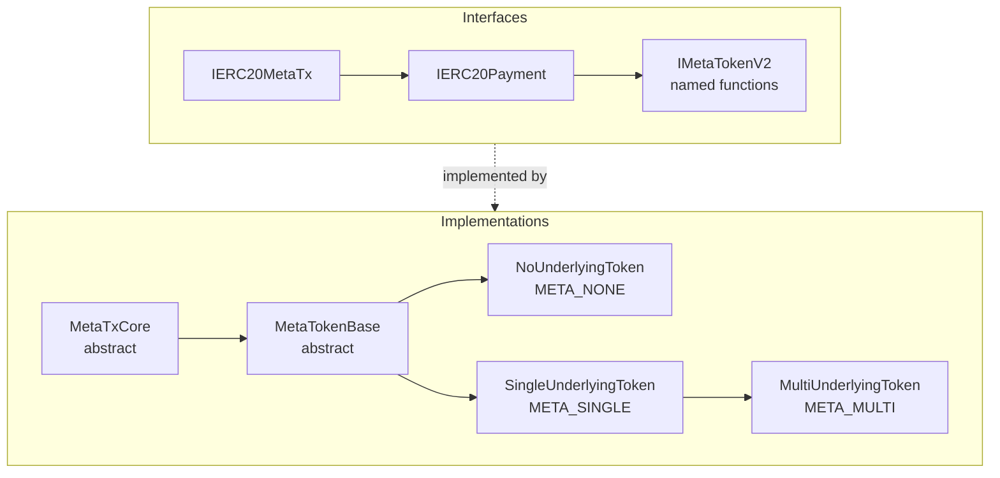

# Token tiers, wrappers and the open factory

SCaaS tokens are created by anyone through an open factory as immutable EIP-1167 clones of versioned
implementations. There are three tiers: a standalone token, a wrapper of one ERC-20 at a conversion rate, and an
any-of wrapper of 2–8 ERC-20s. Every tier carries the meta-transaction layer of [metatx.md](metatx.md). Status:
v1 and v2 (EVM and Hedera) **BUILT** (`smartcontracts/evm/src/{metatx,factory,hedera}/`); node and client support
for v2 **SPECIFIED**; regulated tiers ([asset-suite.md](asset-suite.md)) **SPECIFIED**.

## Overview



| Node | Role | Status |
|---|---|---|
| `IERC20MetaTx` | base: every token is gasless ([metatx.md](metatx.md)) | |
| `IERC20Payment` | public payment: `payWithFee`, `PaymentSettled(entryRef)` | |
| `MetaToken` v1 (kind `META`) | tier 1 standalone / tier 2 single-underlying wrapper | BUILT |
| `HederaMetaToken` | + HIP-632 ED25519 signatures, HTS association | BUILT |
| `MetaTokenBase` v2 | + `mtxTransfer`/…`WithFee`/`mtxPay`/`mtxBatch` | BUILT |
| `NoUnderlyingToken` | (kind `META_NONE`) tier 1 | BUILT |
| `SingleUnderlyingToken` | (kind `META_SINGLE`) tier 2, rate (num/den), reserve | BUILT |
| `MultiUnderlyingToken` | (kind `META_MULTI`) tier 3, 2–8 underlyings, guardian | BUILT |
| + Hedera children of each v2 tier | `HederaNo/Single/MultiUnderlyingToken` | BUILT |
| + regulated child per tier | `*_REG` kinds 5–7, `RegulatedControls` | SPECIFIED |
| + `MetaToken` v3 per tier | `bytes32` UA ledger, `UAMetaTransaction` | SPECIFIED |
| `IZetherToken` + `ITransferDisclosure` | confidential interface | |
| `ZetherToken` v1 | (kind `ZETHER`, dev chains only) | BUILT (unaudited) |
| `PqzToken` | post-quantum class, never an upgrade of `ZetherToken`; + v3 `UAMetaTransaction` path; dev chains and the private chain 7622 only | SPECIFIED |

Confidential tokens are **children** of the meta-tx layer, not a parallel branch: every confidential token is
relayable through the same envelope, `PqzToken` included ([CTR-PQZ-15](pq-zether.md#CTR-PQZ-15)). Non-EVM families
implement the same roles natively.

v2 replaces the single v1 `MetaToken` implementation (one contract, tier picked by `underlying == 0`) with three
contracts in a parent/child tree, adds per-underlying conversion rates, a multi-underlying (any-of) wrapper, a
gasless unwrap op and named meta-tx functions. The `MetaTransaction` struct, its typehash and the digest rule do not
change, so every signature format, KAT and client builder stays valid; only the domain (`name`, `version`,
`verifyingContract`) differs per implementation. Not covered: baskets (proportional, weighted multi-asset
redemption), oracle rates, rebasing/share wrappers (ERC-4626 style).



| Node | Adds |
|---|---|
| `IMetaTokenV2` | named functions |
| `MetaTxCore` (abstract) | nine-step pipeline over a memory struct, allowance lockdown, `FeePolicy`, 2D nonces |
| `MetaTokenBase` (abstract) | ops pay/trade/approve(/unwrap), `payWithFee`, named functions, init, provenance |
| `NoUnderlyingToken` (kind `META_NONE`) | issuer-minted (`initialSupply`, optional minter, burn) |
| `SingleUnderlyingToken` (kind `META_SINGLE`) | one underlying, rate, reserve, optional rate timelock |
| `MultiUnderlyingToken` (kind `META_MULTI`) | 2..8 underlyings, per-leg rate + reserve, guardian |
| Hedera children | `HederaNoUnderlyingToken`, `HederaSingleUnderlyingToken`, `HederaMultiUnderlyingToken` |

## Tiers

<a id="CTR-TOK-02"></a>**CTR-TOK-02** — Three tiers in a parent/child tree: `NoUnderlyingToken`,
`SingleUnderlyingToken`, `MultiUnderlyingToken is SingleUnderlyingToken`, all on `MetaTokenBase is MetaTxCore`. Each
is its own implementation and factory kind, so each implementation's audit surface is only what it holds.

| Tier | Contract | `underlying` | Supply rule | Invariant | Status |
|---|---|---|---|---|---|
| 1 Standalone (loyalty, internal units, access tokens) | v1 `MetaToken`; v2 `NoUnderlyingToken` (`META_NONE`) | `address(0)` | `initialSupply` minted to `creator` at init; `mint(to, v)` by `minter` only (`minter = 0` ⇒ fixed supply); v2 adds holder `burn` and one-way `renounceMinter` | `Σ balances == totalSupply` | v1 and v2 **BUILT** |
| 2 Single-underlying wrapper | v1 `MetaToken`; v2 `SingleUnderlyingToken` (`META_SINGLE`) | ERC-20 address | Only via `wrap(amount)` (mints `⌊received·num/den⌋` of the **measured** delta) / `unwrap(wrapped, recipient)` (pays `⌊w·den/num⌋`, burns `⌈out·num/den⌉`); v1 is the 1:1 case | v1: `underlying.balanceOf(this) ≥ totalSupply`; v2: `Σ⌊reserve·num/den⌋ ≥ totalSupply` with internal `reserve` | v1 **BUILT** at 1:1; v2 with rates **BUILT** |
| 3 Multi-underlying (any-of) | v2 `MultiUnderlyingToken is SingleUnderlyingToken` (`META_MULTI`) | 2–8 ERC-20s, fixed at creation | `wrap(u, amount)` on one chosen leg at that leg's rate; `unwrap(u, wrapped, recipient)` into one chosen leg, bounded by `reserve_u`; guardian may only `disableWrap(u)` (one-way; unwrap stays open) | `Σ_i⌊reserve_i·num_i/den_i⌋ ≥ totalSupply` (pooled; no per-leg invariant) | **BUILT** |

Example (owner requirement): a wrapper over USDT and DAI at 1 → 25,000, i.e. one stablecoin mints 25,000 units of a
low-value currency token — tier 3 with one rate per leg (`num/den` adjusted for each leg's decimals); one underlying at a rate is tier 2.

`initData`: v1 `abi.encode(string name, string symbol, uint8 decimals, uint256 initialSupply, address minter)`
(tier 2 ignores `decimals`); v2 per kind below. Fee-on-transfer underlyings are measured on the way in and must
transfer exactly on the way out; rebasing underlyings are unsupported (a negative rebase stops wrap, exits stay
first-come); classical Zether refuses fee-on-transfer underlyings (`UnsupportedUnderlying`,
[CTR-ZTH-14](zether.md#CTR-ZTH-14)). Weighted baskets (proportional redemption) are not planned.

### Tier 1 — `NoUnderlyingToken` (kind `META_NONE`)

<a id="CTR-TOK-09"></a>**CTR-TOK-09** — `NoUnderlyingToken` keeps the v1 tier-1 semantics (`initialSupply` to
`creator`, optional `minter`, `minter == 0` ⇒ fixed supply) and adds `burn(amount)` by the holder and
`renounceMinter()` (one-way), so an issuer can retire a minter it no longer needs.

`initData = abi.encode(string name, string symbol, uint8 decimals, uint256 initialSupply, address minter)` (v1 ABI);
`underlyings.length == 0`.

| Function | Rule |
|---|---|
| `initialize` | mints `initialSupply` to `creator`; stores `minter` (0 ⇒ fixed supply) |
| `mint(to, amount)` | `msg.sender == minter != 0`, else `NotMinter` |
| `renounceMinter()` | minter only; sets `minter = 0`; `MinterRenounced()`; one-way |
| `burn(amount)` | any holder, own balance; `Transfer(from, 0, amount)` |

Invariant: `Σ balances == totalSupply`. A supply cap or mint-rate limit, if an issuer wants one, belongs in the
minter contract it controls, not in this tier.

### Tier 2 — `SingleUnderlyingToken` (kind `META_SINGLE`)

`underlyings.length == 1`. `initData = abi.encode(string name, string symbol, uint8 decimals, uint96 num, uint96 den,
RateConfig cfg)`, with

```solidity
struct RateConfig { bool adjustable; address rateAdmin; uint32 rateDelay; uint16 maxRateStepBps; }
```

Checks (all revert at init, so a bad token is never born):

| Check | Error |
|---|---|
| underlying `≠ 0`, `≠ address(this)`, has code | `UnderlyingInvalid(u)` |
| `decimals()` returns a `uint8` (staticcall) | `DecimalsUnreadable(u)` |
| `1 ≤ num, den < 2^96` | `RateInvalid(num, den)` |
| `adjustable == false` ⇒ `rateAdmin == 0 && rateDelay == 0 && maxRateStepBps == 0` | `RateConfigInvalid()` |
| `adjustable == true` ⇒ `rateAdmin` is a contract (the `_isContract` of the allowance lockdown), `2 days ≤ rateDelay ≤ 30 days`, `1 ≤ maxRateStepBps ≤ 1000` | `RateAdminNotContract(a)`, `RateConfigInvalid()` |

Client defaults (UI and ERP wizard): `decimals = d_u`, `num = den = 1` (exactly v1 behaviour), `adjustable = false`;
when the issuer turns on `adjustable`: `rateDelay = 7 days`, `maxRateStepBps = 100`.

```
wrap(uint256 amount) returns (uint256 minted)                  // v1 selector kept
    require leg.wrapEnabled                                    // always true in tier 2
    require leg.adjustable ⇒ no pending rate change            // WrapPausedForRateChange (leg slot a)
    before = U.balanceOf(this)
    require before ≥ reserve                                   // ReserveShortfall (one balanceOf serves both)
    U.safeTransferFrom(msg.sender, this, amount); received = U.balanceOf(this) − before
    minted = mulDiv(received, num, den)                        // floor
    require minted > 0                                         // WrapTooSmall
    reserve += received; _mint(msg.sender, minted); emit Wrapped(msg.sender, U, received, minted)

unwrap(uint256 wrapped, address recipient) returns (uint256 out)                    // v1 selector kept: minOut = 0
unwrap(uint256 wrapped, address recipient, uint256 minOut) returns (uint256 out)
    require recipient ∉ {0, address(this)}                     // UnwrapRecipientInvalid
    out    = mulDiv(wrapped, den, num)                         // floor
    require out > 0                                            // UnwrapTooSmall
    require out ≥ minOut                                       // UnwrapBelowMin(out, minOut)
    require out ≤ reserve                                      // InsufficientReserve(U, out, reserve) (Multi only;
                                                               //   tier 2 cannot hit it: w ≤ S ≤ ⌊R·q⌋)
    burned = mulDiv(out, num, den, Ceil)                       // ≤ wrapped
    _burn(msg.sender, burned); reserve −= out
    before = U.balanceOf(this); U.safeTransfer(recipient, out)
    require before − U.balanceOf(this) == out                  // UnderlyingTransferMismatch
    emit Unwrapped(msg.sender, U, recipient, burned, out)

addReserve(address u, uint256 amount)                          // anyone; no mint
    same measured pull as wrap, require leg.wrapEnabled and no shortfall; reserve += received; emit ReserveAdded
```

`mulDiv` is OpenZeppelin `Math.mulDiv` (512-bit intermediate). `addReserve` exists so an issuer can
over-collateralise before a rate change that needs it; otherwise it is a donation that raises every holder's backing.
The gasless form of unwrap is the meta-tx op of [CTR-MTX-12](metatx.md#CTR-MTX-12).

Why the invariant holds, per operation, with `C = Σ⌊reserve·num/den⌋`:

- wrap: `⌊(R+r)·q⌋ ≥ ⌊R·q⌋ + ⌊r·q⌋ = ⌊R·q⌋ + minted` (floor is superadditive), supply rises by `minted`.
- unwrap: `out·q ≤ burned` (ceil), so `(R−out)·q ≥ R·q − burned` and `⌊(R−out)·q⌋ ≥ ⌊R·q⌋ − burned` (`burned` is an
  integer); supply falls by `burned`.
- `addReserve`: `C` rises, supply unchanged. Transfers, meta-tx and fees: supply unchanged.
- rate change: see [rates](#rates).

The plain `underlying.balanceOf(this)` is **not** used for pricing anything; donations sent with a plain transfer are
outside `reserve` and stay locked (no sweep: no owner).

Views: `underlying()` (tier 2: the single underlying), `underlyings() returns (address[])`, `legOf(address u) returns
(uint96 num, uint96 den, uint256 reserve, uint8 decimals, bool wrapEnabled)`, `collateralValue()` (saturates at
`type(uint256).max` instead of overflowing), `previewWrap(u, amount) returns (minted, used)`,
`previewUnwrap(u, wrapped) returns (out, burned)`, `rateAdjustable()`, `rateAdmin()`, `rateDelay()`,
`maxRateStepBps()`, `pendingRate() returns (address u, uint96 num, uint96 den, uint64 eta)` (all zero when nothing is
pending or the pending change has expired). Previews ignore fee-on-transfer (they assume `received == amount`).

### Tier 3 — `MultiUnderlyingToken` (kind `META_MULTI`)

<a id="multi"></a>

<a id="CTR-TOK-07"></a>**CTR-TOK-07** — Multi-underlying is **any-of**: the underlying set (2–8, no duplicates) and
each leg's initial rate are set at creation and never added to or removed (rates themselves may be adjustable,
[CTR-TOK-13](#CTR-TOK-13)); a user wraps one chosen underlying and unwraps into one chosen underlying, bounded by that
leg's reserve (`InsufficientReserve`). A `guardian` (set at creation, optional, may be an EOA) has exactly one power:
`disableWrap(underlying, reason)` — one-way; unwrap from a disabled leg stays open. A disabled leg refuses
`addReserve`, and no rate change that lowers `collateralValue()` executes while any leg is disabled. A re-enable power
would let a compromised guardian reopen a depegged inflow and drain the good legs.

Init: `2 ≤ underlyings.length ≤ 8` (`UnderlyingCountInvalid(n)`), each checked as tier 2, no duplicates
(`DuplicateUnderlying(u)`). `initData = abi.encode(string name, string symbol, uint8 decimals, uint96[] nums,
uint96[] dens, RateConfig cfg, address guardian)`; array lengths equal `underlyings.length`. `guardian` may be 0 (no
guardian) or any address — its only power stops inflow, so an on-call key is acceptable and speed matters in a depeg.
The leg order is the factory's `underlyings` order and never changes.

| Function | Rule |
|---|---|
| `wrap(address u, uint256 amount) returns (uint256 minted)` | tier-2 wrap on leg `u`; `UnknownUnderlying(u)`, `WrapDisabledFor(u)`, `WrapPausedForRateChange(u)` while any change is pending |
| `unwrap(address u, uint256 wrapped, address recipient, uint256 minOut) returns (uint256 out, uint256 burned)` | tier-2 unwrap on leg `u`, bounded by `reserve_u` and `minOut`; works on disabled legs and during a pending change |
| `addReserve(address u, uint256 amount)` | tier 2; refused on disabled legs |
| `disableWrap(address u, bytes32 reason)` | guardian; one-way; `WrapDisabled(u, guardian, reason)`; second call reverts `WrapDisabledFor(u)` |
| `renounceGuardian()` | guardian; `GuardianRenounced()` |
| `wrap(uint256)`, `unwrap(uint256,address)`, `unwrap(uint256,address,uint256)` (inherited single-asset ABI) | revert `UnderlyingRequired()` |
| `underlying()` | returns `address(0)`; clients use `underlyings()` |
| rate functions | as tier 2 with the leg named in `proposeRate` (default fixed; adjustable per [CTR-TOK-13](#CTR-TOK-13)); one pending change per token; admin-only execution; `RateDecreaseWithDisabledLeg()` if a change lowers `C` while any leg is disabled |
| unwrap op / `mtxUnwrap` | with the leg chosen by the signer; works on disabled legs |

Invariant and solvency: `C = Σ_i ⌊reserve_i·num_i/den_i⌋ ≥ totalSupply()` is the aggregate invariant; the tier-2
per-operation argument holds leg by leg. There is **no** per-leg invariant: the backing is pooled and redemption is
any-of.

**Depeg risk (disclosure text for issuers and holders).** At fixed nominal rates the token treats its underlyings as
equal. When one depegs (say USDT trades at 0.95 while the rate says 1:1), anyone can wrap the cheap asset and unwrap
a good one: the good reserves drain first and the remaining holders end up backed by the weakest asset. This is the
expected behaviour of an any-of wrapper, not a bug.

- The guardian's `disableWrap` stops new inflow of the depegged asset; it does **not** stop the exit into good legs
  (that would trap holders) and cannot restore drained legs.
- Holders carry the risk of the worst underlying in the set. More than that: **each leg's admin key can take the
  whole basket.** An upgradeable or compromised underlying that fakes a `transferFrom`/`balanceOf` delta mints
  without limit and drains every good leg in one transaction, before any guardian can react. Plus each underlying
  issuer's freeze power. The reserve composition is public (`legOf`) and the node/ERP should alert on composition
  drift.
- Issuers should list only assets they would accept at par, keep a guardian on call, and expect the composition to
  move toward the cheapest leg during stress. `disableWrap` can be front-run like any transaction, so the guardian
  should submit it privately (a private relay or a builder bundle).
- No re-enable: a mistaken disable is permanent for that leg. Holders lose nothing by it; the issuer creates a new
  token if the leg must come back.
- <a id="CTR-TOK-19"></a>**CTR-TOK-19** — **A shortfall on one leg does not stop wrapping into the others** (owner
  decision 2026-10-06; the reserve rule of [CTR-TOK-05](#CTR-TOK-05) is per leg).
  `wrap(A)` checks only leg A's `balanceOf ≥ reserve`. If leg B loses backing (a blacklist burn, a negative rebase, a
  confiscation), new deposits into A still mint at par into a pool that is now under-backed, and early exiters
  through A take the good assets those deposits brought. `disableWrap(B)` does not prevent this. The node/ERP should
  alert when any leg's `balanceOf < reserve` and the issuer should pause intake by communication; a wallet that shows
  a multi-underlying token should show the per-leg backing before a wrap. (Checking every leg on a multi `wrap` and
  `addReserve` — at most 8 `balanceOf`, as `executeRate` already does — was considered and not adopted.)

## Rates

<a id="CTR-TOK-04"></a>**CTR-TOK-04** — A conversion rate is `(num, den)`, `uint96` each, `1 ≤ num, den < 2^96`,
meaning **wrapped raw units per underlying raw unit**. Every output rounds **down** (in the contract's favour):
`minted = ⌊in·num/den⌋`, `out = ⌊w·den/num⌋`, and unwrap burns only `⌈out·num/den⌉ ≤ w` (the holder keeps the dust).
Zero output reverts (`WrapTooSmall`, `UnwrapTooSmall`). Wrap dust (the part of `in` that mints less than one wrapped
unit, i.e. less than `⌈den/num⌉` raw underlying) stays in the reserve; `previewWrap` returns `(minted, used =
⌈minted·den/num⌉)` and clients round `in` down to `used`. Dust is lost to the reserve instead of to the holder, never
to a third party.

`q = num/den` = wrapped raw units per underlying raw unit. Raising `q` means each wrapped unit redeems for **less**
underlying; lowering `q` means each wrapped unit redeems for **more**.

<a id="CTR-TOK-05"></a>**CTR-TOK-05** — Reserve accounting is internal: `reserve_i` changes only through `wrap`,
`unwrap`, `addReserve`. The token's solvency invariant is **`collateralValue() := Σ_i ⌊reserve_i·num_i/den_i⌋ ≥
totalSupply()`**, plus `underlying_i.balanceOf(this) ≥ reserve_i` while the underlying behaves. Wrap mints the
**measured** balance delta; unwrap requires the balance to drop by exactly `out` (`UnderlyingTransferMismatch`); wrap
and `addReserve` refuse while `balanceOf < reserve_i` (`ReserveShortfall`); unwrap never checks that, so exits stay
open. Donations and rebases would move the redemption price under an `==` rule; internal accounting does not.

<a id="CTR-TOK-06"></a>**CTR-TOK-06** — **Rate mode is the issuer's choice at creation:** `fixed` (default; no setter
exists) or `adjustable`. Adjustable: a `rateAdmin` that **has code** (the same `_isContract` as the allowance
lockdown; meant to be a multisig or timelock, which the contract cannot prove); propose → wait `rateDelay` (default
7 days, bounds [2 days, 30 days]) → **only the `rateAdmin` executes**, within a 7-day window (no third party can bundle
the execution with its own wraps); **one pending change per token**, and while it is pending **wrap is paused on
every leg** (unwrap stays open); each step ≤ `maxRateStepBps` (default 100 = 1 %, bounds [1, 1 000]); every execution
requires `balanceOf_i ≥ reserve_i` on every leg and `collateralValue() ≥ totalSupply()` afterwards; balances never
change (no rebase). `rateAdmin` can renounce (one-way, drops a pending change, the rate becomes fixed); it cannot be
transferred. Delay, step and admin are set once. A holder who disagrees has at least `rateDelay` to unwrap at the old
rate, bound by `minOut`, and loses at most one step per delay.

One pending change per token (`PendingRate` in one slot). A change is **pending** from `proposeRate` until it is
executed, cancelled, dropped by `renounceRateAdmin`, or its window (`eta + 7 days`) has passed; an expired change
counts as no change everywhere (`proposeRate`, `pendingRate()`, the wrap pause).

```
proposeRate(address u, uint96 num, uint96 den)   // rateAdmin; nothing pending (RateChangePending); RateInvalid;
                                                  //   step bound against the current rate (RateStepTooLarge)
    eta = now + rateDelay; emit RateChangeProposed(u, oldNum, oldDen, num, den, eta)
cancelRate()                                      // rateAdmin; emit RateChangeCancelled(u)
executeRate()                                     // rateAdmin only; eta ≤ now ≤ eta + 7 days
                                                  //   (RateChangeNotReady / RateChangeExpired)
    every leg: U_i.balanceOf(this) ≥ reserve_i    // ReserveShortfall(u_i, balance, reserve) — no phantom reserve
    C' with the new rate, summed with early exit once ≥ totalSupply
    require C' ≥ totalSupply                       // RateChangeUndercollateralized(C', supply)
    Multi: a change that lowers C' while any leg is disabled ⇒ RateDecreaseWithDisabledLeg
    apply; delete pending; emit RateChanged(u, oldNum, oldDen, num, den)
renounceRateAdmin()                               // rateAdmin; drops the pending change; rateAdmin = 0 forever; emit RateAdminRenounced()
```

While a change is pending, `wrap` reverts `WrapPausedForRateChange(u)` **on every leg** of the token; unwrap (direct
and the meta-tx op, both with `minOut`) and `addReserve` stay open. The step bound is checked once, at proposal: the
current rate cannot change while a change is pending. Step bound, exact in integers (`uint96` inputs keep every
product below 2^207):

```
|num'·den − num·den'| · 10_000 ≤ num·den' · maxRateStepBps          // RateStepTooLarge
```

Fixed-rate tokens have no pending storage in use and every function above reverts `RateFixed()`.

| Direction | Effect on holders | Solvency | Control |
|---|---|---|---|
| Raise `q` | Redemption value of every outstanding unit falls by ≤ one step (dilution). New wrappers get more units per underlying. | `C` rises: always solvent. The extra backing stays in the reserve; nobody can withdraw it. | Timelock: every holder sees `RateChangeProposed` and can unwrap at the old rate for `rateDelay`, bound by `minOut`. |
| Lower `q` | Redemption value rises. | `C` falls: could go below `totalSupply` (insolvency = a run where the last holders get nothing). | `executeRate` refuses phantom reserve and reverts `RateChangeUndercollateralized(C', supply)` unless `C' ≥ totalSupply`. The issuer funds it first with `addReserve`. |

Consequences, stated for issuers and holders:

1. A fixed-rate token has no admin and its redemption price never moves. This is the default and the only form the
   catalogue templates offer without an explicit opt-in.
2. An adjustable token's worst case for a holder who never reacts: one step of dilution per `rateDelay`, so after a
   year the redemption value can be `(1 + maxRateStepBps/10⁴)^−(365 days / rateDelay)` of the start: ≈ 59 % at the
   defaults (1 % per 7 days), ≈ 0 at the bounds (10 % per 2 days). Wallets compute it from the token's actual
   parameters and show `rateAdjustable()` as a warning; issuers who promise a stable value should not choose
   `adjustable`.
3. Insolvency through a rate change is impossible (real balances and `C' ≥ totalSupply` checked at execution);
   insolvency through a failing underlying is not preventable by any rate rule.
4. `rateAdmin` must have code; that proves only that it is not an EOA. A forwarder owned by one key passes, so
   wallets must not call it a multisig or a timelock unless they verified it.
5. Only the admin executes. A third party cannot bundle `executeRate` with its own wraps and unwraps in one
   transaction; the admin itself could (it controls the execution), which is one more reason to use a multisig.
6. Rounding never favours the caller ([CTR-TOK-04](#CTR-TOK-04)), so repeated wrap/unwrap cycles cannot extract
   value at any rate.
7. Nobody can wrap at a rate that is about to change: wrap is paused on every leg for the whole window, while holders
   keep the unwrap exit at the current rate (`minOut` protects intents that land late).

<a id="CTR-TOK-13"></a>**CTR-TOK-13** — **Multi-underlying rates may be adjustable per leg**: issuer option at
creation, default **off**, the same timelock as [CTR-TOK-06](#CTR-TOK-06) (admin-only execution, one pending change per
token, wrap paused on **all** legs while it is pending, `minOut` on every unwrap). Changing one leg's `q_i` changes
the price of that leg against every other leg, in either direction: a raise makes wrapping `i` and redeeming another
leg profitable; a decrease makes wrapping another leg and redeeming `i` profitable. The guards remove the front-run
at the old rate (no leg can be wrapped while a change is pending) and the third-party flash bundle around the
execution (only the admin executes). They do **not** remove the value shift itself: once a change has landed, a leg
priced off its market value is an arbitrage from the next transaction on, and holders who exit through different legs
end up with different value. A per-leg share cap (`maxLegShareBps`) was rejected: anyone could switch it off or trip
it atomically with a flash loan. Recommendation: fixed rates, or a multisig/timelocked `rateAdmin` that only moves
legs toward their market value.

Residual risk, stated plainly (this text goes into the wizard and wallet disclosure):

1. **A per-leg rate change moves value between holders.** After a change to `q_i`, a unit redeemed through leg `i` is
   worth a different amount of market value than a unit redeemed through another leg. If the new rate is off the
   market price, arbitrageurs wrap the leg that is now cheap and redeem the leg that is now dear, starting in the
   transaction after the execution, until that leg's reserve is gone or the guardian disables wrap. Holders who exit
   through the dear leg first gain; holders left with the cheap leg lose. A decrease that the issuer funded with
   `addReserve` can be captured the same way (wrap another leg, redeem `i`).
2. **What the guards remove:** nobody can wrap at the old rate while a change is pending (all legs paused), nobody but
   the admin can execute (no third-party flash bundle of wrap → execute → unwrap), and every unwrap carries `minOut`.
   So there is no front-run of a pending change and no same-transaction drain around the execution by a third party.
3. **What they do not remove:** the shift in item 1, and the admin's own ability to order its execution with its own
   trades. A change moved **toward** a leg's market value removes an existing arbitrage instead of creating one; only
   such changes are safe.
4. A rate admin can keep wrap paused on the whole token for long periods by proposing changes back to back. That
   denies new wraps (never exits) and is visible on chain.
5. **Recommendation:** keep multi rates fixed (the default). If an issuer needs adjustable legs, the `rateAdmin`
   should be a multisig behind a timelock that only re-pegs legs toward their market value; wallets show the rate
   admin and every pending change. The depeg disclosure above still applies.

<a id="CTR-TOK-08"></a>**CTR-TOK-08** — **Decimals are display only.** `decimals()` of every v2 token is the issuer's
choice at creation; rates are in raw units, so `1 human unit of U_i = num_i/den_i × 10^(D − d_i)` wrapped human
units (human rate = `num/den × 10^(D − d_i)`) (`D` = wrapper decimals, `d_i` = underlying decimals, snapshot at init). Underlyings without a readable
`decimals()` are refused (`DecimalsUnreadable`), because a UI could not show the human rate.

Examples (wrapper `D = 18`):

| Underlying | `d_i` | Intended human rate | `num` / `den` |
|---|---|---|---|
| xDAI / WXDAI | 18 | 1 : 1 | 1 / 1 |
| USDC, USDT | 6 | 1 : 1 | 10^12 / 1 |
| loyalty: 1 USDC → 100 points (`D = 0`) | 6 | 1 : 100 | 1 / 10^4 |

With integer rates (`den = 1`) wrap has no rounding; unwrap pays `⌊w/10^12⌋` and burns a multiple of `10^12`, the
holder keeps the rest. The wizard computes `num/den` from the human rate and the two decimals and shows the result
back; it refuses a rate whose `num` or `den` reaches 2^96. For wraps it rounds the amount down to `used` from
`previewWrap` (a multiple of `den/gcd(num, den)`), so no wrap leaves dust in the reserve: in the loyalty row,
wrapping 15 000 raw would mint 1 point and leave 5 000 raw behind. Minimum amounts: only the zero-output rule;
anything else (minimum ticket sizes) is the issuer's front-end policy — on chain it would only block small exits.

<a id="CTR-TOK-11"></a>**CTR-TOK-11** — **Unsupported underlyings.** Fee-on-transfer underlyings: inbound is handled
(measured delta), outbound must be exact; sender-pays fee designs revert on unwrap and are therefore **unsupported**
(the UI refuses them). Rebasing underlyings are **unsupported**: a positive rebase is a locked donation; a negative
rebase stops wrap ([CTR-TOK-05](#CTR-TOK-05)) and leaves a first-come exit. The contract cannot detect an unsupported
underlying at creation; an unsupported underlying can lock or socialise a loss.

| Underlying behaviour | Effect | Handling |
|---|---|---|
| Fee on transfer, charged from the amount | wrap credits what arrived; unwrap recipient gets `out − fee` | supported; UI discloses |
| Fee charged to the sender on top (incl. HTS fractional fee with `netOfTransfers`) | unwrap reverts `UnderlyingTransferMismatch` ⇒ that reserve is stuck | **unsupported**; UI refuses; Hedera init refuses ([NET-HED-14](../networks/hedera.md#NET-HED-14)) |
| Positive rebase / donation | `balance > reserve` | excess locked; harmless |
| Negative rebase, confiscation, blacklist burn | `balance < reserve` | wrap and `addReserve` refuse (`ReserveShortfall`); unwrap stays first-come until the balance runs out |
| Underlying blacklists the wrapper | unwrap of that leg reverts in the underlying | multi: holders exit through other legs; single: stuck until lifted — disclosure |
| Upgradeable underlying (USDC, USDT) | behaviour can change after creation | disclosure; node alert on an implementation `EXTCODEHASH` change |
| Hooks (ERC-777) | reentrancy | contract-wide transient guard |

<a id="CTR-TOK-14"></a>**CTR-TOK-14** — **Gasless wrap is planned only.** In v2 a wrap is a normal transaction (it
needs an allowance on the underlying). A meta-tx wrap that carries an EIP-2612 `permit` or a Permit2
signature-transfer of the underlying (spender = the wrapper, a contract, so compatible with the allowance lockdown)
is **PLANNED**. Shape for a later version: op `wrap(address underlying, uint256 amount, bytes permit)` where `permit` is
an EIP-2612 `permit(from, wrapper, amount, deadline, v, r, s)` or a Permit2 `permitTransferFrom` signature for the
underlying; step 6 cannot prove the permit valid without calling the underlying, so the op would accept a revert in
step 8 (as the unwrap op does); the fee is taken from the minted units. It needs its own ruling and KAT. Nothing is
lost meanwhile: wrapping is rare next to payments.

## Admin exceptions

<a id="CTR-TOK-10"></a>**CTR-TOK-10** — "No one alters a deployed token" holds with exactly two creation-time,
visible exceptions in the permissionless tiers: the rate admin (only if the issuer chose `adjustable`,
[CTR-TOK-06](#CTR-TOK-06)) and the multi-underlying guardian (only `disableWrap`, [CTR-TOK-07](#CTR-TOK-07)). Neither
can mint, move balances, touch reserves, pause unwrap, or add/remove an underlying. The factory and its registrar have
no power over any token. `rateAdjustable()`, `rateAdmin()` and `guardian()` are public so wallets and indexers flag
them. (The wrap pause during a pending rate change is a consequence of that change, not a separate power.) The
regulated module is a third, separately created exception ([CTR-AS-02](asset-suite.md#CTR-AS-02)).

<a id="permissionless-vs-controlled"></a>

| | Permissionless (uncontrolled) | Controlled / regulated |
|---|---|---|
| Contract | `MetaToken`, `ZetherToken` clones, v2 tiers | Regulated implementations, one per v2 tier: factory kinds `META_NONE_REG = 5`, `META_SINGLE_REG = 6`, `META_MULTI_REG = 7` |
| Admin powers | None: no owner, pause, blacklist, freeze, confiscation, arbitrary mint (v2 exceptions, chosen at creation and public: an adjustable-rate `rateAdmin` and the multi-underlying `guardian`) | The `controls()` bits set at creation (`FREEZE`, `FORCE`, `PAUSE`, `ALLOWLIST`); bits can only be cleared later, never set; no power mints, changes a rate or touches the reserve |
| Use | Loyalty, internal units, B2B settlement tokens, wrapped stablecoins | Central-bank digital currency, licensed stablecoins, digital securities and bonds, real-world-asset claims |
| Guarantee | "Your key, your funds": neither the issuer nor the factory can touch balances | Due-process intervention against a recorded order, permanently evidenced on chain; mandatory disclosure (`termsHash`) |
| Status | **BUILT** | **SPECIFIED** ([asset-suite.md](asset-suite.md#regulated)) |

## Allowance lockdown

<a id="CTR-TOK-01"></a>**CTR-TOK-01** — **An `approve`/allowance spender must be a contract, and only a contract may
call `transferFrom`. An EOA is never a spender.** Enforced in the token code of every family (owner). `extcodesize`
alone decides wrongly in three cases (which is why a simple `isEOA` check was dropped); the rule handles each one
explicitly:

| Case | `code.length` | Treated as | Why |
|---|---|---|---|
| Plain EOA | 0 | EOA | — |
| EOA with an EIP-7702 delegation (`0xef0100 ‖ addr`, 23 bytes, starting `0xef0100`; Prague, available on chain 7622) | 23 | **EOA** | the code is only a designator; the EOA's private key still signs anything |
| Contract during its constructor | 0 | **EOA** (refused) | indistinguishable from an EOA at that moment; consequence: a contract **cannot** be approved or spend an allowance from its own constructor |
| Deployed contract | > 0, not a designator | contract | — |

- EVM `ERC20MetaTx` (the root of every token): `approve` reverts `SpenderNotContract(spender)`; `transferFrom`
  reverts `CallerNotContract(caller)` **before** the allowance check (`msg.sender` must be a contract). No `permit`,
  no `increaseAllowance`: there is no other door except the meta-tx op `approve(address spender, uint256)` (value 0,
  `to == spender`, spender a contract) — used by `OrderBookDex`; it applies the same check (`MetaToken.sol:167-176`,
  `MetaTokenBase.sol:316-323`). Errors:
  `SpenderNotContract(address)`, `CallerNotContract(address)`.
- Soroban `approve` → `require_contract(spender)`; Cosmos `IncreaseAllowance` only for contract spenders and
  `TransferFrom` only from contracts; Move/TON/Solana have no allowance on the hot path (balances live in the
  subject's account object/wallet/PDA, moved only by subject-signed ops).
- Hedera HTS allowances at protocol level cannot be restricted; HTS tokens are used only through a tier-2 wrapper
  ([NET-HED-04](../networks/hedera.md#NET-HED-04)).
- **Agents never sign allowances.** Spending authority is expressed as exact-amount, expiring meta-tx signatures or
  as an on-chain mandate ([CTR-ACC-06](mandates.md#CTR-ACC-06)).

The stricter rule replaces a weaker "EOA caller" form that blocked EOA **callers** of `approve` (`msg.sender == tx.origin &&
extcodesize == 0`): what matters is that no EOA can be a spender and no EOA can spend an allowance.

## Factory

<a id="CTR-TOK-15"></a>**CTR-TOK-15** — **The factory is open to everyone.** Anyone creates tokens; anyone wraps any
ERC-20 into a meta token (or a confidential token where enabled); the market decides which one is used. SCaaS deploys
the factory (the protocol), not tokens: ten people wrapping xDAI get ten different contracts, and that is normal.

<a id="CTR-TOK-18"></a>**CTR-TOK-18** — **The factory is the most critical immutable artifact.** A wrong line in the
factory is wrong forever for every token anyone ever created through it, so the audit budget concentrates there.
Nobody controls who uses it for what (that is what permissionless means); what SCaaS can do is clear documentation,
high-quality reference verifiers, and never claiming a role it does not hold. Verifier support per chain is checked at
creation (`isSupportedOnThisChain()` is mandatory): a BLS12-381 verifier deploys **successfully** on a chain without
EIP-2537 and then reverts on every proof forever — an absent precompile does not revert, it returns success with
empty output — with no symptom until someone has deposited funds.

- **No proxy upgrades anywhere** ([CTR-GEN-02](README.md#CTR-GEN-02)). Each implementation version is deployed once;
  every token is a 45-byte EIP-1167 clone (`363d3d373d3d3d363d73<impl>5af43d82803e903d91602b57fd5bf3`) that
  `DELEGATECALL`s it with its own storage. A clone costs ~45 000 gas instead of ~2.5 M.
- **Versions live in the factory**: `registerImplementation(kind, version, impl)` (registrar only, append-only,
  version 0 forbidden), `deprecate` marks but never blocks, `createUnregistered` deploys an off-catalogue
  implementation with `version() == 0` (visibly). A bug in v1 is permanent for v1 tokens; the remedy is voluntary
  migration (unwrap v1, wrap v2).
- **Atomic init**: CREATE2 salt = `keccak256(abi.encode(msg.sender, salt))` (nobody can take another creator's
  address); `initialize` runs in the same call and requires `msg.sender == FACTORY`; implementations lock themselves
  in the constructor.
- **Zether gate**: `zetherEnabled` default `false`; enabling and creating Zether tokens revert outside chain ids
  31337/1337 (`ZetherSafety`, [CTR-ZTH-02](zether.md#CTR-ZTH-02)).
- **Registrar** is an EOA by default (deployer); it must become a multisig before mainnet. Its only powers are
  `registerImplementation`, `deprecate`, `setZetherEnabled`.
- **Same rule on every family**: a fix to an Aptos package, Sui package, Solana program, Cosmos contract, TON or
  Soroban contract is a new deployment at a new address plus voluntary migration by the owners of the balances;
  accounts on the old deployment keep working with the old code ([CTR-GEN-02](README.md#CTR-GEN-02)).

<a id="CTR-TOK-16"></a>**CTR-TOK-16** — **One wrapper per creator, looked up by `(creator, underlying)`.** There is no
"official" wrapper of an asset: `getWrapper(creator, underlying)` answers "which xDAI wrapper is A's" (exactly one:
the first), while a function answering "which is *the* xDAI wrapper" would lie. A creator may still have several
(one per curve, or per fee schedule): `getWrapperCount(creator, underlying)` / `getWrapperAt(creator, underlying, i)`;
"which wrappers of xDAI exist, by whom" is `deployCountFor(underlying)` / `deployedFor(underlying, i)`. There is no
uniqueness on the underlying alone, no name or symbol vetting. The ranking signal needs no new function:
`IERC20(xDAI).balanceOf(wrapper)` is the real asset locked behind each wrapper, readable on chain for free.

<a id="CTR-TOK-17"></a>**CTR-TOK-17** — **Provenance instead of gatekeeping.** Every token answers, immutably,
`factory()`, `creator()`, `underlying()`, `verifier()`, `implementation()`, `version()`, and the factory keeps
`isDeployedHere(token)` for the reverse check — a contract that claims a `factory()` the factory does not confirm is
only a self-declared string. This answers "is this contract really a wrap of xDAI with verifier X created by Y"; it
does **not** answer "is this the token I should use" — that has no on-chain answer (reputation and liquidity decide).
Clients add their own pinning where needed ([CTR-ZTH-20](zether.md#CTR-ZTH-20)). Provenance metadata published for
every asset: `creator`, `underlying`, `version`, `implementation`, creation block (issuance timestamp), and for
wrappers the live reserve `underlying.balanceOf(token)` — readable by anyone for free.

### Factory v1 (`OpenFactory`, **BUILT**)

<a id="factory-v1"></a>

- `constructor(address registrar)`. `registerImplementation` and `deprecate` are registrar-only; the catalogue is
  **append-only** (`VersionAlreadyRegistered`); `deprecate` only marks.
- Effective salt `keccak256(abi.encode(creator, salt))` with `creator = msg.sender`, so nobody can take another
  creator's address; `predictAddress(impl, creator, salt)` is a pure function.
- `createMetaToken` / `createZetherToken` / `createUnregistered`: `Clones.cloneDeterministic` then
  `IFactoryToken(token).initialize(...)` **in the same function**. `createZetherToken` calls
  `verifier.isSupportedOnThisChain()` (try/catch → `VerifierUnsupportedOnThisChain`). `createUnregistered` records
  `version == 0` and checks `implementation.code.length > 0`.
- Lookups: `isDeployedHere`, `creatorOf`, `versionOf`, `getWrapper(creator, underlying)` (the first),
  `getWrapperCount/At`, `deployCountFor/deployedFor(underlying)`.
- `IFactoryToken` (`src/factory/IFactoryToken.sol`): exactly one function, `initialize(...)` — the contract between
  the factory and every implementation, Zether included.

<a id="factory-interface"></a>

```solidity
interface IOpenFactory {
    enum TokenKind { META, ZETHER }   // future kinds append; values never reused
                                      // factory v2: IOpenFactoryV2.TokenKind adds META_NONE = 2,
                                      // META_SINGLE = 3, META_MULTI = 4; the asset suite appends META_*_REG = 5..7;
                                      // this file stays frozen with v1

    event ImplementationRegistered(TokenKind indexed kind, uint64 indexed version, address indexed implementation, address registrar);
    event ImplementationDeprecated(TokenKind indexed kind, uint64 indexed version, string reason);
    event TokenDeployed(address indexed token, address indexed creator, address indexed underlying,
                        TokenKind kind, uint64 version, address implementation, address verifier);

    error VersionAlreadyRegistered(TokenKind kind, uint64 version, address existing);
    error VersionUnknown(TokenKind kind, uint64 version);
    error VersionKindMismatch(TokenKind expected, TokenKind got);
    error ImplementationNotAContract(address implementation);
    error VerifierUnsupportedOnThisChain(address verifier, string curveName);
    error VerifierRequiredForZether();
    error SaltAlreadyUsed(address existing);

    function registerImplementation(TokenKind kind, uint64 version, address implementation) external; // registrar
    function deprecate(TokenKind kind, uint64 version, string calldata reason) external;             // registrar
    function implementationOf(TokenKind kind, uint64 version) external view returns (address);
    function isDeprecated(TokenKind kind, uint64 version) external view returns (bool);
    function latestVersion(TokenKind kind) external view returns (uint64);

    function createMetaToken(uint64 version, address underlying, bytes calldata initData, bytes32 salt) external returns (address);
    function createZetherToken(uint64 version, address underlying, address verifier, bytes calldata initData, bytes32 salt) external returns (address);
    function createUnregistered(TokenKind kind, address implementation, address underlying, address verifier,
                                bytes calldata initData, bytes32 salt) external returns (address);   // version() == 0

    function predictAddress(address implementation, address creator, bytes32 salt) external view returns (address);
    function isDeployedHere(address token) external view returns (bool);
    function creatorOf(address token) external view returns (address);
    function versionOf(address token) external view returns (TokenKind kind, uint64 version);
    function getWrapper(address creator, address underlying) external view returns (address);       // first one
    function getWrapperCount(address creator, address underlying) external view returns (uint256);
    function getWrapperAt(address creator, address underlying, uint256 index) external view returns (address);
    function deployCountFor(address underlying) external view returns (uint256);
    function deployedFor(address underlying, uint256 index) external view returns (address);
}
// OpenFactory only: address public immutable registrar; bool public zetherEnabled;
//   event ZetherEnabled(bool enabled); error NotRegistrar(); error ZetherDisabled();
//   function setZetherEnabled(bool on) external;   // on ⇒ dev chain only
// IFactoryToken: function initialize(address creator, address underlying, address verifier, uint64 version, bytes calldata initData) external;
```

### Factory v2 (`OpenFactoryV2`, **BUILT**)

<a id="factory-v2"></a>

<a id="CTR-TOK-03"></a>**CTR-TOK-03** — Factory v2 is a **new `OpenFactory` deployment**; `TokenKind` appends
`META_NONE = 2`, `META_SINGLE = 3`, `META_MULTI = 4` (values never reused; `META = 0` stays the v1 combined kind). New
`createTiered`/`createTieredUnregistered` take `address[] underlyings`; `registerImplementation` checks `tokenKind()`
of the implementation (`VersionKindMismatch`). Factory v1 is immutable and its enum cannot decode new values; v1
tokens keep their provenance there. Otherwise tiers would hide inside `META` versions and the catalogue could not say
which tier a version is. The asset suite appends the regulated kinds 5–7 ([CTR-AS-01](asset-suite.md#CTR-AS-01)).

```solidity
enum TokenKind { META, ZETHER, META_NONE, META_SINGLE, META_MULTI }   // append only

interface IFactoryTokenV2 {
    function tokenKind() external pure returns (IOpenFactory.TokenKind);
    function initialize(address creator, address[] calldata underlyings, uint64 version, bytes calldata initData) external;
}

// new in OpenFactory v2 (all v1 functions kept, same semantics)
function createTiered(TokenKind kind, uint64 version, address[] calldata underlyings,
                      bytes calldata initData, bytes32 salt) external returns (address token);
function createTieredUnregistered(TokenKind kind, address implementation, address[] calldata underlyings,
                                  bytes calldata initData, bytes32 salt) external returns (address token); // version 0
event TieredTokenDeployed(address indexed token, address indexed creator, TokenKind kind, uint64 version,
                          address implementation, address[] underlyings);
error UnderlyingCountInvalid(uint256 n);          // META_NONE 0, META_SINGLE 1, META_MULTI 2..8
// registerImplementation checks impl.tokenKind() (VersionKindMismatch) and impl.factory() == this for the new kinds
```

| Rule | Detail |
|---|---|
| Kind ⇒ count | `META_NONE` 0, `META_SINGLE` 1, `META_MULTI` 2–8, else `UnderlyingCountInvalid(n)` (the token re-checks; the factory checks so its indexes are meaningful) |
| Registration | `registerImplementation(kind, v, impl)` for the three new kinds calls `impl.tokenKind()` and `impl.factory()` (try/catch) and reverts `VersionKindMismatch(kind, got)` on a kind mismatch or no answer, `ImplementationFactoryMismatch(impl)` unless `factory() == address(this)` (the catalogue is append-only, so a wrong entry would be dead forever) |
| Kind ⇔ entry point | `createMetaToken`/`createZetherToken`/`createUnregistered` refuse the three new kinds, and `createTiered*` refuse `META`/`ZETHER` (`VersionKindMismatch`), so neither the count check nor `tokenKind()` can be bypassed |
| Creation | same as v1: CREATE2 salt `keccak256(abi.encode(msg.sender, salt))`, `Clones.cloneDeterministic`, `initialize` in the same call; emits **only** `TieredTokenDeployed(token, creator, kind, version, implementation, underlyings)` (no second `TokenDeployed`) |
| Provenance | every underlying of a tier-2/3 token is indexed: `_wrappers[creator][u]`, `_byUnderlying[u]`. `getWrapper(creator, u)` can now return a multi-underlying token, whose single-asset ABI reverts: clients read `versionOf(token).kind` first |
| Unregistered | `createTieredUnregistered` requires code at `implementation`, records `version == 0`, also checks `tokenKind()` |
| Registrar | unchanged powers (`registerImplementation`, `deprecate`, `setZetherEnabled`); none over tokens |
| Deploy script | `Deploy.s.sol` deploys factory v2 + three implementations registered as version 1 of their kind (the version number is per kind; `version()` of a clone is the catalogue version, the domain version string `"2"` is the contract generation) |
| Regulated kinds | `enum TokenKind { META, ZETHER, META_NONE, META_SINGLE, META_MULTI, META_NONE_REG, META_SINGLE_REG, META_MULTI_REG }`; kind ⇒ count through `_baseOf` (code change in `OpenFactoryV2._createTiered`: each `*_REG` kind counts as its tier); `_isTiered` (`kind ≥ META_NONE`) already admits 5–7 and the v1 entry points refuse them; `tokenKind()` and `factory()` checks unchanged (`VersionKindMismatch`, `ImplementationFactoryMismatch`); wallets read `versionOf(token).kind` and, for `*_REG`, the regulated views ([asset-suite.md](asset-suite.md#regulated)) |

```solidity
function _baseOf(TokenKind k) private pure returns (TokenKind) {   // REG → its tier
    return k == TokenKind.META_NONE_REG ? TokenKind.META_NONE
         : k == TokenKind.META_SINGLE_REG ? TokenKind.META_SINGLE
         : k == TokenKind.META_MULTI_REG ? TokenKind.META_MULTI : k;
}
// _createTiered: TokenKind b = _baseOf(kind); count rule of b (0 / 1 / 2–8)
```

Factory v1 stays deployed for v1 tokens. Factory v2 can create the v1 `META` kind (`OpenFactoryV2.sol:103`) once a v1
implementation is registered in it, but `Deploy.s.sol` registers only the three v2 tiers, so as deployed factory v2
does not create `MetaToken` v1. Factory v2 is a new source file
(`src/factory/OpenFactoryV2.sol`); `OpenFactory.sol` stays byte-identical so deployed v1 factories remain
source-verifiable. As built, the appended enum is `IOpenFactoryV2.TokenKind` (same values) in
`src/common/IOpenFactoryV2.sol`, and `IOpenFactory.sol` is untouched: appending to the v1 enum would change the
bytecode (enum range check) and metadata of `OpenFactory` v1. A `tokenKind()` mismatch reports `VersionKindMismatch(kind,
got)`; "No answer" reports `got = META`; a wrong entry point reports `expected = META` (v1 path) or `META_NONE`
(tiered path). Separate `AssetFactory` for action contracts: [asset-suite.md](asset-suite.md#templates).

## Interfaces

```solidity
// v2 — MetaTxCore / MetaTokenBase (all tiers), domain ("SCaaS MetaToken", "2", chainId, clone), same MetaTransaction typehash
event MetaNonceCancelled(address indexed from, uint256 indexed batch, uint256 newNonce);
error FeeRecipientIsPayee();  error MtxModeShape(uint32 mode);  error MtxBatchEmpty();  error MtxBatchLengthMismatch();
error UnwrapRecipientMismatch();
function mtxTransfer(address from, address to, uint256 amount, uint256 batch, uint256 nonce, uint256 validUntil,
                     uint32 mode, address relayer, bytes calldata signature) external returns (bool);
function mtxTransferWithFee(address from, address to, uint256 amount, uint256 batch, uint256 nonce, uint256 validUntil,
                            uint32 mode, address relayer, uint256 fee, address feeRecipient, bytes calldata signature)
    external returns (bool);
function executeMetaTransactionWithFee(MetaTxLib.MetaTransaction calldata m, bytes calldata signature) external returns (bool);
function mtxPay(address from, address to, uint256 amount, bytes32 payId, uint256 validUntil, uint32 mode,
                address relayer, uint256 fee, address feeRecipient, bytes calldata signature) external returns (bool);
function mtxBatch(MetaTxLib.MetaTransaction[] calldata ms, bytes[] calldata signatures) external returns (bool);
function payLane(bytes32 payId) external view returns (uint256);
function mtxUnwrap(address from, address underlying, uint256 wrapped, address recipient, uint256 minOut, uint256 batch,
                   uint256 nonce, uint256 validUntil, uint32 mode, address relayer, bytes calldata signature)
    external returns (bool);
function mtxUnwrapWithFee(address from, address underlying, uint256 wrapped, address recipient, uint256 minOut,
                          uint256 batch, uint256 nonce, uint256 validUntil, uint32 mode, address relayer, uint256 fee,
                          address feeRecipient, bytes calldata signature) external returns (bool);
// op OP_UNWRAP = bytes4(keccak256("unwrap(address,address,uint256)")) on wrapper tiers; MetaTxUnknownOp on NoUnderlyingToken
// NoUnderlyingToken
function mint(address to, uint256 amount) external;  function burn(uint256 amount) external;  function renounceMinter() external;
// SingleUnderlyingToken (MultiUnderlyingToken overrides the single-asset ABI to revert UnderlyingRequired)
function wrap(uint256 amount) external returns (uint256 minted);
function unwrap(uint256 wrapped, address recipient) external returns (uint256 out);                   // minOut = 0 (v1 ABI)
function unwrap(uint256 wrapped, address recipient, uint256 minOut) external returns (uint256 out);
function addReserve(address underlying, uint256 amount) external;
function proposeRate(address underlying, uint96 num, uint96 den) external;   // rateAdmin; one pending per token; RateFixed if fixed
function cancelRate() external;                                              // rateAdmin
function executeRate() external;                                             // rateAdmin only, eta ≤ now ≤ eta + 7 days
function renounceRateAdmin() external;
function underlyings() external view returns (address[] memory);
function legOf(address u) external view returns (uint96 num, uint96 den, uint256 reserve, uint8 decimals, bool wrapEnabled);
function collateralValue() external view returns (uint256);                  // Σ⌊reserve_i·num_i/den_i⌋ ≥ totalSupply
// MultiUnderlyingToken
function wrap(address underlying, uint256 amount) external returns (uint256 minted);
function unwrap(address underlying, uint256 wrapped, address recipient, uint256 minOut)
    external returns (uint256 out, uint256 burned);
function disableWrap(address underlying, bytes32 reason) external;           // guardian, one-way
function renounceGuardian() external;
// errors: WrapPausedForRateChange(address), UnwrapBelowMin(uint256 out, uint256 minOut), UnwrapRecipientInvalid(address)
```

| Contract | Events | Errors |
|---|---|---|
| `MetaTxCore` | `MetaTransactionExecuted` (v1), `MetaNonceCancelled(address indexed from, uint256 indexed batch, uint256 newNonce)` | v1 `MetaTx*`, `SpenderNotContract`, `CallerNotContract`, `FeeRecipientIsPayee()` |
| `MetaTokenBase` | `PaymentSettled` (v1) | v1 op errors, `UnwrapRecipientMismatch()`, `MtxModeShape(uint32 mode)`, `MtxBatchEmpty()`, `MtxBatchLengthMismatch()`, `NotFactory()`, `AlreadyInitialized()`, `UnderlyingCountInvalid(uint256)` |
| `NoUnderlyingToken` | `MinterRenounced()` | `NotMinter()` |
| `SingleUnderlyingToken` | `Wrapped(address indexed account, address indexed underlying, uint256 underlyingIn, uint256 minted)`, `Unwrapped(address indexed account, address indexed underlying, address recipient, uint256 burned, uint256 underlyingOut)`, `ReserveAdded(address indexed from, address indexed underlying, uint256 amount)`, `RateChangeProposed(address indexed underlying, uint96 oldNum, uint96 oldDen, uint96 newNum, uint96 newDen, uint64 eta)`, `RateChangeCancelled(address indexed underlying)`, `RateChanged(address indexed underlying, uint96 oldNum, uint96 oldDen, uint96 newNum, uint96 newDen)`, `RateAdminRenounced()` | `UnderlyingInvalid(address)`, `DecimalsUnreadable(address)`, `RateInvalid(uint256,uint256)`, `RateConfigInvalid()`, `RateAdminNotContract(address)`, `WrapTooSmall()`, `UnwrapTooSmall()`, `UnwrapBelowMin(uint256 out, uint256 minOut)`, `UnwrapRecipientInvalid(address)`, `InsufficientReserve(address,uint256,uint256)`, `ReserveShortfall(address,uint256,uint256)`, `UnderlyingTransferMismatch(address,uint256,uint256)`, `UnknownUnderlying(address)`, `RateFixed()`, `NotRateAdmin()`, `RateChangePending()`, `NoRateChangePending()`, `RateChangeNotReady(uint64)`, `RateChangeExpired(uint64)`, `RateStepTooLarge()`, `RateChangeUndercollateralized(uint256,uint256)`, `WrapPausedForRateChange(address)`, and the multi-leg errors `WrapDisabledFor(address)`, `DuplicateUnderlying(address)`, `RateDecreaseWithDisabledLeg()` (declared here because the leg/rate code that raises them lives here; tier 2 cannot reach them) |
| `MultiUnderlyingToken` | `WrapDisabled(address indexed underlying, address indexed guardian, bytes32 reason)`, `GuardianRenounced()` | `UnderlyingRequired()`, `NotGuardian()` |
| Hedera children | — | `HtsQueryFailed(address u, int64 responseCode)`, `AssociateFailed(int64)` (v1) |
| `OpenFactoryV2` | `TieredTokenDeployed(address indexed token, address indexed creator, TokenKind kind, uint64 version, address implementation, address[] underlyings)` | `UnderlyingCountInvalid(uint256)`, `ImplementationFactoryMismatch(address)` (+ v1 errors) |

The node's event normaliser adds `Wrapped`, `Unwrapped`, `ReserveAdded`, `RateChange*`, `WrapDisabled`,
`MetaNonceCancelled`, `TieredTokenDeployed`; `PaymentSettled` and `MetaTransactionExecuted` are unchanged. The unwrap
op emits the same `Unwrapped` as a direct unwrap, plus `MetaTransactionExecuted`.

## Storage layout (clones)

Each clone has its own storage, `DELEGATECALL`ing a never-upgraded implementation, so there is no cross-version layout
constraint. The layout is still pinned (indexers and storage proofs read `reserve`) by `test_storageLayoutIsPinned`,
which compares the solc `storageLayout` in the build artifact (`extra_output`) with `test/v2/layout/*.json` per
implementation (the same data as `forge inspect <Contract> storageLayout`, without enabling `ffi` in tests). Order
(OpenZeppelin 5.2, non-namespaced):

| Slot | Owner | Variable |
|---|---|---|
| 0–4 | `ERC20` | `_balances`, `_allowances`, `_totalSupply`, `_name`, `_symbol` (last two unused; getters overridden) |
| 5–6 | `EIP712` | `_nameFallback`, `_versionFallback` (unused: a name < 32 bytes lives in immutables; the separator is rebuilt for each clone because `address(this) != _cachedThis`) |
| 7 | `MetaTxCore` | `_metaNonce` `mapping(address ⇒ mapping(uint256 ⇒ uint256))` |
| 8 | `MetaTokenBase` | packed: `creator` (20) ‖ `version` u64 ‖ `_tokenDecimals` u8 ‖ `_initialized` bool ‖ `_legCount` u8 (31 bytes; 0 on tier 1) |
| 9–10 | `MetaTokenBase` | `_tokenName`, `_tokenSymbol` |
| 11 | `NoUnderlyingToken` | `minter` |
| 11 | `SingleUnderlyingToken` | `_legs` `mapping(uint256 ⇒ Leg)` (a mapping, not an array: no length SLOAD for a bounds check; leg 0 is read directly) |
| 12 | 〃 | `_legIndex` `mapping(address ⇒ uint256)` (index + 1) |
| 13 | 〃 | `_pending` `PendingRate` (one per token) |
| 14 | 〃 | packed `RateConfig`: `rateAdmin` (20) ‖ `rateDelay` u32 ‖ `maxRateStepBps` u16 ‖ `adjustable` bool (27 bytes; read only by rate functions) |
| 15 | `MultiUnderlyingToken` | `guardian` |

```solidity
struct Leg { address token; uint8 decimals; bool wrapEnabled; bool adjustable;   // slot a (adjustable copied here so a
                                                                                  //   fixed-rate wrap reads no config)
             uint96 num; uint96 den;                                              // slot b
             uint256 reserve; }                                                   // slot c
struct PendingRate { uint8 leg; uint96 num; uint96 den; uint56 eta; }           // one slot; eta == 0 ⇒ none
```

Immutables (implementation): `FACTORY`, `_SELF`, `SUBJECT_ACCOUNT_IMPL`, `_SUBJECT_CLONE_CODEHASH`; constant `KIND`.
The constructor sets `_initialized = true` on the implementation's own storage (it cannot be initialized). Renouncing
the rate admin sets `rateAdjustable = false`, `rateAdmin = 0` and drops the pending change; the per-leg `adjustable`
copy stays set (wrap then reads an empty `_pending`, one extra SLOAD), so fixed-at-creation tokens keep the cheap path.
Regulated children keep slots 0–15 identical to their base tier ([asset-suite.md](asset-suite.md#storage)).

## Gas

- Hot path (transfer, `pay`, fees, named functions) touches no tier storage: the same SLOAD/SSTORE set as v1, plus the
  payee comparison (< 100 gas). Budget: every row of the v1 gas table ([metatx.md](metatx.md#gas)) within **+300 gas**
  on the generic path; the named functions equal or below the generic path (measured: all below except
  `executeMetaTransactionWithFee`, ≈ 85 gas above, in `MetaTxGasV2.t.sol`).
- `mtxPay` adds one `keccak256` of 46 bytes (~40 gas) and saves the dynamic `data` and two words of calldata.
- `mtxBatch` saves the 21 000 intrinsic gas per item after the first, plus warm re-reads of shared slots (the fee
  recipient's balance, the relayer's own lane state), minus the ABI overhead of `MetaTransaction[]`/`bytes[]`. The
  token address itself is pre-warmed in a single transaction too (EIP-2929 `tx.to`), so there is no cold-account
  saving. The first use of a lane (+17 k) is unchanged.
- Wrap/unwrap: leg slots a–c (6 300 cold) + reserve SSTORE + one `balanceOf` before and one after the transfer + the
  transfer itself. No length SLOAD (legs are a mapping), and fixed-rate tokens read no rate-config slot (the
  `adjustable` flag lives in leg slot a); adjustable tokens add one `_pending` SLOAD (2 100). Multi adds one
  `_legIndex` SLOAD. Rate functions are rare: a multi `executeRate` reads every leg (≤ 8 × 3 cold slots) plus one
  `balanceOf` per leg.
- Gasless unwrap (estimate): envelope (≈ 35 k warm lane) + fee if any (≈ 8 k) + leg reads, burn and reserve write
  (≈ 15 k) + the underlying's `transfer` and two `balanceOf` (≈ 30–40 k for a plain ERC-20). For a proxied stablecoin
  and a fresh recipient add its 0 → non-zero balance SSTORE (+20 k), the cold implementation hop (+2.6 k) and blacklist
  reads (+4.2 k): expect **≈ 110–130 k** for USDC to a new address, ≈ 85–100 k for a plain token to an existing
  holder.
- Size: CI fails if any implementation exceeds 24 576 bytes (`forge build --sizes`); if multi does, the rate timelock
  moves into a linked external library (clone → implementation → library delegatecall keeps the clone's storage).

## Hedera

The Hedera children (`HederaNoUnderlyingToken`, `HederaSingleUnderlyingToken`, `HederaMultiUnderlyingToken`) inherit
their tier and add HIP-632 signatures and fail-closed HTS checks at init; the rules are
[NET-HED-14](../networks/hedera.md#NET-HED-14). As built the signature rule is a `library HederaSig` plus a 4-line
`_requireValidSignature` override in each Hedera child (`src/hedera/HederaV2Lib.sol`, `HederaTokensV2.sol`) rather
than an `abstract HederaSigMixin is MetaTxCore` (a mixin on `MetaTxCore` would form a diamond with the tier and force
seven unrelated overrides per child). Domain, ABI, events and tests are the EVM ones.

Other implementation notes: `mtxUnwrapWithFee` is decoded by hand in `MetaTokenBase.fallback` because 13 parameters
overflow the non-via-IR ABI decoder (`dataEnd` too deep), [metatx.md](metatx.md#named-functions); a plain transfer to
`address(0)` fails at step 6 with OpenZeppelin's `ERC20InvalidReceiver` instead of at step 8 ("step 8 must not
fail"); `fallback` checks the selector before the reentrancy guard (a `TSTORE` in a `STATICCALL` halts and burns the
caller's gas), since integrators probe unknown selectors with `staticcall`.

## Migration

<a id="CTR-TOK-12"></a>**CTR-TOK-12** — v2 is a new implementation per kind in factory v2; v1 clones and factory v1 are
untouched; moving value is voluntary (`unwrap` v1, `wrap` v2). Clients read the domain (`eip712Domain()`) and the pay
lane (`payLane(payId)` on v2; the off-chain derivation for v1, [CTR-MTX-03](metatx.md#CTR-MTX-03)) per token, never
from a constant — otherwise a tag change in a later version would make that version's payments unsignable.

- v1 `MetaToken` clones, `OpenFactory` v1 and the v1 KAT are untouched and stay supported by node and client
  libraries (they read the deployed domain).
- New tokens are created through factory v2. Value moves voluntarily: a holder unwraps v1 and wraps the v2 token of
  the same issuer; tier-1 v1 tokens move only by an issuer-run swap (the issuer's minter on the v2 token).
- Client token records add `kind` (`meta`, `meta_none`, `meta_single`, `meta_multi`), the underlying list, the per-leg
  rates (a read-only mirror of `legOf`) and the pay-lane tag (`pay_lane_tag`); the node token table adds `kind` and reads `payLane`
  for v2. Typed-data builders are unchanged (same struct); only the function selector differs when a client uses a
  named function.

## Conformance

Unit (forge, `test/v2/`):

| Area | Tests |
|---|---|
| Base | typehash still pinned (`test_metaTxTypehashIsPinned` unchanged); v2 domain KAT `test/vectors/metatx_v2_kat.json` (same struct as `metatx_kat.json`, same `struct_hash`, new digest) plus an `mtxpay` vector with `batch = payLane(payId)`, `nonce = 0` and an `mtxunwrap` vector, all checked by Solidity, node and the client library (its lane derivation already equals `payLane`); `MetaNonceCancelled`; the allowance lockdown on all three tiers; ERC-1271 400 k only for `SubjectAccount` clones; an op whose address word has dirty upper bits ⇒ `MetaTxUnknownOp` |
| Fees | percent on `value`, fee on top, 1 % cap PERCENT and FIXED; `FeeRecipientIsPayee` for transfer, `pay`, `payWithFee`, bound and relayer-default; not raised for `trade`/`approve`/`unwrap` |
| Unwrap op | equivalence with `mtxUnwrap`/`mtxUnwrapWithFee`; fee in wrapped units before burn; `UnwrapRecipientMismatch`; `UnwrapRecipientInvalid` for 0 and `address(this)` at step 6; `UnwrapBelowMin`; underlying revert (blacklist mock) reverts fee and nonce; sender-pays fee-on-transfer ⇒ `UnderlyingTransferMismatch`; ERC-777 mock whose hook calls `cancelMetaNonce` and `transfer` mid-unwrap (nonce already written, state consistent); `MetaTxUnknownOp` on tier 1; works on a disabled leg and during a pending rate change |
| Named | `testFuzz_namedDigestEqualsGeneric` over random struct fields for every named function; a signature consumed by a named call fails on the generic path and vice versa; every `MtxModeShape` case; a no-fee struct signed with a leftover `fee ≠ 0` fails through `mtxTransfer`; `mtxPay` lane equals `payLane`; second `mtxPay` of a `payId` reverts `MetaTxBadNonce`; `payWithFee` with the same `entryRef` still emits `PaymentSettled` (documents the per-path limit); `mtxBatch` atomic (one bad item reverts all), length mismatch, empty |
| Tier 1 | init mint to creator, `mint`/`NotMinter`, `renounceMinter`, `burn`, fixed supply with `minter = 0` |
| Tier 2 | rate 1:1 equals v1 behaviour; rounding down on wrap/unwrap; `burned = ⌈out·q⌉`; `previewWrap` `used`; `WrapTooSmall`/`UnwrapTooSmall`/`UnwrapBelowMin`; v1 two-argument `unwrap` = `minOut 0`; fee-on-transfer inbound measured; sender-pays fee-on-transfer reverts `UnderlyingTransferMismatch`; donation not counted; `ReserveShortfall` after a negative-rebase mock stops wrap and not unwrap; `addReserve`; decimals snapshot; init refusals |
| Rates | fixed ⇒ `RateFixed`; propose/cancel/execute; only the admin executes (`NotRateAdmin` for anyone else); delay and window bounds; an expired change counts as none for `proposeRate`, `pendingRate()` and the pause; step bound both directions at the exact edge; decrease refused without collateral, accepted after `addReserve`; execute refused with `ReserveShortfall` when any leg's balance is below its reserve (shock, then decrease); `collateralValue` saturates and `executeRate` exits early on a huge leg; renounce drops pending; EOA admin refused at init; wrap paused on **every** leg while anything is pending, reopens on execute/cancel/expiry, unwrap and `addReserve` open |
| Tier 3 | 2–8 legs, duplicates, zero; per-leg reserves; unwrap bounded by `reserve_i`; guardian disable one-way and idempotence error; unwrap open on a disabled leg; `addReserve` refused on it; `RateDecreaseWithDisabledLeg`; the cross-leg scenario (pending decrease on leg `i`, flash-wrap of leg `j`) reverts `WrapPausedForRateChange` and a third-party `executeRate` reverts `NotRateAdmin`; inherited single-asset ABI reverts |
| Factory v2 | kind ⇒ count; v1 entry points refuse the new kinds and `createTiered*` refuse `META`/`ZETHER`; `VersionKindMismatch`; `ImplementationFactoryMismatch`; append-only catalogue; `createTieredUnregistered` version 0; salt scoped by creator; every underlying indexed; exactly one `TieredTokenDeployed` |
| Layout | `test_storageLayoutIsPinned` per implementation |
| Hedera | HIP-632 path on each tier (mocked precompile, as in `test/hedera/`); association at init; fail-closed custom-fee check: `isToken` rc ≠ SUCCESS, `getTokenCustomFees` rc ≠ SUCCESS, and a non-empty fee list each refuse the underlying |

Invariant / fuzz (`test/v2/WrapperInvariant*.t.sol`, `[invariant] runs = 64, depth = 32, fail_on_revert = true`, with
handlers that bound inputs so expected reverts do not count as failures). One invariant contract per rate setup:
`1:1`, `10¹²:1`, `1:10⁴`, `(2⁹⁶−1):1`, `1:(2⁹⁶−1)`, `3:7`.

- Handlers: wrap / unwrap (direct and the meta-tx op) / `addReserve` on random legs with random actors; plain
  donations; fee-on-transfer and plain underlyings; meta-tx transfers with fees; propose / cancel / execute rate
  changes; `warpToEta`, which jumps exactly to `eta` or to `eta + 7 days`; guardian disables; negative-rebase shocks
  on a mock leg; a ghost attacker that trades only through wrap/unwrap.
- Invariants:
  - `collateralValue() ≥ totalSupply()` and `Σ balances == totalSupply()`;
  - **slack never decreases**: `C − S` (ghost of the previous value) is non-decreasing across every handler call
    except a rate execution;
  - per-leg conservation: `Σ received_i + Σ addReserve_i − Σ out_i == reserve_i`; `balanceOf_i ≥ reserve_i` for
    well-behaved legs;
  - **profit oracle**: the ghost attacker's holdings valued at nominal par never increase over a sequence that
    contains no rate execution (catches the cross-leg class);
  - every executed rate change satisfied the step bound, waited `rateDelay` and was sent by the admin; no wrap
    succeeds while a change is pending; a disabled leg is never re-enabled.
- Fuzz: `testFuzz_wrapUnwrapNeverProfits(amount, num, den)`; cross-leg `testFuzz_wrapIUnwrapJNeverProfitsAtPar`;
  `testFuzz_stepBoundExact(num, den, num', den', bps)` against a reference in 512-bit arithmetic;
  `testFuzz_feeConservesSupply` (v1 test ported).

Cross-family vectors: `test/vectors/wrap_rate_vectors.json` — `(num, den, in) → (minted, used)` and
`(num, den, w) → (out, burned)` incl. edge cases (`2^96 − 1`, `den = 1`, zero outputs), written by
`test_writeRateVectors` and later replayed by the Cosmos, Soroban and TON wrappers. `metatx_v2_kat.json` is
EVM/Hedera only.

## Limitations

- Non-EVM wrappers: Cosmos, Soroban and TON keep their tier-1 tokens; wrappers there (a bank denom or CW20 on Cosmos,
  a Stellar Asset Contract on Soroban, third-party jettons through a wrapper minter on TON) are **PLANNED** with the
  same rate/reserve rules and the shared rate vectors; Move and Solana need no wrapper for gaslessness
  ([NET-ALL-19](../networks/README.md#NET-ALL-19)).
- Gasless wrap: **PLANNED** ([CTR-TOK-14](#CTR-TOK-14)).
- Non-fungible in-app assets (ERC-721/1155 with meta-tx): new kinds, **PLANNED**.
