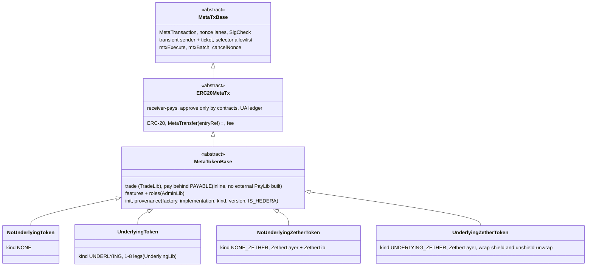

# Token kinds, wrappers and the open factory

SCaaS tokens are created by anyone through an open factory as immutable EIP-1167 clones of versioned
implementations. There are two axes: the **kind** is code (a standalone token, or a wrapper of 1–8 ERC-20s or the native coin ([CTR-TOK-26](#CTR-TOK-26)) at
conversion rates, each with or without the Zether layer) and the **features** are flags chosen at creation. Every
token carries the meta-transaction layer of [metatx.md](metatx.md). Status: the tree, kinds, features, libraries and
the `createToken` factory **SPECIFIED** (accepted 2026-10-08, implemented in phase P1; what is built today is under
[Transitional (BUILT)](#transitional-built-tokens)); node and client support **SPECIFIED**; the regulated controls
as flags ([asset-suite.md](asset-suite.md)) **SPECIFIED**.

**Contents**

1. [Overview](#1-overview)
2. [Kinds](#2-kinds)
   - 2.1 [NONE — `NoUnderlyingToken`](#21-none--nounderlyingtoken)
   - 2.2 [UNDERLYING — `UnderlyingToken` (1–8 legs)](#22-underlying--underlyingtoken-18-legs)
3. [Rates](#rates)
4. [Features](#4-features)
5. [Allowance lockdown](#5-allowance-lockdown)
6. [Factory](#factory)
   - 6.1 [`OpenFactory`](#61-openfactory)
   - 6.2 [Transitional (BUILT)](#62-transitional-built)
7. [Interfaces](#interfaces)
8. [Storage layout (clones)](#8-storage-layout-clones)
9. [Gas](#9-gas)
10. [Hedera](#10-hedera)
11. [No migration](#11-no-migration)
12. [Conformance](#conformance)
13. [Limitations](#13-limitations)

## 1. Overview



<a id="CTR-TOK-21"></a>**CTR-TOK-21** — **One implementation per kind; features are flags
([CTR-TOK-22](#CTR-TOK-22)).** The tree is `MetaTxBase` → `ERC20MetaTx` → `MetaTokenBase` → the kinds below. Two axes:
the **kind** is code (one implementation per large combination, so each implementation's audit surface is only what it
holds); the **features** are flags chosen at creation. Heavy logic lives in external libraries linked at deploy
([CTR-TOK-24](#CTR-TOK-24)). Every EVM token can trade (`TradeOrder`, in the base); pay is the flag `PAYABLE`. Hedera
is a per-chain variant, not a creator's choice ([CTR-TOK-23](#CTR-TOK-23)).

| Kind | Contract | Meaning |
|---|---|---|
| `NONE` | `NoUnderlyingToken` | standalone: loyalty, internal units, access tokens |
| `UNDERLYING` | `UnderlyingToken` | wrapper of 1–8 ERC-20s or the native coin ([CTR-TOK-26](#CTR-TOK-26)) at per-leg rates |
| `NONE_ZETHER` | `NoUnderlyingZetherToken` | standalone + Zether layer ([zether.md](zether.md)) |
| `UNDERLYING_ZETHER` | `UnderlyingZetherToken` | wrapper + Zether layer, wrap-shield and unshield-unwrap |
| `NONE_PQZ`, `UNDERLYING_PQZ`, `NONE_ZETHER_PQZ`, `UNDERLYING_ZETHER_PQZ` | — | **reserved, not built**: post-quantum layer ([pq-zether.md](pq-zether.md)); Zether and PQZ on one token have room in the kind ids only |

| Node | Role |
|---|---|
| `MetaTxBase` | any SCaaS contract (`MandateWallet`, `SmartKeyAccount`, third parties): [CTR-MTX-22](metatx.md#CTR-MTX-22) |
| `ERC20MetaTx` | every token is gasless ([CTR-MTX-07](metatx.md#CTR-MTX-07)); UA ledger, `UAMetaTransaction` ([CTR-UA-18](accounts.md#CTR-UA-18)) |
| `MetaTokenBase` | `TradeLib`, pay behind `PAYABLE` (no external `PayLib` built: pay is inline, controller ruling pending the owner), `AdminLib`, init, provenance |
| Zether verifiers (one per curve), `UniversalAccountRegistry`, `ZetherDisclosure`, `ZetherStatements`, `OpenFactory` | outside the tokens; roles unchanged |

Confidential tokens are kinds of the same tree, not a parallel branch: every one is relayable through the same
envelope ([CTR-PQZ-15](pq-zether.md#CTR-PQZ-15)). Non-EVM families implement the same roles natively.

The `MetaTransaction` struct, its typehash and the digest rule are one for every kind; only the domain's
`verifyingContract` differs per clone. Not covered: baskets (proportional, weighted multi-asset redemption), oracle
rates, rebasing/share wrappers (ERC-4626 style).

## 2. Kinds

The kinds are in [CTR-TOK-21](#CTR-TOK-21). The two public kinds without a Zether layer:

| Kind | Contract | `underlyings` | Supply rule | Invariant |
|---|---|---|---|---|
| `NONE` | `NoUnderlyingToken` | none | `initialSupply` minted to `initialHolder` at init; `mint` by `minter` only with `MINTABLE`; holder `burn` with `BURNABLE` ([CTR-TOK-22](#CTR-TOK-22)) | `Σ balances == totalSupply` |
| `UNDERLYING` | `UnderlyingToken` | 1–8 ERC-20s or the native coin ([CTR-TOK-26](#CTR-TOK-26)), fixed at creation | Only via `wrap` (mints `⌊received·num/den⌋` of the **measured** delta) / `unwrap` (pays `⌊w·den/num⌋`, burns `⌈out·num/den⌉`) on a chosen leg at that leg's rate; `num = den = 1` is the 1:1 case | `Σ_i⌊reserve_i·num_i/den_i⌋ ≥ totalSupply` with internal per-leg `reserve` (pooled; no per-leg invariant) |

Example (owner requirement): a wrapper over USDT and DAI at 1 → 25,000, i.e. one stablecoin mints 25,000 units of a
low-value currency token — an `UnderlyingToken` with two legs and one rate per leg (`num/den` adjusted for each leg's decimals); one leg at a rate is the one-leg case.

`initData` per kind below. Fee-on-transfer underlyings are measured on the way in and must
transfer exactly on the way out; rebasing underlyings are unsupported (a negative rebase stops wrap, exits stay
first-come); built `ZetherToken` refuses fee-on-transfer underlyings (`UnsupportedUnderlying`,
[CTR-ZTH-14](zether.md#CTR-ZTH-14)); target: the confidential kinds use UnderlyingLib ([CTR-TOK-11](#CTR-TOK-11)). Weighted baskets (proportional redemption) are not planned.

### 2.1 NONE — `NoUnderlyingToken`

<a id="CTR-TOK-09"></a>**CTR-TOK-09** — `NoUnderlyingToken` (kind `NONE`) mints `initialSupply` to `initialHolder` at
init (`NONE*` kinds only). Further supply and burning are features, not class: `mint` by the `minter` with `MINTABLE`
(`minter == 0` and no flag ⇒ fixed supply), holder `burn` with `BURNABLE`, and the role and its lifecycle are in
[CTR-TOK-22](#CTR-TOK-22). (Built: the holder's `renounceRole(MINTABLE)`.)

`underlyings.length == 0`. The creation parameters are the `TokenConfig` fields of [CTR-TOK-25](#CTR-TOK-25)
(`name`, `symbol`, `decimals`, `features`, `lockedFeatures`, `owner`, `roles`, `initialSupply`, `initialHolder`).

| Function | Rule |
|---|---|
| `initialize` | mints `initialSupply` to `initialHolder`; validates the flags ([CTR-TOK-22](#CTR-TOK-22)) |
| `mint(to, amount)` | `FeatureNotSet(MINTABLE)` when the flag is clear, `MissingRole(MINTABLE, caller)` when the caller (read through `_msgSender()`) lacks the role (not allowlisted: the minter acts through its own contract); to a public balance only |
| `burn(amount)` | `BURNABLE`; any holder, own public balance (`_msgSender()`; gasless through `mtxExecute`); `Transfer(from, 0, amount)` |

Invariant: `Σ balances == totalSupply`. A supply cap or mint-rate limit, if an issuer wants one, belongs in the
minter contract it controls, not in this kind.

### 2.2 UNDERLYING — `UnderlyingToken` (1–8 legs)

`UnderlyingToken` (kind `UNDERLYING`) takes 1–8 legs at creation; a one-leg token is what the earlier design called a
single-underlying wrapper and a multi-leg token a multi-underlying wrapper, so there are no separate single/multi
kind labels: the leg count says it. The single-asset convenience ABI (`wrap(amount)`, `unwrap(amount, recipient[,
minOut])`) works **only** with exactly one leg (`UnderlyingRequired()` otherwise); the per-leg ABI works for every
count. Everything below until the multi-leg subsection holds per leg, and for a one-leg token as it stands.

A one-leg token: `underlyings.length == 1`. Creation parameters are the `TokenConfig` fields `legs` and `rate` of
[CTR-TOK-25](#CTR-TOK-25); the rate role and the flags are in [CTR-TOK-22](#CTR-TOK-22).

Checks (all revert at init, so a bad token is never born):

| Check | Error |
|---|---|
| underlying `≠ address(this)`, and has code, or is `address(0)` = the native coin ([CTR-TOK-26](#CTR-TOK-26)) | `UnderlyingInvalid(u)` |
| `decimals()` returns a `uint8` (staticcall); not checked for the native leg (18) | `DecimalsUnreadable(u)` |
| `1 ≤ num, den < 2^96` | `RateInvalid(num, den)` |
| rates fixed ⇒ no rate role | `RoleWithoutFeature(3)` (from `AdminLib.init`) |
| rates fixed ⇒ `rateDelay == 0 && maxRateStepBps == 0`; adjustable ⇒ `2 days ≤ rateDelay ≤ 30 days`, `1 ≤ maxRateStepBps ≤ 1000` | `RateConfigInvalid()` |
| rates adjustable ⇒ the rate role is a contract (the `_isContract` of the allowance lockdown) | `RoleNotContract(3, a)` |

Client defaults (UI and ERP wizard): `decimals = d_u`, `num = den = 1` (a plain 1:1 wrapper), rates fixed; when the
issuer makes them adjustable: `rateDelay = 7 days`, `maxRateStepBps = 100`. Role and its lifecycle:
[CTR-TOK-22](#CTR-TOK-22).

**Transitional (BUILT, P1e).** Built: `initialize(creator, version, TokenConfig)` ([CTR-TOK-25](#CTR-TOK-25)); the factory indexes `cfg.legs` and the token reads the same legs (`UnderlyingCountInvalid(n)`); `rate` is zero without `RATE_ADJUSTABLE`, in bounds with it.

```
wrap(uint256 amount) returns (uint256 minted)                  // sender = _msgSender() (the signer under mtxExecute)
    require leg.wrapEnabled                                    // always true for one leg
    require leg.adjustable ⇒ no pending rate change            // WrapPausedForRateChange (leg slot a)
    before = U.balanceOf(this)
    require before ≥ reserve                                   // ReserveShortfall (one balanceOf serves both)
    U.safeTransferFrom(sender, this, amount); received = U.balanceOf(this) − before
    minted = mulDiv(received, num, den)                        // floor
    require minted > 0                                         // WrapTooSmall
    reserve += received; _mint(sender, minted); emit Wrapped(sender, U, received, minted)

unwrap(uint256 wrapped, address recipient) returns (uint256 out)                    // minOut = 0; direct calls only
unwrap(uint256 wrapped, address recipient, uint256 minOut) returns (uint256 out)
    require recipient ∉ {0, address(this)}                     // UnwrapRecipientInvalid
    out    = mulDiv(wrapped, den, num)                         // floor
    require out > 0                                            // UnwrapTooSmall
    require out ≥ minOut                                       // UnwrapBelowMin(out, minOut)
    require out ≤ reserve                                      // InsufficientReserve(U, out, reserve) (Multi only;
                                                               //   a one-leg token cannot hit it: w ≤ S ≤ ⌊R·q⌋)
    burned = mulDiv(out, num, den, Ceil)                       // ≤ wrapped
    _burn(sender, burned); reserve −= out
    before = U.balanceOf(this); U.safeTransfer(recipient, out)
    require before − U.balanceOf(this) == out                  // UnderlyingTransferMismatch
    emit Unwrapped(sender, U, recipient, burned, out)

addReserve(address u, uint256 amount)                          // anyone; no mint
    same measured pull as wrap, require leg.wrapEnabled and no shortfall; reserve += received; emit ReserveAdded
```

`mulDiv` is OpenZeppelin `Math.mulDiv` (512-bit intermediate). `addReserve` exists so an issuer can
over-collateralise before a rate change that needs it; otherwise it is a donation that raises every holder's backing.
The gasless forms are `mtxExecute` with this calldata ([CTR-MTX-12](metatx.md#CTR-MTX-12),
[CTR-MTX-19](metatx.md#CTR-MTX-19)); a holder of a SCaaS underlying wraps by signature ([CTR-TOK-20](#CTR-TOK-20)).

Why the invariant holds, per operation, with `C = Σ⌊reserve·num/den⌋`:

- wrap: `⌊(R+r)·q⌋ ≥ ⌊R·q⌋ + ⌊r·q⌋ = ⌊R·q⌋ + minted` (floor is superadditive), supply rises by `minted`.
- unwrap: `out·q ≤ burned` (ceil), so `(R−out)·q ≥ R·q − burned` and `⌊(R−out)·q⌋ ≥ ⌊R·q⌋ − burned` (`burned` is an
  integer); supply falls by `burned`.
- `addReserve`: `C` rises, supply unchanged. Transfers, meta-tx and fees: supply unchanged.
- rate change: see [rates](#rates).

The plain `underlying.balanceOf(this)` is **not** used for pricing anything; donations sent with a plain transfer are
outside `reserve` and stay locked (no sweep: no owner).

Views: `underlying()` (a one-leg token: the single underlying), `underlyings() returns (address[])`, `legOf(address u) returns
(uint96 num, uint96 den, uint256 reserve, uint8 decimals, bool wrapEnabled)`, `collateralValue()` (saturates at
`type(uint256).max` instead of overflowing), `previewWrap(u, amount) returns (minted, used)`,
`previewUnwrap(u, wrapped) returns (out, burned)`, `rateAdjustable()`, `rateDelay()`,
`maxRateStepBps()`, `pendingRate() returns (address u, uint96 num, uint96 den, uint64 eta)` (all zero when nothing is
pending or the pending change has expired). Previews ignore fee-on-transfer (they assume `received == amount`).

<a id="CTR-TOK-26"></a>**CTR-TOK-26** — **A leg of every `UNDERLYING*` kind may be the chain's native coin** (owner), wrapped like WETH or WXDAI, because some chains have
no standard wrapped native token. `underlying = address(0)` in a `Leg` is the native coin; the per-leg rules above and
[CTR-TOK-05](#CTR-TOK-05) hold, with these differences:

- **Wrap** for the native leg is `payable` and takes `msg.value`, which must equal `amount`; a non-native leg refuses
  `msg.value != 0`. A native wrap cannot be gasless (the caller sends the value); gasless unwrap and every other path
  are unchanged.
- **Unwrap** pays the native coin with checks-effects-interactions (burn and `reserve -= out` before the send) under
  the token's reentrancy guard, to a recipient that may be a contract (no gas-stipend limit); a recipient that fails to
  receive reverts the unwrap.
- **Balance mechanics of [CTR-TOK-05](#CTR-TOK-05)** read `address(this).balance` for the native leg: `ReserveShortfall`
  (`balance ≥ reserve`), `UnderlyingTransferMismatch`, the `balance_i ≥ reserve_i` check in `executeRate` and the
  invariant. This is safe because forced coin only raises the balance, and minting stays bounded by the internal
  `reserve`. The measured delta of a native wrap is `msg.value`; `addReserve` for the native leg is `payable` with
  `msg.value == amount`.
- **`mtxWrap(address underlying, …)` with `address(0)` reverts** (`NativeNotGasless()`): a signature cannot carry value.
- **At most one native leg** per token; its rate math uses 18 decimals (Hedera: 8, the tinybar).
- **Reserve** is internal ([CTR-TOK-05](#CTR-TOK-05)): `collateralValue()` counts the internal `reserve_i` for the native leg, never
  the raw balance; coins forced in by `selfdestruct` or as a block reward are not reserve.
- **Provenance:** the factory's index ([CTR-TOK-25](#CTR-TOK-25), [CTR-TOK-17](#CTR-TOK-17)) records `address(0)` as the
  native underlying; `underlying()` of a one-leg native token therefore returns `address(0)` too, and clients read
  `underlyings()`. Libraries and size budget: [CTR-TOK-24](#CTR-TOK-24).

**Transitional (BUILT, P1d).** The native leg is built, with `NativeValueMismatch(value, expected)` for `msg.value ≠ amount` (and `≠ 0` on an ERC-20 leg), 8 decimals on Hedera; `mtxWrap` and `NativeNotGasless` come with P2 (controller ruling, pending the owner): a native wrap through `mtxExecute(wrap(…))` reverts `NativeValueMismatch(0, amount)`.

#### 2.2.1 More than one leg

<a id="multi"></a>

<a id="CTR-TOK-07"></a>**CTR-TOK-07** — A token with more than one leg is **any-of**: the underlying set (≤ 8, no duplicates) and
each leg's initial rate are set at creation and never added to or removed (rates themselves may be adjustable,
[CTR-TOK-13](#CTR-TOK-13)); a user wraps one chosen underlying and unwraps into one chosen underlying, bounded by that
leg's reserve (`InsufficientReserve`). The `guardian` (role of the `WRAP_DISABLEABLE` flag, [CTR-TOK-22](#CTR-TOK-22); granted by the owner, may be an EOA) has exactly one power:
`disableWrap(underlying, reason)` — one-way; unwrap from a disabled leg stays open. A disabled leg refuses
`addReserve`, and no rate change that lowers `collateralValue()` executes while any leg is disabled. A re-enable power
would let a compromised guardian reopen a depegged inflow and drain the good legs.

Init: `1 ≤ underlyings.length ≤ 8` (`UnderlyingCountInvalid(n)`), each checked as for one leg, no duplicates
(`DuplicateUnderlying(u)`). The guardian may be any address — its only power stops inflow, so an on-call key is acceptable and speed
matters in a depeg; role and lifecycle: [CTR-TOK-22](#CTR-TOK-22). The leg order is the factory's `underlyings` order and never changes.

| Function | Rule |
|---|---|
| `wrap(address u, uint256 amount) returns (uint256 minted)` | one-leg wrap on leg `u`; `UnknownUnderlying(u)`, `WrapDisabledFor(u)`, `WrapPausedForRateChange(u)` while any change is pending |
| `unwrap(address u, uint256 wrapped, address recipient, uint256 minOut) returns (uint256 out, uint256 burned)` | one-leg unwrap on leg `u`, bounded by `reserve_u` and `minOut`; works on disabled legs and during a pending change |
| `addReserve(address u, uint256 amount)` | as for one leg; refused on disabled legs |
| `disableWrap(address u, bytes32 reason)` | guardian; one-way; `WrapDisabled(u, guardian, reason)`; second call reverts `WrapDisabledFor(u)` |
| `wrap(uint256)`, `unwrap(uint256,address)`, `unwrap(uint256,address,uint256)` (single-asset ABI) | revert `UnderlyingRequired()` unless exactly one leg |
| `underlying()` | returns `address(0)` with more than one leg; clients use `underlyings()` |
| rate functions | as for one leg with the leg named in `proposeRate` (default fixed; adjustable per [CTR-TOK-13](#CTR-TOK-13)); one pending change per token; admin-only execution; `RateDecreaseWithDisabledLeg()` if a change lowers `C` while any leg is disabled |
| gasless unwrap (`mtxExecute`) | with the leg chosen by the signer; works on disabled legs |

**Transitional (BUILT, P1d).** One `UnderlyingToken` takes 1–8 legs with the encoding of §2.2; the guardian is optional at init.
`renounceRole(bit)` replaces `renounceGuardian()`/`renounceRateAdmin()` (`RoleNotContract(3, a)` for a non-contract rate role); `rateAdmin()` and `guardian()` are gone (several holders: `hasRole`, `RoleGranted`/`RoleRevoked`).

Invariant and solvency: `C = Σ_i ⌊reserve_i·num_i/den_i⌋ ≥ totalSupply()` is the aggregate invariant; the one-leg
per-operation argument holds leg by leg. There is **no** per-leg invariant: the backing is pooled and redemption is
any-of.

**Depeg risk (disclosure text for issuers and holders).** At fixed nominal rates the token treats its underlyings as
equal. When one depegs (say USDT trades at 0.95 while the rate says 1:1), anyone can wrap the cheap asset and unwrap
a good one: the good reserves drain first and the remaining holders end up backed by the weakest asset. This is the
expected behaviour of an any-of wrapper, not a bug.

- The guardian's `disableWrap` stops new inflow of the depegged asset; it does **not** stop the exit into good legs
  (that would trap holders) and cannot restore drained legs.
- Holders carry the risk of the worst underlying in the set. More than that: **each leg's admin key can take the
  whole basket.** An upgradeable or compromised underlying that fakes a `transferFrom`/`balanceOf` delta mints
  without limit and drains every good leg in one transaction, before any guardian can react. Plus each underlying
  issuer's freeze power. The reserve composition is public (`legOf`) and the node/ERP should alert on composition
  drift.
- Issuers should list only assets they would accept at par, keep a guardian on call, and expect the composition to
  move toward the cheapest leg during stress. `disableWrap` can be front-run like any transaction, so the guardian
  should submit it privately (a private relay or a builder bundle).
- No re-enable: a mistaken disable is permanent for that leg. Holders lose nothing by it; the issuer creates a new
  token if the leg must come back.
- <a id="CTR-TOK-19"></a>**CTR-TOK-19** — **A shortfall on one leg does not stop wrapping into the others** (owner
  decision 2026-10-06; the reserve rule of [CTR-TOK-05](#CTR-TOK-05) is per leg).
  `wrap(A)` checks only leg A's `balanceOf ≥ reserve`. If leg B loses backing (a blacklist burn, a negative rebase, a
  confiscation), new deposits into A still mint at par into a pool that is now under-backed, and early exiters
  through A take the good assets those deposits brought. `disableWrap(B)` does not prevent this. The node/ERP should
  alert when any leg's `balanceOf < reserve` and the issuer should pause intake by communication; a wallet that shows
  a multi-underlying token should show the per-leg backing before a wrap. (Checking every leg on a multi `wrap` and
  `addReserve` — at most 8 `balanceOf`, as `executeRate` already does — was considered and not adopted.)

## <a id="rates"></a>3. Rates

<a id="CTR-TOK-04"></a>**CTR-TOK-04** — A conversion rate is `(num, den)`, `uint96` each, `1 ≤ num, den < 2^96`,
meaning **wrapped raw units per underlying raw unit**. Every output rounds **down** (in the contract's favour):
`minted = ⌊in·num/den⌋`, `out = ⌊w·den/num⌋`, and unwrap burns only `⌈out·num/den⌉ ≤ w` (the holder keeps the dust).
Zero output reverts (`WrapTooSmall`, `UnwrapTooSmall`). Wrap dust (the part of `in` that mints less than one wrapped
unit, i.e. less than `⌈den/num⌉` raw underlying) stays in the reserve; `previewWrap` returns `(minted, used =
⌈minted·den/num⌉)` and clients round `in` down to `used`. Dust is lost to the reserve instead of to the holder, never
to a third party.

`q = num/den` = wrapped raw units per underlying raw unit. Raising `q` means each wrapped unit redeems for **less**
underlying; lowering `q` means each wrapped unit redeems for **more**.

<a id="CTR-TOK-05"></a>**CTR-TOK-05** — Reserve accounting is internal: `reserve_i` changes only through `wrap`,
`unwrap`, `addReserve`. The token's solvency invariant is **`collateralValue() := Σ_i ⌊reserve_i·num_i/den_i⌋ ≥
totalSupply()`**, plus `underlying_i.balanceOf(this) ≥ reserve_i` while the underlying behaves. Wrap mints the
**measured** balance delta; unwrap requires the balance to drop by exactly `out` (`UnderlyingTransferMismatch`); wrap
and `addReserve` refuse while `balanceOf < reserve_i` (`ReserveShortfall`); unwrap never checks that, so exits stay
open. Donations and rebases would move the redemption price under an `==` rule; internal accounting does not.

<a id="CTR-TOK-06"></a>**CTR-TOK-06** — **Rate mode is the issuer's choice at creation:** `fixed` (default; no setter
exists) or `adjustable`. Adjustable: a `rateAdmin` that **has code** (the same `_isContract` as the allowance
lockdown; meant to be a multisig or timelock, which the contract cannot prove); propose → wait `rateDelay` (default
7 days, bounds [2 days, 30 days]) → **only the `rateAdmin` executes**, within a 7-day window (no third party can bundle
the execution with its own wraps); **one pending change per token**, and while it is pending **wrap is paused on
every leg** (unwrap stays open); each step ≤ `maxRateStepBps` (default 100 = 1 %, bounds [1, 1 000]); every execution
requires `balanceOf_i ≥ reserve_i` on every leg and `collateralValue() ≥ totalSupply()` afterwards; balances never
change (no rebase). The rate role is granted and revoked by the owner and may be renounced by its holder; revoking or renouncing it leaves
the rate as it is, and only `disableFeature(RATE_ADJUSTABLE)` fixes the rate and cancels a pending change
([CTR-TOK-22](#CTR-TOK-22)). Delay and step are set once; the rate role is granted by the owner ([CTR-TOK-22](#CTR-TOK-22)). A holder who disagrees has at least `rateDelay` to unwrap at the old
rate, bound by `minOut`, and loses at most one step per delay.

One pending change per token (`PendingRate` in one slot). A change is **pending** from `proposeRate` until it is
executed, cancelled (also by `disableFeature(RATE_ADJUSTABLE)`; `renounceRole` leaves it), or its window (`eta + 7 days`) has passed; an expired change
counts as no change everywhere (`proposeRate`, `pendingRate()`, the wrap pause).

```
proposeRate(address u, uint96 num, uint96 den)   // rateAdmin; nothing pending (RateChangePending); RateInvalid;
                                                  //   step bound against the current rate (RateStepTooLarge)
    eta = now + rateDelay; emit RateChangeProposed(u, oldNum, oldDen, num, den, eta)
cancelRate()                                      // rateAdmin; emit RateChangeCancelled(u)
executeRate()                                     // rateAdmin only; eta ≤ now ≤ eta + 7 days
                                                  //   (RateChangeNotReady / RateChangeExpired)
    every leg: U_i.balanceOf(this) ≥ reserve_i    // ReserveShortfall(u_i, balance, reserve) — no phantom reserve
    C' with the new rate, summed with early exit once ≥ totalSupply
    require C' ≥ totalSupply                       // RateChangeUndercollateralized(C', supply)
    Multi: a change that lowers C' while any leg is disabled ⇒ RateDecreaseWithDisabledLeg
    apply; delete pending; emit RateChanged(u, oldNum, oldDen, num, den)
renounceRole(3)                                   // a holder gives up the role; the rate and a pending change stay
```

While a change is pending, `wrap` reverts `WrapPausedForRateChange(u)` **on every leg** of the token; unwrap (direct
and gasless, both with `minOut`) and `addReserve` stay open. The step bound is checked once, at proposal: the
current rate cannot change while a change is pending. Step bound, exact in integers (`uint96` inputs keep every
product below 2^207):

```
|num'·den − num·den'| · 10_000 ≤ num·den' · maxRateStepBps          // RateStepTooLarge
```

Fixed-rate tokens have no pending storage in use and every function above reverts `RateFixed()`.

| Direction | Effect on holders | Solvency | Control |
|---|---|---|---|
| Raise `q` | Redemption value of every outstanding unit falls by ≤ one step (dilution). New wrappers get more units per underlying. | `C` rises: always solvent. The extra backing stays in the reserve; nobody can withdraw it. | Timelock: every holder sees `RateChangeProposed` and can unwrap at the old rate for `rateDelay`, bound by `minOut`. |
| Lower `q` | Redemption value rises. | `C` falls: could go below `totalSupply` (insolvency = a run where the last holders get nothing). | `executeRate` refuses phantom reserve and reverts `RateChangeUndercollateralized(C', supply)` unless `C' ≥ totalSupply`. The issuer funds it first with `addReserve`. |

Consequences, stated for issuers and holders:

1. A fixed-rate token has no admin and its redemption price never moves. This is the default and the only form the
   catalogue templates offer without an explicit opt-in.
2. An adjustable token's worst case for a holder who never reacts: one step of dilution per `rateDelay`, so after a
   year the redemption value can be `(1 + maxRateStepBps/10⁴)^−(365 days / rateDelay)` of the start: ≈ 59 % at the
   defaults (1 % per 7 days), ≈ 0 at the bounds (10 % per 2 days). Wallets compute it from the token's actual
   parameters and show `rateAdjustable()` as a warning; issuers who promise a stable value should not choose
   `adjustable`.
3. Insolvency through a rate change is impossible (real balances and `C' ≥ totalSupply` checked at execution);
   insolvency through a failing underlying is not preventable by any rate rule.
4. `rateAdmin` must have code; that proves only that it is not an EOA. A forwarder owned by one key passes, so
   wallets must not call it a multisig or a timelock unless they verified it.
5. Only the admin executes. A third party cannot bundle `executeRate` with its own wraps and unwraps in one
   transaction; the admin itself could (it controls the execution), which is one more reason to use a multisig.
6. Rounding never favours the caller ([CTR-TOK-04](#CTR-TOK-04)), so repeated wrap/unwrap cycles cannot extract
   value at any rate.
7. Nobody can wrap at a rate that is about to change: wrap is paused on every leg for the whole window, while holders
   keep the unwrap exit at the current rate (`minOut` protects intents that land late).

<a id="CTR-TOK-13"></a>**CTR-TOK-13** — **Multi-underlying rates may be adjustable per leg**: issuer option at
creation, default **off**, the same timelock as [CTR-TOK-06](#CTR-TOK-06) (admin-only execution, one pending change per
token, wrap paused on **all** legs while it is pending, `minOut` on every unwrap). Changing one leg's `q_i` changes
the price of that leg against every other leg, in either direction: a raise makes wrapping `i` and redeeming another
leg profitable; a decrease makes wrapping another leg and redeeming `i` profitable. The guards remove the front-run
at the old rate (no leg can be wrapped while a change is pending) and the third-party flash bundle around the
execution (only the admin executes). They do **not** remove the value shift itself: once a change has landed, a leg
priced off its market value is an arbitrage from the next transaction on, and holders who exit through different legs
end up with different value. A per-leg share cap (`maxLegShareBps`) was rejected: anyone could switch it off or trip
it atomically with a flash loan. Recommendation: fixed rates, or a multisig/timelocked `rateAdmin` that only moves
legs toward their market value.

Residual risk, stated plainly (this text goes into the wizard and wallet disclosure):

1. **A per-leg rate change moves value between holders.** After a change to `q_i`, a unit redeemed through leg `i` is
   worth a different amount of market value than a unit redeemed through another leg. If the new rate is off the
   market price, arbitrageurs wrap the leg that is now cheap and redeem the leg that is now dear, starting in the
   transaction after the execution, until that leg's reserve is gone or the guardian disables wrap. Holders who exit
   through the dear leg first gain; holders left with the cheap leg lose. A decrease that the issuer funded with
   `addReserve` can be captured the same way (wrap another leg, redeem `i`).
2. **What the guards remove:** nobody can wrap at the old rate while a change is pending (all legs paused), nobody but
   the admin can execute (no third-party flash bundle of wrap → execute → unwrap), and every unwrap carries `minOut`.
   So there is no front-run of a pending change and no same-transaction drain around the execution by a third party.
3. **What they do not remove:** the shift in item 1, and the admin's own ability to order its execution with its own
   trades. A change moved **toward** a leg's market value removes an existing arbitrage instead of creating one; only
   such changes are safe.
4. A rate admin can keep wrap paused on the whole token for long periods by proposing changes back to back. That
   denies new wraps (never exits) and is visible on chain.
5. **Recommendation:** keep multi rates fixed (the default). If an issuer needs adjustable legs, the `rateAdmin`
   should be a multisig behind a timelock that only re-pegs legs toward their market value; wallets show the rate
   admin and every pending change. The depeg disclosure above still applies.

<a id="CTR-TOK-08"></a>**CTR-TOK-08** — **Decimals are display only.** `decimals()` of every token is the issuer's
choice at creation; rates are in raw units, so `1 human unit of U_i = num_i/den_i × 10^(D − d_i)` wrapped human
units (human rate = `num/den × 10^(D − d_i)`) (`D` = wrapper decimals, `d_i` = underlying decimals, snapshot at init). Underlyings without a readable
`decimals()` are refused (`DecimalsUnreadable`), because a UI could not show the human rate.

Examples (wrapper `D = 18`):

| Underlying | `d_i` | Intended human rate | `num` / `den` |
|---|---|---|---|
| xDAI / WXDAI | 18 | 1 : 1 | 1 / 1 |
| USDC, USDT | 6 | 1 : 1 | 10^12 / 1 |
| loyalty: 1 USDC → 100 points (`D = 0`) | 6 | 1 : 100 | 1 / 10^4 |

With integer rates (`den = 1`) wrap has no rounding; unwrap pays `⌊w/10^12⌋` and burns a multiple of `10^12`, the
holder keeps the rest. The wizard computes `num/den` from the human rate and the two decimals and shows the result
back; it refuses a rate whose `num` or `den` reaches 2^96. For wraps it rounds the amount down to `used` from
`previewWrap` (a multiple of `den/gcd(num, den)`), so no wrap leaves dust in the reserve: in the loyalty row,
wrapping 15 000 raw would mint 1 point and leave 5 000 raw behind. Minimum amounts: only the zero-output rule;
anything else (minimum ticket sizes) is the issuer's front-end policy — on chain it would only block small exits.

<a id="CTR-TOK-11"></a>**CTR-TOK-11** — **Unsupported underlyings.** Fee-on-transfer underlyings: inbound is handled
(measured delta), outbound must be exact; sender-pays fee designs revert on unwrap and are therefore **unsupported**
(the UI refuses them). Rebasing underlyings are **unsupported**: a positive rebase is a locked donation; a negative
rebase stops wrap ([CTR-TOK-05](#CTR-TOK-05)) and leaves a first-come exit. The contract cannot detect an unsupported
underlying at creation; an unsupported underlying can lock or socialise a loss.

| Underlying behaviour | Effect | Handling |
|---|---|---|
| Fee on transfer, charged from the amount | wrap credits what arrived; unwrap recipient gets `out − fee` | supported; UI discloses |
| Fee charged to the sender on top (incl. HTS fractional fee with `netOfTransfers`) | unwrap reverts `UnderlyingTransferMismatch` ⇒ that reserve is stuck | **unsupported**; UI refuses; Hedera init refuses ([NET-HED-14](../networks/hedera.md#NET-HED-14)) |
| Positive rebase / donation | `balance > reserve` | excess locked; harmless |
| Negative rebase, confiscation, blacklist burn | `balance < reserve` | wrap and `addReserve` refuse (`ReserveShortfall`); unwrap stays first-come until the balance runs out |
| Underlying blacklists the wrapper | unwrap of that leg reverts in the underlying | multi: holders exit through other legs; single: stuck until lifted — disclosure |
| Upgradeable underlying (USDC, USDT) | behaviour can change after creation | disclosure; node alert on an implementation `EXTCODEHASH` change |
| Hooks (ERC-777) | reentrancy | contract-wide transient guard |

**Gasless wrap.** A holder of an **outside** underlying (USDT, DAI) approves the wrapper once on that underlying (an
EOA may approve a contract on a token SCaaS does not control) and wraps gaslessly with `mtxExecute(wrap(…))`; the
`ABSOLUTE` fee is paid from the minted units ([CTR-MTX-20](metatx.md#CTR-MTX-20)). A holder of a **SCaaS** underlying
cannot approve anything ([CTR-TOK-01](#CTR-TOK-01)) and wraps by signature:

<a id="CTR-TOK-20"></a>**CTR-TOK-20** — **Signature wrap of a SCaaS underlying** (owner). The holder signs a
`TradeOrder` ([CTR-DEX-13](dex.md#CTR-DEX-13)) in the **underlying's** domain with `dex` = the wrapper, `receiveToken`
= the wrapper, `receiveAmount` = the minimum it accepts to receive (its `minOut`), `minFill = amount`, `fee` = the
relayer's rate. (P2, controller ruling, pending the owner: not on the built `UnderlyingToken`.) `UnderlyingToken` and `ZetherToken` expose

```solidity
function mtxWrap(address underlying, TradeOrder calldata o, bytes calldata sig) external nonReentrant returns (uint256 minted);
```

1. resolve the leg: `_legOf(underlying)` (UnderlyingToken; Zether: `underlying == this.underlying()`), which refuses an
   unknown "underlying" whose `mtxTrade` could be a no-op (`UnderlyingInvalid`); require `wrapEnabled`, no pending
   rate change and no reserve shortfall;
2. require `o.receiveToken == address(this)` and `o.relayer == 0 || o.relayer == msg.sender`;
3. quote `minted = ⌊o.amount · num / den⌋` (Zether: `o.amount`, 1:1) and `wrapFee = ⌈minted · o.fee / 10⁶⌉`
   ([CTR-DEX-11](dex.md#CTR-DEX-11) rounding; `fee = 0` ⇒ 0);
4. call `underlying.mtxTrade(o, sig, TradeFill(o.amount, minted, wrapFee, msg.sender))` — the underlying checks the
   signature, that the wrapper is `o.dex`, the price `amount·receiveAmount ≤ minted·amount` and the fee bound, and moves
   the funds **only into the wrapper** ([CTR-DEX-15](dex.md#CTR-DEX-15));
5. require `received == o.amount` (balance delta, as the direct wrap; else `WrapReceivedMismatch(expected,
   received)`), record the reserve, mint `minted − wrapFee` to `destination` (or `from`) and `wrapFee` to `msg.sender`,
   the submitting relayer — the order's `fee` is how a gasless wrap pays its relayer.

No allowance; only the named wrapper can pull, and only at the signed minimum. The call to the underlying is a wrap
talking to its underlying, as the direct wrap's pull is, not the meta-tx pipeline calling out. `mtxWrap` is not
allowlisted (`msg.sender` must be a contract other than the token); the node runs it as a metatx-job entry point.
Clients refuse by default to build or sign such an order when `dex` is not a registered wrapper of that underlying
([CTR-DEX-19](dex.md#CTR-DEX-19)).

## 4. Features

<a id="CTR-TOK-10"></a>**CTR-TOK-10** — "No one alters a deployed token" holds with only visible exceptions: the feature flags are
fixed at creation ([CTR-TOK-22](#CTR-TOK-22)) and the roles are held by the accounts the owner granted them to; an owner
can give everything up. The factory and its registrar have no power over any token, and no role can mint into a shielded
balance, move balances (except under the forced-transfer flag), touch reserves, pause unwrap or add or remove an
underlying.

<a id="CTR-TOK-22"></a>**CTR-TOK-22** — **Features are flags chosen at creation.** `features` and `lockedFeatures` are
two immutable words written by `initialize`, with `lockedFeatures ⊆ features`. Per flag the creator chooses **locked**
(exists forever) or **disableable** (the owner may clear it once, never set it again). Roles and the owner are not
immutable: see the administration bullet below.

| Bit | Flag | Role | Valid kinds | Meaning |
|---|---|---|---|---|
| 0 | `PAYABLE` | — | all | `IERC20Payment` works (`mtxPay`, `payWithFee`, `payLane`, `PaymentSettled`); **default off**; immutable (no role). `MetaTransfer` is never gated (`PaymentSettled` is also emitted by any `MetaTransfer` with `entryRef ≠ 0`, whatever the flag; the flag gates `mtxPay`, `payWithFee`, `mtxPayReceiverFee` and `supportsInterface(IERC20Payment)`) |
| 1 | `MINTABLE` | `minter` | `NONE*` | `mint` to a public balance (a minter never mints into a shielded balance) |
| 2 | `BURNABLE` | — (holder) | `NONE*` | holder `burn` of its public balance |
| 3 | `RATE_ADJUSTABLE` | `rateAdmin` (contract) | `UNDERLYING*` | rate change with timelock; off ⇒ rates fixed at creation |
| 4 | `WRAP_DISABLEABLE` | `guardian` | `UNDERLYING*` | disable wrap per leg, one-way |
| 5 | `FREEZE` | `issuer` (contract) | non-confidential ([CTR-AS-17](asset-suite.md#CTR-AS-17)) | as [CTR-AS-05](asset-suite.md#CTR-AS-05) |
| 6 | `FORCE` | `issuer` + `compliance` | non-confidential | forced transfer on a recorded order ([CTR-AS-04](asset-suite.md#CTR-AS-04)) |
| 7 | `PAUSE` | `issuer` | non-confidential | as [CTR-AS-06](asset-suite.md#CTR-AS-06) |
| 8 | `ALLOWLIST` | `compliance` | non-confidential | receivers checked against a `ComplianceRegistry` ([CTR-AS-07](asset-suite.md#CTR-AS-07)) |

- **Administration: one `owner`.** Each token has one `owner` (0 at creation = no administration ever). Candidate
  implementation, decided in P1: OpenZeppelin `AccessControlDefaultAdminRules` (owner = default admin, delayed two-step
  transfer, renounce). The owner can: `grantRole(bit, account)` / `revokeRole(bit, account)` for the role of a flag set
  in `features` (a role may have several holders; the contract-only roles stay contract-only); `disableFeature(bit)`,
  one-way, only for a flag not in `lockedFeatures` (reverts `FeatureLocked(bit)`; `FeatureNotSet(bit)` when already
  clear); two-step `transferOwnership`; `renounceOwnership()`, after which the owner is 0 forever. After
  `renounceOwnership()` the existing role holders **keep** their roles; to make a token unchangeable the owner revokes
  every role, then renounces. A role holder performs the flag's actions (mint, rate change, freeze, …) and may
  `renounceRole(bit)` itself. The owner only administers: it acts on a flag only if it grants itself the role.
  `PAYABLE` and `BURNABLE` have no role and are always treated as locked: `disableFeature(PAYABLE|BURNABLE)` reverts `FeatureLocked(bit)`. Events: `RoleGranted`/`RoleRevoked`,
  `FeatureDisabled(bit, by)`, the ownership events.
- **Validation in the token**, in `initialize` through `AdminLib` (the factory only forwards; `createTokenUnregistered`
  lets anyone bring an implementation, so the token is the one authority): each flag valid for the kind
  (`FeatureInvalidForKind(bit)`); `lockedFeatures ⊆ features` (`LockedNotSubset()`); a role holder in `roles` only for a
  set flag (`RoleWithoutFeature(bit)`); contract-only roles are contracts. Roles may also be granted later by the owner.
- **Views:** `features()`, `lockedFeatures()`, `owner()`, `hasRole(bit, account)`, `kind()`, `version()`.
  `supportsInterface(IERC20Payment)` is true iff `PAYABLE` is set. `rateAdjustable()` and the role holders stay public so
  wallets and indexers flag them. (The wrap pause during a pending rate change is a consequence of that change, not a
  separate power.)
- **The four regulated controls are flags 5–8** on the ordinary kinds ([CTR-AS-17](asset-suite.md#CTR-AS-17)), not separate kinds; their rules (caps, cooldowns, orders, receiver-only allowlist, the shape-step plus `_update` check) are
  unchanged and live in `AdminLib`. A token with none of the flags is fully permissionless. Confidential kinds refuse
  flags 5–8 (`FeatureInvalidForKind`).
- Flags valid on confidential kinds: `PAYABLE`; `MINTABLE`/`BURNABLE` (`NONE_ZETHER`); `RATE_ADJUSTABLE`/
  `WRAP_DISABLEABLE` (`UNDERLYING_ZETHER`).

<a id="permissionless-vs-controlled"></a>

| | No regulated flag | Any of flags 5–8 |
|---|---|---|
| Admin powers | None beyond the creation-time flags 1, 3, 4: no pause, blacklist, freeze, confiscation | The flags chosen at creation; a flag can only be disabled later (where not locked), never set; no regulated flag mints, changes a rate or touches the reserve |
| Use | Loyalty, internal units, B2B settlement tokens, wrapped stablecoins | Central-bank digital currency, licensed stablecoins, digital securities and bonds, real-world-asset claims |
| Guarantee | "Your key, your funds": neither the issuer nor the factory can touch balances | Due-process intervention against a recorded order, permanently evidenced on chain; mandatory disclosure (`termsHash`) |

**Transitional (BUILT, P1c).** Kind `NONE` has the flags, the owner and the roles (`AdminLib`, namespace `scaas.token`;
admin functions, events and errors in `ITokenAdmin`, including `RoleAccountZero(uint8)`); flags 5–8 are refused
`FeatureNotBuilt` until the asset suite builds the controls. Kind `UNDERLYING` (P1d) uses the same `AdminLib` roles for
`RATE_ADJUSTABLE` (rate role, contract only) and `WRAP_DISABLEABLE` (guardian); `disableFeature(RATE_ADJUSTABLE)` also cancels a pending change.

## 5. Allowance lockdown

<a id="CTR-TOK-01"></a>**CTR-TOK-01** — **Only a contract may call `approve`, an `approve`/allowance spender must be a
contract, and only a contract may call `transferFrom`. An EOA never holds or grants an allowance on a SCaaS token** —
directly, through `mtxExecute` (`approve` is in no allowlist, [CTR-MTX-19](metatx.md#CTR-MTX-19)), or by any permit.
Enforced in the token code of every family (owner). The caller is `_msgSender()`, equal to `msg.sender` because
`approve` is never a self-call. Allowance-like grants obey the same rule: a `TradeOrder` names its executor `dex`,
which must be a contract (`mtxTrade` checks `msg.sender == o.dex` and `_isContract(o.dex)`), so signing `dex` = an EOA
grants nothing; that `dex` is a contract and nothing more is an owner-accepted residual risk
([CTR-DEX-19](dex.md#CTR-DEX-19)). `extcodesize` alone decides wrongly in three cases (which is why a simple `isEOA`
check was dropped); the rule handles each one explicitly:

| Case | `code.length` | Treated as | Why |
|---|---|---|---|
| Plain EOA | 0 | EOA | — |
| EOA with an EIP-7702 delegation (`0xef0100 ‖ addr`, 23 bytes, starting `0xef0100`; Prague, available on chain 7622) | 23 | **EOA** | the code is only a designator; the EOA's private key still signs anything |
| Contract during its constructor | 0 | **EOA** (refused) | indistinguishable from an EOA at that moment; consequence: a contract **cannot** be approved or spend an allowance from its own constructor |
| Deployed contract | > 0, not a designator | contract | — |

- EVM `ERC20MetaTx` (the root of every token): `approve` reverts `CallerNotContract(caller)` for an EOA caller and
  `SpenderNotContract(spender)` for an EOA spender; `transferFrom` reverts `CallerNotContract(caller)` **before** the
  allowance check. No `permit`, no `increaseAllowance`, no meta-tx `approve`. Errors: `SpenderNotContract(address)`,
  `CallerNotContract(address)`. **Transitional (BUILT):** the rule is built on the v2 tokens (P1b); EOA `approve` and the meta-tx
  `approve` op remain only on the v1 line (`…V1`, until P3/P5).
- Contract accounts approve through **their own call path**: `SmartKeyAccount.mtxExecuteAsOwner → execute(token,
  approve)`, a Safe `execTransaction`, or a Safe MultiSend that approves and uses the allowance in one transaction. The
  token sees `msg.sender` = the account. A signature check (`isValidSignature`) is not the account's execution policy
  (Safe guards, modules and thresholds run only on execution), which is why a gasless `approve` by ERC-1271 is refused.
- Payments never need allowances (`pay`, `payWithFee`), the DEX needs none for SCaaS tokens
  ([CTR-DEX-15](dex.md#CTR-DEX-15)), and a mandate is not an allowance: a `MandateWallet` delegate (possibly an EOA)
  pays from the wallet under caps, and the wallet, a contract, is the token's `msg.sender` ([CTR-ACC-06](mandates.md#CTR-ACC-06)).
- Outside tokens are not ours to enforce: wrapping USDT still needs the holder to approve the wrapper on USDT. Hedera
  HIP-632 signers are non-contracts, so they cannot `approve`.
- Soroban `approve` → `require_contract(spender)`; Cosmos `IncreaseAllowance` only for contract spenders and
  `TransferFrom` only from contracts; Move/TON/Solana have no allowance on the hot path (balances live in the
  subject's account object/wallet/PDA, moved only by subject-signed ops).
- Hedera HTS allowances at protocol level cannot be restricted; HTS tokens are used only through a wrapper (`UnderlyingToken`)
  ([NET-HED-04](../networks/hedera.md#NET-HED-04)).
- **Agents never sign allowances.** Spending authority is expressed as exact-amount, expiring meta-tx signatures or
  as an on-chain mandate ([CTR-ACC-06](mandates.md#CTR-ACC-06)).

An earlier "EOA caller" form (`msg.sender == tx.origin && extcodesize == 0`) was dropped because `tx.origin` misjudges
contracts in their constructor and 7702-delegated EOAs; the caller check uses the classifier above.

## <a id="factory"></a>6. Factory

<a id="CTR-TOK-15"></a>**CTR-TOK-15** — **The factory is open to everyone.** Anyone creates tokens; anyone wraps any
ERC-20 into a meta token (or a confidential token where enabled); the market decides which one is used. SCaaS deploys
the factory (the protocol), not tokens: ten people wrapping xDAI get ten different contracts, and that is normal.

<a id="CTR-TOK-18"></a>**CTR-TOK-18** — **The factory is the most critical immutable artifact.** A wrong line in the
factory is wrong forever for every token anyone ever created through it, so the audit budget concentrates there.
Nobody controls who uses it for what (that is what permissionless means); what SCaaS can do is clear documentation,
high-quality reference verifiers, and never claiming a role it does not hold. Verifier support per chain is checked at
creation (`isSupportedOnThisChain()` is mandatory): a BLS12-381 verifier deploys **successfully** on a chain without
EIP-2537 and then reverts on every proof forever — an absent precompile does not revert, it returns success with
empty output — with no symptom until someone has deposited funds.

- **No proxy upgrades anywhere** ([CTR-GEN-02](README.md#CTR-GEN-02)). Each implementation version is deployed once;
  every token is a 45-byte EIP-1167 clone (`363d3d373d3d3d363d73<impl>5af43d82803e903d91602b57fd5bf3`) that
  `DELEGATECALL`s it with its own storage. A clone costs ~45 000 gas instead of ~2.5 M.
- **Versions live in the factory**: `registerImplementation(kind, version, impl)` (registrar only, append-only,
  version 0 forbidden), `deprecate` marks but never blocks, `createUnregistered` deploys an off-catalogue
  implementation with `version() == 0` (visibly). A bug in a version is permanent for that version's tokens; the remedy is
  voluntary migration (unwrap the old token, wrap the new one).
- **Atomic init**: CREATE2 salt = `keccak256(abi.encode(msg.sender, salt))` (nobody can take another creator's
  address); `initialize` runs in the same call and requires `msg.sender == FACTORY`; implementations lock themselves
  in the constructor.
- **Zether gate**: `zetherEnabled` default `false`; enabling and creating Zether tokens revert outside chain ids
  31337/1337 (`ZetherSafety`, [CTR-ZTH-02](zether.md#CTR-ZTH-02)).
- **Registrar** is an EOA by default (deployer); it must become a multisig before mainnet. Its only powers are
  `registerImplementation`, `deprecate`, `setZetherEnabled`.
- **Same rule on every family**: a fix to an Aptos package, Sui package, Solana program, Cosmos contract, TON or
  Soroban contract is a new deployment at a new address plus voluntary migration by the owners of the balances;
  accounts on the old deployment keep working with the old code ([CTR-GEN-02](README.md#CTR-GEN-02)).

<a id="CTR-TOK-16"></a>**CTR-TOK-16** — **One wrapper per creator, looked up by `(creator, underlying)`.** There is no
"official" wrapper of an asset: `getWrapper(creator, underlying)` answers "which xDAI wrapper is A's" (exactly one:
the first), while a function answering "which is *the* xDAI wrapper" would lie. A creator may still have several
(one per curve, or per fee schedule): `getWrapperCount(creator, underlying)` / `getWrapperAt(creator, underlying, i)`;
"which wrappers of xDAI exist, by whom" is `deployCountFor(underlying)` / `deployedFor(underlying, i)`. There is no
uniqueness on the underlying alone, no name or symbol vetting. The ranking signal needs no new function:
`IERC20(xDAI).balanceOf(wrapper)` is the real asset locked behind each wrapper, readable on chain for free.

<a id="CTR-TOK-17"></a>**CTR-TOK-17** — **Provenance instead of gatekeeping.** Every token answers, immutably,
`factory()`, `creator()`, `underlying()`, `verifier()`, `implementation()`, `version()`, and the factory keeps
`isDeployedHere(token)` for the reverse check — a contract that claims a `factory()` the factory does not confirm is
only a self-declared string. This answers "is this contract really a wrap of xDAI with verifier X created by Y"; it
does **not** answer "is this the token I should use" — that has no on-chain answer (reputation and liquidity decide).
Clients add their own pinning where needed ([CTR-ZTH-20](zether.md#CTR-ZTH-20)). Provenance metadata published for
every asset: `creator`, `underlying`, `version`, `implementation`, creation block (issuance timestamp), and for
wrappers the live reserve `underlying.balanceOf(token)` — readable by anyone for free.

### 6.1 `OpenFactory`

<a id="factory-v1"></a>
<a id="factory-v2"></a>

<a id="CTR-TOK-03"></a>**CTR-TOK-03** — **One factory, `OpenFactory`** (owner), the only factory of a chain. The
constructor takes the registrar and `chain_uid` (immutable, exposed as `chainUid()`); `registerImplementation` refuses an
implementation whose `chainUid()` differs, so a clone's domain `salt` has exactly one source
([CTR-GEN-05](README.md#CTR-GEN-05)). The kinds are in [CTR-TOK-21](#CTR-TOK-21), the creation API in
[CTR-TOK-25](#CTR-TOK-25). The factory is deployed through the deterministic CREATE2 deployer
([CTR-GEN-06](README.md#CTR-GEN-06)).

<a id="CTR-TOK-25"></a>**CTR-TOK-25** — **Creation API: `createToken`, `createTokenUnregistered`, `TokenConfig`,
`TokenCreated`.**

```solidity
function createToken(TokenKind kind, uint64 version, TokenConfig calldata cfg, bytes32 salt) external returns (address);
function createTokenUnregistered(TokenKind kind, address implementation, TokenConfig calldata cfg, bytes32 salt) external returns (address);
function createDex(uint64 version, DexConfig calldata cfg, bytes32 salt) external returns (address);

struct TokenConfig {
    string name; string symbol; uint8 decimals;
    uint256 features; uint256 lockedFeatures;
    address owner;                             // 0 = no administration ever
    Roles roles;                               // initial holders (optional, each only for a set flag): minter, rateAdmin, guardian, issuer, compliance
    uint256 initialSupply; address initialHolder;   // NONE* only
    Leg[] legs;                                // underlying (address(0) = native coin, CTR-TOK-26), num, den — UNDERLYING* only, 1..8
    RateConfig rate;                           // with RATE_ADJUSTABLE
    ConfidentialConfig conf;                   // verifier, auditorKey (empty = no auditor), shieldScale — *_ZETHER only
}
struct DexConfig { address admin; uint32 relayerSharePpm; address treasury; bool listedOnly; }
```

- **Creation (unchanged pattern).** `CREATE2` of an EIP-1167 clone, then `initialize(cfg)` **in the same call** (no
  front-run of `initialize`, no deployed-but-uninitialized state); the implementation locks its own `initialize` in
  its constructor. The address is predictable from `(factory, salt, implementation)`.
- **Kinds** (fresh enum, nothing deployed): `NONE`, `UNDERLYING`, `NONE_ZETHER`, `UNDERLYING_ZETHER`; reserved
  `NONE_PQZ`, `UNDERLYING_PQZ`, `NONE_ZETHER_PQZ`, `UNDERLYING_ZETHER_PQZ`. The implementation registry keeps
  versions per kind (register, deprecate) as before; the catalogue is append-only.
- **One event per creation:** `TokenCreated(token, creator, kind, version, implementation, features, lockedFeatures,
  owner, underlyings)`; `DexCreated(dex, creator, version, implementation, admin)` for a DEX clone
  ([CTR-DEX-24](dex.md#CTR-DEX-24)).
- **Registry views:** `isToken(addr)`, `isDex(addr)`, `versionOf(addr)`. `isDex` is advisory: clients and the node use it,
  tokens never consult it ([CTR-DEX-24](dex.md#CTR-DEX-24)).
- `IFactoryToken`, `IFactoryTokenV2`, `IOpenFactory`, `IOpenFactoryV2` are replaced by one `IOpenFactory` and one
  `IFactoryToken`.

Flag validation is the token's ([CTR-TOK-22](#CTR-TOK-22)): the factory only forwards `features`, `lockedFeatures`
and `roles`.

### 6.2 Transitional (BUILT)

<a id="transitional-built-tokens"></a>

**Transitional (BUILT, P1e).** `OpenFactory` (`src/factory/OpenFactory.sol`, `IOpenFactory.sol`, `IFactoryToken.sol`) is
built as [CTR-TOK-03](#CTR-TOK-03) and [CTR-TOK-25](#CTR-TOK-25) specify, except that it creates no Zether token,
DEX (`createDex`, `isDex`, `DexCreated`: P2) and has no `setZetherEnabled` (P3). `NoUnderlyingToken` and
`UnderlyingToken` implement `initialize(creator, version, TokenConfig)` and a constant `kind()` (0 and 1). The v1 line
(`ERC20MetaTxV1`, `MetaToken`, `HederaMetaToken`, `ZetherToken`, `MetaTxDex`) stays in the build as `OpenFactoryV1`,
`IOpenFactoryV1` and `IFactoryTokenV1` (`createMetaToken`, `createZetherToken`) until the node, clientkeys (P5) and Zether (P3) move; it then goes to
`smartcontracts/evm/legacy/`, not deleted (controller ruling, pending the owner). Factory v2 is backed up in
`smartcontracts/evm/legacy/p1e/` (not built).

- `constructor(address registrar, bytes32 chainUid)`, `chainUid` non-zero (`ChainUidZero`). `registerImplementation` and
  `deprecate` are registrar-only; the catalogue is append-only (`VersionAlreadyRegistered`); version 0 is refused.
- **Registration** reads `kind()`, `factory()` and `chainUid()` by staticcall: `ImplementationNotAContract`,
  `VersionKindMismatch(expected, got)` (`got = type(uint256).max` when there is no answer),
  `ImplementationFactoryMismatch`, `ChainUidMismatch`. `NONE_PQZ`…`UNDERLYING_ZETHER_PQZ` (4–7) revert `KindReserved`;
  kinds 2 and 3 are accepted before P3 (controller ruling, pending the owner).
- **Creation:** `createToken` (registered version) and `createTokenUnregistered` (same four checks, recorded with
  `version == 0`) take the leg count from `cfg.legs` (`NONE*` 0, `UNDERLYING*` 1–8, else `UnderlyingCountInvalid`),
  clone with salt `keccak256(abi.encode(msg.sender, salt))` (`SaltAlreadyUsed`), call `initialize` in the same call, and
  emit only `TokenCreated`. The token reads the same `cfg.legs` that the factory indexed. A field of another kind reverts
  `ConfigFieldForOtherKind(field)`: 1 `initialSupply`/`initialHolder` (not `NONE*`), 2 `legs`, 3 `rate` (not
  `UNDERLYING*`), 4 `conf` (not `*_ZETHER`).
- **Views:** `registrar`, `chainUid`, `implementationOf`, `isDeprecated`, `latestVersion`, `predictAddress`, `isToken`,
  `creatorOf`, `versionOf`, `getWrapper(creator, underlying)` (the first; it may be a multi-leg token: read
  `underlyings()`), `getWrapperCount/At`, `deployCountFor/deployedFor`. Every leg is indexed, `address(0)` for the
  native coin.
- **Trust the index only for registered versions** (`versionOf(token).version != 0`): the factory indexes what the
  config says, and an unregistered implementation (version 0) may do anything else with it.

<a id="factory-interface"></a>

The built interface is `IOpenFactory.sol` and the `TokenConfig` block of [CTR-TOK-25](#CTR-TOK-25); the event is
`TokenCreated(token, creator, kind, version, implementation, features, lockedFeatures, owner, underlyings)`, the
enum `TokenKind { NONE, UNDERLYING, NONE_ZETHER, UNDERLYING_ZETHER, NONE_PQZ, UNDERLYING_PQZ, NONE_ZETHER_PQZ,
UNDERLYING_ZETHER_PQZ }`. The deploy scripts register `NoUnderlyingToken` as version 1 of `NONE`; `UnderlyingToken` is over EIP-170 and is not
deployed ([CTR-GEN-06](README.md#CTR-GEN-06), [CTR-TOK-24](#CTR-TOK-24)). Separate `AssetFactory` for action
contracts: [asset-suite.md](asset-suite.md#templates).

## <a id="interfaces"></a>7. Interfaces

The block is the **built** function set, grouped by the built contracts; the role holder's `renounceRole(bit)` replaces
`renounceRateAdmin`/`renounceGuardian` (P1d) and the factory is [CTR-TOK-25](#CTR-TOK-25) (built in P1e).

```solidity
// built v2 line also has executeMetaTransactionWithFee, mtxUnwrap(…, validUntil, …), mtxUnwrapWithFee(…, feeRecipient, …)
//   and OP_UNWRAP; mtxTransferWithFee is unchanged
// ERC20MetaTx / MetaTokenBase (all kinds), domain ("SCaaS MetaToken", "1", chainId, clone, chain_uid):
//   mtxExecute, the named functions and the trade entry points — metatx.md#interfaces, dex.md#CTR-DEX-15
function mtxSelectors() external view returns (bytes4[] memory, uint8[] memory, uint8[] memory);   // per kind, CTR-MTX-19
// MetaTokenBase: kind(), creator(), version(), supportsInterface(bytes4), IS_HEDERA; ITokenAdmin: features(), lockedFeatures(), owner(),
//   pendingOwner(), hasRole(uint8,address), grantRole, revokeRole, renounceRole, disableFeature, transferOwnership, acceptOwnership, renounceOwnership
// NoUnderlyingToken
function mint(address to, uint256 amount) external;  function burn(uint256 amount) external;
// UnderlyingToken (CTR-TOK-21), 1–8 legs: the single-asset ABI reverts UnderlyingRequired unless exactly one leg
function wrap(uint256 amount) external payable returns (uint256 minted);
function unwrap(uint256 wrapped, address recipient) external returns (uint256 out);                   // minOut = 0; not allowlisted
function unwrap(uint256 wrapped, address recipient, uint256 minOut) external returns (uint256 out);
function addReserve(address underlying, uint256 amount) external payable;
function proposeRate(address underlying, uint96 num, uint96 den) external;   // rateAdmin; one pending per token; RateFixed if fixed
function cancelRate() external;                                              // rateAdmin
function executeRate() external;                                             // rateAdmin only, eta ≤ now ≤ eta + 7 days
function underlyings() external view returns (address[] memory);
function legOf(address u) external view returns (uint96 num, uint96 den, uint256 reserve, uint8 decimals, bool wrapEnabled);
function collateralValue() external view returns (uint256);                  // Σ⌊reserve_i·num_i/den_i⌋ ≥ totalSupply
function wrap(address underlying, uint256 amount) external payable returns (uint256 minted);
function unwrap(address underlying, uint256 wrapped, address recipient, uint256 minOut)
    external returns (uint256 out, uint256 burned);
function disableWrap(address underlying, bytes32 reason) external;           // guardian, one-way
// errors: WrapPausedForRateChange(address), UnwrapBelowMin(uint256 out, uint256 minOut), UnwrapRecipientInvalid(address)
```

| Contract | Events | Errors |
|---|---|---|
| `ERC20MetaTx` | `MetaTransactionExecuted`, `MetaNonceCancelled(address indexed from, uint256 indexed batch, uint256 newNonce)`, `TradeFilled`, `OrderCancelled`, `NoncesInvalidated` | `MetaTx*`, `Mtx*` gateway errors, `SpenderNotContract`, `CallerNotContract`, `FeeRecipientIsPayee()`, the `mtxTrade` errors ([dex.md](dex.md#CTR-DEX-15)) |
| `MetaTokenBase` | `PaymentSettled` | `PayToZero()`, `MtxModeShape(uint32 mode)`, `MtxBatchEmpty()`, `MtxBatchLengthMismatch()`, `NotFactory()`, `AlreadyInitialized()`, `UnderlyingCountInvalid(uint256)` |
| `ITokenAdmin` (on `MetaTokenBase`) | `RoleGranted`, `RoleRevoked`, `FeatureDisabled`, `OwnershipTransferStarted`, `OwnershipTransferred` | `FeatureInvalidForKind`, `FeatureNotBuilt`, `LockedNotSubset`, `RoleWithoutFeature`, `RoleNotContract`, `NoSuchRole`, `FeatureLocked`, `FeatureNotSet`, `NotOwner`, `NotPendingOwner`, `MissingRole`, `RoleAccountZero(uint8)` |
| `NoUnderlyingToken` | — (no `MinterRenounced`) | — (no `NotMinter`) |
| `UnderlyingToken` (events and errors declared in `IUnderlyingToken`) | `Wrapped(address indexed account, address indexed underlying, uint256 underlyingIn, uint256 minted)`, `Unwrapped(address indexed account, address indexed underlying, address recipient, uint256 burned, uint256 underlyingOut)`, `ReserveAdded(address indexed from, address indexed underlying, uint256 amount)`, `RateChangeProposed(address indexed underlying, uint96 oldNum, uint96 oldDen, uint96 newNum, uint96 newDen, uint64 eta)`, `RateChangeCancelled(address indexed underlying)`, `RateChanged(address indexed underlying, uint96 oldNum, uint96 oldDen, uint96 newNum, uint96 newDen)`, `WrapDisabled(address indexed underlying, address indexed guardian, bytes32 reason)` | `UnderlyingInvalid(address)`, `DecimalsUnreadable(address)`, `RateInvalid(uint256,uint256)`, `RateConfigInvalid()`, `WrapTooSmall()`, `UnwrapTooSmall()`, `UnwrapBelowMin(uint256 out, uint256 minOut)`, `UnwrapRecipientInvalid(address)`, `InsufficientReserve(address,uint256,uint256)`, `ReserveShortfall(address,uint256,uint256)`, `UnderlyingTransferMismatch(address,uint256,uint256)`, `UnknownUnderlying(address)`, `RateFixed()`, `NotRateAdmin()`, `RateChangePending()`, `NoRateChangePending()`, `RateChangeNotReady(uint64)`, `RateChangeExpired(uint64)`, `RateStepTooLarge()`, `RateChangeUndercollateralized(uint256,uint256)`, `WrapPausedForRateChange(address)`, `WrapDisabledFor(address)`, `DuplicateUnderlying(address)`, `RateDecreaseWithDisabledLeg()`, `UnderlyingRequired()`, `NotGuardian()`, `NativeValueMismatch(uint256 value, uint256 expected)`, `FailedCall()`, `SafeERC20FailedOperation(address)`, `InsufficientBalance(uint256,uint256)`, `HtsQueryFailed(address u, int64 responseCode)`, `AssociateFailed(int64)` |
| `OpenFactory` | `TokenCreated(…)` ([CTR-TOK-25](#CTR-TOK-25)); built; the v1 factory keeps `TokenDeployed(…)` (Zether) | as [above](#factory-interface) |

The node's event normaliser adds `Wrapped`, `Unwrapped`, `ReserveAdded`, `RateChange*`, `WrapDisabled`,
`MetaNonceCancelled`, `TokenCreated`, `TradeFilled`; `PaymentSettled` and `MetaTransactionExecuted` keep their
fields. A gasless unwrap emits the same `Unwrapped` as a direct unwrap, plus `MetaTransactionExecuted`.

## 8. Storage layout (clones)

<a id="CTR-TOK-24"></a>**CTR-TOK-24** — **Libraries, namespaces and size budget.** Heavy logic lives in **external**
libraries, linked at deploy and called by `DELEGATECALL` (≈ 2.6 k gas on the first call of a transaction, 100 after);
each library ≤ 24,576 B.

| Library | Content | Kinds |
|---|---|---|
| `TradeLib` | `TradeOrder` checks, `mtxTrade`, `mtxCancelOrder`, `mtxInvalidateNonces`, the token side of fills | all |
| `AdminLib` | flag validation, roles, owner, `disableFeature` (built, 3,406 B); later freeze / force / pause / allowlist | all |
| `UnderlyingLib` (built, 10,096 B) | legs; the core of wrap and unwrap **without a destination** (pull, rate, reserve; pay out); rate changes with timelock; `disableWrap`; the reserve invariant | `UNDERLYING*` |
| `ZetherLib` | statements, verifier calls, account updates, roll-over, shield / unshield, disclosure entries | `*_ZETHER` |
| `HederaLib` | HIP-632 signature path (`requireValid`, public view, linked; 753 B), HTS associate | all (branch on `IS_HEDERA`, [CTR-TOK-23](#CTR-TOK-23)) |

- **Pay stays inline** (controller ruling, pending the owner): `mtxPay`, `payWithFee` and `mtxPayReceiverFee` are thin builders over the inline `MetaTransfer` core, which a library cannot call; each checks the `PAYABLE` flag.
- **Inline in the token**, never behind a library: ERC-20 `transfer`/`transferFrom`, the core of a `MetaTransfer`, and
  the per-transfer administration check (a bit test plus a mapping read, cheaper than a `DELEGATECALL`).
- **Signature check:** one internal `SigCheck` for every contract ([CTR-MTX-25](metatx.md#CTR-MTX-25)).
- **Storage:** every module keeps its state in its own ERC-7201 namespace: `scaas.metatx`, `scaas.token` (features,
  roles, kind, version), `scaas.trade`, `scaas.pay`, `scaas.admin`, `scaas.underlying`, `scaas.zether`. A library gets
  its storage pointer from the fixed slot, so libraries never overlap; a test proves that a write through one library
  never changes another namespace.
- **Size budget:** each token implementation ≤ 20,480 B (≈ 4 KB left for later streams); CI fails the build when a
  contract exceeds its budget. **Transitional (BUILT, P1e):** `scripts/size_gate.py` runs in CI over
  `forge build src --sizes --json` as a ratchet (controller ruling, pending the owner): token implementations ≤ 20,480 B,
  other contracts ≤ 24,576 B, init code ≤ 49,152 B, and a contract named in `smartcontracts/evm/size-baseline.json`
  may exceed its limit but never its recorded size (`UnderlyingToken` 26,449 B, `ZetherToken` 28,849 B; owner: optimise
  later); the baseline does not tighten itself, so a smaller contract's entry is lowered by hand.
  `NoUnderlyingToken` is 20,196 B (284 B left: P2 must find room).

**Transitional (BUILT, P1d).** `MetaTokenBase` state is in `scaas.token`, the legs in `scaas.underlying`
(`0x38d6f7ed…cd1000`); the rest is OpenZeppelin ERC-20 slots 0–4 only.

Each clone has its own storage, `DELEGATECALL`ing a never-upgraded implementation, so there is no cross-version layout
constraint. The layout is still pinned (indexers and storage proofs read `reserve`) by `test_storageLayoutIsPinned`,
which compares the solc `storageLayout` in the build artifact (`extra_output`) with `test/v2/layout/*.json` per
implementation (the same data as `forge inspect <Contract> storageLayout`, without enabling `ffi` in tests). Order
(OpenZeppelin 5.2, non-namespaced):

| Slot | Owner | Variable |
|---|---|---|
| 0–4 | `ERC20` | `_balances`, `_allowances`, `_totalSupply`, `_name`, `_symbol` (last two unused; getters overridden); nonces live in ERC-7201 `scaas.metatx` |
| NS+0 | `UnderlyingLib` (`scaas.underlying`) | `legs` `mapping(uint256 ⇒ Leg)` at `keccak256(abi.encode(i, NS))`: slot a `token ‖ decimals ‖ wrapEnabled ‖ adjustable`, +1 `num ‖ den`, +2 `reserve` |
| NS+1, NS+2 | 〃 | `legIndex` `mapping(address ⇒ uint256)` (index + 1); `pending` `PendingRate` (one per token) |
| NS+3 | 〃 | `legCount ‖ rateDelay ‖ maxRateStepBps` (roles and flags are in `scaas.token`) |

```solidity
struct Leg { address token; uint8 decimals; bool wrapEnabled; bool adjustable;   // slot a (adjustable copied here so a
                                                                                  //   fixed-rate wrap reads no config)
             uint96 num; uint96 den;                                              // slot b
             uint256 reserve; }                                                   // slot c
struct PendingRate { uint8 leg; uint96 num; uint96 den; uint56 eta; }           // one slot; eta == 0 ⇒ none
```

Immutables (implementation): `FACTORY`, `_SELF`, `SMART_KEY_ACCOUNT_IMPL`, `_SMART_KEY_CLONE_CODEHASH`, `CHAIN_UID`, `IS_HEDERA`;
constant `KIND`. The ticket and sender live in transient storage, never in a slot.
The constructor sets `scaas.token.initialized` on the implementation's own storage (it cannot be initialized). Renouncing
the rate admin sets `rateAdjustable = false`, `rateAdmin = 0` and drops the pending change; the per-leg `adjustable`
copy stays set (wrap then reads an empty `_pending`, one extra SLOAD), so fixed-at-creation tokens keep the cheap path.
The controls of flags 5–8 live in the `scaas.admin` namespace ([asset-suite.md](asset-suite.md#storage), [CTR-TOK-24](#CTR-TOK-24)).

## 9. Gas

- Hot path (transfer, `pay`, fees, named functions) touches no kind-specific storage: the same SLOAD/SSTORE set as the measured
  built path, plus the payee comparison (< 100 gas); the `PAYABLE` gate adds one cold SLOAD of `scaas.token.features`
  to every pay entry (`mtxPay` on a fresh lane 56,182 vs 53,568, +2.6 k). Budget: every row of the gas table
  ([metatx.md](metatx.md#gas)) within **+300 gas** on the generic path; named `mtxTransfer` is +9 execution gas over
  `mtxExecuteTransfer` (33,681 vs 33,672): logged, not asserted.
- `mtxPay` adds one `keccak256` of 46 bytes (~40 gas) and saves the dynamic `data` and two words of calldata.
- `mtxBatch` saves the 21 000 intrinsic gas per item after the first, plus warm re-reads of shared slots (the fee
  recipient's balance, the relayer's own lane state), minus the ABI overhead of `MetaTransaction[]`/`bytes[]`. The
  token address itself is pre-warmed in a single transaction too (EIP-2929 `tx.to`), so there is no cold-account
  saving. The first use of a lane (+17 k) is unchanged.
- Wrap/unwrap: leg slots a–c (6 300 cold) + reserve SSTORE + one `balanceOf` before and one after the transfer + the
  transfer itself. No length SLOAD (legs are a mapping), and fixed-rate tokens read no rate-config slot (the
  `adjustable` flag lives in leg slot a); adjustable tokens add one `_pending` SLOAD (2 100). Multi adds one
  `_legIndex` SLOAD. Rate functions are rare: a multi `executeRate` reads every leg (≤ 8 × 3 cold slots) plus one
  `balanceOf` per leg.
- Gasless unwrap (estimate): envelope (≈ 35 k warm lane, plus the self-call and ticket ≈ 3 k) + fee if any (≈ 8 k) + leg reads, burn and reserve write
  (≈ 15 k) + the underlying's `transfer` and two `balanceOf` (≈ 30–40 k for a plain ERC-20). For a proxied stablecoin
  and a fresh recipient add its 0 → non-zero balance SSTORE (+20 k), the cold implementation hop (+2.6 k) and blacklist
  reads (+4.2 k): expect **≈ 110–130 k** for USDC to a new address, ≈ 85–100 k for a plain token to an existing
  holder.
- Size: each implementation ≤ 20,480 B and each library ≤ 24,576 B, enforced in CI ([CTR-TOK-24](#CTR-TOK-24)); the rate
  timelock lives in `UnderlyingLib` (clone → implementation → library delegatecall keeps the clone's storage).

## 10. Hedera

<a id="CTR-TOK-23"></a>**CTR-TOK-23** — **Hedera is a per-chain variant, not a creator's choice, and has no child
contracts.** Each implementation is deployed with an immutable `IS_HEDERA`. When set, the signature check takes the
HIP-632 path and `UnderlyingLib` associates HTS underlyings fail-closed (`HederaLib`); the rules are
[NET-HED-14](../networks/hedera.md#NET-HED-14). The four copies of the HIP-632 override become one `IS_HEDERA` branch in `MetaTokenBase`
calling `HederaLib.requireValid`; every implementation carries the ≈ 0.5–1 KB of Hedera branches.

**Transitional (BUILT, P1c).** `IS_HEDERA` is built (kind `NONE` on Hedera is `NoUnderlyingToken`; its Hedera child is
deleted). P1d deletes the wrapper children too: the fail-closed HTS check and association run in `UnderlyingLib` init under `IS_HEDERA`.
The signature rule is one `IS_HEDERA` branch in `MetaTokenBase` calling `HederaLib.requireValid` (`src/hedera/HederaLib.sol`),
not a per-child override or an abstract mixin on the base (a diamond with the tier); it serves `mtxTrade` too. Domain (with `salt` = the relay's block-0
hash, confirmed stable across mirror-node and relay restarts before it is fixed), ABI, events and tests are the EVM
ones. A plain transfer to `address(0)` fails at the shape step with OpenZeppelin's `ERC20InvalidReceiver` (as built: at
step 6 instead of step 8, "step 8 must not fail"; `mtxUnwrapWithFee` is decoded in `MetaTokenBase.fallback`, `dataEnd` too deep).

## 11. No migration

Nothing is deployed, so the one base and the one factory replace the built lines in place: there is no version
coexistence and no migration path. Clients still read the domain (`eip712Domain()`) and the pay lane (`payLane(payId)`)
per token, never from a constant ([CTR-MTX-02](metatx.md#CTR-MTX-02)). Client token records carry `kind`
(`NONE`, `UNDERLYING`, `NONE_ZETHER`, `UNDERLYING_ZETHER`), `features` and `lockedFeatures`, the underlying list, the per-leg rates (a read-only mirror of
`legOf`) and the pay-lane tag (`pay_lane_tag`); the node token table adds `kind` and reads `payLane`. A later bug fix
is a new implementation version in the factory and a voluntary move of value by its holders
([CTR-GEN-02](README.md#CTR-GEN-02)).

## <a id="conformance"></a>12. Conformance

Unit (forge, `test/v2/`):

| Area | Tests |
|---|---|
| Base | both typehashes pinned (`test_metaTxTypehashIsPinned`, `test_metaTransferTypehashIsPinned`, [CTR-MTX-15](metatx.md#CTR-MTX-15)); salted-domain KATs `test/vectors/metatx_kat.json` (v3 `MetaTransaction`, `MetaTxBase`; the built v1 struct is `metatx_v1_kat.json`, read by scaas-node and clientkeys until P5) and `metatransfer_kat.json` plus an `mtxpay` vector with `batch = payLane(payId)`, `nonce = 0` and `mtxExecute` calldata vectors per allowlisted selector, all checked by Solidity, node and the client library (its lane derivation already equals `payLane`); `MetaNonceCancelled`; the allowance rule on every kind (EOA caller and EOA spender of `approve` refused); ERC-1271 400 k only for `SmartKeyAccount` clones; `chainUid()` equals the implementation's; the factory refuses an implementation with another `chainUid()` |
| Fees | percent on the basis, fee on top, 1 % cap on transfer, payment and `AMOUNT` selectors; `ABSOLUTE` selectors uncapped and `PERCENT` refused; `FeeRecipientIsPayee` for transfer, `pay`, `payWithFee`, bound and relayer-default |
| Gasless unwrap and wrap | `mtxExecute(unwrap(…))`: fee in wrapped units after the call; `UnwrapRecipientInvalid` for 0 and `address(this)`; `UnwrapBelowMin`; underlying revert (blacklist mock) reverts fee and nonce; sender-pays fee-on-transfer ⇒ `UnderlyingTransferMismatch`; ERC-777 mock whose hook re-enters (`cancelNonce`, `transfer`) mid-unwrap ⇒ `Reentrancy`; not allowlisted on tier 1; works on a disabled leg and during a pending rate change. `mtxExecute(wrap(…))` pays its fee from minted units. `mtxWrap` on Zether (`UnderlyingToken`: P2): price, minimum, fee to the relayer, `WrapReceivedMismatch`, unknown underlying refused |
| Named | `testFuzz_namedDigestEqualsGeneric` over random struct fields for every named function; a signature consumed by a named call fails on the generic path and vice versa; every `MtxModeShape` case; a no-fee struct signed with a leftover `fee ≠ 0` fails through `mtxTransfer`; `mtxPay` lane equals `payLane`; second `mtxPay` of a `payId` reverts `MetaTxBadNonce`; `payWithFee` with the same `entryRef` still emits `PaymentSettled` (documents the per-path limit); `mtxBatch` atomic (one bad item reverts all), length mismatch, empty |
| `NONE` | init mint to `initialHolder`; `mint` with `MINTABLE` and `MissingRole`; `burn` with `BURNABLE`; fixed supply without `MINTABLE`; `disableFeature(MINTABLE)` |
| `UNDERLYING`, one leg | rate 1:1 equals the removed v1 wrapper's behaviour; rounding down on wrap/unwrap; `burned = ⌈out·q⌉`; `previewWrap` `used`; `WrapTooSmall`/`UnwrapTooSmall`/`UnwrapBelowMin`; two-argument `unwrap` = `minOut 0`; fee-on-transfer inbound measured; sender-pays fee-on-transfer reverts `UnderlyingTransferMismatch`; donation not counted; `ReserveShortfall` after a negative-rebase mock stops wrap and not unwrap; `addReserve`; decimals snapshot; init refusals |
| Rates | fixed ⇒ `RateFixed`; propose/cancel/execute; only the admin executes (`NotRateAdmin` for anyone else); delay and window bounds; an expired change counts as none for `proposeRate`, `pendingRate()` and the pause; step bound both directions at the exact edge; decrease refused without collateral, accepted after `addReserve`; execute refused with `ReserveShortfall` when any leg's balance is below its reserve (shock, then decrease); `collateralValue` saturates and `executeRate` exits early on a huge leg; revoking or renouncing the rate role leaves the rate, `disableFeature(RATE_ADJUSTABLE)` cancels a pending change; EOA admin refused at init; wrap paused on **every** leg while anything is pending, reopens on execute/cancel/expiry, unwrap and `addReserve` open |
| `UNDERLYING`, several legs | 2–8 legs, duplicates, zero; per-leg reserves; unwrap bounded by `reserve_i`; guardian disable one-way and idempotence error; unwrap open on a disabled leg; `addReserve` refused on it; `RateDecreaseWithDisabledLeg`; the cross-leg scenario (pending decrease on leg `i`, flash-wrap of leg `j`) reverts `WrapPausedForRateChange` and a third-party `executeRate` reverts `NotRateAdmin`; single-asset ABI reverts `UnderlyingRequired` with more than one leg |
| Factory (`Factory.t.sol`) | zero `chain_uid` refused; registration checks `kind()`, `factory()` and `chainUid()` and refuses reserved kinds; `deprecate` only marks; one `TokenCreated` with provenance; every leg indexed, native included; leg count by kind (`NONE` 0, `UNDERLYING` 1–8); unknown version; salt scoped by creator and not reusable; `createTokenUnregistered` checked and recorded as version 0; the factory only forwards, the token validates flags and fields (`ConfigFieldForOtherKind`); only the factory initialises, once; `kind()` constant; sizes |
| Features | every invalid combination of [CTR-TOK-22](#CTR-TOK-22) reverts with its error (`FeatureInvalidForKind`, `LockedNotSubset`, `RoleWithoutFeature`); owner grant/revoke, holder `renounceRole`, `renounceOwnership` (holders keep roles), `disableFeature` on a locked, a disableable and an already-clear bit; `PAYABLE` off ⇒ `supportsInterface(IERC20Payment)` false and pay reverts; rate fixed vs adjustable; guardian; the four regulated flags (existing asset-suite cases on the ordinary kinds) |
| Layout | `test_storageLayoutIsPinned` per implementation; library storage isolation (a write through one library never changes another namespace); the size gate ([CTR-TOK-24](#CTR-TOK-24)) |
| Hedera | HIP-632 path under `IS_HEDERA` (mocked precompile, as in `test/hedera/`); association at init; fail-closed custom-fee check: `isToken` rc ≠ SUCCESS, `getTokenCustomFees` rc ≠ SUCCESS, and a non-empty fee list each refuse the underlying |

Invariant / fuzz (`test/v2/WrapperInvariant*.t.sol`, `[invariant] runs = 64, depth = 32, fail_on_revert = true`, with
handlers that bound inputs so expected reverts do not count as failures). One invariant contract per rate setup:
`1:1`, `10¹²:1`, `1:10⁴`, `(2⁹⁶−1):1`, `1:(2⁹⁶−1)`, `3:7`.

- Handlers: wrap / unwrap (direct and gasless) / `addReserve` on random legs with random actors; plain
  donations; fee-on-transfer and plain underlyings; meta-tx transfers with fees; propose / cancel / execute rate
  changes; `warpToEta`, which jumps exactly to `eta` or to `eta + 7 days`; guardian disables; negative-rebase shocks
  on a mock leg; a ghost attacker that trades only through wrap/unwrap.
- Invariants:
  - `collateralValue() ≥ totalSupply()` and `Σ balances == totalSupply()`;
  - **slack never decreases**: `C − S` (ghost of the previous value) is non-decreasing across every handler call
    except a rate execution;
  - per-leg conservation: `Σ received_i + Σ addReserve_i − Σ out_i == reserve_i`; `balanceOf_i ≥ reserve_i` for
    well-behaved legs;
  - **profit oracle**: the ghost attacker's holdings valued at nominal par never increase over a sequence that
    contains no rate execution (catches the cross-leg class);
  - every executed rate change satisfied the step bound, waited `rateDelay` and was sent by the admin; no wrap
    succeeds while a change is pending; a disabled leg is never re-enabled.
- Fuzz: `testFuzz_wrapUnwrapNeverProfits(amount, num, den)`; cross-leg `testFuzz_wrapIUnwrapJNeverProfitsAtPar`;
  `testFuzz_stepBoundExact(num, den, num', den', bps)` against a reference in 512-bit arithmetic;
  `testFuzz_feeConservesSupply`.

Cross-family vectors: `test/vectors/wrap_rate_vectors.json` — `(num, den, in) → (minted, used)` and
`(num, den, w) → (out, burned)` incl. edge cases (`2^96 − 1`, `den = 1`, zero outputs), written by
`test_writeRateVectors` and later replayed by the Cosmos, Soroban and TON wrappers. `metatx_kat.json` (v3, `MetaTxBase`) and `metatx_v1_kat.json` (built v1) are EVM/Hedera
only.

## 13. Limitations

- Non-EVM wrappers: Cosmos, Soroban and TON keep their standalone (`NONE`) tokens; wrappers there (a bank denom or CW20 on Cosmos,
  a Stellar Asset Contract on Soroban, third-party jettons through a wrapper minter on TON) are **PLANNED** with the
  same rate/reserve rules and the shared rate vectors; Move and Solana need no wrapper for gaslessness
  ([NET-ALL-19](../networks/README.md#NET-ALL-19)).
- Gasless wrap: **SPECIFIED** (`mtxExecute(wrap)`, [CTR-TOK-20](#CTR-TOK-20)).
- Non-fungible in-app assets (ERC-721/1155 with meta-tx): new kinds, **PLANNED**.
