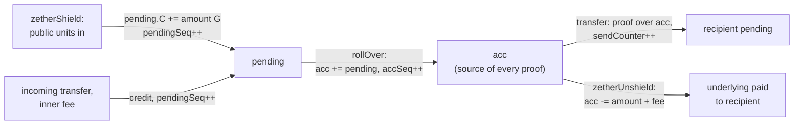
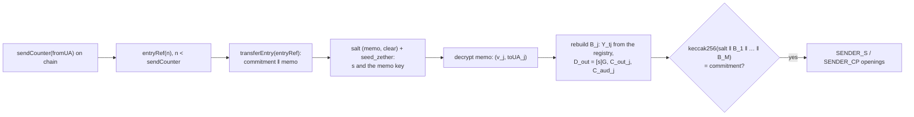
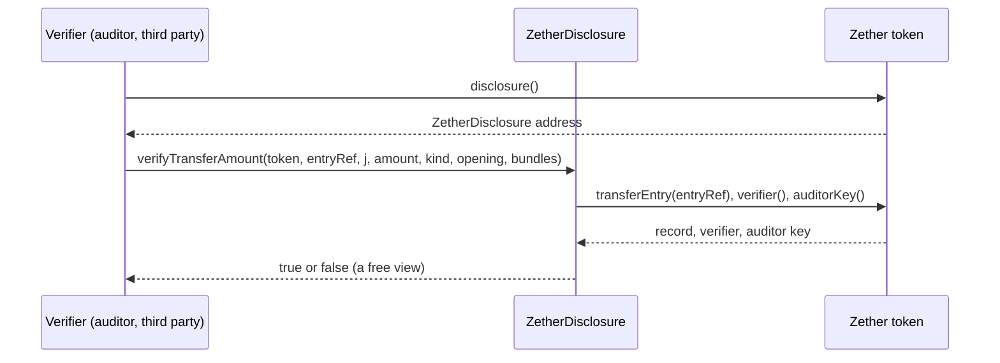

# Zether — confidential amounts (classical)

**Status: BUILT, UNAUDITED — NOT FOR PRODUCTION FUNDS.** The kinds `NONE_ZETHER` (`NoUnderlyingZetherToken`) and
`UNDERLYING_ZETHER` (`UnderlyingZetherToken`) on the one meta-transaction base (`ZetherLayer` + `ZetherLib`),
`ZetherStatements`, `ZetherDisclosure`, `ZetherVerifierBn254`, `ZetherVerifierBls12381`, `ZetherCurves`,
`ZetherTranscript`, `ZetherSafety`, the built `UniversalAccountRegistry` and the Rust prover `zether-prover` exist with
tests (P3; `smartcontracts/evm/src/zether/**`, `src/registry/**`). Every Zether contract and the registry refuse to
deploy or initialize outside chain ids 31337/1337, and `OpenFactory.zetherEnabled` defaults to `false` ([safety
gate](#safety-gate)). Post-quantum confidential balances are a separate class ([pq-zether.md](pq-zether.md)). Relaying is
the generic self-call ([relaying](#envelope)), `chainUid` is in every chain-bound digest; the built `ZetherToken` with its
`ZetherMetaTx` envelope is backed up, not built, in `smartcontracts/evm/legacy/p3/`. **SPECIFIED, not built (P3b):** the storage and auditor modes, the salted `s` and the sender memo ([CTR-ZTH-38](#CTR-ZTH-38), [CTR-ZTH-48](#CTR-ZTH-48)–[CTR-ZTH-50](#CTR-ZTH-50), [CTR-ZTH-30](#CTR-ZTH-30)).

This file is the contract between the prover and the Solidity verifier: **every byte** of the statement, the
transcript and the proof must be exactly as written here. An ambiguity is a bug of this document — report it, do not
guess. Notation: groups are written **additively**; `[k]P` = scalar multiplication, `O` = the point at infinity, `G` =
the standard generator of G1, `r` = the group order (scalar field), `p` = the base field; `‖` = byte concatenation;
`be32(x)` = 32 bytes big-endian, `be4(x)` = 4 bytes big-endian, `u8(x)` = 1 byte; a string `"…"` is ASCII without a
terminator.

**Contents**

1. [Scope](#1-scope)
2. [Parameters](#2-parameters)
3. [Curves, encoding, point checks](#3-curves-encoding-point-checks)
4. [NUMS generators](#4-nums-generators)
5. [Hash-to-scalar and the Fiat-Shamir transcript](#5-hash-to-scalar-and-the-fiat-shamir-transcript)
6. [ElGamal state and lifecycle](#6-elgamal-state-and-lifecycle)
7. [Statement (byte layout)](#statement-byte-layout)
8. [Σ-protocol](#8-σ-protocol)
   - 8.1 [Transfer](#81-transfer)
   - 8.2 [Burn](#burn)
9. [Bulletproofs — exactly two range statements](#9-bulletproofs--exactly-two-range-statements)
10. [Proof wire format](#10-proof-wire-format)
11. [Multi-recipient transfer](#11-multi-recipient-transfer)
12. [Meta-transaction envelope and replay protection](#12-meta-transaction-envelope-and-replay-protection)
   - 12.1 [Fees](#121-fees)
13. [Authorization and the built registry](#13-authorization-and-the-built-registry)
14. [Disclosure](#disclosure)
15. [Confidential layer](#15-confidential-layer)
16. [Safety gate](#safety-gate)
17. [Client decryption and limits](#17-client-decryption-and-limits)
18. [Decryption bound](#decryption-bound)
19. [Gas (measured)](#gas-measured)
20. [Vectors](#20-vectors)
21. [Interfaces](#21-interfaces)
22. [Keys and families](#22-keys-and-families)

## 1. Scope

<a id="scope"></a>
<a id="CTR-ZTH-01"></a>**CTR-ZTH-01** — **Full classical Zether** (owner): the `*_ZETHER` kinds clone through the factory,
verifiers for bn254 **and** BLS12-381 (the curve is a deploy-time parameter of each token: the creator chooses the
verifier at `initialize`, there is no setter and no system-wide curve; the prover is generic over the curve), ElGamal
`acc/pending` balances, two `zetherRollOver` modes (`PUBLIC` default, `OWNER_ONLY` opt-in per account, with an on-chain
`accSeq`), shield/transfer/unshield, Bulletproofs with exactly two range statements, envelope binding to the meta-tx, public
fee scalars, the `ITransferDisclosure` selective-disclosure interface (open the transfer ciphertext; three openings —
`SENDER_S`, `RECEIVER_X`, `AUDITOR` — all kept; verification is a free view, attestation an optional event; the bundle is
stored per transfer), a Rust prover compiled to WASM for client proving, relayer support, and **mandatory tests**.

The
`UNAUDITED — NOT FOR PRODUCTION FUNDS` gate applies: the factory/deploy flag is off by default on non-dev chains, and
NatSpec and client screens carry the warning. Non-EVM families: feasibility only. The statement and transcript are
frozen byte-exact in this file. Two curves cost twice the verifier audit and ~1.3× prover work; there is no interop
between curves (a bn254 confidential token cannot transfer confidentially to a BLS12-381 one; the bridge is unwrap →
wrap), and the same person has distinct Universal Accounts on two curves, never merged into one balance line. Choose
BLS12-381 only when the security horizon exceeds bn254's (~100 vs ~126 bit); it is not cheaper.

<a id="philosophy"></a>**Identity visible, amounts hidden.** SCaaS Zether is not a mixer:

| | Mixer | SCaaS Zether |
|---|---|---|
| Transaction graph | broken | fully visible (ring size **2**: sender and receiver only) |
| Identities | hidden | visible (accounts link to verifiable organizational identity) |
| Amounts and balances | fixed pool denominations | ElGamal-encrypted |
| Relayer fee | hidden in the pool | public scalar |
| Travel-rule / audit | incompatible | compatible: disclosure by sender, receiver or auditor ([disclosure](#disclosure)) |

## 2. Parameters

| Constant | Value | Where |
|---|---|---|
| `n_v` (value range bits) | **64** | verifier `NV = 64` — Bulletproof #1 |
| `n_b` (balance range bits) | **64** | verifier `NB = 64` — Bulletproof #2; the older rule `n_b − n_v ≥ 24` is relaxed ([CTR-ZTH-18](#CTR-ZTH-18)) |
| BSGS decryption | client-configured: `table_bits ∈ [18, 27]`, `bound_bits ≤ 54`; defaults mobile/WASM 22/44, desktop 24–26/54; WASM caps at 2^24 entries (2^26 with `allowLargeTable`) | client only (`zether-prover` `BsgsParams`); there is **no `DECRYPT_BOUND` constant** in the contract |
| `MAX_TOTAL_SHIELDED` | **2^54** | hard cap of the per-token `maxDecryptableShielded` at `initialize` (the older derivation `2^n_b > total·1024` no longer applies) |
| `MAX_CONFIDENTIAL_FEE` | `< 2^64` and `< maxDecryptableShielded` | `confidentialFee` must be `< 2^n_v`; a fee ≥ the total cap would make every transfer with a beneficiary unprovable |
| Single transfer maximum | `< 2^64` (in practice bounded by the sender's balance ≤ 2^54) — one transaction for any amount, so large payments are no longer split and their size is not revealed by the number of transactions | |
| Balance cache | `{ua, token, accSeq, balance}` in the device vault, verified by `[b]G == C − [x]D` before use, updated on rollOver (BSGS only on `pending`) and own debits; never on chain or on a server; key `chainId:ua:token` ([CTR-ZTH-24](#CTR-ZTH-24)) | client (`sealBalanceCache`) |
| Ring size | **2** | identities of sender and receiver are visible; no anonymity set |

<a id="max-total-shielded"></a>
<a id="CTR-ZTH-26"></a>**CTR-ZTH-26** — **`MAX_TOTAL_SHIELDED` stays 2^54** (owner): the hard cap of every token's
`maxDecryptableShielded`. Every balance of every account is `≤ totalShielded ≤ maxDecryptableShielded ≤ 2^54 < 2^64`,
so a valid balance is always provable and decryptable by BSGS up to 2^54.

<a id="shieldscale"></a>
<a id="CTR-ZTH-04"></a>**CTR-ZTH-04** — **`shieldScale` = raw underlying units per shielded unit** (as in the code's
NatSpec; not "the number of decimals kept": with `decimals` and `keep` the relation is `shieldScale =
10^(decimals − keep)`). Example: a 6-decimal stablecoin kept to 2 decimals has `shieldScale = 10^4`; a 0-decimal
underlying has `shieldScale = 1`. `zetherShield(ua, amount)` takes `amount` in **shielded units** and draws `amount · shieldScale` (`amount × shieldScale`)
raw units of the caller's public balance ([CTR-ZTH-35](#CTR-ZTH-35)); `zetherUnshield(…, amount)` pays `amount · shieldScale`. Decimals, shield scale and decryption bound are per token (the
creator's choice, [CTR-GEN-04](README.md#CTR-GEN-04)).

<a id="range-bits"></a>
<a id="CTR-ZTH-18"></a>**CTR-ZTH-18** — **Range bits `n_v = n_b = 64`, sound** (owner; `n_b = n_v = 64`). The rule `n_b − n_v ≥ 24` is
relaxed: safety comes from the total cap `2^54` and `r > 2^253`, not from the gap. **Argument, checked equation by
equation.** Take every ElGamal exponent at its canonical representative in `[0, r)`; `r > 2^253` (bn254 ≈ 2^253.6,
BLS12-381 ≈ 2^254.9). A valid proof extracts `x, v, s, b', γ_v, γ_b` with `v, b' ∈ [0, 2^64)` (BP#1, BP#2, tied to Σ
through E7/E8 sharing `z_v`, `z_b`). E1: `Y_f = [x]G`. E2: `D_out = [s]G`. E3/E4/E6: `C_out`, `C_deb`, `C_aud` encrypt
the same `v` with the same `s` (no sums).

E5: `C_acc − C_deb − [fee]G = [b']G + [x](D_acc − D_out)`; with E4 + E2 this
gives `C_acc − [x]D_acc = [b' + v + fee]G`, i.e. `a ≡ b' + v + fee (mod r)`. This is **the only sum of proven values**
in a transfer: `b' + v + fee < 3·2^64 < 2^66 ≪ r` (also written `b' + v + fee < 3·2^64 ≪ r`; `r` ≈ 2^254 on bn254, ≈ 2^255 on BLS12-381) (`fee < 2^64` is checked at `initialize`), so the balance `a` of `acc` equals `b' + v + fee` **as an
integer**, with no alias mod `r` — i.e. `v + fee ≤ a`: overspending is impossible. Burn (E5 burn): `a = b' + amount +
fee`, `amount ≤ 2^54`, `< 2^66` — the same conclusion; `amount + fee` is also the term `c·(amount+fee)` the verifier
computes with `addmod`, which never wraps.

Integer invariant: the sum of all `acc`/`pending` exponents of a token
`= totalShielded ≤ maxDecryptableShielded ≤ 2^54` — `zetherShield` adds exactly `amount` with the cap checked; a transfer moves
exactly `v` to the receiver's `pending` and `fee` to the beneficiary's `pending`, and leaves the sender exactly `b'`;
rollOver adds two numbers `≤ totalShielded`; burn removes exactly `amount`. No homomorphic addition (`pending += v`,
`+= fee`, `acc += pending`) reaches `r`, because every term and every sum is `≤ 2^54`. Because `b' = b − fee − v ≥ 0` is proven `< 2^64` at the same time, `v ≤ b ≤ 2^54`. Consequences: (a) every real
balance is `≤ 2^54 < 2^64`, so `b'` is always provable (completeness); (b) `v` never exceeds `2^54` in practice although
the proof allows up to `2^64`; (c) every balance is decryptable by BSGS up to `2^54`.

Other sums and bounds: `δ(y,z)`
uses `2^n − 1 = 2^64 − 1 < r`; disclosure takes `amount < 2^64 < r`, so one `[amount]G` opens to exactly one number; the
Rust prover computes `b' = b − v − fee` with checked `u128`, the JS client with BigInt. Wrap resistance comes from
`r / 2^66 > 2^187` and holds for every balance `< r`, cap or not; the `2^54` cap gives completeness, anti-grief (the
24-bit gap was only needed when a balance could be pushed to `2^n_b`, which the cap rules out) and the BSGS bound.
**The argument holds for E1–E8, unshield, rollOver, shield and disclosure.** `proofSystemId` changed to `…/n64-n64/v1` so
that an old `n_v = 32` proof never matches the new transcript. The earlier rule "`2^n_b > total × 1024`" is superseded; `n_b = 128` would add ≈ 1.06 M gas (≈ +32 %) per transfer and ≈ +76 % per burn and is not planned.

## 3. Curves, encoding, point checks

In one paragraph: lifted ElGamal on G1, key `x ∈ [1, r)`, `Y = [x]G`; balance `(C, D) = ([b]G + [ρ]Y, [ρ]G)`;
homomorphic add/sub on ciphertexts; decryption `[b]G = C − [x]D` then a discrete log by client-side BSGS. Proofs: one
Σ-protocol (the sender knows `x`, the three ciphertexts encrypt the same `v` with the same `s`, the remaining-balance
relation) plus **exactly two Bulletproof range statements** — `v ∈ [0, 2^{n_v})` and `b' = b − fee − v ∈ [0, 2^{n_b})`
— in **one** Fiat-Shamir transcript (`init = keccak256("SCAAS-ZETHER-TRANSCRIPT-V1")`, the statement absorbed first:
strong Fiat-Shamir). NUMS generators are computed in the verifier constructor and stored with SSTORE2 (130 points: `h`,
`U`, `G_0..63`, `H_0..63`).

| | bn254 (alt_bn128) | BLS12-381 G1 |
|---|---|---|
| `p` | `21888242871839275222246405745257275088696311157297823662689037894645226208583` | `0x1a0111ea397fe69a4b1ba7b6434bacd764774b84f38512bf6730d2a0f6b0f6241eabfffeb153ffffb9feffffffffaaab` |
| `r` | `21888242871839275222246405745257275088548364400416034343698204186575808495617` | `0x73eda753299d7d483339d80809a1d80553bda402fffe5bfeffffffff00000001` |
| `G` | `(1, 2)` | x=`0x17f1d3a73197d7942695638c4fa9ac0fc3688c4f9774b905a14e3a3f171bac586c55e83ff97a1aeffb3af00adb22c6bb` y=`0x08b3f481e3aaa0f1a09e30ed741d8ae4fcf5e095d5d00af600db18cb2c04b3edd03cc744a2888ae40caa232946c5e7e1` |
| Point `P` bytes | **64** = `be32(x) ‖ be32(y)` (EIP-196) | **128** = `pad16 ‖ x48 ‖ pad16 ‖ y48` (EIP-2537; `pad16` = 16 zero bytes) |
| `O` | 64 zero bytes | 128 zero bytes |
| Scalar | 32 bytes BE, **must be `< r`** | 32 bytes BE, **must be `< r`** |
| Precompiles | `0x06` add, `0x07` mul (MSM = a mul+add loop) | `0x0b` G1ADD, `0x0c` G1MSM (subgroup check), `0x10` MAP_FP_TO_G1 |
| Security | ~100 bit | ~117–126 bit |
| Chains | any EVM since Byzantium | Prague (EIP-2537) |
| `proofSystemId` | `keccak256("scaas/zether/sigma-bullets/bn254/n64-n64/v1")` | `keccak256("scaas/zether/sigma-bullets/bls12-381/n64-n64/v1")` |

Both curves are supported; the token creator chooses the verifier. BLS12-381 buys security, **not** gas (measured: it
is more expensive; an earlier "45–60 % cheaper" claim is wrong). Which curve production tokens should use is open
([CTR-ZTH-32](#CTR-ZTH-32)).

**The canonical encoding is unique.** Coordinates must be `< p` (the precompiles refuse otherwise); BLS points must have
all-zero `pad16`. The prover **never** outputs a non-canonical point; `UA = keccak256(encodedY)` relies on that.

**Point checks.**

- bn254: cofactor 1 — on-curve suffices; the precompiles `0x06/0x07` revert on a bad point.
- BLS12-381: G1ADD checks **only** on-curve; G1MSM also checks the subgroup. The verifier feeds **every** externally
  received point into at least one G1MSM (every check equation is an MSM), so the subgroup check is implicit. The
  registry forces the key `Y` through a G1MSM with k=1 at registration.
- `D_out ≠ O` (if `O`, then `C_out = [v]G` reveals `v`). `Y ≠ O` for every key. `Y_from ≠ Y_to` (no self-transfer).

## 4. NUMS generators

The verifier **computes** the generators in its constructor (not hard-coded) and writes the blob into a data contract
(SSTORE2, read with `extcodecopy` at verification). Anyone can recompute them from this specification ⇒ verifiable
nothing-up-my-sleeve. List: `Hb` (Pedersen blinding, label `"h"`), `U` (inner product, label `"U"`), `G_i` (label
`"G"`), `H_i` (label `"H"`), `i = 0..63`. Both Bulletproofs (`n = 64`) use all of `G_0..G_63`, `H_0..H_63` (the library
still accepts `n = 32` and then uses the **prefix** `G_0..G_31`, `H_0..H_31`; no op uses it any more). `h` and `U` use
`index = 0`. **Case matters:** `Hb` is `"h"` (0x68), `H_i` is `"H"` (0x48) — using `"H"` for `Hb` makes `Hb == H_0` and
breaks every proof. **Blob** (fixed order): `Hb ‖ U ‖ G_0 … G_63 ‖ H_0 … H_63` = 130 points (bn254 8,320 B; BLS
16,640 B).

bn254 — try-and-increment:

```
msg(label, index) = "SCAAS-ZETHER-GEN-BN254-V1" ‖ u8(len(label)) ‖ label ‖ be4(index)
mapToG1(prefix):
  for ctr = 0, 1, 2, …:
    x   = uint256(keccak256(prefix ‖ be4(ctr))) mod p
    rhs = (x^3 + 3) mod p
    y   = rhs^((p+1)/4) mod p
    if y*y mod p == rhs:
        if y is odd: y = p - y          // choose the even y
        return (x, y)
gen(label, index) = mapToG1(msg(label, index))
```

BLS12-381 — RFC 9380: `gen(label, index) = hash_to_curve(msg, DST)`, suite **`BLS12381G1_XMD:SHA-256_SSWU_RO_`**, with
`msg = u8(len(label)) ‖ label ‖ be4(index)` and `DST = "SCAAS-ZETHER-GEN-V1_BLS12381G1_XMD:SHA-256_SSWU_RO_"`
(Solidity: `HashToCurve.hashToG1` — `expand_message_xmd` + `MAP_FP_TO_G1` ×2 + G1ADD; arkworks:
`MapToCurveBasedHasher<G1Projective, DefaultFieldHasher<Sha256,128>, WBMap<g1::Config>>`). Vectors:
`smartcontracts/test/vectors/zether/generators_{bn254,bls12381}.json`.

## 5. Hash-to-scalar and the Fiat-Shamir transcript

```
hashToScalar(seed: bytes32) = ( uint256(keccak256(seed ‖ 0x02)) · 2^256
                              + uint256(keccak256(seed ‖ 0x03)) ) mod r
```

Transcript (keccak, state one `bytes32 st`):

```
init():               st = keccak256("SCAAS-ZETHER-TRANSCRIPT-V1")
absorb(label, data):  st = keccak256(st ‖ 0x00 ‖ u8(len(label)) ‖ label ‖ be4(len(data)) ‖ data)
challenge(label):     st = keccak256(st ‖ 0x01 ‖ u8(len(label)) ‖ label)
                      return hashToScalar(st)          // == 0 ⇒ the proof is refused
```

**One** transcript for Σ and both Bulletproofs (no detached Σ-Bullets). The statement is absorbed **before** every
prover message (strong Fiat-Shamir, against Frozen Heart). A challenge never travels in the proof — the verifier
recomputes it. Vector: `transcript.json`.

## 6. ElGamal state and lifecycle

Key: `x ∈ [1, r)`, `Y = [x]G`, `UA = keccak256(encodedY)` (the built identifier; the Universal Account form is
[CTR-UA-16](accounts.md#CTR-UA-16)). Lifted ElGamal: `(C, D) = ([b]G + [ρ]Y, [ρ]G)` (with `r` for the randomness: `(C, D) = ([b]G + [r]Y, [r]G)`);
homomorphic add/sub on ciphertexts. Decryption: `[b]G = C − [x]D`, then the configurable client BSGS ([CTR-ZTH-19](#CTR-ZTH-19)). The wallet keeps
the balance in a **device cache** and checks it with `[b]G == C − [x]D` instead of decrypting again; when the cache is
lost and the balance exceeds the device's BSGS bound, `zether-read-balance` (native, up to `2^54`) reads it.

State per `(UA, token)`:

| Slot | Changed by | Role |
|---|---|---|
| `acc = (C, D)` | rollOver (adds pending), debits (transfer/burn) | the **only** source of every proof |
| `pending = (C, D)` | every credit: `zetherShield`, incoming transfers, inner fees | where incoming money waits |
| `accSeq` (uint64) | `+1` per rollOver that does work | **in the statement**; the contract `require(accSeq == provedAccSeq)` before verification |
| `pendingSeq` (uint64) | `+1` per credit | tells the client there is new money |
| `lastRolledPendingSeq` | rollOver | the no-op rule |
| `sendCounter` (uint64) | `+1` per successful debit | **in the statement**; anti-replay of proofs; client PRF for `s` |
| `mode` | `zetherSetRollOverMode` (owner signature) | `PUBLIC` (default) / `OWNER_ONLY` |

A new account has `acc = pending = (O, O)`, every counter `0`, `mode = PUBLIC`.

How value moves between the two slots:



<a id="no-epoch"></a>
<a id="CTR-ZTH-03"></a>**CTR-ZTH-03** — **No epochs.** `IZetherVerifier.verifyTransfer/verifyBurn` take the full
`statement` instead of `(payload, epoch)`; per-account state is read with `accountState(UA)` (there is no
`simulateAccounts(encodedY, epoch)`).

- **zetherShield(Y, amount):** `pending.C += [amount]G` (D unchanged; the amount is public), `pendingSeq++`. It debits
  `amount·shieldScale` public units of this token from the caller ([CTR-ZTH-35](#CTR-ZTH-35)).

<a id="CTR-ZTH-35"></a>**CTR-ZTH-35** — **`zetherShield` draws from the caller's public balance** (owner):
`zetherShield(encodedY, amount)` always debits `amount · shieldScale` public Zether units from `_msgSender()` and adds `amount`
to `totalShielded`, instead of pulling the underlying a second time — one path for every Zether token. The escrow
invariant (`underlying held ≥ totalSupply + totalShielded · shieldScale`, [CTR-ZTH-44](#CTR-ZTH-44)) is unchanged by
construction: the underlying is already held for those public units. A holder of an outside underlying wraps, then
funds — two direct calls, or one gasless `mtxBatch` of `mtxExecute(wrap)` and `mtxExecute(zetherShield)`; an EOA holding a
SCaaS underlying wraps by signature (`mtxWrap`, [CTR-TOK-20](token-wrappers.md#CTR-TOK-20)), then funds. Without it, an
EOA holding a SCaaS underlying could not shield at all (it cannot approve, [CTR-TOK-01](token-wrappers.md#CTR-TOK-01)).
- **transfer:** the sender proves over `acc`. Effect:

```
acc_f.C   = acc_f.C − C_deb − [fee]G         acc_f.D   = acc_f.D − D_out
pend_t.C += C_out                             pend_t.D += D_out           pendingSeq_t++
pend_ben.C += [fee]G   (if fee > 0)                                       pendingSeq_ben++
sendCounter_f++
```

- **zetherUnshield(amount, recipient):** `acc_f.C −= [amount + fee]G`, fee as above, `sendCounter_f++`, pays the underlying to
  `recipient`.
- **rollOver:** `acc += pending; pending = (O,O); accSeq++; lastRolledPendingSeq = pendingSeq` (in short:
  `acc += pending; pending = 0; accSeq += 1`). It runs only when
  `pendingSeq > lastRolledPendingSeq`; otherwise it is a **silent no-op** (anti-DoS).

<a id="rollover"></a>Two modes (`enum RollOverMode { PUBLIC, OWNER_ONLY }`, `zetherSetRollOverMode` signed; names per
[CTR-ZTH-45](#CTR-ZTH-45), signed through the base, [CTR-MTX-21](metatx.md#CTR-MTX-21)):

- `PUBLIC` (default; retail, loyalty, low-risk): anyone may call `zetherRollOver(UA)` / `zetherRollOverBatch(UA[])` without a
  signature. `zetherRollOverBatch` skips `OWNER_ONLY` and unregistered items.
- `OWNER_ONLY` (treasury, B2B high value): `zetherRollOver` reverts `RollOverOwnerOnly`; only `zetherRollOverSigned(UA,
  expectedPendingSeq, validUntilBlock, sig)` — `block.number ≤ validUntilBlock`, `lastRolledPendingSeq <
  expectedPendingSeq ≤ pendingSeq`, signed by the account's authority (`authScheme` in the built registry) over
  `keccak256(abi.encode(keccak256("ZETHER_ROLLOVER_V1"), chainid, chainUid, token, UA, accSeq, expectedPendingSeq, validUntilBlock))`.
- `zetherRollOverSigned` also works for `PUBLIC` accounts.
- `zetherSetRollOverMode(UA, mode, validUntilBlock, sig)`: digest
  `keccak256(abi.encode(keccak256("ZETHER_SET_ROLLOVER_MODE_V1"), chainid, chainUid, token, UA, uint8(mode), modeNonce, validUntilBlock))`,
  `modeNonce++` after every change (no replay of an old signature). `chainUid` is in both digests
  ([CTR-ZTH-36](#CTR-ZTH-36)): a re-created chain restarts `modeNonce`, `accSeq` and block numbers, so a captured mode
  or rollover signature would replay without it.

The owner-signed-only rollOver of an earlier design was rejected: the `PUBLIC` default keeps every incoming credit
usable without the owner's key, and `OWNER_ONLY` is chosen per account by risk class (by the client system).

<a id="rollover-signed"></a>
<a id="CTR-ZTH-16"></a>**CTR-ZTH-16** — `zetherRollOverSigned` accepts `pendingSeq ≥ expectedPendingSeq` (not `==`): a free
`v = 0` transfer by a griefer cannot kill an `OWNER_ONLY` owner's rollOver. Replay stays blocked because the digest
pins `accSeq`. Test: `test_rollOverSignedSurvivesFrontRunCredit`.

<a id="rollover-signed-new-credit"></a>
<a id="CTR-ZTH-17"></a>**CTR-ZTH-17** — `zetherRollOverSigned` also requires `expectedPendingSeq > lastRolledPendingSeq`: a
signature that names no new credit would be a no-op that does not raise `accSeq`, would live until the next credit,
and anyone could use it to force a rollOver and kill the owner's in-flight proof. Now every accepted signature performs
a real rollOver ⇒ single use (`test_rollOverSignedWithoutNewCreditIsRejected`).

**Race.** Transfer/burn **never** merge pending by themselves. A credit that arrives while a proof is being built
changes only `pending` ⇒ the proof stays valid. Only rollOver changes `accSeq`; a proof built on an old `accSeq` is
refused **before** verification (`StaleAccSeq`, cheap). With `OWNER_ONLY` nobody but the owner bumps `accSeq`, and an
inserted credit cannot kill the owner's `zetherRollOverSigned`. With `PUBLIC` the grief **costs only gas**: a registered
account with balance 0 can still prove a `v = 0` transfer (a valid proof, the amount hidden ⇒ not blockable on chain)
and then call `zetherRollOver` ⇒ a wallet that needs stable proofs while targeted switches to `OWNER_ONLY`. Wallet
rule: never hold a signed rollOver while a transfer is in flight; short `validUntilBlock` (≈ 50 blocks).

<a id="CTR-ZTH-31"></a>**CTR-ZTH-31** — *Open (owner contingency, never ruled).* If rollOver griefing spreads, a
fallback is to accept a stale `accSeq` for **credits only** (a debit proof stays bound to the exact `accSeq`). It is a
protocol change that needs its own cryptographic review; epochs are not the fallback.

## <a id="statement-byte-layout"></a>7. Statement (byte layout)

The token **builds** the statement from storage + payload; the prover builds exactly the same. `P` = the bytes of one
point. Header (common to every op, `chainUid` at offset 96, [CTR-ZTH-36](#CTR-ZTH-36); the verifier reads `fee` at 288 and `amount` at 352). **Built (P3): 416 bytes**, offsets 0–384; **SPECIFIED (P3b): 480 bytes** with `salt` and `memoHash` (a new `proofSystemId`; both transfer payloads carry `salt(16)` right after `be32(provedSendCounter)`, and a commit-reveal payload appends `memo` after the legs):

| Offset | Len | Field |
|---|---|---|
| 0 | 32 | `opTag` — transfer: `keccak256("SCAAS-ZETHER-OP-TRANSFER-V1")`, burn: `keccak256("SCAAS-ZETHER-OP-BURN-V1")` |
| 32 | 32 | `proofSystemId` |
| 64 | 32 | `chainId` |
| 96 | 32 | `chainUid` (the token's `chainUid()`, [CTR-ZTH-36](#CTR-ZTH-36)) |
| 128 | 32 | token address (12 zero bytes ‖ 20 bytes) |
| 160 | 32 | `bindingTag` — `keccak256("ZTX_V1_DIRECT")` or `keccak256("ZTX_V1_RELAYED")` |
| 192 | 32 | `envelopeBinding` — 0 if DIRECT; [envelope binding](#envelope-binding) if RELAYED |
| 224 | 32 | `sendCounter` |
| 256 | 32 | `accSeq` |
| 288 | 32 | `fee` (inner fee, shielded units) |
| 320 | 32 | `beneficiary` (UA receiving the fee; 0 if none) |
| 352 | 32 | `amount` (burn; transfer = 0) |
| 384 | 32 | `recipient` (burn: 12 zero bytes ‖ address; transfer = 0) |
| 416 | 32 | `salt` — 16 zero bytes ‖ the build salt of [CTR-ZTH-30](#CTR-ZTH-30) (burn = 0); SPECIFIED (P3b; offsets 416/448: controller ruling, pending the owner) |
| 448 | 32 | `memoHash` — `keccak256(memo)` on commit-reveal ([CTR-ZTH-50](#CTR-ZTH-50)), else 0; SPECIFIED (P3b) |

<a id="CTR-ZTH-36"></a>**CTR-ZTH-36** — **Every chain-bound Zether digest carries `chainUid` beside `chainid`** (owner):
the statement header (above), the envelope binding ([CTR-ZTH-06](#CTR-ZTH-06)), the disclosure challenge
([disclosure](#disclosure)), the rollover digest `ZETHER_ROLLOVER_V1` and the mode digest
`ZETHER_SET_ROLLOVER_MODE_V1` ([rollover](#rollover)) and `entryRef` (`SCAAS-ZETHER-ENTRY-V1`). `chainUid` is the
implementation's constructor immutable, exposed as `chainUid()` and equal to the chain's genesis hash
([CTR-GEN-05](README.md#CTR-GEN-05)).

Without it a re-created chain restarts `modeNonce`, `accSeq`, `sendCounter` and
block numbers, so a captured mode or rollover signature, a proof or a disclosure would verify there; `entryRef` gains
it so that references never collide across chains (client reconciliation still keys by `(chain_key, entryRef)`). The
UA registry (target) takes `chainUid` as a constructor immutable and adds it to its PoP challenge; because
it checks raw digests, every caller's digest carries `chainUid` itself. **Built (P3)** for every token-side digest and
the prover (which also mixes `chainUid` into its `s`); the vectors are regenerated. **Transitional:** the built `UniversalAccountRegistry` is unchanged and
takes no `chainUid` until the UA registry replaces it ([CTR-UA-22](accounts.md#CTR-UA-22); controller ruling, pending the owner).

Points:

- **transfer:** `Y_f ‖ Y_t ‖ Y_a ‖ C_acc ‖ D_acc ‖ C_out ‖ D_out ‖ C_deb ‖ C_aud` (9P). `Y_a` = the token's auditor key,
  `O` when off; when off `C_aud` **must** be `O`.
- **burn:** `Y_f ‖ C_acc ‖ D_acc` (3P).

The transfer layout above is the single-recipient format (`zetherTransferSingle`); the multi-recipient statement is
in [Multi-recipient transfer](#multi-recipient).

`fee = confidentialFee()` if `beneficiary ≠ 0`, else `0` (a fixed fee per token, never a function of `v`).

## 8. Σ-protocol

### 8.1 Transfer

Witness: `x, v, s, b' = b − v − fee, γ_v, γ_b`. Bulletproof commitments: `V_v = [v]G + [γ_v]Hb`, `V_b = [b']G +
[γ_b]Hb`. The prover builds `C_out = [v]G + [s]Y_t`, `D_out = [s]G`, `C_deb = [v]G + [s]Y_f`, `C_aud = [v]G + [s]Y_a`
(shared `s`; `O` when the auditor is off). Nonces `k_x, k_v, k_s, k_b, k_gv, k_gb` are **hedged** (`k = H(x ‖ msg ‖ 32 byte CSPRNG)` then mod r) — a repeated nonce reveals `x`.

```
A_y   = [k_x]G
A_D   = [k_s]G
A_out = [k_v]G + [k_s]Y_t
A_deb = [k_v]G + [k_s]Y_f
A_bal = [k_b]G + [k_x](D_acc − D_out)
A_aud = [k_v]G + [k_s]Y_a          (O if the auditor is off)
A_Vv  = [k_v]G + [k_gv]Hb
A_Vb  = [k_b]G + [k_gb]Hb

T.init(); T.absorb("statement", statement)
T.absorb("sigma.commit", V_v ‖ V_b ‖ A_y ‖ A_D ‖ A_out ‖ A_deb ‖ A_bal ‖ A_aud ‖ A_Vv ‖ A_Vb)
c = T.challenge("sigma.c")
z_x = k_x + c·x   z_v = k_v + c·v   z_s = k_s + c·s
z_b = k_b + c·b'  z_gv = k_gv + c·γ_v  z_gb = k_gb + c·γ_b        (mod r)
```

Verifier — each line is an MSM that must equal `O`:

```
E1  [z_x]G − [c]Y_f − A_y
E2  [z_s]G − [c]D_out − A_D
E3  [z_v]G + [z_s]Y_t − [c]C_out − A_out
E4  [z_v]G + [z_s]Y_f − [c]C_deb − A_deb
E5  [z_b + c·fee]G + [z_x]D_acc − [z_x]D_out − [c]C_acc + [c]C_deb − A_bal
E6  [z_v]G + [z_s]Y_a − [c]C_aud − A_aud               (only when the auditor is on; off ⇒ A_aud == O)
E7  [z_v]G + [z_gv]Hb − [c]V_v − A_Vv
E8  [z_b]G + [z_gb]Hb − [c]V_b − A_Vb
```

E5 is `T = C_acc − C_deb − [fee]G = [b']G + [x](D_acc − D_out)`. E7/E8 share `z_v`, `z_b` with E3/E4/E5 — that is the
Σ-Bullets link; removing E7 or E8 prints money.

### <a id="burn"></a>8.2 Burn

Witness `x, b' = b − amount − fee, γ_b`; `V_b = [b']G + [γ_b]Hb`.

```
A_y = [k_x]G      A_bal = [k_b]G + [k_x]D_acc      A_Vb = [k_b]G + [k_gb]Hb
T.init(); T.absorb("statement", statement)
T.absorb("sigma.commit", V_b ‖ A_y ‖ A_bal ‖ A_Vb)
c = T.challenge("sigma.c")
z_x = k_x + c·x   z_b = k_b + c·b'   z_gb = k_gb + c·γ_b

E1  [z_x]G − [c]Y_f − A_y
E5  [z_b + c·(amount + fee)]G + [z_x]D_acc − [c]C_acc − A_bal
E8  [z_b]G + [z_gb]Hb − [c]V_b − A_Vb
```

`recipient` and `amount` are in the statement ⇒ a relayer cannot change where a burn pays out.

## 9. Bulletproofs — exactly two range statements

Transfer: `BP(n=64, V_v)` then `BP(n=64, V_b)`, **in the same transcript**, right after `c`. Burn: only `BP(n=64,
V_b)`. `k = log2(n) = 6`. `be4(n)` in `"bp.AS"` is still absorbed, so the two BPs differ only by their position in the
transcript. `y^n = (1, y, …, y^{n-1})`, `2^n = (1, 2, …, 2^{n-1})`.

Prover:

```
a_L = bits of value (LSB first, a_L[i] = (value >> i) & 1);  a_R = a_L − 1^n
α, ρ, τ1, τ2, s_L[n], s_R[n] ← hedged random
A = [α]Hb + Σ[a_L[i]]G_i + Σ[a_R[i]]H_i
S = [ρ]Hb + Σ[s_L[i]]G_i + Σ[s_R[i]]H_i
T.absorb("bp.AS", be4(n) ‖ A ‖ S);  y = T.challenge("bp.y");  z = T.challenge("bp.z")
l0 = a_L − z·1^n          l1 = s_L
r0 = y^n ∘ (a_R + z·1^n) + z²·2^n      r1 = y^n ∘ s_R
t1 = <l0, r1> + <l1, r0>     t2 = <l1, r1>
T1 = [t1]G + [τ1]Hb      T2 = [t2]G + [τ2]Hb
T.absorb("bp.T", T1 ‖ T2);  x = T.challenge("bp.x")
l = l0 + x·l1;  r = r0 + x·r1;  t̂ = <l, r>
τ_x = τ2·x² + τ1·x + z²·γ;   μ = α + ρ·x
T.absorb("bp.t", be32(τ_x) ‖ be32(μ) ‖ be32(t̂));  w = T.challenge("bp.w")
IPA with a = l, b = r, generators G_i, H'_i = [y^{-i}]H_i, Q = [w]U:
  for j = 1..k (current length m, half h = m/2; lo = [0,h), hi = [h,m)):
    L_j = Σ[a_lo]G_hi + Σ[b_hi]H'_lo + [<a_lo, b_hi>]Q
    R_j = Σ[a_hi]G_lo + Σ[b_lo]H'_hi + [<a_hi, b_lo>]Q
    T.absorb("ipa.LR", L_j ‖ R_j);  u_j = T.challenge("ipa.u")
    a  = a_lo·u_j + a_hi·u_j⁻¹          b  = b_lo·u_j⁻¹ + b_hi·u_j
    G  = [u_j⁻¹]G_lo + [u_j]G_hi        H' = [u_j]H'_lo + [u_j⁻¹]H'_hi
  final a, b (scalars)
```

Verifier:

```
δ(y,z) = (z − z²)·Σ_{i<n} y^i − z³·(2^n − 1)
s_i = Π_{j=1..k} u_j^{ +1 if bit (k−j) of i is 1, else −1 }        (i ∈ [0,n))

BP-1  [t̂ − δ]G + [τ_x]Hb − [z²]V − [x]T1 − [x²]T2                                  == O
BP-2  A + [x]S + Σ[−z − a·s_i]G_i + Σ[z + y^{-i}·(z²·2^i − b·s_i⁻¹)]H_i
        − [μ]Hb + [w·(t̂ − a·b)]U + Σ[u_j²]L_j + Σ[u_j⁻²]R_j                        == O
```

Every challenge `y, z, x, w, u_j, c` must be `≠ 0`. Every scalar in the proof `< r`. Inverses by Fermat (`MODEXP 0x05`).

## 10. Proof wire format

Points as above (P bytes), scalars 32 bytes BE. No length fields, no challenges. Inside `BP(n)` every point precedes
every scalar; the transcript absorption order **differs** from the byte order (`τ_x ‖ μ ‖ t̂` are absorbed before `L_1 ‖
R_1`) — the verifier reads by offset, not sequentially.

```
BP(n) = A ‖ S ‖ T1 ‖ T2 ‖ L_1 ‖ R_1 ‖ … ‖ L_k ‖ R_k ‖ τ_x ‖ μ ‖ t̂ ‖ a ‖ b        ((4+2k)P + 160)

transfer = V_v ‖ V_b ‖ A_y ‖ A_D ‖ A_out ‖ A_deb ‖ A_bal ‖ A_aud ‖ A_Vv ‖ A_Vb
         ‖ z_x ‖ z_v ‖ z_s ‖ z_b ‖ z_gv ‖ z_gb
         ‖ BP(64) ‖ BP(64)                         = 42P + 512   (bn254 3,200 B; BLS 5,888 B)

burn     = V_b ‖ A_y ‖ A_bal ‖ A_Vb ‖ z_x ‖ z_b ‖ z_gb ‖ BP(64)
                                                   = 20P + 256   (bn254 1,536 B; BLS 2,816 B)
```

Payload (calldata for the token, from which the statement takes its points):

```
transfer payload = be32(provedAccSeq) ‖ be32(provedSendCounter) ‖ Y_f ‖ Y_t ‖ C_out ‖ D_out ‖ C_deb ‖ C_aud   (64 + 6P)
burn payload     = be32(provedAccSeq) ‖ be32(provedSendCounter) ‖ Y_f                                       (64 + P)
```

## 11. Multi-recipient transfer

<a id="multi-recipient"></a>
<a id="CTR-ZTH-37"></a>**CTR-ZTH-37** — **One transfer, `M ≥ 1` recipients, one proof; `zetherTransfer` is the
multi-recipient transfer** (owner). The sender may add randomly chosen decoy recipients that receive an encryption of 0
and so hide the real one; sender anonymity (a ring) is not wanted and the sender stays public. **One shared `s`** serves
every recipient: handing `s` to a checker opens every leg of that transfer, decoys included (accepted; the per-leg
opening without `s` is [`SENDER_CP`](#CTR-ZTH-40)). The multi-recipient transfer has three entries by storage, `zetherTransfer` (the mode's default), `zetherTransferCompact`, `zetherTransferNoBundle` ([CTR-ZTH-38](#CTR-ZTH-38)); the single-recipient format above is kept unchanged (same payload, statement, proof, proof system id and full-bundle storage) under the name `zetherTransferSingle`. The statement header is the common header of [Statement](#statement-byte-layout) (with `chainUid`).

**Relation and proof.** Witness: `x, s, v_1..v_M, b' = b − Σv_j − fee, γ_vj, γ_b`. Ciphertexts (shared `s`, shared
`D_out = [s]G`):

```text
C_out_j = [v_j]G + [s]Y_tj        C_aud_j = [v_j]G + [s]Y_a  (O when the auditor is off)
C_deb   = [V]G + [s]Y_f   with V = Σ v_j            V_vj = [v_j]G + [γ_vj]Hb      V_b = [b']G + [γ_b]Hb
```

Σ commitments (hedged nonces as in the single format): `A_y = [k_x]G`, `A_D = [k_s]G`, `A_deb = [Σk_vj]G + [k_s]Y_f`,
`A_bal = [k_b]G + [k_x](D_acc − D_out)`, `A_Vb = [k_b]G + [k_gb]Hb`; per `j`: `A_out_j = [k_vj]G + [k_s]Y_tj`,
`A_aud_j = [k_vj]G + [k_s]Y_a`, `A_Vvj = [k_vj]G + [k_gvj]Hb`. Responses `z_x, z_s, z_b, z_gb`, per `j`: `z_vj, z_gvj`.
Transcript: `T.absorb("statement", statement)`; `T.absorb("sigma.commit", V_b ‖ A_y ‖ A_D ‖ A_deb ‖ A_bal ‖ A_Vb ‖
(V_vj ‖ A_out_j ‖ A_aud_j ‖ A_Vvj)_{j=1..M})`; `c = T.challenge("sigma.c")`; then the range proofs in the order
`v_1 … v_M, b'` with the existing per-proof transcript use.

```text
E1    [z_x]G − [c]Y_f − A_y
E2    [z_s]G − [c]D_out − A_D
E3_j  [z_vj]G + [z_s]Y_tj − [c]C_out_j − A_out_j
E4    [Σ z_vj]G + [z_s]Y_f − [c]C_deb − A_deb
E5    [z_b + c·fee]G + [z_x]D_acc − [z_x]D_out − [c]C_acc + [c]C_deb − A_bal
E6_j  [z_vj]G + [z_s]Y_a − [c]C_aud_j − A_aud_j            (auditor on for this transfer; off ⇒ every C_aud_j, A_aud_j = O)
E7_j  [z_vj]G + [z_gvj]Hb − [c]V_vj − A_Vvj
E8    [z_b]G + [z_gb]Hb − [c]V_b − A_Vb
```

Range proofs: one Bulletproof per `v_j` and one for `b'`, all `n = 64`, the existing single-value proof (no
aggregation). Soundness as [CTR-ZTH-18](#CTR-ZTH-18): the only sum of proven values is `a = b' + Σv_j + fee <
(M + 2)·2^64 ≪ r`, so `Σv_j + fee ≤ a` as integers.

**Encoding.**

```text
payload   = be32(provedAccSeq) ‖ be32(provedSendCounter) ‖ be32(M) ‖ Y_f ‖ D_out ‖ C_deb ‖ (Y_tj ‖ C_out_j ‖ C_aud_j)_{j=1..M}
statement = header(opTag) ‖ Y_f ‖ Y_a ‖ C_acc ‖ D_acc ‖ D_out ‖ C_deb ‖ be32(M) ‖ (Y_tj ‖ C_out_j ‖ C_aud_j)_{j=1..M}
opTag     = keccak256("SCAAS-ZETHER-OP-TRANSFER-MULTI-V1/" ‖ mode)     mode ∈ {"HASH", "BUNDLE", "NONE"}
proof     = sigma commitments ‖ sigma responses ‖ BP(v_1) … BP(v_M) ‖ BP(b')
```

The mode is in `opTag`, so a relayer cannot switch the mode of a signed proof. `1 ≤ M ≤ MAX_RECIPIENTS = 16`
(`BadRecipientCount`); recipients pairwise distinct, none equal to the sender, all registered (`DuplicateRecipient`,
`SelfTransfer`, `AccountNotRegistered`). The multi-recipient format has its own proof system id, so a single-recipient proof never
matches it. Relaying through the meta-transaction envelope is the generic self-call ([CTR-ZTH-34](#CTR-ZTH-34)).

**Token.** Checks and order as `zetherTransferSingle` (cheap first, `accSeq`/`sendCounter`, registry
`requireAuthorized` over the statement digest, verify). Effects: `acc_f −= (C_deb + [fee]G, D_out)`; per `j`
`pending_tj += (C_out_j, D_out)`, `pendingSeq_tj++`; fee to the beneficiary as in the single format; `sendCounter_f++`
once. `entryRef` as in the single format (one per transfer); recipient `j` is addressed as `(entryRef, j)`.

<a id="storage-modes"></a>
<a id="CTR-ZTH-38"></a>**CTR-ZTH-38** — **Three transfer entries; the plain name is the mode's default** (owner 2026-10-08, 2026-10-11; SPECIFIED, P3b). `zetherTransfer`, `zetherTransferCompact`, `zetherTransferNoBundle`, all `(bytes payload, bytes proof, bytes authSig, UA beneficiary) returns (bytes32 entryRef)`; the salt ([CTR-ZTH-30](#CTR-ZTH-30)) and the sender memo ([CTR-ZTH-50](#CTR-ZTH-50)) travel inside `payload`, so they are signed and the ABI shape is the same for every entry. The bundle of leg `j` is `B_j = Y_tj ‖ C_out_j ‖ D_out ‖ C_aud_j` (bn254 256 B, BLS12-381 512 B per leg); the record is `R = salt ‖ B_1 ‖ … ‖ B_M`. Commit-reveal stores `keccak256(R)` (one slot) ‖ `memo` and emits `TransferBundles(entryRef, R)`; on-chain disclosure then takes `R` from the caller and `ZetherDisclosure` checks the hash. Every entry emits `ZetherTransferMulti(from, beneficiary, fee, sendCounter, entryRef, recipients, mode)`; `mode` in the event and the `opTag` names what is stored:

| Entry | BUNDLE token ([CTR-ZTH-48](#CTR-ZTH-48)): stored per transfer | COMPACT token: stored per transfer |
|---|---|---|
| `zetherTransfer` | `R` = every bundle `B_1 ‖ … ‖ B_M` (bn254 256 B per leg) — **default**; on-chain disclosure with nothing supplied | the commitment `keccak256(R)`, `R = salt ‖ B_1 ‖ … ‖ B_M` (32 B) + the sender memo (17 + 40·M B, [CTR-ZTH-50](#CTR-ZTH-50)) — **default** |
| `zetherTransferCompact` | commitment + sender memo, as on COMPACT (cheaper) | same as `zetherTransfer` |
| `zetherTransferNoBundle` | nothing (cheapest; disclosure off chain from calldata) | reverts `TransferEntryDisabled` (owner, 2026-10-11: every transfer stays openable) |
| `zetherTransferSingle` | stores `R` with its one leg (`j = 0`), event `ZetherTransfer` | reverts `TransferEntryDisabled` (controller ruling, pending the owner) |

Every entry also updates `acc_f`, `pending_tj` and `sendCounter`; the commitment entries put the full bundles in `TransferBundles(entryRef, bundles)` and calldata. The prover and client default to `zetherTransfer`; a caller on a BUNDLE token may pick commit-reveal or no-bundle to save gas. `s` of one transfer opens only that transfer ([CTR-ZTH-30](#CTR-ZTH-30)). Off-chain checking needs no storage. Who can open what under each storage: [who can open what](#who-opens); costs: [gas](#gas). **Transitional (BUILT, P3):** `zetherTransfer` = HASH (the documented default), `zetherTransferBundle` = BUNDLE, `zetherTransferNoBundle` = NONE, open on every token; no salt in the record, HASH stores a 32-byte `bytes` (two slots) and no memo. P3b renames as above (`zetherTransferBundle` goes; selectors, the relay allowlist, the prover API and the vectors change).

<a id="disclosure-mode"></a>
<a id="CTR-ZTH-48"></a>**CTR-ZTH-48** — **`disclosureMode ∈ {BUNDLE, COMPACT}` is chosen at `initialize` and immutable** (owner, 2026-10-11; SPECIFIED, P3b). It is `ConfidentialConfig.disclosureMode` through `OpenFactory` ([CTR-TOK-25](token-wrappers.md#CTR-TOK-25)), readable as `disclosureMode()`; an unknown value reverts `BadDisclosureMode`. BUNDLE: every entry of [CTR-ZTH-38](#CTR-ZTH-38) is open and `zetherTransfer` stores the full record. COMPACT: commit-reveal only (`zetherTransfer` = `zetherTransferCompact`); `zetherTransferNoBundle` and `zetherTransferSingle` revert `TransferEntryDisabled(disclosureMode)`. One implementation per kind serves both modes: COMPACT is a subset of BUNDLE, the modes are config flags and the kinds stay `NONE_ZETHER` / `UNDERLYING_ZETHER` ([CTR-TOK-21](token-wrappers.md#CTR-TOK-21)); separate implementations were rejected and are revisited only if EIP-170 forces smaller bytecode. **Transitional (BUILT, P3):** no field; every token offers all entries, with HASH as the default.

<a id="auditor-mode"></a>
<a id="CTR-ZTH-49"></a>**CTR-ZTH-49** — **`auditorMode ∈ {NONE, FULL, OPTIONAL}` is chosen at `initialize` and immutable** (owner, 2026-10-11; SPECIFIED, P3b), `ConfidentialConfig.auditorMode` beside `auditorKey` ([CTR-ZTH-09](#CTR-ZTH-09)), readable as `auditorMode()`. The rule binds every transfer, single and multi-recipient:

| Mode | `auditorKey` | Each transfer | The auditor reads |
|---|---|---|---|
| NONE | empty | every `C_aud_j = O`, statement `Y_a = O` | nothing |
| FULL | set | every `C_aud_j ≠ O`, `Y_a` = the key; an opt-out reverts `AuditorRequired` | every transfer from token creation; exact balances by bookkeeping (balances start at 0, shield and unshield are public) |
| OPTIONAL | set | all legs in or all out, the sender's choice ([CTR-ZTH-42](#CTR-ZTH-42)) | every transfer except the publicly visible opt-outs; balance reconstruction breaks after an opt-out |

The factory and `initialize` refuse FULL or OPTIONAL without a key, NONE with a key and an unknown value (`BadAuditorMode`; the error names `BadAuditorMode`, `AuditorRequired`, `BadDisclosureMode`, `TransferEntryDisabled` are a controller ruling, pending the owner). Reading still needs the leg data: the stored record, or `TransferBundles` / calldata ([who can open what](#who-opens)). One implementation serves the three modes: the token-side difference is a few checks, the E6 check lives in the shared verifier, and an immutable public config gives the same assurance as a separate kind. **Transitional (BUILT, P3):** no field; a token with a key behaves as OPTIONAL, one without as NONE.

<a id="auditor-per-transfer"></a>
<a id="CTR-ZTH-42"></a>**CTR-ZTH-42** — **Under `auditorMode = OPTIONAL` the sender may leave the auditor out of a transfer**, in both formats (owner; mode: [CTR-ZTH-49](#CTR-ZTH-49), SPECIFIED). Either every `C_aud_j ≠ O` (statement `Y_a` = the token key) or every `C_aud_j = O` (statement `Y_a = O`, E6 skipped); a mix reverts (`AuditorLegsMixed`). `Y_a` is in the statement and the transcript, so a proof made for one choice never verifies under the other. The single format follows the same rule with its one `C_aud`. Owner-accepted consequence: on such a transfer the auditor reads nothing, and the opt-out is publicly visible (`C_aud = O`). NONE forces every `C_aud_j = O`, FULL every `C_aud_j ≠ O`. **Transitional (BUILT, P3):** the opt-out is open on every token with an auditor key.

<a id="sender-memo"></a>
<a id="CTR-ZTH-50"></a>**CTR-ZTH-50** — **Commit-reveal stores a sender memo, so the sender opens its transfer from its seed and contract storage alone** (owner, 2026-10-11; SPECIFIED, P3b; both disclosure modes; no logs, nothing remembered). Next to the 32-byte commitment:

```text
key  = HKDF-SHA256(seed_zether, info = "ZTX/memo/v1" ‖ chainUid ‖ token(20) ‖ fromUA ‖ be32(sendCounter) ‖ salt)   (32 B)
ks   = HKDF-Expand-SHA256(key, info = "ZTX/memo/ks/v1", L = 1 + 40·M)
memo = salt ‖ ((flags ‖ (be8(v_j) ‖ toUA_j)_{j=1..M}) XOR ks)      flags: u8, bit0 = auditor included   (17 + 40·M B)
```

No MAC: a wrong decryption rebuilds bundles that fail the commitment. The memo travels in `payload`; `memoHash = keccak256(memo)` is in the statement header ([Statement](#statement-byte-layout)), so `authSig` covers it and a relayer can neither alter nor drop it; the token checks `|memo| = 17 + 40·M`. The keystream label `"ZTX/memo/ks/v1"` and the `flags` byte are a controller ruling, pending the owner. Only what cannot be recomputed is stored (the sender's choices: amounts, decoys at 0, recipients); `s`, the memo key and `Y_a` are recomputed. The `flags` byte records the auditor choice, so recovery needs no guessing (it matters under OPTIONAL). Size at `M = 1`: 32 + 57 B ≈ 3 slots against ≈ 9 for a full bn254 bundle (gas: [§19](#gas), to be measured in P3b). The receiver and the auditor do not know `s` and still read `R` from `TransferBundles` / calldata: commit-reveal guarantees recovery from storage for the sender only; theirs depends on log availability (an archive of `TransferBundles` is an open item). Recovery:



**Transitional (BUILT, P3):** no memo; HASH stores only the hash, so the sender needs calldata or logs.

**PQZ.** The PQZ encryption is already multi-recipient with shared randomness ([CTR-PQZ-04](pq-zether.md#CTR-PQZ-04)); an extra recipient there costs a full `u ‖ v_j` credit at rollover ([CTR-PQZ-11](pq-zether.md#CTR-PQZ-11)), and no PQZ multi-recipient proof exists yet. The storage and auditor modes, the salt and the sender memo carry over ([CTR-PQZ-23](pq-zether.md#CTR-PQZ-23), [CTR-PQZ-24](pq-zether.md#CTR-PQZ-24)).

## 12. Meta-transaction envelope and replay protection

<a id="envelope"></a>

<a id="zethermetatx"></a>
<a id="CTR-ZTH-08"></a>**CTR-ZTH-08** — **A confidential token is a meta-tx token** (owner: Zether is a child of the
meta-transaction layer, not a parallel branch): Zether is a `ZetherLayer` on `MetaTokenBase`, kinds `NONE_ZETHER` /
`UNDERLYING_ZETHER` ([CTR-TOK-21](token-wrappers.md#CTR-TOK-21)) — nonce, envelope, fee and ticket steps are the base's
([CTR-MTX-07](metatx.md#CTR-MTX-07)). Every confidential token is relayable through the same pipeline
([metatx.md](metatx.md)); the post-quantum class follows the same rule ([CTR-PQZ-15](pq-zether.md#CTR-PQZ-15)). The
envelope (`ZetherMetaTx`, `_executeOp`, `relayed*`) is gone: every Zether entry point is an allowlisted self-call of
`mtxExecute` ([CTR-ZTH-34](#CTR-ZTH-34), [CTR-MTX-19](metatx.md#CTR-MTX-19)). **Built (P3)**; the old `ZetherToken` with
its `ZetherMetaTx` mixin (own pipeline, envelope ops, salt-less domain) is in `legacy/p3/`, not built.

Three layers:

1. **Envelope:** the 2D nonce `(from, batch) → nonce`, `validUntil`, the EIP-712 signature (`MetaTxLib.METATX_TYPEHASH`,
   domain `("SCaaS ZetherToken", "1", chainId, token, chain_uid)`), a random lane per `entryRef` chosen by the client.
2. **State:** `accSeq` and `sendCounter` in the statement, compared with storage **before** verification.
3. **Binding:** `bindingTag`/`envelopeBinding` in the statement.

<a id="envelope-binding"></a>
<a id="CTR-ZTH-06"></a>**CTR-ZTH-06** — **The envelope binding covers every envelope field except `data`** (which
contains the proof — including it would be circular); the EIP-712 signature covers `data`; the binding covers the
envelope's identity `(from, batch, nonce, …)`:

```
envelopeBinding = keccak256(abi.encode(
    keccak256("SCAAS-ZETHER-ENVELOPE-V1"), chainid, chainUid, token,
    m.from, m.batch, m.nonce, m.validUntil, m.mode,
    canonRelayer, m.fee, canonFeeRecipient))        // canon* per MetaTxLib.canon
```

`MetaTransaction` has no `to`/`value` ([CTR-MTX-15](metatx.md#CTR-MTX-15)), so the binding carries none; the
binding and statement vectors are regenerated with those of [CTR-ZTH-36](#CTR-ZTH-36) (built, P3).

It is part of the statement (`ZTX_V1_RELAYED`); direct calls use `ZTX_V1_DIRECT` with binding 0. The base computes it
in step 5 of `mtxExecute` (its `_envelopeBinding` hook, which the token implements) and passes it to the self-call
through the transient ticket ([CTR-ZTH-34](#CTR-ZTH-34)); a function reads it only while `msg.sender == address(this)` and the ticket is live, else
it proves with binding 0. Consequences:
stripping the proof out of its envelope and calling directly ⇒ the statement carries `ZTX_V1_DIRECT`, binding 0 ⇒ the
transcript differs ⇒ revert; putting the proof into another envelope (other `from`/`batch`/`nonce`/expiry/fee) ⇒ the
binding differs ⇒ revert; another token / another chain ⇒ the header differs ⇒ revert; a replay after execution ⇒
`sendCounter`/`accSeq`/the envelope nonce have advanced ⇒ revert.

<a id="direct-calls"></a>
<a id="CTR-ZTH-34"></a>**CTR-ZTH-34** — **Zether runs through the generic self-call** (owner). `mtxExecute` with `m.data` =
the real calldata of an allowlisted Zether function
([CTR-MTX-19](metatx.md#CTR-MTX-19)): `zetherTransfer(bytes,bytes,bytes,bytes32)`,
`zetherUnshield(bytes,bytes,bytes,bytes32,address,uint256)`, `zetherShield(bytes,uint256)`, public `wrap(uint256)` and `unwrap(uint256,address)`;
a public ERC-20 transfer is a `MetaTransfer` like on every token ([CTR-MTX-23](metatx.md#CTR-MTX-23)). `PqzToken`
relays the same way ([CTR-PQZ-21](pq-zether.md#CTR-PQZ-21)). `zetherTransfer` and `zetherUnshield` compute
`binding = (msg.sender == address(this) && ticket live) ? ticketBinding : 0`, so the statement tag is
`ZTX_V1_RELAYED` with the envelope's binding inside `mtxExecute` and `ZTX_V1_DIRECT` with binding 0 otherwise: a proof
lifted from a pending meta-tx fails as a direct call, and the envelope-stripping attack stays closed.

The outer fee is
the base's step 6, `FIXED` absolute or `NONE` (fee class `ABSOLUTE`, [CTR-MTX-20](metatx.md#CTR-MTX-20)); the inner fee
(`confidentialFee` to the beneficiary) is unchanged. The dynamic arguments are re-encoded canonically by the node
before it computes the mesh `intent_id`. The `rollOver*` functions stay outside the allowlist: `zetherRollOver` needs no
signature, and `zetherRollOverSigned`/`zetherSetRollOverMode` carry their own signature, so anyone can relay them.
**Built (P3)**, with every signer-authorised confidential op allowlisted `ABSOLUTE`: the four transfers, `zetherShield`,
`zetherUnshield`, and on `UNDERLYING_ZETHER` `zetherWrapShield` and `zetherUnshieldUnwrap` beside `UnderlyingToken`'s
wrap and unwrap entries (without `unwrap(uint256,address)`). A direct `zetherUnshieldUnwrap` proves under `ZTX_V1_DIRECT`
with `keccak256(abi.encode(keccak256("SCAAS-ZETHER-UNWRAP-V1"), u, minOut))` as its binding word, so a copied proof can
neither change the leg, drop `minOut` nor become a `zetherUnshield` (controller rulings, pending the owner). Relayed, the
envelope binding covers every envelope field except `data`, so `u` and `minOut` are protected only by the envelope
signer's signature: the signer (the account authority) can re-route a proof to another leg with `minOut` 0, or into public
units through `zetherUnshield`; the relayer cannot (amount and recipient stay bound). Binding `u` and `minOut` when relayed
is an open question (controller ruling, pending the owner).

<a id="direct-transfer"></a>
<a id="CTR-ZTH-13"></a>**CTR-ZTH-13** — **A direct call carries no outer fee.** The caller (`msg.sender`) pays its own
gas, statement `ZTX_V1_DIRECT`, `envelopeBinding = 0`; the outer fee lives only in the envelope:

```
zetherTransfer(bytes payload, bytes proof, bytes authSig, bytes32 beneficiary) returns (bytes32 entryRef)
      selector 0xd228e5c0; the single format zetherTransferSingle is 0x4d2e578f
zetherUnshield(bytes payload, bytes proof, bytes authSig, bytes32 beneficiary, address to, uint256 amount)
```

In short: `zetherTransfer(payload, proof, authSig, beneficiary)` and
`zetherUnshield(payload, proof, authSig, beneficiary, to, amount)` (selector 0x983c7842; built, P3).

(A first version had 7 parameters `…, FeeMode, uint256, address` — dropped: nobody needs to pay a fee to themselves,
and 7 parameters push every Solidity caller into *stack too deep* with legacy codegen.) `authSig` is present on
**both** paths: a direct call is not a shortcut around the spending authority (`auth_custody`, [authorization](#registry)). `zetherUnshield`:
`0 < amount ≤ maxDecryptableShielded` (≤ 2^54) is checked **before** the statement is built — with `fee < 2^64` this
guarantees `amount + fee < 2^65 < r`, no alias mod `r`.

`entryRef = keccak256(abi.encode(keccak256("SCAAS-ZETHER-ENTRY-V1"), chainid, chainUid, token, fromUA, sendCounter))`
(`sendCounter` before the increment).

### 12.1 Fees

<a id="fees"></a>
<a id="CTR-ZTH-05"></a>**CTR-ZTH-05** — **Two fee layers.** The **inner** fee is a public scalar `fee` in the statement,
subtracted homomorphically `C_acc − [fee]G` and credited as `[fee]G` to the `pending` of the `beneficiary` UA (a
registered account), not paid out as ERC-20; it is fixed per token (`confidentialFee`), independent of `v`. The
**outer** fee is paid from the token's **public** ERC-20 balance (`wrap`/`unwrap` the underlying 1:1). Three
combinations serve different cases: inner only (a relayer that holds a confidential account), outer only (a relayer
paid in the public balance), or a direct call with neither.

<a id="fixed-fee"></a>
<a id="CTR-ZTH-07"></a>**CTR-ZTH-07** — **Fees are flexible for public tokens and fixed for confidential ones** (owner).
A percentage fee on a hidden amount reveals it (`fee = v·p ⇒ v = fee/p`), so on every confidential op the outer fee is
`NONE` or `FIXED` (`FeeMode.NONE` or `FIXED`) — `PERCENT` is refused by `FeePolicy.requireConfidentialSafe` — and `FIXED` is absolute, **not**
capped at 1 % (the amount is hidden, so there is nothing to take a percentage of); the inner fee is one constant per
token. A plain ERC-20 transfer (empty data) keeps `FeePolicy.compute`. The inner fee must be public so that relayers can
judge profitability; the cost is that small confidential transfers pay a high fee ratio, which matches the relayer's
real cost (gas of a confidential transfer barely depends on `v`).

| Layer | Allowed modes | Paid in | Recipient |
|---|---|---|---|
| Outer (meta-tx) on a public token | `NONE` / `PERCENT` / `FIXED` | public ERC-20 | `address` |
| Outer (meta-tx) wrapping a confidential op | `NONE` / `FIXED` | public ERC-20 | `address` |
| Inner (confidential) | `NONE` / `FIXED` — **`PERCENT` refused** | ElGamal balance | `bytes32` UA |

<a id="CTR-ZTH-28"></a>**CTR-ZTH-28** — *Open (owner, unruled).* **A tiered fee also leaks the amount.** A fee schedule
by bracket ("larger transfers pay more") reveals the bracket of `v` (three brackets leak ~1.6 bits per transaction,
which accumulate). Rule wanted: a confidential fee is never a function of `v` in any form — no percentage, no brackets,
no amount-dependent cap; one constant per `(token, chain)`, changed by governance, not per transaction. The inner fee
already is one constant per token, but nothing forbids an outer `FIXED` fee chosen by amount.

<a id="fee-would-stick"></a>
<a id="CTR-ZTH-23"></a>**CTR-ZTH-23** — The outer fee recipient = m.feeRecipient or `msg.sender`; a resolved
recipient `== address(token)` reverts `FeeWouldStick` (as in the DEX); the base also refuses every transfer **to**
`address(this)` (`TransferToSelf`, [CTR-MTX-18](metatx.md#CTR-MTX-18)). **Built (P3):** the base's `TransferToSelf`
refuses it in step 6 (no separate `FeeWouldStick` error; controller ruling, pending the owner).

<a id="erc1271-cap"></a>
<a id="CTR-ZTH-21"></a>**CTR-ZTH-21** — Zether envelopes get the same ERC-1271 cap as every token of the base
([CTR-ACC-05](accounts.md#CTR-ACC-05)): 400 k when `m.from.codehash` is the `SmartKeyAccount` clone codehash
(immutable at `initialize`/deploy), else 50 k. **Built (P3)** through the base (`MetaTokenBase._erc1271Gas`); the built
registry is not changed (the UA registry replaces it and already sets 400 k, [CTR-UA-17](accounts.md#CTR-UA-17)). An
envelope test with a real passkey `SmartKeyAccount` is open (a `Mock1271Wallet` signer is tested).

Pipeline order: the base's ([CTR-MTX-17](metatx.md#CTR-MTX-17)) — relayer → expiry → mode → nonce → signature →
shape (allowlist, fee class) → nonce written → the self-call (cheap op checks `accSeq`, `sendCounter`, registration,
lengths, then **proof verification**, then effects) → outer fee from the public balance → event; a failure anywhere
reverts everything. Relayers simulate first, so an envelope whose signer lacks the fee is refused at intake.

<a id="no-memo"></a>
<a id="CTR-ZTH-12"></a>**CTR-ZTH-12** — **No AEAD memo** (the only memo is the commit-reveal sender memo, [CTR-ZTH-50](#CTR-ZTH-50)); the client decrypts balances itself, with the configurable BSGS
and the device balance cache of [CTR-ZTH-19](#CTR-ZTH-19) (there is no `DECRYPT_BOUND` constant).

## 13. Authorization and the built registry

<a id="registry"></a>

**Transitional (BUILT).** The built `UniversalAccountRegistry` described here (eight `AuthScheme` values, `links` /
`link_eth`, a PoP bound to `msg.sender`, "register is not relayable") is **superseded by the Universal Account
registry** ([accounts.md](accounts.md)): it is deleted and replaced, dev chains only, when the UA
registry and the Zether re-point land ([CTR-UA-22](accounts.md#CTR-UA-22)). Until then this section describes
the code that runs.

Transfer and burn authenticate **two** things: the proof (knowledge of `x`) **and** `authSig` by the account's
authorization scheme over `authDigest = keccak256("SCAAS-ZETHER-AUTH-V1" ‖ keccak256(statement))`. A leaked `x` of an
account that is not `SELF_SCHNORR`/`PQ_COMMITMENT` is only a read-only breach.

Schnorr (every curve):

```
sign(x, msg32):  k hedged;  R = [k]G;  e = hashToScalar(keccak256("SCAAS-ZETHER-SCHNORR-V1" ‖ R ‖ Y ‖ msg32))
                 z = k + e·x mod r;   sig = R ‖ be32(z)                    (P + 32 bytes)
verify:          z < r, R ≠ O, Y ≠ O, e ≠ 0, [z]G − R − [e]Y == O
```

`register(encodedY, scheme, authData, popSignature, linkEVM)`: `|encodedY| ∈ {64, 128}` selects the curve; the point is
valid, `≠ O`, in the subgroup (`y = g^x` in G1; `encodedY` is bn254 64 bytes `x‖y`, BLS12-381 128 bytes in the
EIP-2537 encoding); `UA = keccak256(encodedY)` does not exist yet (`AccountAlreadyRegistered`). Challenge
`c = keccak256(abi.encodePacked(registry, encodedY, msg.sender))` (target: plus `chainUid`, [CTR-ZTH-36](#CTR-ZTH-36));
because `c` binds `msg.sender`, `register` **cannot be relayed by a third party** and, as built, binds no chain id
(`UniversalAccountRegistry.sol:95-96`; acceptable only because the registry is dev-only): the subject calls from its own EOA or smart account (a relayer, if any, pays gas at that
account's level); a replay needs that same `msg.sender` and yields the same record, so there is no cross-chain replay.
`popSignature = abi.encode(bytes schnorrPop, bytes authPop)`: `schnorrPop` = a Schnorr signature by `x` over `c`
(anti-rogue-key for the ElGamal key); `authPop` = a proof of the authorization key, also over `c`:

| # | Scheme | `authData` | `authSig` (transfer/burn/zetherRollOverSigned) | `authPop` |
|---|---|---|---|---|
| 0 | SELF_SCHNORR | `0x` | empty when a proof is present; otherwise `abi.encode(encodedY, schnorrSig)` | empty |
| 1 | ECDSA_MULTISIG | `abi.encode(address[] owners_sorted, uint256 threshold)` | `abi.encode(bytes[] sigs)` sorted by signer, ascending | as authSig, over `c` |
| 2 | FROST_BN254 | `abi.encode(bytes groupKey64, uint256 threshold, uint256 total)` | a bn254 Schnorr by the group key | a Schnorr by the group key over `c` |
| 3 | MUSIG2_BN254 | `abi.encode(bytes aggKey64, uint256 totalSigners)` | as 2 | as 2 |
| 4 | BLS_BN254 | `abi.encode(bytes g2PubKey128)` | a G1 signature of 64 B; `e(sig,−G2)·e(H(m),pk)=1` | BLS over `c`, POP label |
| 5 | BLS_12381 | `abi.encode(bytes g2PubKey256)` | a G1 signature of 128 B (min-sig) | BLS over `c`, POP DST |
| 6 | PQ_COMMITMENT | `abi.encode(bytes32 pqCommitmentHash)` | as 0 (PQ verification off chain; the commitment kept on chain) | empty |
| 7 | SMART_ACCOUNT_1271 | `abi.encode(address account)` | bytes for `isValidSignature(digest, sig)` | `isValidSignature(c, authPop)` |

- ECDSA_MULTISIG: `0 < threshold ≤ len(owners)`, owners non-zero, strictly increasing — checked at `register`.
  Signatures are ECDSA over the **raw digest** (no EIP-191 prefix), low-s, sorted by signer address ascending
  (`MultiSig.sol`).
- bn254 G2 (EIP-197): `x_im ‖ x_re ‖ y_im ‖ y_re`. `H(m)` for BLS_BN254 = `mapToG1("SCAAS-BLS-BN254-SIG-V1" ‖ m)`, PoP
  uses `"SCAAS-BLS-BN254-POP-V1"`.
- BLS_12381: `HashToCurve.hashToG1(m, DST)`, `DST_SIG = "SCAAS-AUTH-V1_BLS12381G1_XMD:SHA-256_SSWU_RO_SIG_"`, `DST_POP =
  "SCAAS-AUTH-V1_BLS12381G1_XMD:SHA-256_SSWU_RO_POP_"`; pk through `G2MSM` k=1 (subgroup).
- **BLS on the same curve as the ElGamal key is forbidden** (publishing `[x]G2` breaks DDH on G1): `BLS_BN254` with a
  64-byte `Y` and `BLS_12381` with a 128-byte `Y` ⇒ `UnauthorizedScheme`. BLS keys and signatures at infinity are
  refused ([CTR-UA-01](accounts.md#CTR-UA-01)).
- `linkEVM`: `links[msg.sender] = UA`, `link_eth[UA] = msg.sender`; an already-linked `msg.sender` ⇒ `EVMAlreadyLinked`.
- A duplicate UA ⇒ `AccountAlreadyRegistered`. No key rotation: a new key = a new UA ([CTR-UA-13](accounts.md#CTR-UA-13)).
- FROST and MuSig2 share one Schnorr verification path (`z·G == R + c·P`, O(1) gas regardless of the signer count).
- **Built limitations, not fixed in this registry:** the PoP does not bind `scheme`/`authData`/`linkEVM` — when
  `msg.sender` is a shared contract (a public multicall/forwarder), a front-runner can replay `schnorrPop` through that
  contract with `SMART_ACCOUNT_1271` pointing at its own always-true contract, giving the UA a foreign authority forever;
  **register only from an account you alone control** (an EOA, your own `SmartKeyAccount`, your own Safe;
  `UniversalAccountRegistry.sol:96`) until the UA registry, whose PoP binds `authRef` ([CTR-UA-07](accounts.md#CTR-UA-07)), replaces it. `SMART_ACCOUNT_1271`
  calls `isValidSignature` with a 50 k cap (`UniversalAccountRegistry.sol:206`), so a passkey `SmartKeyAccount` (Solidity P-256 on a dev chain without
  P256VERIFY) cannot register (`InvalidProofOfPossession`; fail-closed, no loss). `AuthSchemeLib.survivesEncKeyLeak(PQ_COMMITMENT)`
  returns `true` (`AuthScheme.sol:58-60`) although the registry treats `PQ_COMMITMENT` exactly like `SELF_SCHNORR`
  (registry `:122-127`; a leaked `x` loses funds for both); the helper is used only in `test/AuthScheme.t.sol` and the
  file is deleted with the registry.

The built interface is quoted in [accounts.md](accounts.md#legacy-registry).

## <a id="disclosure"></a>14. Disclosure

<a id="disclosure"></a>
<a id="CTR-ZTH-43"></a>**CTR-ZTH-43** — **Disclosure lives in a separate stateless `ZetherDisclosure`** (owner): no state, no admin, no upgrade, one instance for every Zether token on every curve. `verifyTransferAmount` and `transferCiphertext` are there; the token exposes the raw record `transferEntry(entryRef)` (as [CTR-ZTH-38](#CTR-ZTH-38): `R` for the bundle and single entries, `keccak256(R) ‖ memo` for commit-reveal, empty for no-bundle or an unknown ref; built: no salt, no memo) and the implementation-immutable `disclosure()` (set in the constructor, shared by every clone), so a third party finds the canonical contract from the token. `ZetherDisclosure` reads `transferEntry(entryRef)`, `verifier()` and `auditorKey()` from the token: `token.disclosure().verifyTransferAmount(token, entryRef, j, amount, kind, opening, bundles)` serves both formats (a single entry has `j = 0`; `bundles` is ignored when the record is stored, checked against the hash in HASH mode, `UnknownEntry` in NONE mode). `transferCiphertext(token, entryRef, j, bundles)` exports the raw leg for an independent verifier. The caller picks the token it trusts (a fake "token" can answer anything); the challenge binds the token address, not the disclosure contract's.

A verifier checks an opening like this:



<a id="CTR-ZTH-39"></a>**CTR-ZTH-39** — **There is no on-chain attestation** (owner). `attestTransferAmount` and `AmountAttested` are removed; `verifyTransferAmount` is a view that any contract, third-party ones included, can call, and a contract that needs an on-chain trace records the result itself.

<a id="CTR-ZTH-40"></a>**CTR-ZTH-40** — **Four opening kinds; `SENDER_CP` opens one leg; the leg index `j` is in every disclosure challenge** (owner). Leg `j` has `M_j = C_out_j − [v]G`:

| Kind | Who | Secret | Opening | Checks (leg `j`) | Opens |
|---|---|---|---|---|---|
| `SENDER_S` (0) | sender | `s` | `abi.encode(uint256 s)` | `[s]G == D_out`, `M_j == [s]Y_tj` | every leg of the transfer |
| `RECEIVER_X` (1) | recipient `j` | `x_tj` | `abi.encode(bytes A1, bytes A2, uint256 z)` | DLEQ `log_G Y_tj == log_{D_out} M_j` | leg `j` |
| `AUDITOR` (2) | auditor | `x_a` | `(A1, A2, z)` | DLEQ `log_G Y_a == log_{D_out}(C_aud_j − [v]G)`; false when `C_aud_j = O` | leg `j` |
| `SENDER_CP` (3) | sender | `s` | `(A1, A2, z)` | DLEQ `log_G D_out == log_{Y_tj} M_j` | leg `j` |

DLEQ `log_G K == log_B N` (`ZetherDisclosure._chaumPedersen`) checks `[z]G − A1 − [e]K == O` and `[z]B − A2 − [e]N == O` over the pairs above. `SENDER_CP` lets the sender prove one leg without handing over `s`, which would open every leg, decoys included.

```
e = hashToScalar(keccak256("SCAAS-ZETHER-DISCLOSE-V1" ‖ be32(chainid) ‖ chainUid ‖ token(20) ‖ entryRef ‖ be32(j)
                           ‖ be32(amount) ‖ u8(kind) ‖ A1 ‖ A2))
```

`j` is in the challenge for every kind (single format: `j = 0`); the disclosure vectors changed with it. The nonce `k` is hedged (`H(secret ‖ statement ‖ rng)`): a repeated `k` over two openings reveals the secret. The prover's `verify_opening` mirrors `ZetherDisclosure` (`open_sender_cp` builds `SENDER_CP`); `chainUid` built in P3.

Additional checks: `amount < 2^n_v = 2^64` (otherwise `amount + r` would also "pass", because `[amount]G` depends only on `amount mod r`; `2^64 < r`, so each `[amount]G` has exactly one valid `amount`), `z < r`, `e ≠ 0`; `A1`, `A2` go into the same MSM (subgroup check on BLS12-381). The auditor reads exactly the per-transfer `C_aud_j` and never anyone's `acc`/`pending` (encrypted under the owners' keys). Disclosure is irrevocable once an opening is handed over (the sender's `s` opens only this transfer, [CTR-ZTH-30](#CTR-ZTH-30)).

<a id="who-opens"></a>**Who can open what, per storage** (SPECIFIED, P3b; [CTR-ZTH-38](#CTR-ZTH-38), [CTR-ZTH-49](#CTR-ZTH-49), [CTR-ZTH-50](#CTR-ZTH-50)). The auditor column assumes FULL, or OPTIONAL and a transfer that included it; under NONE, or after an opt-out, the auditor opens nothing.

| Storage | Sender (`s`, every leg; or `SENDER_CP`, one leg) | Receiver `j` (`RECEIVER_X`, its leg) | Auditor (`AUDITOR`, every leg) |
|---|---|---|---|
| Full record (`zetherTransfer` on BUNDLE, single format) | always, from seed + storage (salt in `R`); on chain with nothing supplied | always, from storage with `x_tj` | always, from storage with `x_a` |
| Commit-reveal | always, from seed + storage (memo, [CTR-ZTH-50](#CTR-ZTH-50)); on chain with the rebuilt `R` | needs `R` from `TransferBundles` or calldata (log availability) | needs `R` from `TransferBundles` or calldata |
| No-bundle | needs the calldata (salt and legs); off chain only | needs the calldata; off chain only | needs the calldata; off chain only |

<a id="disclosure-bundle"></a>
<a id="CTR-ZTH-14"></a>**CTR-ZTH-14** — **The disclosure bundle is stored per transfer** (owner) so that `transferCiphertext` can return it; what is stored for the multi-recipient entry points depends on the mode ([CTR-ZTH-38](#CTR-ZTH-38)), the single format stores the full bundle: **bn254 256 B** (≈ 9 slots, ≈ +200 k gas), **BLS12-381 512 B** (4 points × 128 B, ≈ 17 slots, ≈ +375 k gas — estimate); `be32(amount)` already has room for 64 bits. Unsupported underlyings (fee-on-transfer, rebasing) are the `UnderlyingLib` rule ([CTR-TOK-11](token-wrappers.md#CTR-TOK-11)). The built NatSpec of `ITransferDisclosure.sol:24` ("no extra gas at transfer") is corrected in P3, where HASH stores its hash in one `bytes32` slot as CTR-ZTH-38 says (built: a 32-byte `bytes`, two slots).

<a id="auditor"></a>
<a id="CTR-ZTH-09"></a>**CTR-ZTH-09** — **The auditor key is immutable**, set at `initialize` (there is no setter, so no timelock is needed). It follows the immutable `auditorMode` ([CTR-ZTH-49](#CTR-ZTH-49)): none under NONE, required under FULL and OPTIONAL.

<a id="threshold-auditor"></a>
<a id="CTR-ZTH-41"></a>**CTR-ZTH-41** — **The auditor key should be a k-of-n threshold key** (owner), e.g. company, audit firm and regulator: `Y_a` stays one public key and `x_a` is split off chain by a DKG, so decrypting or an `AUDITOR` opening needs k parties (FULL and OPTIONAL tokens). No contract change; the prover/CLI protocol follows with [CTR-ZTH-29](#CTR-ZTH-29).

<a id="sender-randomness"></a>
<a id="CTR-ZTH-30"></a>**CTR-ZTH-30** — **The sender randomness `s` is derived from the seed and a published salt, not stored** (owner; salt form 2026-10-11, SPECIFIED, P3b): `s = OKM mod r`, `OKM = HKDF-SHA256(seed_zether, info = "ZTX/s/v2" ‖ chainUid ‖ token(20) ‖ fromUA ‖ be32(sendCounter) ‖ salt, L = 64)`, where `salt` = 16 fresh random bytes per build, published with the transfer (statement header and payload, hence in the event, the stored record `R`, the commitment and the no-bundle calldata) and not checked by the contract; the prover re-draws on `s = 0` (`OKM mod r` and the re-draw: controller ruling, pending the owner). The sender rebuilds `s` from its seed and the published salt, and opens the transfer from storage alone through the memo ([CTR-ZTH-50](#CTR-ZTH-50)). Why the salt: the counter-only form (`"ZTX/s/v1" ‖ chainId ‖ tokenAddress ‖ fromUA ‖ sendCounter`) reuses `s` on a retry at the same counter, and `C_aud₁ − C_aud₂ = [v₁ − v₂]G` leaks the amount difference (failed-transaction calldata is public); mixing the amounts into `s` made the sender remember amounts. (An earlier rule "the client must store every `s`" is superseded.) **Transitional (BUILT, P3):** the prover derives `s` as `SHA-512("SCAAS-ZETHER-S-V1" ‖ x ‖ chainId ‖ chainUid ‖ token ‖ sendCounter ‖ Y_to ‖ v)` (every `(Y_j, v_j)` for a multi-recipient transfer; `clients/zether-prover/src/zether.rs`, `derive_s`), with no salt.

<a id="independent-verifier"></a>
<a id="CTR-ZTH-29"></a>**CTR-ZTH-29** — **An independent, open-source disclosure verifier CLI** (owner, PLANNED): any third party (an auditor, a dispute resolver) verifies an opening against chain data without trusting SCaaS. The chain of evidence holds in both directions: the sender cannot open falsely (the ciphertext binds `v` and `s`), and the receiver cannot deny the amount (its own key opens it). The CLI takes `(entryRef, v, s)`, reads an archive node or a signed chain export, and prints PASS/FAIL with every intermediate value, deterministically (two examiners get the same result); the client exports a standalone evidence file `(entryRef, v, s, chainId, tokenAddress)` that the CLI checks without the app.

## 15. Confidential layer

<a id="underlying"></a>
<a id="CTR-ZTH-44"></a>**CTR-ZTH-44** — **Zether is a layer over the public balance** (owner, T4–T6; supersedes the
"underlying must be an ERC-20" rule of v1). `ZetherLayer` (abstract, in the token) holds the ERC-7201 `scaas.zether`
storage (per-UA `acc`/`pending`, counters, `totalShielded`, disclosure entries) and the external stubs of
[CTR-ZTH-45](#CTR-ZTH-45); the logic is `ZetherLib`. The verifier (curve) and the auditor key are chosen at creation and
immutable; the registry address is an implementation immutable; the dev-chain gate `ZetherSafety` stays
([safety gate](#safety-gate)). `ZetherDisclosure` stays as built but for `chainUid` in its challenge (P3, controller
ruling, pending the owner; [CTR-ZTH-43](#CTR-ZTH-43)); the prover views move to
`ZetherStatements` ([CTR-ZTH-46](#CTR-ZTH-46)).

All rules of the multi-recipient design (Z1–Z13,
[CTR-ZTH-37](#CTR-ZTH-37)…[CTR-ZTH-43](#CTR-ZTH-43)) carry over unchanged except the names.
The confidential layer keeps **no underlying of its own**: it reuses `UnderlyingLib` on kind `UNDERLYING_ZETHER`, so a
leg may be the native coin like on every `UNDERLYING*` kind ([CTR-TOK-26](token-wrappers.md#CTR-TOK-26)) and
`zetherWrapShield` of a native leg is payable like a native wrap. `shieldScale` = public units per shielded unit
([CTR-ZTH-04](#CTR-ZTH-04); shielded amounts are bounded by `2^54`).

- **Reserve invariant.** `UNDERLYING_ZETHER`: `Σ_i ⌊reserve_i·num_i/den_i⌋ ≥ totalSupply() + totalShielded·shieldScale`,
  held by construction (a wrap-shield credits whole units, an unshield-unwrap pays at most what it removes) and checked
  by `executeRate` with the shielded part (controller ruling, pending the owner). `totalSupply()` counts public
  balances only (the ERC-20 meaning); `totalShielded()` is a separate view.
- **The minter never mints shielded.** `MINTABLE` on `NONE_ZETHER` mints public balance only; shielded value exists only
  through `zetherShield` / `zetherWrapShield`, which take public units or an underlying deposit.
- **Fees.** The inner confidential fee (fixed per token, credited to the beneficiary UA) stays in `ZetherLib`. Relaying
  goes through the base ([CTR-ZTH-34](#CTR-ZTH-34)).
- **Removed with the built `ZetherToken`** (now in `legacy/p3/`): its own underlying, `wrap`/`unwrap`/`fund`,
  `_checkEscrow`, `UnsupportedUnderlying`, `ZetherMetaTx` and the envelope, the v1 init, `burn`, the prover views.

<a id="CTR-ZTH-45"></a>**CTR-ZTH-45** — **Entry points and names** (owner, T5). Zether entry points carry the prefix
`zether` (classical) or `pqz` ([CTR-PQZ-22](pq-zether.md#CTR-PQZ-22)); `shieldScale` as above.

| Function | Effect |
|---|---|
| `zetherShield(ua, amount)` | `_burn(sender, amount·shieldScale)` from the public balance; `pending[ua] += [amount]G` |
| `zetherWrapShield(u, amountIn, ua)` | `UnderlyingLib` pulls `amountIn` of leg `u` and computes the public-equivalent `minted` at the leg's rate **without minting**; `minted % shieldScale ≠ 0` ⇒ `AmountNotScaled` (the client sends an exact amount); `pending[ua] += [minted / shieldScale]G` |
| `zetherTransfer`, `zetherTransferCompact`, `zetherTransferNoBundle`, `zetherTransferSingle` (built: `zetherTransfer` = HASH, `zetherTransferBundle`) | the multi-recipient transfers of [CTR-ZTH-37](#CTR-ZTH-37)/[CTR-ZTH-38](#CTR-ZTH-38) |
| `zetherUnshield(payload, proof, authSig, beneficiary, to, amount)` | the proof of the unshield statement ([Burn](#burn)); `_mint(to, amount·shieldScale)` |
| `zetherUnshieldUnwrap(payload, proof, authSig, beneficiary, u, recipient, amount, minOut)` | the same proof; burns `amount·shieldScale` public-equivalent units from `totalShielded` and `UnderlyingLib` pays leg `u` that value **rounded down**, bounded by `minOut`, nothing minted; the holder loses less than one raw underlying unit to the rounding (a public `unwrap` burns only `⌈out·q⌉`), so a client picks `amount` with `previewUnwrap(u, amount·shieldScale).burned == amount·shieldScale` |
| `zetherRollOver`, `zetherRollOverBatch`, `zetherSetRollOverMode`, `zetherRollOverSigned` | the roll-over functions of [ElGamal state and lifecycle](#rollover) |

`NONE_ZETHER` has `zetherShield` / `zetherUnshield` only. Events follow the names (`ZetherShielded`, `ZetherUnshielded`,
`ZetherTransfer`, `ZetherTransferMulti`, …). There is no `zetherRegister` / `pqzRegister` (T6): the registry's
`register` is relayable (PoP over `popDigest(ua, authRef)`, anyone submits, [accounts.md](accounts.md)), and the
confidential kinds depend on that registry for gasless onboarding. **Built (P3)** under these names (before P3:
`transferConfidential*`, `burn`, `fund`, `rollOverPublic`, `setRollOverMode`, …; node and client ABI in P5);
`zetherShield` takes the encoded key, `zetherWrapShield` the UA; the two underlying paths emit only `ZetherShielded` /
`ZetherUnshielded`, since nothing is minted or burnt (controller ruling, pending the owner).

<a id="CTR-ZTH-46"></a>**CTR-ZTH-46** — **The prover views live in a stateless `ZetherStatements`** (owner, T14; pairs
with `ZetherDisclosure`). It serves `transferStatement`, `transferStatementSingle` and `unshieldStatement` (built:
`burnStatement`) from the token's `accountState`, so the token carries no prover-only view; no admin, no upgrade, one
stateless instance, as `ZetherDisclosure` ([CTR-ZTH-43](#CTR-ZTH-43)); it reads the curve from the token. Its output is the byte layout of [Statement](#statement-byte-layout) and
nothing else. **Built (P3)**; every view takes `envelopeBinding` (`transferStatement` too: a multi-recipient transfer
relays), and `unshieldUnwrapStatement` / `unwrapBinding` serve `zetherUnshieldUnwrap` (controller ruling, pending the owner).

<a id="CTR-ZTH-47"></a>**CTR-ZTH-47** — **Regulated flags are refused on confidential kinds** (owner, T11). The flags
valid on `NONE_ZETHER` / `UNDERLYING_ZETHER` are `PAYABLE`; `MINTABLE` / `BURNABLE` (`NONE_ZETHER`);
`RATE_ADJUSTABLE` / `WRAP_DISABLEABLE` (`UNDERLYING_ZETHER`) ([CTR-TOK-22](token-wrappers.md#CTR-TOK-22)). The regulated
flags 5–8 (`FREEZE`, `FORCE`, `PAUSE`, `ALLOWLIST`) are refused at creation ([CTR-AS-17](asset-suite.md#CTR-AS-17)).

<a id="precompile-gas"></a>
<a id="CTR-ZTH-15"></a>**CTR-ZTH-15** — **The verifier forwards `gas()` to the precompiles** (it does not pin the
EIP-1108/EIP-2537 prices): one bad point makes the transaction spend all its gas, so relayers must simulate first (the
node's simulation gate).

<a id="chains"></a>
<a id="CTR-ZTH-27"></a>**CTR-ZTH-27** — *Open (owner).* The owner put the private chain in scope as the **first**
target for confidential payments (where gas is not a blocking constraint); the private reference chain is 7622, but
classical Zether is gated to the dev chain ids 31337/1337 ([CTR-ZTH-02](#CTR-ZTH-02)) and whether 7622 counts as a dev
chain is open ([CTR-ZTH-33](#CTR-ZTH-33)). Post-quantum Zether serves the private chain instead
([pq-zether.md](pq-zether.md)).

## <a id="safety-gate"></a>16. Safety gate

<a id="safety-gate"></a>
<a id="dev-gate"></a>
<a id="CTR-ZTH-02"></a>**CTR-ZTH-02** — **Classical Zether is gated to dev chains**: a hard-coded allowlist
`ZetherSafety.isDevChain()`: `chainid ∈ {31337 (anvil/hardhat), 1337 (geth --dev)}`; the factory flag is off by
default; the check is repeated in `initialize` and in the verifier and registry constructors. Adding a chain = a change
of `ZetherSafety` + a new deployment, after the cryptographic audit.

- `OpenFactory.zetherEnabled` defaults to `false`; `setZetherEnabled(true)` (registrar) reverts outside a dev chain;
  creating a `*_ZETHER` token reverts when the flag is off **or** the chain is not a dev chain (built, P3).
- The kinds' `initialize`, the constructors of both verifiers and `UniversalAccountRegistry` also revert outside a dev
  chain (a manual deploy cannot bypass it).
- The NatSpec of every Zether contract carries **UNAUDITED — NOT FOR PRODUCTION FUNDS**.

<a id="CTR-ZTH-33"></a>**CTR-ZTH-33** — *Open (owner).* **Chain 7622 is not a classical-Zether dev chain**:
`ZetherSafety`'s allowlist stays `{31337, 1337}` until the owner decides whether the private chain counts as "dev".

<a id="parameters"></a>
<a id="CTR-ZTH-32"></a>**CTR-ZTH-32** — *Open (owner).* **The production curve for classical Zether tokens**: bn254 or
BLS12-381 — BLS12-381 is more secure (~117–126 vs ~100 bit) and measured **more expensive** (the gas table below);
both stay supported per token meanwhile.

<a id="pinned-verifier"></a>
<a id="CTR-ZTH-20"></a>**CTR-ZTH-20** — **Clients and the gateway pin the canonical verifier and registry.** A wallet
(the client library) and the node gateway accept a Zether token only when `verifier()` is in the chain's published list
of **canonical** verifiers and `registry()` equals the chain's canonical registry. The factory does not refuse others
(`OpenFactory._checkZether`, as the v1 `_checkVerifier`, only requires code + `isSupportedOnThisChain()`; the registry is
an implementation immutable checked only for code) — "provenance instead of gatekeeping"
([CTR-TOK-17](token-wrappers.md#CTR-TOK-17)) — so a v1 token from a registered implementation could still carry a fake
verifier (returning `true` for every proof ⇒ `zetherUnshield` drains the escrow) or a fake registry (`requireAuthorized` a no-op).

Pin by **address**, not codehash: a verifier embeds its `generatorStore` address as an immutable, so its codehash differs
per deployment. The built `clients/clientkeys/src/zether.js` does not read `verifier()`/`registry()` yet. Tests: the client
refuses a token with a foreign `verifier()`/`registry()`; the gateway errors when relaying a Zether op of an unpinned
token. The gateway half is [NODE-GW-01](../node/gateway.md#NODE-GW-01)'s door; the client half
[CLI-SGN-10](../clients/signers-clientkeys.md#CLI-SGN-10). Status **SPECIFIED**.

Production gates (owner/operator): an independent cryptographic audit (Σ-Bulletproofs, transcript, inner-product
argument, registry PoP) **before** the dev gate is lifted; the curve decision ([CTR-ZTH-32](#CTR-ZTH-32)); gas
optimization before public chains (the bn254 transfer exceeds the 2.5 M kill criterion); client screens show the
UNAUDITED warning ([README](README.md#production-gates-unaudited)).

## 17. Client decryption and limits

<a id="client-decryption"></a>
<a id="CTR-ZTH-19"></a>**CTR-ZTH-19** — **Configurable client BSGS plus a device balance cache** (owner; replaces the
constant `DECRYPT_BOUND = 2^40`). BSGS `BsgsParams(table_bits 18–27, bound_bits ≤ 54)`; the baby-step table (16 B ×
2^table_bits; the multiples `[j]G`, identical for every account) is public data (regenerated, or loaded from a file and then checked: correct shape, sorted, each `j`
exactly once, 64 random entries recomputed); a result is returned only when `[v]G == target`, so a wrong table can only
miss, never mislead. Defaults: WASM/mobile `table_bits 22, bound_bits 44`, desktop 24–26 with `bound_bits 54` by RAM; WASM refuses a 2^27 table (2 GiB — a 32-bit
`Vec` cannot hold it) and stops at 2^24 unless called with `allowLargeTable`; the native API checks RAM.

The balance cache
`{ua, token, accSeq, balance}` lives in an AES-GCM box whose key is derived from `x` (opened only after the confidential
vault is opened), is checked with `check_balance` on every use, and is updated on rollOver (`b += pending`, i.e. `+pending`, BSGS only on
`pending`) and on own spending (`b −= v + fee`, i.e. `−v−fee`). When `acc` changes outside the wallet's view (someone else's public rollOver,
a late credit, an unrecorded own spend), the last verified value is the anchor and the wallet BSGS-searches the
**difference** `(C − [x]D) − [b_cache]G` (up, then down) within the device bound; `accSeq` only increases — an `acc` with an `accSeq` below the
anchor is refused.

Only when the difference also exceeds the bound does the wallet ask for `zether-read-balance` (native,
`--table-bits` default 24, 20–27, refuses without enough RAM; it reads `acc` through an RPC `eth_call` — the URL through
curl's stdin (`-q`, ignoring `~/.curlrc`), result `"verified": false` (`"source": "rpc"`), `true` when it matches a `--ct`
from a second source — or only a pasted ciphertext (`"verified": null`, `"source": "pasted"`); the key only through a
piped stdin, a terminal is refused, it never leaves the machine). The API accepts numbers `> 2^53 − 1` only as decimal
strings and returns amounts as strings (beyond JavaScript's `2^53`).

| `table_bits` | Memory | Table build (once) | Worst-case search to 2^54 (desktop) |
|---|---|---|---|
| 22 | ~64 MiB | ~1.5 s | ~25 min |
| 24 | ~256 MiB | ~6 s | ~6 min |
| 25 | ~512 MiB | ~12 s | ~3 min |
| 26 | ~1 GiB | ~24 s | ~1.5 min |
| 27 | ~2 GiB | ~47 s | ~47 s |

These times are **estimates** from ≈ 0.35 µs per step on a desktop (Android ≈ 4× slower; no benchmark exists in
`zether-prover`); the number of search steps is 2^(bound_bits − table_bits), entries 16 bytes.

<a id="balance-cache-key"></a>
<a id="CTR-ZTH-24"></a>**CTR-ZTH-24** — **The client balance-cache key includes the chain**: `chainId:ua:token` (the
built key is `ua:token`, `clients/clientkeys/src/zether.js:218`); with chain identity it becomes `chain_uid` ([NET-ALL-22](../networks/README.md#NET-ALL-22)). Test:
two chains with the same token address do not make each other `staleSeq`. The client implementation is
[CLI-SGN-10](../clients/signers-clientkeys.md#CLI-SGN-10).

<a id="schnorr-export"></a>
<a id="CTR-ZTH-25"></a>**CTR-ZTH-25** — **The public `schnorrSign` export takes no caller-chosen nonce `k`** (the built
`schnorrSign(curve, x, msg, k)` exports `k`); the fixed-`k` path remains only in a test export (vectors). Test: the
public export does not accept `k`.

<a id="limits"></a>

Limits (shielded units; for a 6-decimal stablecoin kept to 2 decimals, `shieldScale = 10^4`, one unit = 0.01):

| Limit | Where decided | Value |
|---|---|---|
| Maximum shielded supply of a token (hard cap) | `MAX_TOTAL_SHIELDED` | 2^54 = 18,014,398,509,481,984 units (≈ $180 trillion at one unit = $0.01; ≈ $706 billion when one unit is worth 1/25,500 USD, a low-value fiat unit with `shieldScale = 1`) |
| Actual supply cap of a token | `maxDecryptableShielded`, set by the creator at `initialize`, ≤ 2^54 | per token |
| Maximum balance of one account | ≤ the token's supply | ≤ 2^54 |
| **Maximum amount of ONE transfer** (`v < 2^n_v`) | `n_v` | 2^64 − 1 ⇒ in practice bounded only by the sender's balance: the whole balance in one transaction (the former 2^32 − 1 = 4,294,967,295-unit cap — $42.9 million at one unit = $0.01 — forced large payments into several transactions, whose count revealed "amount > cap") |
| Withdrawal (`zetherUnshield`) | `0 < amount ≤ maxDecryptableShielded` | ≤ the supply |
| Confidential fee | `confidentialFee < 2^n_v` **and** `< maxDecryptableShielded` (else `BadInit`, `ZetherLib.init`) | < 2^64 and < `maxDecryptableShielded` |
| Amount provable by disclosure | `amount < 2^n_v` | < 2^64 |
| Node gas cap per transaction | `max_gas_per_tx`, default 3,000,000 | **below** a direct transfer (3,329,831) and a relayed one (3,414,283), bn254 ⇒ a chain with Zether sets ≥ 4.2 M |

| Client limit (defaults) | Value |
|---|---|
| Balance a wallet can read **without** a cache | mobile 2^44 (≈ $176 billion at one unit = $0.01); desktop up to 2^54 |
| Balance a wallet can read and spend **with** a cache | up to 2^54 |
| Incoming money between two rollOvers that a mobile wallet decrypts itself (`pending`) | 2^44 per round (≈ $176 billion at one unit = $0.01) |

Beyond the mobile `pending` limit nothing is lost: roll over more often, or read on a desktop/CLI. When the cache is
lost: a balance ≤ the device's BSGS bound is read again; a larger one needs a desktop or the CLI.

## <a id="decryption-bound"></a>18. Decryption bound

<a id="decryption-bound"></a>

The `MAX = 2^32 − 1` of the original Zether (`ZSC.sol`: `uint256 constant MAX = 4294967295`; `fund` requires
`bTransfer <= MAX` and `bTransfer + bTotal <= MAX`; `burn` requires `bTransfer <= MAX`; the client `utils.readBalance` loops
linearly `b = 0 … B_MAX` with `B_MAX = 4294967295` (`B_MAX = 2^32 − 1`); its range proofs are 32 bits, every proven value in `[0, 2^32)`: `ZetherVerifier` `m = 64` = 2 values
× 32 bits, `n = 6` rounds, `BurnVerifier` `m = 32`, `n = 5`) is a **decryption bound, not a soundness bound**:

1. A balance is ElGamal `(C, D) = (g^b·y^r, g^r)`; the owner computes only `g^b = C·D^{-x}` and must solve a discrete
   logarithm, solvable only when `b` is known to lie in a small range — `MAX` is that range (linear search, or BSGS /
   kangaroo in O(√MAX), still bounded by MAX).
2. The contract enforces the bound by capping the **total** (`zetherShield` checks `bTransfer + bTotal <= MAX`; the original ZSC's `fund`): every balance
   ≤ the total ≤ MAX, so every wallet can read its balance.
3. It is not "the maximum per transfer"; it only coincides with the original 32-bit range proofs, and the "amount out
   of range" messages caused that misreading. Per transfer the limit is the range proof and the balance; MAX is the
   bound that keeps a balance **readable**. With an 18-decimal token, 2^32 − 1 units are only 4.29e-9 tokens, and as a
   `constant` it cannot be set per token.

Simply raising MAX (e.g. `MAX = 2^128 − 1`, as an old note proposed) is accepted by such a contract but makes balances unreadable (2^128 search
steps) and therefore unspendable (the prover needs the plaintext balance). SCaaS splits the original MAX into three
independent quantities:

| Role of the original MAX | Original | SCaaS |
|---|---|---|
| Soundness: provable value of **one transfer** | 32-bit range proof | `n_v = 64` (6 rounds) — each transfer bounded only by the balance |
| Soundness: **remaining balance** after spending | 32-bit range proof | `n_b = 64` (6 rounds) |
| Total supply cap of the token (how the contract enforces the decryption bound) | 2^32 | `MAX_TOTAL_SHIELDED = 2^54`; each token sets `maxDecryptableShielded ≤ 2^54` |
| **Decryption bound** (the real MAX) — the owner solves the discrete log of its balance | linear search to 2^32, enforced by the 2^32 total cap | BSGS O(√bound), client-configured table 2^18–2^27, search bound ≤ 2^54; + device balance cache |

Raising the bound further. Decryption = finding `b` from `g^b` knowing `b < bound`. Pollard kangaroo needs ≈ 2·√bound point additions with near-constant memory and
parallelizes on cores and GPUs. Estimates on bn254 (CPU ≈ 0.35 µs per addition per core; high-end GPU ≈ 2–5 × 10^9
additions/s, extrapolated from public secp256k1 kangaroo tools written for the "Bitcoin puzzle", since the point-add cost is close; BLS12-381 ~2–3×
slower) — **to be measured on real hardware**:

| Bound | √bound | Desktop, 1 core | 16-core CPU | 1 high-end GPU |
|---|---|---|---|---|
| 2^54 | 1.3e8 | ~0.8–6 min (BSGS table 2^27–2^24) | ~5–20 s | < 0.1 s |
| 2^60 | 1.1e9 | ~12 min | ~45 s | ~0.5–1 s |
| 2^64 | 4.3e9 | ~50 min | ~3 min | ~2–4 s |
| 2^72 | 6.9e10 | ~13 h | ~50 min | ~30–70 s |
| 2^80 | 1.1e12 | ~9 days | ~14 h | ~7–18 min |

A total above 2^54 must address three things: (1) soundness does not bound the total ([CTR-ZTH-18](#CTR-ZTH-18)):
completeness needs only `total ≤ 2^64 − 1` with `n_b = 64` (the other code bounds hold to 2^64 too: `v < 2^64`,
`fee < 2^64`, burn `amount + fee < 2^65 < r`, disclosure `amount < 2^64`), so a total up to `2^64 − 1` needs a new
`MAX_TOTAL_SHIELDED` constant (a new implementation version) and a decryption plan, **not** larger range proofs; only a
total `≥ 2^64` needs `n_b = 128` (BP-2 grows by `2·64 + 2 = 130` points, 144 → 274, × ≈ 8.2 k gas per point ≈ **+1.06 M**
⇒ transfer ≈ **+32 %**, 3.29 M → ≈ 4.35 M; burn ≈ +76 %, 1.40 M → ≈ 2.46 M; estimates); (2) mobile devices have no
usable GPU — they keep the cache and a small BSGS; (3) outsourcing the search to a GPU machine does not reveal the key
(only `g^b` is needed) but that machine **learns the balance `b`** — use only machines the account owner controls.

The
shipped client BSGS would need ~2^33 steps with a 2^27 table to reach 2^60 (~50 min on one desktop core), unusable for
recovery; a kangaroo tool is not built (`elgamal.rs` has BSGS only). Recommendation: keep the 2^54 total for v1; a token
that needs more opens a separate change (a new `MAX_TOTAL_SHIELDED` up to `2^64 − 1` with `n_b = 64`, plus an internal
GPU kangaroo tool, measured first). Separate **series** are separate, non-fungible tokens with their own escrow; no
factory path creates linked series.

## <a id="gas-measured"></a>19. Gas (measured)

<a id="gas"></a>

Measured with `gasleft()` around the call in tests (`forge test --match-path 'test/zether/*' -vv`, forge 1.3.5, EVM
Osaka, solc 0.8.37, chain 31337, real proofs from the prover vectors and `ZetherProver.sol`; **re-measured 2026-10-11 on
the P3 kinds** for `n_v = 64`, the figures of the old `ZetherToken` are gone): **execution gas, excluding the 21,000
intrinsic and calldata** (a bn254 transfer ≈ 3.9 KB calldata ≈ +52 k; BLS ≈ 7 KB ≈ +99 k). Verification gas does not
depend on the value (identical for `v = 300`, `v = 2^32 + 5`, `v = 2^64 − 1`). The test that produced each figure is in
the first column; `zetherUnshield` is on `NONE_ZETHER` (public mint, no underlying transfer); `zetherWrapShield` and
`zetherUnshieldUnwrap` are not measured.

| Operation (test) | bn254 | BLS12-381 | Earlier estimate (bn254 unless noted) | Deviation (n_v = 64) |
|---|---|---|---|---|
| `verifyTransfer` (verifier, auditor off; `ZetherVerifier.t` `test_transferBn254` / `Bls`) | **2,738,256** | **2,966,900** | BP 1,507 k + Σ 171 k = 1,678 k | +63 % |
| `verifyTransfer` (auditor on; `test_transferBn254Auditor` / `BlsAuditor`) | **2,766,515** | **3,009,535** | +27.5 k | matches (+28 k / +43 k) |
| `verifyBurn` (`test_burnBn254` / `Bls`) | **1,349,042** | **1,448,067** | ~1.27 M | +6 % |
| `zetherTransferSingle` / `zetherTransfer` (multi) | see tables (a) and (b) below | | earlier single-recipient figures: 3.29 M / 3.92 M (direct, auditor, inner fee) | superseded by (a) |
| `zetherUnshield` (`ZetherNone.t` `test_lifecycleShieldTransferRollOverUnshield`) | **1,439,032** | **1,564,583** | ~1.27 M | +13 % |
| `zetherShield` (first credit / warm; `test_shieldAndRollOverGas`) | 159,788 / 25,384 | 215,748 / 33,639 | — | −16 % / −11 % against the old token |
| `zetherRollOver` (work / no-op; `test_shieldAndRollOverGas`) | 115,783 / 3,093 | 166,975 / 3,083 | ~66 k execution | unchanged |
| `zetherRollOverSigned` (Schnorr; `test_ownerOnlyRollOver`) | **135,724** | **199,706** | ~31 k | ×4 |
| `register` SELF_SCHNORR (`UniversalAccountRegistry.t` `test_registerGas`) | **102,659** | **83,440** | ~105,750; BLS ~160 k | matches; BLS cheaper |

`n_v` 32 → 64 (measured 2026-10-05) adds exactly one inner-product round and 64 pairs `G_i`/`H_i` to the BP-2 MSM of Bulletproof #1:
≈ +538 k (bn254) / +519 k (BLS) execution gas, ≈ +20 %/+15 % on a single-recipient transfer. The relayed form adds ≈ +85 k (bn254, `ZetherRelay.t` `test_relayedTransferSingle_outerFeeFromPublicBalance_innerFeeToBeneficiary`) to a direct transfer. Burn is unchanged (BP#2 only).
A few hundred gas of drift on `register`/`zetherRollOverSigned` is bytecode/memory layout, not logic. Why the numbers differ
from earlier estimates, so nobody "fixes" the wrong thing:

- **bn254 verify +63 % over the estimate:** the estimate assumed one `n_v = 32` BP and 6,550 gas per MSM point; now
  two `n = 64` BPs (2 × 144 BP-2 points + 2 × 5 BP-1) plus 32 Σ points = 330 points. Each point is a `staticcall` 0x07
  + 0x06 through an assembly loop plus buffer copies, plus 8 small Σ MSMs (each paying its own overhead) and the keccak
  transcript over a 960 B statement. The irreducible floor is 6,150 × 330 points ≈ 2.03 M (before `n_v = 64`: 264
  points ≈ 1.62 M).
- **BLS is more expensive than bn254, not cheaper:** final EIP-2537 prices G1MSM at 12,000 per pair × a discount whose
  floor is **519/1000** at k ≥ 128 ⇒ ≈ 6,230 gas per point — level with bn254 `ecMul` — while the estimate assumed a
  deeper discount; plus 128 B points (double memory/calldata). BLS12-381's advantage is **security** (117–126 bit), not
  gas.
- **The token adds ~560 k (bn254) over verification:** storing the disclosure bundle `Y_t‖C_out‖D_out‖C_aud` (256 B ≈ 9
  new slots ≈ 200 k — the price of `transferCiphertext`, [CTR-ZTH-14](#CTR-ZTH-14)), updating `acc`/`pending` as `bytes`
  in storage, the `g1Add/g1Sub/g1MulBase` calls to the verifier, the registry's `requireAuthorized`.
- **rollOver:** 4 `bytes` points rewritten + 2 additions through the verifier; the estimate counted 10 warm SSTOREs.

<a id="gas-multi"></a>
**(a) Transfer, single and multi-recipient** (2026-10-11, the P3 kinds: `NoUnderlyingZetherToken`, `ZetherLib`,
`ZetherDisclosure`). `test/zether/ZetherMulti.t.sol` `test_gas*`, forge 1.3.5, Osaka, `gasleft()` around the call: execution gas
without the 21,000 intrinsic and calldata, each cell from a fresh state (every recipient and the beneficiary get their
first credit), inner fee to a beneficiary, one real recipient and `M − 1` decoys at 0, real proofs (test prover
`ZetherProver.sol`). **on** = auditor on; **out** = the same auditor-on token, the sender leaves the auditor out
([CTR-ZTH-42](#CTR-ZTH-42): every `C_aud = O`, statement `Y_a = O`). Calldata = the ABI-encoded call in bytes (same for
on and out).

| Curve | Entry | Aud. | M = 1 | M = 2 | M = 4 | M = 8 | Calldata (M = 1 / 2 / 4 / 8) |
|---|---|---|---|---|---|---|---|
| bn254 | `zetherTransferSingle` | on | 3,329,407 | — | — | — | 3,876 |
| bn254 | `zetherTransferSingle` | out | 3,261,491 | — | — | — | 3,876 |
| bn254 | HASH | on | 3,168,046 | 4,693,119 | 7,754,641 | 13,924,113 | 3,908 / 5,604 / 8,996 / 15,780 |
| bn254 | HASH | out | 3,140,793 | 4,637,989 | 7,643,210 | 13,697,894 | same |
| bn254 | BUNDLE | on | 3,342,044 | 5,042,477 | 8,454,719 | 15,325,287 | same |
| bn254 | BUNDLE | out | 3,274,991 | 4,907,747 | 8,184,088 | 14,780,667 | same |
| bn254 | NONE | on | 3,139,717 | 4,661,297 | 7,715,761 | 13,870,048 | same |
| bn254 | NONE | out | 3,112,464 | 4,606,167 | 7,604,330 | 13,643,827 | same |
| BLS12-381 | `zetherTransferSingle` | on | 3,945,458 | — | — | — | 6,948 |
| BLS12-381 | `zetherTransferSingle` | out | 3,823,389 | — | — | — | 6,948 |
| BLS12-381 | HASH | on | 3,608,690 | 5,354,205 | 8,906,523 | 16,258,599 | 6,980 / 10,148 / 16,484 / 29,156 |
| BLS12-381 | HASH | out | 3,567,318 | 5,269,721 | 8,732,900 | 15,895,039 | same |
| BLS12-381 | BUNDLE | on | 3,958,048 | 6,054,283 | 10,308,041 | **19,061,962** | same |
| BLS12-381 | BUNDLE | out | 3,837,076 | 5,810,599 | 9,816,018 | **18,061,599** | same |
| BLS12-381 | NONE | on | 3,578,217 | 5,318,071 | 8,858,923 | 16,185,680 | same |
| BLS12-381 | NONE | out | 3,536,845 | 5,233,587 | 8,685,300 | 15,822,115 | same |

- **Per extra recipient** (slope M = 1 → 8, auditor on): bn254 HASH ≈ 1.54 M, BUNDLE ≈ 1.71 M, NONE ≈ 1.53 M;
  BLS12-381 HASH ≈ 1.81 M, BUNDLE ≈ 2.16 M, NONE ≈ 1.80 M — against ≈ 3.33 M / 3.95 M for another separate transfer.
- **The auditor scan:** the multi cells carry ≈ 1 k per leg for the `C_aud` scan that picks `Y_a` ([CTR-ZTH-42](#CTR-ZTH-42)).
- **Leaving the auditor out** saves E6 per leg (bn254 ≈ 27–28 k, BLS12-381 ≈ 41–45 k) and, where the bundle is stored, the
  zero `C_aud` words: single −68 k / −122 k, BUNDLE M = 8 −545 k / −1.0 M (bn254 / BLS12-381).
- **EIP-7825 cap (16,777,216 per transaction, intrinsic + calldata included):** every bn254 cell fits; on BLS12-381
  M = 8 BUNDLE does not, auditor on or out; M = 8 HASH on ≈ 16.75 M and NONE on ≈ 16.67 M fit with < 1 % headroom, out
  ≈ 16.38 M / 16.31 M. The node gas cap below applies to M = 1; a chain that relays larger `M` raises it to the cell plus
  intrinsic and calldata.
- **Prover** (release `zether-cli proveTransferMulti`, one process per call; median of 3 on the chain-7622 host, AMD
  Ryzen 5 7235HS): bn254 single 74 ms, M = 1/2/4/8 = 75 / 114 / 181 / 322 ms; BLS12-381 single 162 ms, M = 1/2/4/8 =
  159 / 231 / 361 / 660 ms.

**P3b (to be measured):** commit-reveal with its memo (32 B + 17 + 40·M B, ≈ 3 slots at `M = 1`), the 16-byte salt in every record and commitment, the 480-byte header, and the mode checks of [CTR-ZTH-48](#CTR-ZTH-48)/[CTR-ZTH-49](#CTR-ZTH-49). The cells above are the P3 build (no salt, no memo).

**(b) Disclosure** (`ZetherDisclosure.verifyTransferAmount`, `test_gasDisclose*`): an on-chain call from a contract
(`Escrow3P.measure`: `token.disclosure()`, then `gasleft()` around the call), every opening true, on the real leg
`j = M − 1`. Token, `ZetherDisclosure` and verifier cooled with `vm.cool` before each call (cold accounts and slots as
in a new transaction; the token account itself is warm, the caller just read `disclosure()`). HASH: the bundles are
passed in calldata — their size in the last column; their transaction calldata cost (≤ 16 gas/B) is not included.

| Curve | Entry | `SENDER_S` | `RECEIVER_X` | `AUDITOR` | `SENDER_CP` | Bundles in calldata |
|---|---|---|---|---|---|---|
| bn254 | Single (stored) | 77,123 | 101,008 | 109,924 | 101,057 | — |
| bn254 | BUNDLE M = 1 | 77,123 | 101,008 | 109,924 | 101,057 | — |
| bn254 | BUNDLE M = 8 | 199,141 | 223,048 | 231,969 | 223,097 | — |
| bn254 | HASH M = 1 | 57,636 | 81,519 | 90,435 | 81,568 | 256 B |
| bn254 | HASH M = 8 | 58,847 | 82,743 | 91,662 | 82,792 | 2,048 B |
| BLS12-381 | Single (stored) | 120,279 | 151,745 | 165,059 | 151,794 | — |
| BLS12-381 | BUNDLE M = 1 | 120,279 | 151,745 | 165,059 | 151,794 | — |
| BLS12-381 | BUNDLE M = 8 | 364,482 | 396,010 | 409,338 | 396,059 | — |
| BLS12-381 | HASH M = 1 | 83,538 | 115,000 | 128,314 | 115,049 | 512 B |
| BLS12-381 | HASH M = 8 | 86,005 | 117,504 | 130,825 | 117,553 | 4,096 B |

- `SENDER_CP` costs as `RECEIVER_X` (+49 gas: the bases swap); `AUDITOR` adds the cold `auditorKey()` read (≈ 9 k /
  13 k). A stored entry is read whole: BUNDLE M = 8 pays ≈ 65 / 129 cold slots for 2 / 4 KiB, which is why HASH (one
  slot + calldata) is the cheaper on-chain check at large `M`. Off chain (`eth_call`) every kind is free.

**Sizes** (`forge build --sizes`, runtime bytes, optimizer 200 runs; EIP-170 limit 24,576 B):

| Contract | Built (P3, solc 0.8.37) |
|---|---|
| `NoUnderlyingZetherToken` / `UnderlyingZetherToken` | 30,659 / 40,381 (over EIP-170: ratchet baseline; owner: size waits for Glamsterdam) |
| `ZetherLib` / `ZetherStatements` / `ZetherDisclosure` | 15,662 / 7,311 / 5,021 |
| `ZetherVerifierBn254` / `ZetherVerifierBls12381` | 15,955 / 16,312 |


**Node gas cap:** the default `max_gas_per_tx = 3,000,000` (`scaas-node/src/config.rs:415-416`) is below a classical transfer (3.33 M direct / 3.41 M relayed, bn254), so the node refuses to relay Zether with the default; a chain with Zether sets `max_gas_per_tx` ≥ 4.2 M (BLS direct 3.96 M, `test_lifecycleShieldTransferRollOverUnshield`; a BLS
relayed transfer was not re-measured: ≈ 3.96 M + the envelope delta (bn254 +85 k) + 21 k + ≈ 99 k calldata ≈ 4.2 M). The node's configuration check warns when a
Zether token is registered on a chain whose cap is below that ([NODE-STO-01](../node/store.md#NODE-STO-01)).

The 2.5 M per-transfer kill criterion of the original plan is exceeded by the bn254 transfer (3.33 M direct after
`n_v = 64`; 2.75 M before) — accepted by the owner for v1 in exchange for one transaction per payment of any size. This
is an unoptimized reference: open optimizations are one randomized MSM for Σ, points stored as `bytes32[2]`, and moving
the disclosure bundle out of storage.

## 20. Vectors

Common format: JSON, numbers as hex strings `0x…` (32-byte scalars, points in the encoding above), bytes as `0x…`.

Exported by the contracts (`smartcontracts/test/vectors/zether/`):

- `generators_bn254.json`, `generators_bls12381.json`: `{ "curve", "proofSystemId", "h", "U", "G": [64], "H": [64],
  "blobKeccak" }`.
- `transcript.json`: `{ "cases": [ { "ops": [ {"absorb": label, "data": hex} | {"challenge": label, "curve": c} … ],
  "states": [st after each op], "challenges": [scalar] } ] }` + `hashToScalar` cases `{seed, bn254, bls12381}`.
- `schnorr_{bn254,bls12381}.json`: `{ "x", "Y", "msg", "k", "R", "e", "z", "sig" }`.

Exported by the prover (`clients/zether-prover/vectors/`, copied into `smartcontracts/test/vectors/zether/s3/`):

- `transfer_{bn254,bls12381}.json`: `{ "curve", "statement", "proof", "payload", "witness":
  {"x","v","s","b","bPrime","gammaV","gammaB"}, "expect": true }` — the statement as above with any chainId/token (the
  verifier reads them only through the transcript).
- `burn_{bn254,bls12381}.json`: as above, witness `{"x","b","amount","bPrime","gammaB"}`.
- `schnorr_{curve}.json` (cross-checked with the contracts' own), `disclosure_{curve}.json`:
  `{ "entryRef","chainId","token","amount","kind","Yt","Cout","Dout","Ya","Caud","opening" }`.

The contracts check: a correct vector ⇒ `verifyTransfer/verifyBurn == true`; flipping any bit of proof/statement ⇒
`false` or revert. Since `n_v = 64` the transfer/disclosure vectors carry a balance of `2^44 + 10^6` and an amount of
`2^33 + 250,000` — above the old caps of both `n_v` and BSGS — so the Solidity side cross-checks the new value range.
Regenerate with `zether-cli vectors vectors` (prover) and `kat.py` (py_ecc ≥ 8; `kat.py --check` reports a stale file).

<a id="required-tests"></a>
<a id="CTR-ZTH-22"></a>**CTR-ZTH-22** — **Mandatory tests for the load-bearing invariants:** (a) an invariant/fuzz
handler (using `test/zether/helpers/ZetherProver.sol`) over random shield/transfer/rollOver/unshield/wrap/unwrap sequences:
Σ of the `acc` + `pending` exponents = `totalShielded ≤ maxDecryptableShielded`, escrow `held ≥ totalSupply +
totalShielded·shieldScale` ([CTR-ZTH-18](#CTR-ZTH-18)); (b) BLS points outside the subgroup placed in the
statement/proof (`C_out`, `D_out`, `A_*`, `L_j`) ⇒ `verifyTransfer` false/revert (the implicit subgroup check through
MSM); (c) `D_out = O` is refused (`ZetherVerifier.sol`). **Built (P3):** (a) `ZetherInvariant.t`, (b) and (c) `ZetherVerifier.t`.

## 21. Interfaces

```solidity
interface IZetherToken is IERC20MetaTx {  // target; built (P3): standalone, the ops both kinds share (wrap-shield / unshield-unwrap on UnderlyingZetherToken)
    struct AccountState { bytes accC; bytes accD; bytes pendingC; bytes pendingD; uint64 accSeq; uint64 pendingSeq;
                          uint64 sendCounter; uint64 modeNonce; ZetherTypes.RollOverMode mode; }
    event ZetherShielded(ZetherTypes.UA indexed account, uint256 amount);
    event ZetherTransfer(ZetherTypes.UA indexed from, ZetherTypes.UA indexed to, ZetherTypes.UA indexed beneficiary,
                               uint256 fee, uint256 sendCounter, bytes32 entryRef);          // single format
    event ZetherTransferMulti(ZetherTypes.UA indexed from, ZetherTypes.UA indexed beneficiary, uint256 fee,
                                    uint256 sendCounter, bytes32 entryRef, ZetherTypes.UA[] recipients,
                                    ZetherTypes.TransferMode mode);
    event TransferBundles(bytes32 indexed entryRef, bytes bundles);                          // commit-reveal (HASH)
    event ZetherUnshielded(ZetherTypes.UA indexed account, uint256 amount, address indexed recipient);
    event RolledOver(ZetherTypes.UA indexed account, uint256 accSeq);
    event RollOverModeChanged(ZetherTypes.UA indexed account, ZetherTypes.RollOverMode mode);

    function maxDecryptableShielded() external view returns (uint256);   // ≤ 2^54
    function shieldScale() external view returns (uint256);
    function confidentialFee() external view returns (uint256);
    function auditorKey() external view returns (bytes memory);
    function disclosureMode() external view returns (uint8); function auditorMode() external view returns (uint8);   // CTR-ZTH-48/49, SPECIFIED (P3b)
    function disclosure() external view returns (ITransferDisclosure);   // implementation immutable (CTR-ZTH-43)
    function transferEntry(bytes32 entryRef) external view returns (bytes memory);   // raw record: R | keccak256(R) ‖ memo | empty
    function totalShielded() external view returns (uint256);
    function registered(ZetherTypes.UA account) external view returns (bool);
    function accountState(ZetherTypes.UA account) external view returns (AccountState memory);
    function sendCounter(ZetherTypes.UA account) external view returns (uint256);

    function zetherRollOver(ZetherTypes.UA account) external;
    function zetherRollOverBatch(ZetherTypes.UA[] calldata accounts) external;
    function zetherRollOverSigned(ZetherTypes.UA account, uint64 expectedPendingSeq, uint64 validUntilBlock, bytes calldata sig) external;
    function zetherSetRollOverMode(ZetherTypes.UA account, ZetherTypes.RollOverMode mode, uint64 validUntilBlock, bytes calldata sig) external;

    function zetherShield(bytes calldata ua, uint256 amount) external;   // burns amount·shieldScale public units (CTR-ZTH-35)
    // multi-recipient (CTR-ZTH-37/38); enum TransferMode { HASH, BUNDLE, NONE }
    function zetherTransfer(bytes calldata payload, bytes calldata proof, bytes calldata authSig,
                                  ZetherTypes.UA beneficiary) external returns (bytes32 entryRef);          // BUNDLE token: R; COMPACT: commit-reveal (built: HASH)
    function zetherTransferCompact(bytes calldata payload, bytes calldata proof, bytes calldata authSig,
                                        ZetherTypes.UA beneficiary) external returns (bytes32 entryRef);    // commit-reveal (built instead: zetherTransferBundle, BUNDLE)
    function zetherTransferNoBundle(bytes calldata payload, bytes calldata proof, bytes calldata authSig,
                                          ZetherTypes.UA beneficiary) external returns (bytes32 entryRef);  // NONE; BUNDLE tokens only
    function zetherTransferSingle(bytes calldata payload, bytes calldata proof, bytes calldata authSig,
                                        ZetherTypes.UA beneficiary) external returns (bytes32 entryRef);    // one recipient
    function zetherUnshield(bytes calldata payload, bytes calldata proof, bytes calldata authSig,
                  ZetherTypes.UA beneficiary, address to, uint256 amount) external;
    function zetherWrapShield(address u, uint256 amountIn, ZetherTypes.UA ua) external payable;   // UNDERLYING_ZETHER; payable for a native leg
    function zetherUnshieldUnwrap(bytes calldata payload, bytes calldata proof, bytes calldata authSig,
                  ZetherTypes.UA beneficiary, address u, address recipient, uint256 amount, uint256 minOut) external;
    // wrap / unwrap / mtxWrap and the legs are the UnderlyingLib surface of UNDERLYING_ZETHER (CTR-TOK-24), not repeated here
    function chainUid() external view returns (bytes32);

    function envelopeBinding(MetaTxLib.MetaTransaction calldata m) external view returns (bytes32);

    function verifier() external view returns (IZetherVerifier);
    function registry() external view returns (address);
    // provenance: factory(), creator(), implementation(), version()
}

interface IZetherStatements {            // stateless prover views, CTR-ZTH-46 (built: ZetherStatements, P3)
    function transferStatement(address token, bytes calldata payload, ZetherTypes.UA beneficiary, ZetherTypes.TransferMode mode,
                               bytes32 envelopeBinding) external view returns (bytes memory);
    function transferStatementSingle(address token, bytes calldata payload, ZetherTypes.UA beneficiary, bytes32 envelopeBinding) external view returns (bytes memory);
    function unshieldStatement(address token, bytes calldata payload, uint256 amount, address recipient, ZetherTypes.UA beneficiary,
                               bytes32 envelopeBinding) external view returns (bytes memory);
    // + unshieldUnwrapStatement(…, address u, uint256 minOut, bytes32 envelopeBinding), unwrapBinding(u, minOut)
}

interface ITransferDisclosure {          // implemented by the stateless ZetherDisclosure (CTR-ZTH-43)
    enum OpeningKind { SENDER_S, RECEIVER_X, AUDITOR, SENDER_CP }
    error UnknownEntry(bytes32 entryRef);
    error OpeningMalformed();
    error BundlesMismatch(bytes32 entryRef);
    error BadRecipientIndex(uint256 index);
    function verifyTransferAmount(address token, bytes32 entryRef, uint256 index, uint256 amount, OpeningKind kind,
                                  bytes calldata opening, bytes calldata bundles) external view returns (bool);
    function transferCiphertext(address token, bytes32 entryRef, uint256 index, bytes calldata bundles)
        external view returns (bytes memory encodedCiphertext, bytes memory encodedYTo);
}
```

Compared with earlier drafts: the direct `zetherTransfer` (multi-recipient, [CTR-ZTH-37](#CTR-ZTH-37)) has 4 parameters and no outer fee (the outer fee lives
only in the envelope); the built names are listed in [CTR-ZTH-45](#CTR-ZTH-45); `zetherUnshield` carries `recipient`, `beneficiary`, `authSig`; registration lives in the registry, not the
token (no `Registered` event); `RolledOver` carries `accSeq` (no epoch). `IZetherVerifier`: `proofSystemId`,
`curveName`, `isSupportedOnThisChain`, `verifyTransfer(statement, proof)`, `verifyBurn` (the unshield statement), `generators`, point ops.

## 22. Keys and families

Keys: the confidential key `x` is derived from the same 24-word seed on a separate path — BLS12-381 EIP-2333
`m/12381/<coin>/<account>/7`; bn254 EIP-2333-style with salt `"SCAAS-ZETHER-BN254-v1"` on `m/254/<coin>/<account>/7`;
`<use> = 8` reserved for viewing/disclosure keys; `x` never equals a signing scalar of the same seed and never leaves the
device (the client seals it with `sealConfKey`, [CLI-SGN-10](../clients/signers-clientkeys.md#CLI-SGN-10)). Relayers never need `x`.

<a id="families"></a>Families: classical Zether is EVM-only in v1 (bn254 or BLS12-381 precompiles). Confidential
intents are not carried on the mesh (`W = 0` and single-flight per sender need their own design); neither are PQ
Zether envelopes (`metatx`/`ua_metatx` jobs naming a PQ Zether token are never exported). Non-EVM feasibility (notes only, nothing planned):

| Family | Feasibility |
|---|---|
| Soroban | host functions for BLS12-381 (CAP-59) and BN254 (CAP-74, protocol 25) + Poseidon ⇒ a Bulletproofs/ElGamal verifier is feasible in principle, but one transaction's CPU budget (~100 M instructions) may not suffice for an `n = 64` Bulletproofs range proof ⇒ to be measured; Groth16 (one pairing check) over a Zether-like circuit is the more realistic candidate |
| TON | TVM has BLS12-381 (`BLS_*`, pairing, MSM) since 2024 but **no** bn254; a port is mathematically feasible (a BLS12-381 verifier in TVM opcodes, ElGamal on G1), but the asynchronous actor model breaks the assumption that one transaction reads and updates several balances (a transfer reads/writes both parties' balances in one transaction) ⇒ the confidential balances would have to live in **one** contract (losing the jetton's sharding), at hundreds of thousands to millions of gas per transfer; if ever needed, a single-contract `ZetherTon` on BLS12-381 |
| Hedera | the same Solidity runs on HSCS, but its throttle (an estimated ~15 M gas/s for contract calls network-wide) makes high-frequency confidential payments impractical; bn254 variant only, gas-limit charge: [networks/hedera.md](../networks/hedera.md#wrappers) |
| Cosmos | BLS12-381 variant: [networks/cosmos.md](../networks/cosmos.md#limitations) |
| Sui | Groth16 path: [networks/sui.md](../networks/sui.md#limitations) |
| Aptos | Ristretto255, native `confidential_asset`: [networks/aptos.md](../networks/aptos.md#limitations) |
| Solana | Token-2022 ConfidentialTransfer: [networks/solana.md](../networks/solana.md#limitations) |
