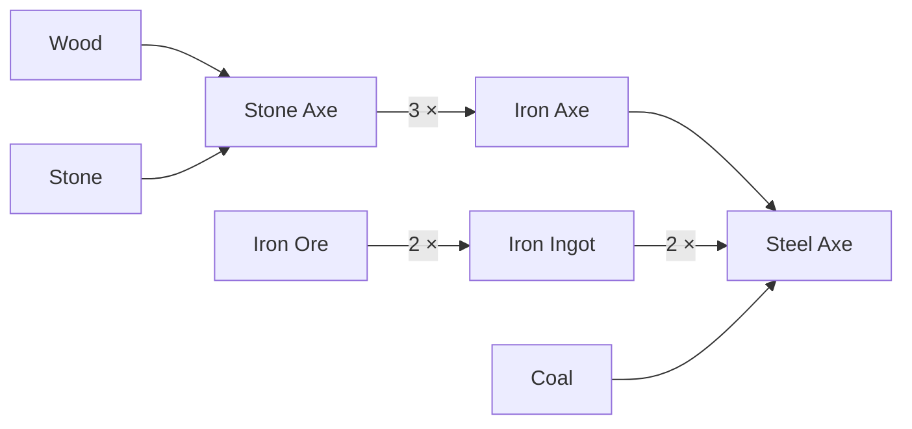

# Building an item economy with SCaaS tokens (games, stamps, passes)

This guide is for anyone who wants on-chain items for their own game or service — swords and axes, potions, crafting
materials, loyalty stamps, session passes — that players can hold, give away, trade and **combine into other items**,
without NFTs and without players ever holding a native coin. It explains the idea, how to design your items and
recipes, how to set the tokens up, and what is built today versus still to come.

Status at a glance: the item tokens (with mint and burn), gasless transfers and the DEX are **BUILT** on EVM; the
**recipe contract** that converts items is **NOT SPECIFIED** yet — you can design for it today and write it as an
ordinary contract (§6), and a SCaaS template is planned ([README §16](../../README.md#16-use-cases)).

## 1. The idea in one paragraph

Every **kind** of item is its own token with `decimals 0`, so one unit is one item: "Stone Axe" is one token,
"Iron Axe" another, "Iron Ingot" a third. A player's inventory is simply its balances of those tokens. A **recipe** is a
rule that burns some items and mints others, for example *3 Stone Axe → 1 Iron Axe*. Recipes chain: what one recipe
produces, another can consume, so you get tiers and crafting trees. One contract — the **recipe contract** — holds the
recipe table and is allowed to mint and burn every item, so a conversion either happens completely in one transaction
or not at all, and anyone can read the rules.

## 2. Vocabulary

| Term | Meaning |
|---|---|
| Item kind | One token (`NONE` kind, `decimals 0`). All units of a kind are identical and interchangeable. |
| Unit | One item. Balance 5 of "Iron Ingot" = five ingots. |
| Recipe | `inputs → outputs`, each side a list of (item kind, amount): m·X + n·Y + … → k·Z + l·W + … |
| Catalyst | An item that must be held for a recipe but is not consumed (an anvil, a crafting licence). |
| Recipe graph | All recipes together: item kinds are nodes, recipes are edges from inputs to outputs. |
| Recipe contract | The contract that checks a recipe, burns the inputs and mints the outputs; minter of every item kind. |

## 3. What recipes can express

The general form is **m·X + n·Y + … → k·Z + l·W + …** — any number of inputs and outputs, any amounts. That one
shape covers:

| Pattern | Example (game) | Example (outside games) |
|---|---|---|
| Upgrade / tier up | 3 Stone Axe → 1 Iron Axe | 5 Silver stamps → 1 Gold stamp |
| Combine different kinds | 1 Iron Axe + 2 Iron Ingot → 1 Steel Axe | 1 Coffee stamp + 1 Cake stamp → 1 Combo voucher |
| Split | 1 Bundle of arrows → 20 Arrow | 1 Ten-session pass → 10 Session |
| Plain exchange | 1 Red Gem ↔ 1 Blue Gem | 1 Weekday pass → 1 Weekend pass |
| Multi-output | 1 Ore → 1 Iron Ingot + 1 Slag | 1 Gift box → 1 Voucher + 3 Stamp |
| With a catalyst | 2 Iron Ingot → 1 Iron Sword, if the holder owns an Anvil | 10 stamps → 1 reward, if the holder holds a Member card |
| With randomness | 1 Mystery Box → 1 of {Common, Rare, Epic} | 1 Lucky draw ticket → prize or nothing |

Optional conditions the recipe contract can add: a cooldown per holder, a per-holder or global limit (only 100 Legendary
items ever), a start and end date (seasonal recipes), a fee in one of the item tokens.

### A crafting tree (example)

Read each arrow group as one recipe: *1 Wood + 1 Stone → 1 Stone Axe*, *3 Stone Axe → 1 Iron Axe*, *2 Iron Ore → 1 Iron
Ingot*, *1 Iron Axe + 2 Iron Ingot + 1 Coal → 1 Steel Axe*. Every item in the picture is both something you can get and
something you can spend.

## 4. Designing your economy — step by step

1. **List your item kinds.** One row per kind: name, symbol, how it enters the game (drop, purchase, quest reward,
   recipe output), whether it can leave the game (burned by a recipe, redeemed for a service).
2. **Write the recipe table.** One row per recipe: inputs with amounts, outputs with amounts, catalyst, conditions.
   Keep it as data (a JSON or CSV file), not as prose — the recipe contract will load exactly that table.
3. **Check the graph for value loops.** Give each kind a rough value and walk every cycle in the graph: a path such as
   X → Y → X that ends with *more* X than it started with lets players mint value from nothing. Either make the graph
   acyclic, or make sure every cycle loses value. The recipe contract can enforce this (§6).
4. **Decide who may mint outside recipes.** Usually the game server (drops, rewards) and the shop (purchases). Those
   accounts get the minter role next to the recipe contract.
5. **Decide what is transferable.** By default every item can be given, sold or traded. Items that must stay with one
   player (soul-bound) need the receiver allowlist (SPECIFIED, §7).
6. **Decide who pays the gas.** Usually the game's relayer at fee 0 — players sign, the game submits. Or players pay a
   small fee in one of the item tokens. See [README §8](../../README.md#8-who-pays-the-fee-every-model).

## 5. Creating the item tokens

Each item kind is one token created through `OpenFactory.createToken` (`NONE` kind) with:

| Field | Value | Why |
|---|---|---|
| `decimals` | `0` | one unit is one item |
| `features` | `MINTABLE` and `BURNABLE` | any item can be produced and consumed by some recipe; set both for every kind, even one that is only an input today, so you can add recipes later without new tokens |
| `lockedFeatures` | your choice | lock a flag to promise players it can never be removed |
| `owner` | the game's admin account | it grants and revokes the minter role |
| `roles.minter` | the recipe contract (or your admin first) | more minters can be added later with `grantRole(MINTABLE, …)` — the role is a set, not a single address |
| `initialSupply` / `initialHolder` | `0` / ignored, or a starting stock for the game treasury | items normally come into existence by drops or recipes |

Token mechanics are in [token-wrappers.md](../contracts/token-wrappers.md) (kinds, features and roles: CTR-TOK-21,
CTR-TOK-22). Players move items with signed meta-transactions, so they never need a native coin
([metatx.md](../contracts/metatx.md)).

## 6. The recipe contract (to build; not yet a SCaaS template)

What it does, for one `craft(recipeId, times)` call signed by the player:

1. Check the recipe exists, is active, its conditions hold (cooldown, limits, dates) and any catalyst is held.
2. Take the inputs: the player's signed transfers of `times × amount` of each input item to the recipe contract
   (meta-transaction transfers, so the player pays no gas).
3. Burn the inputs it now holds (`burn`, allowed because every item kind is `BURNABLE`).
4. Mint `times × amount` of each output item to the player (`mint`, allowed because the contract holds the minter role).
5. Emit an event with the recipe id and the amounts, so the game and indexers update inventories.

All five steps run in one transaction: if anything fails, nothing changes. Several recipes in a row ("craft Stone Axe ×3,
then Iron Axe") can be one call too.

Rules worth building in:
- **Public, versioned recipe table.** Store it on chain (or its hash, with the table published); changes emit events so
  players can see when a rule changed.
- **Loop guard.** Reject a table update that creates a value-gaining cycle — simplest: require the graph to be acyclic,
  or attach a value per kind and require every recipe to have outputs worth ≤ inputs.
- **Randomness.** On chain, use a commit–reveal or a verifiable random source; never the block hash alone.
- **Supply caps.** A per-kind maximum supply enforced at mint time.

## 7. Trading, privacy and limits

- **Trading.** Each item kind can have a market on `SCaaSDex`; players sign orders without allowances or gas, and
  the same orders can fill against Uniswap pools ([dex.md](../contracts/dex.md)). Direct gifts are ordinary signed
  transfers.
- **Soul-bound items.** Need the receiver allowlist of the regulated controls (SPECIFIED,
  [asset-suite.md](../contracts/asset-suite.md#2-regulated-controls)).
- **Hidden inventories.** A Zether or PQ Zether item token hides how many units each player holds; recipes on
  confidential tokens need the recipe contract to verify proofs and are not covered here.
- **Unique items.** Every unit of a kind is identical. An item with its own identity or stats — a numbered sword, a
  worn axe with durability 37 — needs an NFT, which is PLANNED. A common workaround: make each *level* or *quality* its
  own kind (Iron Axe, Iron Axe +1, Iron Axe +2).

## 8. Status

| Part | Status |
|---|---|
| Item tokens: `NONE`, `decimals 0`, `MINTABLE`, `BURNABLE`, several minters | BUILT |
| Gasless transfers and fees in the item token | BUILT |
| Item markets on `SCaaSDex` | BUILT on EVM |
| Receiver allowlist (soul-bound items) | SPECIFIED |
| Recipe contract / template | NOT SPECIFIED (design in §6) |
| NFTs for unique items | PLANNED |
