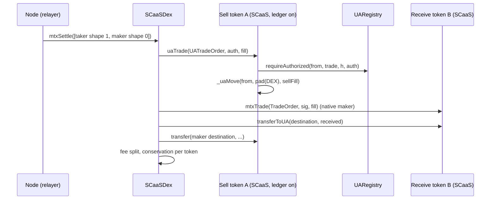

# UA parity: every native-address operation for a derived UA

**Status:** ACCEPTED by the owner 2026-10-13 (§6) and folded; frozen here. Ids: UP-1…UP-6, UP-8, UP-10 and Q1, Q2 →
CTR-UA-27; UP-9, §4.2, §4.5 (`_uaMint`, `wrapToUA`, `unwrapToUA`, `mintToUA`, `payWithFeeToUA`) → CTR-UA-28 and the
CTR-MTX-19 rows; §4.8 (`uaPayReceiverFee`) → CTR-MTX-05/06; UP-11, §4.6, Q3, Q4 → CTR-DEX-25 and the `trade` row of
CTR-UA-10; UP-12, Q6 → CTR-DEX-15 step 4; §4.7, Q5 → CTR-DEX-26 (with CTR-DEX-16, -23); `uaWrap` → CTR-TOK-20; UP-13,
Q8 → CTR-MTX-22 and CTR-ACC-12; §4.11, Q7 → CTR-ZTH-51; Q9 → CTR-UA-28; Q10 → CTR-AS-07; §7 → the TODO stream UA-5
(UA-5a / 5b / 5c). UP-7 (size) needs no rule. Draft ids: UP-1…UP-13 (design rules), O1…O9 (options), Q1…Q10 (owner
questions).
**Date:** 2026-10-13. **Scope:** the EVM (and Hedera) token kinds `NONE`, `UNDERLYING`, `NONE_ZETHER`,
`UNDERLYING_ZETHER`, `SCaaSDex` with `DexPuller`, `MandateWallet`, `SmartKeyAccount`, the factory where a subject is a
user. Non-EVM families: out of scope. PQZ (`PqzToken`) is not built; §4.11 notes what it inherits. Nothing is deployed
(dev chains only), so every change is in place: no compatibility, no migration.
**Builds on:** [accounts.md](../../contracts/accounts.md) (CTR-UA-10, -14, -18, -19, -24, -26), [metatx.md](../../contracts/metatx.md),
[dex.md](../../contracts/dex.md), [token-wrappers.md](../../contracts/token-wrappers.md), [zether.md](../../contracts/zether.md),
[mandates.md](../../contracts/mandates.md), the UA-4 plan `docs/superpowers/plans/2026-10-12-ua4-ledger.md` (rulings
L4-1…L4-20), TODO items **UA-DEX** and **UA wrap in one step** (replaced by the stream UA-5).

Marks: **[code]** found in the code at `main` 3b9a150; **[spec]** found in a normative doc; **[inferred]** this draft's
design or estimate. Unmarked design text is [inferred].

## 1. Why

Owner decision (2026-10-13): full parity between the address path (`mtx*` and the other native-address functions) and
the UA path (`ua*`). Every operation open to a native address is open to a derived UA of any SIGNING kind, PQ kinds
included.

Today [spec, code]:

- CTR-UA-14 keeps the DEX, `MandateWallet` and regulated tokens native-only ("not in v1").
- The UA allowlist (CTR-UA-26, `_uaAllowed`) holds the two `unwrap`s with `minOut` only; `approve` and `trade` revert
  `MetaTxUnknownOp` on every `ua*` function.
- `TradeOrder.from` / `.destination`, `DexOrder`, the DEX's `Leg` and `ExchangeLeg`, `MandateWallet.owner` and
  `Mandate.delegate`, `zetherUnshield.to`, `unwrap.recipient`, `payWithFee.to`, `mint.to` are `address`.
- A wrap reaches a UA in two calls (`wrap`, then `transferToUA`).

Parity has two axes:

| Axis | Meaning | Native today | What a UA needs |
|---|---|---|---|
| Subject | who authorizes: `from`, owner, delegate, order signer | a direct call or an EIP-712 signature | a UA struct (`bytes32 from`) verified by `requireAuthorized`, or a self-call under a UA ticket |
| Receiver | who is credited: `to`, `recipient`, `destination`, payee | an `address` parameter | a `bytes32` parameter credited in the UA ledger |

A UA never sends a transaction. So every function a native **calls** needs a signed UA form, and every `address`
receiver needs a `bytes32` form.

## 2. Ground rules (carried over)

- **UP-1 Structs.** A UA intent is its own struct with `bytes32` ids and its own typehash, in the contract's existing
  domain (CTR-UA-19). The UA path accepts a native id too (zero-padded, `U`); a native signs the v3 digest itself
  (ECDSA, ERC-1271 by CTR-UA-24, HIP-632 on Hedera); a derived id goes through
  `registry.requireAuthorized(id, purpose, digest, auth)` [spec, code].
- **UP-2 Lanes.** Every UA nonce, and the new UA order lanes, use the existing maps keyed by `bytes32` with natives
  padded, so a native and its padded id share one lane (L4-12 trick: a padded address hashes to the same mapping slot)
  [code for the meta-tx map].
- **UP-3 Receivers.** A derived receiver must be registered and SIGNING (`_checkTo`: `UANotRegistered`,
  `UAKindNotAccepted`); a Zether kind can never receive [code].
- **UP-4 Ledger writes.** Every UA credit or debit goes through `_uaMove` or the new `_uaMint` (below), so
  `balanceOf(UA_POOL) == Σ _uaBalance` and the `Transfer`/`UATransfer` pairing hold by construction [code for `_uaMove`].
- **UP-5 Funds.** A derived UA holds only balances in SCaaS tokens whose ledger is on (`registry() ≠ 0`). It never
  holds an outside ERC-20, an HTS token or the native coin. Every UA leg that would touch such an asset is impossible by
  construction; that side stays on the address path [inferred from CTR-UA-18].
- **UP-6 Events.** Where an address-typed event names a party, a UA move emits a separate `UA…` event with `bytes32`
  ids; address events keep their shape (precedent: `UAPaymentSettled`, `UATransfer`) [code].
- **UP-7 Size.** No size work (owner, until Glamsterdam); growth is stated per phase (§4.17).

New common internals [inferred]:

```solidity
/// Mint into a derived UA: ERC20._update(0, UA_POOL, v) (Transfer(0, UA_POOL)), _uaBalance[to] += v, UATransfer(0, to, v).
function _uaMint(bytes32 to, uint256 v) internal;
/// The subject of the current call as an id: the ticket's subject inside a self-call, else pad(msg.sender).
function _subjectId() internal view returns (bytes32);
```

## 3. Inventory

"Today UA" = what a derived UA can do now. Phase: see §7. "unchanged (Q1)" = kept as it is, with no UA counterpart
(owner, 2026-10-13, §6 Q1); the role or admin holder still acts gaslessly through its own contract account.

### 3.1 Tokens (every kind: `ERC20MetaTx`, `MetaTokenBase`)

| Function [code] | Subject / receiver | What it does | Today UA | Parity design |
|---|---|---|---|---|
| `mtxExecute`, `executeMetaTransaction`, `mtxExecuteWithFee` | `m.from` | allowlisted self-call | `uaExecute` (UA allowlist) | grow the UA allowlist (§4.1) — 5a, 5c |
| `mtxBatch` | each `m.from` | atomic batch | `uaBatch` | exists |
| `cancelNonce(batch)` | sender | bump a lane | `uaCancelNonce` (derived) | exists |
| `mtxExecuteTransfer`, `mtxBatchTransfer` | `t.from` → `t.to` | typed transfer / payment | `uaExecuteTransfer`, `uaBatchTransfer` | exists |
| `mtxTransfer`, `mtxTransferWithFee`, `mtxPay` | `from` → `to` | named builders | `uaTransfer`, `uaTransferWithFee`, `uaPay` | exists |
| `transfer(to, v)` | sender → `to` | ERC-20 | `transferToUA` (native → UA); `uaTransfer` (UA → any) | exists |
| `approve`, `transferFrom` | contract caller and spender | allowance (CTR-TOK-01) | refused | **none** (UP-10, Q2) |
| `payWithFee(to, …, entryRef)` | sender → payee `to` | direct payment | none for a UA payee | `payWithFeeToUA(bytes32 to, …)` — 5a |
| `mtxPayReceiverFee(t, payerSig, fee, …, payeeSig)` | payer `t.from`, payee `t.to` co-signs | receiver pays the relayer | none | `uaPayReceiverFee` — 5a |
| `mtxTrade(o, sig, f)` | `o.from` (`dex` calls) | sell side of an order | `MetaTxUnknownOp` | `uaTrade(UATradeOrder, auth, f)` — 5b |
| `mtxCancelOrder`, `mtxInvalidateNonces` | `o.from`, `from` | close an order / a lane | none | `uaCancelOrder`, `uaInvalidateNonces` — 5b |
| views `tradeOrderDigest`, `invalidateNoncesDigest`, `minNonce` | — | — | none | `uaTradeOrderDigest`, `uaInvalidateNoncesDigest`, `uaMinNonce` — 5b |
| `grantRole`, `revokeRole`, `renounceRole`, `disableFeature`, ownership | owner, role holders | administration | none | unchanged (Q1) |

### 3.2 Kinds

| Kind / function [code] | Subject / receiver | Today UA | Parity design |
|---|---|---|---|
| `NONE` `mint(to, v)` | minter → `to` | none | `mintToUA(bytes32 to, v)` (same role) — 5a |
| `NONE` `burn(v)` | holder | none | `burn(uint256)` on the UA allowlist — 5a |
| `UNDERLYING` `wrap(v)`, `wrap(u, v)` (payable) | sender pays and receives | two calls | `wrapToUA(u, v, bytes32 to)` payable, also allowlisted on the address path — 5a |
| `UNDERLYING` `mtxWrap(u, o, sig)` | `o.from` on the underlying, `o.destination` | none | `uaWrap(u, UATradeOrder, auth)` — 5b |
| `UNDERLYING` `unwrap(…, address recipient, minOut)` | sender → `recipient` | `uaUnwrap` / `uaExecute(unwrap)` to an address | exists; plus `unwrapToUA(u, wrapped, bytes32 to, minOut)` for a ledger underlying — 5a |
| `UNDERLYING` `addReserve(u, v)` | anyone | none | unchanged (Q1) |
| `UNDERLYING` `disableWrap`, `proposeRate`, `cancelRate`, `executeRate` | role holders | none | unchanged (Q1) |
| `*_ZETHER` `zetherShield(Y, amount)` | burns the signer's public units | none | `zetherShield` on the UA allowlist — 5c |
| `UNDERLYING_ZETHER` `zetherWrapShield(u, amountIn, ua)` | sender pays the underlying | none | unchanged (Q1); from a UA source: two signed steps (`uaWrap`, then `uaExecute(zetherShield)`) |
| `*_ZETHER` `zetherTransfer*`, `zetherUnshield`, `zetherUnshieldUnwrap` through `mtxExecute` | `m.from` pays the outer fee | none | the same selectors on the UA allowlist with a UA envelope binding — 5c |
| `*_ZETHER` `zetherUnshield(…, address to, amount)` | receiver `to` | none | `zetherUnshieldToUA(…, bytes32 to, amount)` — 5c |
| `UNDERLYING_ZETHER` `zetherUnshieldUnwrap(…, address recipient, …)` | receiver `recipient` | none | `zetherUnshieldUnwrapToUA` for a ledger underlying — 5c |
| `*_ZETHER` `zetherRollOver*`, `zetherSetRollOverMode` | a Zether UA | already Z | unchanged |

### 3.3 DEX, accounts, factory

| Contract / function [code] | Subject / receiver | Today UA | Parity design |
|---|---|---|---|
| `SCaaSDex.mtxSettle(Settlement[])` | each leg's `o.from`, `o.destination` | none | tagged legs carrying a `UATradeOrder` (§4.7) — 5b |
| `SCaaSDex.mtxExchange`, `mtxExchangeVia` | each `ExchangeLeg` | none | same — 5b |
| `SCaaSDex.mtxCancelOrders`, `mtxInvalidateNonces` | outside-token orders | n/a | none: a UA holds no outside token (UP-5) |
| `SCaaSDex` `setMarket`, `setFeeSplit`, `setExchangeTarget`, `setListedOnly` | `admin` | none | unchanged (Q1) |
| `DexPuller.pull` | outside-token holder | n/a | unchanged: never a UA leg (UP-5) |
| `MandateWallet` owner: `setMandate`, `setPayee`, `revoke(token)`, `execute`, `mtxExecuteAsOwner`, `isValidSignature` | `owner` | none | `bytes32 owner`, UA pipeline (§4.12) — 5c |
| `MandateWallet` delegate: `payUnderMandate`, `revoke(token, epoch)`, `mtxPayUnderMandate`, `mtxRevoke` | `Mandate.delegate`; payee | none | `bytes32 delegate`, `bytes32` payees — 5c |
| `SmartKeyAccount` (keys, guardian, recovery), `SmartKeyAccountFactory.deploy` | its own keys; `guardian` | is itself an N id | unchanged (Q1) |
| `OpenFactory.createToken`, `createDex`; `TokenConfig.owner`, `roles`, `initialHolder` | creator = sender | none | unchanged (Q1); a creator moves the initial supply with `transferToUA` |
| `UARegistry.register` | any derived kind | exists | unchanged |
| planned: regulated flags (`FREEZE`…`ALLOWLIST`), `SealedBidTender`, `VestingGrant`, `Distribution`, `ExchangeOffer` | receivers, bidders | not built (`FeatureNotBuilt` [code]) | `bytes32`-keyed when built (§4.13) |

Doc drift found (fixed in the fold, 2026-10-13): [accounts.md §1.7](../../contracts/accounts.md#functions) lists `mtxPayReceiverFee` as
"(planned)" and metatx.md §12 as SPECIFIED; it is built in `MetaTokenBase` [code].

## 4. Design per group

### 4.1 The UA allowlist and dedicated functions

- **UP-8** A self-call whose body reads only `_msgSender()` as the subject joins the **UA allowlist** (`_uaAllowed`):
  under a derived ticket `_msgSender()` is `UA_POOL`, and a burn from `UA_POOL` debits the subject (L4-3) [code]. That
  covers `burn`, `unwrapToUA`, `zetherShield` and the Zether proof ops. Anything with a `bytes32` receiver, a different
  signed struct, or a native caller who pays (`msg.value`, an outside `transferFrom`) gets a **dedicated function**.
  Named UA builders exist only where the address path has one (precedent `uaUnwrap`).

| Selector | UA allowlist | Address allowlist | Fee class |
|---|---|---|---|
| `burn(uint256)` (`NONE*`) | added (5a) | exists | `AMOUNT(0)` |
| `unwrapToUA(address,uint256,bytes32,uint256)` | added (5a) | added (5a) | `AMOUNT(1)` |
| `wrapToUA(address,uint256,bytes32)` | no (a UA holds no outside underlying) | added (5a) | `ABSOLUTE` |
| `zetherShield(bytes,uint256)` | added (5c) | exists | `ABSOLUTE` |
| `zetherTransfer*`, `zetherUnshield`, `zetherUnshieldUnwrap`, `zetherUnshieldToUA`, `zetherUnshieldUnwrapToUA` | added (5c), with the UA binding (§4.11) | exists / added | `ABSOLUTE` |
| `approve`, `mtxTrade`, `uaTrade`, transfers, role functions | never | never | — |

### 4.2 Transfers and payments

Built [code]: `uaExecuteTransfer`, `uaBatchTransfer`, `uaTransfer`, `uaTransferWithFee`, `uaPay`, `transferToUA`. One gap:
a **direct** payer paying a UA payee with a reference (`payWithFee` takes an address). `MandateWallet` pays through
`payWithFee`, so a UA payee of a mandate needs it too.

```solidity
/// PAYABLE; the caller (native) pays `amount` to a registered SIGNING UA and the fee on top to feeRecipient.
function payWithFeeToUA(bytes32 to, uint256 amount, FeeMode feeMode, uint256 fee, address feeRecipient,
                        bytes32 entryRef) external returns (bool);
// emits UAPaymentSettled(pad(payer), to, amount, feeAmount, feeRecipient, entryRef)
```

Not allowlisted (as `payWithFee`, CTR-MTX-19: it charges its own fee). A native `to` reverts `UANotRegistered` (use
`payWithFee`), as `transferToUA` [code].

### 4.3 Wrap in one step (TODO "UA wrap in one step")

Three sources, three functions [inferred]:

| Source of the underlying | Function | Who signs / calls | Native-coin leg |
|---|---|---|---|
| a native holder, any leg (outside ERC-20, HTS, native coin) | `wrapToUA(address u, uint256 amount, bytes32 to)` payable | the holder calls directly | yes (`msg.value`) |
| the same, gasless | `mtxExecute(wrapToUA(…))`, allowlisted `ABSOLUTE` | the holder signs a `MetaTransaction` | no: a self-call carries no value (`NativeNotGasless`, as the address path) |
| a holder (native or UA) of a **SCaaS** underlying | `uaWrap(address u, UATradeOrder o, bytes auth)` | the holder signs a `UATradeOrder` on the underlying | no |

- **UP-9 `wrapToUA`.** `to` derived and registered SIGNING; `UnderlyingLib.wrap(i, amount, _msgSender(), msg.value)`
  exactly as `wrap(u, amount)`; then `_uaMint(to, minted)`. Events: `Wrapped(account, u, received, minted)`,
  `Transfer(0, UA_POOL, minted)`, `UATransfer(0, to, minted)`. Relayed: the fee is charged **after** the call from the
  signer's own native balance of this token (the base rule, no special case); a signer without one signs fee `NONE`
  (sponsored). The single-leg ABI gets no `wrapToUA(uint256, bytes32)` (the per-leg form works for one leg).
- **`uaWrap`** is `mtxWrap` (CTR-TOK-20) with three changes: the order is a `UATradeOrder` pulled by the underlying's
  `uaTrade` (§4.6); `minted − wrapFee` goes to `o.destination` (0 ⇒ `o.from`): derived ⇒ `_uaMint`, native ⇒ `_mint`;
  event `UAWrapped(bytes32 indexed from, address indexed u, uint256 received, uint256 minted)`. The underlying must
  be a ledger token (`UALegNotLedger(u)` otherwise). A native holder uses it to wrap straight into its UA. It needs
  5b (`uaTrade`).

### 4.4 Approve and allowance: none for UAs

- **UP-10** A UA never grants or holds an allowance. A UA is a key-held account like an EOA, and an EOA never grants or
  holds one on a SCaaS token (CTR-TOK-01) [spec]; parity is therefore "no allowance", not `uaApprove`. Every contract
  that must move a UA's funds does it against a **signed, named** intent, as every native EOA case already does
  (CTR-TOK-01's "allowance-like grants"): the DEX by `UATradeOrder` (§4.6), a wrapper by `uaWrap`, a mandate by its
  wallet. CTR-UA-14's `uaApprove` (an assumption of the 2026-10-06 UA design §5.4) is dropped: the token-side order check
  (CTR-DEX-15) already moves funds into `dex` with no allowance. `approve` stays refused on every `ua*` function.

### 4.5 Unwrap

Built [code]: `uaUnwrap` and `uaExecute(unwrap(…))` pay the underlying to an **address**. The receiver gap: an
underlying that is itself a SCaaS ledger token can pay a UA.

```solidity
/// On both allowlists, AMOUNT(1). Burns from the subject (native, or a UA through UA_POOL); pays leg u's out to `to` in
/// u's UA ledger: IUALedger(u).transferToUA(to, out). Leg not a ledger token (outside, HTS, native coin) => UALegNotLedger(u).
function unwrapToUA(address u, uint256 wrapped, bytes32 to, uint256 minOut) external returns (uint256 out, uint256 burned);
```

Reserve accounting is the same as `unwrap`: the wrapper's own balance of `u` drops by `out` (`UnderlyingLib.payOutToUA`).

### 4.6 Trade on the token

- **UP-11 `UATradeOrder`.** A separate struct in the sell token's domain (CTR-UA-19 rationale: `from` cannot be an
  `address`); `TradeOrder` and its vectors stay untouched (O2).

```solidity
struct UATradeOrder {
    bytes32 from; address receiveToken; uint256 amount; uint256 receiveAmount; uint256 minFill; uint256 fee;
    address relayer; address dex; bytes32 destination; uint8 flags; uint256 batch; uint256 nonce; uint256 validUntil;
}
// UA_TRADE_ORDER_TYPEHASH = keccak256("UATradeOrder(bytes32 from,address receiveToken,uint256 amount,"
//   "uint256 receiveAmount,uint256 minFill,uint256 fee,address relayer,address dex,bytes32 destination,uint8 flags,"
//   "uint256 batch,uint256 nonce,uint256 validUntil)")
// UA_INVALIDATE_NONCES_TYPEHASH = keccak256("UAInvalidateNonces(bytes32 from,uint256 batch,uint256 minNonce)")
// cancel: the existing CancelOrder(bytes32 orderHash), orderHash = the UATradeOrder digest

function uaTrade(UATradeOrder calldata o, bytes calldata auth, TradeFill calldata f) external;           // only o.dex
function uaCancelOrder(UATradeOrder calldata o, bytes calldata auth) external;                          // never expires
function uaInvalidateNonces(bytes32 from, uint256 batch, uint256 newMin, bytes calldata auth) external; // strictly up
function uaTradeOrderDigest(UATradeOrder calldata o) external view returns (bytes32);
function uaInvalidateNoncesDigest(bytes32 from, uint256 batch, uint256 newMin) external view returns (bytes32);
function uaMinNonce(bytes32 from, uint256 batch) external view returns (uint256);
```

- **Checks.** Exactly CTR-DEX-15 steps 1–8 [spec], with `o.from ≠ pad(this)` (`SelfOrder`) and step 4 by UP-1 under the
  new purpose **`trade`** (`scaas.ua.purpose.trade.v1`, O4): the order digest, the `CancelOrder` digest over a UA order
  hash and the `UAInvalidateNonces` digest. The registry accepts any purpose tag (`_authorized` takes it as given
  [code]): the registry does not change, only the purpose table and the `UAKinds` constants in six libraries.
- **Move.** `_uaMove(o.from, pad(o.dex), move)`: a derived seller emits `Transfer(UA_POOL, dex)` + `UATransfer`.
- **State.** `TradeLib`'s `minNonce` is re-keyed `bytes32` (natives padded: same slots, UP-2), so
  `mtxInvalidateNonces(addr, b, n)` also invalidates that address's `UATradeOrder`s on lane `b` — one lane, one floor.
  `pulled[h]` is keyed by the digest and needs no change. `TradeLib`'s checks are rewritten over the fields both
  structs share (`from` as `bytes32`), so no logic is duplicated.
- **UP-12 Verified once.** `pulled[h] ≠ 0` only after a verified pull or a verified cancel, and `h` binds every field,
  so the signature check is skipped when `pulled[h] ≠ 0` (a Path A order's second fill; O6, Q6). This saves one PQ
  verify (up to 5.95 M gas) per second fill.
- **Events.** `UATradeFilled(bytes32 indexed orderHash, bytes32 indexed from, uint256 sellFill, uint256 receiveFill,
  uint256 dexFee)`, `UAOrderCancelled(bytes32 indexed orderHash, bytes32 indexed from)`,
  `UANoncesInvalidated(bytes32 indexed from, uint256 indexed batch, uint256 minNonce)`.
- **Natives** may sign a `UATradeOrder` (U): that is how a native seller names a UA `destination`.

### 4.7 DEX

O3: extend `SCaaSDex` in place (one book, one contract; a UA order can match a native order).

```solidity
struct Leg         { address sellToken; uint8 shape; bytes order; bytes sig; uint256 fill; }
struct ExchangeLeg { address sellToken; uint8 shape; bytes order; bytes sig; uint256 sellFill; uint256 receiveFill; }
// shape 0: order = abi.encode(TradeOrder)    (today's legs; ABI change, nothing deployed)
// shape 1: order = abi.encode(UATradeOrder)  (sig = the registry auth or a native signature)
```

The DEX decodes each leg into one internal `Core` (ids as `bytes32`) and runs today's logic on it [inferred]:

| Step | Shape 1 rule |
|---|---|
| leg kind | `kind[sellToken] == KIND_SCAAS` and the ledger on, else `UALegNotLedger(sellToken)` (UP-5); never a `DexOrder`, never the `DexPuller` |
| pull | `IUATrade(sellToken).uaTrade(o, sig, f)` (the token checks and verifies) |
| self-trade | over ids: a native order and its padded id are one party (`SelfTrade`) |
| payout | `to = destination == 0 ? from : destination`; derived ⇒ `IUALedger(receiveToken).transferToUA(to, amount)` from the DEX's own balance, `receiveToken` a ledger token else `UAReceiveNotLedger(receiveToken)`; native ⇒ `safeTransfer` |
| Path B refund | to a derived `from` by `transferToUA` on `sellToken` |
| fee shares | unchanged: relayer and treasury are addresses |
| conservation | unchanged: `transferToUA` lowers the DEX's own `balanceOf` like `safeTransfer` |
| events | `UALegSettled(bytes32 indexed ref, bytes32 indexed orderHash, bytes32 indexed from, bytes32 destination, uint256 sold, uint256 received, uint256 dexFee, uint256 refund, uint256 relayerShare, uint256 treasuryShare)` and `UAExchangeLegSettled(…)` likewise |

- **Gas starvation.** The registry reverts `UAVerifyGas` when less than `cap + cap/63 + margin` is left [code]. `mtxSettle`
  re-raises it as a whole-call revert, exactly as `SigCheckGasStarved` (CTR-DEX-08), so a starved submitter never turns
  a valid UA order into `MatchFailed` (and the node never drops it, NODE-DEX-06).
- **Interactions.** `_interact` refuses the `uaTrade` selector as it refuses `mtxTrade` [code for `mtxTrade`]: an
  interaction runs as the DEX, which is `o.dex` of every order.
- **`DexPuller`** is unchanged: it serves outside tokens, which a UA never holds.



Gas per settlement (one transaction) [inferred from the measured caps, accounts.md §1.15]: a UA leg costs its kind's
verify (the registry holds the full cap before each call), ≈ 0.12 M of leg work (estimate, to be measured in 5b) and
its signature calldata. With the EIP-7825 cap 16,777,216 (chain 7622's block limit is the same) and ≈ 0.17 M of
settlement base:

| Leg kind | Cap (gas) | Sig calldata | Max legs of that kind per transaction (16.78 M) | Hedera (15 M) |
|---|---|---|---|---|
| `mldsa65` (Solidity, cached key) | 5,950,000 | 3,309 B ≈ 53 k | 2 | 2 |
| `mldsa44` (cached key) | 4,250,000 | 2,420 B ≈ 39 k | 3 | 3 |
| `fndsa512` | 2,500,000 | 666 B ≈ 11 k | 6 | 5 |
| `slhdsa128s` | 1,400,000 | 7,856 B ≈ 126 k | 10 | 9 |
| `ed25519` | 210,000 | 96 B | ≈ 50 | ≈ 45 |
| classical (`bip340`, `p256` precompile, native) | ≤ 50,000 | ≤ 400 B | > 90 (settlement work bounds it) | > 80 |
| `mldsa65` with chain 7622's precompile (P6g) | ≈ 20,000 | 3,309 B | as classical | — |
| `msig` at `verifyBudget` | up to 12,000,000 | Σ members | 1, plus classical legs | 1 |

So a PQ taker against one PQ maker fits everywhere; a PQ taker against two `mldsa65` makers does not, and the node
splits it. UP-12 makes a resting order's second fill free of verification. Several settlements in one `mtxSettle` share
the one cap.

### 4.8 Receiver pays the fee

```solidity
/// PAYABLE. CTR-MTX-06's shape on t (entryRef != 0, fee NONE, relayer bound, batch payLane, nonce 0, feeRecipient != 0);
/// pad(feeRecipient) != t.to; d = _uaExecuteTransfer(t, payerAuth) (payer U); the payee t.to (U) co-signs the existing
/// ReceiverFee(paymentDigest = d, fee, feeRecipient, rfValidUntil): native => its v3 signature (CTR-UA-24, HIP-632),
/// derived => requireAuthorized(t.to, PURPOSE_RECEIVER_FEE, receiverFeeDigest(...), payeeAuth); then
/// _uaMove(t.to, pad(feeRecipient), fee).
function uaPayReceiverFee(UAMetaTransfer calldata t, bytes calldata payerAuth, uint256 fee, address feeRecipient,
                          uint256 rfValidUntil, bytes calldata payeeAuth) external returns (bool);
event UAReceiverFeePaid(bytes32 indexed paymentDigest, bytes32 indexed payee, address indexed feeRecipient, uint256 fee);
```

The purpose `receiver-fee` already exists for exactly this [spec, code: `PURPOSE_RECEIVER_FEE`]. `ReceiverFee` and
`receiverFeeDigest` are reused unchanged; RP1–RP4 and the threat table of CTR-MTX-06 carry over with ids. Two
`mldsa65` signatures cost ≈ 11.9 M (fits 16.78 M and Hedera's 15 M); an `msig` payer at 12 M plus any PQ payee does
not fit. Not in `uaBatchTransfer` (as the address path).

### 4.9 Batches

`uaBatch` runs every UA-allowlisted selector, so it gains `burn`, `unwrapToUA` and the Zether ops with no new code;
`uaBatchTransfer` is unchanged. `uaPayReceiverFee`, `uaTrade`, `uaWrap` are not batched (as their address twins).
`mtxSettle` is the DEX's batch; the per-transaction gas cap of §4.7 bounds the PQ legs in it.

### 4.10 Fees

| Function | Who pays the relayer | From |
|---|---|---|
| `uaExecute`, `uaBatch`, typed `ua*` | the signer `from` | its ledger, after the call (built [code]) |
| `burn`, `unwrapToUA` via `uaExecute` | the signer | its ledger, `AMOUNT(i)` ≤ 1 % |
| `zetherShield` and Zether ops via `uaExecute` | the signer | its public UA balance, `FIXED`/`NONE` (`ABSOLUTE`); the inner confidential fee is unchanged |
| `wrapToUA` via `mtxExecute` | the native signer | its own native balance (UP-9) |
| `uaTrade` / DEX legs | the order signer | the signed DEX fee rate on what it receives, split by the DEX (CTR-DEX-17) |
| `uaWrap` | the order signer | `wrapFee` from the minted units, to `msg.sender` (CTR-TOK-20) |
| `uaPayReceiverFee` | the payee | out of the payment it receives |
| `payWithFeeToUA` | the caller | its own balance, as `payWithFee` |
| `MandateWallet` UA path | — | fee `NONE` only (CTR-MTX-22) |

### 4.11 Zether: the public side from and to the UA ledger

Zether functions keep accepting Zether kinds only as the confidential account (CTR-UA-14) [spec]. Only the **public**
side — the units burned by a shield, minted by an unshield, and the outer fee — may be a UA (O5).

- **Shield from a UA.** `zetherShield` joins the UA allowlist on both Zether kinds. Its body `_burn(_msgSender(), …)`
  already debits the subject under a derived ticket (L4-3) [code]; it carries no proof, so it needs no binding.
- **Confidential ops paid by a UA.** `zetherTransfer*`, `zetherUnshield`, `zetherUnshieldUnwrap` (and the two `…ToUA`
  below) join the UA allowlist, and `_uaExecute` stores a UA envelope binding in the ticket, as the address path does
  (CTR-ZTH-34): `uaEnvelopeBinding(UAMetaTransaction m) = keccak256(abi.encode(TAG_UA_ENVELOPE, chainid, chainUid,
  token, m.from, m.batch, m.nonce, m.validUntil, m.mode, canonRelayer, m.fee, canonFeeRecipient))` with
  `TAG_UA_ENVELOPE = keccak256("SCAAS-ZETHER-UA-ENVELOPE-V1")` (a distinct tag, as PQZ's `SCAAS-PQZ-UA-ENVELOPE-V1`
  [spec]). This closes the ponytail note in `_uaExecute` ("binding 0 is safe only while no confidential selector is on
  the UA allowlist") [code].
- **Unshield to a UA.** `zetherUnshieldToUA(payload, proof, authSig, beneficiary, bytes32 to, uint256 amount)`:
  `to` registered SIGNING; the same `OP_BURN` statement whose recipient word (header word 12 counting from 0, today
  `abi.encode(address)`) carries `to` as a `bytes32`. A native recipient's word is unchanged (a padded address), and a
  derived id has non-zero top bits, so one proof binds exactly one recipient id with no new op tag [inferred from
  `ZetherLib._header`]. Then `_uaMint(to, amount · shieldScale)`; event `ZetherUnshieldedUA(UA indexed from, uint256
  amount, bytes32 indexed to)`. `zetherUnshieldUnwrapToUA` likewise pays a ledger leg through `transferToUA`.
- **Invariant.** `totalSupply` counts `UA_POOL`, so the reserve invariant of `UNDERLYING_ZETHER`
  (`Σ reserve ≥ totalSupply + totalShielded · shieldScale`) is unchanged.
- **Prover.** `clients/zether-prover/src/zether.rs` takes the recipient as 32 bytes; the statement layout does not change.
- **PQZ** (not built): `PqzToken` already plans a UA path with its own binding [spec]; `pqzUnshield` should take a
  `bytes32` recipient from the start (a note for P6g, not a delta here).

### 4.12 `MandateWallet` with a UA owner or delegate

- **UP-13 The generic UA pipeline moves to `MetaTxBase`.** `uaExecute`, `uaBatch`, `uaCancelNonce`, `uaDigest`,
  `uaNonce`, the registry immutable (0 = off: `UALedgerOff`), `_uaAllowed` and the cancel-used set move down from
  `ERC20MetaTx`; the fee becomes a virtual `_chargeUAFee` that refuses every mode but `NONE` unless a token overrides it
  (the address path's rule, CTR-MTX-22). Every SCaaS contract and third-party contract on `MetaTxBase` then takes UA
  signers. The UA balances, `_uaMove`, `transferToUA` and the typed path stay in `ERC20MetaTx` (O7).
- **Wallet.** `owner` becomes `bytes32` (constructor `(bytes32 owner, bytes32 chainUid, address registry)`),
  `Mandate.delegate` `bytes32`, `payeeAllowed[token][bytes32]`. Authority checks compare `_subjectId()` with the id.
  A native payee is paid by `payWithFee`, a derived one by `payWithFeeToUA` (§4.2). `UAMetaTransaction` builders
  `uaPayUnderMandate`, `uaRevoke`, `uaExecuteAsOwner` mirror the `mtx*` ones and derive the same lanes.
- **ERC-1271.** A native owner keeps today's `isValidSignature` (ECDSA). A derived owner gets none: it returns
  `0xffffffff`, because token and DEX callers cap 1271 at 50 k gas (a PQ check needs up to 5.95 M) and a 1271 answer
  would be a generic "sign this digest" for a UA key, which CTR-UA-10 layer 1 forbids [spec]. A derived owner acts
  through `uaExecute(execute(…))` on the wallet.
- `HederaMandateWallet` follows (HIP-632 on the native branch).

### 4.13 Regulated tokens (asset suite not built)

`FREEZE`, `FORCE`, `PAUSE`, `ALLOWLIST` are refused at creation (`FeatureNotBuilt`) [code]. Recorded constraints for
when the asset suite is built (Q10): the per-transfer checks hook `_uaMove` and `_uaMint` too, the UA → UA branch
included (the ponytail note in `_uaMove` says so [code]); `ComplianceRegistry` and the freeze set key accounts by
`bytes32` (natives padded), an amendment of CTR-AS-07, which keys by address today [spec].

### 4.14 Hedera and HIP-632

- Every new UA-path native check calls `_requireNativeUASignature`, which already has the HIP-632 branch [code].
- Derived checks are the registry's, unchanged; Hedera's per-transaction cap is 15 M (`UA_VERIFY_BUDGET` 10.5 M) [spec],
  hence the Hedera column of §4.7.
- HTS underlyings: `wrapToUA` works (the wrapper's association is unchanged); `unwrapToUA` and `uaWrap` need a SCaaS
  ledger underlying, so an HTS leg reverts `UALegNotLedger` (UP-5). UA balances need no HTS association: they are a
  sub-ledger of the token's own ERC-20 slot.

### 4.15 Gas of the new functions [inferred]

| Function | Cost over its address twin |
|---|---|
| any derived-subject function | + one `requireAuthorized`: ≈ 6–8 k registry overhead + the kind's verify (§4.7 caps) |
| a derived receiver | + `kindOf` (cold call + SLOAD ≈ 5 k) + a UA slot (≈ 22 k new, 5 k warm) + `UATransfer` (≈ 2 k) |
| `wrapToUA` | `wrap(u, v)` + derived receiver |
| `uaPayReceiverFee` | two checks (payer, payee) + the receiver-fee move |
| `uaTrade` second fill | no verify (UP-12) |
| UA-path Zether op | + the binding hash (≈ 1 k) |

Measured numbers replace these in each phase (logged, not asserted, as L4-20).

### 4.16 Storage, events, errors

| Item | Where |
|---|---|
| `TradeLib.minNonce` keyed `bytes32` (same slots for natives) | `scaas.trade` [code namespace] |
| cancel-used set (`uaCancelNonce`) moves with the UA pipeline | from `scaas.ua.ledger` into `MetaTxBase`'s namespace (nothing deployed) |
| `MandateWallet` owner / delegate / payee keys `bytes32` | the wallet's state |
| new events | `UATradeFilled`, `UAOrderCancelled`, `UANoncesInvalidated`, `UAWrapped`, `UAReceiverFeePaid`, `UALegSettled`, `UAExchangeLegSettled`, `ZetherUnshieldedUA` |
| new errors | `UALegNotLedger(address)`, `UAReceiveNotLedger(address)`; reused: `UANotRegistered`, `UAKindNotAccepted`, `UAUnauthorized` (registry), `UAVerifyGas` (registry, re-raised by `mtxSettle`), `MetaTxUnknownOp` |
| new purpose | `trade` (`scaas.ua.purpose.trade.v1`) in `UAKinds` and the six UA libraries, with `kinds.json` vectors |

### 4.17 Code size [code for today; inferred growth]

| Contract | Runtime today (B) | Growth (estimate) | Phase |
|---|---|---|---|
| `NoUnderlyingToken` | 31,770 | + 2–3 K (5a), + 2–3 K (5b) | 5a, 5b |
| `UnderlyingToken` | 39,189 | + 3–4 K (5a), + 3–4 K (5b) | 5a, 5b |
| `NoUnderlyingZetherToken` | 40,067 | + the base's growth + 1–2 K (5c) | all |
| `UnderlyingZetherToken` | 49,778 (init 51,473) | + the base's growth + 2–3 K (5c) | all |
| `TradeLib` (library) | 3,140 | + 1–2 K, stays under 24,576 | 5b |
| `UnderlyingLib` (library) | 11,697 | + 0.5–1 K | 5a, 5b |
| `SCaaSDex` | 21,866 | + 4–6 K: crosses 24,576, joins `size-baseline.json` | 5b |
| `MandateWallet` | 15,638 | + 2–4 K (the UA pipeline + `bytes32` ids) | 5c |
| `SmartKeyAccount` | 18,928 | + 1.5–2 K (the UA pipeline it inherits, off with registry 0) | 5c |

Every token implementation is already above 24,576 (chains need 64 KiB code, L4-14) [code]; after 5b the DEX is too.
No size work before Glamsterdam (owner).

### 4.18 Node and clients

| Part | 5a | 5b | 5c |
|---|---|---|---|
| clientkeys (`src/evm.js`) | calldata builders `wrapToUA`, `unwrapToUA`, `payWithFeeToUA`; `uaPayReceiverFee` typed data (`UAMetaTransfer` + `ReceiverFee`) | `uaTradeOrderTypedData`, `uaInvalidateNoncesTypedData`, UA cancel; purpose `trade` | UA envelope binding for Zether; `MandateWallet` UA builders |
| vectors | `metatx3.json` rows: `burn`, `unwrapToUA` under a UA; receiver-fee with a derived payee | `uatrade_kat.json` (order, cancel, invalidate; classical + PQ rows) | `zether` UA-path binding rows; `mandate_*` UA rows |
| scaas-node | needs UA F5 (`ua_metatx` jobs, `UATransfer`/`UA_POOL` indexing) first; then the receiver-fee job with a `bytes32` payee | book and TradeEngine keyed by `bytes32` `from` (`src/dex.rs`, `src/dex/venue.rs`, `src/abi.rs`); committed balance from `balanceOfUA`; settlement packing by the §4.7 caps; `UALegSettled` indexing; book gossip of PQ orders (signatures up to 7.9 KB) | mandate jobs with a UA delegate; Zether UA-path jobs |
| zether-prover | — | — | 32-byte recipient |

## 5. Options and recommendations

| # | Choice | Options | Recommendation |
|---|---|---|---|
| O1 | How UA operations are exposed | (a) one generic UA allowlist for everything; (b) a dedicated `ua*` function per operation; (c) hybrid | **(c)** (UP-8): the allowlist where the body only needs `_msgSender()`; dedicated functions where a `bytes32` receiver, another signed struct or a paying native caller is involved — the allowlist cannot express those |
| O2 | Trade struct | (a) widen `TradeOrder.from`/`.destination` to `bytes32` for everyone; (b) a separate `UATradeOrder` | **(b)**: CTR-UA-19 precedent, native wallets keep displaying an `address`, existing vectors and node encoders stay; the shared core avoids duplicated logic |
| O3 | DEX | (a) a new implementation `SCaaSDexV2`; (b) extend `SCaaSDex` in place with tagged legs | **(b)**: one book in which UA and native orders match each other; nothing is deployed; the factory's DEX version registry still versions it |
| O4 | Purpose for orders | (a) reuse `metatx`; (b) a new `trade` | **(b)**: purposes separate uses (CTR-UA-10 layer 3); the cost is a constant in six libraries; the registry is unchanged |
| O5 | Zether public side | (a) only via a native address; (b) directly from and to the UA ledger | **(b)**: (a) forces a PQ UA holder to keep a classical key, which is what PQZ's UA path exists to avoid [spec, CTR-PQZ-21] |
| O6 | Order signature on a later fill | (a) verify every fill; (b) skip when `pulled[h] ≠ 0` | **(b)** on both paths (UP-12): `h` binds every field and `pulled[h] ≠ 0` only after a verified pull or cancel |
| O7 | UA signers for `MandateWallet` | (a) wallet-specific named functions calling the registry; (b) the generic UA pipeline in `MetaTxBase` | **(b)** (UP-13): one pipeline for every SCaaS contract, third parties included |
| O8 | Allowance for UAs | (a) `uaApprove` to contracts; (b) none | **(b)** (UP-10): an EOA has none; every pull is a signed, named intent |
| O9 | Events for UA parties | (a) `bytes32` in the existing events; (b) separate `UA…` events | **(b)** (UP-6): address events and their indexers stay; same pattern as `UATransfer`, `UAPaymentSettled` |

## 6. Decisions (owner, 2026-10-13)

The owner decided every question on 2026-10-13: Q2–Q10 as recommended; Q1 in the owner's words "Giữ nguyên, họ vẫn
có thể chạy gasless" ("keep them as they are; they can still run gasless").

1. **Q1 Scope.** **Decided: unchanged** — no UA counterpart for the token owner and role holders (`mint` role, rate
   admin, guardian, the `ITokenAdmin` functions), the DEX `admin`, the factory creator and `TokenConfig.owner` /
   `roles` / `initialHolder`, `SmartKeyAccount` keys and guardian, `addReserve`, and a one-call `zetherWrapShield` from
   a UA source. They are not "excluded because never gasless": a role or admin holder still acts gaslessly through its
   own contract account — `SmartKeyAccount.mtxExecuteAsOwner`, `MandateWallet` owner `execute` through `mtxExecute`,
   or a Safe's `execTransaction` — fee `NONE`, relayed as a `call` job (NODE-JOB-01, NODE-JOB-19); what stays is that
   no token allowlist carries a role function (CTR-MTX-19: a signature check would skip a minter contract's caps or a
   Safe's guards). `SmartKeyAccount` is option (b), the alternative to a UA, not a UA consumer; `addReserve` is a
   donation; a UA source wrap-shields in two signed steps (`uaWrap`, then `uaExecute(zetherShield)`).
2. **Q2 UA allowance.** **Decided: as recommended** — `uaApprove` leaves CTR-UA-14; no UA ever grants or holds an
   allowance (UP-10, as an EOA); the DEX, wrappers and mandates pull against signed intents.
3. **Q3 Trade struct.** **Decided: as recommended** — a separate `UATradeOrder` and `UAInvalidateNonces` beside
   `TradeOrder` (O2).
4. **Q4 Purpose.** **Decided: as recommended** — a new purpose `trade` for the order, cancel and invalidate digests (O4).
5. **Q5 DEX.** **Decided: as recommended** — `SCaaSDex` extended in place with tagged legs (`shape`, `bytes order`),
   changing today's `Leg` and `ExchangeLeg` ABI (O3); UA legs only on SCaaS ledger tokens, UA payouts by `transferToUA`.
6. **Q6 Verify once.** **Decided: as recommended** — the order signature check is skipped when `pulled[h] ≠ 0`, on both
   paths (a change to CTR-DEX-15 step 4; UP-12).
7. **Q7 Zether public side.** **Decided: as recommended** — shield from, unshield to, and pay the outer fee of
   confidential ops from the UA ledger, with the UA envelope tag `SCAAS-ZETHER-UA-ENVELOPE-V1` and a `bytes32`
   recipient word in the unshield statement (O5, §4.11).
8. **Q8 Mandates.** **Decided: as recommended** — the generic UA pipeline moves into `MetaTxBase`; `MandateWallet`'s
   owner, delegate and payees become `bytes32`; a derived owner gets no ERC-1271 answer (O7, §4.12).
9. **Q9 Direct pay to a UA.** **Decided: as recommended** — `payWithFeeToUA` (§4.2).
10. **Q10 Regulated tokens.** **Decided: as recommended** — a constraint only: the asset suite, when built, hooks the UA
    ledger and keys compliance by `bytes32` (an AS amendment); no code until AS is built (§4.13).

## 7. Phasing

Prerequisite for every relayed use: UA F5 (node `ua_metatx` jobs, `UATransfer`/`UA_POOL` indexing), open in TODO.
Every phase ends with the size gate (`scripts/size_gate.py`, `size-baseline.json` ratcheted) and the full forge suite
(default and `private7622` profiles), as the repo's phases do.

| Phase | Contracts | Tests | Node / clients | Docs |
|---|---|---|---|---|
| **UA-5a** receivers, one-step wrap, receiver-pays | `_uaMint`; `wrapToUA` (+ address allowlist); `unwrapToUA` (both allowlists), `UnderlyingLib.payOutToUA`; `mintToUA`; `burn` on the UA allowlist; `payWithFeeToUA`; `uaPayReceiverFee` | `UA_POOL` = Σ (invariant replay over the new moves); `wrapToUA` per leg type (ERC-20, native coin, HTS under `IS_HEDERA`), relayed with fee; `unwrapToUA` ledger leg and `UALegNotLedger`; receiver-fee shape errors and RP1–RP4 with native/derived payer × payee, two PQ signatures under the cap; reserve-invariant fuzz incl. `unwrapToUA` | clientkeys builders; `metatx3.json` rows; node receiver-fee job with a `bytes32` payee (after F5) | accounts.md CTR-UA-14 partial, CTR-UA-18, CTR-UA-26; metatx.md CTR-MTX-05/06, -19; token-wrappers.md |
| **UA-5b** trade and DEX | `UATradeOrder`, purpose `trade` (`UAKinds` + six libraries); `TradeLib` core and `bytes32` `minNonce`; `uaTrade`, `uaCancelOrder`, `uaInvalidateNonces`, views; UP-12; `uaWrap`; `SCaaSDex` tagged legs, UA payouts and refunds, `UAVerifyGas` re-raise, `uaTrade` refused in interactions | CTR-DEX-15 matrix on the UA shape; mixed native/UA settlements; self-trade by id; PQ legs at the caps (2 × `mldsa65` fits, 3 does not; `UAVerifyGas` reverts the call); cancel/invalidate shared floors; exchange path with UA surplus; DEX conservation invariant with UA handlers; `uaWrap` | `uatrade_kat.json`; clientkeys typed data; node book/TradeEngine `bytes32`, gas packing, `UALegSettled` indexing, gossip sizes | accounts.md CTR-UA-10, -14, -19; dex.md; token-wrappers.md CTR-TOK-20; decisions.md records |
| **UA-5c** Zether public side and mandates | `zetherShield` and proof ops on the UA allowlist; `uaEnvelopeBinding`; `zetherUnshieldToUA`, `zetherUnshieldUnwrapToUA`; UA pipeline into `MetaTxBase`; `MandateWallet` (+ Hedera) with `bytes32` ids and UA builders | binding lift tests (UA proof under an address envelope and back fail); unshield-to-UA proof with a derived recipient word, a native word unchanged; mandate matrix with native/derived owner × delegate × payee; derived owner 1271 refused; `SmartKeyAccount` unaffected | zether-prover 32-byte recipient; clientkeys binding + mandate builders; vectors; node mandate and Zether UA jobs | accounts.md §1.7 tables, CTR-UA-14 final; metatx.md CTR-MTX-22; zether.md CTR-ZTH-34, -35, -44; mandates.md CTR-ACC-06, -07 |
| later | regulated flags with `bytes32` compliance (AS); `SealedBidTender`, `VestingGrant`, `Distribution`, `ExchangeOffer` with UA bidders/beneficiaries when built | — | — | asset-suite.md CTR-AS-07 |

5a stands alone. 5b needs 5a's `_uaMint` (for `uaWrap`). 5c needs nothing from 5b.

## 8. Spec-text deltas (draft wording; applied 2026-10-13, the normative wording differs where the fold says so)

**accounts.md**

- **CTR-UA-14**, replace "native-address functions (the tokens' address-typed paths, DEX, mandates) keep accepting native
  ids only — the DEX with UA makers … are not in v1;" with: "every operation open to a native id is open to a registered
  SIGNING UA (owner 2026-10-13, parity): through the UA-ledger functions (`ua*`), the UA allowlist, `UATradeOrder` on
  tokens and in `SCaaSDex`, and `bytes32` owners, delegates and payees in `MandateWallet`; the address-typed functions
  keep their ABI and accept native ids only. Unchanged (Q1): role and admin functions, `SmartKeyAccount` keys and
  guardian; their holders still act gaslessly through their own contract account. A UA never grants or holds an
  allowance."
- **§1.7 tables:** `mtxPayReceiverFee` loses "(planned)"; new rows `uaPayReceiverFee` (payer U, payee U),
  `payWithFeeToUA` (sender N, to U-derived), `wrapToUA`, `unwrapToUA`, `mintToUA`, `uaWrap`, `uaTrade`/`uaCancelOrder`/
  `uaInvalidateNonces` (U), `zetherUnshieldToUA` (Z; to U-derived); `SCaaSDex` row: "N or U (`UATradeOrder` legs on SCaaS
  ledger tokens)"; `MandateWallet` row: "owner, delegate, payee: U".
- **CTR-UA-10 purposes table**, add: "`trade` | EIP-712 digest of `UATradeOrder`, of `CancelOrder` over a `UATradeOrder`
  hash, and of `UAInvalidateNonces`".
- **CTR-UA-18**, add: "A mint into a derived UA (`_uaMint`: `wrapToUA`, `uaWrap`, `mintToUA`, `zetherUnshieldToUA`)
  emits `Transfer(0, UA_POOL)` and `UATransfer(0, ua)`."
- **CTR-UA-19**, add after the two structs: "`UATradeOrder` and `UAInvalidateNonces` (trade, [dex.md](../../contracts/dex.md#CTR-DEX-13))
  follow the same rule: own struct, own typehash, the token's domain."
- **CTR-UA-26**, replace "today `unwrap` only" with "`unwrap`, `unwrapToUA`, `burn`, and on the Zether kinds
  `zetherShield` and the confidential ops under the UA envelope binding (CTR-ZTH-34)"; replace "**`approve` and `trade`
  are refused in every `ua*` function** … a UA-ledger allowance model waits for DEX v2" with "`approve`, `mtxTrade` and
  `uaTrade` are refused in every `ua*` function (`MetaTxUnknownOp`); a UA trades by a signed `UATradeOrder` and never
  holds an allowance."

**metatx.md**

- **CTR-MTX-19 table:** add `wrapToUA(address,uint256,bytes32)` `ABSOLUTE` and `unwrapToUA(address,uint256,bytes32,uint256)`
  `AMOUNT(1)` on `UnderlyingToken`; `zetherUnshieldToUA`, `zetherUnshieldUnwrapToUA` `ABSOLUTE` on the Zether kinds.
- **CTR-MTX-05/06**, add: "`uaPayReceiverFee(UAMetaTransfer t, …)` is the UA-path twin: payer and payee are ids (U); the
  payee co-signs the same `ReceiverFee`, a derived payee through `requireAuthorized` under purpose `receiver-fee`; event
  `UAReceiverFeePaid`."
- **CTR-MTX-11**, extend the list of different structs with `UATradeOrder` and `UAInvalidateNonces`.
- **CTR-MTX-18**, the "stays `msg.sender`" set adds `uaTrade`'s `msg.sender == o.dex` and `uaWrap`'s relayer binding and
  fee payee.
- **CTR-MTX-22**, add: "`MetaTxBase` also holds the generic UA path (`uaExecute`, `uaBatch`, `uaCancelNonce`) with the
  registry as an implementation immutable (0 = off); a contract that charges no fee accepts `NONE` on it too."

**dex.md**

- **CTR-DEX-13**, add: "A UA signs `UATradeOrder` (`bytes32 from`, `bytes32 destination`, otherwise the same fields) in
  the sell token's domain under the UA purpose `trade`."
- **CTR-DEX-15**, add the `ua*` entry points; step 4: "skipped when `pulled[h] ≠ 0` (the order was verified at its first
  pull)"; `minNonce` keyed by id, one floor for an address and its padded id.
- **CTR-DEX-16**, legs become `{sellToken, shape, order, sig, fill}`; add: "a shape-1 leg's sell token and, for a derived
  receiver, its receive token are SCaaS ledger tokens; derived payouts and refunds go by `transferToUA`; `UAVerifyGas`
  reverts the whole `mtxSettle`, as `SigCheckGasStarved`."
- **CTR-DEX-18 / CTR-DEX-22**, add: "outside-token legs and the `DexPuller` are native only: a UA holds no outside token."
- **CTR-DEX-23**, the forbidden selectors add `uaTrade`.

**Others** (same phase as their code): token-wrappers.md CTR-TOK-01 ("a UA never grants or holds an allowance"),
CTR-TOK-20 (`uaWrap`), a new rule for `wrapToUA`/`unwrapToUA`; zether.md CTR-ZTH-34 (UA envelope binding), CTR-ZTH-35
(shield from a UA balance), CTR-ZTH-44 (unshield to a UA); mandates.md CTR-ACC-06/07 (`bytes32` owner, delegate,
payees); asset-suite.md CTR-AS-07 (the Q10 constraint); decisions.md one record per accepted Q.

## 9. Testing (across phases)

Per new function: every error, native and derived subject, PQ and classical kinds (`metatx3.json` / `pq_signatures.json`
keys), Hedera branch under `IS_HEDERA`. Global: `UA_POOL` = Σ `_uaBalance` after every handler sequence
(`UALedgerInvariant` extended), DEX conservation with UA legs, wrapper reserve invariant with `unwrapToUA` and Zether
unshield to UA, one lane per id across both paths, the "stays `msg.sender`" lint updated, gas logged per kind at the caps.

## 10. Revision history

| Rev | Date | What |
|---|---|---|
| 1 | 2026-10-13 | First draft from the owner's parity decision |
| 2 | 2026-10-13 | Owner decisions on Q1–Q10 (§6; Q1 "unchanged", role holders stay gasless through their own contract account); accepted, folded into the component docs and frozen here |
