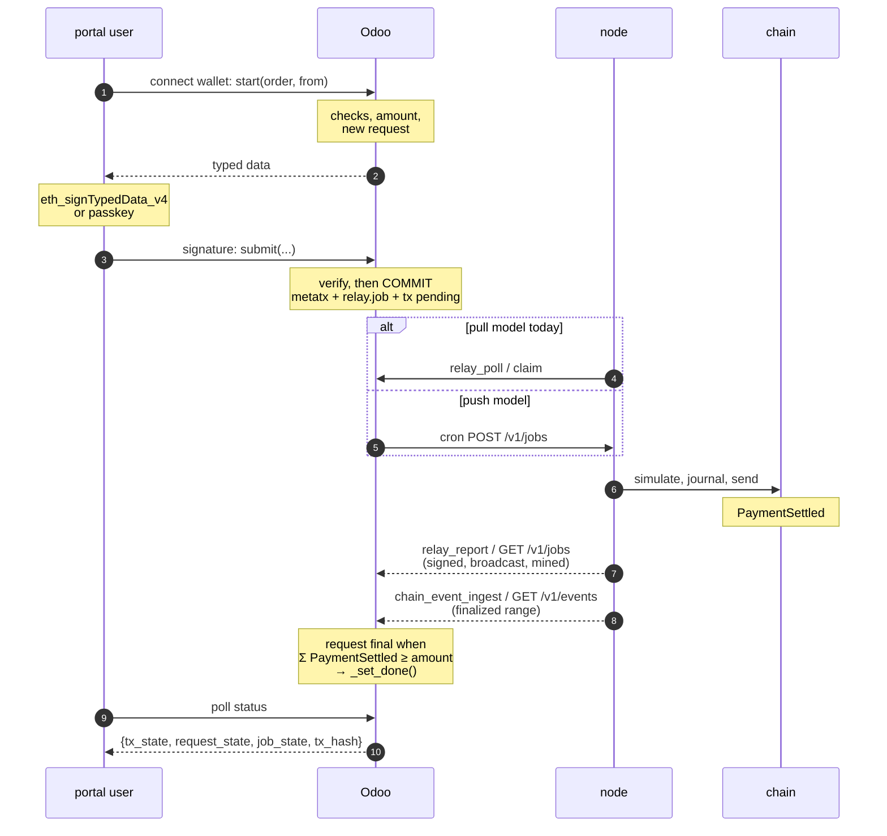

<!-- example:odoo -->
# Example: Odoo connector

This page is the worked example for [integration.md](integration.md): one ERP client (Odoo 19 addons) implementing
the push model, outbox rules, feeds and family verifiers described there. It is the only page where Odoo-internal
model, field and method names appear.

The Odoo addons are **one example** of a SCaaS client; another ERP implements the same contract with its own models.
Names below are Odoo-specific. Every service entry point is a public model method (no `@api.private`, guarded by `check_service()`, writes under
`sudo()` only after that check) reachable by `call_kw` and `POST /json/2/<model>/<method>`, with private implementations, and never accepts `company_id` from the client. Scheduled-job bodies live in model methods
(the `ir.cron` eval context has no `fields`); secrets live in `ir.config_parameter`.

**Addons.**

| Addon | Depends | Auto-install | Role | Status |
|---|---|---|---|---|
| `dms_blockchain` | `base`, `mail` | `False` | Chains, RPC endpoints, tokens, metatx/signed-op envelopes, outbox `blockchain.relay.job`, chain events, payment requests, receiving/paying wallets (four-eyes), subject accounts, family address/digest libraries (`lib/eip712.py` — keccak-256 + EIP-712 + ecrecover in pure Python; `lib/fam_*.py`, KAT-locked) | **BUILT** |
| `dms_blockchain_payment` | `dms_blockchain`, `account_payment` | `False` | `payment.provider` `code='chain'` (`code = 'chain'`), `payment.method` `chain`; `payment.transaction` ↔ `blockchain.payment.request`, `_set_done`; auto-pay policies (`blockchain.autopay.policy`/`.run`) with custodial (`env:` dev-only adapter) and delegated (`MandateWallet`) modes | **BUILT** |
| `dms_blockchain_bridge` | `dms_blockchain_payment`, `dms_portal` | **`True`** | Portal facade on `dms.portal.api` (`dms_portal_chain_payment_options/start/submit/status`, subject-account register/add-key) + JS signers (EIP-6963, passkey, seed vault, family connectors) | **BUILT** |
| `dms_blockchain_dex` | `dms_blockchain` | `False` | DEX markets, read-only book/trade mirrors, DEX and relayer fee accounting | **BUILT** |

`bamboo_dms` and `dms_portal` depend on none of these; the bridge installs itself when both sides are present
(`auto_install: True` = `set(depends)`).

**INT-ODOO-05** — **`dms_blockchain_payment` depends on `account_payment`** (formerly `payment`):
auto-pay reads invoices and hands reconciliation to `account_payment`; provider `chain` is not installable on a database
without accounting.

**INT-ODOO-06** — **No `bamboo_idempotency` dependency; dedup by UNIQUE natural keys.** An
optional addon must install independently, and `bamboo_idempotency` adds a column to **every** table; it can be added
later as a dependency if needed.

**INT-ODOO-07** — **The blockchain addons never depend on the DMS core; no accounting addon of
their own.** Three addons (`dms_blockchain`, `dms_blockchain_payment`, `dms_blockchain_bridge` for the portal), no
`dms_blockchain_account` and no `dms.payment.collection` (`depends ['dms_blockchain','dms']` was rejected); the bridge is
`depends ['dms_blockchain_payment','dms_portal']`; `account_payment` already creates `account.payment` when a transaction
is `done`. The DEX addon came later.

**Data model essentials.** Conventions: model prefix `blockchain.`; uint256 = `Char` + CHECK `'^(0|[1-9][0-9]{0,77})$'`
with suffix `_base`; addresses `Char` + CHECK `'^0x[0-9a-f]{40}$'` (stored lower-case; per-family checks for non-EVM);
hashes `_hash`; no `size=`; constraints are `models.Constraint` / `models.UniqueIndex` (`_sql_constraints` is ignored by
Odoo 19).

- `blockchain.chain` (`mail.thread`): `name`, `evm_chain_number` (unique), `caip2` (`eip155:<n>`), `native_currency`,
  `state` (`draft`/`active`/`paused`), `finality_mode` (`depth`/`tag`), `finality_depth`, `finality_quorum`,
  `indexed_block`, `public_rpc_url` (for `wallet_addEthereumChain`); activation refuses `rpc_urls < quorum`; seeds for
  100, 42220 and the SCaaS testnet (chain id 7622, formerly 9000).
- `blockchain.token` (`mail.thread`): `chain_id`, `address`, `name`, `symbol`, `decimals`, `domain_name` (default
  `SCaaS MetaToken`), `domain_version` (`1`), `currency_id`, `is_confidential`, `active`; `UNIQUE(chain_id, address)`.
- `blockchain.metatx` — signed envelope, immutable after signing: `company_id`, `chain_id`, `token_id`, `from_address`,
  `to_address`, `value_base`, `data_hex`, `batch_hex`, `nonce_base`, `valid_until_datetime`, `mode_flags`
  (`@api.constrains` against `MODE_KNOWN_MASK`), `relayer_address`, `fee_base`, `fee_recipient_address`, `digest_hash`
  (from `lib/eip712.py`), `signature_hex`, `signature_verified`, `metatx_state` (`signed`/`final`/`failed`/`expired`),
  `executed_tx_hash`; `UNIQUE(chain_id, digest_hash)`; `write` refuses signed fields (64-hex digests; validity < 2^31).
- `blockchain.relay.job` (outbox): `company_id`, `chain_id`, `job_kind ∈ {metatx, call, signed_op}`, `metatx_id` /
  `signed_op_id` / (`target_address`, `calldata_hex`, `call_valid_until_ts`), `payment_request_id`,
  `subject_account_id`, `prerequisite_job_id`, `origin_producer`, `origin_key`
  (`UNIQUE(company_id, origin_producer, origin_key)`), `chain_state ∈ {queued, nonce_leased, signed, broadcast, mined,
  final, reverted, dead, consumed}`, `business_state ∈ {pending, success, failed}`, `claimed_by`, `claimed_datetime`,
  `signer_address`, `tx_hash`, `outer_nonce`, `attempt_count`, `last_error`, `landed_elsewhere`,
  `mesh_published_datetime`; `state` moves only through the transition table, by `create`/`write` under `sudo` from the
  service (`blockchain_subject_account.py:493`). Push model adds: `node_id`, `node_job_uid`, `push_state ∈ {local, sent,
  cancel_requested, attention}`, `push_attempted`, `push_generation`, `node_event_seq`. Immutable after create and
  operator read-only ([INT-ERP-05](integration.md#INT-ERP-05)): `company_id`, `chain_id`, `job_kind`, `metatx_id`, `signed_op_id`,
  `target_address`, `calldata_hex`, `call_valid_until_ts`, `payment_request_id`, `subject_account_id`,
  `origin_producer`, `origin_key`; `prerequisite_job_id` set once from empty while `queued`. Group
  `group_blockchain_operator` gets ACL `1,0,0,0`; `action_requeue` checks
  `has_group('dms_blockchain.group_blockchain_operator')` then writes with `sudo()` (`blockchain_relay_job.py:249-262`);
  envelopes freeze via `_MUTABLE` (`blockchain_metatx.py:10,65`). The built ACL still gives operators write
  (`1,1,0,0`).
- `blockchain.payment.request`: `request_uuid`, `company_id`, `chain_id`, `token_id`, `receiving_address`,
  `relayer_address`, `amount_base`, `amount_settled_base` (Σ `PaymentSettled`), `entry_ref_hex` (32 random bytes,
  `UNIQUE(entry_ref_hex)`), `batch_hex` = `keccak256("scaas.pay.lane" ‖ entry_ref)`, `payer_address` (locked at `start`,
  so `(payer, batch)` is fixed), `issued_valid_until` (`submit` requires `valid_until` equal), `expiry_datetime`,
  `request_state ∈ {open, partial, final, expired}`, `needs_attention`, `res_model`/`res_id`, `metatx_ids`, `event_ids`.
  `_payment_gate()` counts an event only when `contract_address == token_id.address` and
  `to_address == receiving_address` (and `value_base` from the event); `int(amount_settled_base) >= int(amount_base)` ⇒
  `request_state='final'` + `_on_paid()`; more than due ⇒ `needs_attention = True`. An ingest batch still commits when
  a business hook fails (savepoint + log): a closed period or credit hold never blocks the cursor.
- `blockchain.chain.event`: `UNIQUE(chain_id, tx_hash, log_index)`; `event_name ∈ {MetaTransactionExecuted,
  PaymentSettled, Transfer}`; `relayer_address = fields.Char()` filled from the event's `relayer` (EVM:
  `indexer.rs` l.49). `_mark_executed(tx_hash, relayer=None)` on `blockchain.metatx` and `blockchain.signed.op` sets
  `final` + `success` (also from `consumed`) and `landed_elsewhere = True` for foreign relayers.
- Consumption in the pull model: `CHAIN_STATES += [('consumed', 'Consumed (nonce used elsewhere)')]`, allowed from
  `nonce_leased` (`TRANSITIONS`); `_apply_report('consumed')` keeps `business_state = 'pending'` and does not touch
  `metatx_state`/`op_state`; `consumed` is not in `FAILED_STATES` (`blockchain_subject_account.py`, `('dead',
  'reverted')`), so `_fail_dependents()` is not called; `_cron_expire` handles the superseded branch. Server-only fields:
  `create` always writes `landed_elsewhere = False` and `mesh_published_datetime = False` explicitly in `vals` (an explicit
  value beats a `default_*` context key; `super().create()` under `sudo()`), and `write` strips them unless
  `self.env.su`.
- Groups: `group_blockchain_viewer` (reads chains, tokens, events, requests, jobs of its company) ⊂ `operator` (+ reads
  metatx; reads jobs; requeues `dead`/`reverted` to `queued` via `action_requeue`) ⊂ `group_blockchain_manager` (CRUD
  chain, endpoint, token); service groups `group_blockchain_relay_worker` (`relay_poll/claim/report`, `node_config`) and
  `group_blockchain_indexer` (`chain_event_ingest`, `node_config`) exist for the pull model and are deleted when pull is
  removed.
- `relay_report(job, 'signed', tx_hash, n)` repeated with the same `(tx_hash, outer_nonce, signer_address)` succeeds
  unchanged ([NODE-LANE-02](node/submit-lanes.md#NODE-LANE-02)).

Pull-model transition table (legacy; `relay_report` unless noted):

| From | To | By |
|---|---|---|
| (create) | `queued` | Odoo, in the same transaction as `payment.transaction → pending` |
| `queued` | `nonce_leased` | `relay_claim` (CAS) |
| `nonce_leased` | `queued` (node restarted, unsigned) / `signed` / `dead` / `consumed` | `relay_report` |
| `signed` | `broadcast` / `mined` / `reverted` (receipt before `broadcast`) / `queued` (gap-filled at cold start) / `dead` / `consumed`; `signed` again with the same `(tx_hash, outer_nonce, signer)` = successful no-op, different values = error | `relay_report` |
| `broadcast` | `mined` / `reverted` / `broadcast` (replacement, new tx_hash) / `queued` (gap-filled) / `dead` / `consumed` | `relay_report` |
| `mined` | `reverted` | `relay_report` |
| `consumed` | `mined`/`reverted`/`consumed` = late no-op | `relay_report` (`LATE_NOOP`) |
| `queued`, `nonce_leased`, `signed`, `broadcast`, `mined`, `reverted`, `dead`, `consumed` | `final` + `success` | `chain_event_ingest` on `MetaTransactionExecuted(digest)` |
| `queued`, `nonce_leased`, `consumed` | `dead` | expiry cron (`valid_until` + 10 min, not final) |

Chain family selection `evm|hedera|sui|soroban|cosmos|ton` (Aptos and Solana added later); `evm_chain_number` only for
`evm|hedera`. No FX: a rate-quote model `blockchain.payment.quote` was rejected ([INT-ERP-07](integration.md#INT-ERP-07)).

**Payment provider.** `payment.provider`: `code` adds `chain`; fields `chain_token_id`, `chain_receiving_address`,
`chain_relayer_address`, `chain_validity_seconds` (default 300), state `disabled` by default, `payment.method` `chain`;
the provider needs `journal_id` (required by `account_payment` to create `account.payment`); when the transaction is
`done`, `sale` confirms the order and `account_payment` creates and reconciles the payment. `payment.transaction.chain_request_id`;
private `_chain_create_request()` converts `amount × 10^decimals` with `Decimal` and requires
`token.currency_id == tx.currency_id` ([INT-ERP-07](integration.md#INT-ERP-07)); `_chain_typed_data(from_address)`.
`blockchain.payment.request._on_paid()` override: finds the transaction; `done` already ⇒ nothing; `tx._set_done()` only
from `pending` (a `cancel`/`error` transaction gets a note for an operator, no automatic refund). Expiry cron: (a) jobs
`queued`/`nonce_leased` with `valid_until` + 10 minutes < now ⇒ `dead`, metatx ⇒ `expired`; (b) requests
`open` past `expiry_datetime` with no signature whose `valid_until` + 1 hour > now and no job in
`broadcast`/`mined` ⇒ `expired`, `_on_expired()` ⇒ `_set_canceled()`; a late payment turns `expired → final` and calls
`_set_done` with `needs_attention = True`.

**Portal payment, end to end.**

| Method | Rule |
|---|---|
| `dms_portal_chain_payment_start(order_id, from_address)` | entitlement (`dms_allowed_partner_ids`); order confirmed (`state == 'sale'`); `provider.chain_token_id.currency_id == order.currency_id`; amount = the `posted` invoices' (`invoice_ids`) `amount_residual`, or for an advance on `sale_order_ids` `amount_total − amount_paid`; reuses a `chain` transaction in `draft/pending` only for the same `from` (`payer_address`) after `issued_valid_until + 60 s`; sets `issued_valid_until = now + chain_validity_seconds`; returns `{reference, chain: {chainId, name, rpcUrl, nativeCurrency}, typed_data}` |
| `dms_portal_chain_payment_submit(reference, valid_until, signature)` | entitlement through the transaction; `valid_until == issued_valid_until` (the server picks validity: no clock skew, the client cannot extend it); the digest is rebuilt and a 65-byte signature must recover `payer_address` (`signature_verified = True`; `wallet_kind = contract` ⇒ `signature_verified = False`); creates `metatx` + `relay.job` + pending transaction in one commit |
| `dms_portal_chain_payment_status(reference)` | `{tx_state, request_state, job_state, tx_hash}` |
| `dms_portal_chain_payment_options(order_id)` | the usable (chain, asset) pairs of the receiving company whose token currency equals the order currency; `start(order_id, from_address, receiving_wallet_id=None)` |

1. `dms_portal_chain_payment_start(order, from)`. Checks: entitlement; order confirmed (`state = 'sale'`); token currency == order currency (no FX). Amount = posted invoices' residual, or order total − paid (advance). New request: `entryRef` random, `lane = keccak("scaas.pay.lane" ‖ entryRef)`, nonce 0, `issued_valid_until = now + validity`.
2. Typed data: `{to: receiving wallet, value, data: pay(entryRef), mode: RESTRICT_RELAYER, relayer: company lane, fee 0}`; the user signs with `eth_signTypedData_v4` / passkey.
3. `dms_portal_chain_payment_submit(reference, valid_until, signature, wallet_kind)`. Verify: `valid_until == issued_valid_until`; digest rebuilt; 65-byte sig must recover payer. Then metatx + `relay.job` (outbox) + tx pending in one `[COMMIT]`.
4. Pull model today: the node calls `relay_poll`/claim.
5. Push model: an Odoo cron sends `POST /v1/jobs`.
6. The node simulates, journals and sends; the chain emits `PaymentSettled`.
7. Job states (signed, broadcast, mined) come back by `relay_report` / `GET /v1/jobs`.
8. Events come back by `chain_event_ingest` / `GET /v1/events` (finalized range). The request is final when Σ `PaymentSettled(token, to, entryRef)` ≥ amount → `payment.transaction._set_done()` → `account_payment` posts and reconciles.
9. Poll status: `dms_portal_chain_payment_status(reference)`.
10. → `{tx_state, request_state, job_state, tx_hash}`.

The pull-model sequence uses `relay_poll`, `relay_claim`, `eth_call`, `signTypedData`, `sendRawTransaction`,
`getLogs` and `chain_event_ingest`, with `RESTRICT_RELAYER`, `feeRecipient` 0, `validUntil`, `tx_hash` and
`amount_settled`; `_set_done` comes only from `chain_event_ingest` on finalized logs matching (token, receiver,
`entryRef`), with `quorum` RPCs agreeing (`quorum = 1` is single-provider trust). Lane horizon: every
`validUntil ≤ first issue + H` (`LANE_HORIZON_S`, 30 d); a different `from` is a different
`(from, batch)` lane, so `start` from another wallet creates a new request.

**INT-ODOO-09** — **The portal pay button is plain JS calling the model facade**; no standard
payment-form integration (that needs its own JS payment form; website checkout does not use provider `chain` yet).

**INT-ODOO-10** — **The portal pays confirmed orders only** (`state == 'sale'`): `sale._post_process`
would otherwise `action_confirm` a `draft/sent` quotation when the transaction is `done`, bypassing order approval and
`dms_check_credit`.

**INT-ODOO-08** — **Odoo verifies ECDSA signatures itself**
(keccak-256 + secp256k1 ecrecover in pure Python, 256-bit, no `pycryptodome`): immediate feedback and a third digest
implementation next to the contract and the node; narrowed by `wallet_kind` — a `contract` wallet's 65-byte or longer
signature is stored `signature_verified = False` and judged by simulation ([INT-ERP-03](integration.md#INT-ERP-03)).

**INT-ODOO-11** — **One receiving-company seam and one
"platform company".** The receiving company is `dms.portal.api._dms_chain_receiving_company(order)` (= `order.company_id`;
in a multi-company deployment `res.company._dms_document_company()`); every lookup of provider, receiving wallet and staff note
goes through it (`_dms_chain_offered`, `_dms_chain_start`, `sale_order`, `payment_transaction`). One wallet-admin seam:
`res.users._blockchain_wallet_admin(company)` (`group_blockchain_treasury`, members with the company in
`user.company_ids`, or `base.group_system`).

The former "Host" is the **"platform company"**: parameter
`dms_blockchain.platform_company_id` (the old `dms_blockchain.host_company_id`, defaulting to `base.main_company`, is read
once on upgrade; `host_company_id` stays read-only, `blockchain_receiving_wallet.py:9-10`), method
`_blockchain_platform_company()` (replacing `_blockchain_host_company()`); records with `company_id = False` belong to
it; `NONE` when unset. Receiving wallets: cooling-off parameter `dms_blockchain.receiving_wallet_cooling_hours`
(`usable_from = approved + N` hours, default 24); default wallet by a partial `UniqueIndex`; record rule per company,
`base.group_system` of the platform company sees all.

**Wallets and custody.** Paying wallets `manual`/`custodial`/`delegated` hold `signer_ref` and `license_ref`; the
custody adapter is `dms_blockchain/lib/custody.py` (`lib/custody.py:9-13,64-75`, schemes `env:` and `broker:`; the scheme
list is an `ir.model.fields` selection, secrets in `ir.config_parameter`); `env:` registers only with
`dms_blockchain.allow_dev_custody` = `1` and `is_dev_chain = True`, and signs through `cryptography`, not `secp256k1.py`.
Auto-pay: `blockchain.autopay.policy` → `_cron_autopay` → one `blockchain.autopay.run` per (policy, invoice, event);
`payment.transaction` provider `chain`, `invoice_ids`, `operation='offline'`; kill switch `revokeWithSig` job
(`eip712.revoke_mandate_digest`, `_enqueue_revoke`; target selector `mtxRevoke`).

The outbox generalisation added `job_kind`, `target_address`,
`calldata_hex`, `payment_request_id` to `blockchain.relay.job` and made `metatx_id` optional. Accounting:
`blockchain.token.journal_id` (company-dependent); drift A `blockchain.chain.event` with `event_name = 'Transfer'` ⇒
`unmatched_inbound`; drift C `blockchain.chain.balance_report(chain_key, height, [{token, address, balance}])` (pull) or
`balances` items (push) ⇒ `blockchain.balance.snapshot` with `drift_state = 'mismatch'`, compared only when `height` =
the indexed cursor (else `stale`; `payment` outstanding accounts included; `balanceOf` at the final block). Families:
`blockchain.chain.family` and `network_key`, `lib/addresses.py` `parse(family, value, chain) -> canonical`,
`blockchain.signed.op` next to `blockchain.metatx`, `kind = 'signed_op'`.

**Family libraries and connectors.** `dms_blockchain/lib/fam_<family>.py` + `models/blockchain_<family>.py` + connector
`dms_blockchain_bridge/static/src/js/connectors/<family>.js`: Hedera (`dms_blockchain/lib/fam_hedera.py`,
`models/blockchain_hedera.py`, `dms_blockchain_bridge/static/src/js/connectors/hedera.js`; `_issue` returns
`{family:'hedera', digest, typed_data, valid_until, …}` to connector `hedera`; `_accept_signature` takes the 64-byte
signature + public key and verifies with `cryptography`; `blockchain.chain.hedera_mirror_url`; resolution of
`blockchain.token` / `blockchain.receiving.wallet` through the mirror's `contracts` / `accounts`; signer
`window.dmsHederaSigner = {accountId, publicKey, signBytes(Uint8Array)}`; Rust config refuses a shared key in
`Config::validate`), Cosmos (`dms_blockchain/lib/fam_cosmos.py`, `fam_cosmos.build_terms`, `connectors/cosmos.js`),
Soroban (`fam_soroban.py`, `blockchain_soroban.py`, `connectors/soroban.js`, `blockchain.chain` `soroban_anchor_ts`
updated in `chain_event_ingest`; `fam_soroban.auth_nonce`, `fam_soroban.py:88-90`), Sui (`fam_sui.py`,
`blockchain_sui.py` = `models/blockchain_sui.py`, `connectors/sui.js`, `fam_sui.build_terms(req, valid_until)`, `fam_sui.verify`
(`address_of(flag, pk) == payer`), `blockchain.chain.sui_start_checkpoint`, `sui_coin_type`), Aptos
(`dms_blockchain/lib/fam_aptos.py`, `models/blockchain_aptos.py`, `dms_blockchain_bridge/static/src/js/connectors/aptos.js`,
`fam_aptos`, `aptos_package`, `blockchain.chain.aptos_start_block`, `aptos_root`; `blockchain_payment_request._issue`;
tests `TestAptosPayments.test_reissue_*`), Solana (`dms_blockchain/lib/fam_solana.py`, `models/blockchain_solana.py`,
`dms_blockchain_bridge/static/src/js/connectors/solana.js`, `fam_solana`, `_lane_address`, `solana_program_id`, `solana_config`,
`solana_token_program`, `blockchain.chain.solana_start_slot`, `addresses.canonical('solana')`; `relay_report` path), GRAM (`fam_ton.py`,
`blockchain_ton.py`, `connectors/ton.js`, `ton_global_id`, `ton_app_domain`, `ton_manifest_url`,
`ton_wallet_code_hash`, `ton_wallet_code_depth`, `blockchain.token.address` = the jetton master, `batch_hex` lanes).

Contracts and adapters per family: `smartcontracts/move/aptos/` (package `scaas`), `scaas-node/src/adapters/aptos.rs`,
`scaas-node/tests/e2e_aptos.rs`; `smartcontracts/solana/` (program `scaas`), `scaas-node/src/adapters/solana.rs`,
`scaas-node/tests/e2e_solana.rs`. Test databases: `dms_test_chain_6` (Hedera), `dms_test_chain_8` (Soroban),
`dms_test_chain_10` (GRAM), `dms_test_chain_11` (Aptos, port 8931, gateway 32010–32019), `dms_test_chain_12` (Solana,
port 8932, ports 32020–32049); 118 addon tests, 4 of them Hedera (`test_fam_cosmos`, `test_fam_sui.py`); `lib/eip712.py`
and `blockchain_relay_job.py:137` are shared. Sui verifier tests (`test_fam_sui.py`): `test_added_key_signature_is_left_to_the_node` and
`test_recovered_key_signature_is_left_to_the_node` (⇒ `None`), `test_flipped_byte_from_added_key_is_refused` (`False`),
`test_own_key_still_verified`, `test_passkey_cross_origin_refused`, `test_keyop_bytes_match_move`,
`test_vectors_file_matches_move`, `test_signature_from_another_wallet_is_refused` (narrowed to "invalid under its own
key"); clientkeys mirrors them in `fam_sui.test.js`.

Mandate payments through the connector
(`_enqueue_mandate_payment`) are EVM-only; for other families the contract exists and the connector path is a seam. Portal glue (`connectors/*.js` call each family's `fam_<f>.verify` mirror on the server): `chain_pay.js` and `subject_signers.js` call
`window.dmsChainConnectors` and `dms_portal_chain_payment_options/start/submit`
(`test_options_carry_family_and_network`). The multi-family `chain_pay.js` flow: `options` (now with `family` and
`network`) → the signer (EVM and Hedera ECDSA: the EVM wallet chooser; other families: a family wallet or the seed-vault
family path) → `start(order, signer.from, wallet_id)` (owner key only) → the family encoder's `checkTerms(start, shown)`
([CLI-SGN-27](clients/signers-clientkeys.md#CLI-SGN-27); `shown` = the amount, currency and payee text the portal
displayed) → `{signature, publicKey} = sign(checked)` → `submit(reference, validUntil, signature, kind, publicKey)` with
`validUntil` from `typed_data.message.validUntil` or `valid_until`; a `checkTerms` refusal stops before `sign`. The
WalletConnect project id is `dms_blockchain.walletconnect_project_id` in
`ir.config_parameter`. `_hex32` normalises 32-byte values; `_apply_report` applies node reports.

**Backup-key switch.** Parameter `dms_blockchain.require_backup_key` (`'1'`/`'True'` = ON).
`blockchain.subject.account._dms_has_backup()` (private, `_dms_has_backup`; tested in `test_backup_policy.py`): distinct
active key rows, de-duplicated by `(public_x)` for passkeys and `evm_address` for seed keys; then ≥ 2, or 1 with
`guardian_address ∉ {ZERO_ADDRESS, account address, any key's evm_address}`. Known blind spots (accepted, the switch is
soft): `guardian_address` is the CREATE2 input, so a later `setGuardian` is not mirrored; removals done outside the portal
are not mirrored, and `key_state` has no "removed" state, so Odoo over-counts. `dms_portal_chain_payment_start` raises
`UserError("Add a backup key to your account first.")` when ON and the paying account has no backup; any future flow
paying **to** a subject account applies the same check. `subject_signers.js` with ON: after the first key the flow goes to
"add a backup" before the first payment; new seed keys use the role path and the key row stores the address in
`evm_address`. Non-EVM families: client enforcement only. Seed vault entries are stored under
`dms_chain_seed_vault:<subject>`.

**Subject accounts.**

**INT-ODOO-01** — **The deploy job precedes payment through a prerequisite.** The `call` job that
deploys the account and the payment/owner-call job both sit in the outbox; the later job carries `prerequisite_job_id`,
and neither `relay_poll` nor the push batch hands it out until the earlier job is `mined/final`; when the earlier job
ends `dead/reverted`, the dependant goes `dead` too.

**INT-ODOO-02** — **The owner-call nonce (`executeAsOwner`, target `mtxExecuteAsOwner`) is the
count of the account's `mined/final` owner-call jobs** on that chain; only one owner call is live at a time; `reverted`
consumes no nonce (a failed receipt is not `mined`). The account address is predicted per chain, since the account
factory's constructor takes `chain_uid` ([NET-ALL-22](networks/README.md#NET-ALL-22)).

**INT-ODOO-03** — **The first key registers in two steps with an HMAC challenge.**
`..._register_start` returns a challenge HMAC(`database.secret`; user, partner, chain, expiry) — nothing stored, TTL
600 s; the new key signs the [first-key proof](integration.md#first-key-proof); the server checks the passkey with
`_clientDataOk` (origin and rpId from `dms_blockchain_bridge.passkey_origin`, else `web.base.url` — not the request host)
or a seed key with `ecrecover`; the caller must be a user entitled to act for that partner.

**INT-ODOO-04** — **A deploy job is created only for the account of the paying partner itself**
(`res_model/res_id` of the request).

**INT-ODOO-14** — **Key registration is not the addon's job.**
The blockchain addon keeps generic subject accounts linked to partners; it knows nothing of the host application's business objects. Mapping
those to keys lives in a bridge, and the operator decides how keys are issued.

**INT-ODOO-13** — **Odoo stores UAs as addresses of a new kind and
never derives policy off chain.** Model `blockchain.ua`; partner links only in the client store.

| Where | Change |
|---|---|
| `dms_blockchain/models/` new `blockchain.ua` | `ua_id` (Char 66, indexed, normalised: lower-case, 20-byte form when the top 96 bits are zero, normalised in `create`/`write` and by `lib/addresses.canonical`), `kind`, `key_data`, `registration_ids`; `models.Constraint` unique `(ua_id)` |
| `blockchain.chain` config | `ua_registry_address`, `ua_registry_generation`, `ua_kinds_enabled` (read from chain) |
| `lib/addresses.py` (`canonical`) and `blockchain.address.mixin` | accept a 32-byte UA id as an address form on EVM (`0x` + 64 hex) alongside 20-byte addresses; never truncate |
| `blockchain.signed.op` | `auth_kind` gains `ua`; `from_address` holds the UA id |
| `blockchain.metatx`, `payment_request.payer_address`, `chain_event` from/to | accept UA ids; `blockchain.chain.event` maps `UATransfer` |
| `dms_portal_subject_account.py` | `register_start/register` gain the UA path (passkey ⇒ `webauthn-p256` UA) next to `SmartKeyAccount` |
| `lib/fam_*.py` `verify(...)` | `fam_evm.verify_ua(record, digest, auth)` using the shared Python kind library (same vectors) |
| `blockchain.subject.account.key` | `evm_address` keys created from now on come from the role path; existing dev keys get a migration note |
| Credentials (optional, relying-party side only) | `blockchain.ua.credential`: issuer, schema, `validUntil`, status URL, received VP / evidence as `ir.attachment` encrypted under the per-subject DEK ([INT-ERP-24](integration.md#INT-ERP-24)); `bundleHash` |
| Partner link | partner ↔ UA only in the client store (erasable) |

**DEX addon.** `blockchain.chain` (inherit): `dex_address`, `dex_indexed_block` (written by
the watcher only). `blockchain.dex.market`: `company_id` (operating company), `chain_id`, `base_token_id`,
`quote_token_id`, `fee_on`, `maker_fee_ppm`, `taker_fee_ppm` (CHECK 0..10000), `fee_recipient_address`,
`min_base_amount`, `income_account_id`, `relayer_expense_account_id`, `journal_id`, `active`. `blockchain.dex.order`:
`market_id`, `order_hash` (unique per chain), `maker_address`, `side`, amounts, `remaining_sell` (in `sellToken` units,
as `filled` on chain), `nonce`, `expiry_ts`, `flags`, `max_fee_ppm`, `signature_hex`, `order_json`, `seq`,
`order_state`. `blockchain.dex.trade`: `trade_ref` (unique), `market_id`, `maker_order_id`, `taker_order_id`,
`maker_fill_base`, `taker_fill_base`, expected/actual fees, `relay_job_id`, `trade_state`, `restored`, `tx_hash`,
`block_number`, `move_ids`. Fee postings use `income_account_id` and, for payers that are an approved
`blockchain.paying.wallet`, `relayer_expense_account_id` ([INT-ERP-12](integration.md#INT-ERP-12)).

**Encoders and selectors (target, SPECIFIED).** The connector's `lib/eip712.py` and the portal encoders follow the
renamed contracts: `blockchain.chain` gains `chain_uid` (the genesis hash, seeded with the chain and compared at
activation with the RPC's block 0 and with `/v1/gateway`), and every domain the connector builds — token
(`domain_name`, `domain_version`), mandate wallet, subject account — adds `salt = chain_uid`; the digest KATs are
regenerated with it. Call-job calldata uses `mtxPayUnderMandate`, `mtxRevoke` and `mtxExecuteAsOwner`; the payment
envelope becomes a `MetaTransfer` with `entryRef` (new typehash and KAT, `metatransfer_kat.json`) through `mtxPay` or
`mtxExecuteTransfer` (as built: `pay(bytes32)` through `executeMetaTransaction`); mandate and subject-account calls are
`MetaTransaction`s in those contracts' domains ([CTR-MTX-22](contracts/metatx.md#CTR-MTX-22)); the subject-side
cancel is `cancelNonce(batch)`.

The connector never builds an `approve` on a SCaaS token. DEX mirrors: an order row
stores the `TradeOrder` fields (`from`, `receiveToken`, `amount`, `receiveAmount`, `minFill`, `fee`, `relayer`, `dex`,
`destination`, `flags`, order lane `batch`, `nonce`, `validUntil`); `maker_fee_ppm`/`taker_fee_ppm` become the venue's
intake rates and `fee_recipient_address` the DEX treasury; trades are booked from `LegSettled`
([INT-ERP-12](integration.md#INT-ERP-12)).

**INT-ODOO-12** — **A late `Matched` after a restore debits the Odoo-held book.** When
`dex_fill_ingest` flips a `failed` + `restored` trade to `settled` (`dex_trade.py:195-198`), the node subtracts that
amount from the book at the next sync; with the store-backed book ([NODE-DEX-14](node/dex-venue.md#NODE-DEX-14)) a late
`dex_trade` item in state settled subtracts it from `remaining`. Transitional: the Odoo-held book is BUILT.

**Tender.** Model `blockchain.tender` (config, state, `tender_id`, `chain_id`, links to RFQ/PO) and
`blockchain.tender.bid` (own bids: commitment, encrypted `(price, salt)`, state); `SERVER_ONLY` fields for chain state;
the PO is created from the finalized `TenderSettled`; all `dms_blockchain*` (example, not built).

**Crypto-shredding (not built).** `dms_blockchain` models `blockchain.shred.key` (`subject_ref = HMAC(subject_key,
res.partner id)`, `wrapped_dek`, `state`) and `blockchain.shred.record` (`model`, `res_id`, `ciphertext` of
`(salt, payload)`, `retain_until`, `legal_basis`), `SERVER_ONLY`; private `_shred_commit(record, payload)` and
`_shred_open(record)`; `log_key` and `subject_key` in `ir.config_parameter` (or the KMS).

**Bus scope.** `res.company.blockchain_bus_scope` (`restricted` default, `open`; `MODE_RESTRICT_RELAYER` vs
`relayer = 0`; the job stays `queued` during `blockchain_bus_private_window_secs`, default 120 s, with `validUntil` ≥ the
300 s default) is exposed in `res.config.settings` (related fields), editable by `group_blockchain_manager`;
`dms_blockchain_payment/models/payment_transaction.py` (l.47, `_chain_start`, also serving custodial auto-pay) sets
`relayer_address = None` instead of `provider.chain_relayer_address` when `company.blockchain_bus_scope == 'open'`;
`blockchain_autopay.py` delegated payments stay `call` jobs (l.267).

**Push and sync (SPECIFIED).** `blockchain.node` (`mail.thread`; url, `key_id`, secret in `ir.config_parameter`
`dms_blockchain.node_secret.<id>` written only by `base.group_system` (`secret_set` flag), `bound_db_uuid`,
`bound_base_url`, `jobs_cursor`, `jobs_last`, `events_cursor`, `store_id`, `incarnation`, `restore_epoch`,
`tokens_hash`, `watch_hash`, `last_sync_datetime`, `last_error`, `needs_attention`; `NODE_SERVER_ONLY`) and
`blockchain.node.route` (`company_id`, `chain_id`, `node_id`; `UNIQUE(company_id, chain_id)`,
[INT-ERP-16](integration.md#INT-ERP-16)). `url` must be `https` (`http` only with `dms_blockchain.allow_plain_node_url = '1'`).
`BigInteger` moves from `blockchain_relay_job.py:34-36` to `dms_blockchain/lib/fields.py`. `blockchain.chain` gains
`node_transport` (`pull` default | `push`, deleted with pull) and `event_node_id`; `action_reset_event_cursor(block)`
re-reads events; `action_acknowledge_store_change()` resets cursors after a store change (`store_id`, `restore_epoch`),
clears `needs_attention` and returns non-terminal pushed jobs to `push_state = 'local'`; a pushed job past `valid_until`
is cancelled by origin (`POST /v1/jobs/cancel {origin}`) before going `dead`; events dedupe by
`(chain_key, tx_hash, log_index)`. `blockchain.relay.job` gains server-only fields (`SERVER_ONLY` becomes a dict →
forced create value, so `push_state` is `'local'`, not `False`; `write` strips them unless `env.su`): `node_id`,
`node_job_uid`, `push_state` (`local` | `sent` | `cancel_requested` | `attention`), `push_attempted`,
`push_generation`, `node_event_seq`. `dms_blockchain/data/neutralize.sql` (as `addons/mail/data/neutralize.sql`) deletes
`ir_config_parameter` keys `dms_blockchain.node_secret.%`, sets every `blockchain_chain.node_transport = 'pull'` and
`needs_attention` on nodes; push/sync refuse when `database.uuid` or `web.base.url` differ from the node's `bound_*`.

- Client library `dms_blockchain/lib/node_client.py`: `requests`, `allow_redirects=False`, timeout `(5, 30)`, HMAC
  byte-identical to the node's `gwauth.rs` (shared KAT), response cap 4 MiB, error detail truncated to 300 characters;
  `blockchain.node._client()` builds it.
- Crons: `cron_node_push` → `model._cron_node_push()` and `cron_node_sync` → `model._cron_node_sync()`, re-triggered
  with `ir.cron._trigger()`; the server-only field list moves from `blockchain_relay_job.py:27-29, 79-86`; the two
  crons fit `max_cron_threads = 2`.
- Push `cron_node_push` → `_cron_node_push(batch=50, rounds=4)`: lock a batch (`SELECT … FOR UPDATE SKIP LOCKED`,
  re-checking `chain_state`), mark `push_attempted`, commit, `post_jobs` (results in `node_jobs`), apply results; domain
  `_poll_domain(chain) + [('push_state', '=', 'local')]` (reusing `_poll_domain` with the prerequisite extension,
  `blockchain_subject_account.py:451-455`), only routes with `tokens_hash` set. `_push_item()`: `origin = {scope:
  f'{dbuuid}:{company_id}', producer, key: origin_key, generation: push_generation}`, `client_ref = f'odoo:{id}'`,
  `payload = _payload()` minus `id`, `bus = {scope, private_window_secs}`. `_apply_push_result` follows the push
  algorithm above: accepted ⇒ `push_state='sent'`, `node_id`, `node_job_uid`, then `_apply_node_snapshot`; permanent
  errors ⇒ `dead`/`failed` with `last_error` and `_fail_dependents()`; `IDEMPOTENCY_MISMATCH`/`PREVIOUS_GENERATION_LIVE`
  ⇒ `push_state='attention'`, `needs_attention`, `GET /v1/jobs/{uid}` with the uid from the 409 body; `DUPLICATE_DIGEST`/`DUPLICATE_CALL`, `429`,
  `SPONSOR_*`, `503` ⇒ stay `local`. Other writers (`_node_cancel`, `_fail_dependents`) lock with `FOR UPDATE`.
- Sync `cron_node_sync` → `_cron_node_sync()` per `blockchain.node` with a secret and matching `bound_*`, each page in
  its own transaction, `wait=0`: (0) retry `cancel_requested`; (1) `GET /v1/jobs?cursor=max(0, jobs_cursor−200)`,
  continuity checks, each item in a savepoint through `_apply_node_event(node, item)` (a `UserError` ⇒
  `last_error = 'node event rejected: …'`), then `jobs_cursor = next`, `jobs_last`; (2) `GET /v1/events?cursor=…` for
  chains whose `event_node_id` is this node: `range` ⇒ `_ingest_range`, `balances` ⇒
  `blockchain.balance.snapshot._record` when `height == chain.indexed_block`, `dex_*` to the DEX addon,
  `from_block > indexed + 1` ⇒ `needs_attention`; (3) watch and token sync when hashes changed: `PUT /v1/watch/{chain}`
  with `_receiving_addresses()` (`blockchain_chain.py:215-219`), `PUT /v1/tokens/{chain}`; a `missing` token ⇒
  `needs_attention` "token active in Odoo but not registered on the node"; wallet approval triggers
  `cron_node_sync._trigger()`; (4) any non-terminal pushed job ⇒ `_trigger(now + 10 s)`.
- `_apply_node_event` finds the job by (`node_id`, `node_job_uid`) or adopts it by origin. `_apply_node_snapshot(snap)`
  maps `leased → nonce_leased`, `cancelled → dead` (error `cancelled`); a state in `FEED_LATE_NOOP`
  (`{'final': ALL, 'consumed': {'mined', 'reverted', 'consumed'}, 'dead': {...}}`) for the target is a no-op; otherwise
  it walks `queued → nonce_leased → signed → broadcast → mined` with `_apply_report(state, …, table=FEED_TRANSITIONS)`
  (the `signed` step writes `tx_hash`, `outer_nonce` and signer as `relay_report` did, `blockchain_relay_job.py:135-137`),
  then `reverted`/`consumed`/`dead` (`_apply_report` with `table=TRANSITIONS`; a failed `call` deploy fails dependants
  through `_fail_dependents`, `blockchain_subject_account.py:457-460`, `blockchain_relay_job.py:226-231`); `mined` of a
  `call` job releases dependants (RS4 ordering).
- `_ingest_range(chain, …)` = the body of `chain_event_ingest` (`blockchain_chain_event.py:84-103`) without
  `check_service`, with (a) the straddle rule — `from_block ≤ indexed < to_block` ⇒ drop events with
  `block_number ≤ indexed` and set `from_block := indexed + 1`; `to_block ≤ indexed` ⇒ skip; `from_block > indexed + 1`
  ⇒ halt — and (b) `_decode` per family (`:110-112`).
- Cancel: `blockchain.relay.job._node_cancel()` (used by `_cancel_unsent`, `blockchain_autopay.py:80-99`), after
  `SELECT … FOR UPDATE` on the job: `push_attempted` false ⇒ today's local `dead`; true ⇒ node cancel: `cancelled` ⇒
  `dead`; `TOO_LATE` (`published` or later) ⇒ "already sent", the request stays open until `final` or expiry; transport
  error ⇒ `push_state = 'cancel_requested'`. `action_requeue` (`blockchain_relay_job.py:249-261`) keeps its checks and adds
  `push_generation += 1`, `push_state = 'local'`, `push_attempted = False`, `node_job_uid = False`, `node_event_seq = 0`.
  `_cron_expire` (`:275-291`) adds `('push_attempted', '=', False)` to its first search; a pushed job's expiry is the
  node's; the `consumed` → superseded branch is unchanged.
- Transitional gates: `relay_poll` returns nothing for push chains (`if chain.node_transport == 'push': return []`, next
  to the paused-chain gate, l.110-111); `relay_claim` adds `AND push_attempted IS NOT TRUE` (l.130-132); `node_config`
  returns `'node_transport'` so the transitional node stops legacy ingest for `push` chains; `chain_event_ingest` refuses
  `push` chains and uses `_ingest_range` otherwise; `action_switch_to_push()` on `blockchain.chain` (manager group).
- ACL: `access_node_viewer` (`model_blockchain_node`, `group_blockchain_viewer`, `1,0,0,0`), `access_node_system`
  (`base.group_system`, `1,1,1,1`), `access_node_route_viewer`, `access_node_route_manager` (`model_blockchain_node_route`,
  `group_blockchain_manager`); only system users create/edit `blockchain.node` (dial target, key, SSRF); record rule
  `rule_node_route_company`: `[('company_id', 'in', company_ids)]`; `rule_relay_job_company` unchanged
  (`blockchain_security.xml:61`).

**Migration from pull to push.**

| Node | Odoo | `node_transport` | Works? |
|---|---|---|---|
| old (pull only) | old | — | today |
| old | new | `pull` | yes: pull path unchanged |
| old | new | `push` | refused: `action_switch_to_push` requires `GET /v1/info` `api ≥ 1` |
| transitional (`[odoo]` present) | old | — | yes: legacy path; job API idle; store indexer runs |
| transitional | new | `pull` | yes |
| transitional | new | `push` | yes: store path for new jobs; legacy path drains in-flight Odoo jobs |
| final | new, all chains `push` | `push` | target |
| final | any chain `pull` | — | refused by the Odoo pre-migration; the final node refuses `[odoo]` ("removed by" the node release that deletes pull) |

Per-chain cutover (`action_switch_to_push`) preconditions: (1) every company with a non-terminal job **or an approved
receiving/paying wallet** on the chain has a route; `event_node_id` set; secrets set; `bound_*` match; (2) `GET /v1/info`:
`api ≥ 1`, chain granted, `state = active`; Odoo's active tokens ⊆ the node's tokens for the chain; every route's token
subset pushed (`tokens_hash` set); (3) **journal continuity**: for each lane the node reports, `journal_max ≥` Odoo's
`max(outer_nonce)` for that signer — the transitional node bumps `lane.journal_max` on every successful legacy `signed`
report (and imports it from each legacy `node_config`), so this holds exactly, not "as of the last read"; (4) DEX chain: every market paused, no `pending` trade;
(5) GRAM chains: the forward cap is deployed on the node ([NET-TON-14](networks/ton.md#NET-TON-14)); the node's
payload-sourced fields, cost metering, value-out and deposit caps are live before the first push cutover.

Effects:
`node_transport = 'push'`; `relay_poll` serves nothing for the chain; queued jobs are pushed; legacy in-flight jobs keep
reporting through `relay_report` until terminal; a legacy job the old path requeues is pushed like any other. The store
indexer has been running for the chain since the transitional binary started (cursor bootstrapped from the legacy
`node_config.indexed_block`); the straddle rule absorbs any misalignment ([cutover](node/runbooks.md#cutover)). Rollback for a chain: `node_transport = 'pull'`; new jobs go back to the pull path; pushed
jobs stay with the node and keep syncing. Host bootstrap and the final removal of pull are node runbook steps
([node/runbooks](node/runbooks.md)).
<!-- /example -->
