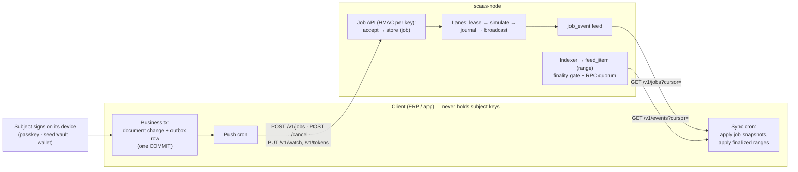
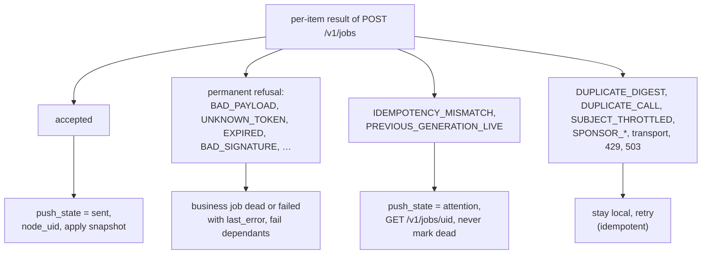
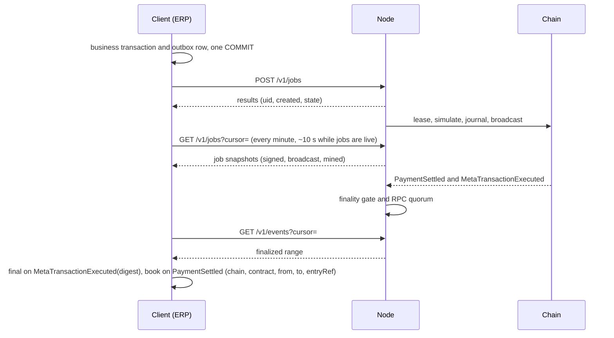
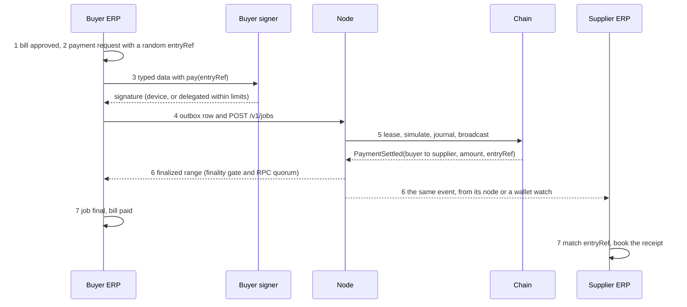
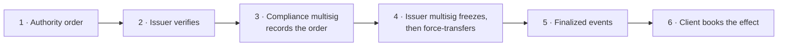

# Integrating an ERP or back office with SCaaS

This guide is for teams connecting an ERP, accounting system or line-of-business application ("the client") to a
`scaas-node`. The client keeps its own transactional outbox, **pushes** jobs to the node's job API and **polls** two
feeds (`/v1/jobs`, `/v1/events`) to learn job states and finalized chain facts. The node never calls the client; the
node's store is the configuration authority ([NODE-STO-03](node/store.md#NODE-STO-03)). The node is independent of any
ERP ([ARCH-POS-05](decisions.md#ARCH-POS-05)); one worked ERP connector is shown at the end as an example.

Status tags: **BUILT**, **SPECIFIED**, **PLANNED**. The job API, the feeds and the admin API are **SPECIFIED**
([node/job-api](node/job-api.md), [node/indexer-feeds](node/indexer-feeds.md)); the node that runs today pulls work
from the example connector over its RPC (the legacy pull path, [NODE-JOB-10](node/job-api.md#NODE-JOB-10)). New
integrations target the push model. The public gateway `POST /v1/metatx` and `/v1/dex/*` are **BUILT**.

**GRAM is blocked on every push, mesh and gateway path** until the node enforces the forward-TON cap
([NET-TON-14](networks/ton.md#NET-TON-14)): an unbounded forward-TON floor drains a lane. Until then no job API, mesh
or gateway submission may reach a GRAM lane, and no GRAM chain is cut over to push. The legacy pull path is safe: it
builds `extra = 0` and no `forward_nanoton`.

**Contents**

1. [Integration model](#1-integration-model)
2. [Onboarding a client](#2-onboarding-a-client)
3. [Pushing jobs](#3-pushing-jobs)
4. [Cancel](#4-cancel)
5. [Outbox rules](#5-outbox-rules)
6. [Feeds and reconciliation](#6-feeds-and-reconciliation)
7. [Payment references](#payment-references)
8. [Wallets and custody](#8-wallets-and-custody)
9. [Families and addresses](#9-families-and-addresses)
10. [Accounting](#accounting)
11. [Procure-to-pay](#11-procure-to-pay)
12. [Sealed-bid tender in procurement](#12-sealed-bid-tender-in-procurement)
13. [Accounts, Universal Accounts and identity](#13-accounts-universal-accounts-and-identity)
14. [Regulated-token compliance](#14-regulated-token-compliance)
15. [Data protection](#data-protection)
16. [Failure handling and reconciliation runbook](#16-failure-handling-and-reconciliation-runbook)
17. [Integration checklist](#17-integration-checklist)

## 1. Integration model

<a id="model"></a>



| Client | Node |
|---|---|
| Build typed data / `MetaOp` for the subject; choose `validUntil` inside the lane horizon ([payment references](#payment-references)); verify the signature shape | Recompute the digest from the payload (a differing client digest ⇒ `422 BAD_PAYLOAD`); read every signed field from the payload, never from job JSON ([NODE-LANE-16](node/submit-lanes.md#NODE-LANE-16)) |
| Record the outbox row in the business transaction; keep it immutable ([outbox rules](#outbox)) | Accept idempotently; enforce namespace grants, registered tokens, normalization ([NODE-LANE-10](node/submit-lanes.md#NODE-LANE-10)), the `call` target table, value-out and deposit caps, the per-subject grief score |
| Push, retry, cancel | Lease to a lane, simulate, journal before broadcast, replace, gap-fill, consumption checks |
| Apply job snapshots; mark business documents final **only** from finalized events | Index finalized ranges with RPC quorum; serve them per namespace |
| Keep payer/payee/party mapping and business data | Keep jobs ≤ 30 d after terminal, feeds ≤ 7 d |

Rules every client follows:

1. **No socket inside a business transaction.** Network calls happen after commit (cron/worker).
2. **Nothing is "paid" before a finalized event.** HTTP 200, `tx_hash`, `signed`, `broadcast` or `mined` are progress,
   not results.
3. **Never sign for a subject** unless the subject explicitly entrusted a custodial/delegated wallet with limits
   ([custody](#custody)).
4. **Apply feeds idempotently** and persist cursors together with the node's `store_id`, `incarnation`,
   `restore_epoch`.

## 2. Onboarding a client

<a id="onboarding"></a>

| Step | Who | Command / route |
|---|---|---|
| 1 | Host operator | `scaas-node admin create alice --role admin --role key_custodian --config node.toml` (first admin) |
| 2 | Admin | Create namespace: `POST /v1/admin/namespaces {"name": "acme-erp", "chains": ["evm:100"], "allow_call": false, "max_live_jobs": 10000}` (`allow_call = true` only if the client needs `call` jobs: mandates, subject-account deploys, DEX settles; even then only the selectors and targets of the [call table](#call-targets) run) |
| 3 | Admin | Register chains/tokens on the node if not yet present (`POST /v1/admin/chains/{key}/tokens`); RPC URLs and lane keys are toml-only |
| 4 | key_custodian | `scaas-node key create --namespace acme-erp --scopes "submit read"` or `POST /v1/admin/keys` → `{"key_id": "k_3f9a0c1d2e4b5a6c", "secret": "<64 hex>", …}` shown **once** |
| 5 | Client admin | Store `key_id` + secret in the client's secret store (never in a business table) |
| 6 | Client | `GET /v1/info` → api version, `store_id`, `incarnation`, `restore_epoch`, `head_seq`s, granted chains with lanes, tokens, `fee_recipient`, profile, state |
| 7 | Client | `PUT /v1/tokens/{chain}` with the tokens it uses (intersected with the node registry; `missing` listed) and `PUT /v1/watch/{chain}` with its receiving wallets (drift detection) |

One namespace per client database is the default; several legal entities may share it, distinguished by
`origin.scope` ([NODE-JOB-03](node/job-api.md#NODE-JOB-03)).

**API keys are for external server-side clients only** ([NODE-JOB-05](node/job-api.md#NODE-JOB-05),
[NODE-ADM-06](node/admin-auth.md#NODE-ADM-06)): the ERP backend or another service holds the key in its secret store.
Never embed one in a browser, mobile or desktop app or an extension — client apps sign user actions with `clientkeys`
and submit through the gateway ([inbound](#inbound), [clients/app](clients/app.md)), and read namespace data through
their own backend. API keys never reach the admin API; admin access is a built-in user or OIDC login, and config
automation (CI, Terraform, scripts) uses OIDC client credentials or the host CLI.

**Request signing (HMAC).**

```
X-Scaas-Key:       k_3f9a0c1d2e4b5a6c
X-Scaas-Timestamp: 1790000000                     # unix seconds; ±300 s accepted
X-Scaas-Nonce:     9b2cf0e1                       # [A-Za-z0-9_-]{1,64}, single use until ts + 300 s
X-Scaas-Signature: hex(HMAC-SHA256(secret, ts + "." + nonce + "." + METHOD + " " + path_with_query + "\n" + body))
```

```python
import hashlib, hmac, os, time, requests

def signed(method, url_path, body_bytes, key_id, secret_hex):
    ts, nonce = str(int(time.time())), os.urandom(8).hex()
    msg = f"{ts}.{nonce}.{method} {url_path}\n".encode() + body_bytes
    sig = hmac.new(bytes.fromhex(secret_hex), msg, hashlib.sha256).hexdigest()
    return {"X-Scaas-Key": key_id, "X-Scaas-Timestamp": ts, "X-Scaas-Nonce": nonce,
            "X-Scaas-Signature": sig, "Content-Type": "application/json"}

# requests.post(base + "/v1/jobs", data=body, headers=signed("POST", "/v1/jobs", body, kid, sec),
#               allow_redirects=False, timeout=(5, 30))
```

A shared KAT (`scaas-node/tests/api/hmac_kat.json`) pins the byte layout; clients must test against it. Unknown key
and bad signature both return `401 UNAUTHORIZED`. API keys never work on the admin listener. Rotation:
`POST /v1/admin/keys/{id}/rotate` (generation + 1; the old secret dies immediately).

<a id="node-routing"></a><a id="INT-ERP-16"></a>**INT-ERP-16** — **One node per (company, chain).** A client routes each
`(company, chain)` to exactly one node; two nodes for one company only on **different chains**, enforced client-side
by a `UNIQUE(company_id, chain_id)` route table. The node has no company notion
([NODE-JOB-03](node/job-api.md#NODE-JOB-03)); it claims work by a CAS `queued → leased` inside its single owner
process ([NODE-JOB-06](node/job-api.md#NODE-JOB-06)). Why: one lane journal per signer is the double-spend guard.

## 3. Pushing jobs

<a id="push"></a>

`POST /v1/jobs` — up to 50 jobs, body ≤ 1 MiB, per-item results.

```json
{"jobs": [{
  "origin": {"scope": "6f1c…:1", "producer": "blockchain.payment.request", "key": "0x8d…", "generation": 0},
  "client_ref": "erp:1234",
  "chain_key": "evm:100",
  "kind": "metatx",
  "payload": {"token": "0x…", "signature": "0x…",
              "metatx": {"from": "0x…", "to": "0x…", "value": "100000000", "data": "0x…", "batch": "7412…",
                         "nonce": "0", "validUntil": "1790000300", "mode": 1, "relayer": "0x…", "fee": "0",
                         "feeRecipient": "0x0000000000000000000000000000000000000000"}},
  "bus": {"scope": "restricted", "private_window_secs": 120}}]}
```

| Field | Rule |
|---|---|
| `origin.scope` | Client-chosen, stable: e.g. `"<database uuid>:<legal entity id>"` |
| `origin.producer` | Business object type that produced the job (e.g. `blockchain.payment.request`, `purchase.tender`) |
| `origin.key` | Natural key of the business event (e.g. the payment `entryRef`, `invoice:42:attempt:1`) |
| `origin.generation` | `0` initially; `+1` on an operator requeue of a dead job |
| `client_ref` | Echoed in feeds; for the client's own lookup |
| `kind` | `metatx` (EVM meta-tx, incl. v1 envelopes of a `PqzToken`), `signed_op` (non-EVM `MetaOp` or Soroban auth payload), `call` (calldata to a contract, needs `allow_call` **and** a [call table](#call-targets) row); `ua_metatx` (UA; incl. v3 envelopes of a `PqzToken`) and `pqz_call` (direct PQZ calls, private chain), both **SPECIFIED** |
| `payload.digest` / `op.digest` | Optional; if present must equal the node's digest |
| `bus.scope` | `restricted` (company lanes only; default), `open` (admitted peers after the window), `public` (also the open mesh) — see [bus scope](#bus-scope) |

| Kind | Payload |
|---|---|
| `metatx` | `{token, signature, struct: "call"\|"transfer", metatx: {…}}`: a `MetaTransaction` (an allowlisted call of any SCaaS contract) or a token's `MetaTransfer` (transfer or payment) ([NODE-JOB-20](node/job-api.md#NODE-JOB-20), [CTR-MTX-15](contracts/metatx.md#CTR-MTX-15)); `uint256` as decimal strings; addresses lowercase |
| `signed_op` | `{op: {op_kind: "pay", payload: "0x<exact signed bytes>", signature, public_key, auth_kind: "wallet"|"passkey", extra: {…native params}}}`; `from`, lane, nonce, `valid_until`, relayer are decoded from `payload` |
| `call` | `{call: {target, calldata, validUntil}}` — e.g. `MandateWallet.mtxPayUnderMandate(...)` (as built `MandateWallet.payUnderMandate(...)`), `SmartKeyAccountFactory.deploy(...)`; the signature lives inside the calldata; selector and target must match a call-table row; no native value |
| `ua_metatx` (SPECIFIED) | MetaToken v3 `UAMetaTransaction` or `UAMetaTransfer` with `from: bytes32` and its `auth`; same lifecycle as `metatx` |
| `pqz_call` (SPECIFIED; private chain only) | **Direct open calls only**: `{chain, contract, selector ∈ {mtxConfidentialTransfer, mtxConfidentialTransferCompact, mtxConfidentialTransferSingle, mtxConfidentialTransferSingleCompact, mtxUnshield, mtxRollOver}, calldata}` to a configured PQZ token (plan 5h names; direct `mtxShield` / `mtxWrapShield` take the caller's own public units / underlying and are never a node job) |
| PQZ envelopes (SPECIFIED) | **No new kind**: a `PqzToken` is an `IERC20MetaTx` token, so its envelope ops travel as ordinary `metatx` or `ua_metatx` jobs with `struct = call` (domain `("SCaaS PqzToken", "1", chainId, token, chainUid)`), `m.data` = the direct calldata of `mtxConfidentialTransfer*`/`mtxUnshield`/`mtxShield` (and `mtxUnshieldUnwrap` on `UNDERLYING_PQZ`; opaque to the client); `mtxRollOver` and `mtxPrepareAcc` are relayable too (on both PQZ allow-lists since Task R, owner 2026-10-20; the outer fee may be 0; anyone may also call them directly); outer fee `NONE`/`FIXED` only; never batched, never on the mesh; 1 MiB job body on the `pqz` profile; a gasless exit is the envelope `mtxUnshield` (public units from `SHIELD_POOL` to `recipient`) or `mtxUnshieldUnwrap` (the underlying) |

**Accept checks.** The node checks every item in a fixed order without RPC and answers per item; the rules and their
order are [job-api.md#intake](node/job-api.md#intake). What a client must get right before it pushes:

- Every field the signed payload carries (`contract`, `valid_until`, `from`, lane, nonce, relayer binding, value or
  forward floors) is read from the payload; a job-JSON copy that differs is `422 BAD_PAYLOAD`.
- `now < valid_until ≤ now + chain.max_valid_for_secs` (default 3600; read it from `GET /v1/info` or `GET /v1/gateway`),
  else `422 EXPIRED` / `VALID_TOO_LONG`. A sponsored job needs `valid_until ≥ now + min_valid_secs` of its policy
  (default 120).
- The token subset is pushed before the first job on a chain ([NODE-JOB-12](node/job-api.md#NODE-JOB-12)), else
  `422 UNKNOWN_TOKEN`; a `call` job needs `allow_call` and a [call table](#call-targets) row.

Which code means what for the client is in the push algorithm below.

Response `200`:

```json
{"results": [{"client_ref": "erp:1234", "uid": 17, "created": true, "state": "queued", "last_seq": 902},
             {"client_ref": "erp:1235", "error": "UNKNOWN_TOKEN", "detail": "0x… is not registered on evm:100"}]}
```

Paused chain: accepted and held `queued`. Halted chain: `409 CHAIN_HALTED`.

**Client push algorithm:**

```text
loop (cron, after each new outbox commit and every minute):
  rows = SELECT outbox rows WHERE state='queued' AND push_state='local' ... FOR UPDATE SKIP LOCKED LIMIT 50
  UPDATE rows SET push_attempted = true; COMMIT            # marker durable BEFORE any HTTP call
  results = POST /v1/jobs(rows)
  for each (row, r):
     accepted               → push_state='sent', node_uid=r.uid, apply r's snapshot (feeds, below)
     BAD_PAYLOAD | UNKNOWN_TOKEN | EXPIRED | VALID_TOO_LONG | RELAYER_NOT_OURS | CALL_NOT_ALLOWED | CHAIN_NOT_GRANTED
       | CALL_TARGET_REFUSED | VALUE_OUT_TOO_HIGH | DEPOSIT_NOT_ALLOWED | SUBJECT_DENIED | FEATURE_UNSUPPORTED
       | UA_NOT_REGISTERED | BAD_SIGNATURE
                            → business job dead/failed with last_error (the node holds nothing); fail dependants
     IDEMPOTENCY_MISMATCH | PREVIOUS_GENERATION_LIVE
                            → push_state='attention', node_uid from the 409 body, GET /v1/jobs/{uid}, apply it;
                              NEVER mark dead (the node holds a job under this key)
     DUPLICATE_DIGEST       → stay 'local', last_error (another key carries this intent)
     DUPLICATE_CALL         → stay 'local', last_error with the 409 body's uid (follow that job, or cancel and re-push)
     SUBJECT_THROTTLED      → stay 'local', retry after retry_after; flag the subject for attention (its intents keep failing)
     SPONSOR_BUDGET | SPONSOR_RATE | SPONSOR_TOO_SHORT, transport | 429 | 503
                            → stay 'local' (retry; idempotent)
  COMMIT
```

Per-item outcome of a push, in groups:



The `push_attempted` marker decides cancel semantics: an unmarked row can be killed locally; a marked row may exist on
the node and must be cancelled there. HTTP runs after the marker commits and holds no row lock except the batch's own
rows; other writers of those rows (cancel, dependency failure) lock with `FOR UPDATE` and wait at most one batch.

## 4. Cancel

<a id="cancel"></a><a id="INT-ERP-17"></a>**INT-ERP-17** — **The client kills a job locally only if it was never pushed;
otherwise it cancels on the node, by uid or by origin.** `POST /v1/jobs/{uid}/cancel` or `POST /v1/jobs/cancel {origin}`
is a node CAS ([NODE-JOB-07](node/job-api.md#NODE-JOB-07)) that succeeds from `queued`/`leased` only if the job was
never published on the bus:

| Node state | Result |
|---|---|
| `queued`/`leased`, never published | `cancelled` (reported as `dead`, `error = "cancelled"`) |
| no job yet for the origin | tombstone written; a late push of that key returns `created: false, state: cancelled` |
| `queued` but published on the bus | `409 TOO_LATE {state, published: true}`; job held (never leased by us) but a peer may still land it |
| `signed` or later | `409 TOO_LATE {state}` |

Client handling: `cancelled` ⇒ local dead + side effects; `TOO_LATE` ⇒ treat as "already sent", keep the business
request open until final or expiry; transport error ⇒ `cancel_requested`, retried first on the next sync. A subject can
always invalidate its own pending intents with `cancelNonce(batch)` (EVM; a direct call, or signed through `mtxExecute`
on another lane; as built `cancelMetaNonce(batch)`, direct only) — the authoritative cancel.

## 5. Outbox rules

<a id="outbox"></a><a id="INT-ERP-05"></a>**INT-ERP-05** — **Outbox `call` jobs are immutable and operators are
read-only.** A `call` job is a transaction a node lane signs as `msg.sender`; whoever can edit an outbox row can point it
anywhere. Every client's outbox therefore follows these rules (the node's half is the call table,
[NODE-JOB-01](node/job-api.md#NODE-JOB-01)):

| Rule | Detail |
|---|---|
| **Operators are read-only** | No role below the service itself may write outbox rows (ACL `1,0,0,0` for operators). Requeue of a `dead`/`reverted` job is one public method that checks the operator group explicitly and then writes internally; a viewer calling it over RPC fails |
| **Job fields are immutable after create** | company, chain, job kind, envelope link, `target_address`, `calldata_hex`, call validity, payment request, subject account, `origin_producer`, `origin_key` — `write` raises for every environment, privileged ones included; `prerequisite_job_id` may be set once, from empty, while the job is `queued`. State and progress fields (`chain_state`, `tx_hash`, `outer_nonce`, `last_error`, push fields) stay writable by the service |
| **A different call is a new job** | Never edit target, calldata, kind or payload of an existing row; create a new outbox row (new origin key or `generation + 1` after an operator requeue) |
| **No context-key switches** | Immutability is enforced in `write` itself, not bypassed by a client-settable flag (client context reaches the server on RPC) |
| **Signed envelopes are immutable too** | metatx / signed-op rows are frozen after signing |

Tests a client must carry: operator write on any job field ⇒ access error; privileged write of each immutable field ⇒
error; `prerequisite_job_id` set once from empty passes, a second change fails; operator requeue still works. A `call`
outside the table is `dead` with `CALL_TARGET_REFUSED` before simulation on the legacy pull path and
`403 CALL_TARGET_REFUSED` at accept on the push path. A job carries `job_kind` (`metatx` | `call` | `signed_op`),
`target_address`, `calldata_hex` and `payment_request_id`; the node uses `calldata` when present, and the request
becomes `final` only from its `PaymentSettled` — the node is never a "blind signer" of client calldata.

<a id="call-targets"></a>**Call targets.** `allow_call` on the namespace is necessary, not sufficient: the node runs a
`call` job only for a selector and target in its call table ([NODE-JOB-01](node/job-api.md#NODE-JOB-01),
[NODE-JOB-19](node/job-api.md#NODE-JOB-19)). Client producers of `call` jobs: subject-account deploys and key changes
([accounts](#accounts)), mandate payments and revokes ([auto-pay](#auto-pay)), DEX settles, the permissionless tender
steps ([tender](#tender)), vesting releases, distribution claims and `ExchangeOffer` legs. Lane keys never hold a role:
a role-restricted call (`createTender`, bond calls, issuer and compliance interventions, factory `create*`) reaches
its target only through the role holder's own contract — `SmartKeyAccount.executeAsOwner`, or a `Safe.execTransaction`
the owners already signed, pushed as a `call` job to a registered role-holder contract
(`chain_contract.kind = role_holder`). Any other call shape needs a table row first (a node release) or is sent by the
subject's or treasury's own wallet.

## 6. Feeds and reconciliation

<a id="reconciliation"></a>

**Jobs feed.** `GET /v1/jobs?cursor=901&limit=200&wait=0`:

```json
{"store_id": "…32 hex", "incarnation": "…32 hex", "restore_epoch": 0, "head_seq": 950,
 "items": [{"seq": 902, "uid": 17, "client_ref": "erp:1234",
            "origin": {"scope": "6f1c…:1", "producer": "blockchain.payment.request", "key": "0x8d…", "generation": 0},
            "state": "signed", "tx_hash": "0x…", "outer_nonce": 42, "signer": "0x…", "error": null,
            "at": 1790000000123}],
 "next": 902}
```

Each item is a **snapshot** after one transition (`queued`, `leased`, `signed`, `broadcast`, `mined`, `reverted`,
`consumed`, `dead`, `cancelled`). `final` never appears here (finality comes from the events feed). `mined`/`reverted`
items add `gas_used`, `gas_price`, `cost_native`, `sponsor: {policy, account} | null` and
`sponsor_fallback: <policy> | null` (a policy matched but was exhausted and the job was booked to the namespace). Error
values the client must recognise on `dead`/`reverted` items: `cancelled`, decoded contract errors (`MetaTxBadNonce`,
`MetaTxExpired`, …), `ATTEMPTS_EXHAUSTED` (`attempt_count` passed `chain.max_attempts`, default 5), and a `reverted`
after one billed retry (the chain charged the lane for a failure the subject could make deterministic, e.g. Hedera
`INSUFFICIENT_GAS`, Aptos out-of-gas, Solana CU exhaustion — the subject must re-sign;
[NODE-LANE-14](node/submit-lanes.md#NODE-LANE-14)).

**Events feed.** `GET /v1/events?cursor=…`: items of kind `range` (one finalized block range per chain, always served
even when empty, `from_block = previous to_block + 1`), `balances` (hourly, drift C), `dex_order`/`dex_trade`/`dex_range`
(DEX mirrors).

```json
{"seq": 77, "kind": "range", "chain_key": "evm:100", "from_block": 41233001, "to_block": 41233040,
 "to_block_hash": "0x…",
 "events": [{"event": "PaymentSettled", "contract": "0xtoken…", "block_number": 41233017, "block_hash": "0x…",
             "tx_hash": "0x…", "log_index": 3, "from": "0xpayer…", "to": "0xpayee…", "amount": "100000000",
             "fee": "0", "fee_recipient": "0x0000…", "entry_ref": "0x8d…"},
            {"event": "MetaTransactionExecuted", "contract": "0xtoken…", "block_number": 41233017, "tx_hash": "0x…",
             "log_index": 4, "from": "0xpayer…", "relayer": "0xlane…", "batch": "7412…", "nonce": "0",
             "digest": "0x…", "fee_recipient": "0x0000…", "fee": "0"}]}
```

Per-namespace filtering at serve time: only contracts in the namespace token subset; `Transfer` only to watched wallets.

| Rule | Detail |
|---|---|
| Cursor | Request `cursor = max(0, last − 200)` (overlap), apply idempotently (skip `seq ≤ applied seq` per job), persist `next` with `store_id`, `incarnation`, `restore_epoch` and the last applied `(seq, uid, state)` |
| Continuity | `store_id` or `restore_epoch` changed ⇒ **halt** sync for this node (needs attention); `head_seq < stored cursor` ⇒ halt; `incarnation` changed ⇒ read `cursor = last_seq − 1, limit = 1` and compare with the stored item; differs ⇒ halt |
| Expired cursor | `410 CURSOR_EXPIRED` ⇒ jobs: `GET /v1/jobs/{uid}` for each non-terminal pushed job, then `cursor = -1`; events: restart at 0 (ranges are idempotent) |
| Adoption | An item whose `uid` is unknown locally is matched by `origin` (+ generation) — covers a rollback after the node accepted |
| State ladder | Map node → client states (`leased → nonce_leased`, `cancelled → dead`) and walk `queued → nonce_leased → signed → broadcast → mined` up to the target, applying side effects once; late `mined`/`reverted` after `final` or `consumed` are no-ops |
| Ranges | Reject a gap (`from_block > indexed + 1`) ⇒ halt events; straddle (`from_block ≤ indexed < to_block`) ⇒ drop events at or below `indexed`; dedup events by `(chain_key, tx_hash, log_index)` |
| Unknown contract | Event for a contract that is not a client token ⇒ drop and count, never fail the page |
| Finality | A job is **final** when a `MetaTransactionExecuted` with its digest arrives in a range (by any relayer: `landed_elsewhere = relayer ∉ our signers`). A range is served only after ≥ `quorum` independent RPC endpoints returned the same event set ([NODE-IDX-01](node/indexer-feeds.md#NODE-IDX-01)); a chain with `quorum = 1` is single-provider trust — confirm the chain's quorum with the node operator (gauge `scaas_finality_quorum{chain}`) before booking material amounts on it |
| Business booking | Only from `PaymentSettled` (or the family equivalent) in a range, matched on `(chain, contract, from, to, entryRef)` for a request the client issued (payer locked at `start`); isolate business hooks (savepoint) so a failing hook never blocks the cursor |
| Consumed | `consumed` keeps the business request pending; it becomes final via the event, or dead if no event arrives by `valid_until + grace + 1 h` (superseded) |
| Latency | Poll with `wait = 0` every minute, and every ~10 s while pushed jobs are live (≤ 25 s long-poll available for clients that can hold a connection) |

One payment from push to booking:



**Consumption and `landed_elsewhere`.** A job whose subject nonce was used by another digest or relayer is `consumed`
("nonce used elsewhere"); allowed from `nonce_leased`, `signed` and `broadcast`. Applying it records
`last_error = 'nonce consumed: <kind>'` and keeps the business state `pending`; it does not touch the envelope's state
and is not a failure state, so dependants are not failed. Expiry moves a `consumed` job to dead/failed when
`valid_until < now − _EXPIRY_GRACE − 3600` and no final event arrived (superseded). When the executed event arrives, the
job becomes `final` + `success` from any earlier state including `consumed`, with
`landed_elsewhere = True` unless the event's relayer (or, without one, the tx hash) matches the job's own signer. The
event's `relayer` is stored with the event when the family reports it. `landed_elsewhere` and the mesh-published time
are **server-only**: set explicitly on every create (never from a client default), stripped from client writes.

<a id="status-sync"></a><a id="INT-ERP-18"></a>**INT-ERP-18** — **Client push and sync cadence.** The outbox is
unchanged; two scheduled jobs, bodies in methods: **push** sends one batch (≤ 50) per transaction and is re-triggered
after the commit of every new job; **sync** runs every minute, plus 10 s after itself while any pushed job is live,
with `wait=0`. Push and sync fields on the outbox are server-only. Sync order per node: retry `cancel_requested`, jobs
feed, events feed (chains whose event node is this node), watch and token sync when their hashes changed. Why: a client
that cannot hold a long poll still sees status within seconds.

<a id="sync-latency"></a><a id="INT-ERP-20"></a>**INT-ERP-20** — *Open (default applied).* **Payment status latency is
≤ ~10 s while jobs are live and ≤ 1 min otherwise**, from the cadence of [INT-ERP-18](#INT-ERP-18). Owner confirmation
pending; the default stands.

<a id="store-change"></a><a id="INT-ERP-19"></a>**INT-ERP-19** — **The client halts sync on a store change.** A changed
`store_id` or `restore_epoch`, `head_seq < cursor`, or an `incarnation` change whose last item differs sets
`needs_attention` on the node record and stops both feeds; an operator acknowledges the store change (cursors reset,
non-terminal pushed jobs return to `local`). Node admin mutations are audited separately
([NODE-ADM-07](node/admin-auth.md#NODE-ADM-07)).

## <a id="payment-references"></a>7. Payment references

<a id="payment-references"></a>

**Generation (BUILT; [CTR-MTX-03](contracts/metatx.md#CTR-MTX-03)):**

```
entryRef = 32 bytes from a CSPRNG                     # carries no information; unlinkable by construction
batch    = keccak256("scaas.pay.lane" ‖ entryRef)     # lane of this request (v2 tokens: payLane(entryRef) on chain)
nonce    = 0
```

- One `entryRef` per **payment request** (an invoice may have several requests over time; each request is payable at
  most once because its lane has nonce 0).
- **Lane horizon** ([CTR-MTX-04](contracts/metatx.md#CTR-MTX-04)): pay-once holds only if every signature the client
  issues on a pay lane has `validUntil ≤ t_first_issue + 30 d`. Re-issuing terms on the same lane later than that, or
  signing an op with `valid_until > now + 30 d` on a pruning family (GRAM, Aptos, Solana, Sui), gives no pay-once
  guarantee — issue a new request (new `entryRef`, new lane) instead. Wallet connectors and `clientkeys` refuse such ops
  ([NET-ALL-01](networks/README.md#NET-ALL-01)).
- The client stores `entryRef` with a UNIQUE constraint on the request, together with `chain`, `token`,
  `receiving_address`, `payer_address` (locked at start), `amount_base`, `issued_valid_until`.
- Do **not** derive `entryRef` from business identifiers (`keccak256(company ‖ move ‖ amount ‖ salt)` as in older
  drafts): a random value needs no salt management and cannot be brute-forced from known invoice numbers.
- Splitting: Zether `n_v = 64` removed the need to split large payments; for transparent tokens one payment per
  request. If a business case needs partial payments, issue one request (one `entryRef`) per instalment.

**Client → chain (before signing and at push):**
1. The payment `MetaTransfer` built server-side from the request: `to = receiving_address`, `value = amount_base`,
   `entryRef`, `batch` as above, `validUntil = issued_valid_until` (server-chosen, e.g. now + 300 s).
2. After signing: recompute the digest; a 65-byte signature must recover `payer_address` (EOA); a contract wallet
   (ERC-1271) is accepted unverified and judged by the node's simulation ([INT-ERP-03](#INT-ERP-03)).
3. The node recomputes the digest and simulates before broadcast.

**Chain → client (on each finalized range):**
1. Filter `PaymentSettled` by `contract == request.token` **and** `from == request.payer_address` **and**
   `to == request.receiving_address` **and** `entry_ref == request.entryRef`.
2. `amount_settled = Σ amount` of matching events; `amount_settled ≥ amount_base` ⇒ request final; more than due ⇒
   final + needs attention (refund manually); less ⇒ partial.
3. Cross-check `MetaTransactionExecuted(digest)` to mark the outbox job final.
4. Drift checks: unmatched inbound `Transfer` to a watched wallet ⇒ drift A record; hourly `balances` vs ledger balance
   of the token's bank journal ⇒ drift C ([accounting](#accounting)).

A third party paying 1 unit with someone else's `entryRef` is not counted (`from` is not the request's payer), so it can neither complete a request nor push it into needs attention; it is just money received. Reconciliation matches on (chain, token contract, payer, receiving address,
`entryRef`) — never on the amount alone.

<a id="payment-terms"></a><a id="INT-ERP-06"></a>**INT-ERP-06** — **Self-service payment terms use fee `NONE` and
`MODE_RESTRICT_RELAYER` to the company relayer, `fee = 0`, and a server-chosen validity (default 300 s).** This trades
payer self-submission for front-run safety; payee self-relay stays available ([inbound](#inbound)). With bus scope
`open` the relayer is left unbound instead ([INT-ERP-15](#INT-ERP-15)).

<a id="currency"></a><a id="INT-ERP-07"></a>**INT-ERP-07** — **No FX: the token's currency equals the order currency.**
A rate quote would need a price source; only a token pegged to the document's currency is offered (the example
connector has no quote model).

<a id="payment-modes"></a><a id="INT-ERP-27"></a>**INT-ERP-27** — **The payment mode is configuration, not code.** A
deployment chooses per company and channel among: sponsored (company relayer, `MODE_FEE_NONE` +
`MODE_RESTRICT_RELAYER`, gas as OPEX); fee in token (`MODE_FEE_PERCENT`/`FIXED`, fee ≤ 1 % to `feeRecipient`); payee
self-relay ([inbound](#inbound)); receiver pays the fee; a node gas-sponsorship policy; the enterprise inbound gateway.

<a id="bus-scope"></a><a id="INT-ERP-15"></a>**INT-ERP-15** — **Bus scope is a per-tenant client setting delivered per
job.** `restricted` (default) keeps [INT-ERP-06](#INT-ERP-06): terms pin `MODE_RESTRICT_RELAYER` to the company relayer
and the job never leaves the company's lanes. `open`: terms are built with `relayer = 0`; the node publishes the job to
admitted peers after a private window (`bus.private_window_secs`, default 120 s) while it is still `queued`, so
`validUntil` must leave room for it (≥ the 300 s default). `public` also reaches the open mesh. The node publishes
([NODE-MESH-15](node/mesh.md#NODE-MESH-15)).

<a id="mesh-scope"></a>The setting is a required selection `blockchain_bus_scope ∈ {restricted, open, public}` (default
`restricted`) plus `blockchain_bus_private_window_secs`, editable by the client's blockchain managers; the payment start
leaves the relayer unbound only when the company's scope is `open`; delegated (mandate) payments are `call` jobs and stay
`restricted`.

## 8. Wallets and custody

<a id="receiving-wallets"></a>

**Receiving wallets** are kept per (company, network, asset):

- **Address:** accept all-lowercase/all-uppercase, or mixed case with a **correct EIP-55 checksum**; a bad checksum is
  refused. Refuse `0x0`, `0x…dEaD`, the address of **the token itself** or of any registered token or contract. Other
  families use their own normalised form ([addresses](#addresses)).
- **Four-eyes:** proposed by someone holding wallet-admin rights for that company; approved by **a different person**
  with the same right (one seam decides the right; a treasury group, or the system group of the platform company).
- **Immutable once approved** (except the default flag and archiving); a change is a new wallet, the old one archived.
- **Default:** at most one default per company (partial unique index). Record rule: a company sees and edits only its
  own wallets.
- **Snapshot:** the payment request copies `receiving_address`, `chain_id`, `token_id`, `amount_base`, `payer_address`
  and the receiving wallet id (audit reference), and is write-locked thereafter. The payment provider no longer holds
  token or receiving address: only relayer, signature validity and journal; token and address come from the receiving
  wallet the payer picks. The payment options list only usable (chain, asset) pairs of the receiving company whose token
  currency equals the order currency.

<a id="INT-ERP-01"></a>**INT-ERP-01** — **A newly approved receiving wallet is usable only after a cooling-off of 24 h**
(`usable_from = approved + N hours`, default 24): new requests and the default flag wait for it. Push approved wallets to
the node watch list (`PUT /v1/watch/{chain}`).

<a id="payer-wallets"></a>**Paying wallets** have three modes:

| Mode | Who signs | From | Rule |
|---|---|---|---|
| `manual` (default) | the user, each time | their EOA/wallet | the existing flow |
| `custodial` | the platform through the custody adapter (`signer_ref`) | an EOA the adapter controls | `signer_ref` required; a wallet of a **non-company partner** (customer/store) also needs `license_ref` |
| `delegated` | a platform delegate key (through the adapter) **within on-chain limits** | the payer's `MandateWallet` | the payer keeps the owner key; limits enforced on chain ([CTR-ACC-07](contracts/mandates.md#CTR-ACC-07)) |

<a id="INT-ERP-02"></a>**INT-ERP-02** — **A `custodial` paying wallet of a non-company partner requires `license_ref`.**
Holding someone else's key for them is a regulated activity; the reference records the licence it runs under.

<a id="custody"></a>**Custody** is pluggable and chosen at deploy time; the ERP holds only a `signer_ref`, never key
material. The custody adapter is a registry by `signer_ref` scheme with the interface `address(ref)` and
`sign_digest(ref, digest32) -> 65 byte`; production schemes (KMS/HSM `broker:`) are PLANNED. A delegated or custodial
signature is issued only through a signing policy (`SigningPolicyService`, PLANNED) with `validUntil − now ≤ 300 s`.

<a id="INT-ERP-08"></a>**INT-ERP-08** — **The ERP-held `env:` custody is dev-only and signs through OpenSSL.** The `env:`
adapter registers only when a dev-custody flag is `1`, and signs only for wallets on a chain with `is_dev_chain = True`;
production custodial and delegated wallets need another scheme. ECDSA signing goes through the `cryptography` library
(OpenSSL; constant-time, random `k` rather than RFC 6979, low-s and `v` recomputed by `ecrecover` against the address),
never a pure-language `secp256k1.sign`. Node lane keys are separate ([NODE-LANE-20](node/submit-lanes.md#NODE-LANE-20)).

<a id="mandates"></a><a id="INT-ERP-04"></a>**INT-ERP-04** — **A `MandateWallet` is deployed outside the ERP**
(`forge create … --constructor-args <owner>`); the ERP only records its address. The ERP makes no deploy RPC and holds
no deploy key; a CREATE2 factory would force it to compute addresses. Contract rules:
[contracts/mandates](contracts/mandates.md).

<a id="auto-pay"></a>**Auto-pay.** A policy (payer, paying wallet, trigger `invoice_posted|invoice_due`, caps per
payment/day/month, four-eyes, kill switch) drives a scheduled job that finds the payer's `posted`, unpaid customer
invoices and creates exactly **one** run per (policy, invoice, event) (`UNIQUE`); each run creates the same request and
outbox job as a manual payment (a `chain` payment transaction over `invoice_ids`, `operation='offline'`). `custodial`
wallets sign `pay` through the custody adapter under `SigningPolicyService` (`validUntil ≤ 300 s`); `delegated` wallets
sign the `payUnderMandate` `MetaTransaction` in the wallet's domain and push a `call` job to
`MandateWallet.mtxPayUnderMandate` (as built `payUnderMandate` with the typed `PayUnderMandate`). A run ends `done` when the payment
transaction is done (the accounting module posts and reconciles) or `failed`. Kill: off-chain immediately, and for
delegated wallets an `mtxRevoke` job (as built `revokeWithSig`); the revoke is the delegate's `MetaTransaction` with `data =
revoke(token, epoch)` and the wallet's current `epoch[token]` ([CTR-ACC-07](contracts/mandates.md#CTR-ACC-07)).

## 9. Families and addresses

<a id="addresses"></a><a id="INT-ERP-10"></a>**INT-ERP-10** — **The ERP is family-aware: chains carry a family,
addresses are stored in the family's normalised form, and non-EVM payments are signed ops.** The ERP verifies ed25519
itself; every other non-EVM check it cannot complete is left to the node's simulation.

- Chain: `family`, `network_key` (EVM/Hedera: chain id; Sui: `mainnet|testnet|devnet|localnet`; Stellar:
  `pubnet|testnet|standalone`; Cosmos: chain id; GRAM: `-239|-3|localnet`), `chain_key = family:network_key` (EVM:
  `evm:N`), `is_dev_chain`, `bech32_prefix`, `network_passphrase`; CAIP-2: `eip155:N`, `hedera:mainnet|testnet`,
  `sui:<net>`, `stellar:<pubnet|testnet>`, `cosmos:<chain-id>`, `ton:<-239|-3>`.
- `parse(family, value, chain)` returns the stored form: EVM EIP-55; Hedera EIP-55 **or** `0.0.N`, stored
  as `0x` (a payer's `0.0.N` ⇒ long-zero `0x000…N`; tokens and receiving wallets go through the mirror lookup of the
  Hedera row below); Sui `0x` + up to 64 hex, normalised to 64 lower-case; Stellar strkey `G…` (account) / `C…` (contract): base32,
  version byte, CRC16-XModem, `M…`/`S…` refused; Cosmos bech32 (BIP-173), HRP = the chain's `bech32_prefix`, 20 (account)
  or 32 bytes (contract); GRAM raw `wc:hex64` or user-friendly base64/base64url of 48 characters (tag, wc, hash,
  CRC16-XModem; the testnet flag must match the chain), stored raw `wc:hex64`; Aptos `0x` + 64 lower-case hex, short
  forms (`0x1`, `0xa`) padded (AIP-40); Solana base58 decoding to exactly 32 bytes, **never lower-cased**
  ([NET-ALL-16](networks/README.md#NET-ALL-16)).
- Database address checks (`CHECK ~ '^0x…'`) move to per-family validation in code; the column stays text; the old
  constraint is dropped on upgrade (verify in `pg_constraint` after the upgrade, `-u`).
- **Signed payload per family** next to the EVM envelope: `family`, `contract`, `from`, `payload` (the family's exact
  signed bytes), `signature`, `pubkey`, `auth_kind` (`wallet|passkey`), `digest`, validity, state; the outbox job has
  `kind = 'signed_op'`.
- Receiving and paying wallets exist per (company, network, asset) for every family.

<a id="families"></a>**Per-family ERP rules.** Each family library offers `build_terms(request, valid_until)` (no RPC:
the payment request alone fixes contract, network, `lane = batch_hex`, `pay_ref = entry_ref_hex`, nonce 0, relayer) and
`verify(request, payload, signature, public_key)` returning `True`, `False` or `None`:

<a id="INT-ERP-21"></a>**INT-ERP-21** — **ERP verifiers are three-valued and verify only with a key provably bound to the
payer** ([NET-ALL-14](networks/README.md#NET-ALL-14)): `False` for a wrong envelope or a bad signature; `True` only when
the public key derives the payer's address; `None` when the key cannot be tied to the payer without chain reads (rotated
keys, added keys, keyless or passkey accounts) — the job is then pushed with `signature_verified = False` and the node's
simulation decides. Sui verify follows the same rule as Aptos and Solana.

<a id="INT-ERP-03"></a>**INT-ERP-03** — **Contract wallets: the ERP defers to node simulation.** The browser reports the
`wallet_kind` (from `eth_getCode` through the wallet); for `contract` the ERP accepts the signature unverified and the
node's simulation arbitrates. A 23-byte `0xef0100…` code is an EIP-7702 delegated **EOA**
([CTR-UA-24](contracts/accounts.md#CTR-UA-24)).

<a id="INT-ERP-13"></a>**INT-ERP-13** — **Hedera long-zero payers sign with their native ED25519 key.** A payer stored as
`0.0.N` (long-zero) takes the native-key path: the ERP issues the raw 32-byte digest, receives a **64-byte** signature
plus the public key, verifies ed25519 itself, and the key↔account binding is checked on chain (job with
`signature_verified = False`, since without RPC the ERP cannot know whether the key belongs to `0.0.N`).

<a id="INT-ERP-14"></a>**INT-ERP-14** — **The ERP verifies Stellar `G…` ed25519 through OpenSSL.** For `from` = `G…` the
check is real ed25519 over `sha256(payload)` with the master key from the strkey (64-byte hex signature), via the
`cryptography` library already required by custody, not a pure-language ed25519; for `C…` (custom account) `None`.

| Family | ERP specifics |
|---|---|
| Hedera | Chain `family = hedera`, `evm_chain_number` 295–298. An alias `0x…` payer uses the EVM path (EIP-712 + EIP-6963) unchanged. Tokens and receiving wallets entered as `0.0.N` are looked up **once, at entry**, on the chain's mirror node (`/api/v1/{contracts|accounts}/0.0.N` ⇒ `evm_address`) and stored as `0x`, because `0.0.N` → long-zero is right only for ED25519 accounts without alias, and a CREATE2 clone's `address(this)` is its EVM address (a long-zero entry would break `verifyingContract`; an ECDSA account receiving at its long-zero address strands the funds). Long-zero is kept only when the mirror reports an `ED25519` key and no alias; no mirror, a lookup error, or a non-ED25519 account without alias ⇒ refused, and a `0x` address is required. This is the only exception to "the ERP makes no chain RPC": one public read GET at entry, never on the payment path. To check on testnet: `msg.sender` of an ECDSA account with alias is the alias `0x…`. The connector signs the raw `digest` with a page-provided ED25519 signer (`m/44'/3030'/0'/0'/i'` seed key); one key per family — a connector key that signs any 32 bytes is never shared with Stellar or a GRAM mandate delegate ([NODE-LANE-20](node/submit-lanes.md#NODE-LANE-20)) |
| Cosmos | `build_terms` builds the signed `payload` (contract = token address, `network` = `chain.network_key`); terms `{chain_id, signer, data_b64}`. `verify`: base64 64-byte signature + 33-byte pubkey, rebuild the ADR-036 doc, recover secp256k1 and compare; bind the address with `ripemd160` if `hashlib` has it, else `None`. Connector `cosmos.js`: `window.keplr || window.leap`, `enable(chainId)`, `getKey` ⇒ `{address, publicKey}`, `signArbitrary(chainId, signer, payloadString)` ⇒ `{signature, publicKey}`; no library |
| Soroban | `build_terms(request, valid_until)` ⇒ `payload` (XDR), `digest`, `contract` = token, `terms` = `{network_passphrase, contract, function: "pay", from, preimage_b64, nonce, expiration_ledger, …}`. The chain keeps an anchor timestamp updated on event ingest. Freighter: `@stellar/freighter-api` pinned and vendored in `static/lib/`, loaded lazily; `connect()` = `requestAccess` ⇒ `{address}`; `sign(terms)` ⇒ `signAuthEntry(preimage_b64, …)` |
| Sui | Token adds `sui_coin_type` (e.g. `0x2::sui::SUI`); `address` = the `Registry<T>` id; `chain.network_key` must equal the string given to `set_network`. A start checkpoint is taken at enable time (else the latest via the public RPC). A Sui receiving address is an object ⇒ checked as an `Account<T>`. `build_terms(req, valid_until)`: amount > u64::MAX refused; account = `derive(registry, payer)`; `MetaOp{pay, to=receiving, amount, pay_ref=entryRef, lane=batch, nonce=0, relayer=@0x0}` ⇒ `contract = account`, `terms = {message_b64, account, registry, network}`, `extra = {coin_type}`. `verify`: split the serialized signature; `blake2b256(flag ‖ pk)` must equal the payer; ed25519 / secp256k1 / secp256r1 checked with `cryptography`; passkeys check challenge + P-256, else `False`. Connector `connectors/sui.js`: pure Wallet Standard (`wallet-standard:register-wallet` / `wallet-standard:app-ready`), a wallet with `sui:signPersonalMessage`; `connect()` ⇒ `{address, publicKey}`; `sign(terms)` ⇒ `{signature (base64 serialized), publicKey}`; zkLogin/multisig accounts refused (key not 32/33 bytes, or flag ∉ 0/1/2/6) |
| Aptos | Chain `family = 'aptos'`, `network_key` = decimal chain id, `chain_key = aptos:<id>`, `caip2 = aptos:<id>`; adds the package address and a start block; root object id. `blockchain.token.address` = the FA metadata object; addresses normalised as for Sui (one shared normaliser). `build_terms(request, valid_until)`: amount > u64::MAX refused; `account = account_of(root, payer)`; `MetaOp{pay, …, lane=lane_batch(entryRef), nonce=0}` ⇒ `digest`, `contract = account`, `terms = {message, nonce, chain_id, account, asset, application}`, `extra = {asset}`. `verify(request, payload, signature, public_key)`: parse the blob strictly — `message` = digest and `application` = the portal origin, else `False`; bad ed25519 ⇒ `False`; pk proven when `sha3_256(pk‖0x00)` or `sha3_256(0x00‖0x20‖pk‖0x02)` = the payer ⇒ `True`; otherwise `None`. Any address receiving FA gets a primary store, so receiving wallets need no object check. Connector: Wallet Standard AIP-62 (`wallet-standard:register-wallet` / `wallet-standard:app-ready`, as `sui.js`), a wallet with `aptos:connect` + `aptos:signMessage`, network from `aptos:network` = `terms.chain_id`; `connect()` ⇒ `{address, publicKey}`, refusing non-ed25519-32-byte keys (keyless, MultiKey, secp256k1); `sign(terms)` ⇒ `signMessage({message, nonce, application: true, chainId: true})`, state `Approved`, `fullMessage` checked **before** returning `{signature: hex(sig64 ‖ utf8(fullMessage)), publicKey}`. Seed signer in `clientkeys`: `m/44'/637'/i'/0'/0'`. Tests: `node --test` with a fake wallet (line order, a second `message` line, wrong chain id, 33-byte key, refusal) |
| Solana | Chain `family='solana'`, `network_key` = genesis hash base58, `chain_key = solana:<genesis>`, CAIP-2 `solana:<first 32 chars of genesis>`; adds program id and config; `blockchain.token.address` = the mint, plus `solana_token_program` (`spl_token` | `token_2022`) to compute the deposit ATA. the Solana normaliser decodes base58 to exactly 32 bytes and returns standard base58. `build_terms(request, valid_until)`: amount > u64::MAX refused; `account = pda(["acct", owner])`; ⇒ `digest`, `contract = account`, `terms = {text, digest, network, account, asset, ocms_ok: true}`. PDAs in the ERP: sha256 + an "off-curve" check by ed25519 point decompression (~20 lines, RFC 8032 §5.1.3), cross-vectored with `Pubkey::find_program_address`. `verify(request, payload, signature, public_key)`: `kind 2` (passkey) ⇒ `None`; `kind 0/1`: message must equal `T`/OCMS else `False`; bad ed25519 ⇒ `False`; pk = payer ⇒ `True`. Connector: Wallet Standard (`wallet-standard:register-wallet` / `app-ready`, as `sui.js`), a wallet with `standard:connect` + `solana:signOffchainMessage` or `solana:signMessage`, `chains` containing `solana:<genesis32>`; `connect()` ⇒ `{address, publicKey}` (32 B); `sign(terms)` prefers `signOffchainMessage` (kind 1), else `signMessage(T)` (kind 0), and checks the returned `signedMessage` bytes before returning. Passkeys use the shared passkey signer (blob `kind 2`). Seed signer `m/44'/501'/i'/0'` signs `T`. Tests: `node --test` with a fake wallet (with/without OCMS, a wallet returning another message, wrong chain, key not 32 B, refusal) |
| GRAM | Chain: `ton_global_id` (default from `network_key`: -239/-3; required on localnet), app domain, manifest URL; token: jetton wallet code hash and depth. `build_terms`: `MetaOp` (lane = `batch_hex`, nonce 0, `pay_ref = entry_ref`), payload = BOC, digest = cell hash; connector terms `{schema, cell (base64 BOC), network, from, manifest_url}`. `verify`: wrong `domain` ⇒ False; **no `state_init` ⇒ None** (the declared key is not bound to the address); with it the hash must give the payer address. Cross vectors: `smartcontracts/ton/vectors/metaop.json`, checked by Python and Rust. TON Connect **embedded JS bridge** (`window[<jsBridgeKey>].tonconnect`): `connect(2, {manifestUrl, items:[{name:'ton_addr'}]})` ⇒ `{address, publicKey, walletStateInit}`; `send({method:'signData', params:[JSON]})`; no `@tonconnect/sdk`. Masterchain BFT: a committed block is final (`finality_mode = depth`, `depth = 0`/`1`). Normalised event `{event, contract=master, block_number=mc_seqno, block_hash=root_hash mc, tx_hash, log_index, from, to, amount, entry_ref, digest}`, addresses raw. `TradeSettled` is not ingested (as EVM) |

<a id="key-ops"></a>**Subject-account key operations (non-EVM).** The ERP library mirrors the on-chain key-op encoding:
op codes `ADD_KEY, REMOVE_KEY, ADD_ORIGIN, REMOVE_ORIGIN, SET_GUARDIAN, CANCEL_RECOVERY = range(6)`, domain
`KEYOP_DOMAIN = b'scaas.keyop.v1'` (callers pass `domain`), `keyop_bytes(network, account, op, …, valid_until)`,
`keyop_digest`, `personal_digest`, `parse_signature`, `address_of`, `verify_digest(…, rp_id_hash)` and `to_bytes`. The
passkey branch of `verify_digest` also refuses `b'"crossOrigin":true'` and `b'"topOrigin"'`; the vector generator
(`gen_vectors.py`) imports `keyop_bytes`; `signature_verified = False` for `None`. In a portal, a non-EVM signer pays with
the **owner key only**: the portal sends `signer.from` and has no chain reads, and a Sui `Account<T>` has no reverse
index from key to account, so the signer is `{family, account, owner, key_index}` with `key_index` 0.

## <a id="accounting"></a>10. Accounting

<a id="accounting"></a><a id="INT-ERP-09"></a>**INT-ERP-09** — **One journal per (company, token); drift A and drift C.**
The token's journal is company-dependent: each company picks a bank journal per token, and payment transactions of the
chain provider post their payments to it. **Drift A** (unmatched inbound): `Transfer` events to watched receiving
wallets that belong to no transaction with a `PaymentSettled` become `unmatched_inbound` records for manual booking.
**Drift C** (balance): the node reads `balanceOf(receiving wallet)` hourly at a finalized height and serves `balances`
items; the client stores a balance snapshot and sets `drift_state = 'mismatch'` on two consecutive differences. A report
is compared only when its `height` equals the client's indexed cursor (else `stale`); the ledger side is the posted lines
of the token journal on the bank account plus every outstanding account the payment uses.

<a id="dex-accounting"></a><a id="INT-ERP-12"></a>**INT-ERP-12** — **The ERP mirrors DEX markets and books DEX fees.**
Market configuration lives in the node store ([NODE-DEX-14](node/dex-venue.md#NODE-DEX-14)); the ERP keeps read-only
mirrors of markets, orders and trades from the `dex_*` feed items and books: **DEX fees received** (the operator's fee
wallet) — debit the token journal's default account, credit the market's income account; **relayer fees paid** (payer =
an approved paying wallet of a company) — debit the market's relayer-expense account, credit that company's token journal
default account. Target (SPECIFIED, [dex-venue.md#trade-orders](node/dex-venue.md#trade-orders)): there is no separate
relayer fee; each order pays one DEX fee (its signed `fee` rate on what it receives), which the DEX splits in the same
call between the submitting relayer and the treasury.

The ERP books from the DEX's `LegSettled` record: for a
company's own order, `received − dexFee` into its token journal and `dexFee` to the market's fee-expense account; for
the operator, its treasury share (and the relayer share, when its own lane submitted) as market income. A token's
`TradeFilled` alone is never booked (an escrowed leg shows the whole amount pulled with nothing received). On the
exchange path ([CTR-DEX-20](contracts/dex.md#CTR-DEX-20)) the record is `ExchangeLegSettled`: the company books
`receivedFloor − dexFee + surplus` and shows `surplus` as price improvement on the trade (part of the proceeds, never
a separate income), after checking `receivedFloor + surplus ≥ limitReceive`.

<a id="confidential-payments"></a><a id="INT-ERP-11"></a>**INT-ERP-11** — **Confidential payment requests are reconciled
from disclosed amounts, with an audit key per company.** The ERP issues confidential payment requests on Zether tokens,
reconciles from the amount the counterparty discloses (`ITransferDisclosure` opening) and holds the token's auditor key
per company. The token keeps ElGamal `acc/pending` balances with a decrypt bound of 2^40; design history:
[zether design](history/specs/2026-10-03-zether-design.md). Zether is **UNAUDITED — NOT FOR PRODUCTION FUNDS** and runs on dev chains
([contracts/zether](contracts/zether.md)).

## 11. Procure-to-pay

<a id="procure-to-pay"></a>

A buyer pays a supplier's invoice with a public payment token (a META tier 2 wrapper of a stablecoin). Both companies may
use the same or different nodes.



| # | Step | System | Detail | Status |
|---|---|---|---|---|
| 1 | Bill approved | Buyer ERP | Vendor bill posted and approved (maker-checker for risk-class-3 amounts, [signing policy](clients/signers-clientkeys.md#signing-policy)) | client |
| 2 | Payment request | Buyer ERP | `entryRef` random; request row (token, supplier's approved receiving wallet, amount in base units, payer wallet); typed data with `pay(entryRef)` | **BUILT** (example connector, inbound direction); outbound treasury payouts **PLANNED** |
| 3 | Sign | Buyer signer | Human approver signs on device (passkey/seed), or the delegated/custodial path signs under `SigningPolicyService` limits (`validUntil − now ≤ 300 s`) or `MandateWallet.payUnderMandate` | **BUILT** (device, mandate); policy service **PLANNED** |
| 4 | Outbox + push | Buyer ERP → node | Outbox row in the same transaction as `request → pending`; push `POST /v1/jobs` (`kind = metatx`, or `call` for mandates) | outbox **BUILT**; push **SPECIFIED** |
| 5 | Submit | Node | Lease, simulate, journal, broadcast; `MODE_RESTRICT_RELAYER` pins the company lane; fee 0 | **BUILT** |
| 6 | Finalize | Node indexer | Range with `PaymentSettled(buyer → supplier, amount, entryRef)` after the finality gate + RPC quorum | **BUILT** |
| 7 | Reconcile both sides | Buyer and supplier ERPs | Buyer: job final, bill paid (outbound payment entry in the token's journal). Supplier: its node/feed (or a watch on its receiving wallet) delivers the same event; it matches the `entryRef` the buyer communicated with the remittance advice (or a `Transfer` to its watched wallet) and posts the receipt | buyer **SPECIFIED**; supplier matching by `entryRef` **BUILT** for requests it issued itself |

When the **supplier** issues the request (its portal/invoice shows a pay link), steps 2 and 7 are on the supplier's side
and the buyer only signs (step 3) — the BUILT portal flow of the [example connector](integration-odoo-example.md#example-odoo-portal). Its
guarantees: (1) **no booking before finality** — done only from a finalized range, only when Σ `PaymentSettled` matching
(token, receiver, `entryRef`) ≥ the amount due; a range counts only after `quorum` RPCs agree, and `quorum = 1` is
single-provider trust; (2) **pay at most once per request** — every signature of a request shares the lane
`(from, batch)` with nonce 0, so the chain can execute only one; a different wallet (`from`) is another lane, so a new
`start` from a different wallet issues a new request, and every `validUntil ≤ first issue + H` (lane horizon, 30 d);
(3) **the server sets the amount** — `value` comes from the document; the client sends no amount; (4) **the relayer
never touches funds** — `to`, `value`, `data` are inside the digest; fee 0.

**Fast path and batching.**

| Path | Use today | Status |
|---|---|---|
| `executeMetaTransaction` with `data = pay(entryRef)` | Every relayed payment; emits `PaymentSettled`. Target: a payment `MetaTransfer` (`entryRef ≠ 0`) through `mtxExecuteTransfer` or `mtxPay` ([CTR-MTX-23](contracts/metatx.md#CTR-MTX-23)), domain `salt = chain_uid`; new typehash, `PaymentSettled` unchanged | **BUILT** (single struct); target **SPECIFIED** |
| `payWithFee(to, amount, feeMode, fee, feeRecipient, entryRef)` | Contract wallets and payers submitting themselves | **BUILT** |
| v2 `mtxPay(from, to, amount, payId, validUntil, mode, relayer, fee, feeRecipient, sig)` | Flat entry point that builds the same `MetaTransfer`; lane `payLane(payId)` derived on chain, `nonce = 0`; same digest, so one signature works on either path ([CTR-MTX-10](contracts/metatx.md#CTR-MTX-10)) | **BUILT** (contracts); node use **SPECIFIED** |
| v2 `mtxBatch(MetaTransaction[], bytes[])` | Several intents of one token in one outer transaction, atomic (one failing item reverts all; the partial-success `batchMtxPay` and its second typehash were withdrawn, [CTR-MTX-11](contracts/metatx.md#CTR-MTX-11)) | **BUILT** (contracts); node batching **SPECIFIED** |

Client contract: same `entryRef`, same lanes (a request lane can be consumed by either path, never both), same
`PaymentSettled` — reconciliation code does not change; a second `PaymentSettled` for one `entryRef` (possible via
`payWithFee` or another lane) is a reconciliation exception, never a second payment: the node marks it `repeat_of`
on the feed and the client checks it independently, keeping payer, amount and transaction so that the business can
decide a refund ([NODE-IDX-06](node/indexer-feeds.md#NODE-IDX-06)). The node batches per
`(chain_key, token)` only items bound to its own lane, at 50 items or 3 s; batching is invisible to the client except
that several jobs share one `tx_hash`.

<a id="inbound"></a>**Inbound payments.**

| Pattern | How the client integrates | Status |
|---|---|---|
| Enterprise inbound gateway | Partners/agents post signed EVM meta-txs to the company node: `POST /v1/metatx {chain, token, m, signature}` (gateway auth `bearer`/`hmac` for partners; `none` only on loopback behind a proxy). The client sees results on its events feed by `entryRef`/`to` | **BUILT** |
| Door A intake rules | `value == 0` transfer/pay ⇒ `422 ZERO_VALUE`; the `~gateway` `min_fee` floor applies unless a sponsor policy matches (which also caps the spend); `profile = private` keeps fee 0, `profile = public` refuses fee-0 intents without a matching sponsor policy; per-`from` bucket (default 60 per hour); signature checked before simulation ([NODE-GW-01](node/gateway.md#NODE-GW-01)) | **SPECIFIED** |
| Gateway discovery and other families | `GET /v1/gateway` lists served chains (with `chain_uid` where a UA registry is configured; target: on every EVM and Hedera chain, with the DEX list, [NET-ALL-24](networks/README.md#NET-ALL-24)), tokens, fee recipient and DEX policy; Hedera intents use `POST /v1/metatx` (64-byte HIP-632 signatures allowed); the six non-EVM families use `POST /v1/ops {chain, op}`; UA intents `POST /v1/ua-metatx`; errors follow the stable contract `{error, code, detail, revert_data?}` ([NODE-GW-06](node/gateway.md#NODE-GW-06)) | **SPECIFIED** |
| Non-EVM inbound | The client builds the `MetaOp`, the payer signs, the client pushes `signed_op` jobs | **BUILT** (via the example outbox); job API **SPECIFIED** |
| Payee self-relay ("e-cheque") | Payer signs offline with fee 0 and relayer unbound or bound to the payee's address; the payee (or its node) submits; the ERP books from `PaymentSettled` exactly as usual | contract **BUILT**; QR (EIP-681-style payload) tooling **PLANNED** |
| Gas sponsorship policy | Node policy rows: e.g. "to wallet W, value ≥ X ⇒ fee 0, gas to account Y"; the client books gas from the job's receipt data. A policy caps a tenant's own spend only with `on_exhausted = reject`; with `unsponsored` an exhausted policy books the job to the namespace and marks it `sponsor_fallback` (the admin must set `fallback_to_namespace`, audited) ([NODE-SPN-01](node/sponsorship.md#NODE-SPN-01)) | **SPECIFIED** |
| Receiver pays fee | Two signatures (payer's `pay`, payee's fee authorization); booked as payment N and fee F | **SPECIFIED** ([CTR-MTX-05](contracts/metatx.md#CTR-MTX-05); job field `receiver_fee`, event `ReceiverFeePaid`) |

Receiver pays, client side: the **payee ERP** sets `fee_paid_by_receiver` and `receiver_fee_amount` (base units) on the
request it issues; the payer's terms stay fee `NONE`; once the payer's address is known (portal: wallet connect), the
payee signs `ReceiverFee` over the `paymentDigest` (a `SmartKeyAccount` payee signs through `mtxExecuteAsOwner` rules) and
books payment `N` received and fee `F` paid from `PaymentSettled` + `ReceiverFeePaid`. The **payer ERP** is unchanged
(pays `N`, books `N`). **E-cheque flow:** the payee's request names the relayer lane; the payer signs offline with that
relayer bound and hands the intent to the payee, which co-signs over the digest and pushes it to that node.

Never accept raw subject-signed native transactions (Sui `txBytes`, GRAM BOC from the subject wallet, Stellar envelopes)
as the integration format: they order operations by the subject's account sequence. Always use the contract-level
payload of the family ([NET-ALL-02](networks/README.md#NET-ALL-02)).

## 12. Sealed-bid tender in procurement

<a id="tender"></a>

The contract is [contracts/tender](contracts/tender.md). The commit is the deposit token's own `pay` intent; reveal,
withdraw and settle need no signature and can be run by any keeper. `commitBid`, `revealBid`, `withdrawDeposit` and
`settleTender` are rows of the node's call table ([NODE-JOB-19](node/job-api.md#NODE-JOB-19); target
`chain_contract.kind = tender`), so they run as ordinary `call` jobs. The buyer's role-restricted calls (`createTender`,
`cancelTender`, `disqualifyWinner`, bond release and claim) go through the buyer's own contract
([call targets](#call-targets)).

**Buyer (ERP):**

| # | Buyer ERP | Chain |
|---|---|---|
| 1 | Tender record linked to the RFQ; documents normalised (JCS), `documentRef` = salted commitment ([data protection](#data-protection)); deposit token, `minDeposit`, deadlines, public reserve, `minBidders`, bond policy, `slashSink`, allowlist root, `dqWindow`, `maxDisqualifications`, `forfeitClasses` | — |
| 2 | Chain check: refuses, or warns with a recorded reason, on a chain whose validators the buyer organization controls alone; then `createTender(config)` sent through the buyer's `SmartKeyAccount.executeAsOwner` or its registered role-holder Safe (a `Safe.execTransaction` `call` job, namespace with `allow_call`, [NODE-JOB-09](node/job-api.md#NODE-JOB-09), [NODE-JOB-19](node/job-api.md#NODE-JOB-19)); stores `tenderId` from `TenderCreated` | `TenderCreated` |
| 3 | Publishes tender id, deadlines, deposit terms, eligibility proofs; may offer a sponsored portal path, never as the bidders' only path | — |
| 4 | Watches commits (count only); may cancel until `commitDeadline` (all deposits refund) | `BidCommitted`, `TenderCancelled` |
| 5 | Inside the award window: due diligence on the leader; if it fails, `disqualifyWinner(reasonRef, class)` (through the same role-holder contract) with the reason document committed and retained for audit and dispute (leader only, only while a next valid bid exists) | `BidDisqualified` |
| 5b | Then `settleTender` (buyer early, or any keeper after the window) | `TenderSettled` |
| 6 | On the **finalized** `TenderSettled`: PO to the winner; non-revealers = committed set − revealed set (flagged from `DepositSlashed`); keeper jobs `withdrawDeposit` for every bid (refunds and forfeits) | `DepositRefunded`, `DepositSlashed` |
| 7 | Bond: `releaseBond` on contract signature/delivery, or `claimBond(reasonRef)` | `BondReleased`/`BondClaimed` |
| 8 | Supplier invoice paid with `mtxPay` and a **fresh random `entryRef`**; the link tender ↔ PO ↔ invoice ↔ `entryRef` stays off chain | `PaymentSettled` |

The payment `entryRef` is never derived from `tenderId`. The ERP never sees prices before reveal and creates the PO only
from the finalized `TenderSettled`.

**Bidder (ERP, portal or app):**

0. **Independent path (normative).** Before signing a deposit intent, the bidder's ERP/app checks that it can submit
   `commitBid` and `revealBid` on that chain **without the buyer**: its own node namespace or a neutral sponsor, never
   only the buyer's portal ([CTR-TND-04](contracts/tender.md#CTR-TND-04)).
1. Generate `salt`, compute `commitment = commitmentOf(…)` locally — `keccak256(abi.encode(BID_TAG, chainId, tender,
   tenderId, bidder, price, salt))` — and store `(tenderId, price, salt)` in the bidder's secret store **before**
   signing.
2. Build and sign the deposit `MetaTransfer` ([CTR-TND-01](contracts/tender.md#CTR-TND-01)): `to = tender`,
   `value = minDeposit`, `entryRef = depositRef`, `batch = payLane(depositRef)`, `nonce = 0`,
   `mode = MODE_RESTRICT_RELAYER`, `relayer = tender`, `fee = 0`, `feeRecipient = 0`, `validUntil ≤ now + 3600`.
3. Submit `commitBid` as a `call` job (own path, or the portal). Verify `BidCommitted` is final; if missing before
   `validUntil`/`commitDeadline − margin`, submit the same signed intent through the independent path.
4. After `commitDeadline`: submit `revealBid(tenderId, bidder, price, salt)` (no signature) through the independent path, or hand `(price, salt)` to the
   portal **and** verify `BidRevealed` before `revealDeadline − margin`, falling back to the independent path. Live-call
   dedupe is per namespace, so a portal copy never blocks the bidder's own path; on its own namespace
   `409 DUPLICATE_CALL {uid}` names its own live job.
5. After settlement: the refund arrives through any keeper's `withdrawDeposit(tenderId, bidder)`; the bidder's ERP books it from
   `DepositRefunded` (the outgoing deposit was booked from its own `PaymentSettled(entryRef = depositRef)`).

**Gas.** Bidder steps are relayed `call` jobs, so a bidder needs no native coin **if** its independent path pays gas (its
own node, or a neutral sponsor). A buyer may additionally sponsor its tender's `commitBid`/`revealBid`/`withdrawDeposit`/
`settleTender` (a sponsor policy matching `job_kind = call` to that tender); ERC-1271 bidders need the policy's
`max_cost_per_tx` sized for their verification cost ([contracts/tender](contracts/tender.md) gas table).

**Salt generation and backup.** A lost salt means a forfeited deposit. Either (a) 32 CSPRNG bytes, encrypted backup with
the bid record; or (b) derived from a high-entropy secret the bidder already backs up:
`salt = HKDF-SHA256(ikm = secret, info = "scaas.tender.salt" ‖ chainId ‖ tender ‖ tenderId)`, where the secret is never
the bid's own data. Either way the salt is unknown to anyone else until reveal, and in particular before
`commitDeadline`.

## 13. Accounts, Universal Accounts and identity

<a id="accounts"></a>

**Subject accounts (BUILT).**

- **EVM `SmartKeyAccount`** (passkey + seed keys, guardian): address predicted by
  `SmartKeyAccountFactory.predict(firstKey, guardian)`; the client enqueues a `call` job `deploy(firstKey, guardian)`
  **before** the subject's first payment (deploy is permissionless and idempotent). Key changes are `MetaTransaction`s of the account signed by an existing key with `from` = the account itself
  ([CTR-ACC-10](contracts/accounts.md#CTR-ACC-10)), in the account's domain, `salt = chain_uid`, relayed through
  `mtxExecuteAsOwner` or `mtxExecute` (as built `executeAsOwner` with `OwnerCall(bytes data,uint256 nonce,uint256
  validUntil)`). The factory's constructor takes
  `chain_uid`, so the predicted address differs per chain: the client predicts and records it per chain
  ([NET-ALL-22](networks/README.md#NET-ALL-22)).
  <a id="first-key-proof"></a>When the client registers the first key against a server challenge, the new key signs
  `keccak256("scaas-subject-key-proof-v1" ‖ challenge)` — domain separation: a server-chosen challenge is never an
  operation digest. A passkey proof is checked as any assertion (`clientDataJSON`, `rpIdHash`, UP|UV, P-256 signature),
  a seed key by `ecrecover`; origin and rpId come from configuration, **never from the request host**.
  Under Universal Accounts it is **option (b)**: the optional smart account for subjects who want recovery without moving
  funds or one address across key changes ([CTR-ACC-09](contracts/accounts.md#CTR-ACC-09)); its seed keys come
  from the role path `m/7622'/0'/<account>'/2'/<i>'`, never the EOA path
  ([CLI-SGN-30](clients/signers-clientkeys.md#CLI-SGN-30)).
- Non-EVM: open the subject's account object (`meta::open`/`open_passkey` on Sui/Aptos, `open`/`open_passkey` on
  Solana, custom account on Soroban). GRAM needs no open step and has no `BindKey` message: the first `SignedOp` carries
  the owner wallet's `stateInit` and the jetton wallet binds the key lazily.
- Every Aptos, Sui and Solana program is immutable at deploy, and Cosmos code is instantiated `--no-admin`
  ([NODE-STO-07](node/store.md#NODE-STO-07)): a contract fix is a new deployment with new package/program/account ids,
  and subjects move their balances by signing `pay` from the old account. Clients re-read chain profiles after such a
  redeploy.

**Universal Account registration ([contracts/accounts](contracts/accounts.md#universal-account); the registry BUILT, UA-2/UA-3).** It
replaced the Zether-only flow of the old `UniversalAccountRegistry` (`UA = keccak256(encodedY)`, PoP bound to
`msg.sender`, `AuthScheme`, `linkEVM`; backed up in `smartcontracts/evm/legacy/ua3/`).

**Native accounts need no registration** ([CTR-UA-06](contracts/accounts.md#CTR-UA-06); the same key may also register a
derived kind, e.g. `secp256k1` or `ed25519`, for one id on every chain): an EVM EOA or contract
account (incl. `SmartKeyAccount`, Safe), Hedera native accounts (an `msig` member only on Hedera registries), Solana,
Stellar/Pi `G…`, Soroban `C…`, Aptos, Sui and Cosmos native accounts, GRAM wallets. They sign as today. Every **derived**
kind (passkey `webauthn-p256`, `p256`, `ed25519`, `bip340`, `secp256k1`, Schnorr/BLS, MuSig2/FROST, `msig`, ML-DSA/FN-DSA,
`zether-*`, `pqz-mlwe`) registers once on each chain where it is used:

1. The client derives the key for the kind on its own path (`m/7622'/0'/<account>'/<kindNo>'/<i>'`; Zether conf keys
   keep `m/254|12381/<coin>/<account>/7`; passkeys are one credential per `rpId`), builds the normalised `keyData`,
   computes `ua = keccak256(keccak256("scaas.ua.<kind>.v1") ‖ keyData)` and checks `ua >> 160 ≠ 0`.
2. It computes the portable PoP locally: `portablePopDigest = keccak256(abi.encode(PURPOSE_POP_V2, ua, pqzKeyHash,
   kemRecordHash))` and `registrationDigest = keccak256(abi.encode(portablePopDigest, pqzPopHash))` bind the UA, its PQZ key,
   its first KEM record and the PQZ proof hash — **no chain, no registry, not the caller**
   ([CTR-UA-07](contracts/accounts.md#CTR-UA-07)); the hashes are 0 for an absent attribute. The client signs
   `uaMessage(kind, PURPOSE_POP_V2, registrationDigest)` with the kind's signer (`UAKey.signUA("pop", …)`; MuSig2/FROST: a group
   signing session plus the KeyAgg hints or the DKG transcript; a PQ-eligible `msig`: its members, a native member by
   `personal_sign`). A PQ holder with a PQZ key first makes the `R_REG` proof over `portablePopDigest`. The EIP-712 `salt =
   chain_uid` ([NET-ALL-22](networks/README.md#NET-ALL-22)) still guards every `UAAuth` and mtx signature, which stay chain-bound.
3. **Anyone** submits `register(kind, keyData, attrs, pop, pqzPop)`: the subject self-paid, a relayer job, a sponsor,
   or the node gateway `POST /v1/ua/register {chain, kind, keyData, attrs, pop, pqzPop?}` (gasless,
   [NODE-GW-03](node/gateway.md#NODE-GW-03); the node relays all four registry writes, `register`, `setKemKey`, `storePqzPop` and `setPqzKey`, owner 2026-10-30
   ruling R-node: the node's call-table rows are built, the gateway route and its sponsor policy are not yet, `TODO.md`; a relayed `register`
   with its proof over the cap is refused `UA_REGISTER_SPLIT`). Front-running yields the identical record or a revert. When the full call with the proof does not fit one
   transaction — its estimate exceeds the block gas limit for a direct submitter, or min(block gas limit, the relayer's per-transaction
   cap) through a relayer (the SCaaS testnet relayer cap is 64 M, so a relayed PQ registration splits there) — `register` goes without
   `pqzPop` and `storePqzPop(ua, pqzPop)` follows. The **same call registers the UA on any other chain** (build it from the first
   chain's logs or from `registrationOf`; [CTR-UA-31](contracts/accounts.md#CTR-UA-31)); later KEM versions come by `setKemKey`
   ([CTR-UA-32](contracts/accounts.md#CTR-UA-32)), a PQZ key by `setPqzKey` — ordinary `call` jobs, no fee.
4. On the finalized `UARegistered` event the client reads `registrationOf(ua)` (the stored arguments equal what it sent),
   `pqzKeyOf(ua).proven` and `checkedOf(ua)`, and only then marks the account usable on that chain.

Kind choice: staff/points of sale with a phone → `webauthn-p256` UA (or `SmartKeyAccount` when they want recovery);
extension-wallet users → native EOA; boards and finance → `msig` over members' passkey UAs and/or EOAs (each member
confirms its listing off chain; membership is not consent); agent clusters and Schnorr MPC → `frost-*` (shown with its
attestation-only caveats); HSM keys → `p256`; confidential balances → `zether-*` (the Zether key is the UA); PQ
authority → `mldsa65`; PQZ on the private chain → a PQ holder (`mldsa44` / `mldsa65` / `fndsa512` or a PQ-eligible `msig`) that carries a
`pqz-mlwe` key ([CTR-UA-16](contracts/accounts.md#CTR-UA-16)). The registry refuses the same public
key under a second kind (`UAKeyInUse`).

**Identity sync rules.**

- The party ↔ address/UA mapping lives only in the client (erasable, [data protection](#data-protection)); a UA record
  holds kind, normalised id, key data and per-chain registrations.
- Normalised UA form everywhere: lower-case hex; a value whose top 96 bits are zero is the 20-byte native id. On non-EVM
  families a derived id is shown only as `urn:scaas:ua:v1:<kind>:<hex32>`, never as a native address
  ([CTR-UA-03](contracts/accounts.md#CTR-UA-03)).
- Receiving wallets are approved with four-eyes and become usable after the cooling-off ([INT-ERP-01](#INT-ERP-01));
  push them to the node watch list.
- A UA is the same on every chain (chain-independent id) but registered per chain; never per token. No rotation inside a
  UA: a new key is a new UA plus a transfer ([CTR-UA-13](contracts/accounts.md#CTR-UA-13)); a stable address
  across key changes is `SmartKeyAccount`.
- EVM balances of derived UAs exist only on MetaToken v3 clones (`bytes32` ledger, events `UATransfer`,
  `UAMetaTransactionExecuted`); v1/v2 tokens accept native ids only ([CTR-UA-14](contracts/accounts.md#CTR-UA-14)).
- EIP-7702 delegated EOAs are native EOAs ([CTR-UA-24](contracts/accounts.md#CTR-UA-24)): their key signs as an
  EOA everywhere; the UA registry and v3 also accept an ERC-1271 signature through the delegate. Never register them.
- Verifiable credentials stay optional ([CTR-UA-20](contracts/accounts.md#CTR-UA-20)). A BBS presentation is
  never legal evidence: workflows with legal recourse require the account-bound KB-JWT with `nonce` = deal reference /
  `intent_id`.

## 14. Regulated-token compliance

<a id="regulated-assets"></a>



1. An authority issues an order.
2. The issuer's legal or compliance team verifies it; `orderId = keccak256(normalised order id)`; the document hash
   stays off chain.
3. The compliance contract (multisig) records the order `{subject, beneficiary, maxAmount, freezeUntil}`.
4. The issuer contract (multisig) freezes the subject, then force-transfers ≤ `maxAmount` to the beneficiary. Members
   sign on their devices; the client pushes the members' signed `Safe.execTransaction` on the registered role-holder
   contract (`chain_contract.kind = role_holder`) as a `call` job from a namespace with `allow_call` — a lane is never `msg.sender` of the privileged call
   ([NODE-JOB-19](node/job-api.md#NODE-JOB-19)).
5. The freeze, order, forced-transfer and pause events become final.
6. The client books the effect (reclassify the frozen balance, post the forced transfer) and links the order document
   to the event.

Rules ([CTR-AS-03](contracts/asset-suite.md#CTR-AS-03)): `issuer` and `compliance` are contracts, never EOAs; a forced
transfer needs a live order record and moves only from the frozen subject to the recorded beneficiary; there is no
court-ordered burn (a burn is a forced transfer to a beneficiary that burns or unwraps); frozen accounts still receive;
issuer-only freezes ≤ 30 days; pauses ≤ 7 days with a 7-day cooldown, and fee-less unwraps are never paused. Every
intervention event is reconciled to exactly one approved request (unmatched intervention events ⇒ incident).
Eligibility: the token pins a `ComplianceRegistry` and a `requiredFlags` mask; only receivers are checked; the client
keeps KYC/accreditation data off chain and only an attester pushes flags (no personal data on chain; optional VC
layer). An issuer wizard (templates, inputs, human-rate preview, mandatory disclosure) and a compliance console that
**builds** Safe transactions for orders, freezes, forced transfers, pauses and relaxations are client tooling; signing
stays with the multisig members.

**Asset-suite configuration.** Creating a token is a subject-signed (or treasury-multisig) factory call sent by the
creator's wallet or relayed through its own contract ([call targets](#call-targets)); a direct `call` job to the factory
is refused by the node. Templates are off-chain presets mapping to one
factory call plus optional action contracts ([CTR-AS-14](contracts/asset-suite.md#CTR-AS-14)).

| Template | Call | Client configuration | Status |
|---|---|---|---|
| Loyalty points (tier 1) | `createToken(NONE, version, abi.encode(cfg), salt)` on `OpenFactory` (built, P1e; the v1 `OpenFactoryV1.createMetaToken` is in `legacy/p5`, not deployed) | `minter` = the issuer's mint contract or multisig; earn rules in the ERP trigger `mint` jobs; fee 0 | **BUILT** |
| Internal 1:1 money (tier 2) | `createToken(UNDERLYING, version, abi.encode(cfg), salt)` with one leg, `num = den = 1` (built) | Journal per (company, token) for accounting; wrap/unwrap by holders | **BUILT** |
| Wrapper with a rate, multi-underlying (tiers 2/3, v2) | `createToken(UNDERLYING, version, abi.encode(cfg), salt)` with 1–8 `cfg.legs` (built: `UnderlyingToken`, not yet deployed by the script: over EIP-170) | rates fixed or adjustable (contract rate-role holder), optional guardian | **BUILT** (contracts; client fields SPECIFIED) |
| Confidential money | `createToken(NONE_ZETHER or UNDERLYING_ZETHER, version, abi.encode(cfg), salt)` with `cfg.conf` (auditor key; the verifiers are the release's, `shieldScale`, `maxShielded`, `confidentialFee`) on `OpenFactory` (built, P3) | dev chains only until audit; curve decision; auditor key custody | **BUILT** (dev chains) |
| Regulated tokens (flags 5–8, [CTR-AS-17](contracts/asset-suite.md#CTR-AS-17)), vesting (`VestingGrant`), distributions, `ExchangeOffer` | `createToken` with flags 5–8 ([CTR-TOK-25](contracts/token-wrappers.md#CTR-TOK-25)); counterfactual clones via `predict*` | issuer/compliance contracts, `ComplianceRegistry`, `termsHash` disclosure | **SPECIFIED** |
| NFT kinds | — | — | **PLANNED** |

After creation: read `predictAddress` before, verify `isToken`, `creatorOf`, `versionOf` after (decoders know
the built kinds 0–4; flags 5–8 are fields, [CTR-AS-17](contracts/asset-suite.md#CTR-AS-17)); register the token on the node (`POST /v1/admin/chains/{key}/tokens`) and in the client
(`PUT /v1/tokens/{chain}`), record the EIP-712 domain from `eip712Domain()` (target: with `salt` = the chain's
`chain_uid`, checked against the chain profile). Built: one factory, `OpenFactory` (CTR-TOK-25), with `createToken` of kinds `NONE`, `UNDERLYING` and, on dev chains, `NONE_ZETHER`, `UNDERLYING_ZETHER` (P3); the v1 factory
(`OpenFactoryV1`: `createMetaToken`) stays until the node and clientkeys move (P5). Gasless token operations other than transfer and payment are `mtxExecute` self-calls on the token's
allowlist; role calls such as `mint` stay `call` jobs through the role holder's contract.

## <a id="data-protection"></a>15. Data protection

<a id="data-protection"></a>

Crypto-shredding covers the commitment formats, salt and key handling on the client, erasure and retention, and audit.
It removes the link to a person, not between addresses: the address graph stays public. Anchoring contracts and batch
scheduling are out of scope; only the commitment and leaf formats are fixed here.

| Data | On chain | Node | Client |
|---|---|---|---|
| Party identity, documents, contact data | never | never | yes (erasable) |
| Address ↔ party mapping | never | never | yes (erasable) |
| Salts, per-subject DEKs | never | never | yes (secret store) |
| Commitments, Merkle roots, `entryRef`, `depositRef`, digests | yes (permanent) | job payloads ≤ 30 d | yes |
| Addresses and transparent amounts | yes (permanent, value transfers) | job payloads ≤ 30 d, feeds 7 d | yes |
| Zether ciphertexts, auditor ciphertexts | yes (permanent) | job payloads ≤ 30 d | openings only when produced |
| Revealed tender prices | yes (permanent) | feeds 7 d | yes |

<a id="INT-ERP-22"></a>**INT-ERP-22** — **The client holds every salt and key; the chain holds only commitments; the node
holds neither salts nor personal data.** Node payloads are addresses, amounts, digests and commitments, retained for
`job_retention_secs`.

<a id="INT-ERP-23"></a>**INT-ERP-23** — **Commitment and Merkle formats:**

```
salt        = CSPRNG(32 bytes), one per record, never reused, never derived from the payload
payloadHash = SHA-256(JCS(payload))                          # RFC 8785, the same form as job payload hashing
commitment  = keccak256(abi.encode(REC_TAG, salt, payloadHash))
leaf        = keccak256(0x00 ‖ commitment)
node        = keccak256(0x01 ‖ min(a, b) ‖ max(a, b))        # sorted pairs; a custom verifier, not OZ MerkleProof
# replaces the earlier draft form commitment = keccak256(salt ‖ canonical(payload))
```

Only `commitment` goes on chain (or into a Merkle root).
Uses: `documentRef` (tender documents), `reasonRef` (cancel, bond claim), anchored records and batch roots. The payload is
never on chain; `payloadHash` alone is not published (a hash of a guessable payload is not a commitment).

<a id="INT-ERP-24"></a>**INT-ERP-24** — **Salts and anchored payloads are encrypted under a per-subject data key (DEK);
erasure destroys the DEK.** Hierarchy: KEK (KMS/HSM/Vault transit, or a key file/env secret outside the database) →
per-subject DEK (AES-256-GCM key, wrapped) → **salt and anchored payload** of each record encrypted with the DEK; the
subject is referenced as `subject_ref = HMAC(subject_key, party id)`; erasure logs are keyed by a separate `log_key`.

- **Tier A (KMS/secret store):** DEK destroyed in the KMS ⇒ salts and payloads unreadable everywhere, backups included,
  at once.
- **Tier B (no KMS):** wrapped DEK in the ERP database; erasure deletes it; complete when the last backup holding it
  expires (the deployment's backup retention, stated in its records of processing).
- **Not covered by the DEK (both tiers):** address ↔ party mappings (wallet approvals, payment requests) and ERP master
  data. They are deleted from the live database at once and leave backups at backup expiry, with itemized tombstones
  keyed by `subject_ref` replayed after any restore.
- **Multi-subject records:** the record's salt and payload are encrypted under a record key wrapped by each subject's
  DEK. Erasing one subject is refused (`legal_basis = other_subject`) while another subject's retention holds.
- **Never:** salts in the node store, on chain, in logs, in analytics exports, or derived from the payload or from a
  business id.

<a id="INT-ERP-25"></a>**INT-ERP-25** — **References carry no personal data and are not derived from business
identifiers.** `entryRef`/`payId`: 32 random bytes per payment request ([CTR-MTX-03](contracts/metatx.md#CTR-MTX-03));
never a hash of invoice numbers or parties; no salt needed; erasure = delete the request ↔ party link. `depositRef` is
derived from `(chainId, tender, tenderId, commitment)`: public data only. `documentRef`, `reasonRef`, bond/claim
references are salted commitments, so the documents and reasons they name are shreddable. `origin.key` and `client_ref`
sent to the node ([NODE-JOB-04](node/job-api.md#NODE-JOB-04)) are opaque (`entryRef`, record ids), never names. Bidder
identities are public at commit (addresses), prices at reveal, forever.

**Erasure and retention:**

```
erase_subject(party_id, reason) -> {ticket, erased: […], refused: [{model, id, legal_basis, retain_until}]}
requires role compliance_officer (client side)
1. ticket = random 16 bytes; append {ticket, HMAC(log_key, party_id), reason_code, scheduled_at} to the erasure log
2. for every record of the subject: retain_until > now ⇒ refused with its legal_basis; else delete
3. destroy the subject's DEK (tier A) or delete the wrapped DEK (tier B); delete address ↔ party mappings
4. node data needs no action: it holds no personal data and expires by job_retention_secs
```

Retention conflicts (accounting, anti-money-laundering, contract duties) refuse until `retain_until`, with the legal
basis returned; surplus personal data is still deleted; on-chain pseudonyms are handled by deleting the mapping. Zether:
erasure deletes the off-chain UA ↔ party mapping; the confidential amounts stay encrypted; disclosure proofs already
handed to a counterparty or auditor cannot be revoked (state this to data subjects).

<a id="INT-ERP-26"></a>**INT-ERP-26** — **Disclosure is opening a commitment.** An auditor verifies a commitment from
`(salt, payload)`, a batch member from the Merkle path; Zether amounts via `ITransferDisclosure.verifyTransferAmount`
(view, leaves no trace; there is no on-chain attestation, [CTR-ZTH-39](contracts/zether.md#CTR-ZTH-39); a contract that needs a trace records the result itself).

| Question after erasing X | Answerable? |
|---|---|
| Retained record Y existed at time T | yes: `(salt_Y, payload_Y)` opens Y's commitment; Merkle path from leaf to the anchored root |
| Integrity of the remaining batch | yes: leaves are hashes of commitments, not personal data; the client keeps the leaf list after shredding X |
| What X contained / who X was about | no (by design) |
| Payment N from address A to B with `entryRef` E | yes from chain data; who A or B is: only while the mapping is retained |
| Zether amount of transfer E | yes with an opening (`ITransferDisclosure`: `SENDER_S`, `RECEIVER_X`, `AUDITOR`, `SENDER_CP` ([CTR-ZTH-40](contracts/zether.md#CTR-ZTH-40))) via `verifyTransferAmount` (view, leaves no trace); identity only while the mapping is retained |
| Tender procedure fairness | yes: all events and reveals are public; `documentRef` opens only while its salt is retained |

Disclosure flow: the client hands the auditor `(salt, payload)` for the specific record, never the DEK. Transparent tokens:
amounts are public; reconciliation uses `entryRef`. Zether tokens: the receiver or sender produces an
`ITransferDisclosure` opening for the counterparty or an auditor; the token's auditor key reads every `C_aud` of that
token. The independent verifier CLI (PLANNED) gains `verify-commitment` and `verify-merkle`. Erasure of a salt makes its
commitment computationally unlinkable (2^256 preimage space); the on-chain value becomes random data.

## 16. Failure handling and reconciliation runbook

<a id="runbook"></a>

| Situation | What the client sees | Action |
|---|---|---|
| Node unreachable | Push/sync transport errors | Retry with backoff; jobs stay `local`/`sent`; signatures live until `validUntil` — expired requests are re-issued (new `entryRef` or same request after expiry per client policy) |
| Simulation revert (insufficient balance, expired, bad signature) | Snapshot `dead` with decoded `error` (`MetaTxBadNonce`, `MetaTxExpired`, …) | Request stays open; ask the payer to fund and re-sign |
| Lost race / paid elsewhere | `consumed` then a range with `MetaTransactionExecuted(digest)` | Mark final, `landed_elsewhere = true`; no business failure |
| Superseded intent | `consumed`, no event by `valid_until + grace + 1 h` | Mark dead; the subject spent that lane nonce on another intent — investigate if unexpected |
| Stuck transaction | `signed`/`broadcast` for a long time | Nothing to do client-side; the node replaces at ×1.25 up to its fee cap; operator may raise the cap |
| Reverted on chain | `reverted` (rare: state changed between simulation and inclusion) | Re-push with `generation + 1` after operator requeue if still wanted; the subject nonce was not consumed |
| Chain paused | Jobs accepted and held `queued`; events continue | None; resumes automatically |
| Chain halted | `409 CHAIN_HALTED`; no new ranges | Wait for the operator; do not re-route to another node for the same (company, chain) |
| Chain halted for an upgradeable program | `409 CHAIN_HALTED`; operator reason `PROGRAM_UPGRADEABLE` (Aptos/Sui/Solana package or program still upgradeable, [NODE-STO-07](node/store.md#NODE-STO-07)) | Nothing to fix client-side; the operator redeploys immutable and the client updates the chain profile (new package/program and account ids) |
| `CALL_TARGET_REFUSED` | `403` per item (push) or `dead` with that error (pull) | Permanent: the call shape is not in the node's table. Do not retry; route a role-restricted call through the role holder's contract ([call targets](#call-targets)), send it from the subject's/treasury's wallet, or ask for a table row |
| `VALUE_OUT_TOO_HIGH` | `422` per item | Permanent for this payload: the signed forward/value floor exceeds `chain.max_value_out` (GRAM); have the payer re-sign with a floor ≤ the cap |
| `DEPOSIT_NOT_ALLOWED` | `422` per item | The lane would fund a deposit a third party can reclaim (Solana: destination ATA missing for an unconfigured receiver); the receiver creates its ATA, or the operator configures the receiving wallet |
| `SUBJECT_THROTTLED` | `429 {retry_after}` | Retry after `retry_after`; the subject's intents keep failing after simulation (balance moved, nonce burnt, key changed) — investigate before re-pushing |
| `ATTEMPTS_EXHAUSTED` | Snapshot `dead`, `error = ATTEMPTS_EXHAUSTED` | Request stays open; re-sign if still wanted (new job); several in a row ⇒ check the chain's health with the operator |
| `IDEMPOTENCY_MISMATCH` | 409 with `uid` | The business payload changed under the same key (e.g. module upgrade); fetch the node job, compare, decide manually; never mark dead |
| Range gap | `from_block > indexed + 1` | Halt event sync, needs attention; check the node's event-node routing and restore events from 0 |
| Store recreated or restored | `store_id`/`restore_epoch` change, `head_seq < cursor`, incarnation mismatch | Halt sync; operator verifies the node runbook was followed (`store restored` CLI), then acknowledges in the client; acknowledged re-push of non-terminal jobs (old outer txs may still be in a mempool: funds safe, gas may be lost) |
| Underpayment / overpayment | `partial` / `final` + needs attention | Partial: wait or re-request; overpayment: manual refund from the company wallet |
| Unknown inbound transfer to a watched wallet | Drift A record | Identify the payer off chain; book manually |
| Balance drift vs ledger | Drift C mismatch on two consecutive snapshots | Reconcile journal vs wallet (sweeps to cold wallets must be booked) |
| Business hook failure during ingest | Event and cursor committed; request needs attention | Fix the accounting condition (closed period, credit hold) and re-run the hook manually |

**Daily reconciliation.**

1. Every non-terminal pushed job older than its `valid_until + 1 h` ⇒ `GET /v1/jobs/{uid}`; mismatch with the local state
   ⇒ apply the snapshot.
2. Every request `open/partial` past `expiry_datetime` with no live signature ⇒ expire and cancel the payment transaction.
3. For each (company, token): Σ finalized `PaymentSettled` into receiving wallets (feed) = Σ booked receipts; Σ wallet
   balances (latest `balances` item at the indexed height) = ledger balance of the token journal (± booked sweeps).
4. `needs_attention` queue reviewed by an operator; every item closed with a note.
5. Gas cost per finalized job allocated to its business document (PLANNED).

**After a node restore (client side).**

1. Sync halts automatically (continuity check, [INT-ERP-19](#INT-ERP-19)).
2. Confirm with the node operator: restore time, `restore_epoch`, re-revoked keys.
3. Acknowledge the store change (system role): cursors reset, non-terminal pushed jobs return to `local`.
4. Re-push; idempotency returns `created: false` for jobs the restored store still knows; new jobs are created for the
   rest; consumption checks on the node prevent double execution (the subject nonce is the final guard).

## 17. Integration checklist

<a id="checklist"></a>

- [ ] Outbox row written in the same transaction as the business change; no network call inside it.
- [ ] Typed data built server-side; amount and `validUntil` chosen by the server; `entryRef` random.
- [ ] Signature shape verified before push; never store subject secrets.
- [ ] HMAC client passes the shared KAT; clock synced (NTP); the API key lives only in the server-side secret store
      (never in a browser, mobile or desktop app or extension).
- [ ] Idempotency tuple stable across retries; generation bumped only by operator requeue.
- [ ] Outbox rows immutable after create (kind, target, calldata, payload links, origin); operators read-only, requeue
      through one checked method; a different call is a new row.
- [ ] `call` jobs only for selectors/targets in the call table; role-restricted calls through the role holder's
      `executeAsOwner` or Safe; everything else sent from the subject's or treasury's wallet.
- [ ] Every signature on a pay lane inside the 30-day lane horizon; new request (new `entryRef`) instead of re-issuing
      old terms.
- [ ] Error handling covers `CALL_TARGET_REFUSED`, `VALUE_OUT_TOO_HIGH`, `DEPOSIT_NOT_ALLOWED` (permanent),
      `SUBJECT_THROTTLED` (retry later), `ATTEMPTS_EXHAUSTED` (dead), `PROGRAM_UPGRADEABLE` halts.
- [ ] `push_attempted` committed before HTTP; permanent vs transient errors distinguished; 409 never ⇒ dead.
- [ ] Both feeds polled with overlap; cursors persisted with `store_id`, `incarnation`, `restore_epoch`; continuity checks
      halt on mismatch.
- [ ] Business documents booked only from finalized events matched on (chain, contract, to, `entryRef`).
- [ ] Business hooks isolated so they never block the cursor.
- [ ] Watch list and token subset pushed after every wallet approval and token activation.
- [ ] Cancel semantics implemented (`TOO_LATE` = already sent; `cancelNonce`, as built `cancelMetaNonce`, for subject-side cancel).
- [ ] Database copies neutralized (secrets removed, pushing disabled).
- [ ] No personal data in any payload; party ↔ address mapping erasable on the client side.

A worked example of one ERP connector is in [integration-odoo-example](integration-odoo-example.md).
