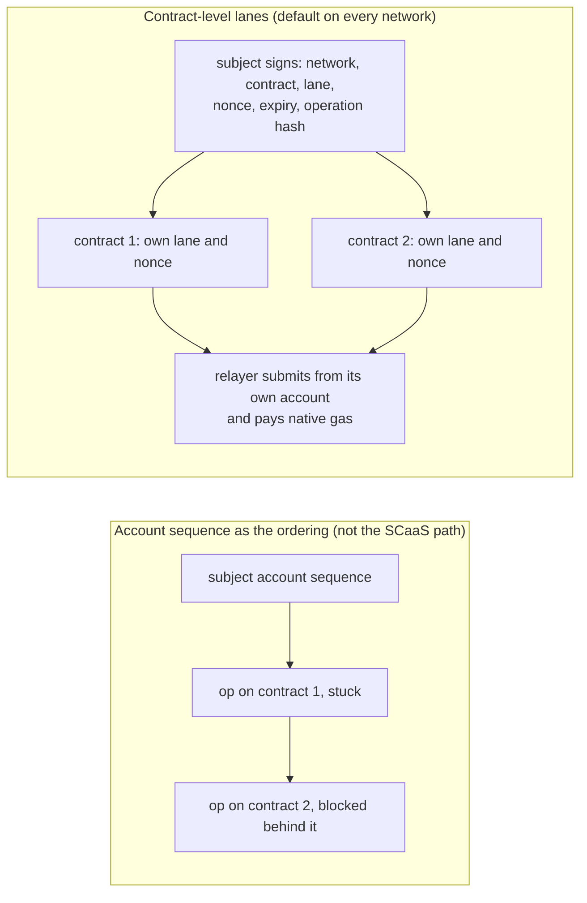
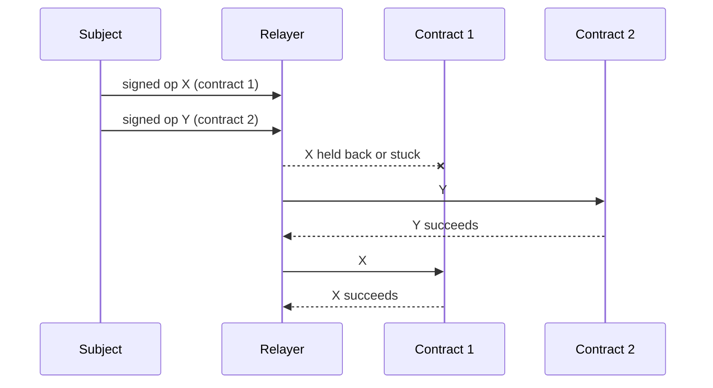

# Networks — the common model for every family

SCaaS runs the same three on-chain roles on eight families: a **token** with `pay` and a contract-level meta
operation, a **mandate** (delegated, capped payments), and a **DEX** settlement contract — plus a multi-key subject
account where the chain needs one. This page states what every family shares; each family page
([EVM](evm.md), [Hedera](hedera.md), [Cosmos](cosmos.md), [Soroban](soroban.md), [Sui](sui.md), [Aptos](aptos.md),
[Solana](solana.md), [GRAM](ton.md)) states only what differs.

Status tags: **BUILT** (in code, tested), **SPECIFIED** (normative, code pending), **PLANNED** (direction, not yet
specified in detail).

**Contents**

1. [Families and chains](#families-and-chains)
2. [Principles](#2-principles)
3. [Common on-chain model](#3-common-on-chain-model)
4. [Signing domains](#4-signing-domains)
5. [Passkeys (WebAuthn P-256)](#5-passkeys-webauthn-p-256)
6. [Universal Account on non-EVM families](#6-universal-account-on-non-evm-families)
7. [Key lifecycle per family](#7-key-lifecycle-per-family)
8. [Head-of-line per adapter](#8-head-of-line-per-adapter)
9. [Finality per family](#9-finality-per-family)
10. [Design lessons](#10-design-lessons)
11. [DEX per family](#dex-per-family)
12. [Availability of component features](#12-availability-of-component-features)

## <a id="families-and-chains"></a>1. Families and chains

The family taxonomy is an owner decision: EVM (Hedera is an EVM chain with its own page), Cosmos (CosmWasm), Soroban
(Stellar and Pi Network), Move (Sui and Aptos), GRAM (formerly TON), Solana. Planned (owner 2026-10-17): NEAR,
Algorand, and TRON as an EVM profile (Base is already a draft EVM profile).

Pay-meta ([CTR-MTX-26](../contracts/metatx.md#CTR-MTX-26)) and the relay fee ([CTR-MTX-27](../contracts/metatx.md#CTR-MTX-27)) are built on the EVM, Hedera, Soroban, Solana, Cosmos, Sui, Aptos and GRAM families (see each family's "Pay-meta and relay fee" section). NEAR and Algorand carry the same two rules: they are brought up on their own branch from `metatx-split` (owner 2026-10-27; spec approved 2026-10-28), with their own spec and plan.

<p align="center"></p>

| Family | Chains | Meta-tx mechanism | Subject signature | Relayer lane key | Mesh v1 | Status |
|---|---|---|---|---|---|---|
| EVM | Gnosis (100), Celo (42220), SCaaS testnet, anvil 31337 | contract-level EIP-712 (`ERC20MetaTx`) | ECDSA secp256k1 (EOA) / ERC-1271 (`SmartKeyAccount`: P-256 WebAuthn, secp256k1) | secp256k1 `m/44'/60'/0'/0/i` | yes | BUILT |
| Hedera | 295 / 296 / 297 / 298 | the same Solidity on HSCS through a JSON-RPC relay | ECDSA (EVM alias) or ED25519 through HIP-632 `isAuthorizedRaw` | secp256k1 `m/44'/3030'/0'/0/i` | yes (family `hedera`) | BUILT |
| Cosmos | CosmWasm chains (`cosmos:<chain-id>`) | contract-level `Relay{payload, auth}` | ADR-036 secp256k1 (Keplr/Leap `signArbitrary`) / WebAuthn P-256 | secp256k1 `m/44'/118'/0'/0/i` | yes | BUILT |
| Soroban | Stellar (`pubnet`, `testnet`, `standalone`), Pi Network (`pi-mainnet`, `pi-testnet`) | native Soroban authorization (`SorobanAddressCredentials`, nonce + ledger expiry) | ed25519 (Freighter `signAuthEntry`) / custom account `__check_auth` with `secp256r1_verify` | ed25519 `m/44'/148'/i'`; Pi `m/44'/314159'/i'` | **no** | BUILT |
| Move — Aptos | 1 / 2 / 4 | contract-level, one `Account` object per owner, lanes inside | ed25519 (Wallet Standard `signMessage`) / WebAuthn P-256 (pure-Move verifier) | ed25519 `m/44'/637'/i'/0'/0'` | yes | BUILT |
| Move — Sui | mainnet / testnet / devnet / localnet | contract-level, shared `Account<T>` per subject, lanes inside | ed25519 / secp256k1 / secp256r1 / passkey (`signPersonalMessage`) | ed25519 `m/44'/784'/i'/0'/0'` | yes | BUILT |
| GRAM | -239 / -3 | custom jetton wallet verifies `SignedOp` | TON Connect `signData` (cell) / passkey | ed25519 `m/44'/607'/i'` (W5R1 lane wallets) | yes (`pay`) | BUILT; **blocked** for every path except the transitional ERP pull path until the forward-TON cap lands ([NET-TON-14](ton.md#NET-TON-14)) |
| Solana | `solana:<genesis hash>` | program-level, `SmartKeyAccount` PDA + `LanePda` | raw ed25519 / off-chain message / passkey, verified through the precompile instruction | ed25519 `m/44'/501'/i'/0'` | yes (`pay`) | BUILT |
| EVM — TRON (planned) | TRON mainnet / Nile / Shasta | the EVM contracts on TRON's TVM (Solidity; TIP-712 typed data) | ECDSA secp256k1 | secp256k1 `m/44'/195'/0'/0/i` | — | PLANNED: energy / bandwidth fees, base58 addresses, TRC-20 |
| NEAR (planned) | mainnet / testnet | to be designed (a contract that checks the signed operation; NEP-141 token) | ed25519 / secp256k1 access keys | ed25519 `m/44'/397'/0'` | — | PLANNED |
| Algorand (planned) | mainnet / testnet | to be designed (an app call that carries the signed operation; ASA or ARC-200 token) | ed25519 / logic signatures | ed25519 `m/44'/283'/0'/0/i` | — | PLANNED |

Lane keys come from one 24-word BIP-39 mnemonic or a raw private key per lane (Pi Network overrides the SLIP-44
`coin_type`)
([NODE-LANE-08](../node/submit-lanes.md#NODE-LANE-08)); `scaas-node addresses` prints every lane address to fund.
Soroban is not on the mesh: its replay protection is the host's per-entry auth nonce, so peers have no readable
per-subject sequential nonce ([NODE-MESH-07](../node/mesh.md#NODE-MESH-07); owner: job API only).

## 2. Principles

<a id="principles"></a>

1. **The client signs, the relayer pays.** No server ever holds a key to sign for a subject. The only exception is
   an explicitly delegated, capped custodial or mandate wallet with four-eyes control
   ([CTR-ACC-06](../contracts/mandates.md#CTR-ACC-06)).
2. <a id="r30-path"></a><a id="NET-ALL-02"></a>**NET-ALL-02** — **Contract-level meta-transactions are the default
   path on every network; the subject's account sequence is never an ordering lock.** An account sequence (Stellar
   sequence, Cosmos account sequence, GRAM wallet seqno, the Hedera account transaction path) queues *every*
   operation of a subject on *every* contract, so one stuck transaction locks the subject everywhere — a severe
   failure mode of blockchains. On every network the subject only **signs** a domain-separated payload (network +
   contract + lane + nonce + expiry + operation hash); **each contract keeps its own lane/nonce space** (a random
   lane derived from the payment reference, nonce 0: [CTR-MTX-03](../contracts/metatx.md#CTR-MTX-03)); a relayer
   submits from **its own** account and pays native gas. Native sponsorship features (Sui sponsored transactions,
   Soroban fee-bump, Cosmos feegrant, GRAM W5) are used only so that a **relayer** pays, never so that the subject's
   sequence orders anything. A relayer runs many signing lanes (accounts derived from one mnemonic by account
   index), each with its own sequence; jobs spread across lanes; the fee sink is a fixed cold wallet and never a
   lane. SCaaS has no ERC-4337 dependency: the meta-transaction lives in the token contract. On EVM and Hedera
   `mtxExecute` (alias `executeMetaTransaction`) runs a self-call of one of the contract's **own** functions on that
   implementation's selector allowlist — never a call to another contract — and a token's transfers and payments are
   `MetaTransfer`s ([CTR-MTX-23](../contracts/metatx.md#CTR-MTX-23), [NODE-JOB-20](../node/job-api.md#NODE-JOB-20)); the
   other families sign the same two kinds ([NET-ALL-26](#NET-ALL-26)); every entry point whose authority is a subject's
   signature is named `mtx…` in the family's case ([NET-ALL-28](#NET-ALL-28)).
3. **The relayer is not a new global lock**: every adapter's head-of-line behaviour is in
   [NET-ALL-03](#NET-ALL-03).
   Every relayer simulates on its own RPCs before signing: EVM and Hedera `eth_call`/`eth_estimateGas` (no vendor fork
   service such as Tenderly), Sui `sui_devInspectTransactionBlock`, Soroban and Solana `simulateTransaction`, Cosmos
   `tx/simulate`, Aptos `/v1/transactions/simulate`, GRAM get-method reads ([NET-TON-17](ton.md#NET-TON-17)).
4. **Owner invariants hold on every network:** no ordinary account is ever a spender (allowance and delegation go to
   contracts/programs only — [CTR-TOK-01](../contracts/token-wrappers.md#CTR-TOK-01)), and on a SCaaS token only a
   contract may call `approve`, so an ordinary account never grants an allowance either (a trade order names its DEX,
   a contract, as the only place its funds may go; a wrap of a SCaaS underlying is signed, not approved), no replay, every signature
   expires, mandate limits per payment and per period, and the client keeps four-eyes control and a snapshot of its
   receiving wallets.
5. <a id="deploy-gate"></a>**Immutable at deploy.** Every program that holds subject value is immutable from the
   moment it is deployed ([CTR-GEN-02](../contracts/README.md#CTR-GEN-02)); a fix is a new deployment plus a
   voluntary migration by the owners. Per family: Aptos `upgrade_policy = "immutable"`
   ([NET-APT-20](aptos.md#NET-APT-20)); Sui `0x2::package::make_immutable(UpgradeCap)` in the same deploy run
   ([NET-SUI-15](sui.md#NET-SUI-15)); Solana upgrade authority `None` after `initialize`
   ([NET-SOL-20](solana.md#NET-SOL-20)); Cosmos instantiated `--no-admin` ([NET-COS-07](cosmos.md#NET-COS-07)); GRAM
   code and Soroban contracts are immutable as built; EVM tokens are non-upgradeable clones. Every deploy script
   ends with a gate that **fails the run (non-zero exit) if the deployed program is still upgradeable** — Aptos
   registry policy ≠ immutable, Sui `UpgradeCap` still present, Solana `Authority` ≠ none, Cosmos contract admin ≠
   empty — and local test validators are not exempt, so tests exercise the gate; a negative test (skip the freeze
   step) makes it fail. The node re-checks at chain activation and at every start and holds an upgradeable chain
   `halted` ([NODE-STO-07](../node/store.md#NODE-STO-07)). Why: a held upgrade key lets one server-side key publish a
   `drain` entry over the stored `ExtendRef`/PDA seeds for every subject on that chain — the failure mode SCaaS
   exists to remove. Cost: no hotfix in place.

Principle 2 in a picture:



## 3. Common on-chain model

<a id="model"></a>

Three pieces, as on EVM:

1. **Token.** Our contract holds the balances; `pay(from,to,amount,payRef)` emits
   `PaymentSettled{from,to,amount,payRef}`; the contract-level signed entries (`mtx_pay`, `mtx_transfer`, one `mtx_<name>` per gasless
   function, [NET-ALL-27](#NET-ALL-27)) check the subject's signature over the domain-separated payload, its lane/nonce, `validUntil` and the optional `relayer`
   binding. Where the chain has allowances, only a contract may be a spender.
2. **Mandate.** As the EVM `MandateWallet`: funds sit in the contract, a delegate signs, limits per payment and per
   period, a payee, an expiry, revocation, each `payRef` once.
3. **DEX.** Two signed legs, fill-or-kill per pair, no allowance to an ordinary account — except GRAM, which uses an
   escrow (actor model, no cross-contract atomicity; [GRAM DEX](ton.md#dex)). EVM and Hedera (SPECIFIED): one taker
   against one or more makers per settlement; each SCaaS leg is a role-free `TradeOrder` verified by its own sell token,
   which moves the funds only into the DEX; no allowance at all ([NODE-DEX-15](../node/dex-venue.md#NODE-DEX-15)).

<a id="metacall"></a><a id="NET-ALL-26"></a>**NET-ALL-26** — **Two signed kinds on every non-EVM family, as on EVM:
`MetaCall` for any gasless function, `MetaTransfer` for transfers and payments** (owner 2026-10-08). Status:
**SPECIFIED**. Family encoding; every field mandatory:

```text
MetaCall     { domain "scaas.metacall.v1",     network, contract, function, args_hash, from, lane, nonce, valid_until, relayer }
MetaTransfer { domain "scaas.metatransfer.v1", network, contract, asset, from, to, amount, entry_ref, lane, nonce, valid_until, relayer }
```

- `function` = the entry's stable name: Move `module::function`, CosmWasm the `ExecuteMsg` variant, GRAM the internal
  opcode (`uint32`), Solana the 8-byte Anchor discriminator, Soroban the host's `function_name`. `args_hash` = the
  family hash (Aptos `sha3_256`, Sui `blake2b256`, CosmWasm and Solana `sha256`, GRAM the cell hash) of the canonical
  encoding of the entry's arguments other than the `MetaCall` and the auth.
- `MetaTransfer` is the EVM `MetaTransfer` ([CTR-MTX-23](../contracts/metatx.md#CTR-MTX-23)): `entry_ref` 0 = a plain
  transfer, ≠ 0 = a payment (`PaymentSettled` with that reference); it keeps the typed fields wallets and the indexer
  read. Family-specific signed bounds stay in the family's `MetaTransfer` (GRAM: the forward-TON floor,
  [NET-TON-14](ton.md#NET-TON-14)).
- `network` = the chain identity of [NET-ALL-22](#NET-ALL-22).
- No fee field off EVM: the lane pays native gas, as for EVM contracts that are not tokens
  ([CTR-MTX-22](../contracts/metatx.md#CTR-MTX-22)); a family that ever charges a token fee adds it to `MetaTransfer`
  only ([INT-ERP-06](../integration.md#INT-ERP-06), [NODE-MESH-05](../node/mesh.md#NODE-MESH-05)).
- One lane space per contract for both kinds ([CTR-MTX-03](../contracts/metatx.md#CTR-MTX-03)). DEX orders keep their
  own signed structs, as EVM keeps `TradeOrder` ([CTR-DEX-13](../contracts/dex.md#CTR-DEX-13)).

Soroban maps both kinds onto the host authorization preimage and has no struct of its own
([NET-SOR-16](soroban.md#NET-SOR-16)). On EVM and Hedera the two kinds *are* the EIP-712 `MetaTransaction` and
`MetaTransfer` ([Hedera mapping](hedera.md#payload)). Transitional (BUILT): the token's generic `relay(op, auth)` checks **`MetaOp` v1** in every
family — `domain = "scaas.metaop.v1"` ‖ network ‖ contract ‖ op (pay | trade | mandate_pay | revoke; GRAM also set_key)
‖ from ‖ to ‖ amount (u128) ‖ payRef (32) ‖ lane (32) ‖ nonce (u64) ‖ validUntil (u64, seconds) ‖ relayer ‖ extra
(H(op parameters); for `trade` the parameters travel verbatim next to it) — and key management and mandates use
structs of their own (`KeyOp`, `ForwardOp`, `MandateInit`, the Cosmos mandate JSON, GRAM `MandatePay`).

<a id="NET-ALL-27"></a>**NET-ALL-27** — **Verify generically, dispatch statically** (owner 2026-10-08). Status:
**SPECIFIED**. Move has no call by name and Solana declares every account up front, so the shared part is verification:
one library per family checks a `MetaCall` or `MetaTransfer` — domain, expiry, relayer binding, lane nonce, signature
(key, passkey, account) — and returns the authorised subject; each gasless function is a typed entry of its own
contract that calls the library with its own `function` and the hash of its own arguments. The allowlist is the set of
entries that call the verifier; a contract adds a gasless function by adding one entry.

| Family | Library | Generic entry | Typed path |
|---|---|---|---|
| Aptos | `scaas::metacall::verify(…, function, args_hash): address` (`public`) | `mtx_<name>(lane, from, args…, lane_id, nonce, valid_until, relayer, auth)` rebuilds the `MetaCall` from typed arguments | `mtx_transfer`, `mtx_pay`, `mtx_execute_transfer`, `mtx_batch_transfer` |
| Sui | `scaas::metacall::verify` (`public`) | as Aptos | `mtx_transfer<T>`, `mtx_pay<T>`, `mtx_execute_transfer<T>` |
| Soroban | none: the host verifies; `SmartKeyAccount.__check_auth` checks contexts ([NET-SOR-04](soroban.md#NET-SOR-04)) | the function itself, `from.require_auth_for_args(args)`, named `mtx_<name>` | SEP-41 `transfer` (standard name), `mtx_pay` |
| CosmWasm | `scaas-metacall` crate: `verify(deps, env, info, payload, auth) -> Addr` | `MtxExecute{payload, auth}`, `payload.msg` = the inner allowlisted message, matched in the contract's own `execute` with the verified `from` (never a self-message, which would carry the contract as sender) | `MtxTransfer`, `MtxPay`, `MtxExecuteTransfer` |
| GRAM | Tact trait `MetaCallVerifier` | `MtxExecute{call, auth, body}`: `hash(body) == args_hash`, then the contract dispatches `body`'s opcode over its allowlist | `MtxTransfer`, `MtxPay`, `MtxExecuteTransfer` |
| Solana | `scaas-metacall` crate (instruction-sysvar signature check, lane PDA) | one instruction `mtx_<name>` per gasless function with its fixed accounts ([NET-SOL-04](solana.md#NET-SOL-04)); the library checks `function` = its own discriminator | `mtx_transfer`, `mtx_pay`, `mtx_execute_transfer` |

A third-party contract (the owner's family-tree example) on Aptos: `mtx_add_person(lane, from, parent, data, lane_id,
nonce, valid_until, relayer, auth)` calls `metacall::verify(…, b"family::add_person", sha3_256(bcs(parent, data)))` and
runs its body with the returned subject; the relayer lane pays gas. Every family has the same shape: one typed entry,
one call into the library.

<a id="NET-ALL-28"></a>**NET-ALL-28** — **Every entry point whose authority is a subject's signature is named `mtx` in
the family's case, and the typed path matches EVM** (owner 2026-10-08). `mtx_` snake case in Move, Soroban and Solana;
`Mtx` Pascal case for CosmWasm `ExecuteMsg` variants and GRAM messages ([CTR-MTX-21](../contracts/metatx.md#CTR-MTX-21)).
Parity with EVM ([CTR-MTX-09](../contracts/metatx.md#CTR-MTX-09), [CTR-MTX-23](../contracts/metatx.md#CTR-MTX-23),
[CTR-MTX-24](../contracts/metatx.md#CTR-MTX-24)):

| EVM | Non-EVM | Rule |
|---|---|---|
| `mtxTransfer` | `mtx_transfer` / `MtxTransfer` (Soroban: SEP-41 `transfer`) | `MetaTransfer{entry_ref: 0}` |
| `mtxPay` | `mtx_pay` / `MtxPay` | `entry_ref = payId`, lane derived on chain as `H("scaas.pay.lane" ‖ payId)`, `nonce = 0` |
| `mtxExecuteTransfer` | `mtx_execute_transfer` / `MtxExecuteTransfer` | `MetaTransfer` on a client-chosen lane (Move: fields as typed arguments); not on Soroban (host nonces, no lanes) |
| `mtxBatchTransfer`, `mtxBatch` | multi-message transactions (Cosmos messages, Solana instructions, Sui PTB commands, GRAM messages from one lane); Aptos `mtx_batch_transfer` with parallel vectors | atomic per transaction |
| `mtxTransferWithFee`, `mtxExecuteWithFee`, `mtxPayReceiverFee` | none while non-EVM tokens charge no relayer fee | added with a token fee |

Entry points whose authority is the native transaction signer (owner-native calls, guardian recovery, admin) and chain
standard interfaces (SEP-41, CW20 `Transfer`/`Send`) keep their names. Programs are immutable at deploy, so the renames
ship as new deployments ([CTR-GEN-02](../contracts/README.md#CTR-GEN-02)).

<a id="NET-ALL-29"></a>**NET-ALL-29** — **Key management and mandate operations are `MetaCall` entries** (owner
2026-10-08). `KeyOp` (`"scaas.keyop.v1"`: Aptos, Sui, Solana), Sui `ForwardOp`, `MandateInit` and the signed mandate
close/revoke messages, the Cosmos mandate JSON (`"scaas.mandate.v1"`), GRAM `MandatePay` and op `set_key` are SCaaS
structs, not chain standards; each becomes a `MetaCall` entry of its contract — `mtx_add_key`, `mtx_remove_key`,
`mtx_set_guardian`, `mtx_cancel_recovery`, `mtx_mandate_open`, `mtx_mandate_pay`, `mtx_revoke`, … — on the contract's
lanes, with one vector set per family. Where the account's keys have no address of their own, the account signs as
itself, as `SmartKeyAccount` on EVM ([CTR-ACC-10](../contracts/accounts.md#CTR-ACC-10)). Native key rotation of the
chain account (Aptos `rotate_authentication_key`) is untouched. DEX `Order`/`Cancel`/min-nonce structs stay
([CTR-DEX-13](../contracts/dex.md#CTR-DEX-13)); the op byte `trade` disappears — where a DEX leg is signed to the token
(Cosmos, GRAM) it becomes the token's `MetaCall` entry `MtxTrade`, with the binding `relayer = to = the DEX` unchanged.

**Account-sequence lanes** (Cosmos, Stellar, GRAM): before each job the runner reads the lane's **committed**
sequence; the outer transaction carries a timebound / `valid_until` equal to the payload's expiry, so a transaction
that never lands expires together with the payload and the sequence never hangs.

<a id="lane-pruning"></a><a id="NET-ALL-01"></a>**NET-ALL-01** — **Families that prune executed lane state keep an
executed lane for at least the horizon H after the op's `validUntil`.** Pay-once ("at most once per request") holds
only if every signature on a pay lane has `validUntil ≤ t_first_issue + H` (`H = LANE_HORIZON = 30 d`,
[CTR-MTX-04](../contracts/metatx.md#CTR-MTX-04)) **and** every pruning family keeps the executed lane for ≥ H:
GRAM two `LANE_TTL` generations (`LANE_TTL` = 30 days), Aptos and Solana `PRUNE_DELAY_S`, Sui `LANE_HORIZON_S`
(30 d). The constants are pinned equal in tests (GRAM `LANE_TTL`, Aptos/Solana `PRUNE_DELAY_S`, node `LANE_TTL_S`,
client `LANE_HORIZON_S`); a node chain on a pruning family must have `max_valid_for_secs ≤ H` and refuses
`max_valid_for_secs > LANE_HORIZON` ([NODE-STO-01](../node/store.md#NODE-STO-01)); every signing client refuses an op beyond the horizon
([NET-APT-24](aptos.md#NET-APT-24), [NET-SOL-25](solana.md#NET-SOL-25)). Issuers that sign terms on a lane beyond H
get no pay-once guarantee. Both conditions hold in the code today (SPECIFIED: the constant-equality tests and the
node refusal).

## 4. Signing domains

<a id="signing-domains"></a>

Where the network identity in each family's signed payload comes from:

| Family | Network in the signed payload comes from | Contract / app binding |
|---|---|---|
| EVM (incl. Hedera) | `block.chainid` (runtime) + `verifyingContract` + `salt = chain_uid` in every SCaaS domain ([NET-ALL-22](#NET-ALL-22); as built, only the Universal Account domains carry it) | EIP-712 domain |
| Aptos | `chain_id::get()` (runtime) | AIP-62 `application ∈ origins` |
| Sui | per-network object ids (`Config`, `Account`) | none ([NET-ALL-23](#NET-ALL-23)) |
| Soroban | `network_id` (host preimage) | host auth preimage (contract + function + args) |
| Cosmos | `env.block.chain_id` (runtime), `env.contract.address` | ADR-036 sign doc (`chain_id: ""`, domain inside the payload) |
| GRAM | config 19 global id, master and wallet addresses | signData `domain`, checked on chain against the wallet's domain set ([NET-TON-02](ton.md#NET-TON-02)) |
| Solana | the genesis hash fixed at build time ([NET-SOL-01](solana.md#NET-SOL-01)) | none ([NET-ALL-23](#NET-ALL-23)) |

Every signature also expires (`validUntil`, compared with chain time) and is bound to one contract and one lane
nonce, so a signature from a test network or another chain is worthless elsewhere. Expiry is per chain
(`max_valid_for_secs`) and bounded by the lane horizon, not a fixed global window.

<a id="chain-identity"></a><a id="NET-ALL-22"></a>**NET-ALL-22** — **A chain is identified by `(chain_key,
chain_uid)`, never by its chain id alone (the chain key resolves to the chain id, so `(chain_key, chain_uid)` and `(chainId, chain_uid)` name the same pair), and `chain_uid` is the `salt` of every SCaaS signing domain.** `chain_uid`
(`bytes32`, `≠ 0`) is the chain's genesis block hash as its RPC reports it (EVM, Hedera). On EVM and Hedera it is a
**constructor immutable**, exposed as `chainUid()`, of every SCaaS contract that checks a signature or binds a
digest to a chain — token implementations (a clone runs its implementation's code, so it uses the implementation's
value and cannot declare another), the factory (which registers only implementations with its own value), the subject
account factory, mandate wallets, the DEX and the Universal Account registry — and it is the `salt` of every SCaaS
EIP-712 domain: `(name, version, chainId, verifyingContract, salt = chain_uid)`, ERC-5267 `eip712Domain()` fields
`0x1f`.

It is also bound into the registry's proof-of-possession digest and the `metatx-cancel` digest
([CTR-UA-07](../contracts/accounts.md#CTR-UA-07)) and into the confidential token's statement, envelope, rollover,
mode, disclosure and `entryRef` digests beside `chainId`, since those are not EIP-712 domains. The EVM cannot read its
own genesis hash after block 256, so a contract cannot *prove* `chain_uid`; the deploy script reads it from the RPC,
and the deploy gate and the node require each contract's `chainUid()` = the RPC's genesis hash = the chain profile
([NODE-GW-07](../node/gateway.md#NODE-GW-07), [NET-EVM-05](evm.md#NET-EVM-05)). `chain_uid` alone is not unique — Ethereum and ETC, Avalanche C-Chain and Fuji share a genesis — a chain is identified by `(chainId, chain_uid)` together; pruned RPCs (EIP-4444) may not serve block 0, so deploy scripts and the node read [`chain-uids.json`](../../smartcontracts/evm/chain-uids.json).

A wrong value makes correct signatures
fail; it is unsafe only if it equals another chain's `chain_uid`, which that comparison excludes. The guarantee is that
honest contracts on two chains sharing a chain id (7622 or any other) never accept each other's signatures, whichever
wallet produced them. A replica deployed elsewhere from a copy of our profile is trusted by nothing of ours: tokens
bind the registry address at `initialize`, and the node binds every contract's `chainUid()` and the RPC's genesis hash
per chain profile and refuses a mismatch. Because contracts are deployed through a CREATE2 deployer with a fixed salt
([NET-EVM-05](evm.md#NET-EVM-05)), a contract whose constructor takes `chain_uid` — and every clone made from it — has
a **different address on each chain**, so a user's subject account does too; a contract with no chain-specific
constructor argument has the same address everywhere.

Safety does not rest on the address: the salt is in every
digest. Limit: a genesis hash does not separate the two branches of a fork, which share genesis
([NET-ALL-25](#NET-ALL-25)). Non-EVM families take the family's genesis or network identifier where the runtime
exposes it (Soroban network id, Solana genesis hash), else a chain-profile constant, each fixed with vectors; it is the `network` field of `MetaCall`/`MetaTransfer`
([NET-ALL-26](#NET-ALL-26)). Hedera:
the relay's block-0 hash, fixed only once it is confirmed stable across mirror-node and relay restarts
([hedera.md#payload](hedera.md#payload)). Why: chain ids are a registry convention, not unique — 9000 is also Evmos
Testnet, which is why the private chain moved to the SCaaS testnet ([NET-EVM-02](evm.md#NET-EVM-02)). Transitional (BUILT): only
the Universal Account registry and the UA meta-transaction domain carry `chain_uid`; deployed tokens, the factory,
subject accounts, mandate wallets and the DEX sign with `(name, version, chainId, verifyingContract)` and are
deployed with CREATE, until the salted contracts replace them (nothing is deployed outside test chains).

<a id="chain-profile"></a><a id="NET-ALL-24"></a>**NET-ALL-24** — **A chain profile carries the chain's `chain_uid`
and its list of SCaaS DEX contracts.** Status: **SPECIFIED**. Every EVM and Hedera chain profile — the node's chain row
with its registered contracts ([store.md](../node/store.md)), the signer's own pinned profile
([CLI-SGN-08](../clients/signers-clientkeys.md#CLI-SGN-08)) and the app's chain configuration — holds `chain_uid` and
the list of DEX contracts deployed by SCaaS on that chain (each with its `chainUid()` checked).

Clients fill
`domain.salt` from `chain_uid` and refuse to build or sign a trade order whose `dex` is not on the list
([CLI-SGN-33](../clients/signers-clientkeys.md#CLI-SGN-33), [CLI-SGN-35](../clients/signers-clientkeys.md#CLI-SGN-35));
the node routes and settles orders only for listed DEXes ([NODE-DEX-16](../node/dex-venue.md#NODE-DEX-16)). A
client takes both values from its own pinned profile (built in, or pinned by the user) and uses a server's
`/v1/gateway` answer only to detect a disagreement, never as the source. Why: the token requires only that a trade
order's `dex` is a contract (owner, 2026-10-08), so the list of genuine DEXes has to live where the signer and the
relayer can check it. Cost: a new DEX reaches users only with a profile update.

<a id="chain-forks"></a><a id="NET-ALL-25"></a>**NET-ALL-25** — **A chain we run that forks becomes a new chain, and
no two chain profiles share a genesis hash.** Owner ruling 2026-10-08. Two branches of a fork share their genesis
block, so `chain_uid` cannot tell them apart and a signature made on one replays on the other. For chains SCaaS runs,
a fork is a new chain: a new chain id (EIP-155 practice) and a new `chain_key`, with its own profile; the deploy gate
enforces it. A private chain re-created from the **same** genesis file would also repeat its genesis hash, so every
private chain's genesis carries a unique `extraData` nonce, and the deploy gate and the node refuse a genesis hash
that is already present in any chain profile. On public chains SCaaS relies on the fork's own chain-id change; a fork
without one is a documented residual (signatures replay on both branches until the profile is withdrawn). Cost: a
fork of our own chain needs fresh deployments and profiles.

## 5. Passkeys (WebAuthn P-256)

<a id="webauthn"></a>

A WebAuthn assertion `{authenticatorData, clientDataJSON, r, s}` on P-256; the challenge in `clientDataJSON` is
`base64url(op digest)` — the EIP-712 digest on EVM, the family's typed digest elsewhere.

<a id="NET-ALL-04"></a>**NET-ALL-04** — **One WebAuthn rule and one bounded `clientDataJSON` grammar for every
family.** Every passkey verifier checks, in order:

1. `authenticatorData` ≥ 37 bytes;
2. `rpIdHash` (its first 32 bytes) equals the stored one (`SHA-256(rpId)`);
3. flags UP **and** UV;
4. `type == "webauthn.get"`: `clientDataJSON` matches exactly `{"type":"webauthn.get","challenge":"<b64url(digest)>","origin":"` + origin +
   `"` followed by either `}` (end of input) or `,"crossOrigin":false` followed by `}` (end) or `,`;
   `crossOrigin: true` and any `topOrigin` are refused, as is any member before `crossOrigin` and any whitespace;
5. the origin bytes equal a stored origin **exactly** (no prefix match — a prefix rule accepts
   `https://a.example.evil` for `https://a.example`);
6. `s ≤ n/2` (low-s);
7. P-256 over `sha256(authenticatorData ‖ sha256(clientDataJSON))`.

The check is the bounded parsing algorithm of WebAuthn Level 3 (§5.8.1.2 of that standard): a fixed prefix
`{"type":"webauthn.get","challenge":"<b64url>","origin":"`, then the origin up to the next `"`, compared with the stored
origin (EVM stores `originHash` = keccak(origin) in the key), then only the allowed suffixes. No client-supplied
`typeIndex/challengeIndex` is needed; a browser that orders members differently fails closed.

The shared vectors `smartcontracts/test/vectors/webauthn_kat.json` (accept cases in the Safari Level 2 and
Chrome/Firefox Level 3 shapes; reject cases: `crossOrigin:true`, `topOrigin`, a member before `crossOrigin`,
whitespace, an origin extended by a suffix, wrong rpIdHash, UV unset, high-s, the challenge of another digest) run in
every family's test suite. Why: a page that can obtain an assertion for the rpId (sibling subdomain, related origin,
delegated iframe) would otherwise sign any op; a cross-origin iframe yields assertions that carry the RP's origin.
Status: BUILT on EVM and Aptos; SPECIFIED for the strict grammar and exact origin on Sui, Soroban, GRAM and Solana and
for rpIdHash/origin/UV/low-s on Cosmos ([NET-COS-03](cosmos.md#NET-COS-03)).

Client side: WebAuthn returns a **DER** signature and authenticators do not enforce low-s, so the client decodes DER
into `(r, s)` and normalises `s := n − s` when `s > n/2` (still valid) before sending.

**Batching** (EVM and Soroban only; other families verify one digest per assertion): the challenge is the Merkle
root (keccak on EVM, sha256 elsewhere) of the op digests; leaves are double-hashed `H(H(0x00 ‖ digest))` against
second preimages; each op carries `(assertion, proof)`; the verifier checks proof(digest → root), then the assertion
on the root. One biometric prompt for N lines, every line bound to the signed root.

Verifier primitive per family: EVM and Hedera OpenZeppelin 5.2 `P256.verify` (RIP-7212 / EIP-7951 precompile at
`0x100` when present — probed per chain as `has_p256_precompile` — else a Solidity verifier of ~200–330 k gas); Sui
`ecdsa_r1::secp256r1_verify`; Soroban `env.crypto().secp256r1_verify` (CAP-51); Cosmos `secp256r1_verify` of
cosmwasm-std 2.1+; GRAM `P256_CHKSIGNU/P256_CHKSIGNS` (TVM upgrades of 2023/2024, used through `asm` in Tact); Aptos a pure-Move verifier ([NET-APT-14](aptos.md#NET-APT-14)); Solana the
secp256r1 precompile through instruction introspection ([NET-SOL-12](solana.md#NET-SOL-12)). Each family's subject
account or contract stores the passkey; a passkey-signed op takes the same meta-transaction path as any other op of
that family. Client rules for creating and using passkeys: [CLI-SGN-09](../clients/signers-clientkeys.md#CLI-SGN-09).

<a id="readable-signing"></a><a id="NET-ALL-23"></a>**NET-ALL-23** — **Solana and Sui wallet-key signatures: no
blind blobs; origin binding through the passkey path or an opt-in account policy.** On-chain *application* binding
of a wallet's `signMessage` / `signPersonalMessage` is not possible on Solana and Sui: unlike AIP-62 (an
`application:` line written by the wallet) and WebAuthn (`origin` written by the browser), these wallets put no
requesting origin into the signed bytes, so any line a contract checks could be written by the phishing page itself.
Therefore:

1. **Readable payload, rebuilt on chain.** The signed bytes are UTF-8 text the contract re-renders from the `MetaTransfer`
   ([NET-ALL-26](#NET-ALL-26)) and compares byte for byte (a `MetaCall` renders `SCaaS <function>`, `Args: <args_hash>`,
   the network, expiry and digest; the app and clientkeys decode its arguments before signing):

   ```
   SCaaS <op>
   Amount: <decimal> <symbol>
   To: <address>
   Network: <id>
   Valid until: <unix>
   Ref: <hex>
   Digest: <hex>
   ```

   Solana as an off-chain message v1 (restricted UTF-8, `\xffsolana offchain` envelope), Sui as a UTF-8 personal
   message (not BCS). Decimals and symbol come from the on-chain token or config object. A wallet then shows what is
   paid, so the wallet path is as safe as signing a wallet transaction on that page.
2. **Origin-bound path by default.** Portal and app flows on Solana and Sui offer the passkey first (origin and
   rpIdHash checked on chain, [NET-ALL-04](#NET-ALL-04)).
3. **Opt-in on-chain binding.** An account policy bit `POLICY_PASSKEY_FOR_VALUE` (Solana `SmartKeyAccount.policy`,
   `account.rs:254`; Sui `Keys.policy`), set by a key operation, makes value ops (`pay`, `trade`, mandate setup) require a passkey
   signature; wallet keys then authorise key operations only.

Residual risk, stated to users: a user who approves a readable "pay X to Y" message on a phishing page has
authorised it, as with any wallet transaction. Tests: the readable text verifies; a hex-only text is refused; a text
whose amount or `to` differs from the `MetaTransfer` is refused; with the policy bit a wallet-key `pay` is refused and a
passkey `pay` passes. Status: SPECIFIED (built today: Solana signs `"<label>:" ‖ hex(sha256(MetaOp))`, Sui signs
BCS). Client rendering: [CLI-SGN-27](../clients/signers-clientkeys.md#CLI-SGN-27).

## 6. Universal Account on non-EVM families

<a id="ua-registries"></a><a id="NET-ALL-20"></a>**NET-ALL-20** — **Per-family registries share the kind table, the
tags, the derivations and one vector file** (`smartcontracts/vectors/ua/kinds.json`,
[CTR-UA-05](../contracts/accounts.md#CTR-UA-05)); each family realises the registry in its own idiom. GRAM
has no registry in v1: a derived key on GRAM is bound by the native wallet owner's `set_key`, which **also carries a
signature by the bound key** over `uaMessage(kind, POP_TAG, pop_digest)` (`registry_id` = the jetton-wallet address;
TVM `CHKSIGNS` for ed25519, `P256_CHKSIGNS` for P-256), so binding is consent **and** possession; chain-wide keyHash
uniqueness is not enforced there (the other purpose layers still hold, and the wallet refuses binding the same key
under two wallets). Why: GRAM calls are asynchronous, and owner consent alone would let a wallet claim someone else's
key. Owner-confirmed.

<a id="ua-passkey-ids"></a><a id="NET-ALL-21"></a>**NET-ALL-21** — **Non-EVM passkey owners become the
`webauthn-p256` UA id, and a derived id is never shown in a native address format.** Cosmos: the passkey account is
the 32-byte UA id instead of a 20-byte truncated hash; Solana: the passkey owner is the UA id instead of
`sha256("scaas.owner.p256" ‖ pk33)`. Both change at the family's next version. These ids are ledger keys inside our
contracts, not accounts of the chain: nobody can sign for them as an x/auth account or a Solana pubkey, so a bank
`MsgSend`, a SOL transfer or an ATA created for one burns funds. They are therefore **displayed and encoded only as
`urn:scaas:ua:v1:<kind>:<hex32>`** (never the chain's account HRP, never base58 as a pubkey), and wallets and
clientkeys refuse a native send to that form. Why: a 20-byte form is exactly the truncation the UA id space forbids
(2^80 collision work against secp256k1 accounts, [CTR-UA-03](../contracts/accounts.md#CTR-UA-03)); an
account-shaped form invites native sends to a keyless address. Cost: dev passkey accounts re-open; users copy a URN,
not an address. Owner-confirmed.

## 7. Key lifecycle per family

<a id="key-lifecycle"></a><a id="NET-ALL-05"></a>**NET-ALL-05** — **Key rotation and recovery are stated per family;
every gap is listed, never implied away.** The subject-account "equivalents per family" are:

| Family | Rotation | Guardian / recovery | Gap |
|---|---|---|---|
| EVM | `SmartKeyAccount` add/remove/rotate through `mtxExecute` signed by the account ([CTR-ACC-10](../contracts/accounts.md#CTR-ACC-10)) | guardian + `RECOVERY_DELAY` (default 2 days, cancellable by a key) | — |
| Hedera | native account key update (no `SmartKeyAccount` on Hedera) | native | — (stated) |
| Aptos | account keys + origins in `Account` | guardian + `RECOVERY_DELAY` | — |
| Sui | per `Account<T>` as built → per subject `Keys` object ([NET-SUI-02](sui.md#NET-SUI-02), SPECIFIED) | guardian per `Account<T>` as built | moves to `Keys` |
| Soroban | account-authorised add/remove | **seam only** ([NET-SOR-03](soroban.md#NET-SOR-03)) | guardian + delayed recovery (SPECIFIED) |
| Cosmos | **none** (passkey owner = `webauthn-p256` UA id, [NET-ALL-21](#NET-ALL-21)) | **none** | passkey account contract with rotation (design first) |
| GRAM | wallet key follows the owner's wallet; **a passkey cannot rotate** | **none** | guardian + delayed passkey rotation (SPECIFIED) |
| Solana | key operations add/remove/policy | `start_recovery` / `finish_recovery` | — |

The **backup-key switch** ([CLI-SGN-12](../clients/signers-clientkeys.md#CLI-SGN-12)) applies per family as follows:

| Family | Subject account | Max keys | Guardian | Satisfiable by | On-chain bit | Client-side check by the ERP |
|---|---|---|---|---|---|---|
| EVM, Hedera | `SmartKeyAccount` | unbounded | yes | 2 keys or key + guardian | no | yes |
| Sui | `Account<T>` | 8 | yes | as EVM | no | no |
| Aptos | `Account` object | 8 | yes | as EVM | no | no |
| Solana | `SmartKeyAccount` PDA | 8 | yes | as EVM | opt-in (no de-duplication) | no |
| Soroban | `SmartKeyAccount` `C…` | multi | no | **≥ 2 distinct keys** (owner) | no | no |
| GRAM | `ScaasJettonWallet` | 2 (`pubkey` + one passkey) | no | **both keys** (owner) | no | no |
| Cosmos | none (native; multi-key seam) | 1 | no | seed: native; passkey-only: **unsatisfiable** | no | no |

## 8. Head-of-line per adapter

<a id="head-of-line"></a><a id="NET-ALL-03"></a>**NET-ALL-03** — **Every adapter states how it avoids head-of-line
blocking, and every family passes the anti-lock test.**

| Family | Who submits | Ordering on the relayer side | Why one stuck transaction locks nothing else |
|---|---|---|---|
| EVM | lane EOA | nonce per lane; pipeline, replacement, gap-fill | the subject has no account nonce on the path; other lanes continue |
| Hedera | lane ECDSA account | one transaction in flight per lane (`lane_runner`), committed nonce read before each job | no mempool; meta-tx lanes live inside each contract ([NET-HED-08](hedera.md#NET-HED-08)) |
| Sui | lane address, own gas coin | no nonce; one gas coin and one transaction in flight per lane | object version per lane; the subject's shared object has no sequence |
| Aptos | lane account | sequence-number transactions; each `(lane, seq)` runs exactly once | no object locks, so no equivocation |
| Soroban | lane account | sequence per lane, one transaction in flight | the subject's auth entry uses a non-sequential nonce |
| Cosmos | lane account | account sequence per lane, one transaction in flight | the subject sends no transaction |
| GRAM | lane wallet (W5) | seqno per lane, one transaction in flight | the subject sends no transaction; the subject's jetton wallet keeps its own lanes/nonces |
| Solana | lane key with its own durable nonce account | one durable-nonce value per landed transaction | write-locks of two ops of one subject on different contracts are disjoint ([NET-SOL-04](solana.md#NET-SOL-04)) |



Mandatory test per network (**anti-lock**): the subject signs op X on contract 1 and op Y on contract 2; X is held
back (not sent, or sent stuck); Y still succeeds; then X succeeds. Soroban is off the mesh, so its anti-lock test runs
on the job-API path only.

## 9. Finality per family

The node's finality gate and event-set quorum are node rules
([NODE-IDX-01](../node/indexer-feeds.md#NODE-IDX-01)): `final_head` is the minimum height reported by ≥ `quorum`
endpoints with the same block/ledger/checkpoint hash at that height, and `events(from, to)` must return the **same
normalised list** from ≥ `quorum` endpoints; `quorum = 1` is single-provider trust and is reported as such. The
per-family inputs:

| Family | Final when | Event source agreed across the quorum |
|---|---|---|
| EVM | `tag finalized` (Gnosis ~160–240 s), or a configured depth (SCaaS testnet: depth 1) | `eth_getLogs` |
| Hedera | record file accepted (`instant`, depth 0) | `eth_getLogs` through the relay (1 000 blocks per call) |
| Cosmos | committed block (`instant`, CometBFT) | `status` + `block` at the minimum height and the tx events of the range |
| Soroban | closed ledger (`instant`, SCP) | `getEvents` per ledger range |
| Sui | certified checkpoint | event query per checkpoint range |
| Aptos | committed block (AptosBFT), cursor bounded by the Indexer API's processed version | per-transaction agreement (BUILT) |
| GRAM | masterchain block (`depth 0`) | `masterchainInfo` + the jetton wallets' transactions of the range |
| Solana | commitment `finalized` | per-signature transaction agreement (`emit_cpi` inner data) |

Status: BUILT for Aptos and for EVM/Hedera head hashes; SPECIFIED for event-set agreement on the other families and
for Cosmos and GRAM honouring a configured quorum (today a single endpoint).

Every adapter normalises events to one shape ([NODE-IDX-05](../node/indexer-feeds.md#NODE-IDX-05)) with
family-specific address forms: EVM lowercase `0x`, bech32, `0x` + 64 hex, `G…`/`C…` strkeys, raw `wc:hex`, base58.
Heights are block / height / ledger / checkpoint / masterchain seqno / slot.

## 10. Design lessons

<a id="design-lessons"></a>

Lessons from the first families' reviews, designed into every family from the start:

- <a id="NET-ALL-06"></a>**NET-ALL-06** — **The indexer filters by the registered contracts in the family's own
  address form, and an empty list never advances the cursor.** The token list comes from the node store per
  namespace ([NODE-JOB-12](../node/job-api.md#NODE-JOB-12)); `events(from,to,contracts)` filters by `nc.tokens`;
  there is no static contract list in adapter parameters (`params.contracts`); the shared `index_step` holds the cursor;
  unfinalised ranges are never queried.
- <a id="NET-ALL-07"></a>**NET-ALL-07** — **End-to-end fakes return real token ids and refuse unregistered
  emitters.** The fake job-API client returns the address the test just deployed; ingest refuses `contract ∉
  tokens`; a second deployment of the same code emitting identical events is ignored.
- <a id="NET-ALL-08"></a>**NET-ALL-08** — **Every amount chosen by the relayer that decides whether value arrives
  must be inside the payer's signature.** Gas, compute units and priority fees chosen by the relayer may only affect
  the relayer: an out-of-gas rolls back everything except the lane's fee and nonce. A billed failure is rebuilt
  **once** at the configured cap, then reported `reverted` ([NET-APT-21](aptos.md#NET-APT-21),
  [NET-SOL-23](solana.md#NET-SOL-23); Solana at `max_cu`). The forward-TON cap ([NET-TON-14](ton.md#NET-TON-14),
  the unsigned `forwardTon` amount) is the case that taught it.
- <a id="NET-ALL-09"></a>**NET-ALL-09** — **A permanent refusal at submit frees the lane at once** (`Rejected`),
  and a billed on-chain failure is `Rejected` at most once, then `reverted`
  ([NODE-LANE-14](../node/submit-lanes.md#NODE-LANE-14)).
- <a id="NET-ALL-10"></a>**NET-ALL-10** — **Lanes are crash-safe: no equivocation, no sequence used twice.**
  Each family states which chain mechanism enforces it (EVM nonce journal, Sui lane journal, Aptos sequence numbers,
  Solana durable nonce, where `sequence(lane)` = the nonce value so the shared `recover_lane` is exact).
- <a id="NET-ALL-11"></a>**NET-ALL-11** — **Multi-key accounts with origins and a guardian survive an origin
  change.** Up to 8 keys and 8 origins where the family has a subject account; a new origin under the **same rpId**
  is added by that passkey's own signature, so moving a portal domain does not brick the account; the
  "backup key required" policy is default off.
- <a id="NET-ALL-12"></a>**NET-ALL-12** — **Coins sent directly to an account or contract address stay spendable.**
  Balances are the chain's own stores of the account address (no internal ledger that ignores direct deposits), and
  markets/mandates that can receive stray funds have a `sweep`.
- <a id="NET-ALL-13"></a>**NET-ALL-13** — **No shared object serialises all markets.** One `Market` object per pair;
  nonces and fills per market; no global counter written on the hot path.
- <a id="NET-ALL-14"></a>**NET-ALL-14** — **A client verifies a signature only with a key it can prove belongs to
  the payer** ("signer == payer"). A verifier returns `True` only when the public key derives the payer's address;
  a passkey or a key added later yields "unknown", and the node's simulation decides ([INT-ERP-03](../integration.md#INT-ERP-03)).
- <a id="NET-ALL-15"></a>**NET-ALL-15** — **Lane and nonce state is prunable and its storage is refunded.** Every
  lane/fill/mandate-reference entry stores `valid_until` (and, where rent exists, the `rent_payer`); `prune` is
  permissionless after expiry plus the horizon ([NET-ALL-01](#NET-ALL-01)) and refunds the storage to the right
  party; signer-chosen expiries are capped on chain so entries always become prunable.
- <a id="NET-ALL-16"></a>**NET-ALL-16** — **Base58 addresses and ids are never case-folded.** Solana signatures are
  64 bytes, so a `tx_id` is `0x` + 128 hex (safe against `.lower()`) and ingest accepts 64-byte `tx_hash` for the
  `solana` family; addresses never pass through a lower-case normalisation
  ([client address rules](../integration.md#addresses)).

## <a id="dex-per-family"></a>11. DEX per family

<a id="dex-per-family"></a>

The book, matcher, gateway and client mirror are shared (they depend on no EVM detail beyond addresses and hashes).
Each family supplies a "settlement adapter" — a settlement contract that keeps the same invariants:

1. Signed orders are domain-separated (network + DEX contract + every order field) and verified on chain with the
   subject's key; no account sequence; nonces and `filled` are held by the DEX contract. EVM and Hedera (SPECIFIED):
   a SCaaS leg is verified by its sell token in the token's domain (network + token + `chain_uid`), which holds the
   order's fill state and cancels; only outside-token legs are verified and held by the DEX
   ([NODE-DEX-15](../node/dex-venue.md#NODE-DEX-15)).
2. `filled[orderHash]` on chain, no overfill, cross-multiplied price check, `maxFeePpm` inside the order, fee cap
   1 %.
3. Cancel closes `filled` with the owner's signature; `minNonce` raises in bulk, capped below `2^(w−1)` for the
   family's nonce width `w` — `min_nonce < 2^(w−1)` (Sui/Aptos `u128`, Solana `u64`;
   [CTR-DEX-10](../contracts/dex.md#CTR-DEX-10)). As built, the three accept `u128::MAX` / `u64::MAX`, so one mistaken
   signature locks a maker out of a market forever (`sui dex.move:295`, `aptos dex.move:299`, `solana dex.rs:340`;
   SPECIFIED fix).
4. Value moves person to person inside one transaction: Soroban two `require_auth`; Sui `Account<T>` two legs;
   Cosmos CW20 `TransferFrom` with the allowance to the DEX contract; GRAM escrow (the one exception that holds funds
   briefly, since jettons have no `transferFrom`).
5. Events equivalent to `OrderFilled/Matched/MatchFailed`, so the watcher and the client mirror work unchanged.
6. Settlement is bound to the relayer ([CTR-DEX-09](../contracts/dex.md#CTR-DEX-09)): the order names a `relayer`
   (0 = open, except Soroban, which has no open form, [NET-SOR-10](soroban.md#NET-SOR-10)) and the contract checks
   the submitter. BUILT on Sui (`dex.move:321`), Aptos (`dex.move:382`) and Solana (`dex.rs:187`); SPECIFIED for
   Cosmos (as built `Settle` does not check `info.sender` and `OrderParams` has no relayer,
   `cosmos/dex/src/lib.rs:29-34, 145`; fix: add `relayer` to `OrderParams`, `info.sender == relayer` when set),
   Soroban (as built `require_auth_for_args((order,))` binds only the order, not the counter-order, `maker_fill` or the
   submitter, `lib.rs:158-159`; fix: `relayer: Address` in `Order` + `relayer.require_auth()`) and GRAM (as built
   `receive(Match)` is open, `dex.tact:138-144`; fix: optional `relayer` in `TradeParams`, compared with `sender()` at
   `Match` and on the hint path). Without it, a mempool watcher copies the auth entries, inserts its own pair and
   takes the taker's price improvement.

Accepted differences, which the adapter, matcher and client must know:

| Difference | Families |
|---|---|
| No partial fill (fill-or-kill orders only) | Cosmos, GRAM |
| No `minNonce` (bulk cancel) | Cosmos, Soroban, GRAM |
| IOC closes at its first fill (one maker, [NODE-DEX-09](../node/dex-venue.md#NODE-DEX-09)) | Sui, Aptos, Solana |
| One fee recipient for the whole DEX, not per market | Cosmos (`InstantiateMsg`), Soroban (`Key::FeeRecipient`) |
| One `fee_ppm`, no maker/taker split (`dex.rs:74-97`) | Solana |
| Minimum received measured **after** the DEX fee (EVM: `buyAmount`, target `receiveAmount`, gross) | Cosmos, GRAM |
| No on-chain self-trade check (the node still skips self-trades) | Cosmos, Soroban |

Non-EVM books are served after the venue moves into the node store ([CLI-APP-21](../clients/app.md#CLI-APP-21)).

## 12. Availability of component features

<a id="availability"></a>

- <a id="NET-ALL-17"></a>**NET-ALL-17** — **The asset suite is specified for EVM and Hedera only.** When: each
  other family gets its own short specification after the EVM+Hedera build and after its token-wrapper work, and must
  satisfy the asset-suite rulings or amend them explicitly ([contracts/asset-suite](../contracts/asset-suite.md));
  candidate native mechanisms below are named for that assessment only, and none is relied on.
- <a id="NET-ALL-18"></a>**NET-ALL-18** — **The sealed-bid tender ships on EVM and Hedera first** (owner): the same
  bytecode on HSCS — the tender verifies no signature, so no Hedera child is needed, and HIP-632 bidders are handled by
  the deposit token. Prerequisite EIP-1153 (`TLOAD`/`TSTORE`) for the reentrancy guard; it is not new, since every
  deposit token already needs it (`MetaTxCore.nonReentrant`, `MetaTxCore.sol:38-44`, inherited by the v2 tiers and
  the Hedera children; `ERC20MetaTx.sol:35-41` for v1); the deploy script probes `TSTORE` and refuses a chain without
  it (no storage-guard fallback). Cosmos, Soroban, Sui, Aptos, GRAM and Solana are PLANNED with the notes below
  ([contracts/tender](../contracts/tender.md)).
- <a id="NET-ALL-19"></a>**NET-ALL-19** — **Token wrappers v2 are EVM and Hedera only**; Move and Solana need no
  wrapper for gaslessness; Cosmos, Soroban and GRAM wrappers are PLANNED
  ([contracts/token-wrappers](../contracts/token-wrappers.md)).

| Component | EVM | Hedera | Cosmos | Soroban (Stellar, Pi) | Move (Aptos, Sui) | GRAM | Solana |
|---|---|---|---|---|---|---|---|
| Regulated module | SPECIFIED | SPECIFIED (HSCS contracts + HIP-632 + fail-closed HTS underlying checks; HTS-native tokens not used, owner) | PLANNED: CW20 variant with the same rules | PLANNED: SEP-41 variant; native flags (auth-required, clawback) to assess | PLANNED: native mechanisms to assess (Aptos FA `TransferRef` freeze/transfer; Sui regulated-coin deny list) | PLANNED: jetton master + wallet with order records | PLANNED: Token-2022 extensions to assess (permanent delegate, default frozen state, transfer hook) |
| ComplianceRegistry | SPECIFIED | SPECIFIED | PLANNED | PLANNED | PLANNED | PLANNED | PLANNED |
| VestingGrant, Distribution, ExchangeOffer | SPECIFIED | SPECIFIED | PLANNED | PLANNED | PLANNED (subject account holds any asset; contracts as Move modules) | PLANNED | PLANNED |
| Snapshot builder | SPECIFIED | SPECIFIED (same indexer) | with each family's token | 〃 | 〃 | 〃 | 〃 |
| Managed markets | SPECIFIED | SPECIFIED | where an order book exists | — | — | — | — |
| Sealed-bid tender | SPECIFIED | SPECIFIED (same bytecode on HSCS; the tender checks no signature, so no Hedera child; deposit token = Hedera v2 meta token; tight gas limit since HSCS charges ≥ 80 % of it) | PLANNED: contract holds the deposit; commit = the meta token's signed `Relay` op with a `pay` memo = `depositRef`, executed by the tender via submessage; commitment over `(chain_id, contract, tender, bidder, price, salt)` with SHA-256 | PLANNED: the bidder's `require_auth` entries for `commit_bid` (deposit = SAC/token `transfer` sub-invocation in the same auth tree); reveal/withdraw permissionless | PLANNED: tender object / resource; deposit coin moved by the relayer-submitted PTB / entry function under the bidder's signed op; time from `Clock` / `timestamp` | PLANNED: async — deposit arrives as a jetton `transfer_notification` with `forward_payload = (tenderId, commitment)`; reveal/withdraw are internal messages; bounce handling on refunds | PLANNED: program + PDA vault per tender; deposit through the token-program CPI under the bidder's precompile-verified op |
| Receiver-pays | EVM v2 | Hedera v2 | — | — | — | — | — |
| Gas sponsorship policy (node) | all | all | book and limit only | 〃 | 〃 | 〃 | 〃 |
| Token wrappers v2 | SPECIFIED | SPECIFIED ([hedera wrappers](hedera.md#wrappers)) | today `scaas-token` (CW20 + meta-op, `minter`, `initial_balances`, tier 1): tier 1 unchanged (gets `Burn` and minter renounce with its next version); wrapper of a bank denom (`info.funds`) or a CW20 (`Receive`) with the same rate/reserve rules and `wrap_rate_vectors.json`: PLANNED | today SEP-41 token + `pay`, admin `mint`, `burn` (tier 1): unchanged; wrapper of a Stellar Asset Contract (e.g. USDC): PLANNED | none needed (the subject `Account` holds any FA / `Coin<T>`; gasless for every asset) | today Tact jetton + custom wallet + `SignedOp`, admin `Mint` (tier 1): unchanged; third-party jettons cannot carry `SignedOp`, so a wrapper minter (receive `transfer_notification`, mint; unwrap with bounce handling) is the only gasless route: PLANNED, highest value of the three | none needed (the `SmartKeyAccount` PDA owns SPL token accounts for any mint) |
| Post-quantum Zether | SCaaS testnet only (precompile in our client); dev chains 31337/1337 tests only (anvil cannot host the precompile, so forge mocks it with `vm.mockCall` on KAT inputs; end to end on a SCaaS testnet copy); other private EVM clients not in v1 (later via an attestation seam); public EVM never without an owner ruling | no | Cosmos SDK private chains feasible later (Go module calling `libpqz` via cgo; own spec) | no | no | no | no |
| Crypto-shredding commitments | keccak256 | keccak256 | SHA-256, tag `scaas.commit.sha256.v1` | 〃 | 〃 | 〃 | 〃 |

Common to all wrappers: fees are `NONE` off EVM, so fee policies are EVM/Hedera only; named meta-tx functions are
EVM/Hedera (non-EVM ops are already named — `pay`, `Relay{payload}`, `SignedOp`); a multi-underlying guardian and
rate timelock, when built elsewhere, follow the EVM rules verbatim. Receiver-pays is unavailable on v1, Zether and
non-EVM families; there the options are payee self-relay and sponsorship. Sponsorship cost fields apply on every
family and `signed_op` jobs match on the decoded op. Classical Zether feasibility per family:
[contracts/zether](../contracts/zether.md).
