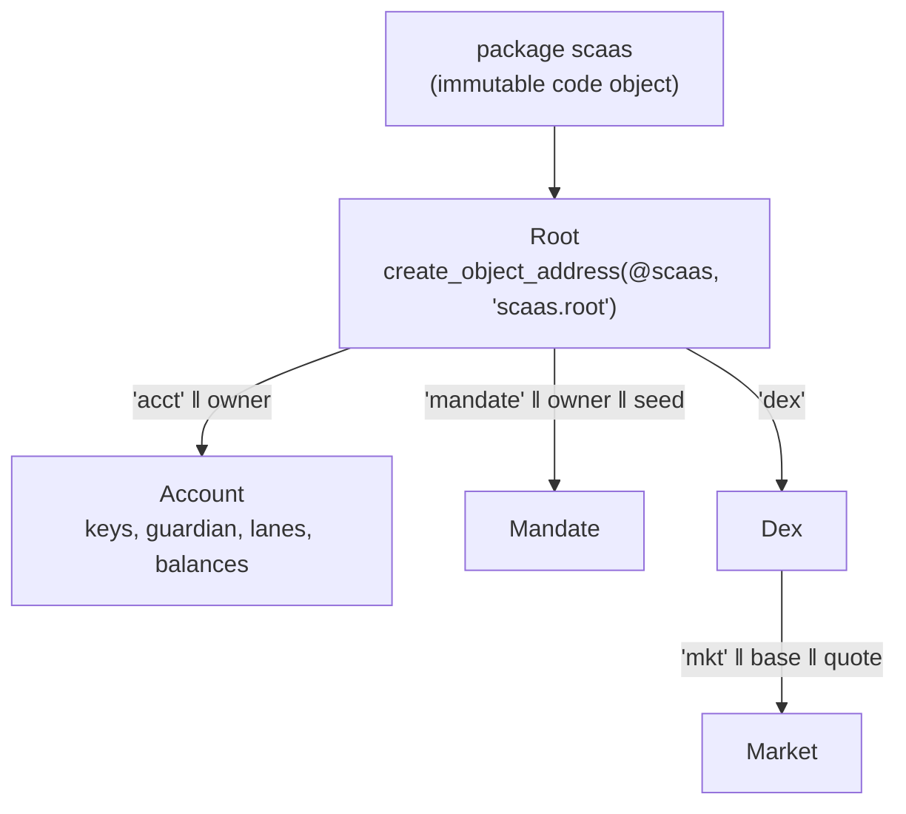

# Aptos (Move)

Common rules for every family: [networks/README](README.md). Status: Move package, adapter and client verifier
**BUILT** (Move at `smartcontracts/move/aptos/`, package `scaas`; adapter `scaas-node/src/adapters/aptos.rs`; end to end
`scaas-node/tests/e2e_aptos.rs`; devnet ports 32010–32019); items marked SPECIFIED are normative and not yet in code.
Market-neutral: any Fungible Asset (FA) registered by a client works; no asset, country or law is assumed.

**Contents**

1. [Overview](#1-overview)
2. [Objects and accounts](#2-objects-and-accounts)
3. [Keys](#3-keys)
4. [Lanes](#4-lanes)
5. [Payload](#5-payload)
6. [Signatures](#6-signatures)
7. [Move entry points](#7-move-entry-points)
8. [Relayer](#8-relayer)
9. [Finality and events](#9-finality-and-events)
10. [Mandate](#10-mandate)
11. [DEX](#dex)
12. [Deploy](#12-deploy)
13. [Conformance](#13-conformance)
14. [Limitations](#limitations)
15. [References](#15-references)

## 1. Overview

<a id="overview"></a>

Aptos has three native mechanisms, and none of them alone satisfies [NET-ALL-02](README.md#NET-ALL-02):

- **Sequence-number transactions** (default): a transaction runs only when its `sequence_number` equals the account's
  current sequence, so every transaction of one subject, on **every** module, queues in one line; one transaction
  stuck in the mempool (low gas, late expiry) blocks all later transactions of that subject ("sequence-number
  transactions require the sender's next sequence number to match exactly. That forces clients to serialize
  submissions from one account" — Aptos docs).
- **Orderless transactions** (AIP-123, payload per AIP-129): a random u64 `replay_protection_nonce` replaces the
  sequence; a transaction runs if `(sender, nonce)` is unused, with **no ordering**; the chain remembers pairs only for
  a short window; expiry at most **60 seconds**; usable by accounts without a `0x1::account::Account` resource
  (stateless, AIP-115) and combinable with sponsorship.
- **Fee-payer (sponsored) transactions** (AIP-39): the sender signs `RawTransactionWithData::MultiAgentWithFeePayer`
  and the fee payer pays; since framework 1.8 the sender may set the fee-payer address to `0x0` and only the fee payer
  signs with the real address. The sequence (or orderless nonce) is still **the sender's**.

So: a fee payer alone keeps the subject's sequence as the lock; orderless + fee payer removes the ordering lock but
cannot replace a contract-level meta-tx, because (a) the expiry ≤ 60 s requires the subject online when the
transaction is sent — no pre-signed queued jobs, batches, mandates or **DEX orders resting for hours**; (b) the
subject signs the **whole transaction** (gas, expiry, function) — every rebuild needs a new signature; (c) funds sit
in the subject's native account, so a capped mandate still needs a contract holding funds and checking a delegate.

<a id="NET-APT-04"></a>**NET-APT-04** — **The main path is a contract-level meta-tx signed with `aptos:signMessage`,
whose `fullMessage` envelope is parsed strictly**: exactly one `message` line equal to `scaas.metaop.v1:0x<sha3
digest>`, only known keys, each key at most once, and `chainId` (when present) equal to the runtime chain id; fee payer
and orderless are not the main path. Each contract (the subject's `Account`, `Mandate`, `Market`) keeps its own
lane/nonce space; the relayer sends from **its own** lane and pays itself (no fee payer). Orderless + fee payer stays a
**seam** only for subjects whose key Move cannot verify (keyless AIP-61, non-ed25519 MultiKey), for interactive `pay`
only, with the lane as fee payer; not built. BUILT.

What Move can verify (checked 2026-10-04; references `aptos-stdlib/sources/cryptography/secp256r1.move` and the
`AccountAuthenticator` of AIP-66; measured cost of the pure-Move P-256 path ≈ 4100 execution gas per signature, below):

| Scheme | Native Move | Used on the contract path |
|---|---|---|
| ed25519 | `aptos_std::ed25519::signature_verify_strict` | **yes** — Petra, Nightly, our seed signer |
| MultiEd25519 | `aptos_std::multi_ed25519` | no (YAGNI) |
| secp256k1 | `aptos_std::secp256k1::ecdsa_recover` | reserved (scheme flag 1), not built |
| secp256r1 / WebAuthn | **no** verify function callable from Move: `aptos_std::secp256r1` has only key types (`ecdsa_raw_public_key_from_64_bytes`, `…_to_bytes`); P-256 is checked only at the **transaction authenticator** layer (AIP-66) — re-checked on framework rev `4f0d278` (`mainnet` head on 2026-10-02): still only two functions | **yes** — pure-Move `scaas::p256` ([NET-APT-14](#NET-APT-14), owner) |
| keyless (AIP-61) | not verifiable in Move | **no** (seam above) |

## 2. Objects and accounts

<a id="accounts"></a>

| Object | Address | Created by | Role |
|---|---|---|---|
| package `scaas` | object code deployment (`aptos move deploy-object`), `upgrade_policy = "immutable"` ([NET-APT-20](#NET-APT-20)) | deployer (production: a multisig holds the code object — the DEX admin role, which cannot upgrade) | one address for calls **and** event types; a fix = a new deployment at a new address |
| `Root` | `create_object_address(@scaas, b"scaas.root")` | `init_module` | holds the `ExtendRef` to create child objects; `admin: address`; **read-only** on the hot path |
| `Account` | `create_object_address(root, b"acct" ‖ bcs(owner))` | lazily at the first `relay_pay`, or `open` | a subject's contract wallet: keys, guardian, lane → nonce; **balances = the primary fungible stores of this address** |
| `Mandate` | `create_object_address(root, b"mandate" ‖ bcs(owner) ‖ bcs(seed: vector<u8>))` | `mandate::open` (signed by an Account key) | as `MandateWallet`; balances = its primary stores |
| `Dex` | `create_object_address(root, b"dex")` | admin | parent of the markets, admin only |
| `Market` | `create_object_address(dex, b"mkt" ‖ bcs(base) ‖ bcs(quote))` | admin `list_market` | fees, `filled`, `min_nonce` of **one** pair |



`create_object_address(src, seed) = sha3_256(src ‖ seed ‖ 0xFE)`, so the client, the relayer and connectors compute
every address **without RPC**. A named object cannot be created twice, so the chain enforces one Account per subject.
Cross vectors Move = client verifier = Rust.

<a id="NET-APT-05"></a>**NET-APT-05** — **One derived `Account` object per subject holds every asset; its balance is the
primary fungible store of the Account address — no internal ledger.** An Aptos FA (AIP-21) primary store for
`(owner_address, metadata)` is created automatically when anyone sends to **any** address
(`primary_fungible_store::deposit` → `ensure_primary_store_exists`); withdrawing needs the owner's `&signer`, which
the module derives from the Account's `ExtendRef`. So the Account's balance of asset X =
`primary_fungible_store::balance(account, X)`, and anything sent to the Account address (FA, or a legacy coin with its
paired FA — AIP-63), even before the Account exists, is spendable at once by meta-tx; funding = an ordinary transfer
from Petra to the address the portal shows.

Unlike Sui's `Account<T>` per coin type, one key set and one rotation cover
every asset, which travels **explicitly** in `MetaOp.asset`. No `TransferRef` or allowance is used: only module
`scaas` derives the Account signer, through `public(package)` functions that `mandate`/`dex` of the same package call
([CTR-TOK-01](../contracts/token-wrappers.md#CTR-TOK-01) at module level). Funds **leave** through
`primary_fungible_store::transfer(&acct_signer, asset, to, amount)` (through dispatchable FA hooks, AIP-73, when the
asset has them) to any address, usable at once by an ordinary wallet. BUILT.

## 3. Keys

<a id="keys"></a>

```move
struct Account has key {
    owner: address,                    // the owner (an Aptos address), fixed; the object address seed
    keys: vector<Key>,                 // 1..=8
    guardian: Option<address>,
    recovery: Option<Recovery>,        // { key: Key, ready_at: u64 }
    key_nonce: u64,                    // KeyOp nonce
    lanes: Table<vector<u8>, Lane>,    // lane(32) → { next: u64, valid_until: u64 }
    extend: ExtendRef,
}
struct Key has copy, drop, store {    // scheme 0 = ed25519 (32 B), 2 = WebAuthn P-256 (65 B uncompressed)
    scheme: u8, public_key: vector<u8>,
    rp_id_hash: vector<u8>,            // passkey: the key's rpIdHash
    table: vector<u256>,               // passkey: p256::table(pk), computed ONCE at registration
}
// Account also holds `origins: vector<vector<u8>>` (≤ 8).
```

<a id="NET-APT-03"></a>**NET-APT-03** — **An Aptos Account holds ≤ 8 ed25519 and WebAuthn P-256 keys and ≤ 8 origins; the
first key must match the owner's live authentication key; three administration paths.** The keys and `origins` live
inside `Account` itself (`meta.move:103-106`), not in an extra resource. Rules:

- **First key** (explicit or lazy open): `sha3_256(pk ‖ 0x00)` **or** `sha3_256(0x00 ‖ 0x20 ‖ pk ‖ 0x02)` (SingleKey
  ed25519, AIP-55) must equal `account::get_authentication_key(owner)` **at that moment** — the function returns
  `bcs(addr)` for a stateless account (AIP-115; `aptos-framework/sources/account/account.move`), so it is right for an
  address without an Account resource. An attacker cannot pre-open an Account for a victim with a wrong key. A WebAuthn
  P-256 key may be the first key if `sha3_256(0x02 ‖ 0x41 ‖ pk65 ‖ 0x02)` (SingleKey `AnyPublicKey::Secp256r1Ecdsa`,
  AIP-66) equals the owner's auth key — the owner needs no real Aptos passkey account: that (stateless) address is the
  identity; a lazy open takes rpIdHash and origin from the very assertion being checked.
- **Three administration paths** (add/remove keys, set guardian, cancel recovery): (1) `manage_signed(account, KeyOp,
  sig, full_message)` — `KeyOp{domain=b"scaas.keyop.v1", chain_id, account, action, key, guardian, nonce=key_nonce,
  valid_until}` signed by **one current key** (relayed; no gas for the owner); (2) `manage_native(owner: &signer, …)` —
  the owner's own native transaction; subjects whose Aptos account is passkey/keyless/MultiKey use it once to attach an
  ed25519 seed key (an administrative transaction off the hot path); (3) the guardian (native tx) calls
  `start_recovery(new_key)`, `finish_recovery` after `RECOVERY_DELAY` = 2 days (172 800 s); a current key or the owner
  can cancel. `finish_recovery` adds the key through `add_key`, which aborts on a key already present or a full set
  (`MAX_KEYS`): an owner who lost every key of a full set cannot be recovered, so keep a free slot (as Solana).
- Never zero keys; an account with a passkey never has zero origins. Rotating the native Aptos auth key does **not**
  touch `keys`, so it never bricks the Account; the consequence: an owner who rotates the auth key *because* a key
  leaked is still exposed through the old key in `Account.keys` (the chain reads the auth key only at open). The
  one-transaction remedy is `reset_keys(owner: &signer, scheme, public_key, rp_id_hash, origin)` — a native transaction
  signed with the CURRENT auth key that replaces all keys by one, increments `key_nonce` (pending KeyOps die) and
  cancels a pending recovery; the portal says so explicitly ("rotating the wallet key does not remove it from the
  Account; use reset after rotating").
- Duplicate keys are detected by `public_key` (not the whole `Key`): the same passkey added again with another rpIdHash
  is refused, because `verify_by` takes the first entry with that `public_key`.

BUILT; per-family lifecycle summary in [NET-ALL-05](README.md#NET-ALL-05).

## 4. Lanes

<a id="lanes"></a>

<a id="NET-APT-06"></a>**NET-APT-06** — **The lane table is a `Table` with `valid_until`, prunable by anyone after the
delay.** `Table`, not `SmartTable` (no length counter, so two lanes are two state keys and Block-STM sees no conflict);
one lane = one entry; `next == nonce` then increments; `valid_until` = the maximum of the ops that used the lane.
`prune(account, lanes: vector<vector<u8>>)` is **permissionless**: it deletes entries with `valid_until +
PRUNE_DELAY_S < now` (`PRUNE_DELAY_S` = 30 days ≥ the client's `LANE_HORIZON_S`; `mandate::prune` uses the same rule
for `pay_ref`), and the storage refund goes to the sender of the `prune` transaction (a relayer lane), which therefore
has a reason to clean up.

Why the delay: a lane's `valid_until` is only the expiry of the op that RAN. The client
re-issues terms on the SAME lane/nonce 0 at every issue (signing timed out, retry), so one request can have several
signed ops: only one can run while the lane exists (`next = 1`); if the lane were deleted right after the executed
op's expiry, a later, still-valid op would run a second time (double pay). The rule: the client issues every
`valid_until` of one request within `LANE_HORIZON_S` (30 days) from request creation and stops issuing once it sees a
settlement; the executed op's expiry ≥ the request creation, so the deletion time > creation + 30 days ≥ the expiry of
every other op ([NET-ALL-01](README.md#NET-ALL-01)). Never one lane per issue (two ops could both run). Tests:
`meta_tests::reissued_op_*`, `mandate_tests::reissued_mandate_op_cannot_pay_twice`, and the client's re-issue tests.
BUILT.

<a id="NET-APT-24"></a>**NET-APT-24** — **Every signing client honours the lane horizon.** The chain cannot see signing
time: a different client (job API, app, mesh source) signing two different ops on one lane/nonce with `valid_until`
more than 30 days apart lets the later op run after someone prunes the lane (its holder has a reason to call
`prune`). Checking `valid_until <= now + LANE_HORIZON_S` at **execution** does not close it (a later op running at
`t' > first expiry + 30 days` with `valid_until ≤ t' + 30 days` still passes). Rule: every signing client (ERP, the
`aptos.js` connector, `clientkeys`, the app) issues every op of a lane within `LANE_HORIZON_S` of the lane's first op
and refuses to sign an op with `valid_until > now + LANE_HORIZON_S`. SPECIFIED; test: the connector refuses a 31-day op.
An on-chain closure, if third-party clients cannot be trusted: put the issue day in the first 4 bytes of `lane`;
`check_at` checks `issue_day·86400 − 86400 ≤ now` and `valid_until ≤ issue_day·86400 + LANE_HORIZON_S + 86400`;
`PRUNE_DELAY_S = LANE_HORIZON_S + 2 days` — changes lane derivation in clients; not done (`ponytail:`).

No shared hot resource: `relay_pay` **writes** only the payer's Account and the payer's and receiver's primary stores,
and **reads** `Root` and `chain_id`; no global counter, no global `SmartTable`, events are module events (AIP-44, no
handle/counter). Two subjects never conflict in Block-STM; one subject on two lanes shares only that asset's primary
store (a read-write conflict that Block-STM re-executes — **never aborts**, unlike Sui congestion).

## 5. Payload

<a id="payload"></a>

<a id="NET-APT-27"></a>**NET-APT-27** — **Target: `MetaCall`/`MetaTransfer` in BCS and `mtx_` entries**
([NET-ALL-26](README.md#NET-ALL-26)–[NET-ALL-29](README.md#NET-ALL-29); owner 2026-10-08). Status: **SPECIFIED**. Both
kinds are BCS structs (domains `b"scaas.metacall.v1"`, `b"scaas.metatransfer.v1"`, `network` = `chain_id::get()`,
digest `sha3_256(bcs)`) signed through the same `aptos:signMessage` envelope ([NET-APT-04](#NET-APT-04));
`scaas::metacall::verify` is `public`, so other packages use it. Entries: `relay_pay` → `mtx_pay` (+ `mtx_transfer`,
`mtx_execute_transfer`, `mtx_batch_transfer`); `manage_signed` + `KeyOp` → `mtx_add_key`, `mtx_remove_key`,
`mtx_add_origin`, `mtx_remove_origin`, `mtx_set_guardian`, `mtx_cancel_recovery` (on the account's lanes, `key_nonce`
retired); `mandate::open` + `MandateInit` → `mtx_mandate_open`; `mandate::pay` → `mtx_mandate_pay`; `revoke_signed` →
`mtx_revoke`; `dex::settle`, `cancel_signed`, `invalidate_nonces_signed` → `mtx_settle`, `mtx_cancel`,
`mtx_invalidate_nonces` (order structs unchanged). `manage_native`, `reset_keys`, the guardian's recovery entries and
admin entries keep their names. A new immutable package ([NET-APT-20](#NET-APT-20)). The `MetaOp`, `KeyOp` and entry
lists on this page are **Transitional (BUILT)**.

```move
struct MetaOp has copy, drop {
    domain: vector<u8>,     // b"scaas.metaop.v1"
    chain_id: u8,           // aptos_framework::chain_id::get() — mainnet 1, testnet 2, localnet 4
    contract: address,      // Account (pay) / Mandate (mandate_pay, revoke)
    asset: address,         // FA metadata object (= the token address)
    op: u8,                 // 0 pay · 1 trade (reserved) · 2 mandate_pay · 3 revoke
    from: address,          // owner of the funds (Account.owner / Mandate.owner)
    to: address,            // receiver (revoke: @0x0)
    amount: u128,           // ≤ u64::MAX (FA is u64) — the client refuses larger
    pay_ref: vector<u8>,    // 32 — entryRef
    lane: vector<u8>,       // 32 — random lane per entryRef
    nonce: u64,             // client: 0
    valid_until: u64,       // unix seconds; compared with timestamp::now_seconds()
    relayer: address,       // @0x0 = any lane; non-zero = only signer::address_of(lane)
    extra: vector<u8>,      // 32 — H(op-specific parameters) or 32 zero bytes
}
```

**Bytes (309 B, BCS, little-endian integers, `vector<u8>` = ULEB128(len) ‖ bytes):**

| off | len | field |
|---|---|---|
| 0 | 16 | `0x0f` ‖ `"scaas.metaop.v1"` |
| 16 | 1 | chain_id |
| 17 | 32 | contract |
| 49 | 32 | asset |
| 81 | 1 | op |
| 82 | 32 | from |
| 114 | 32 | to |
| 146 | 16 | amount u128 LE |
| 162 | 33 | `0x20` ‖ pay_ref |
| 195 | 33 | `0x20` ‖ lane |
| 228 | 8 | nonce u64 LE |
| 236 | 8 | valid_until u64 LE |
| 244 | 32 | relayer |
| 276 | 33 | `0x20` ‖ extra |

- **`digest = sha3_256(bcs(MetaOp))`** — the op key: emitted in `MetaTransactionExecuted.digest`, used by the client to
  book its signed op, and the passkey challenge.
- Move **rebuilds** `bcs::to_bytes(&op)` from the entry function's typed arguments (entry functions take no structs,
  so fields travel flat) — a relayer cannot change a field and keep the signature valid.

<a id="NET-APT-07"></a>**NET-APT-07** — **The Aptos domain is the on-chain `chain_id`, the derived contract address and
the explicit `asset`.** `chain_id` is read **on chain** (cannot be faked, like GRAM's config 19) + `contract` (derived
from `@scaas`, so it differs between two deployments, even two networks sharing chain id 4) + `op` + `asset`. Replay:
lane/nonce (pay), `pay_ref` once (mandate). Expiry: `now_seconds() <= valid_until`. BUILT.

## 6. Signatures

<a id="signatures"></a>

**`aptos:signMessage` envelope.** The wallet signs **`fullMessage`** (UTF-8) with ed25519. The Wallet Standard
specifies only the input `{message, nonce, address?, application?, chainId?}` and the output `{fullMessage, signature,
prefix:"APTOS", …}`; the **line order is not standardised** (Petra's docs show `"APTOS\nnonce: 1234034\nmessage:
Welcome to dapp!"`; older docs `address/application/chainId/message/nonce`; `aptos-wallet-adapter`
`derived-wallet-base/src/StructuredMessage.ts` encodes `APTOS, message, nonce, address?, application?, chainId?`;
`aptos-labs/ace` `aptos-wallet-message.ts` builds `APTOS, address, application, chainId, message, nonce`). The
`aptos-labs/wallet-standard` `aptosSignMessage.ts` types say *every field other than `signature` is the wallet's own
claim*, so the verifier checks `fullMessage` itself.

- **What we ask to sign:** `message = "scaas.metaop.v1:0x" ‖ hex(digest)` (lowercase, 64 hex), `nonce = hex(lane)`,
  `application: true`, `chainId: true`.
- **Strict parse** (Move `auth::check_envelope`, the client verifier and JS share one rule): (1) the first line is
  exactly `APTOS`; split on `\n`; (2) every later line is `"<key>: <value>"` with key ∈ {`address`, `application`,
  `chainId`, `message`, `nonce`}, each key **at most once**; `message` **exactly once** and **equal** to the expected
  string; (3) a `chainId:` line, if present, equals `chain_id` (decimal). Why: a phishing page asking to sign
  `"hello\nmessage: scaas.metaop.v1:0x…"` produces **two** `message:` lines and is refused; only a signature over the
  exact digest passes. The order rule accepts both official orders (tested in Move, the client and JS); the demo wallet
  in `aptos-wallet-adapter/apps/nextjs-example` signs a free string and is refused (as intended). Petra (closed
  source) is untested in a browser; the connector checks the envelope before sending, so a non-conforming wallet fails
  early.
- **`application:` is checked on chain when the Account has origins**: the line is mandatory and its value ∈
  `Account.origins` (the passkey origin list, maintained by KeyOps `ADD_ORIGIN`/`REMOVE_ORIGIN`, so an origin change
  never bricks the Account). The client also checks `application` = the portal origin before accepting a signature.
- **Seed signer** and tests build the fixed minimal envelope `"APTOS\nmessage: scaas.metaop.v1:0x<hex>\nnonce:
  <hex(lane)>"` (+ the portal's `application:`), signed with `m/44'/637'/i'/0'/0'`.
- **Passkey (WebAuthn):** challenge = `digest` (32 bytes, base64url in clientDataJSON); blob = `sig64 (r‖s, low-s) ‖
  u16be(len ad) ‖ authenticatorData ‖ clientDataJSON`, `public_key = hex(pk65)`. The scheme is chosen by key length
  (32 ⇒ ed25519, 65 ⇒ WebAuthn) in Move, the client and Rust.
- **Signature blob** (connector → client → job → relayer → Move): `signature = hex(sig64 ‖ utf8(fullMessage))`,
  `public_key = hex(pk32)`. Move receives `sig: vector<u8>` (64), `full_message: vector<u8>`, `public_key`; the key must
  be ∈ `Account.keys` (or be the first key of a lazy open).
- No collision with transaction signing: an Aptos transaction message starts with `sha3_256("APTOS::RawTransaction")`
  (32 binary bytes), never with `"APTOS\n"`.

| | Build `MetaOp` | digest | envelope | verify |
|---|---|---|---|---|
| Move | `bcs::to_bytes` | `aptos_std::aptos_hash::sha3_256` / `std::hash::sha3_256` | `auth::check_envelope` | `ed25519::signature_verify_strict` |
| Client verifier | byte concatenation per the table above (stdlib) | `hashlib.sha3_256` | the same parse | OpenSSL Ed25519 |
| Rust adapter | only **decodes** the job payload (proptest) + vectors | crate `sha3` 0.10 (already in `Cargo.lock`, now a direct dependency — no new crate) | none — bytes passed through | none (simulation decides) |
| JS (connector, clientkeys) | none — uses `terms.message` | — | checks the returned `fullMessage` before sending | — |

Cross vectors: `smartcontracts/move/aptos/scripts/gen_vectors.py` generates `tests/vectors.move` (payload, digest,
envelope, real signatures from fixed keys, derived addresses); the client and Rust tests pin **the same** hex.

<a id="NET-APT-22"></a>**NET-APT-22** — **A lazy ed25519 open requires the `application:` line and records it as the
Account's first origin.** The line must be non-empty, ≤ 256 B, without `"`; `create_account` stores it as the first
origin (`meta.move:220-240`), so every Account is origin-bound from its first payment. Why: opt-in was not enough —
every client-opened Account starts without origins (`meta.move:345`; `check_envelope` requires `application` only
when origins exist, `auth.move:132, 138`), and a phishing page that obtained a `signMessage` can submit `relay_pay`
itself (relayer `0x0`) without passing the client. Residual: the **first** op of an unopened Account has no list to
compare with, so one phished first op still runs and records the phishing origin; the owner removes it with
`manage_native` / `reset_keys` (native transactions). Older Accounts without origins: the portal guides adding the
origin by KeyOp. SPECIFIED. Move tests: lazy open without `application` ⇒ abort; with it ⇒ `origins == [app]`; a later op
with another `application` ⇒ `EBAD_SIGNATURE`.

<a id="NET-APT-25"></a>**NET-APT-25** — **The `chainId:` line stays optional.** The digest already binds `chain_id` (no
replay), and requiring the line would refuse standard wallets that omit optional fields; the connector already asks
`chainId: true`. No code change.

<a id="passkey"></a>

<a id="NET-APT-14"></a>**NET-APT-14** — **Aptos passkeys are WebAuthn P-256 verified by the pure-Move `scaas::p256`.**
Owner decision (2026-10-04). Montgomery u256 arithmetic, interleaved wNAF (G window 7 with constant tables, Q window 5),
low-s, on-curve key check, no inversion in the final x comparison; WebAuthn `clientDataJSON`/`authenticatorData`
checked as on the EVM `SmartKeyAccount` (`_clientDataOk`; `crossOrigin`/`topOrigin` refused); cross vectors with Wycheproof secp256r1
(262 cases) + W3C + clientkeys vectors pass; **UNAUDITED**; a separate module, replaced by a native verifier when Aptos
has one (only `scaas::p256`'s API `verify`/`table`/`verify_with` changes). Consequence: Account accepts `p256_webauthn`
keys beside ed25519, so pre-signed mandates and DEX orders work with passkeys. The framework's `single_key.move`
declares a 64-byte Secp256r1 key while the TS SDK / AIP-66 use 65-byte uncompressed; we use 65 bytes
(`0x02 ‖ 0x41 ‖ pk65 ‖ 0x02`) like the SDK, not yet compared with a real passkey account. BUILT.

<a id="NET-APT-17"></a>**NET-APT-17** — **A passkey key is stored with its precomputed `p256::table`** (8 odd multiples,
computed once at registration): each signature is ~400 gas cheaper, which lets one `dex::settle` matching two passkey
orders fit the execution-gas limit. BUILT.

## 7. Move entry points

<a id="contracts"></a>

```move
// scaas::meta
entry relay_pay(lane: &signer, owner: address, asset: Object<Metadata>, to, amount: u128, pay_ref, lane_id,
                nonce, valid_until, relayer: address, extra, public_key, sig, full_message)
    // builds MetaOp{op: pay, contract: account_of(owner)}, checks domain/expiry/relayer/lane/key/envelope/signature,
    // lazily opens the Account, amount > 0, sufficient balance; transfers; emits
    // MetaTransactionExecuted{contract: asset, account, from, digest, lane, nonce} then
    // PaymentSettled{contract: asset, from, to, amount, pay_ref}
entry open(owner, public_key)
entry manage_signed(…); entry manage_native(…); entry start_recovery(…); entry finish_recovery(…); entry cancel_recovery(…)
entry reset_keys(owner: &signer, scheme, public_key, rp_id_hash, origin); entry prune(account, lanes)
#[view] account_of(owner): address            // for tests and manual checks
public(package) fun signer_of(account): signer // only mandate/dex call it
// scaas::mandate
entry open(owner, seed, delegate_key, max_per_payment, max_per_period, period_s, expiry_s, payees, key_nonce,
           valid_until, public_key, sig, full_message)
entry pay(lane: &signer, mandate, asset, to, amount, pay_ref, valid_until, relayer, public_key, sig, full_message)
entry revoke_signed(…); entry refund(…); entry prune(…)
// scaas::dex
entry settle(lane, market, maker fields…, maker_sig…, taker fields…, taker_sig…, maker_fill, taker_fill)
entry cancel_signed(…); entry invalidate_nonces_signed(…); entry sweep(market, asset)
entry create_dex(…); entry list_market(…); entry set_market(…); entry admin_sweep(holder, asset, to)
```

The SCaaS summary form of the pay entry is `package entry relay_pay(lane, owner, asset, …)`. An earlier draft had a
separate `close_signed`; it is folded into `revoke_signed` (owner or delegate) + `refund`.

## 8. Relayer

<a id="relayer"></a>

<a id="NET-APT-08"></a>**NET-APT-08** — **An Aptos relayer lane is an ed25519 account at `m/44'/637'/{i}'/0'/0'` sending
sequence-number transactions, one in flight, paying its own fee.** SLIP-10, coin 637, every level hardened, the
account index at the third level (`m/44'/637'/account'/change'/address_index'`, default `m/44'/637'/0'/0'/0'`, as in
aptos-core and the SDKs); lane address = the legacy Ed25519 auth key `sha3_256(pk ‖ 0x00)` (the node's `keys.rs::lane_path` arm); lanes are funded with APT
(the account is created on receipt; a stateless account can still send — AIP-115); start-up prints lane addresses. No
fee payer, no orderless: the lane sequence matches the shared `recover_lane` contract exactly ("a used sequence slot
with no visible transaction ⇒ requeue"), and one transaction per lane needs no parallel in-flight transactions. BUILT.

<a id="NET-APT-09"></a>**NET-APT-09** — **Aptos transactions are hand-written BCS, hashed before sending, with vectors from
the TS SDK.** No `aptos-sdk` crate (it pulls all of `aptos-core` — a huge dependency tree, an OOM risk on a shared
build host, and its own tokio/rustc pins). `RawTransaction = sender(32) ‖ sequence_number u64 ‖ payload ‖ max_gas_amount
u64 ‖ gas_unit_price u64 ‖ expiration_timestamp_secs u64 ‖ chain_id u8`; payload = `TransactionPayload::EntryFunction`
(variant 2): `ModuleId{address, name}` ‖ function name ‖ empty `vec<TypeTag>` ‖ `vec<vec<u8>>` arguments (each already
BCS). The lane signs `sha3_256("APTOS::RawTransaction") ‖ bcs(raw)`; authenticator `Ed25519{pk, sig}` (variant 0).
`tx_id` = the Aptos hash `sha3_256(sha3_256("APTOS::Transaction") ‖ 0x00 ‖ bcs(SignedTransaction))` (variant 0 =
`UserTransaction`) as `0x` + 64 hex, computed **before** sending so the signed journal entry exists. Byte-exact with
`@aptos-labs/ts-sdk` 7.3.0 (`scripts/tx_vector.mjs`, Rust test `tx_matches_the_ts_sdk`, `generateUserTransactionHash`)
and equal to the REST `hash` in end-to-end runs. `expiration_timestamp_secs = min(valid_until, now + params.tx_ttl_s)`
(default 600 s): a transaction never outlives the payload. BUILT.

Simulation, fees, balances:

- `POST /v1/transactions/simulate?estimate_gas_unit_price=true&estimate_max_gas_amount=true` with an **all-zero**
  signature (the API refuses to simulate a validly signed transaction); `success=false` from a `scaas` abort ⇒
  `SimError::Revert` (job dies); HTTP/5xx ⇒ `Transport`.
- `gas_unit_price` = `GET /v1/estimate_gas_price` (`gas_estimate`); `max_gas_amount = ceil(gas_used × 1.3)`, capped by
  `params.max_gas_amount`. `lane_balance` = view `0x1::coin::balance<0x1::aptos_coin::AptosCoin>(lane)` (octa, including
  the paired FA after AIP-63). `tx_fee` = `gas_used × gas_unit_price` of a landed transaction.
- `sequence(lane)` = view `0x1::account::get_sequence_number(lane)` (0 for stateless) — the **committed** value.
- `tx_fee` is reported for **every** committed transaction, including `success=false` (storage fee included, storage
  refund subtracted) ([NODE-LANE-13](../node/submit-lanes.md#NODE-LANE-13); as built the breaker fills only on `Mined`,
  `adapter.rs:270-276`).

<a id="NET-APT-16"></a>**NET-APT-16** — **For an Account not yet opened, the relayer runs the view `meta::pay_check`
instead of `simulate`, with gas at the configured cap.** `pay_check` runs every check of `relay_pay` without writing.
Why: aptos-node 9.6.0's REST `simulate` hangs on a transaction that both creates the Account object and spends from its
pre-existing primary store (the real transaction runs normally); reported upstream if it persists. `relay_pay` runs
every check (`pay_checked`) BEFORE opening the Account. BUILT; amended by [NET-APT-23](#NET-APT-23).

<a id="NET-APT-23"></a>**NET-APT-23** — **Dispatchable assets are refused on the not-yet-opened path.** `pay_check` does
not move funds (`meta.move:316-356` checks only balances; `aptos.rs:615-622` uses the gas cap), so a dispatchable hook
that aborts or burns gas shows only on chain at the cap. The unsimulated path **refuses** dispatchable assets (even
when the token enables them, [NET-APT-21](#NET-APT-21)), and an out-of-gas there is final (already at the cap).
SPECIFIED. Rust test: a first job with a dispatchable token ⇒ `422`/`dead` before signing.

Submission and status:

- `POST /v1/transactions` (`Content-Type: application/x.aptos.signed_transaction+bcs`).
- A committed out-of-gas was first mapped to `Err(Rejected)` (rollback, payer nonce intact, requeue and rebuild); that
  is replaced by the bounded rule [NET-APT-21](#NET-APT-21).
- `tx_status`: `GET /v1/transactions/by_hash/{h}`: `pending_transaction` ⇒ `Pending`; `user_transaction` + `success` ⇒
  `Mined{height}` (height = the block containing `version`, via `GET /v1/blocks/by_version/{v}`); 404 ⇒ `Unknown`. The
  shared runner asks `tx_status` **before** trusting `Rejected` (a `SEQUENCE_NUMBER_TOO_OLD` may mean our own previous
  transaction landed).

<a id="NET-APT-02"></a>**NET-APT-02** — **Aptos outcome classes: validation refusals free the lane; a `scaas` abort is
`Reverted`.** HTTP 400 with `vm_error_code` ∈ {`SEQUENCE_NUMBER_TOO_OLD`, `SEQUENCE_NUMBER_TOO_NEW`,
`INSUFFICIENT_BALANCE_FOR_TRANSACTION_FEE`, `TRANSACTION_EXPIRED`, `INVALID_SIGNATURE`, `GAS_UNIT_PRICE_BELOW_MIN_BOUND`,
`MAX_GAS_UNITS_BELOW_MIN_TRANSACTION_GAS_UNITS`} ⇒ `adapter::Rejected` (resending the same bytes never passes, so the job
returns to the queue at once); `mempool_is_full`, 5xx, timeout ⇒ ordinary error (retry the same bytes); a committed
`success=false` whose `vm_status` is a `scaas` abort (`Move abort in 0x…::meta: …`) ⇒ `Reverted` (the subject's op is
wrong or used). BUILT.

<a id="NET-APT-21"></a>**NET-APT-21** — **A committed out-of-gas is rebuilt once at the gas cap, then `reverted`; every
committed transaction is metered.** Class table ([NODE-LANE-14](../node/submit-lanes.md#NODE-LANE-14)):

| Result | Class | Action |
|---|---|---|
| HTTP 400 `vm_error_code` in the list above (validation, not committed) | not committed, not billed | `queued` |
| `mempool_is_full`, 5xx, timeout | transport | resend the same bytes |
| committed `success=false`, `Move abort` (of `scaas`, of a hook, of the framework) | committed, billed | `reverted` (consumption check first); counts for grief |
| committed `OUT_OF_GAS` with the transaction's `max_gas_amount` < `params.max_gas_amount` | committed, billed | **one** `queued`; the rebuild signs at `params.max_gas_amount` (meta `oog_retry`) |
| committed `OUT_OF_GAS` at the cap, or the second time, or on the unopened path (already at the cap) | committed, billed | `reverted` "out of gas at cap"; counts for grief |
| other committed failure (`EXECUTION_LIMIT_REACHED`, …) | committed, billed | `reverted` |

Every billed row feeds `tx_cost` to the breaker ([NODE-LANE-13](../node/submit-lanes.md#NODE-LANE-13)) and the `from`
grief score ([NODE-LANE-15](../node/submit-lanes.md#NODE-LANE-15)). **Dispatchable assets** (metadata with
`0x1::fungible_asset::DispatchFunctionStore`): the node refuses the job unless the token enables `features.dispatchable`
(an admin setting in the node store). Why: a committed out-of-gas is billed the full `max_gas_amount × gas_unit_price`,
and a dispatchable FA hook can read `transaction_context::max_gas_amount()` (framework rev `4f0d278`,
`transaction_context.move:113`) and burn gas only when the cap is the real transaction's `used × 1.3`, not when
simulation runs at the configured cap — so as built (`classify_committed` maps OOG to `Rejected`, `aptos.rs:326-338`;
the runner requeues, `adapter.rs:293-299`; simulation at `self.max_gas`, `aptos.rs:624`, signing at `used × 1.3`, `:639`;
`attempt_count` only counted, `store/sqlite.rs:162`) it loops until `valid_until`, the lane paying every round, unseen
by the hourly breaker. SPECIFIED. Tests: Rust classification (OOG under the cap ⇒ once, at the cap ⇒ `reverted`, second
time ⇒ `reverted`); end to end with an FA hook in `smartcontracts/move/aptos/testfa/` that burns gas when
`max_gas_amount()` is below a threshold ⇒ job `reverted` after ≤ 2 billed transactions; a dispatchable token without the
flag ⇒ `422`.

<a id="NET-APT-13"></a>**NET-APT-13** — **No disk transaction journal on Aptos.** One transaction in flight per lane;
a resend is **the same bytes**; the chain runs exactly one transaction per `(lane, sequence)`; Aptos has no
version-based object lock like Sui, so signing two different transactions on one sequence (after a restart) locks
nothing: at most one lands, the other gets `SEQUENCE_NUMBER_TOO_OLD`, and the contract refuses a used digest, so nothing
pays twice. The shared `recover_lane` + `outer_nonce = sequence` suffice (YAGNI on a journal). Residual (as on every
sequence family): after a restart without bytes, a transaction dropped by the mempool (TTL) leaves the sequence
unchanged and `tx_status` 404, so the runner waits until `valid_until + 30 s`, then `dead` (the payer signs again); no
funds lost. BUILT.

<a id="NET-APT-26"></a>**NET-APT-26** — **Mesh and gateway verify Aptos signatures locally before any simulation**
([NODE-MESH-16](../node/mesh.md#NODE-MESH-16)): ed25519 over `fullMessage` with the job's `public_key`; the key must be
the first key (derives the auth key: one cached view read) or ∈ `Account.keys` (one cached resource read); passkeys are
checked with the existing `p256` crate. SPECIFIED (as built `aptos_op` checks no signature, `mesh/digest.rs:257-266`).

Head-of-line row: Aptos — lane account (ed25519, coin 637) — sequence per lane, one transaction in flight — the subject
sends no transaction; lanes/nonces live in our Account/Mandate/Market; Block-STM runs different subjects in parallel
([NET-ALL-03](README.md#NET-ALL-03)).

Node configuration:

```toml
[[chains]]
family = "aptos"; network = "4"          # chain id: 1 mainnet, 2 testnet, 4 localnet
rpc_urls = ["http://127.0.0.1:32010/v1"]
lanes = [0, 1]
[chains.params]
package = "0x…"                          # object-code address of package scaas
indexer_url = "https://api.testnet.aptoslabs.com/v1/graphql"   # localnet: http://127.0.0.1:32015/v1/graphql
# indexer_api_key_env = "SCAAS_APTOS_INDEXER_KEY"            # optional: env var holding the API key
tx_ttl_s = 600
max_gas_amount = 200000
```

## 9. Finality and events

<a id="events"></a>

<a id="NET-APT-10"></a>**NET-APT-10** — **Aptos finality is commit (AptosBFT), indexed by block height; a block with
missing transactions fails the range.** REST returns only committed state. `final_head` = `block_height` (+
`block_hash` through `GET /v1/blocks/by_height/{h}`) of `GET /v1`; `block_hash(h)` from the same endpoint; a block scan
uses `GET /v1/blocks/by_height/{h}?with_transactions=true`; several `rpc_urls` ⇒ quorum as on EVM (minimum
height, compare hashes). Events of type `<params.package>::meta::{MetaTransactionExecuted,PaymentSettled}` (and
`mandate::PaidUnderMandate`) from `user_transaction`s with `success=true` and `data.contract ∈ contracts`; only code in
package `scaas` can emit those types, so a copy of the package at another address is ignored. A block whose returned
transactions are fewer than `last_version − first_version + 1` is completed through `GET /v1/transactions?start=&limit=`;
missing or failing ⇒ `Err`, the range is not committed. Normalised: `block_number` = block height, `block_hash` = block
hash, `tx_hash` = transaction hash, `log_index` = the event's index in the transaction (module events have
`sequence_number = 0`, unusable), addresses `0x` + 64 lowercase hex (AIP-40 long form), `amount` as a decimal string.
BUILT.

<a id="NET-APT-15"></a>**NET-APT-15** — **The Aptos Indexer API is a hint; content is re-read from the fullnode, and the
cursor never passes the indexer's processed version.** Owner decision (hosted Indexer API GraphQL, endpoint per chain;
for localnet/private chains a self-hosted indexer stack with the same schema, `aptos node run-local-testnet
--with-indexer-api`, same client). Neither the hosted Indexer API (testnet) nor the localnet stack has an `events`
table (checked 2026-10-04: `__type(name: "events")` = null; localnet 9.6.0: `field 'events' not found in type:
'query_root'`; running processors: fungible_asset, account_restoration, token_v2, stake, default, objects,
user_transaction, account_transactions).

The hint is `user_transactions(where: {entry_function_contract_address: {_eq:
<package long form>}, block_height: {_gte, _lte}})` (processor `user_transaction_processor`, running on hosted testnet;
the old `parquet_…` one stalled at version 6.65 billion); per version: `GET /v1/transactions/by_version/{v}` (success,
hash, events) + `GET /v1/blocks/by_height/{h}` (hash; the version must lie in `first_version..last_version`), then
filter type `<package>::meta::…` and `contract ∈ tokens`; with `quorum > 1` the block (`first_version`, `last_version`,
hash) and the transaction (type, hash, success, events) must agree across `quorum` endpoints, not only the head hash
(`quorum = 1` trusts the first endpoint, as on every family). `final_head` = min(REST head, the last block FULLY
processed by `processor_status.last_success_version`), so the cursor never passes the indexer; `events` errors if the
indexer has not reached the `last_version` of block `to`. The token list is the node store's per-namespace set that clients push
(`PUT /v1/tokens/{chain}`; an empty list holds the cursor, [NET-ALL-06](README.md#NET-ALL-06)). The start cursor is a per-chain start block (fullnodes
prune history), else the newest block. BUILT. The hosted indexer is a third party for **completeness** only (owner
accepted); content is always re-read from the fullnode.

**Relayed entries are `package entry`**: `meta::relay_pay`, `meta::manage_signed`, `mandate::{open, pay,
revoke_signed}`, `dex::{settle, cancel_signed, invalidate_nonces_signed}` can be called only by a direct transaction
(an `EntryFunction` payload of the package — exactly what the indexer hint finds) or by modules of the same package;
scripts and other packages are refused by the compiler/VM (`scripts/check_entry_visibility.sh` compiles `wrapcheck/`,
which must fail on all 8 functions). **Residual risk — multisig wrap, stated:** the VM calls an entry function
regardless of visibility when a `0x1::multisig_account` executes a stored payload, and a hash-only execution carries
no payload, so the indexer gets no hint. Blocking it on chain with `transaction_context::multisig_payload()` is not
usable (the native aborts outside a real transaction, which breaks every Move unit test of the pay path; tried
2026-10-04). Bounded: the wrapper needs the subject's signature (relayer `0x0`), funds still reach the signed
receiver, and the consumed lane stops a replay on the same lane — the client only misses the settlement (the request
expires with attention). Mitigation if needed (`ponytail:`): hint by `fungible_asset_activities` per `asset_type`
(expensive for busy assets).

## 10. Mandate

<a id="mandate"></a>

<a id="NET-APT-12"></a>**NET-APT-12** — **An Aptos mandate is opened by an Account key's signature, funded by an
ordinary `pay`, and its `pay_ref` entries are prunable.** `entry open(owner, seed, delegate_key, max_per_payment,
max_per_period, period_s, expiry_s, payees: vector<address>, key_nonce, valid_until, public_key, sig, full_message)`:
the owner signs `MandateInit{domain=b"scaas.mandate.v1", chain_id, account, mandate (derived address), params…,
nonce=key_nonce, valid_until}` with an **Account** key — no gas, no owner sequence; it creates the object; funding = an
ordinary `pay` to the Mandate address (its balance = its primary store). `entry pay(lane: &signer, mandate, asset, to,
amount, pay_ref, valid_until, relayer, public_key, sig, full_message)`: the delegate signs `MetaOp{op: mandate_pay,
contract: mandate, from: owner}`; checks mandate expiry, signature expiry, payee, per-payment cap, per-period cap
(compared by subtraction), `pay_ref` once (`Table<pay_ref, valid_until>`, prunable like lanes); emits
`PaymentSettled{contract: asset,…}` + `PaidUnderMandate`. BUILT (`mandate::open` takes no `lane` signer).

<a id="NET-APT-18"></a>**NET-APT-18** — **Mandate open, revoke and refund rules.** Open needs no nonce (a named object
is created only once); revocation by the delegate OR the owner's Account key (the same `MetaOp{op: revoke}`, through
`revoke_signed`); a permissionless `refund` after revocation or expiry returns the whole balance of one asset to the
owner's Account — funds never stick. BUILT.

## <a id="dex"></a>11. DEX

<a id="dex"></a>

<a id="NET-APT-11"></a>**NET-APT-11** — **Aptos DEX: one derived `Market` per pair, `min_nonce`/`filled` per market, a
permissionless `sweep`, one pair per transaction.** `Order`: `domain=b"scaas.order.v1", chain_id, market, maker,
taker (@0x0 = any), sell: address (metadata), buy: address, sell_amount: u64, buy_amount: u64, nonce: u128, expiry: u64,
max_fee_ppm: u32, flags: u8 (bit0 FOK, bit1 IOC), relayer`; order hash = `sha3_256(bcs(Order))`; signed through the
envelope with `message = "scaas.order.v1:0x<hash>"`. `entry settle(lane, market, maker fields…, maker_sig…, taker
fields…, taker_sig…, maker_fill, taker_fill)` checks flags, expiry, `nonce >= min_nonce[(maker)]` of the market,
relayer, taker, signatures (keys ∈ `Account.keys` of maker/taker), cross-matching pair, distinct parties, listed
market; `fill > 0`, `filled + fill <= sell_amount`, FOK; cross-multiplied price on u128; fee `ppm <= max_fee_ppm`, cap
10 000 ppm checked at `set_market`.

Funds move Account → Account (store → store), the fee to `fee_recipient`; the fills
are the relayer's choice but bounded by the signed limit price and amounts ([NET-ALL-08](README.md#NET-ALL-08)).
Events `OrderFilled` ×2 + `Matched`. Cancel: `cancel_signed` (`Cancel{domain=b"scaas.cancel.v1", chain_id, market,
order_hash}` ⇒ `filled = sell_amount`) and `invalidate_nonces_signed` (`min_nonce` per (maker, market), strictly
increasing) — touching **that market** only. `entry sweep(market, asset)` is **permissionless**: a market holds nothing
between transactions; anything sent by mistake to the primary store of a Market or the Dex goes to `fee_recipient`.
Differences from EVM: entry functions take no structs, so one pair per transaction; a multi-pair batch = several
transactions on several lanes (parallel, atomic **per pair**; a Move script batching is a seam — the relayer would carry
script bytecode); no relayer fee; IOC closes its remainder inside its own `settle`, as on Sui. BUILT.

<a id="NET-APT-19"></a>**NET-APT-19** — **DEX orders travel as BCS bytes parsed strictly, and a market is a named object
of the unordered pair.** `bcs_stream` parsing must consume every byte and re-encode to exactly the input; the market
seed is `mkt ‖ lo ‖ hi` (sorted pair). BUILT.

**Admin.** `Root.admin` = the code-object owner (`object::is_owner`; production: the code object is transferred to a
multisig); no admin address is stored. Admin only: `create_dex`, `list_market`, `set_market` (fee, on/off),
`admin_sweep(holder, asset, to)` — an FA sent by mistake to Root, the Dex or a Market (including a market without a fee
recipient yet) goes to `to`. The admin can **never** touch an Account or a Mandate (`admin_sweep` refuses every other
holder).

## 12. Deploy

<a id="deploy"></a>

<a id="NET-APT-01"></a>**NET-APT-01** — **The Aptos package is deployed as one object code deployment: one address for
calls and event types.** Admin = the code-object owner; deploy with `--included-artifacts none` (44 KB; with metadata
it exceeds the 60 KB single-transaction limit). BUILT.

<a id="NET-APT-20"></a>**NET-APT-20** — **The Aptos package is immutable from deploy.** `Move.toml` `upgrade_policy =
"immutable"`; the code object is deployed with that policy. **Deploy gate:** the publish script (`devnet.sh publish` and
the production command) reads `0x1::code::PackageRegistry` back at the code-object address and exits 1 unless the
policy is immutable. The node refuses to activate a chain whose package is upgradeable (`halted`,
`PROGRAM_UPGRADEABLE`, [NODE-STO-07](../node/store.md#NODE-STO-07)). Consequences: every contract fix is a new deployment
at a new address with new tokens/Accounts; old Accounts remain spendable through the old package; the DEX admin role
(code-object owner) is unchanged. Owner ruling 2026-10-07 ([CTR-GEN-02](../contracts/README.md#CTR-GEN-02)), confirmed by
owner ruling 2026-10-28. `Move.toml` `upgrade_policy = "immutable"` is BUILT (owner ruling 2026-10-28); the publish
script's registry read-back and the node's refusal stay SPECIFIED. Test: the publish script on localnet prints policy 2;
a node with a `compatible` package ⇒ chain `halted`.

## 13. Conformance

<a id="conformance"></a>

**Move (`aptos move test`, framework pinned to the `mainnet` rev):** pay with real vectors, replay, expiry, wrong
`chain_id`/`contract`/`asset`/`op`, relayer binding, key ∉ Account, envelope (two `message` lines, unknown key, wrong
`chainId`, other line order still passes), lazy open with key ≠ auth key ⇒ refused, a stateless account can open; keys:
add/remove, never remove the last key, `manage_native`, guardian + delay, cancel recovery, a native auth-key rotation has
no effect; mandate: per-payment and per-period caps, payee, `pay_ref` once, revoke, refund to the Account; DEX: price,
overfill, FOK/IOC, fee on/off, `max_fee_ppm`, cancel, per-market `min_nonce`, two independent markets; **anti-lock**
(mandatory): X (`pay` of asset A through the Account) and Y (`mandate::pay` / DEX `cancel`); X held; Y passes; then X —
plus X and Y on one Account, two assets, two lanes; **coin anti-lock**: an FA sent straight to the Account address
(before and after the Account exists) is spendable by `pay`; an FA sent to a Mandate counts; an FA sent to a Market ⇒
`sweep`; a legacy coin with its paired FA sent by `aptos_account::transfer_coins` to the Account is spendable; `prune`
deletes only expired entries and an old op cannot replay after prune; `dispatchable_asset_hook_runs` proves a withdraw
hook runs under `relay_pay` (`primary_fungible_store::transfer` → `dispatchable_fungible_asset::transfer`, framework rev
`4f0d278`).

**Rust:** payload and signature-blob decoder proptests (no panic); BCS `RawTransaction` + transaction hash vectors (TS
SDK); `Rejected`/`Reverted`/OOG classification on recorded JSON; end-to-end `tests/e2e_aptos.rs` (`#[ignore]`) on
localnet: two lanes from a 24-word mnemonic, publish, a fake job-API client **returning the real metadata address** and
**refusing an unregistered contract**, payment through `lane_step`, final through `index_step`, concurrent anti-lock (X
`signed` held on lane 0 while Y `mined` on lane 1), a restart mid-way (`recover_lane` closes the job), `Rejected` (old
sequence) frees the lane at once, an empty token list keeps the cursor. **Client** (reference ERP client, its own test database on port 8931): cross vectors client = Move = Rust;
`verify` returns `True`/`False`/`None` in exactly the three cases; issue → accept → `signed_op` job with `extra.asset`.
**JS** (`node --test` with a fake wallet): different line orders, a second `message` line, wrong chain id, 33-byte key,
refusal.

**Devnet:** Aptos CLI 9.6.0, `smartcontracts/move/aptos/scripts/devnet.sh up|publish|down`: `aptos node run-localnet
--force-restart --assume-yes --test-config-override <api.address 127.0.0.1:32010> --faucet-port 32011
--ready-server-listen-port 32012 --txn-stream-port 32013 --with-indexer-api --postgres-port 32014 --indexer-api-port
32015` (the indexer needs the transaction stream + Docker `postgres:14.11`, `hasura/graphql-engine:v2.44.0-ce`).
`run-localnet` has **no REST port flag** — set it through `--test-config-override` (merged into the default config); the
node's other default ports (6180/6181 network, 6186 backup, 9101 metrics, 9102 admin) are not configurable, so one Aptos
localnet per host at a time, under the memory cap; `down` stops the process and the containers. Stateless auth keys
(AIP-115): `get_authentication_key` returns `bcs(addr)` when `DEFAULT_ACCOUNT_RESOURCE` is enabled — enabled on localnet
9.6.0 (a user without APT still opens an Account end to end).

**Gas measured on localnet** (`smartcontracts/move/aptos/scripts/gas_probe.py`, FeeStatement; price 100 octa/gas; the
execution limit of one transaction = 9 200 gas units — `txn.max_execution_gas` 9.2·10⁹ internal), 2026-10-04 after review:

| Transaction | execution | io | storage (octa) | total gas |
|---|---|---|---|---|
| `relay_pay` ed25519, first (lazy Account open) | 164 | 111 | 1 957 200 | 19 847 |
| `relay_pay` ed25519, later | 152 | 85 | 432 400 | 4 560 |
| `relay_pay` passkey, first (open + table computed once) | 4 614 | 106 | 1 665 200 | 21 371 |
| `relay_pay` passkey, later (stored table) | 4 133 | 85 | 432 400 | 8 541 |
| `dex::settle` matching TWO passkey orders | 8 209 | 175 | 1 390 800 | 22 292 |

The `crossOrigin`/`topOrigin` checks cost +60 per passkey signature and computing the table once saves 340 on the first
passkey spend (earlier measurement: 163 / 151 / 4 954 / 4 073 / 8 148). **Constraint:** `dex::settle` with two passkeys
uses **89 %** of the execution limit (8 209 / 9 200); more logic in `settle`/`auth::verify`/`p256`, or an Aptos gas-table
change, can make a passkey match `EXECUTION_LIMIT_REACHED` (job `Reverted`, no retry). `gas_probe.py` is the gate: it
exits 1 if execution exceeds 8 600 (settle with two passkeys), 4 300 (later passkey) or 5 200 (first passkey); raising
a threshold requires a recorded reason; run it after every change to `p256`/`auth`/`settle` (after `devnet.sh up &&
publish`). How the number was reached: a call-per-operation version exceeded the limit (`EXECUTION_LIMIT_REACHED` at
9 256, ~48 000 calls taking 30 %); inlining field arithmetic in `fmul` (~5 550), wNAF + binary-Euclid inversion
(~4 530), a stored key table (~4 070). One passkey signature ≈ 0.4 US cent at 100 octa gas price (≈ 0.0041 APT) — ~27×
an ed25519 signature, but one transaction still suffices.

## <a id="limitations"></a>14. Limitations

<a id="limitations"></a>

- `scaas::p256` is **UNAUDITED** self-written cryptography. Keyless / non-ed25519 MultiKey accounts cannot pay on the
  contract path; they open an Account and attach a seed key or passkey with `manage_native`.
- The hosted indexer is a third party for completeness (owner accepted); content is re-read from the fullnode.
- Multi-pair atomic DEX batches: a seam (Move script).
- A dispatchable FA hook can make `pay` abort (job `reverted`, no funds lost) or force billed out-of-gas loops (hence
  [NET-APT-21](#NET-APT-21)); clients should register only tested assets.
- An issuer with freeze rights can freeze an Account's primary store — the issuer's risk, outside the contract
  (operations note).
- Copying a transaction from the mempool and front-running it (Aptos has no public mempool API; low risk): our
  transaction aborts, the job is `reverted`, the request still closes by digest; only gas is lost.
- Confidential payments: `aptos_std` has `ristretto255`, `ristretto255_elgamal`, `ristretto255_pedersen` and
  `ristretto255_bulletproofs` (native range-proof verification), so Zether-style ElGamal + range proofs on
  **Ristretto255** are feasible at reasonable cost, on a different curve than EVM Zether (bn254/BLS12-381), needing its
  own key tree. `aptos_framework::confidential_asset` (+ `confidential_balance`, `confidential_range_proofs`,
  `sigma_protocols`) exists on the `mainnet` framework branch and hosted testnet runs `confidential_asset_processor`; not
  assessed, not built.

## 15. References

<a id="references"></a>

- Orderless: aptos.dev/build/guides/orderless-transactions; aptos.dev/build/aips/aip-123 (payload AIP-129).
- Sponsored / fee payer: aptos.dev/build/guides/sponsored-transactions (AIP-39; `0x0` since framework 1.8; AIP-115).
- Move cryptography: aptos.dev/build/smart-contracts/cryptography; `aptos-core/aptos-move/framework/aptos-stdlib/sources/
  cryptography/secp256r1.move` (`main`); AIP-66 (github.com/aptos-foundation/AIPs/issues/322).
- Auth key / stateless: `aptos-core/aptos-move/framework/aptos-framework/sources/account/account.move`
  (`get_authentication_key`, `get_sequence_number`, `ED25519_SCHEME = 0`).
- Key paths: github.com/aptos-labs/aptos-core/pull/2073; aptos.dev/build/sdks/dotnet-sdk/accounts/ed25519
  (`m/44'/637'/0'/0'/0'`).
- signMessage: github.com/aptos-labs/wallet-standard `src/features/aptosSignMessage.ts`; petra.app/docs/signing-a-message.
- Localnet: aptos.dev/network/nodes/localnet (defaults REST 8080, faucet 8081, ready 8070, stream 50051).

## <a id="paymeta-relayfee"></a>Pay-meta and relay fee (metatx split)

Spec `docs/superpowers/specs/2026-10-27-metatx-split-design.md` §6.2 / §7.2; rules [CTR-MTX-26](../contracts/metatx.md#CTR-MTX-26) and [CTR-MTX-27](../contracts/metatx.md#CTR-MTX-27); decisions CTR-MTX-26 / -27 (commit per family below). Status BUILT unless a line says owed.

- **Pay-meta.** `meta::relay_pay_meta` (`package entry`): `pay_ref = meta_pay_id(salt, meta)`, `lane = pay_lane(pay_ref)`,
  `nonce = 0` derived on chain, then `relay_pay`'s body; the view `pay_meta_check` is the twin of `pay_check`. Once per
  `(payer, payId)` in `Account.lanes` until the lane is pruned: `meta::prune` is permissionless 30 days
  (`PRUNE_DELAY_S`) after the lane's `valid_until`, after which the same `payId` can be signed and settled again (a signed
  payment itself never replays: `valid_until` bounds it). The same holds for the relay-fee payment's lane (final review M9,
  as Solana's lane PDA).
- **Relay fee.** Module `scaas::relayfee`, one `package entry` per fee-less signed entry (`relay_manage_signed`,
  `relay_mandate_open`, `relay_revoke_signed`, `relay_cancel_signed`, `relay_invalidate_nonces_signed`), each running the
  entry then `meta::pay_routed`. `ref = keccak256("scaas.relayfee" ‖ chain_id (1 byte) ‖ @scaas ‖ keccak256(call) ‖ salt)`.
  Marker = `object::create_object_address(&@scaas, b"scaas.relayfee")`; a plain pay to it is refused on chain by
  `relay_pay` (`EWRONG_RELAYER`) and by the node. A cancel that changes nothing aborts (`ECALL_REFUSED`).
- **Client rule: open the Account first.** No view runs the wrapped call and `simulate` hangs on a payment that opens the
  Account, so the node refuses a relay-fee job while the payer's Account is not open. A client opens the Account (any
  signed pay or `manage_signed`) before it asks for a relay-fee job.
- **Chain-id reuse.** `ref` and the `MetaOp` domain carry a 1-byte `chain_id`, not network bytes. A customer chain that reuses
  an Aptos chain id and publishes the package at the same address shares signatures with that chain; give a customer chain
  its own id (or its own package address) before it carries payments.
- **Upgrade authority.** `upgrade_policy = "immutable"` (NET-APT-20, owner ruling 2026-10-28): nobody can upgrade
  `relayfee` or `meta` after the deploy.
- **Owed.** A two-passkey relay may exceed the 9,200 exec-gas ceiling (unmeasured); measure it on a localnet or testnet
  (TODO.md). Commits: T14 `78c67cff`, fix 1 `d48c51f9`.
