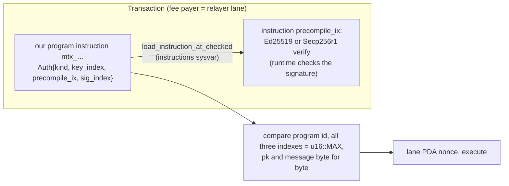

# Solana (Rust / Anchor)

Common rules for every family: [networks/README](README.md). Status: program, adapter and client verifier **BUILT**
(Anchor program at `smartcontracts/solana/`, program `scaas`, its own Cargo workspace; adapter
`scaas-node/src/adapters/solana.rs`; end to end `scaas-node/tests/e2e_solana.rs`; devnet ports 32020–32049); items marked
SPECIFIED are normative and not yet in code. Any SPL Token / Token-2022 mint registered by a client and passing the
extension policy ([NET-SOL-09](#NET-SOL-09)) works; market-neutral.

**Contents**

1. [Overview](#1-overview)
2. [Accounts](#2-accounts)
3. [Keys](#3-keys)
4. [Lanes](#4-lanes)
5. [Payload](#5-payload)
6. [Signatures](#6-signatures)
7. [Tokens](#7-tokens)
8. [Mandate](#8-mandate)
9. [DEX](#dex)
10. [Relayer](#10-relayer)
11. [Finality and events](#11-finality-and-events)
12. [Deploy and toolchain](#12-deploy-and-toolchain)
13. [Conformance](#13-conformance)
14. [Limitations](#limitations)
15. [References](#15-references)

## 1. Overview

<a id="overview"></a>

Five native mechanisms (documentation checked 2026-10-04):

- **Fee payer.** The first signing account pays; other signers only authorise. **Solana has no account sequence**:
  replay protection of a transaction is its signature + a recent blockhash (status cache), so a fee payer by itself
  creates no ordering lock as on Stellar/Cosmos.
- **Recent blockhash.** A transaction references a blockhash; not landed within ~150 blocks (~60–90 s,
  `lastValidBlockHeight`) ⇒ it expires.
- **Durable nonce.** The blockhash is replaced by a value stored in a nonce account; the first instruction must be
  `SystemProgram::AdvanceNonceAccount` (the nonce account first, writable, **static** — SIMD-0242). The transaction does
  not expire until the nonce advances. "If a nonce transaction passes validation but execution fails …, the nonce is
  still advanced and fees are still collected." No double advance in one block. The docs warn "Durable nonces may be
  deprecated in a future release" (SIMD discussion #415).
- **Priority fee / compute budget.** Base fee 5 000 lamports **per signature — including signatures that the
  Ed25519 / Secp256k1 / Secp256r1 precompiles verify**. Priority fee: v0 = a micro-lamport/CU price through the
  `ComputeBudget` instruction; **v1 = a total in lamports in the message header**, `ComputeBudget` a no-op, and
  CU/loaded-data limits **mandatory** (zero ⇒ the transaction does not run). Priority fees are a **local fee market**
  priced per contended writable account.
- **Parallel execution (Sealevel).** A transaction declares every account it reads/writes; the scheduler never runs
  two transactions writing one account in parallel. Limits: 100M CU per block (SIMD-0286, mainnet 2026-07-29) but
  **12M CU per writable account per block** unchanged.

So the native path (the subject signs the transaction, the relayer is fee payer) does not suffice, even without a
sequence: (a) a subject-signed transaction lives ≤ ~90 s, so no pre-signed queued jobs, batches, mandates or **DEX orders
resting for hours**; (b) extending it with the **subject's** durable nonce makes that nonce account queue **every**
operation of the subject on **every** program (each transaction advances it) — exactly the lock
[NET-ALL-02](README.md#NET-ALL-02) forbids; (c) Solana transaction signatures are ed25519 only, so a **P-256 passkey
cannot sign a transaction** — it works only through checks inside a program; (d) funds in an ATA owned by the wallet key
have no multi-key / guardian / recovery and no capped mandate.

<a id="NET-SOL-03"></a>**NET-SOL-03** — **Solana uses a program-level meta-tx; the subject never sends a transaction on
the hot path, and the native fee payer is only ever a relayer lane.** The subject signs a domain-separated message; each
"contract" (our SmartKeyAccount, Mandate, Market) keeps its lane/nonce space **as one PDA per lane**; the relayer sends
from **its own** lane (fee payer = lane) and pays base fee + priority fee + rent. The subject sends native transactions
only for one-off actions off the hot path (funding from a wallet; a guardian's `start_recovery`). Owner decision
(gasless: contract-level meta-tx before the native fee payer). BUILT.

Signatures a program can verify:

| Scheme | How the program verifies | Used |
|---|---|---|
| ed25519 (Phantom / Solflare / Backpack, our seed signer) | precompile `Ed25519SigVerify111111111111111111111111111` + introspection of the Instructions sysvar | **yes** |
| secp256r1 / WebAuthn | precompile `Secp256r1SigVerify1111111111111111111111111` (SIMD-0075, *Implemented*; Agave 2.2; mainnet since epoch 800): pk SEC1 compressed 33 B, signature 64 B `r‖s`, SHA-256 of the message inside, **low-S enforced**, ≤ 8 signatures per instruction, index `0xFFFF` = "this instruction" | **yes** (passkey) |
| secp256k1 | Keccak/secp256k1 precompile (pk = a 20-byte ETH address) | no (YAGNI) |

<a id="write-locks"></a>

<a id="NET-SOL-04"></a>**NET-SOL-04** — **On Solana the write-lock is the real lock: the hot path writes only the
operation's own new PDA and the two parties' token accounts, and a write-set disjointness test is mandatory.** A
write-lock exists only while a block executes the transaction; a pending or held-back transaction holds no lock, so the
anti-lock property (X held, Y passes) follows structurally when X and Y share no nonce — the property the native path
breaks. The real risk is a **hot account**: any account many transactions write (a global counter, a `Market` storing
its book/`filled`, a shared fee vault, `Config` written on the hot path, `SmartKeyAccount` written per op) serialises
those transactions within a block, hits 12M CU/account/block, raises the local priority fee and drops under congestion —
a "lock" between two **unrelated** ops of one subject. Rule: on the hot path each transaction **writes** only the relayer
lane + the lane's nonce account; one **new** op-specific PDA (lane / mref / fill PDA); the token accounts of exactly the
two parties; the Mandate PDA (mandate ops only — period caps are sequential anyway); the fee vault of **one** market (only
when the fee is on). Everything else (`Config`, `Market`, `SmartKeyAccount`, mints, min-nonce PDA) is **read-only**. The
mandatory test builds real X and Y transactions of one subject on different contracts and asserts their writable sets,
minus lane + lane nonce, are **disjoint**, and that `Config`, `Market`, `SmartKeyAccount` are read-only in every hot-path
transaction. Owner decision. BUILT.

| Instruction | Writable (besides lane + lane nonce) | Read-only |
|---|---|---|
| `relay_pay` | LanePda (new), the Account's source token account, the receiver's ATA | Config, SmartKeyAccount (except a lazy open), mint, Instructions sysvar |
| `mandate_pay` | Mandate (period counter), MandateRef (new), the Mandate's source token account, the receiver's ATA | Config, mint |
| `settle` (per pair) | Fill ×2, the 4 token accounts of the two sides, the market fee vault (only when the fee > 0) | Config, Market, SmartKeyAccount ×2, MinNonce ×2, mint ×2 |
| `cancel_signed` | that order's Fill | Config, Market, SmartKeyAccount |

Two subjects never share a writable account except when paying the same receiver (that receiver's ATA is an
unavoidable shared write; 12M CU/block ≈ a few hundred payments per block to one receiver). One subject, two assets ⇒
disjoint; same asset ⇒ the shared source token account (the balance itself — sequential within a block, no lock across
blocks).

## 2. Accounts

<a id="accounts"></a>

| Account | Address (PDA of program `scaas`) | Created by | Role |
|---|---|---|---|
| program `scaas` | program id = `SCAAS_PROGRAM_ID` at build (default: the published test/localnet id, refused on public clusters); upgrade authority **None** after `initialize` ([NET-SOL-20](#NET-SOL-20)) | deployer (`scripts/deploy.sh`, key outside the repo) | one id for calls **and** the event authority; another program id = another domain |
| `Config` | `["config"]` | `initialize` (only the upgrade authority — checked through `ProgramData`; runs **before** the authority is removed) | `admin`, `network` = the cluster genesis hash; **read-only** on the hot path |
| `SmartKeyAccount` | `["acct", owner32]` | lazily at the first `relay_pay` (ed25519), or `open` / `open_passkey` | keys, origins, guardian, policy; **balances = token accounts owned by this PDA** |
| `LanePda` | `["lane", account, lane32]` | `relay_pay` / `mandate::open` / KeyOp (init) | `LanePda{next}`: `{next u64, valid_until i64, rent_payer}` |
| `Mandate` | `["mandate", account, seed32]` | `mandate_open` (signed by an Account key) | as `MandateWallet`; balances = token accounts owned by this PDA |
| `MandateRef` | `["mref", mandate, pay_ref32]` | `mandate_pay` (init — a second run fails) | `pay_ref` once, prunable |
| `Market` | `["mkt", base_mint, quote_mint]` | admin `list_market` | ppm fee, on/off; fee vault = ATA(Market, mint) |
| `Fill` | `["fill", market, order_hash32]` | `settle` / `cancel_signed` (`init_if_needed`) | `filled` of **one** order, `valid_until` = order expiry |
| `MinNonce` | `["minnonce", market, account]` | `invalidate_nonces_signed` | `min_nonce` per (maker, market) |
| `__event_authority` | `["__event_authority"]` (Anchor) | — | signs the `emit_cpi!` self-CPI |

PDA = `find_program_address(seeds, program_id)` (sha256(seeds ‖ bump ‖ program_id ‖ "ProgramDerivedAddress"), bump from
255 down until the point is **not** on ed25519), so the client, the relayer and connectors compute every address
**without RPC** (the client checks "off-curve" by decompressing the ed25519 point in ~20 lines, RFC 8032 §5.1.3). Cross
vectors program = client = adapter.

<a id="NET-SOL-05"></a>**NET-SOL-05** — **One SmartKeyAccount PDA per subject holds every mint; its balance is the token
accounts owned by the PDA — no internal ledger.** The balance of mint X = the token accounts (SPL Token or Token-2022)
with `owner` = the Account PDA and `mint` = X. The standard one is ATA(Account PDA, X, token_program) (ATAs are valid for
off-curve owners), but the program accepts **any** token account owned by the PDA as a source, so funds sent to an odd
token account of the PDA are still spendable. Funding = an ordinary SPL transfer to that ATA (the portal builds a
`createIdempotent + transferChecked` transaction for the wallet, since many wallets refuse off-curve owners — a one-off
native transaction off the hot path). One Account for every asset (as on Aptos): one key set, one rotation; the asset
travels explicitly in `MetaOp.asset`. No SPL `Approve` to an ordinary account: the token accounts' authority is the PDA,
only the program signs for it (`invoke_signed` with the Account seeds; [CTR-TOK-01](../contracts/token-wrappers.md#CTR-TOK-01)).
Lamports sent by mistake to the PDA (above rent exemption) are withdrawn by KeyOp `withdraw_lamports{to}`. Rejected
alternative: funds in the wallet's ATA with an `Approve` to the PDA — a token account has only **one** delegate
(conflicts with other dApps), re-approval needs a native transaction, and there is no multi-key/recovery. BUILT.

## 3. Keys

<a id="keys"></a>

```rust
#[account]
pub struct SmartKeyAccount {
    pub owner: [u8; 32],          // PDA seed, never changes
    pub bump: u8,
    pub keys: Vec<Key>,           // 1..=8
    pub origins: Vec<String>,     // 0..=8, each ≤ 128 B; ≥ 1 while a P-256 key exists
    pub guardian: Option<Pubkey>,
    pub recovery: Option<Recovery>, // { key: Key, ready_at: i64 }
    pub key_nonce: u64,
    pub policy: u8,               // bit0 = BACKUP_REQUIRED (default 0)
}
pub struct Key { pub scheme: u8, pub pubkey: [u8; 33], pub rp_id_hash: [u8; 32] }
// scheme 0 = ed25519 (32 B + one 0 byte), 2 = P-256 WebAuthn (33 B compressed + rpIdHash)
```

<a id="NET-SOL-06"></a>**NET-SOL-06** — **A SmartKeyAccount holds ≤ 8 keys (ed25519 / P-256 WebAuthn), ≤ 8 origins and a
guardian with a 2-day delay; a new origin under the same rpId is added by that passkey; `open_passkey` requires an
assertion.** Owner decision. Rules:

- **`owner`**: ed25519 ⇒ the 32-byte pk itself (= the Solana wallet address). Passkey-first owners are the 32-byte
  `webauthn-p256` UA id stored with `owner_kind`, displayed **only** as `urn:scaas:ua:v1:…` ([NET-ALL-21](README.md#NET-ALL-21);
  as built `owner = sha256("scaas.owner.p256" ‖ pk33)`, `account.rs:73-74`, `p256_owner`). The base58 form of such an id
  looks like a Solana address but has no private key — SOL or an ATA sent there is lost — so until the UA owner ids land,
  clients and connectors **never** show it as a deposit address. The account is `realloc`ed per key/origin (small rent at
  open).
- **Open:** ed25519 — lazily in the first `relay_pay` (a valid signature from the key = `owner`) or `open(owner)`
  ([NET-SOL-27](#NET-SOL-27)); P-256 — `open_passkey(pk33, assertion)` with challenge `sha256("scaas.open.v1" ‖
  program_id ‖ pk33)`; `rp_id_hash` = the first 32 bytes of authenticatorData and `origin` from **that assertion's**
  clientDataJSON, so nobody can pre-open an Account with a wrong origin.
- **Administration:** (1) `manage_signed(KeyOp, auth)` — `KeyOp{domain="scaas.keyop.v1", network, account, action,
  key, origin, guardian, policy, to, nonce=key_nonce, valid_until}` signed by **one current key**; `action` ∈
  {add_key, remove_key, add_origin, remove_origin, set_guardian, cancel_recovery, set_policy, withdraw_lamports};
  relayed. (2) The guardian (native tx signed with its Solana key) `start_recovery(new_key)`; `finish_recovery` after
  `RECOVERY_DELAY` = 2 days; a current key can cancel.
- **Never bricked:** never zero keys; while a P-256 key exists, never zero origins. An assertion whose `rpIdHash` matches
  the key but whose `origin ∉ origins` is accepted for exactly one thing: `KeyOp{action=add_origin, origin = the
  assertion's own origin}` (the origin carried in that assertion). Browsers let only origins of the rpId (or related origins published by the rpId owner) assert
  for it, so a domain change within one rpId does not brick the Account while a phishing page on another rpId stays
  blocked; changing rpId needs a seed key or the guardian — the reason for the backup policy. Operations note: `add_origin`
  accepts every origin the browser allows for the rpId, including related origins published at `/.well-known/webauthn`,
  so publishing that file is an **account-security decision**.

<a id="NET-SOL-27"></a>**NET-SOL-27** — **`open` requires the wallet's own signature.** A permissionless `open(owner)`
would let anyone pre-open a passkey-first id with an ed25519 key and brick that passkey Account; opening on someone's
behalf is unnecessary because the first `relay_pay` opens lazily with the owner's signature. Test
`open_needs_the_wallet_signature`. BUILT.

<a id="NET-SOL-07"></a>**NET-SOL-07** — **The `BACKUP_REQUIRED` policy bit ("backup key required", constant `POLICY_BACKUP_REQUIRED`) is optional and off by default.** "Has a
backup" ⇔ (≥ 2 keys) **or** (1 key **and** a guardian) — the backup-key switch
([CLI-SGN-13](../clients/signers-clientkeys.md#CLI-SGN-13)). The owner sets it with `KeyOp set_policy` signed by **its
own** key (the admin never touches an Account); turning it on without a backup is refused (no self-lock). When on:
`remove_key` or `set_guardian(None)` that loses the backup is refused (replacing a leaked guardian with
`set_guardian(other)` is always allowed); value ops (`relay_pay`, `mandate_open`, DEX legs of this Account) abort
`NoBackup` if a backup is somehow missing (a cheap check). The portal guides adding a seed key or guardian before
`set_policy`; a client cannot read on-chain state, so a missing backup surfaces in simulation (the job `dead` with a
clear reason). Owner decision ("only an on/off option"). BUILT.

## 4. Lanes

<a id="lanes"></a>

<a id="NET-SOL-08"></a>**NET-SOL-08** — **A lane is a PDA per (account, lane), prunable by anyone after
`valid_until + PRUNE_DELAY_S`, with the rent returned to the stored `rent_payer`.** `["lane", account, lane32]`,
`init_if_needed`: `next == nonce` then increments; `valid_until` = the maximum of the ops that used the lane;
`rent_payer` = the relayer lane that paid the rent. The client issues nonce 0 on a random lane per `entryRef`, so in
practice every request is a new PDA and no account is shared between two ops. `prune(pdas)` is **permissionless**: it
closes a LanePda / `MandateRef` when `valid_until + PRUNE_DELAY_S < Clock.unix_timestamp` (`PRUNE_DELAY_S` = 30 days ≥ the
client's `LANE_HORIZON_S`) and a `Fill` when `valid_until < now` (the expiry is inside the order hash); the lamports go to
the **`rent_payer` stored in the PDA** (not to the caller, so nobody steals rent). Safety: `valid_until` is the expiry of
the op that RAN; the client re-issues a request's terms on the SAME lane, nonce 0, every expiry within 30 days of the
request's creation, so when the PDA is deleted every other signed op of that request has expired (no double pay;
[NET-ALL-01](README.md#NET-ALL-01)). Cost (rent-exempt, refunded on prune): a lane PDA ~0.0012 SOL; until pruned the rent
stays there; the node does not yet crank `prune` automatically (a script/cron calls it by `rent_payer` = lane). BUILT.

<a id="NET-SOL-22"></a>**NET-SOL-22** — **Signer-chosen expiries are capped on chain at `MAX_TTL_S` = 31 days.** The
program refuses `valid_until` (LanePda, MandateRef) and order `expiry` (`Fill` in `settle`/`cancel_signed`) beyond `now +
MAX_TTL_S` (`MAX_TTL_S = 31 d`; `expiry > now + MAX_TTL_S` ⇒ error) (the 30-day DEX book cap + 1 day of clock skew); the Mandate's own `expiry` is unchanged (a Mandate PDA has a
`rent_payer` and can be closed). Why: `u64::MAX` makes a PDA never prunable (`account.rs:204`, `dex.rs:199, 312`) — one
`cancel_signed` for an invented order hash locks a `Fill`'s rent forever. Rent that never returns (lazy SmartKeyAccount
open, `account.rs:189`, no close path; KeyOp growth through `util::grow`, `account.rs:365`, bounded by 8 keys + 8 origins
and never shrinking, so once per Account; `MinNonce`, `dex.rs:327`; DEX ATAs of the PDA and vaults) stays lane-paid —
subjects are gasless — but is metered ([NODE-LANE-13](../node/submit-lanes.md#NODE-LANE-13)) and bounded per job
([NODE-LANE-18](../node/submit-lanes.md#NODE-LANE-18)) and per subject ([NODE-LANE-15](../node/submit-lanes.md#NODE-LANE-15)).
SPECIFIED. LiteSVM tests: `cancel_signed` with `expiry = u64::MAX` ⇒ error; `relay_pay` with `valid_until = now + 32 days`
⇒ error; every lane PDA created is prunable ≤ `MAX_TTL_S + PRUNE_DELAY_S` after creation.

<a id="NET-SOL-25"></a>**NET-SOL-25** — **Every signing client honours the lane horizon** (as on Aptos,
[NET-APT-24](aptos.md#NET-APT-24); the same `prune` pattern, `account.rs:423-450`, with `check_deadline` checking only the
expiry, `util.rs:134-138`): the `solana.js` connector and `clientkeys` refuse to sign an op with `valid_until > now +
LANE_HORIZON_S` and re-issue on one lane only within the horizon of its first op. SPECIFIED; JS test.

## 5. Payload

<a id="payload"></a>

<a id="NET-SOL-33"></a>**NET-SOL-33** — **Target: `MetaCall`/`MetaTransfer` layouts and `mtx_` instructions**
([NET-ALL-26](README.md#NET-ALL-26)–[NET-ALL-29](README.md#NET-ALL-29); owner 2026-10-08). Status: **SPECIFIED**. Both
kinds are fixed little-endian layouts (domains `"scaas.metacall.v1"`/`"scaas.metatransfer.v1"`, `network` = the genesis
hash, `function` = the 8-byte discriminator; lengths pinned by vectors), digest `sha256`, signed as today
([NET-SOL-11](#NET-SOL-11)); the `scaas-metacall` crate verifies them. Instructions: `relay_pay` → `mtx_pay` (+
`mtx_transfer`, `mtx_execute_transfer`; a batch is a multi-instruction transaction); `manage_signed` + `KeyOp` actions →
`mtx_add_key`, `mtx_remove_key`, `mtx_add_origin`, `mtx_remove_origin`, `mtx_set_guardian`, `mtx_cancel_recovery`,
`mtx_set_policy`, `mtx_withdraw_lamports`; `mandate_open` + `MandateInit` → `mtx_mandate_open`; `mandate_pay` →
`mtx_mandate_pay`; `mandate_revoke_signed` → `mtx_revoke`; `mandate_close_signed` → `mtx_mandate_close`; `settle`,
`cancel_signed`, `invalidate_nonces_signed` → `mtx_settle`, `mtx_cancel`, `mtx_invalidate_nonces` (order structs
unchanged). Each keeps its fixed write-set ([NET-SOL-04](#NET-SOL-04)). A new program, authority `None`
([NET-SOL-20](#NET-SOL-20)). The `MetaOp`, `KeyOp` and instruction names on this page are **Transitional (BUILT)**.

**Bytes (336 B, fixed, little-endian, no length prefixes — `MetaOp::LEN`; the tag is 15 bytes):**

| off | len | field |
|---|---|---|
| 0 | 15 | `"scaas.metaop.v1"` |
| 15 | 32 | `network` = the cluster genesis hash (from `Config.network`) |
| 47 | 32 | `contract` = SmartKeyAccount PDA (pay) / Mandate PDA (mandate_pay, revoke) |
| 79 | 32 | `asset` = mint |
| 111 | 1 | `op`: 0 pay · 1 trade (reserved) · 2 mandate_pay · 3 revoke |
| 112 | 32 | `from` = owner |
| 144 | 32 | `to` = receiving wallet (owner of the destination ATA; revoke: 32 zero bytes) |
| 176 | 16 | `amount` u128 (≤ u64::MAX — the client refuses larger) |
| 192 | 32 | `pay_ref` (entryRef) |
| 224 | 32 | `lane` |
| 256 | 8 | `nonce` u64 |
| 264 | 8 | `valid_until` u64 unix seconds, compared with `Clock.unix_timestamp` |
| 272 | 32 | `relayer` (0 = any lane; non-zero = exactly the fee payer) |
| 304 | 32 | `extra` = H(op-specific parameters) or 0 |

- **`digest = sha256(bytes)`** (the cheap `sol_sha256` syscall, the same hash as WebAuthn) — the op key in
  `MetaTransactionExecuted.digest`, used by the client to book its signed op.
- The program **rebuilds** the bytes: `contract`, `from`, `asset`, `network` come from seed-checked accounts (never from
  instruction data); only `to, amount, pay_ref, lane, nonce, valid_until, relayer, extra` travel in the data, so a relayer
  cannot change a field and keep the signature valid.
- Replay: lane PDA (pay), `MandateRef` (mandate), `Fill` (DEX). Expiry: `Clock.unix_timestamp <= valid_until`.

<a id="network-domain"></a>

<a id="NET-SOL-10"></a>**NET-SOL-10** — **The Solana domain is the genesis hash held by `Config` and cross-checked by the
node, plus the PDA, the op and the asset.** A program cannot read the genesis hash on chain (no sysvar), so `network` is
stored in `Config`; at start-up the node checks `getGenesisHash` = `Config.network` = the chain's configured network, and
refuses to run on a mismatch. `contract` (a PDA depending on the program id) + `op` + `asset` complete the domain; one
program keypair deployed on two clusters still has different `network`s. BUILT.

<a id="NET-SOL-01"></a>**NET-SOL-01** — **The Solana signing network is fixed at build time from the chain, never typed by
an admin.** The runtime exposes no genesis hash (no syscall, no sysvar), so the program takes it at **build** time:
`deploy.sh` reads `solana genesis-hash --url <cluster>` and builds the program with `SCAAS_NETWORK` = that hash next to
`SCAAS_PROGRAM_ID`; `initialize` loses its `network` argument and stores the constant; `deploy.sh` records `(program id,
genesis hash)` in the deployments file and refuses to deploy a program id already recorded for another genesis. The
chain profile's `chain_uid` ([NET-ALL-22](README.md#NET-ALL-22)) for Solana **is** the genesis hash as the RPC reports
it, and the node keeps [NET-SOL-10](#NET-SOL-10) (RPC genesis == `chain_uid` == `Config.network`). Why: today
`initialize(network, admin)` stores any 32 bytes (`account.rs:28-34`), so a Config initialised with another cluster's
hash makes that cluster's signatures valid here for the same PDA, for any relayer; our node is protected by the
cross-check, third-party relayers are not. Cost: one build per cluster (already one per program id). SPECIFIED.
**Operator invariant until it lands:** never reuse a Solana program id across clusters, and keep the node's genesis
cross-check on. Chains are keyed `solana:<genesis hash>`.

## 6. Signatures

<a id="signatures"></a>

<a id="NET-SOL-11"></a>**NET-SOL-11** — **ed25519 is accepted as a raw message or an off-chain message v1; a passkey
challenge is `base64url(digest)`.**

- The signed text is `"<domain>:" ‖ hex(sha256)` of the op bytes, moving to the readable message of [NET-ALL-23](README.md#NET-ALL-23) (built: `T = "scaas.metaop.v1:" ‖
  hex(digest)`, 80 ASCII bytes, lowercase hex; DEX orders `"scaas.order.v1:"…`, cancels `"scaas.cancel.v1:"…`, KeyOps
  `"scaas.keyop.v1:"…`, mandates `"scaas.mandate.v1:"…` — in general `"<domain>:" ‖ hex(sha256(MetaOp))`).
- **ed25519 — two envelopes, both accepted**, the precompile message compared **byte for byte**:
  - `kind 0` raw — `solana:signMessage(T)`: message = `T`. It cannot be mistaken for a transaction: a first byte `'b'` =
    0x62 would be a legacy header demanding 98 signatures (v0 starts 0x80, v1 0x81) — 80 bytes never parse as a valid
    transaction.
  - `kind 1` off-chain message (OCMS v1) — `solana:signOffchainMessage`: message = `"\xffsolana offchain" ‖ version 1 ‖
    signer count (u8) ‖ pk32 × n (ascending) ‖ text UTF-8` (codec `preamble-v1` of `@solana/offchain-messages` 8.4.0; the
    client, the program and the connector agree on the `OCMS` vector). This is the format hardware wallets (Ledger,
    Trezor) sign; Solana's docs recommend it when the wallet supports it, else raw.
- **Passkey — `kind 2`**: challenge = base64url(digest) without padding; the secp256r1 precompile receives message =
  `authenticatorData ‖ sha256(clientDataJSON)`; the program checks that `clientDataJSON` holds exactly one
  `"type":"webauthn.get"`, `"challenge":"<b64url(digest)>"`, `"origin":"<o>"` with `o ∈ origins` (except `add_origin`
  above); `rpIdHash` = the key's; flags UP|UV (`flags & 0x05 == 0x05`); sha256(cdj) = the message's last 32 bytes. Low-S
  is enforced by the precompile; the client normalises `s := n − s`.
- **Signature blob** (connector → client → job → relayer): `signature = hex(kind ‖ key_index ‖ sig64 ‖ [authData_len u16
  ‖ authData ‖ cdj])`, `public_key = hex(pk)` (32 or 33 B); the relayer builds the precompile instruction from the blob.
- **Seed signer**: `kind 0` with `m/44'/501'/i'/0'` ([CLI-SGN-22](../clients/signers-clientkeys.md#CLI-SGN-22)).

<a id="NET-SOL-30"></a>**NET-SOL-30** — **In the passkey blob the `u16` authenticatorData length is little-endian.**
BUILT.

<a id="NET-SOL-12"></a>**NET-SOL-12** — **Precompile introspection: the instruction is loaded through the checked sysvar,
must be the right precompile, every instruction index must be `u16::MAX`, and pk + message are compared byte for byte.**
Owner decision (precompile via introspection). Our instruction carries `Auth{kind, key_index, precompile_ix: u8,
sig_index: u8, cdj?}`; the program (1) calls `load_instruction_at_checked(precompile_ix, instructions_sysvar)` (Anchor
binds `address = sysvar::instructions::ID`, closing the fake-sysvar class of exploit seen in 2022); the program id must be
Ed25519 (`kind 0/1`) or Secp256r1 (`kind 2`); `precompile_ix < load_current_index_checked()`; (2) parses the header —
`num_signatures`, the offsets of signature `sig_index`; **all three** `*_instruction_index` must be `u16::MAX` (data inside
the precompile instruction itself) and every offset inside the data; (3) the extracted pk = `account.keys[key_index].pubkey`
and the extracted message = the expected one (`T`, `OCMS(pk,T)`, or the WebAuthn check above). The runtime has already
verified the signature (a wrong one fails the whole transaction). Two of our instructions pointing at one signature only
re-check one op, and the second hits replay. The "absolute index" flaw (Improper Instruction Introspection) does not
apply because pk + message are compared verbatim, not merely "an ed25519 instruction exists". Every precompile signature
also pays the base fee: a `relay_pay` transaction = 10 000 lamports (one lane + one precompile signature; LiteSVM and a
real validator), 51 580 CU. BUILT.

One relayed transaction, as built:



<a id="NET-SOL-24"></a>**NET-SOL-24** — **The Solana passkey verifier refuses `"crossOrigin":true` and any `"topOrigin"`**
(the common grammar, [NET-ALL-04](README.md#NET-ALL-04); as on Aptos, `auth.move:99`). SPECIFIED (as built `auth::passkey`
does not check them, `auth.rs:175-193`). LiteSVM test: an assertion vector with those fields ⇒ `BadWebAuthn`.

| | Build bytes | digest | envelope | verify |
|---|---|---|---|---|
| Program (Rust SBF) | per the table above | `solana_program::hash::hashv` (sha256) | `auth::expected_message` | precompile + introspection |
| Client verifier | byte concatenation (stdlib) | `hashlib.sha256` | the same rule | OpenSSL Ed25519 (kind 0/1) |
| Rust adapter | only decodes the job payload (proptest) + vectors | `sha2` (already a dependency) | none — builds the precompile instruction from the blob | none (simulation decides) |
| JS connector | uses `terms.text` | — | checks the returned `signedMessage` = `T`/OCMS before sending | — |

Cross vectors: `smartcontracts/solana/scripts/gen_vectors.py` generates `programs/scaas/tests/vectors.rs` (payload, digest,
T, OCMS, real signatures from fixed keys, PDAs of Account/lane/mandate/fill, ATA); the client and adapter tests pin
**the same** hex.

## 7. Tokens

<a id="tokens"></a>

<a id="NET-SOL-09"></a>**NET-SOL-09** — **SPL Token and Token-2022 are both supported through `token_interface`; a mint that
is `NonTransferable`, has an active transfer hook, or charges a transfer fee is refused at every transfer.** Through
`anchor_spl::token_interface` (`InterfaceAccount<Mint>`, `transfer_checked`); the mint's token program follows the
account (`mint.owner`) and ATAs derive with that token program. Extension policy, **checked on chain at every transfer**
(reading the mint TLV): abort on `NonTransferable`; `TransferHook` with a non-null `program_id` (a hook runs arbitrary code
and needs extra accounts — a seam); `TransferFeeConfig` whose fee for the current epoch is > 0 for this `amount` (the
receiver would get less than signed — breaking [NET-ALL-08](README.md#NET-ALL-08); fees change after 2 epochs, so the
check is at transfer time, not at registration). Accepted as **issuer risk** (stated to operators and in the UI; the
client warns at token registration): `PermanentDelegate` (the issuer can withdraw from the Account's token accounts),
freeze authority, `DefaultAccountState=Frozen`, `Pausable` (transfers abort while paused ⇒ `reverted`),
`ScaledUiAmount`/`InterestBearing` (base units stay right, only display differs). `MemoTransfer` on the receiver's ATA ⇒
the transfer aborts, so the receiver must turn it off (receiving wallets are platform-managed; simulation catches it first,
the job `dead` with a clear reason, no fee). Owner decision. BUILT.

Pay entry: `relay_pay(to, amount, pay_ref, lane, nonce, valid_until, relayer, extra, auth)` — accounts: lane signer (fee
payer), Config, SmartKeyAccount (lazy init), LanePda, source, destination ATA (must exist), mint, token program,
Instructions sysvar, system/ATA program, event authority; checks domain/expiry/relayer/lane/key/envelope/policy,
`amount > 0`, the extension policy; `transfer_checked`; `emit_cpi!` `MetaTransactionExecuted{contract: mint, account,
from, digest, lane, nonce}` then `PaymentSettled{contract: mint, from, to, amount, pay_ref}`. Also `open`,
`open_passkey`, `manage_signed`, `start_recovery` / `finish_recovery`, `prune`; no `sweep` is needed for Accounts (the
balance is the PDA's token accounts).

<a id="NET-SOL-21"></a>**NET-SOL-21** — **The destination ATA of `relay_pay`/`mandate_pay` must already exist; the node
creates one, lane-paid, only for a configured receiving wallet.** The program no longer creates it: the destination is an
`InterfaceAccount<TokenAccount>` with `owner == to` and `mint == mint`; the node adds one `create_idempotent` instruction
paid by the lane **only** when `to` is a configured receiving wallet (namespace/token in the node store), otherwise
`422 DEPOSIT_NOT_ALLOWED` ([NODE-LANE-18](../node/submit-lanes.md#NODE-LANE-18)); the lane-paid rent feeds the breaker.
Why: an ATA owner can `CloseAccount` it at zero balance and recover ~0.00204 SOL of rent (more for Token-2022 with
extensions), and `to` is signer-chosen — loop: the SmartKeyAccount holds 1 unit; sign `pay(1, to = W)`; the lane creates
ATA(W) (as built, `account.rs:210-218`, `util.rs:55-73`; `mandate.rs:170-178` likewise); W sends the unit back, closes
ATA(W), keeps the rent; repeat — ≈ 0.002 SOL profit per round, stopped only by `min_relayer_balance` (the hourly breaker
sees only fees, `adapter.rs:270-276`). The ERP path is safe (`to` = a fixed receiving wallet); mesh `pay` and the job API
are not. Taking the rent from the SmartKeyAccount's lamports was rejected (gasless subjects hold no SOL). DEX ATAs owned by
a SmartKeyAccount PDA (`dex.rs:252-254`) and the fee vault owned by the Market (`:264-265`) cannot be closed (the program
has no `CloseAccount` path), so they are a one-time cost per (PDA, mint), metered and bounded by
`max_deposit_per_job`, not a drain. SPECIFIED. LiteSVM: `relay_pay` to a missing ATA ⇒ `DestinationMissing`; to an
existing ATA ⇒ runs, the lane pays no rent. Rust: missing destination + unconfigured `to` ⇒ `422`; configured `to` ⇒ the
transaction carries the ATA creation; the pay → close → pay loop never creates a second ATA on lane money.

## 8. Mandate

<a id="mandate"></a>

<a id="NET-SOL-13"></a>**NET-SOL-13** — **A Solana mandate is opened by an Account key's signature; each `pay_ref` is
consumed once through a prunable `mref` PDA.** `mandate_open(MandateInit, auth)`: an **Account** key signs
`MandateInit{domain="scaas.mandate.v1", network, account, mandate, asset (a single mint), delegate_key, max_per_payment,
max_per_period, period_s, expiry, payees ≤ 8, nonce=key_nonce, valid_until}` — no native owner transaction. Funding = an
ordinary `pay` to the Mandate PDA (`to` = Mandate). `mandate_pay(...)`: the delegate signs `MetaOp{op: mandate_pay,
contract: mandate, asset = the mandate's mint, nonce = generation}` (`generation` = `key_nonce` at open; closing and
reopening the same seed starts a new generation, so old ops/revokes never run); `to` must not be a token account or a
mint; checks mandate expiry, signature expiry, payee, per-payment cap, per-period cap (compared by subtraction),
`MandateRef` init (once, prunable); events `PaymentSettled` + `PaidUnderMandate`. The payee ATA **must exist**
([NET-SOL-21](#NET-SOL-21)). BUILT.

<a id="NET-SOL-28"></a>**NET-SOL-28** — **The mandate delegate is ed25519; revoke only sets a flag; close returns the
passed token accounts and closes the PDA.** The delegate is a platform service/HSM key (passkeys do not run on servers);
`mandate_revoke_signed` (delegate, `op: revoke` — the platform's kill switch) sets the flag; `mandate_close_signed` (an
Account key, `"scaas.mclose.v1" ‖ network ‖ account ‖ mandate ‖ key_nonce ‖ valid_until`) moves the token accounts passed
in back to the Account's ATA and closes the PDA (rent to `rent_payer`); a leftover token account still belongs to the PDA
— reopen the same seed and close again. Withdrawable after revoke or expiry. BUILT.

## <a id="dex"></a>9. DEX

<a id="dex"></a>

<a id="NET-SOL-14"></a>**NET-SOL-14** — **Solana `settle` verifies both signatures in the same transaction, with one `Fill`
PDA per order and a fee vault per market; cancelling creates or closes the `Fill`.** `Order` (fixed bytes):
`domain="scaas.order.v1", network, market, maker (owner), taker (0 = any), sell mint, buy mint, sell_amount u64,
buy_amount u64, nonce u64, expiry, max_fee_ppm u32, flags u8 (bit0 FOK, bit1 IOC), relayer`; `order_hash = sha256(bytes)`,
signed text `"scaas.order.v1:" ‖ hex(order_hash)`. `settle(a, b, hash_a, hash_b, fill_a, fill_b, auth_a, auth_b)` checks,
per pair: flags, expiry, `nonce >= MinNonce`, relayer, taker, keys ∈ maker/taker keys, cross-matching pair, distinct
parties, market enabled; `fill > 0`, `Fill.filled + fill <= sell_amount`, FOK; cross-multiplied price on u128; ppm ≤
`max_fee_ppm`, cap 10 000 ppm checked at `set_market`. Funds go token account → token account between Accounts, the fee
to the market vault; the fills are the relayer's choice bounded by the signed price and amounts. Events `OrderFilled` ×2
+ `Matched`. IOC closes its remainder (`filled = sell_amount`) inside its own `settle`. Cancel: `cancel_signed`
(`Cancel{domain="scaas.cancel.v1", network, market, order_hash}`) ⇒ `Fill.filled = sell_amount` (creating the Fill if
needed, so an order never filled still can never settle); `invalidate_nonces_signed` ⇒ `MinNonce` strictly increasing;
both touch that market only. Differences from EVM: a fee vault per market (a shared write of that market; `ponytail:` split
into N vaults when one market hits 12M CU/block); no relayer fee; ATA rent as in [NET-SOL-21](#NET-SOL-21). BUILT.

<a id="NET-SOL-29"></a>**NET-SOL-29** — **One pair per `settle` instruction; a batch is several instructions in one
transaction; `sweep` is permissionless.** Accounts are Anchor-typed (no self-checked `remaining_accounts`); a batch is
atomic per transaction and bounded by transaction v1 (4 096 B, ≤ 64 inline accounts) and CU (1.4M) — in practice 2–3
pairs. `cancel_signed` carries the full order (its hash checked, `Fill.valid_until` = the order expiry, so `prune` never
revives a cancelled order — test `cancel_even_before_any_fill`); `invalidate_nonces_signed` signs `"scaas.minnonce.v1" ‖
network ‖ market ‖ account ‖ min_nonce`; a market has one `fee_ppm` (no maker/taker split); permissionless `sweep(market,
mint)` moves every token account of the Market (including the vault) to `fee_recipient`. BUILT.

Admin: `Config.admin` (production: a multisig). Admin only: `list_market`, `set_market` (fee, on/off); the admin **never**
touches a SmartKeyAccount or Mandate; `initialize` only by the upgrade authority (no front-run of init).

## 10. Relayer

<a id="relayer"></a>

<a id="NET-SOL-16"></a>**NET-SOL-16** — **A Solana relayer lane is an ed25519 key at `m/44'/501'/{i}'/0'` with its own
durable nonce account; `sequence` = the nonce value; one transaction in flight.** Owner decision (lane keys coin 501).
SLIP-10, coin 501, every level hardened — the Phantom/Solflare convention and `solana-keygen … prompt://?full-path=m/44'/501'/0'/0'`
(Phantom's second wallet is `m/44'/501'/1'/0'`; Ledger Live's three-level `m/44'/501'/i'` is not used); vector: `solana-keygen
pubkey prompt://?full-path=m/44'/501'/{0,1}'/0'` with "abandon … art" = `3Cy3YNTF…aSnx`, `5frqxtii…hcTA` (test
`keys::solana_path_matches_solana_keygen`). Lane address = the pk in base58; lanes need SOL; start-up prints them. The nonce
account = `create_with_seed(lane, "scaas-nonce-v1", SystemProgram)` (in short `create_with_seed(lane,"scaas-nonce-v1")`) (deterministic, no extra keypair), authority = lane;
when missing, the adapter creates it (one setup transaction paid by the lane) at the first `sequence(lane)`: `Transfer`
(top up to rent) + `AllocateWithSeed` + `InitializeNonceAccount` — so a public address pre-funded by someone still works
(`ponytail:` a side effect inside `sequence`, fine because it runs once per lane). Why a durable nonce, not a recent
blockhash: the shared runner (`recover_lane` / `follow`) treats "the lane sequence changed and the transaction is still
unseen ⇒ it will never land"; with a nonce account that is **literally** true (the nonce changes ⇔ a transaction using it
landed, success or failure); with a blockhash, "never lands" means `block_height > lastValidBlockHeight`, which the
runner's `!=` cannot express without changing shared code; and every rebuild of one job uses **the same** nonce value, so
at most one transaction lands (as with an EVM nonce) even if old bytes still float around. Fallback if durable nonces are
deprecated: recent blockhash + a default trait hook `async fn sequence_moved(&self, lane, journaled) -> Result<bool>`
(default `sequence != journaled`; Solana: `finalized block_height > journaled` with `journaled = lastValidBlockHeight`); not
built. `sequence(lane)` = the nonce value's first 8 bytes (commitment `confirmed`) read LE, `& 0x7FFF_FFFF_FFFF_FFFF` (the
`outer_nonce` column is `int8`); `sign` re-reads the nonce account and refuses if it no longer matches `sequence` (an
ordinary error, retried). BUILT.

<a id="NET-SOL-17"></a>**NET-SOL-17** — **Solana transactions are hand-written v1 transactions, with no `solana-sdk` and no
new crate; vectors come from `@solana/kit`.** Transaction v1 (SIMD-0385 + SIMD-0296: 4 096 B; mainnet, devnet and testnet
since 2026-09-15, mainnet epoch 1035, devnet epoch 1140): byte 0 = `0x81`; CU / loaded-accounts / priority-fee limits in the
**header** (mandatory); ≤ 64 inline addresses, no ALT, no duplicates; signatures **at the end**; the `LifetimeSpecifier` (the
old recent-blockhash field) holds the durable nonce value. Layout: `0x81 ‖ header(3) ‖ config mask u32 ‖ lifetime 32 ‖ n_ix u8
‖ n_keys u8 ‖ keys ‖ values (priority u64, CU u32, loaded bytes u32, heap u32 per mask bits 0-1/2/3/4) ‖ ix headers (program
u8, n_acc u8, len u16) ‖ payloads`; the transaction = the message **then** the signatures. Sent with `encoding: "base64"`
(base58 is still capped at 1 232 B). Why v1: passkey transactions (Chrome's clientDataJSON may carry an
`other_keys_can_be_added_here` member of ~110 B) and two-leg `settle` exceed the 1 232 B of v0/legacy. Hand-written (no
`solana-sdk` — a large dependency tree, an OOM risk on a shared build host): header, config, addresses, lifetime,
instructions (`AdvanceNonceAccount` first, the precompile, `scaas::*` with the Anchor discriminator
`sha256("global:<name>")[..8]`), the lane signature; existing crates only: `ed25519-dalek` (signing + off-curve check for
PDAs through `VerifyingKey::from_bytes`), `sha2`, `bs58`, `base64`. `tx_id` = `0x` + hex(the lane's 64-byte signature),
computed before sending; base58 when calling RPC. Vector: the v1 message + signature pinned from `@solana/kit` ≥ 8.0
(8.4.0 installed locally with `npm i` in `smartcontracts/solana/scripts/`, script `tx_vector.mjs`, `node_modules` not committed),
matching the kit codec byte for byte (account order is the adapter's choice; kit sorts by string collation, the validator
does not require it); end to end compares with the RPC's signature. Durable nonce in a v1 transaction runs on a local
validator (`AdvanceNonceAccount` first, lifetime = the nonce value). A client transaction never outlives `valid_until`: the
program refuses expired ops (Clock); the nonce has no expiry of its own. Old RPCs/SDKs that do not accept v1 get a clear
error; no v0 fallback (YAGNI). BUILT.

Simulation, fees, balances:

- `simulateTransaction(tx, {sigVerify:false, replaceRecentBlockhash:false, commitment:"confirmed"})`: an `err` from program
  `scaas` (custom error) ⇒ `SimError::Revert` (job dies); HTTP/5xx/429 ⇒ `Transport`.
- `cu_limit = ceil(unitsConsumed × 1.2)`, capped by `params.max_cu`; priority fee (total lamports, v1) = `cu_limit ×
  p75(getRecentPrioritizationFees(writable accounts))/10^6`, capped by `params.max_priority_lamports` (transaction v1
  header with `max_priority_lamports` total, explicit compute-unit and loaded-data limits `max_cu`, `max_loaded_bytes`).
  Our writable accounts are rarely contended ([NET-SOL-04](#NET-SOL-04)), so local fees stay low.
- `lane_balance` = `getBalance(lane)`; `tx_fee` = `meta.fee` of `getTransaction`; `tx_cost` for **every** landed
  transaction (failures too) = `meta.fee` + lane-paid rent = the drop of the lane's `preBalances − postBalances` minus
  `fee` (negative when `prune` refunds rent) ([NODE-LANE-13](../node/submit-lanes.md#NODE-LANE-13)).
- Recent-blockhash expiry (~60–90 s) is why the subject never signs the transaction itself (queued jobs and resting DEX
  orders live much longer); the lane's durable nonce keeps lane transactions alive while queued.

Submission and status:

- `sendTransaction(base64, {skipPreflight:false, preflightCommitment:"confirmed", maxRetries: 0})`. `AlreadyProcessed` ⇒
  treated as sent; 429/5xx/timeout ⇒ ordinary error (resend the same bytes).
- **Self-rebroadcast**: RPCs drop transactions under congestion; the adapter keeps the bytes in memory by `tx_id` and
  `tx_status` resends the same bytes (≤ once per 2 s) while the status is still `null` and the nonce unchanged
  (`ponytail:` rebroadcast inside `tx_status`; a separate task when many RPCs run in parallel).
- `tx_status`: `getSignatureStatuses([sig], {searchTransactionHistory:true})`: `null` ⇒ `Unknown`; only `processed` ⇒
  `Pending`; `confirmed`/`finalized` + `err=null` ⇒ `Mined{height: slot}`. The lane moves to its next job at `confirmed`
  (optimistic confirmation); finality for clients comes from the `finalized` indexer.

<a id="NET-SOL-02"></a>**NET-SOL-02** — **Solana outcome classes: preflight refusals free the lane; a `scaas` error is
`Reverted`; the adapter rebroadcasts.** Preflight/RPC refusals ⇒ `adapter::Rejected` (rebuild; the next simulation decides
`dead`): nonce mismatch / `BlockhashNotFound` (the nonce advanced), `InsufficientFundsForFee`, `InsufficientFundsForRent`,
`SignatureFailure`, preflight `InstructionError`. A landed `InstructionError(i, Custom(_))` with `i` = a `scaas` instruction
(including token-program errors inside the CPI) ⇒ `Reverted` (the op is wrong, used, or underfunded). BUILT.

<a id="NET-SOL-23"></a>**NET-SOL-23** — **Compute exhaustion is rebuilt once at `max_cu`, then `reverted`; lane-side faults
retry once without grief.** Class table ([NODE-LANE-14](../node/submit-lanes.md#NODE-LANE-14)):

| Result | Class | Action |
|---|---|---|
| preflight/RPC refusal (list above) | not landed | `queued` |
| 429/5xx/timeout | transport | resend the same bytes |
| landed, `InstructionError(i ≥ 1, …)` other than compute exhaustion | billed | `reverted` (consumption check first); counts for grief |
| landed, `ComputationalBudgetExceeded`/`ProgramFailedToComplete`, CU limit < `max_cu` | billed | **one** `queued`; the rebuild sets CU = `max_cu` (meta `cu_retry`) |
| the same at `max_cu`, or the second time | billed | `reverted` "compute exhausted at cap"; counts for grief |
| landed, error in instruction 0 (AdvanceNonce) or at transaction level (`InsufficientFundsForRent` of the lane) | billed, lane-side | one `queued` (the nonce advanced ⇒ a new transaction); no grief; still bounded by `max_attempts` |

Why: as built `classify_landed` (`solana.rs:496-507`) maps compute exhaustion and every instruction-0 / transaction-level
error to `Rejected` ⇒ `queued` without limit; each landed transaction costs the base fee + a priority fee (up to
`max_priority_lamports`, default 2 000 000, `:40`), and the subject can steer the CU gap between simulation and the real
transaction (CU limit = `used × 1.2`, `solana.rs:914-915`). SPECIFIED. Tests: Rust classification on recorded JSON (each
row); LiteSVM: CU below the need ⇒ one retry at `max_cu`, then `reverted`.

<a id="NET-SOL-18"></a>**NET-SOL-18** — **No disk journal on Solana: the durable nonce and the shared `recover_lane`
suffice.** Every transaction of a lane uses the current nonce, so at most **one** transaction lands per nonce value; a
rebuild after `Rejected` reuses the same nonce, so old and new bytes exclude each other. After a restart (bytes lost):
`recover_lane` — transaction seen ⇒ close; nonce changed but no transaction ⇒ `queued`; nonce unchanged ⇒ wait until
`valid_until + 30 s` ⇒ `dead` (the payer signs again). The nonce value at signing is in `outer_nonce`, so there is no local
journal to move into the store ([NODE-LANE-19](../node/submit-lanes.md#NODE-LANE-19)). Residual: old bytes (which never
expire) could land **after** the job is `dead` while chain time is still `< valid_until` (Solana's Clock can drift from
wall time); no double pay — the re-signed request uses **the same lane**, whose PDA stops the second op, and ingest closes
the request by event. BUILT.

<a id="NET-SOL-31"></a>**NET-SOL-31** — **On restart the Solana adapter advances each lane's nonce once, and errors are
classed by instruction index.** `resend_journaled` advances the lane nonce once at start-up, so old bytes can never land
and `recover_lane` sees the nonce change ⇒ `queued` at once (end to end: a `signed`, unsent job ⇒ `queued` in < 30 s); a
transaction that landed but whose status the RPC no longer has is found through `getSignatureStatuses(searchTransactionHistory:
true)`, and on an RPC without history the job goes `dead` while the indexer still closes the request by event (`final` wins
over `dead`; no double pay). Errors in the precompile or `scaas` instruction (index ≥ 1) ⇒ `Reverted`, except compute
exhaustion; errors in the nonce advance or at transaction level ⇒ `Rejected`. BUILT.

<a id="NET-SOL-26"></a>**NET-SOL-26** — **Mesh and gateway verify Solana signatures locally before any simulation**
([NODE-MESH-16](../node/mesh.md#NODE-MESH-16)): ed25519 (`ed25519-dalek`, already a dependency) over the raw/OCMS text with
`from` as the key (key 0) or a key ∈ `SmartKeyAccount.keys` (one cached account read); passkeys with `p256` over
`authData ‖ sha256(cdj)`. SPECIFIED (as built `solana_op` checks no signature, `mesh/digest.rs:281-291`).

Head-of-line row: Solana — lane fee payer (ed25519, coin 501) — durable nonce per lane, one transaction in flight — the
subject sends no transaction and has no nonce/sequence; lanes/nonces are per-op PDAs; disjoint write-sets let Sealevel run
in parallel ([NET-ALL-03](README.md#NET-ALL-03)). Front-running by copying a transaction: the subject signs an op, not a
transaction; a lane transaction cannot be copied whole (the fee payer signs); copying the op into another transaction
(when `relayer = 0`) only does our work (the op runs exactly once) at the copier's cost.

Node configuration:

```toml
[[chains]]
family = "solana"; network = "<genesis hash base58>"
rpc_urls = ["http://127.0.0.1:32020"]
lanes = [0, 1]
[chains.params]
program_id = "<base58>"
max_cu = 600000
max_priority_lamports = 2000000
```

## 11. Finality and events

<a id="events"></a>

<a id="NET-SOL-19"></a>**NET-SOL-19** — **Solana finality is commitment `finalized` with the slot as cursor; the indexer uses
standard JSON-RPC (`getSignaturesForAddress` + `getTransaction`), events through `emit_cpi!`, filtered by program id, event
authority and the registered tokens; missing history is an error.** Owner decision (hosted standard JSON-RPC; Geyser as a
later seam). `finalized` = rooted by a supermajority (TowerBFT ~12.8 s); Alpenglow (SIMD-0326, ~150 ms) was voted in
09/2025 and is active on devnet (epoch 1167) but **not yet** on mainnet (target H2 2026) — commitment semantics stay the
same, no design change. `final_head` = `getSlot({commitment:"finalized"})` + that block's hash; several `rpc_urls` ⇒ the
quorum's minimum slot with matching hashes, as on EVM. Source: `getSignaturesForAddress(program_id, {commitment:"finalized",
before, limit:1000})` paged backwards until a slot `< from`, then `getTransaction(sig, {commitment:"finalized",
maxSupportedTransactionVersion: 1, encoding:"json"})` — works on `solana-test-validator`, self-hosted RPC and any hosted RPC
with transaction history, **no proprietary API**. Rejected: Geyser/Yellowstone (needs our own RPC node + plugin — heavy;
the mainnet upgrade path), provider webhooks / "enhanced APIs" (push, vendor lock-in, unverifiable completeness).
Completeness: a short page is NOT the end of history (hosted RPCs cap `limit`) — page until an empty page or a slot `<
from`; an unparseable registered token ⇒ `Err`; an empty page whose smallest slot is still `≥ from` ⇒ require
`getFirstAvailableBlock() <= from`, else `Err` (the RPC pruned history); any error ⇒ `Err`, the range not committed; never
a slot > `finalized`. Filter: only `meta.err = null`; only **inner instructions** with program id = `params.program_id`,
first account = the event-authority PDA, data starting with Anchor's event-CPI tag (`0xe445a52e51cb9a1d`) + the event
discriminator; events `MetaTransactionExecuted` / `PaymentSettled` / `PaidUnderMandate` with `contract ∈ contracts` (mints).
Only our program can sign with its event authority, so a copied program at another id is ignored. Normalised:
`block_number` = slot, `block_hash` = `0x` + hex(blockhash), `tx_hash` = `0x` + hex(64-byte signature), `log_index` = event
order in the transaction, addresses base58 (never lower-cased, [NET-ALL-16](README.md#NET-ALL-16)), `amount` a decimal
string, `entry_ref` = `0x` + hex. Start cursor: a per-chain start slot, else the current finalized slot. `ponytail:` each
paging step runs from the head down to `to` — cheap on localnet/low load, O(lag) when catching up on mainnet; upgrade:
remember the boundary signature in memory; high load ⇒ Geyser. BUILT; event-set agreement across the quorum per
signature SPECIFIED.

<a id="NET-SOL-32"></a>**NET-SOL-32** — **`block_hash(s)` is the hash of the last produced block ≤ s within a 2 048-slot
window; `Config` is read at `confirmed`.** `getBlocks(s−2048, s)`'s last element (first designed as `getBlocks(s−512, s)`; widened for idle clusters), then `getBlock(…,
{transactionDetails:"none", rewards:false})`; skipped slots are normal on Solana; empty ⇒ `Err`. `Config` is immutable after
`initialize`, so `confirmed` suffices. BUILT.

## 12. Deploy and toolchain

<a id="deploy"></a>

<a id="NET-SOL-20"></a>**NET-SOL-20** — **The Solana program is immutable after `initialize`.** `deploy.sh` = deploy with a
temporary authority → `initialize` (signed by the upgrade authority; its `Initialize` accounts require it, `account.rs:16-26`)
→ `solana program set-upgrade-authority <id> --final` (authority None; `solana program set-upgrade-authority --final`) → check `ProgramData.upgrade_authority_address ==
None` **and** `Config` exists; otherwise exit 1 (the deploy gate). Removing the authority before `initialize` makes the
program never initialisable (redeploy a new id); `initialize` after `--final` fails; Config cannot be re-created (PDA `init`
+ no authority); `solana program show <id>` reports `Authority: none`. The node holds a chain whose program still has an
authority `halted` (`PROGRAM_UPGRADEABLE`, [NODE-STO-07](../node/store.md#NODE-STO-07)). Config's admin (a multisig) still
runs `list_market`/`set_market`; a fix = a new program id (a new domain). Owner ruling 2026-10-07
([CTR-GEN-02](../contracts/README.md#CTR-GEN-02)). SPECIFIED (as built the deploy keeps an upgrade authority, dev only). End
to end: a node starting with a program that still has an authority ⇒ chain `halted`; after `--final` ⇒ `active`.

<a id="toolchain"></a>

<a id="NET-SOL-15"></a>**NET-SOL-15** — **The program uses Anchor 1.x, built with `cargo build-sbf` and tested with LiteSVM;
no Anchor v2 alpha, no native/Pinocchio.** The largest bug class of Solana programs is **missing account checks** (owner,
signer, seeds/bump, discriminator — "type cosplay", fake sysvars); Anchor generates those checks from declared constraints,
`token_interface` covers both token programs, and `emit_cpi!` gives events that logs cannot truncate. Native/Pinocchio save
CU but every check is hand-written (higher audit risk), and our CU budget has room (estimate: pay 40–80k CU, a settle pair
~150–250k, cap 1.4M; measured `relay_pay` 51 580 CU). No `anchor` CLI (Anchor 1.0's `anchor test` uses Surfpool; we do not need it): `cargo build-sbf`, LiteSVM inside `cargo test` (no
validator, low RAM). Versions (user space, no sudo): Agave **4.3.0** (`solana-release-x86_64-unknown-linux-gnu.tar.bz2`, sha256 `c97289a8…3611e8` matching the
GitHub release digest) in `~/.local/share/solana/install/releases/4.3.0`; `cargo build-sbf` 4.3.0 + platform-tools **v1.57**
(rustc 1.95 sbpf); **Anchor 1.2.0** (`anchor-lang`/`anchor-spl` crates); **LiteSVM 0.17.0** (`precompiles`), whose Agave 4.3
crates need **rustc ≥ 1.97.1** for the host test (`smartcontracts/solana/rust-toolchain.toml`, this workspace only); LiteSVM
includes the secp256r1 precompile (`agave-precompiles` 4.3, feature `enable_secp256r1_precompile` on by default), so passkey
tests (real vectors, high-S, origin, UV) run in LiteSVM. Builds are memory-heavy: `CARGO_BUILD_JOBS=2`, never in parallel
with another heavy build. BUILT.

## 13. Conformance

<a id="conformance"></a>

**Program (LiteSVM inside `cargo test`, `.so` from `cargo build-sbf`):** pay — real vectors, replay (lane), expiry, wrong
`network`/`contract`/`asset`/`op`, relayer binding, key ∉ keys, `kind 0` and `kind 1`, a message off by one byte, a
precompile pointing at `instruction_index` ≠ `u16::MAX` ⇒ refused, a non-precompile instruction ⇒ refused, lazy open, a
non-ATA source token account of the PDA; passkey — real WebAuthn vectors (software authenticator, fixed P-256 key), high-S
blocked by the precompile, wrong origin, missing UV, `open_passkey` against a fake origin, `add_origin` within the rpId by
the passkey itself; keys — add/remove, never the last key, guardian + delay, cancel recovery; backup policy on without a
backup ⇒ refused, on then remove a key ⇒ refused; Token-2022 — transfer fee > 0 ⇒ abort, a transfer hook with a program ⇒
abort, NonTransferable ⇒ abort, PermanentDelegate ⇒ transfers; mandate — per-payment and per-period caps, payee, `pay_ref`
once, revoke, close to the Account; DEX — price, overfill, FOK/IOC, fee on/off, `max_fee_ppm`, cancel (including never-filled
orders), `MinNonce` per market, two independent markets, a 2-pair batch; **anti-lock** (mandatory): X (`relay_pay` of asset
A) and Y (`mandate_pay` / DEX `cancel_signed`); X held; Y passes; then X — plus one Account, two assets, two lanes;
**write-set** ([NET-SOL-04](#NET-SOL-04)); **coin anti-lock**: SPL to the Account's ATA (before and after the Account
exists), to an extra token account of the PDA, to a Mandate; market `sweep`; surplus lamports ⇒ `withdraw_lamports`;
`prune` only after expiry, rent to `rent_payer`, an old op cannot replay. Self-reviewed facts kept: the open of
[NET-SOL-27](#NET-SOL-27); base fee counts precompile signatures (`python_signatures_pay…`); `#[event_cpi]` adds
`event_authority` + `program`, and the ATA program checks derivation in `create_idempotent` (`recipient_and_destination…`);
the SmartKeyAccount is an `UncheckedAccount` without `mut` and marked writable only for a lazy open; `set_guardian(other)`
always allowed (`backup_policy…`); `getBlocks` window 2 048 slots; `sign` re-reads the 32-byte nonce and refuses when the
first 8 bytes ≠ `sequence`.

**Rust adapter:** payload and signature-blob decoder proptests; v1 message + signature vectors (`@solana/kit`); PDA/ATA
equal to the client's; `Rejected`/`Reverted`/compute classification on recorded JSON; events of another program or with
`contract ∉ contracts` ignored; a `getSignaturesForAddress` page lacking history ⇒ `Err`.

**End to end `tests/e2e_solana.rs` (`#[ignore]`, `solana-test-validator`):** two lanes from a 24-word mnemonic, airdrop,
automatic nonce accounts, the program loaded at genesis (`--upgradeable-program`), `initialize` with the real genesis hash,
then the authority removed (the node refuses a still-upgradeable program), an SPL mint + a Token-2022 mint, a fake job-API
client returning the real mints and refusing unknown ones, payment through `lane_step`, final through `index_step`,
concurrent anti-lock (X `signed` held on lane 0, Y `mined` on lane 1), a restart mid-way (`recover_lane`), `Rejected`
(nonce advanced) frees the lane at once, an empty token list keeps the cursor; our computed signature = the RPC's.
**Client** (reference ERP client, its own test database on port 8932): cross vectors client = program = adapter; `verify` in three branches; PDA/ATA; base58 never lower-cased through
status reports; issue → accept → `signed_op` job with `extra.asset`. **JS** (`node --test`, fake wallets): with/without
OCMS, a wallet returning another message, wrong chain, a key that is not 32 B, refusal.

**Devnet:** `solana-test-validator --reset --quiet --ledger $SP/solana-ledger --bind-address 127.0.0.1 --rpc-port 32020
--faucet-port 32022 --gossip-port 32023 --dynamic-port-range 32024-32050` (WebSocket takes 32021). Agave 4.3 requires a
dynamic port range of **≥ 26 ports** (the first range 32020–32039 was too small), so the block is 32020–32049 (RPC 32020, WS 32021, faucet 32022, gossip 32023,
dynamic [32024, 32050)). The local validator enables every feature from epoch 0 (SIMD-0075, SIMD-0385, SIMD-0242;
`solana feature status -u http://127.0.0.1:32020`); mainnet: secp256r1 epoch 800, SIMD-0242 epoch 890, transaction v1 epoch
1035. One validator at a time; check free memory (`free -g`) first. The public test program id is refused on public clusters.

## <a id="limitations"></a>14. Limitations

<a id="limitations"></a>

- Durable nonces may be deprecated (SIMD discussion #415) ⇒ the fallback in [NET-SOL-16](#NET-SOL-16).
- Rent locked in lane/mref/fill PDAs until `prune` (~0.0012 SOL per op); no automatic node crank yet.
- A hot receiver: every payment to one wallet writes that ATA (12M CU/block).
- Solana's Clock drifts from wall time ([NET-SOL-18](#NET-SOL-18)); at-most-once is held by the lane PDA.
- Mints with a transfer hook or transfer fee are unusable; permanent delegate / freeze / pause are issuer risk.
- A hosted RPC that truncates history or caps `getSignaturesForAddress` makes the indexer report an error, never commit a
  wrong range.
- Untested: the exact `solana:signOffchainMessage` API of real wallets (the connector assumes `{account, message, version:
  1}` ⇒ `[{signedMessage, signature}]` and checks `signedMessage` = the expected OCMS, refusing before sending otherwise);
  hosted mainnet RPCs (`getSignaturesForAddress` history, `getTransaction` json encoding of v1 transactions).
- clientkeys has no Solana signer yet; the seed and passkey signers are SPECIFIED
  ([CLI-SGN-22](../clients/signers-clientkeys.md#CLI-SGN-22)).
- Confidential payments: Token-2022's **ConfidentialTransfer** extension (twisted ElGamal on Ristretto/curve25519 + range
  proofs through the ZK ElGamal Proof program) was disabled on mainnet on 2025-06-19 (epoch 805) after a proof-forgery bug,
  audited (Code4rena 08–09/2025), and re-enabled ("Re-enables zk-elgamal-proof program": mainnet epoch 982, devnet 1055).
  It would be Solana's native confidential-balance path (another curve than EVM Zether, so its own key tree; heavy
  client-side proofs); not built.

## 15. References

<a id="references"></a>

- Precompiles: solana.com/docs/core/programs/precompiles; SIMD-0075
  (github.com/solana-foundation/solana-improvement-documents `proposals/0075-precompile-for-secp256r1-sigverify.md`,
  *Implemented*); helius.dev/blog/solana-passkeys.
- Durable nonces: solana.com/docs/core/transactions/durable-nonces (deprecation note → discussion #415); SIMD-0242 (static
  nonce account, *Implemented*); SIMD-0297 (relax invalid nonce, *Review*).
- Transaction v1 / sizes: solana.com/upgrades/larger-transaction-sizes (SIMD-0296, SIMD-0385; activated 2026-09-15, epoch
  1035).
- Fees: solana.com/docs/core/fees/fee-structure; helius.dev/blog/solana-local-fee-markets; solana.com/upgrades/100m-cu-blocks
  (SIMD-0286; 12M CU per writable account).
- Finality / Alpenglow: solana.com/upgrades/alpenglow; SIMD-0326.
- Message signing: solana.com/docs/frontend/messages-and-auth (OCMS, `solana:signOffchainMessage`, `solana:signMessage`).
- Introspection: solana.com/docs/core/instructions/instruction-introspection; secure-contracts.com (Improper Instruction
  Introspection).
- Key paths: monadical.com/posts/export-phantom-wallet.html (`m/44'/501'/0'/0'`, `solana-keygen prompt://?full-path=`).
- Indexer: `getSignaturesForAddress` (helius.dev/docs/api-reference/rpc/http/getsignaturesforaddress — commitment
  `confirmed|finalized`, limit ≤ 1000, `before`/`until`).
- Anchor: anchor-lang.com/docs/updates/release-notes/1-0-0; solana.com/docs/programs/anchor-events (`emit_cpi!`);
  solana.com/docs/tools/litesvm.
- Token-2022: solana.com/docs/tokens/extensions. ZK ElGamal: solana.com/news/post-mortem-june-25-2025.
