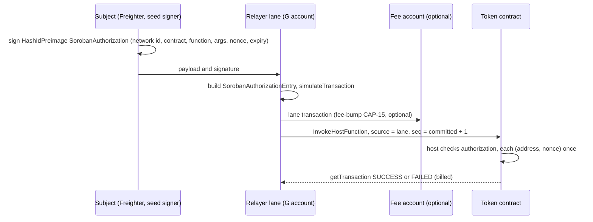

# Soroban (Stellar and Pi Network)

Common rules for every family: [networks/README](README.md). Status: contracts, adapter and client verifier
**BUILT**; the UA base (UA-Soroban, [section 10](#ua-base)) is **BUILT** on branch `ua-soroban` (merge pending the owner's go); items marked SPECIFIED are normative and not yet in code. **Soroban is not on the mesh**: jobs reach a
Soroban lane only through the job API (owner; [NODE-MESH-07](../node/mesh.md#NODE-MESH-07)).

**Contents**

1. [Overview](#1-overview)
2. [Payload](#2-payload)
3. [Signatures](#3-signatures)
4. [Contracts](#contracts)
5. [DEX](#dex)
6. [Relayer](#6-relayer)
7. [Finality and events](#7-finality-and-events)
8. [Conformance](#8-conformance)
9. [Limitations](#9-limitations)
10. [UA base (UA-Soroban)](#ua-base)

## 1. Overview

<a id="overview"></a><a id="NET-SOR-01"></a>**NET-SOR-01** — **On Soroban the contract-level meta operation is the
native Soroban authorization; a relayer lane is the transaction source, and fee-bump lets one lane pay for all.** The
subject never sends a transaction and never uses its account sequence: it signs a
`HashIdPreimage::SorobanAuthorization` (network id + contract + function + args, `i64` nonce, ledger expiry), which is
already a contract-level verifier with a **non-sequential** nonce (each `(address, nonce)` once) and a
domain-separated preimage. No second verifier is written. The relayer places the signature in a
`SorobanAuthorizationEntry` of a transaction whose source is its **lane account** (own sequence, pays the fee);
fee-bump (CAP-15) lets one fee account pay for every lane's transaction. Wallet: Freighter `signAuthEntry`; passkey: a
custom account's `__check_auth` with `secp256r1_verify`. The subject `G…` account must exist on the ledger (a host
requirement). Pi Network is the same family with network passphrases "Pi Testnet" / "Pi Network" and SLIP-44 coin
314159 (passphrases confirmed by the owner at deploy). Networks: Stellar `pubnet`, `testnet`, `standalone`; Pi
`pi-mainnet`, `pi-testnet`.



## 2. Payload

<a id="payload"></a>

<a id="NET-SOR-16"></a>**NET-SOR-16** — **Target: both kinds are host authorizations of `mtx_` functions**
([NET-ALL-26](README.md#NET-ALL-26)–[NET-ALL-29](README.md#NET-ALL-29); owner 2026-10-08). Status: **SPECIFIED**, except the mandate names, which are **BUILT** in the UA-Soroban deployment (`mtx_set_mandate`, `mtx_set_payee`, `mtx_revoke`, `mtx_withdraw`, `mtx_mandate_pay`; [NET-SOR-21](#NET-SOR-21)); the token's `pay` and the DEX's `settle` / `cancel` keep their names.
Soroban needs no struct and no verifier library: a `MetaCall` is the host authorization entry of an `mtx_<name>`
function (`function_name` + `args`), a `MetaTransfer` that of SEP-41 `transfer` (standard name kept) or `mtx_pay(from,
to, amount, pay_ref, valid_until)`; the contract's own op digest tag becomes `"scaas_metacall_v1"`. No
`mtx_execute_transfer`: host nonces order nothing ([NET-SOR-02](#NET-SOR-02)). Renames: `pay` → `mtx_pay`,
`pay_under_mandate` → `mtx_mandate_pay`, `revoke(token, by)` → `mtx_revoke`, `add_key`/`remove_key` → `mtx_add_key`/
`mtx_remove_key`, DEX `settle`/`cancel` → `mtx_settle`/`mtx_cancel`. Restriction is the missing part, so
[NET-SOR-04](#NET-SOR-04) becomes mandatory. New deployments. The names on this page are **Transitional (BUILT)**.

The subject signs these exact XDR bytes (the client builds them without RPC):

```
HashIdPreimage {
  type = ENVELOPE_TYPE_SOROBAN_AUTHORIZATION (9)
  network_id                = sha256(network_passphrase)          -- network separation
  nonce                     = i64(sha256("scaas.soroban.nonce" ‖ entryRef ‖ validUntil_be64)[0..8])
  signature_expiration_ledger = u32 (upper bound, below)
  invocation = { contract_fn: { contract_address = token (C…), function_name = "pay",
                                args = [Address from, Address to, I128 amount, BytesN<32> pay_ref, U64 valid_until] },
                 sub_invocations = [] }
}
signature: ed25519(sha256(payload))   (Freighter signAuthEntry; the seed signer computes the same)
```

The nonce is **deterministic**, not random: one payment request at one validity maps to one host nonce.

`MetaOp` v1 mapping: network → `network_id`; contract → `contract_address`; op → `function_name`; from/to/amount/payRef
→ args; lane + nonce → `nonce` (the host records each used `(address, nonce)` until the signature expires — not
sequential); validUntil → the `valid_until` arg (the contract checks `ledger.timestamp() ≤ valid_until`) **and**
`signature_expiration_ledger`; relayer → unbound (any lane may submit; the host does not bind the transaction source);
extra → none for `pay`.

Replay protection: (a) the host refuses a used `(from, nonce)`; (b) each **`(from, pay_ref)`** pays once
([NET-SOR-09](#NET-SOR-09)); (c) another network ⇒ another `network_id` ⇒ the signature fails; another contract ⇒
another `contract_address` ⇒ the invocation does not match.

**Digest.** The host does not reveal the signature hash to the contract, so the contract computes an **op digest** and
emits it in `MetaTransactionExecuted`:

```
digest = sha256( ScVal::Vec[ Symbol("scaas_metaop_v1"), BytesN<32>(network_id), Address(contract),
                             Symbol(function_name), Vec(args) ].to_xdr() )
```

The client, the contract tests and the Rust adapter compute the same value (cross vectors). The args contain `pay_ref`
and `valid_until`, so every issue (another expiry) has another digest, and a uniqueness key on
`(chain_id, digest_hash)` keeps its meaning. This digest is also what the job API and the indexer use.

<a id="NET-SOR-02"></a>**NET-SOR-02** — **The ledger expiry is computed without RPC as a safe upper bound.**
`signature_expiration_ledger` must lie in `[current ledger, current ledger + max_entry_ttl − 1]`. The client makes
no RPC call, so it uses an **anchor** left by the indexer: each time the event feed advances the Soroban chain's
cursor, the client records `soroban_anchor_ts` (its server time) next to `indexed_block` (the final ledger). Ledgers
never close faster than 1 per second (SCP), so

`exp = indexed_block + (valid_until − soroban_anchor_ts) + 17280`

is an **upper bound**: it never expires before `valid_until` (the real expiry is checked by the contract in seconds);
the 17 280-ledger margin covers indexer lag. The anchor is recorded only when the ingested batch is **shorter than
1000 ledgers** (the node has caught up with the final head; a catch-up batch after a long outage never pairs an old
anchor with a new time). An anchor older than 7 days (indexer stopped) ⇒ refuse to issue (the bound could exceed
`max_entry_ttl`); a chain never indexed ⇒ refuse to issue. Exceeding the bound only lengthens how long the host keeps
the nonce. BUILT.

## 3. Signatures

<a id="signatures"></a>

| `from` kind | Signer | Signature in the auth entry | Client check |
|---|---|---|---|
| `G…` (Freighter, seed key `m/44'/148'/i'`) | the account's ed25519 key (the host checks threshold/signers) | `Vec[Map{public_key: Bytes32, signature: Bytes64}]` (the relayer builds it from the 64 bytes) | real ed25519 with the master key inside the strkey ([INT-ERP-14](../integration.md#INT-ERP-14)) |
| `C…` = `SmartKeyAccount` (multi-key subject account) | a P-256 WebAuthn passkey or an ed25519 seed key | the account's ScVal `Signature` (XDR hex, inserted verbatim by the relayer) | none (`None`) — the node's simulation decides |

**Freighter `signAuthEntry`** (`@stellar/freighter-api`; `@stellar/stellar-sdk`, `stellar/rs-soroban-sdk`):

```typescript
signAuthEntry(entryXdr: string, opts?: { networkPassphrase?: string; address?: string }):
  Promise<{ signedAuthEntry: string | null; signerAddress: string; } & { error?: FreighterApiError }>;
```

Input: a base64 `SorobanAuthorizationEntry` (or `HashIdPreimage`) XDR string. Output: `signedAuthEntry` (base64 XDR with
the credentials filled in) and `signerAddress` (`G...` or `C...`). What is signed: the SHA-256 of the
`HashIdPreimage` XDR — `Signature = Ed25519.sign(sha256(HashIdPreimage.toXDR()))` — whose
`HashIdPreimageSorobanAuthorization` holds `network_id` (SHA-256 of the passphrase), `nonce`,
`signature_expiration_ledger` and `invocation` (`SorobanAuthorizedInvocation` tree). Contract vs account address:
`soroban_sdk::Address` exposes `Address::executable(&self) -> Option<Executable>` with `enum Executable { Wasm(BytesN<32>),
StellarAsset, Account }` — `Some(Executable::Account)` for classic `G...` accounts, `Some(Executable::Wasm(...))` or
`Some(Executable::StellarAsset)` for contracts (`C...`), `None` if the address does not exist on chain;
`Address::to_string(&self) -> String` returns the StrKey (`C...` for contracts, `G...` for accounts). Soroban SDK major version at the time of writing: **`28.0.0`** (protocol 22 /
23+); the contracts build with soroban-sdk 26.1.1 and Rust 1.97.1 (`smartcontracts/soroban/rust-toolchain.toml`; the SDK needs ≥ 1.91).

**`SmartKeyAccount.__check_auth(signature_payload, Signature, contexts)`:**

- `Ed25519{key_id, signature}`: `ed25519_verify(pk, signature_payload, sig)`.
- `WebAuthn{key_id, authenticator_data, client_data_json, signature (r‖s, low-s), proof}`: the challenge is
  `signature_payload` when `proof` is empty, otherwise the sha256 Merkle root of leaves
  `sha256(sha256(0x00 ‖ payload))` with sorted pairs (batching); `clientDataJSON` carries `"type":"webauthn.get"`,
  `"challenge":"<base64url(challenge)>"` and the registered origin; `authenticator_data[0..32] = rp_id_hash`; flags UP
  (`0x01`) and UV (`0x04`); `secp256r1_verify(pk65, sha256(authData ‖ sha256(clientDataJSON)), sig)` (the host refuses
  high-s — CAP-51).
- Key lifecycle: `add_key` / `remove_key` need the account's own authorization (an existing key signs); never zero
  keys. The account is deployed permissionlessly with `__constructor(first_key)` and must exist before it pays.

<a id="NET-SOR-13"></a>**NET-SOR-13** — **The Soroban passkey verifier refuses `"crossOrigin":true` and any
`topOrigin`** (the common grammar, [NET-ALL-04](README.md#NET-ALL-04)). SPECIFIED (as built `verify_webauthn` checks
only `type`/`challenge`/`origin`, `smart-key-account/src/lib.rs:149-153`, so an RP page embeddable in a cross-origin iframe —
Permissions-Policy `publickey-credentials-get` — yields valid assertions under an attacker's page). Test: an assertion
with `crossOrigin:true` ⇒ `BadClientData`.

## <a id="contracts"></a>4. Contracts

<a id="contracts"></a>

`smartcontracts/soroban/contracts/{token,mandate,dex,account,ua-registry,ua-common,relay-fee,relay-executor}/` (the UA contracts: [section 10](#ua-base)):

- **`scaas-token`** — SEP-41 (`balance`, `transfer`, `transfer_from`, `approve`, `allowance`, `burn`, `burn_from`,
  `decimals`, `name`, `symbol`) + admin `mint` + `pay(from, to, amount, pay_ref, valid_until)`: `from.require_auth()`,
  expiry, `pay_ref` once per `from` and `amount > 0` ([NET-SOR-09](#NET-SOR-09)); emits
  `PaymentSettled{from,to | amount,pay_ref}` and `MetaTransactionExecuted{from | digest}`. **`approve` only to a
  contract spender** (`executable()` = Wasm or StellarAsset; [CTR-TOK-01](../contracts/token-wrappers.md#CTR-TOK-01)).
  No fee. Storage: balances, allowances and `pay_ref` entries persistent, with TTL extension.
- **`scaas-mandate`** (as the EVM `MandateWallet`): one owner; funds inside the contract; per token: delegate, limits
  per payment and per period, period, expiry, allowed payees; `mtx_mandate_pay(token, payee, amount, pay_ref,
  epoch, valid_until, relayer, auth)` (was `pay_under_mandate`) — the delegate's authorisation (host auth or a UA signature) then `token.pay(self, payee, …)` (the same `PaymentSettled`, so the client
  reconciles it like a manual payment); `pay_ref` once (its own `Key::Ref(pay_ref)`; only the delegate spends it);
  `mtx_revoke(token, by, epoch, …)` by the owner **or** the delegate (kill switch); owner `withdraw`. The owner is gasless naturally:
  its native authorization goes through a relayer (no `executeAsOwner` needed).
- **`SmartKeyAccount`** — the multi-key subject account above.

<a id="pay-ref"></a><a id="NET-SOR-09"></a>**NET-SOR-09** — **`pay_ref` is one-shot per `(from, pay_ref)`, not
globally, and `pay` moves a positive amount.** `Token::pay` keys `Key::PayRef(from, pay_ref)`; `ref_used(from,
pay_ref)`; `pay` with `amount ≤ 0` (`amount <= 0`) ⇒ `Error::NonPositiveAmount` (`i128`: a negative amount is refused too; owner
decision on the error name). The mandate path keys by the mandate's address automatically and keeps its own
`Key::Ref(pay_ref)`. Why: with a global key, a stranger's 0- or 1-unit `pay(attacker, receiver, …, victim_ref)` burns
the victim's ref and blocks the victim's signed payment; booking already sums settlements per `entry_ref` and
receiver, so a stranger's payment with someone else's ref is only money in (same direction as Cosmos, which never
locks `pay_ref`, and the EVM `MetaToken`). SPECIFIED (as built the key is global, `token/src/lib.rs:203-209`, and
`check_amount` accepts 0, `:113-117`). Tests: a third party `pay(self, x, 0, victim_ref)` ⇒ `NonPositiveAmount`;
`pay(self, x, 1, victim_ref)` does not block the victim's `pay`; the same `from` paying the same `pay_ref` twice (two
signatures) ⇒ `RefUsed`; `pay_under_mandate` cannot be burnt by a third party.

<a id="ttl"></a><a id="NET-SOR-11"></a>**NET-SOR-11** — **Entries in daily use extend their TTL, and an archived
footprint is restored by the lane and retried.** `pay_under_mandate` extends `Key::Payee` on every use;
`SmartKeyAccount.__check_auth` extends the account instance; when simulation returns a `restorePreamble`, the lane
submits `RestoreFootprintOp` with the preamble's footprint and fee, then rebuilds the job; the restore rent is a
lane-paid deposit bounded by `chain.max_deposit_per_job` and charged to the `from` subject
([NODE-LANE-18](../node/submit-lanes.md#NODE-LANE-18)). The node's restore half is **BUILT** (UA-Soroban, [NET-SOR-23](#NET-SOR-23): a simulation that restores archived entries is accepted within `params.max_deposit_per_job`; TTL extension on the UA entries and the mandate and DEX instances, [NET-SOR-22](#NET-SOR-22)); the rest is SPECIFIED (as first written a `restorePreamble` ⇒ `Revert` ⇒ job `dead`,
`soroban.rs:325-327`; only `set_payee` extends the payee, `mandate/src/lib.rs:131-140`, `:167` only `has`; the account
extends only on `save`, `smart-key-account/src/lib.rs:75-78`, `__check_auth` `:215-229` does not — so an account in daily use is
archived ~60 days after its last key change, a payee 60 days after it was allowed). Tests: TTL after
`pay_under_mandate` / `__check_auth` is raised; end to end: archive ⇒ restore ⇒ `mined`. System relayers may also call
`extend_ttl` for long-lived state.

## <a id="dex"></a>5. DEX

<a id="dex"></a>

`scaas-dex` `settle(maker, taker, maker_fill, maker_auth, taker_auth)` (the two `auth` are empty for a native maker; every leg is pull-then-pay, [NET-SOR-21](#NET-SOR-21)): `require_auth_for_args((order,))` for **both** orders (and, per [NET-SOR-10](#NET-SOR-10), `order.relayer.require_auth()`); both price limits
(maker's price; the taker receives at least its own); `filled[order_hash]` never overfills; maker/taker ppm fees per
market (sorted token pair), on/off, cap 1 % (10 000 ppm) and ≤ the signed `max_fee_ppm`; tokens move by
`transfer_from` with the DEX as spender (allowances only to contracts); `cancel(order)` authorised by the maker sets
`filled = sell_amount`, so a cancelled order never settles. `order_hash = sha256(order.to_xdr())`. One fee recipient
for the whole DEX (`Key::FeeRecipient`); no on-chain self-trade check.

<a id="NET-SOR-10"></a>**NET-SOR-10** — **Soroban orders always name their settling relayer; there is no open form.**
`Order.relayer: Address` is mandatory (not an `Option`); `settle` calls `maker.relayer.require_auth()` and requires
`maker.relayer == taker.relayer` — the Soroban application of the bound-settler rule
([CTR-DEX-09](../contracts/dex.md#CTR-DEX-09)), which elsewhere allows "relayer 0 = open". Why: the host only matches
`dex.settle(order)` (`dex/src/lib.rs:158-159`); the counter-order and `maker_fill` (`:153`) are the submitter's choice,
so anyone who sees a pending `settle` (transactions flood to every peer before the ledger closes) re-submits both auth
entries with `maker_fill = 1`: both nonces are consumed for a dust fill, the real `settle` fails (the relayer pays) and
both makers must sign again. Binding the settler means only the DEX operator's lane can spend the auth entries; roles
and `maker_fill` are chosen by the (trusted) operator. Binding `(order, fill)` into the signature is not possible: a
resting order is signed before its fill is known. SPECIFIED (as built `Order` has no relayer, `:35-47`). Test: a third
party re-submits both auth entries with `maker_fill = 1` ⇒ fails; the right relayer settles.

- <a id="NET-SOR-05"></a>**NET-SOR-05** — **One signature settles once.** An auth entry consumes its nonce when used:
  a partially filled order needs the maker to sign again for the rest; `filled[order_hash]` (the hash holds no nonce)
  prevents overfill across re-signed copies of one order.
- <a id="NET-SOR-06"></a>**NET-SOR-06** — **No multi-pair batch per Soroban transaction.** A Soroban transaction is
  one host call; a failure in one pair reverts the whole transaction (no per-pair atomicity), so the matcher submits
  one pair per transaction, in parallel across lanes.
- <a id="NET-SOR-07"></a>**NET-SOR-07** — **A relayed DEX job carries two auth entries.** `settle` needs two auth
  entries while a `signed_op` job carries one signature; the adapter accepts
  `extra.auth = [{from, payload, signature, public_key}]` (same rules), so the matcher only queues jobs with two
  signatures. The Soroban book and matcher are a seam.

## 6. Relayer

<a id="relayer"></a>

- Lane = `G…` account derived at `m/44'/148'/i'` (SEP-0005); one transaction in flight per lane (`lane_runner`); the
  **committed** sequence is read (`getLedgerEntries` of the account); the transaction uses `seq+1` and
  `time_bounds.max_time = valid_until`, so a transaction that never lands expires with the payload and the lane
  sequence never hangs.
- `build`: decode `payload` (XDR) → check `network_id` = sha256(configured passphrase) (stops cross-network ops before
  any fee), the invocation's contract = `op.contract`, `from` matches; build the `SorobanAuthorizationEntry` (Address
  credentials with the payload's nonce/expiry + signature); `InvokeHostFunction` = exactly the invocation;
  `simulateTransaction` (auth enforced) ⇒ footprint + resource fee; simulation error ⇒ `Revert` (job dies); network
  error ⇒ `Transport`.
- `sign`: `fee = base + min_resource_fee·1.15`, `seq = committed + 1`, ed25519 over
  `sha256(TransactionSignaturePayload)`; `tx_id = 0x‖hex(hash)`.
- `submit`: `sendTransaction`; `tx_status`: `getTransaction` (SUCCESS / FAILED / NOT_FOUND). Classes
  ([NODE-LANE-14](../node/submit-lanes.md#NODE-LANE-14), already right in code): `sendTransaction` `ERROR` = not in a
  ledger ⇒ free requeue (`soroban.rs:368-378`); `TRY_AGAIN_LATER` / network error ⇒ resend the same bytes;
  `getTransaction` `FAILED` = included and **billed** (inclusion fee + non-refundable resource fee) ⇒ final
  `Reverted` (`:380-387`). There is no requeue loop after a billed failure.
- **Fee-bump (CAP-15):** `params.fee_bump_lane = i` wraps every lane's transaction in a `FeeBumpTransaction` signed by
  the fee account `m/44'/148'/i'`; lane accounts need only the minimum balance. The subject's sequence is never used.
- Head-of-line: other lanes continue; the subject has no sequence on the path (the nonce is derived from
  `entryRef ‖ validUntil`, not sequential).

<a id="NET-SOR-15"></a>**NET-SOR-15** — **`build` takes `valid_until` (hence `TimeBounds.max_time` and the runner's
expiry) and `contract` from the signed invocation** (the `valid_until` arg, `contract_address`), never from the job
JSON; a mismatch ⇒ `422 BAD_PAYLOAD` ([NODE-LANE-16](../node/submit-lanes.md#NODE-LANE-16)). SPECIFIED (as built
`op["valid_until"]`, `soroban.rs:313`). Test: a job whose JSON `valid_until` exceeds the signed arg ⇒ refused.

<a id="NET-SOR-14"></a>**NET-SOR-14** — **The Soroban adapter reports `tx_fee` (`feeCharged` from the `resultXdr` of
`getTransaction`, for both `SUCCESS` and `FAILED`) and `lane_balance` (native balance of the lane and of the
`fee_bump_lane`)** to the breaker ([NODE-LANE-13](../node/submit-lanes.md#NODE-LANE-13)). SPECIFIED (as built neither is
implemented, `adapter.rs:112-118`, so `gas_budget` and `min_relayer_balance` are blind on Soroban; the breaker fills
only on `Mined`, `adapter.rs:270-276`). Test: a FAILED transaction adds `feeCharged` to `spent`. Residual risk: a `G…`
subject flips state after simulation (transfers everything away, or submits its own auth entry to burn the nonce);
bounded per `from` by the grief score ([NODE-LANE-15](../node/submit-lanes.md#NODE-LANE-15); `subject_grief` not yet in
code).

<a id="NET-SOR-12"></a>**NET-SOR-12** — **`op_consumed` reads the host nonce key** (`getLedgerEntries` of
`ContractData{contract: from, key: LedgerKeyNonce{nonce}, Temporary}`): present ⇒ `Some(true)`; for `pay` also
`ref_used(from, pay_ref)`. An auth entry consumed by someone else (a dust-fill attacker, a stranger's `pay`, or the
subject itself) makes the job `consumed`, not `dead`/`reverted`, so the client never asks the payer to re-sign an op
that already ran ([NODE-LANE-09](../node/submit-lanes.md#NODE-LANE-09)). SPECIFIED (as built the default `Ok(None)`,
`adapter.rs:127-129`). Test: an auth entry already submitted by someone else ⇒ job `consumed`.

<a id="NET-SOR-08"></a>**NET-SOR-08** — **A Soroban token address is a per-family string.** The token configuration
holds the address as the family's own string (`TokenCfg.address`, `config.rs:302-306`) and `index_step` passes it
through; the token list is the node store's per-namespace set (no `params.contracts`). BUILT.

Node-wide rules: value out = 0 ([NODE-LANE-17](../node/submit-lanes.md#NODE-LANE-17)); one custody key per family —
a `G…` ed25519 key signs raw 32 bytes like a Hedera ED25519 key, so one key never serves two families
([NODE-LANE-20](../node/submit-lanes.md#NODE-LANE-20)); no adapter journal of its own. Mesh signature checks do not
apply while Soroban is off the mesh (`mesh/digest.rs:146` returns `FamilyNotSupported`); if it joins, the decoder
verifies a `G…` ed25519 signature locally.

## 7. Finality and events

<a id="finality"></a>

SCP: a closed ledger is final. `final_head` = `getLatestLedger` (+ quorum: the other endpoints return the same hash
through `getLedgers`); `block_hash` through `getLedgers`. Events: `getEvents` (contract = a registered token, ≤ 5 per
filter), normalised to `{event, contract, block_number = ledger, block_hash, tx_hash, log_index, from, to, amount,
entry_ref, digest}` (hashes `0x` + 64 hex, strkey addresses); `log_index` = the event's index in the transaction (one
op per Soroban transaction). `getEvents` serves only the RPC's retention window (quickstart: 120 960 ledgers): a newly
created chain must set `indexed_block` near the current ledger (operations). Event-set agreement across the quorum per
ledger range: SPECIFIED.

## 8. Conformance

<a id="conformance"></a>

- Contracts (`cargo test`): token, mandate, DEX, account with **real** authorization (`set_auths` + real ed25519 / P-256
  signatures through the account), not only `mock_all_auths`; **anti-lock** (X on token 1 and Y on token 2; X held; Y
  succeeds; then X succeeds); a used nonce refuses replay.
- Cross vectors: the same `payload` / `digest` from the client verifier, the contract tests and the Rust adapter (pinned
  constants).
- UA-Soroban (SDK testutils at Protocol 30): `ua-registry` 49 tests (every S3 kind's vectors and negatives incl. the 21 WebAuthn negatives, canonical blob, `msig` members, receivability, interface check), token 30, mandate 11 (epoch, `StaleEpoch`), DEX 16, relay-fee 19 (both attacks on the executor, `BadPayee`, `BadExecutor`), `smart-key-account` 10; `ua-ops.json` reproduced by the contracts, the adapter (63 rows) and `clientkeys`; node `ua_metatx` allow-list, lane-authority, executor-refusal, `StaleEpoch` and auto-restore tests; local end-to-end `e2e_soroban_ua` (6 tests) through `deploy.sh` ([NET-SOR-24](#NET-SOR-24)).
- Adapter: unit tests + decoder proptest; end-to-end `tests/e2e_soroban.rs` (`#[ignore]`) on a local `stellar/quickstart`
  (port 31980): two lanes from a 24-word mnemonic, payment through `lane_step`, finality through `index_step`,
  anti-lock end to end.

## 9. Limitations

<a id="limitations"></a>

- <a id="NET-SOR-03"></a>**NET-SOR-03** — **Soroban guardian recovery is a seam.** Guardian + delayed recovery is not
  built on Soroban; SPECIFIED as a gap ([NET-ALL-05](README.md#NET-ALL-05)).
- <a id="NET-SOR-04"></a>**NET-SOR-04** — **`__check_auth` checks every entry of `auth_contexts` against the key's allowlist**
  (owner 2026-10-08, [NET-ALL-27](README.md#NET-ALL-27)). Each key of `SmartKeyAccount` carries the `(contract, function)`
  pairs it may authorise (a passkey that pays, only a seed key changes keys…), aligned with Universal Account key
  purposes ([CTR-UA-10](../contracts/accounts.md#CTR-UA-10)); a context outside it fails. SPECIFIED. Transitional
  (BUILT): `_contexts` is ignored (`smart-key-account/src/lib.rs:215`), so any one passkey can `add_key` an attacker's key.
- Not on the mesh (above). Seed role keys of a `C…` account use `kindNo` 18
  ([CLI-SGN-30](../clients/signers-clientkeys.md#CLI-SGN-30)).
- Confidential payments: Soroban has BLS12-381 (CAP-59) and BN254 (CAP-74, protocol 25) host functions plus Poseidon, so
  a Bulletproofs/ElGamal verifier is feasible in principle, but the per-transaction CPU budget (~100 M instructions)
  may not fit a range proof with n = 64 (to be measured); Groth16 over a Zether-like circuit (one pairing check) is the
  more practical candidate. Classical Zether on Soroban is [NET-SOR-25](#NET-SOR-25) (specified, Part Z; the early T0 model puts the transfer verifier over the limit); PQZ is [NET-SOR-26](#NET-SOR-26). Not built.

## <a id="paymeta-relayfee"></a>Pay-meta and relay fee (metatx split)

Spec `docs/superpowers/specs/2026-10-27-metatx-split-design.md` §6.2 / §7.2; rules [CTR-MTX-26](../contracts/metatx.md#CTR-MTX-26) and [CTR-MTX-27](../contracts/metatx.md#CTR-MTX-27); decisions CTR-MTX-26 / -27 (commit per family below). Status BUILT unless a line says owed.

- **Pay-meta.** Token `pay_meta(from, to, amount, salt: BytesN<32>, meta: Bytes, valid_until)`: `from.require_auth()` covers
  these arguments (`meta` included), `pay_ref = metaPayId(salt, meta)`, then `pay`'s body (`settle_pay`); event
  `PaymentMeta { pay_id, meta }` before `PaymentSettled`; `MetaTransactionExecuted.digest = op_digest("pay_meta", args)`.
  The token's `PayRef` set is keyed by `(from, pay_ref)` for `pay` and `pay_meta` (the per-payer lane of EVM), so nobody can
  pre-burn another payer's id (T10 fix 1, controller call 2026-10-27, owner may override). Read it with
  `ref_used(from, pay_ref)`.
- **Relay fee.** Contract `contracts/relay-fee`: `relay(payer, target, func, args, salt, token, to, amount, valid_until, relayer)`.
  `payer.require_auth_for_args((target, func, args, salt, token, to, amount, valid_until))`; the payer's auth entry is rooted
  at this router call with the token's `pay` as sub-invocation. `ref = keccak256("scaas.relayfee" ‖ network id ‖ xdr(target) ‖
  keccak256(xdr((func, args))) ‖ salt)`; the payer-signed `salt` is needed because Soroban's target auth is outside `args`.
  Open mode (`to == router`): the router receives, then `token.transfer(router, relayer, amount)`. The target runs
  through `contracts/relay-executor` (`executor.exec`, router-only), never as the router: Soroban grants a contract's
  authority to every contract it calls directly (controller ruling 2026-10-31 after the UA-Soroban T8 review, EVM
  parity). Each constructor names the other; `deploy.sh soroban <net> relay_fee` deploys both. `ua_relay` is the UA
  payer form (UA-Soroban spec §5.4). Event `RelayFeePaid` topics `ref, target, token`, data `payer, payee, amount`
  (`payer` / `payee` as `Holder`).
- **Relayer rule.** `relayer.require_auth()` is not satisfied by the transaction source: the node adds an explicit
  `SourceAccount` auth entry rooted at the `relay` call. Node config `params.relay_fee = { router, min_amount }`.
- **Owed.** A testnet or localnet simulate-and-submit of a `relay_fee` job to prove the `SourceAccount` path (the Rust test
  environment has no transaction source). TODO.md, "metatx split — e2e still owed".
- Commits: pay-meta + router T10 `cd5e508c`, fix 1 `351f67ea`.

## <a id="ua-base"></a>10. UA base (UA-Soroban)

Spec: `docs/superpowers/specs/2026-10-30-ua-soroban-design.md` (rows S1-S18 in §0); decisions: NET-SOR-17 to NET-SOR-26, with the spec rows and the plan's SOR-D1 to SOR-D18 in full. Status: contracts, node adapter, `clientkeys` and the local Protocol 30 end-to-end run **BUILT** on branch `ua-soroban` (tasks T0 to T10, reviewed); the Stellar testnet run (after 2026-11-03), UA-8 Part B (`ua8-soroban`) and classical Zether (`zether-soroban`) are next. Common UA rules are [accounts.md](../contracts/accounts.md#CTR-UA-01) (CTR-UA-*) and the checklist [NET-ALL-84](README.md#NET-ALL-84).

<a id="NET-SOR-17"></a>**NET-SOR-17** — **Records live in a stand-alone `UaRegistry` contract (`contracts/ua-registry`), registered with the portable `register`, no admin and no upgrade.** `register(kind, key_data, attrs, pop, pqz_pop, relayer)` is the CTR-UA-07 form (UA-8 P1); UA-Soroban accepts only empty `attrs` (`Attrs`); `Registration` already has the full layout, so Part B changes no storage. Check order: kind enabled (`KindDisabled`), key data canonical (`KeyData`), id not in the native space (`IdInNativeSpace`, top 96 bits zero), not registered (`AlreadyRegistered`), `keyHash` free (`KeyInUse`), `msig` members known and in MEMBER (`MemberUnknown`), `attrs` empty (`Attrs`), `pop` over `uaMessage(kind, PURPOSE_POP_V2, registrationDigest)` (`Pop`), store, list, event. Nothing is read from the submitter: anyone may submit, a front-runner gets the identical record or a revert. Ids are `keccak256(TAG(kind) ‖ key_data)` with the host keccak, byte-identical to EVM; `Holder { Addr(Address), Ua(BytesN<32>) }` tells a native id from a derived one; a derived id is displayed only as `urn:scaas:ua:v1:<kind name>:<hex32>` ([NET-ALL-21](README.md#NET-ALL-21); the segment is the kind **name** of `kinds.json`, never its code; the hex is lower-case). The ML-DSA kinds use only the CAP-0087 host functions (`ml_dsa_44_verify`, `ml_dsa_65_verify`), one `verify.rs` for `register` and `require_authorized`; the registry has no pure-Rust fallback. The `UaRegistered` event (topics `ua`, `kind`) carries the record with `pop` replaced by `pop_hash = keccak256(pop)` ([CTR-UA-33](../contracts/accounts.md#CTR-UA-33)); `pop` stays in the record, read by `registration_of`. Constructor `__constructor(relayers: Vec<Address>)` (may be empty), immutable; tokens, mandate and DEX bind the registry at construction, `None` = the UA ledger is off (`UaLedgerOff`). Shared types (`Holder`, `Order`, `Checked`, `UaAttrs`, `Registration`, `UaRegistryClient`, `op_digest`, `pay_lane`, `meta_pay_id`) live in the lib crate `contracts/ua-common` so every contract has one XDR. `check-registry-interface.sh` compares the built Wasm's interface with the exact function list (no admin, no upgrade, no setter). **Errors** (`contracterror`, each contract appends and never renumbers): registry `KindDisabled = 1, KeyData = 2, IdInNativeSpace = 3, AlreadyRegistered = 4, KeyInUse = 5, MemberUnknown = 6, Attrs = 7, Pop = 8, NotRegistered = 9, Unauthorized = 10, NotVerifiable = 11, RelayerNotListed = 12` (Part B continues at 13); token `UaLedgerOff = 8, UaNotRegistered = 9, UaNotReceivable = 10, UaPoolNotPayable = 11, BadNonce = 12, BadOrder = 13` (after the built 1 to 7); mandate `BadAuth` after its built codes, `Expired = 10, BadNonce = 11, UaLedgerOff = 12, StaleEpoch = 13`; DEX `BadAuth = 9, UaLedgerOff = 10, BadDestination = 11`; relay-fee `BadPayee`, `BadExecutor = 3`. A host crypto failure (an ed25519 / P-256 / ML-DSA verify panic, a P-256 key that is not a curve point) is a host error, not `Pop`. BUILT.

<a id="NET-SOR-18"></a>**NET-SOR-18** — **Seven kinds are enabled; `msig` members are those kinds plus the Soroban natives.** Enabled: `webauthn-p256` 0x0100, `p256` 0x0101, `ed25519` 0x0102, `secp256k1` 0x0108, `msig` 0x0120, `mldsa44` 0x0130, `mldsa65` 0x0131; every other derived kind is `KindDisabled` here and stays valid elsewhere. Checks: `webauthn-p256` the [NET-ALL-04](README.md#NET-ALL-04) grammar (type, challenge = base64url(`ua_msg`), `crossOrigin` absent or false, no `topOrigin`, `rpIdHash`, UP and UV) then `secp256r1_verify`, **no origin compare**; `p256` over `sha256(ua_msg)`; `ed25519` `ed25519_verify` with the contract refusing `y ≥ p`, the eight small-order encodings and the two negative-zero encodings (the host refuses the rest); `secp256k1` `secp256k1_recover` with `s ≤ n/2` and `v ∈ {27, 28}`; ML-DSA over `pq_msg` with the empty context. The WebAuthn signature blob is **canonical only** (owner ruling 2026-10-30, every registry): `webauthn::check` re-encodes the decoded blob and refuses unless it is byte-equal (`Pop`), so a front-runner cannot register the same id with other `pop` bytes (CTR-UA-07 identical-record rule). `msig` (CTR-UA-09 layout, `count ≤ 16`): `auth = abi.encode(MemberSig[])`, canonical encoding only; MEMBER = the enabled single-key kinds plus `stellar-account` 0x0011 and `soroban-contract` 0x0012 (checked by the host, `member.require_auth_for_args((ua, purpose, digest))`; a record with such a member is Soroban-network-local) ; `evm-eoa` 0x0001 members verify the portable purposes only and have **zero signing weight** otherwise (`NotVerifiable`, fails closed as on EVM); `evm-contract` 0x0002 members are never chain-verified here. A **registered** member's slot carries an **empty `keyData`** and the registry reads only that member's `(kind, key_data)` from its own `Signer(ua)` entry, never its `pop` ([CTR-UA-33](../contracts/accounts.md#CTR-UA-33); a non-empty `keyData` is `Pop`); a Soroban native member's slot is empty and host-checked. BUILT.

<a id="NET-SOR-19"></a>**NET-SOR-19** — **Only a UA that can spend on Soroban may receive.** `receivable(ua)` is true only for a registered, enabled-kind UA whose `pop` the chain checked and, for `msig`, whose Soroban-signable member weight reaches the threshold (`Registration.signable`, fixed at `register`); it is `false` for an unregistered id too. The token tells the two failures apart on the error path only (`record_of(ua).is_none()` is `UaNotRegistered`, else `UaNotReceivable`). In UA-Soroban a signature part the chain cannot verify (an `evm-contract` member slot, any `MemberSig` of a kind outside MEMBER) is `NotVerifiable` whatever `relayer` says; Part B adds the relayer-checked mode on top. BUILT.

<a id="NET-SOR-20"></a>**NET-SOR-20** — **Tokens keep a UA ledger beside the native one: separate `ua_*` entries, lanes in persistent storage, the token's own address as the UA pool.** Entries: views `ua_balance`, `ua_nonce(ua, lane)`, `ua_ref_used`, `registry`; native-to-UA `transfer_to_ua`, `pay_to_ua` (emits the native `MetaTransactionExecuted`, controller ruling 2026-10-30), `mint_to_ua`; signed `ua_transfer`, `ua_pay`, `ua_pay_meta`, `ua_burn`, `ua_cancel_nonce`, `ua_trade`. `from` of a `ua_*` entry is a derived id; natives keep host authorisation. Replay: `UaNonce(ua, lane) → u64` persistent (never temporary, which would reopen spent nonces on expiry); `ua_pay` uses `lane = payLane(pay_ref)`, `nonce = 0`, so `ua_ref_used = ua_nonce(ua, pay_lane(pay_ref)) > 0` (no own entry). `ua_cancel_nonce` signs no nonce, so each digest runs once: persistent `UaCancelUsed(digest)`, checked before the signature, a replay is `BadNonce`. `ua_trade` is called only by a deployed Wasm contract as `dex` (`executable() == Some(Wasm)` before `dex.require_auth()`), requires maker `Holder::Ua` and `sell_token == token`, and keeps a running persistent `UaPulled(order digest) + amount ≤ sell_amount` (EVM `pulled[h]` parity), else `BadOrder`. A relayer-bound entry has `relayer: Option<Address>`; `Some(r)` requires `r.require_auth()` (a lane by an explicit `SourceAccount` entry rooted at the call; the router as the direct invoker of its own fee call). The pool is the token's own address: `balance(token) = Σ UaBalance`, every native to UA move also emits the SEP-41 `transfer` event to or from it; a native `transfer` / `pay` / `mint` to the token's own address is `UaPoolNotPayable`. Events `UaTransfer { from, to, amount }`, `UaPaymentSettled`, `UaMetaTransactionExecuted`. No allowances for UAs. The pool is not checked on `pay_to_ua`'s `from` (native `pay` has no pool check; a pool-held balance could be paid to a UA as to a native address today; controller ruling 2026-10-30). Constructors: token `__constructor(admin, decimals, name, symbol, registry: Option<Address>)`, mandate `(owner: Holder, registry: Option<Address>)`, DEX `(admin, fee_recipient, registry: Option<Address>)`. BUILT.

<a id="NET-SOR-21"></a>**NET-SOR-21** — **The mandate, the DEX and the relay-fee router accept UA holders; the router executes every target through a separate executor.** *Mandate*: owner, delegate and payees are `Holder`; the NET-SOR-16 names are built (`mtx_set_mandate`, `mtx_set_payee`, `mtx_revoke`, `mtx_withdraw`, `mtx_mandate_pay`), each one entry for a native and a UA holder (a native holder: host auth, `auth` empty else `BadAuth`, its lane not consumed). Epoch ([CTR-ACC-07](../contracts/mandates.md#CTR-ACC-07), now on Soroban): `epoch(token)` +1 on every `mtx_set_mandate` and every revoke; the delegate's `mtx_revoke(token, by, epoch, …)` and `mtx_mandate_pay(token, payee, amount, pay_ref, epoch, …)` sign it and are `StaleEpoch` unless current; **the owner may pass any epoch to `mtx_revoke`** (unchecked, EVM parity: the owner's revoke has no epoch and the lane nonce stops replay). *DEX*: `Order` carries `maker: Holder`, `destination: Holder` and the mandatory `relayer` (NET-SOR-10); a UA maker's leg has `auth` over `op_digest(dex, "ua_order", (dex, order))`, `ua_cancel(order, auth)` signs purpose `trade` over `op_digest(dex, "ua_cancel", (order,))`; `filled[order_hash]` bounds partial fills without re-signing. **Every leg is pull-then-pay**, native legs too: the DEX pulls the sell amount into itself (`transfer_from` or `ua_trade`), then pays the destination and the fee (as EVM `settleOne`), so the DEX is a middle hop in events and holds nothing after; a destination equal to the DEX is `BadDestination = 11` before any pull. Differences from EVM: the fee is rounded down (floor; EVM rounds up), there is no `SelfTrade` check, the `Cancelled` event topic is a `Holder`. A relayer that is also a native maker needs two auth entries (its `SourceAccount` entry for `order.relayer` and its order entry). `settle(maker, taker, maker_fill, maker_auth, taker_auth)`. *Router* ([CTR-MTX-27](../contracts/metatx.md#CTR-MTX-27)): `ua_relay(payer, target, func, args, salt, token, to, amount, valid_until, relayer, auth)` with the `relay` ref, then `token.ua_pay(payer, to, amount, ref, valid_until, Some(router), auth)`; `RelayFeePaid` `payer` and `payee` are `Holder`. **Executor** (controller ruling 2026-10-31 after the T8 review, EVM parity; owner may override): Soroban grants a contract's authority to every contract it calls directly, so a router that called the target itself let a relayer submit a victim's router-bound `ua_pay` as the target (fee paid and ref burned without the call; an open-mode fee stuck on the router then drained by `token.transfer(router, attacker)`). The router therefore never calls a target as itself: `executor.exec(target, func, args)` on `contracts/relay-executor` requires `router.require_auth()` and calls the target as the executor, which holds nothing. The two constructors name each other (`RelayFee(executor)`, `RelayExecutor(router)`), the router's constructor checks `executor.router() == self` (`BadExecutor = 3`), a payee equal to the router or the executor is `BadPayee`, and `deploy.sh soroban <net> relay_fee` derives the router id from a salt, then deploys executor and router. The router is **not stateless** (it stores the executor id). BUILT.

<a id="NET-SOR-22"></a>**NET-SOR-22** — **Every UA record, balance, lane and ref is a persistent entry; the lane pays fees, rent and restores; deploy warms every contract.** One entry per key (`Ua(ua)`, `Key(key_hash)`, `List(kind, i)`, `Count(kind)`, `Signer(ua) → (kind, key_data)`, `UaBalance`, `UaNonce`, `UaPulled`, `UaCancelUsed`), instance storage only for constructor constants, temporary only for SEP-41 allowances. `Signer(ua)` is the fifth persistent entry of a record: it duplicates the key data so a member check reads 384 B instead of the 16,768 B record (identical CPU 3,279,036 and memory 87,048), write-once. TTL `extend_ttl(30 days, 60 days)` on each write and in-transaction read, the mandate and DEX instances too; views extend nothing; **no node TTL job**. An archived entry is restored by the next transaction that lists it (Protocol 23), never read as absent, so an archived nonce cannot be replayed. The lane pays the resource fee, rent and restore, bounded per job by `params.max_deposit_per_job`; users and UAs hold no XLM. **First-call rent** (local Protocol 30 run, stroops): a fresh contract's first call pays the 60-day TTL rent (`set_market` 83.8 M, `mtx_set_mandate` 88.0 M, a first relayed `ua_relay` 51.5 M against about 0.7 M warm), so `deploy.sh` **warms every deployed contract** (extends the instance and the code to 60 days, 1,036,800 ledgers, paid by the deployer; token, mandate, DEX, registry, executor, router): after it the same calls cost 181 k, 502 k and 438 k and every relayed job at most about 1.1 M. A per-job resource-fee cap for Soroban jobs is a TODO (operator policy). BUILT.

<a id="NET-SOR-23"></a>**NET-SOR-23** — **The node relays UA jobs as `ua_metatx` and never lends a lane's authority.** Job `{kind: "ua_metatx", op: {contract, function, args: "<hex XDR ScVec>", auth?: [{payload, from, signature}], valid_until}}` (`op.kind` present is refused); `call` jobs for the registry writes are Part B. Allow-list by function and contract class (arity includes `auth`): token `ua_transfer`, `ua_pay`, `ua_pay_meta`, `ua_burn`, `ua_cancel_nonce`; router `ua_relay`; DEX `settle`, `ua_cancel`; mandate `mtx_set_mandate`, `mtx_set_payee`, `mtx_revoke`, `mtx_withdraw`, `mtx_mandate_pay`. `valid_until` and the contract come from the signed arguments ([NET-SOR-15](#NET-SOR-15)); the op digest is recomputed and is the job id. `op_consumed`: `ua_nonce(ua, lane) > nonce` or `ua_ref_used` ⇒ consumed ([NET-SOR-12](#NET-SOR-12)). **Lane-authority rule**: the adapter attaches only the subject's signed entries and, when `relayer = Some(lane)`, one `SourceAccount` entry rooted at exactly the job's top-level call; any other recorded `SourceAccount` entry fails the job before submission (the Protocol 30 host itself refuses the smuggled entry at simulation with `Error(Auth, InvalidAction)`, before the guard; the guard is the second line). **Executor refusal**: a `pay`, `pay_meta`, `mtx_mandate_pay` payee, `mtx_withdraw` destination, `mtx_set_payee` payee (when allowing), either `settle` destination, or relay-fee job whose recipient is the router or the executor is refused (payments there are stranded or executor-drainable). **Archived entries** (BUILT, NET-SOR-11's node half): a simulation that restores archived footprint is accepted when its declared fee is ≤ `params.max_deposit_per_job` (absent = 0 = none), else `Revert`. **StaleEpoch**: the node holds no delegate key; a delegate job refused `StaleEpoch` re-reads `epoch(token)` and returns the signed and the current epoch in the failure reason; the client re-signs (EVM parity). **Events**: `UaTransfer`, `UaPaymentSettled`, `UaMetaTransactionExecuted`, `UaRegistered` and `RelayFeePaid` rows carry the `Holder` fields as **plain strings** (`G…`, `C…` or `0x` + 64 hex, as the NEAR and Algorand rows; the Holder tag decides the form and the three forms cannot collide; a URN is built by the client from the kind, never by the node; controller ruling 2026-10-30, owner may override); the EVM rows use the pool sentinel with `from_ua` / `to_ua`, a cross-family alignment would need an owner ruling. A lane-bound job (relayer bound to one lane) claimed by another lane goes dead on a two-lane chain: [NODE-JOB-08](../node/job-api.md#NODE-JOB-08) `lane_hint` is the open item (TODO). BUILT.

<a id="NET-SOR-24"></a>**NET-SOR-24** — **Pins, test order and measured limits.** `soroban-sdk = "=30.0.0-rc.1"` for the whole workspace (swapped to 30.0.0 before the testnet run); `stellar-cli` 30.0.0 (own directory, the older 22.2.0 removed); `stellar/quickstart@sha256:e05d68bb3b2629a829310dc3434fc0ee3f801854bdfa1a7c8c362d2f1c9060f8` (Core v30.0.0, RPC 30.0.0) run `--local --protocol-version 30 --limits testnet` by `scripts/quickstart.sh`. Order: unit tests (SDK testutils at Protocol 30), local quickstart (`e2e-local.sh`: `e2e_soroban` 1/1 and `e2e_soroban_ua` 6/6, every contract deployed through `deploy.sh`), Stellar testnet only after 2026-11-03 and only when the RPC reports Protocol 30. Two branches: `ua-soroban` first, then `ua8-soroban` (Part B) on the owner's go. **Network limits** (`stellar network settings`, quickstart testnet limits): 400,000,000 instructions, 41,943,040 B memory, 200,000 read bytes, 132,096 write bytes, 132,096 B transaction, 65,536 B largest entry, 16,384 B contract events plus return value, 131,072 B Wasm, 400 entries (200 writes). **T0 spike figures** (`runs/2026-10-30-ua-soroban-t0-spike.txt`, SDK 30.0.0-rc.1 over env-host 30.0.0, instructions / events / largest entry): `register` `mldsa65` 4,361,999 (1.1 %) / 2,628 B (16.0 %) / 5,820 B (8.9 %); 3-member `msig` of `mldsa65` 11,639,166 (2.9 %) / 788 B (4.8 %) / 11,292 B (17.2 %); `ua_pay` passkey to an `mldsa65` UA (token and registry) 6,043,670 (1.5 %), 9 entries, 692 B events; ML-DSA verify alone `mldsa44` 1,608,400, `mldsa65` 2,572,818; passkey `require_authorized` 3,152,068. **The largest `msig`** is the spec cap `count ≤ 16`: 16 `mldsa65` members use 58,175,514 instructions (14.5 %), a 57,520 B entry (87.8 % of 65,536 B), 59,352 B transaction, 1,256 B events; the 64 KiB entry limit would bind at about 18. Before the owner ruling on `UaRegistered` and `MemberSig` ([CTR-UA-33](../contracts/accounts.md#CTR-UA-33)) the same 3-member `msig` overran the events limit (17,228 B against 16,384 B). Wasm: registry 21.5 KB. Local end-to-end fees (stroops, `runs/2026-10-31-ua-soroban-e2e-local.txt`): `register` passkey 1,441,492, `mldsa65` 7,010,351; `ua_pay` 176,511; `transfer_to_ua` 17,394; `mtx_mandate_pay` 293,424; `settle` with a UA maker 1,093,539; `ua_relay` 437,890. `ua-ops.json` (`vectors/ua-ops.json`) is generated by `clientkeys` (`scripts/soroban-ua-ops-vectors.mjs`, `--check`) over the passphrase `Standalone Network ; February 2017` and reproduced by the contracts, the adapter and `clientkeys`; the e2e signs through `scripts/soroban-sign.mjs`. BUILT.

<a id="NET-SOR-25"></a>**NET-SOR-25** — **Classical Zether on Soroban is its own track in this round (Part Z, branch `zether-soroban` after `ua-soroban`).** Port the EVM classical Zether (BLS12-381, `NormalZetherToken` / `WrappedZetherToken`) to the BLS12-381 host functions (CAP-59) with the proof bytes of `clients/zether-prover` (one prover, two verifiers, shared vectors), feature parity with the EVM token unless the measurement forces a cut; ciphertexts stay in contract state ([zether.md](../contracts/zether.md); never-lose rule). **Measure first** (Z0): the T0 model estimate of the transfer verifier is 536 M (one recipient) to 2,409 M (eight) instructions against the 400 M limit, so a verify that does not fit is a STOP for the owner (split over transactions, a smaller range, Groth16, cheaper host functions). The Soroban statement header is chain id 0, `chainUid` = the network id, a 32-byte token word; the EVM bytes are unchanged. The Zether PoP kind 0x0141 stays off in the Soroban registry until the token enables it. Status: **SPECIFIED**, not built.

<a id="NET-SOR-26"></a>**NET-SOR-26** — **There is no post-quantum Zether (PQZ) on Soroban.** No PQZ verifier and no PQZ token exist there. Part B stores PQZ attributes unproven (`checked = None`, `proven = false`) with the key and the proof bytes in contract state (`PqzK(ua)`, `PqzP(ua)`), never only a hash; no PQZ ciphertext ever exists on Soroban, so the never-lose rule is met vacuously. Status: **SPECIFIED** (Part B), not built.
