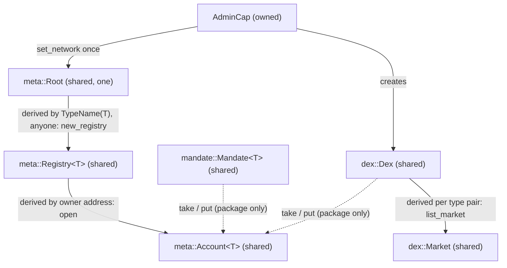

# Sui (Move)

Common rules for every family: [networks/README](README.md). Status: Move package, adapter and client verifier
**BUILT** (Move at `smartcontracts/move/sui/`, package `scaas`, edition 2024, Sui 1.81; adapter
`scaas-node/src/adapters/sui.rs`); items marked SPECIFIED are normative and not yet in code.

**Contents**

1. [Overview](#1-overview)
2. [Objects](#objects)
3. [Payload](#3-payload)
4. [Signatures](#4-signatures)
5. [Keys](#5-keys)
6. [Lanes](#6-lanes)
7. [Mandate](#7-mandate)
8. [DEX](#8-dex)
9. [Relayer](#9-relayer)
10. [Finality and events](#10-finality-and-events)
11. [Deploy](#11-deploy)
12. [Client key verification](#12-client-key-verification)
13. [Conformance](#13-conformance)
14. [Limitations](#limitations)

## 1. Overview

<a id="overview"></a><a id="NET-SUI-01"></a>**NET-SUI-01** — **Sui = a shared `Account<T>` per subject holding the
balance, signed through `signPersonalMessage`; DEX settlement is two signed legs.** The subject's balance sits in a
shared object of our package (owned coins on Sui cannot be spent by anyone else, so funds a subject pays by meta-tx
must be inside `Account<T>`); contention is limited to one subject. The subject signs the readable personal message
of [NET-ALL-23](README.md#NET-ALL-23) (built: `signPersonalMessage(BCS(MetaOp))`); Move recomputes the digest
`blake2b256([3,0,0] ‖ bcs(vector<u8>))` and
verifies ed25519, secp256k1 (`secp256k1_verify(hash=SHA256)`), secp256r1 or a passkey; the domain is the network
string set in the root config plus `object::id(account)`. A relayer lane sends a PTB calling
`meta::relay_pay<T>` with its own gas coin. **Sponsored transactions** (dual signature, the sponsor owns `GasData`) are used only for transactions
the subject sends itself (deposits, creating a mandate) — a seam, never as the gas mechanism of a meta operation. Keys
move to a per-subject `Keys` object ([NET-SUI-02](#NET-SUI-02)).

## <a id="objects"></a>2. Objects

<a id="objects"></a>

| Object | Kind | Created by | Role |
|---|---|---|---|
| `meta::Root` | shared, one | `init` | holds `network` (string, set **once** with `AdminCap`); parent of every `Registry<T>` |
| `meta::AdminCap` | owned (`key`, no `store`) | `init` → publisher | `set_network` once, create `Dex`, list DEX markets; production publishes from a Sui multisig address; the `UpgradeCap` is destroyed in the deploy run ([NET-SUI-15](#NET-SUI-15)), so `AdminCap` cannot upgrade code |
| `meta::Registry<T>` | shared, **derived** from `Root` with key `TypeName(T)` | anyone calls `new_registry<T>` (once per T) | the client's "token": a token address = the `Registry<T>` id; every event carries it as `contract` |
| `meta::Account<T>` | shared, **derived** from `Registry<T>` with key `owner: address` | `open` / `open_passkey` | one subject's `Balance<T>`, ≤ 8 keys, ≤ 8 WebAuthn origins, guardian, lane table |
| `mandate::Mandate<T>` | shared | the subject (native tx) | as `MandateWallet` |
| `dex::Dex` | shared | `AdminCap` | parent of the `Market`s (admin only) |
| `dex::Market` | shared, **derived** from `Dex` per type pair | `AdminCap` (`list_market`) | fees, `filled`, `min_nonce` of ONE market |



<a id="NET-SUI-03"></a>**NET-SUI-03** — **`Account<T>` and `Registry<T>` are derived objects.** The id of
`Account<T>` = `derive_address(registry_id, owner)` =
`blake2b256(0xf0 ‖ registry ‖ u64le(32) ‖ owner ‖ bcs(TypeTag 0x2::derived_object::DerivedObjectKey<address>))`. So (1)
the client and the relayer compute the id **without RPC** from the registry id and the payer address; (2) `claim`
refuses a second derivation, so the chain itself enforces **one account per (subject, coin type)** — nobody can open
a decoy account to trap funds, and no separate mapping table is needed; (3) `Registry<T>` derives from `Root` by
`TypeName`, so there is one registry per coin type and nobody can create a second one to split accounts. Cross
vectors: Move tests, the client verifier and Rust compute the same id. BUILT.

Token operations (`scaas::meta`): `relay_pay<T>(account, op fields…, auth, clock, ctx)` checks `op = pay`, domain,
expiry, relayer, lane/nonce and signature, `amount > 0` and sufficient balance; transfers `Coin<T>` to `to`; emits
`MetaTransactionExecuted { contract: registry, account, from, digest, lane, nonce }` then
`PaymentSettled { contract: registry, from, to, amount, pay_ref }`. There is no allowance: balances change only through
`public(package)` functions (`take`, `put`) callable only by `mandate`/`dex` of the same package — "the only spender is
a contract" at module level ([CTR-TOK-01](../contracts/token-wrappers.md#CTR-TOK-01)).

Funds **leave** an account always as `Coin<T>` transferred straight to the receiving address
(`transfer::public_transfer`), usable at once by an ordinary Sui wallet. `deposit<T>(account, coin)`: anyone can fund.
Withdrawal: the owner signs `pay` with `to` = itself.

## 3. Payload

<a id="payload"></a>

<a id="NET-SUI-18"></a>**NET-SUI-18** — **Target: `MetaCall`/`MetaTransfer` in BCS and `mtx_` entries**
([NET-ALL-26](README.md#NET-ALL-26)–[NET-ALL-29](README.md#NET-ALL-29); owner 2026-10-08). Status: **SPECIFIED**. Both
kinds are BCS structs (domains `b"scaas.metacall.v1"`, `b"scaas.metatransfer.v1"`, `network` = `Root.network`) signed
with `sui:signPersonalMessage` as the readable text of [NET-ALL-23](README.md#NET-ALL-23); `scaas::metacall::verify` is
`public`. Entries: `relay_pay<T>` → `mtx_pay<T>` (+ `mtx_transfer<T>`, `mtx_execute_transfer<T>`; a batch is one PTB);
`manage` + `KeyOp` → `mtx_add_key`, `mtx_remove_key`, `mtx_add_origin`, `mtx_remove_origin`, `mtx_set_guardian`,
`mtx_cancel_recovery`; `forward_signed` + `ForwardOp` → `mtx_forward`; mandate `pay<T>` → `mtx_mandate_pay<T>`,
`revoke_with_sig` → `mtx_revoke`; DEX `settle`, `cancel`, `invalidate_nonces` → `mtx_settle`, `mtx_cancel`,
`mtx_invalidate_nonces` (order structs unchanged). Owner-native calls (mandate creation, `withdraw`, `set_payee`, the
owner's `revoke`) and recovery keep their names. A fresh immutable package ([NET-SUI-15](#NET-SUI-15)). The `MetaOp`,
`KeyOp`, `ForwardOp` and entry text on this page is **Transitional (BUILT)**.

```move
public struct MetaOp has copy, drop {
    domain: vector<u8>,     // b"scaas.metaop.v1"
    network: vector<u8>,    // = Root.network at open, copied into Account (e.g. b"localnet", b"mainnet")
    contract: address,      // object id of Account<T> (pay) / Mandate<T> (mandate_pay, revoke)
    op: u8,                 // 0 pay · 1 trade (reserved) · 2 mandate_pay · 3 revoke
    from: address,          // owner of the funds (Account.owner / Mandate.owner)
    to: address,            // receiver (revoke: @0x0)
    amount: u128,           // ≤ u64::MAX (Sui Coin is u64)
    pay_ref: vector<u8>,    // 32 bytes — the client's entryRef
    lane: vector<u8>,       // 32 bytes — random lane per entryRef
    nonce: u64,             // nonce within the lane (client: 0)
    valid_until: u64,       // unix seconds; compared with Clock (ms / 1000)
    relayer: address,       // @0x0 = any relayer; non-zero = only ctx.sender()
    extra: vector<u8>,      // 32 bytes — H(op-specific parameters) or 32 zero bytes
}
```

- **Signed message** as built = `bcs(MetaOp)`, signed with Wallet Standard **`sui:signPersonalMessage`**; the
  signature is over the **digest** `blake2b256([3,0,0] ‖ bcs(vector<u8>)(msg))` (intent PersonalMessage, V0, app Sui;
  `bcs(vector<u8>)` = ULEB128(length) ‖ bytes). Move rebuilds `bcs::to_bytes(&op)` from typed arguments (never raw
  bytes), so a relayer cannot change a field and keep the signature valid. The target form is the readable text of
  [NET-ALL-23](README.md#NET-ALL-23) rebuilt on chain from the same fields.
- The **`digest`** is the op key: emitted in `MetaTransactionExecuted.digest`, used by the client to book the signed op,
  and the passkey challenge.
- **Domain separation:** `network` (differs between mainnet/testnet/localnet) + `contract` = an object id (never equal
  between two objects, even across networks, since ids derive from transaction digests) + `op` ⇒ no replay across
  contracts, networks or op kinds. Expiry: `clock.timestamp_ms() / 1000 <= valid_until`. Replay: `lanes[lane] == nonce`
  then increment (pay); `pay_ref` once (mandate).

## 4. Signatures

<a id="signatures"></a>

`auth::Auth { sig, authenticator_data, client_data_json }`, by Sui flag:

| Flag | Scheme | Address | Move check |
|---|---|---|---|
| 0 | ed25519 (Sui wallets; our seed key `m/44'/784'/i'/0'/0'`) | `blake2b256(0x00 ‖ pk32)` | `ed25519_verify(sig64, pk, digest)` |
| 1 | secp256k1 | `blake2b256(0x01 ‖ pk33)` | `secp256k1_verify(sig64, pk, digest, SHA256)` — Sui wallets sign the SHA-256 of the blake2b digest |
| 2 | secp256r1 | `blake2b256(0x02 ‖ pk33)` | `secp256r1_verify(sig64, pk, digest, SHA256)` |
| 6 | WebAuthn passkey | `blake2b256(0x06 ‖ pk33)` — Sui's own passkey address | below |

Wallet facts (`MystenLabs/sui` `crates/sui-types/src/crypto.rs`, `MystenLabs/fastcrypto`): intent bytes
`[0x03, 0x00, 0x00]` (`IntentScope::PersonalMessage = 3`, `IntentVersion::V0 = 0`, `AppId::Sui = 0`); BCS
`PersonalMessage { message: Vec<u8> }` = `ULEB128(length) || message_bytes`; digest = 32-byte Blake2b-256 of
`[0x03, 0x00, 0x00] ‖ ULEB128(len) ‖ message`. Returned signatures are base64 `flag || signature || public_key`:
Ed25519 (`flag = 0x00`) 1 + 64 + 32 = **97 bytes**; Secp256k1 (`flag = 0x01`) 1 + 64 compact (`r ‖ s`) + 33 compressed =
**98 bytes**. The secp256k1 signature is over **`sha256(blake2b_digest)`** = `SHA-256(blake2b_digest)` (`fastcrypto::secp256k1::Secp256k1KeyPair`
signs with `DefaultHash = Sha256`), which is why Move uses hash flag 1 (`HASH_SHA256: u8 = 1`; 0 = KECCAK256):

```move
module my_pkg::verifier {
use sui::ed25519; use sui::ecdsa_k1; use sui::address; use sui::hash;
const HASH_SHA256: u8 = 1; // 0 = KECCAK256, 1 = SHA256
public fun verify(flag: u8, sig: vector<u8>, pk: vector<u8>, blake2b_digest: vector<u8>, expected_signer: address): bool {
    let mut pk_buf = vector[flag];
    vector::append(&mut pk_buf, pk);
    let derived_addr = address::from_bytes(hash::blake2b256(&pk_buf));   // address = blake2b256(flag || pk)
    assert!(derived_addr == expected_signer, 100);
    if (flag == 0) { ed25519::ed25519_verify(&sig, &pk, &blake2b_digest) }
    else if (flag == 1) { ecdsa_k1::secp256k1_verify(&sig, &pk, &blake2b_digest, HASH_SHA256) }
    else { false }
}
}
```

Every ECDSA check enforces `s ≤ n/2` in Move (not relying on the native). Wallet signatures arrive in Sui's serialized
form (`flag ‖ sig ‖ pk`, base64; passkey: `0x06 ‖ bcs(PasskeyAuthenticator{authenticator_data, client_data_json,
user_signature = 0x02‖sig64‖pk33})` — Sui's native passkey format, so a Sui passkey wallet and our passkey signer
produce the same bytes). The relayer splits it into `Auth`; the public key is taken from the `Account`, never from the
signature (`parse_signature`, `sui.rs:199`, still requires and forwards a pk — harmless, Move does not use it to
decide). Connectors refuse zkLogin and multisig accounts (keys not 32/33 bytes, or a flag other than 0/1/2/6).

<a id="passkey"></a>

**Passkey** (common rule [NET-ALL-04](README.md#NET-ALL-04)): challenge = base64url(**digest**) without padding; Move
checks that `client_data_json` contains `"type":"webauthn.get"`, `"challenge":"<b64url(digest)>"` and a registered
origin; `authenticator_data[0..32] == rp_id_hash` registered; flags `authenticator_data[32] & 0x05 == 0x05` (UP + UV);
low-s; `secp256r1_verify(sig, pk, authenticator_data ‖ sha256(client_data_json), SHA256)`. Strict grammar, exact
origin and the `crossOrigin`/`topOrigin` refusal: SPECIFIED. Merkle batching is not on Sui (one signature per op); a
seam.

<a id="NET-SUI-04"></a>**NET-SUI-04** — **`open_passkey` requires an assertion; origin and rpIdHash come from that
assertion.** A plain `open` (flags 0/1/2) needs no signature — its only parameter is the pk and the address must
equal its hash. A passkey also carries `rp_id_hash`/`origin`: if anyone could set them, an attacker could pre-open the
account for a victim's pk with a wrong origin, and the (unique, derived) account could never sign, trapping deposits.
So `open_passkey(registry, pk33, auth)` requires an assertion over the challenge
`blake2b256("scaas.open.v1" ‖ registry_id ‖ pk33)`; `rp_id_hash` = the first 32 bytes of `authenticatorData`, and the
`origin` is read from **that assertion's** `client_data_json`. BUILT.

## 5. Keys

<a id="keys"></a>

<a id="NET-SUI-05"></a>**NET-SUI-05** — **A Sui account has many keys, many origins and a guardian with delayed
recovery.** `owner` (and the derived id) is the **first** key's address and never changes; `keys` (≤ 8) are the keys
that can sign now; `origins` (≤ 8, including `android:apk-key-hash:…`) are the accepted WebAuthn origins.
`manage(action…)` signs `KeyOp{domain=b"scaas.keyop.v1", network, account, action, scheme, public_key, rp_id_hash,
origin, guardian, nonce = key_nonce, valid_until}` with **one current key**: add/remove a key, add/remove an origin,
set the guardian, cancel a recovery — one action per call. Never zero keys; an account with a passkey never has zero
origins. Recovery as the EVM `SmartKeyAccount`: the guardian (native tx) calls `start_recovery(key)`, then
`finish_recovery` after `RECOVERY_DELAY` = 172 800 s (2 days); a current key can cancel. BUILT per `Account<T>`. The
`owner` is an **identity**, not a receiving address. Client verification is [NET-SUI-16](#key-verification).

<a id="NET-SUI-02"></a>**NET-SUI-02** — **Sui keys belong to the subject, not to a coin type.** A shared `Keys` object
per subject (owner, keys, origins, guardian, recovery, `key_nonce`, policy) is created by the first `open`; every
`Account<T>` stores its `Keys` id; `verify_by`, `manage` and recovery take `&Keys`; `dex::cancel` and
`invalidate_nonces` take the maker's `&Keys` (`order.maker == keys.owner`; today `dex::cancel/invalidate_nonces` accept
any account). Why: as built keys live in each
`Account<T>` (`meta.move:93-105`), so rotating a key on one coin type leaves the old key alive on another, and
`dex::cancel`/`invalidate_nonces` accept any `Account<X>` of the maker (`dex.move:275-294`). A struct-layout change is
a fresh package publish, and every publish is fresh and immutable anyway ([NET-SUI-15](#NET-SUI-15)). SPECIFIED.
Tests: rotate a key on `Keys` ⇒ the old key fails on `Account<USDC>` and `Account<SUI>` and cannot cancel orders on any
market. The `Keys.policy` bit `POLICY_PASSKEY_FOR_VALUE` is defined in [NET-ALL-23](README.md#NET-ALL-23).

<a id="NET-SUI-11"></a>**NET-SUI-11** — **`forward` never returns to a removed key.** Anyone may call
`receive<T>(account, Receiving<Coin<T>>)` to pull a coin sent straight to the account id into the balance, and
`forward<T, O>` sends objects of other types to `owner`. Permissionless `forward<T, O>` works only while the first key
(`owner`) is still in `keys`; otherwise it aborts `EOwnerKeyRemoved`, and `forward_signed<T, O>(account, r, to, auth)`
with `ForwardOp{domain=b"scaas.forward.v1", network, account, object, to, nonce = key_nonce, valid_until}` signed by a
current key is used. Why: as built `owner` never changes and `forward` is permissionless (`meta.move:257-261`), so
after the owner removes a leaked first key (the main reason for key removal and recovery), anyone can forward objects
sent to the account id (e.g. a `Coin<U>` of another type) to the leaked key's address. `Mandate.forward`
(`mandate.move:118-120`) is not affected: a mandate's owner is the native address that created it. SPECIFIED. Move
tests: remove the first key ⇒ `forward` aborts; `forward_signed` with a current key ⇒ sent to the right `to`.

## 6. Lanes

<a id="lanes"></a><a id="NET-SUI-12"></a>**NET-SUI-12** — **The Sui lane table is pruned under an on-chain horizon,
and the storage rebate returns to the lane.** The lane table stores `{nonce, valid_until}` (the highest executed);
`relay_pay` refuses `valid_until > now + LANE_HORIZON_S` (30 days) on chain; permissionless `prune(account, lanes)`
deletes entries when `now > valid_until + LANE_HORIZON_S`, with the storage rebate to the sender of the `prune`
transaction (the node collects it with its lanes, [NODE-LANE-18](../node/submit-lanes.md#NODE-LANE-18)). Two ops
replacing each other on one lane/nonce signed more than `LANE_HORIZON_S` apart are the client's obligation (the client
signs one op per lane; [NET-ALL-01](README.md#NET-ALL-01)). Why: as built there is no `prune` in
`smartcontracts/move/sui/sources`; every lane is one dynamic field (`meta.move:285-287`) whose storage fee the lane
pays and never recovers. SPECIFIED. Move tests: prune before the horizon aborts; after it deletes and rebates;
`valid_until` beyond the horizon is refused.

## 7. Mandate

<a id="mandate"></a>

`create<T>(registry, coin, delegate_scheme, delegate_pk, max_per_payment, max_per_period, period_s, expiry_s, payees,
clock, ctx)`: the owner (`ctx.sender()`) sends a native transaction — on Sui a subject has **no account sequence**
(only gas-coin versions), so the owner's transaction locks no other contract. Owner operations: `deposit`,
`withdraw`, `set_payee`, `revoke` (check `ctx.sender() == owner`). `pay<T>(mandate, op fields…, auth, clock, ctx)`: the
delegate signs `MetaOp{op: mandate_pay, contract: mandate_id, from: owner}`; checks mandate expiry, signature expiry,
payee, per-payment and per-period caps (reset when the period ends), `pay_ref` once; emits
`PaymentSettled{contract: registry,…}` + `PaidUnderMandate`. `revoke_with_sig`: the delegate signs
`MetaOp{op: revoke}` (the platform's kill switch, as `revokeWithSig`).

## 8. DEX

<a id="dex"></a>

`Order` (BCS, signed as a personal message like `MetaOp`): `domain=b"scaas.order.v1", network, market (Market id),
maker, taker (@0x0 = any), sell_type, buy_type (ASCII of type_name::with_defining_ids), sell_amount: u64, buy_amount:
u64, nonce: u128, expiry: u64 (seconds), max_fee_ppm: u32, flags: u8 (bit0 FOK, bit1 IOC), relayer`; order hash = the
personal-message digest. `settle<A,B>(market, maker_sell: &mut Account<A>, maker_buy: &mut Account<B>, taker_sell: &mut
Account<B>, taker_buy: &mut Account<A>, maker: Order, maker_auth, taker: Order, taker_auth, maker_fill, taker_fill, ref,
clock, ctx)` checks flags, expiry, `nonce >= min_nonce[maker]`, relayer, taker, signature (key of `maker_sell.owner`),
cross-matching tokens (by type, enforced by generics), distinct parties, a listed market; `fill > 0`,
`filled + fill <= sell_amount`, FOK; cross-multiplied price on u128; fee `ppm <= max_fee_ppm`, cap 10 000 ppm (1 %)
checked at `set_market`.

Funds move account → account (the fee recipient receives a `Coin`); IOC closes the remainder.
Events `OrderFilled` (each side) + `Matched`; the indexer normalises only `MetaTransactionExecuted`/`PaymentSettled`
(`sui.rs:383-392`), so Sui DEX fills are **not** in the event feed until the non-EVM venue exists
([CLI-APP-21](../clients/app.md#CLI-APP-21)). Cancel: `cancel(market, &Account<A>, order, auth)` signs
`Cancel{domain=b"scaas.cancel.v1", network, market, order_hash}` ⇒ `filled = sell_amount`;
`invalidate_nonces(market, &Account<A>, min_nonce, auth)` signs `InvalidateNonces{…, market, maker, min_nonce}` — per
(maker, market), strictly increasing, `<= 2^128` as built (u128), capped by
[CTR-DEX-10](../contracts/dex.md#CTR-DEX-10); no expiry.

<a id="NET-SUI-09"></a>**NET-SUI-09** — **One shared `Market` per pair.** Derived from `Dex` by the pair key, so there is
one market per pair, and settle/cancel/`min_nonce` touch only that market (Sui's per-shared-object transaction limit
per commit never spreads to other markets). `list_market<A,B>` is open (once); `set_market(cap, &mut Market, …)`
edits fees and listing; `min_nonce` is per (maker, market). BUILT.

<a id="NET-SUI-06"></a>**NET-SUI-06** — **Sui DEX differences from EVM**: (1) Move has no try/catch, so a batch is one PTB
of several `settle` calls, **atomic as a whole**; the relayer dry-runs and drops a failing pair before sending (no
`MatchFailed`); (2) no relayer fee off EVM, so `Order` has no relayer-fee field; (3) four accounts per pair (two per
side) because balances are per coin type; (4) IOC closes its remainder inside its own `settle`, so an IOC order matches
**one** maker per transaction ([NODE-DEX-09](../node/dex-venue.md#NODE-DEX-09)); the Sui matcher groups IOC into one pair.
BUILT.

## 9. Relayer

<a id="relayer"></a>

- **Lane**: ed25519 `m/44'/784'/i'/0'/0'`, address `blake2b256(0x00 ‖ pk)`. Each lane is sender **and** gas owner: it
  pays with its own SUI coin (no sponsorship needed).
- **Simulation**: `sui_dryRunTransactionBlock`; `failure` ⇒ `Revert` (job dies); network error ⇒ `Transport`. A
  `failure` after inclusion in a checkpoint is final `Reverted` (bounded by `max_attempts`,
  [NODE-LANE-14](../node/submit-lanes.md#NODE-LANE-14)).
- **Signing**: `blake2b256([0,0,0] ‖ tx_bytes)` (intent TransactionData) with the lane's ed25519 `Signer`; serialized
  `0x00 ‖ sig ‖ pk`. `tx_id` = the Sui digest (`blake2b256("TransactionData::" ‖ tx_bytes)`) as `0x` + hex; the RPC uses
  base58.
- **Ordering**: Sui has no account nonce, so `sequence()` = 0. One transaction in flight per lane (`lane_runner`):
  the lane's gas coin is in exactly one signed transaction. A resend uses **the same bytes**; a second transaction on
  the same gas-coin version is never signed (no equivocation, no object lock until the epoch ends). The subject's
  shared `Account` goes through consensus without a sequence, so one stuck op never blocks another op of the same
  subject.
- **Configuration** (`[[chains]] family="sui"`): `params.package` (call target); `params.type_package` = `package` always (the
  package never upgrades); `params.upgrade_cap` (the destroyed `UpgradeCap` id, checked by the node); `rpc_urls`. The
  token list is the node store's set (no `params.registries`).
- **Residual risks**: (a) a transaction cancelled by shared-object congestion (`…SharedObjectCongestion`) is a
  `failure` ⇒ the job is `reverted` and the payer signs again (no new transaction inside the same job); (b) if a lane
  transaction reached only some validators and its job then died on expiry, the next transaction on the same gas-coin
  version may be locked until the epoch ends — rare, other lanes keep running; operations: fund the lane with another
  coin or wait for the epoch.

<a id="NET-SUI-07"></a>**NET-SUI-07** — **The relayer builds the PTB BCS locally and resends the same bytes.** The PTB is
built in Rust (`TransactionData::V1`, two commands: `auth::new` → `meta::relay_pay<T>`), **never** with
`unsafe_moveCall` (blind-signing bytes built by an RPC lets the RPC take the gas coin). Inputs: the account (shared,
mutable, `initial_shared_version` read from RPC), Clock `0x6` (shared, immutable, version 1), pure arguments. Gas: the
lane's largest SUI coin (re-read per job), `gas_price = suix_getReferenceGasPrice`, budget = dry-run × 1.2 (capped by
`max_gas_per_tx`). BUILT.

<a id="lane-journal"></a><a id="NET-SUI-10"></a>**NET-SUI-10** — **The Sui lane journal is the set of every unresolved
transaction per lane, kept in the node store; no second transaction is ever signed on one gas-coin version.** Each
lane keeps **every** signed, non-final `(gas coin, version, tx bytes, signature, digest)` — final = included in a
checkpoint, or the coin moved to another version; entries are never overwritten; coin selection skips **every** coin
in the set (`gas_coin` selection); an entry is deleted only when its transaction is final. The set is the store's `outer_tx` rows (signed
bytes + object ref + version), written in the `leased → signed` transaction, so it follows the owner lock on failover
([NODE-LANE-19](../node/submit-lanes.md#NODE-LANE-19)); `pay_tx` sets `TransactionExpiration::Epoch(current epoch + 1)`,
so a held-back transaction never surfaces after one epoch. `build()` processes the journal first: landed, or the coin
moved on (the old transaction can never run) ⇒ delete; still pending ⇒ resend the identical bytes and build the new
transaction on ANOTHER coin (none free ⇒ wait).

SPECIFIED. Why: as built the journal is a local directory
(`params.lane_journal/<chain>-lane<i>.json`, fsync + rename, written by `sign()` before the signed report and before
sending) with
**one** entry per lane — job B's `sign` overwrites job A's pending entry (`sui.rs:495-505, 693-707`), a failed resend of
A is only logged (`sui.rs:523-527`), coin selection skips only the current entry's coin (`:657, 666`), so a later job
can pick coin C1 vN again (the largest) and sign a second transaction on the same version — equivocation, C1 locked
until the epoch ends; the directory (`:465-467`) does not follow the owner lock on failover; expiration is `None`
(`sui.rs:317`). Tests: A `Unknown` + failed resend, B signed on C2, job C never picks C1 vN; a restart on a fresh disk
with the same store ⇒ no equivocation; transactions carry an epoch expiration.

<a id="NET-SUI-13"></a>**NET-SUI-13** — **Grief after dry-run uses the node rules, no Sui-specific mechanism.**
`relay_pay` is permissionless when `relayer == @0x0`; the subject (or anyone holding the payload) can submit another op
that drains the account, or the same op, before the lane's transaction, which then aborts (`EInsufficient` /
`EBadNonce`) and still pays computation + storage; each new op adds one `lanes` dynamic field paid by the lane. The
failed fee and lane storage feed the breaker ([NODE-LANE-13](../node/submit-lanes.md#NODE-LANE-13)), the score is per
`from` ([NODE-LANE-15](../node/submit-lanes.md#NODE-LANE-15)), lane storage is refunded through `prune`
([NET-SUI-12](#NET-SUI-12)). SPECIFIED (as built the breaker sees only mined fees, `adapter.rs:270-276`). Test: a lane
transaction aborts `EBadNonce` after dry-run ⇒ counted in `subject_grief` and the breaker.

<a id="NET-SUI-14"></a>**NET-SUI-14** — **The mesh checks a `sui_op` signature before any dry-run**
([NODE-MESH-16](../node/mesh.md#NODE-MESH-16)): the `Account`'s keys are read once (cached, `sui_getObject` as in
`build`). SPECIFIED (as built `mesh/digest.rs:245-255` checks no signature). Signed fields come from the payload
(`work()` already decodes it).

## 10. Finality and events

<a id="events"></a>

A certified checkpoint is final (BFT): `final_head` = the newest checkpoint (quorum across endpoints when several RPCs
are configured), hash = the checkpoint digest (base58 → `0x` hex). `tx_status`: `effects.status` success/failure; with a
`checkpoint` ⇒ `Mined{height}`, without ⇒ `Pending`; unknown ⇒ `Unknown`.

<a id="NET-SUI-08"></a>**NET-SUI-08** — **The Sui indexer filters by event type and by the registered tokens.** It scans
checkpoints `[from, to]` (`sui_getCheckpoints` + `sui_multiGetTransactionBlocks{showEvents}`), keeps type
`<type_package>::meta::{MetaTransactionExecuted,PaymentSettled}` **and** `contract ∈` the `Registry<T>` ids of the
registered tokens (node store per namespace; an empty list holds the cursor, [NET-ALL-06](README.md#NET-ALL-06)). Every
transaction of the range must be present with its events, else the range is not committed. Normalised:
`block_number` = checkpoint, `block_hash` = checkpoint digest, `tx_hash` = transaction digest, `log_index` = `eventSeq`,
addresses `0x` + 64 hex. Every transaction of a checkpoint is scanned (`ponytail:` a ceiling — move to gRPC/GraphQL
filtered by package under load). BUILT; event-set agreement across the quorum per checkpoint range SPECIFIED.

## 11. Deploy

<a id="deploy"></a><a id="NET-SUI-15"></a>**NET-SUI-15** — **The Sui package is immutable from deploy.** The deploy
script (`smartcontracts/move/sui/scripts/`, not yet written) publishes and calls
`0x2::package::make_immutable(upgrade_cap)` in the same run; **deploy gate**: the `UpgradeCap` must be deleted
(`sui_getObject` ⇒ deleted) before `params.package` is recorded. The node re-checks at chain activation and at every
start (`params.upgrade_cap`); a live cap ⇒ chain `halted`, `PROGRAM_UPGRADEABLE`
([NODE-STO-07](../node/store.md#NODE-STO-07)). Consequences: `type_package = package`; every fix is a new package with
new `Root`/`Registry<T>`/`Account<T>` ids, and owners move funds by signing `pay` from the old account (old code keeps
running) to the new one; the deployment's vectors are regenerated. Owner ruling 2026-10-07; application of
[CTR-GEN-02](../contracts/README.md#CTR-GEN-02). SPECIFIED (as built the publisher keeps the `UpgradeCap`).

## 12. Client key verification

<a id="key-verification"></a>

Facts: `Account<T>` id = `derive_address(registry, owner)` with `owner` = the first key's address, never changing;
`keys` ≤ 8; `manage(KeyOp…)` signed by any current key, one action per call; recovery `start_recovery(key)` then
`finish_recovery` after 172 800 s; `MetaOp.from` = owner; `relay_pay` accepts any key in `keys` (vectors `a2_pay_sui` —
an added ed25519 key — and `a3_pay_sui` — a recovered secp256k1 key — pass `sui move test`). A client verifier follows
[NET-ALL-14](README.md#NET-ALL-14): `False` for a malformed signature or one invalid under its own key; `True` when
`blake2b256(flag ‖ pk)` = the payer address — "the payer's own key", **not** "will pass" (an owner key removed by
KeyOp still returns `True`); `None` for a valid signature by any other key (added by `KeyOp ADD_KEY` or by
`finish_recovery`), and the node's simulation decides ([INT-ERP-21](../integration.md#INT-ERP-21)). The passkey path
also refuses `"crossOrigin":true` and `"topOrigin"`.

<a id="NET-SUI-16"></a>**NET-SUI-16** — **Every signed Sui payload is encoded in every client language byte-identical to
Move, with the domain as a parameter** — the target `MetaCall`/`MetaTransfer` ([NET-SUI-18](#NET-SUI-18)) as the built
`KeyOp` (`keyop_digest`), whose encoding (Transitional, BUILT) is:

```python
ADD_KEY, REMOVE_KEY, ADD_ORIGIN, REMOVE_ORIGIN, SET_GUARDIAN, CANCEL_RECOVERY = range(6)
KEYOP_DOMAIN = b'scaas.keyop.v1'          # callers pass `domain`

def keyop_bytes(network, account, action, scheme, public_key, rp_id_hash, origin, guardian, nonce, valid_until,
                domain=KEYOP_DOMAIN):
    return (_vec(domain) + _vec(network.encode()) + addr(account) + bytes([action, scheme])
            + _vec(public_key) + _vec(rp_id_hash) + _vec(origin.encode()) + addr(guardian)
            + nonce.to_bytes(8, 'little') + valid_until.to_bytes(8, 'little'))

def keyop_digest(*a, **kw):
    return personal_digest(keyop_bytes(*a, **kw))
```

JS: clientkeys `fam/sui.js` exports `metaOpBytes`, `personalDigest`, `deriveAccount`, `addressOf`, `parseSignature`,
`serializeSignature`, `serializePasskey`, `keyOpBytes(…, {domain})`, `keyOpDigest` and
`verifyKeyOp(account, op, signature, {now})`, whose check covers membership, `op.nonce == key_nonce`, `op.account`,
`op.network`, the `valid_until` window and, for passkeys, origin ∈ `account.origins`. Clients build KeyOps from what the
user asked for; servers issue none ([CLI-SGN-05](../clients/signers-clientkeys.md#CLI-SGN-05)). Why: one encoding, local
check before submit ([CLI-APP-09](../clients/app.md#CLI-APP-09)).

<a id="NET-SUI-17"></a>**NET-SUI-17** — **One generator run feeds every language's Sui vectors.** `gen_vectors.py --json`
writes `smartcontracts/move/sui/vectors/sui_vectors.json` in the same run as `tests/vectors.move` (ECDSA signatures are
random per run); the JSON carries `sha256(vectors.move)` (`vectors_move_sha256`) and every client test compares it with
the file (a partial regeneration fails). Every `pay` and `keyop` vector is `{name, signer {flag, pk}, owner, account,
payload_hex | keyop fields, digest, signature_b64, expect_odoo: true | null | false}`. `scaas-node/src/adapters/sui.rs`
pins only the deterministic ed25519 `a_pay_sui_0` vector and is unaffected. Client tests: an added key's and a
recovered key's signatures are left to the node (`None`); a flipped byte from an added key is refused (`False`); the
own key is still verified; passkey `crossOrigin` refused; KeyOp bytes match Move for every `k_*` vector; the vector file
matches Move (sha256); a signature from another wallet is refused only when invalid under its own key; `keyOpDigest`
matches every `k_*` vector; `verifyKeyOp` is true for the right signer and nonce and false for a wrong nonce, a
non-member key, a flipped byte, a wrong account, a wrong network, an expired op, a foreign origin.

Reach: in a portal without chain reads, a non-EVM signer pays with the **owner key only** (a Sui `Account<T>` has no
reverse index from key to account); added keys pay through the app (find-my-account), or through the portal once the
vault stores `{family, account, owner, key_index}` next to the phrase (optional).

## 13. Conformance

<a id="conformance"></a>

- `sui move test`: pay (real ed25519 / k1 / r1 / passkey vectors), replay, expiry, wrong domain (network / contract /
  op), relayer binding, duplicate account refused, `open_passkey` against a fake origin, mandate (per-payment and
  per-period caps, payee, ref once, revoke), DEX (price, overfill, FOK/IOC, fee on/off, `max_fee_ppm`, cancel,
  `min_nonce`), **anti-lock** (X on account 1 held; Y on account 2 passes; X passes later), cross vectors (derived id,
  `MetaOp` digest).
- Rust: payload / serialized-signature decoders (proptest), BCS transaction vector, end-to-end `tests/e2e_sui.rs`
  (`#[ignore]`) on `sui start --force-regenesis --with-faucet` (RPC 31970, faucet 31971): two lanes from a 24-word
  mnemonic, payment through `lane_step`, final through `index_step`, anti-lock end to end.
- Client: cross vectors client = Move = Rust; issue → accept → `signed_op` job.
- Review lessons kept: substring checks in `clientDataJSON` are not forgeable — the browser builds the JSON and the
  only page-controlled value is the challenge (base64url, no `"`), every other string is escaped (`\"`); connectors
  refuse malformed hex (`fromHex`).

## <a id="limitations"></a>14. Limitations

<a id="limitations"></a>

- Key rotation per subject (`Keys`), `prune`, `forward_signed`, immutable deploy, journal in the store and the mesh
  signature check are SPECIFIED; the DEX `min_nonce` cap ships with the same new package.
- Rotating the owner is invisible to a client that sees only the first key's address; the mesh `from` is that address.
  Kept as a seam until Universal Account `key_owner` tables.
- Confidential payments: Sui has no EVM-style bn254 pairing precompile but has `sui::groth16` (bn254 + BLS12-381
  verify) and `sui::group_ops` (`bls12381` G1/G2/GT, add/scalar mul, pairing). ElGamal on BLS12-381 G1 with Bulletproofs
  (many multi-scalar multiplications) is possible in principle at high Move compute gas; the practical route is
  Groth16 range/ownership proofs (native, cheap) instead of the EVM Σ-protocols + Bulletproofs. Feasible with a
  dedicated Groth16 circuit; not built.
