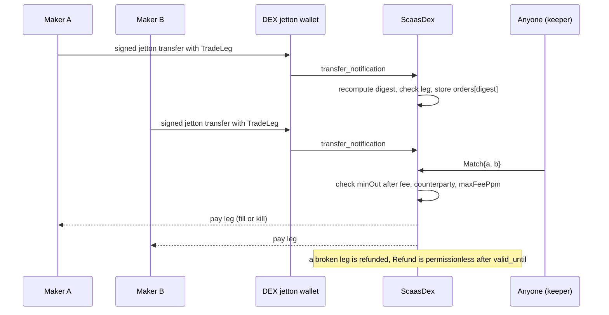

# GRAM, formerly TON (Tact)

Common rules for every family: [networks/README](README.md). Status: Tact contracts, adapter and client verifier
**BUILT** (contracts at `smartcontracts/ton/contracts/`; adapter `scaas-node/src/adapters/ton.rs`); items marked SPECIFIED
are normative and not yet in code.

> **Blocking rule.** An unbounded forward-TON amount lets one signed `pay` send a lane's balance to an address the signer
> chooses. **No job-API, mesh or gateway path may reach a GRAM lane until the node half of the forward cap
> ([NET-TON-14](#NET-TON-14)) is in code.** The transitional ERP pull path is safe today because the client builds
> `extra = 0` and never sets `forward_nanoton`.

**Contents**

1. [Overview](#overview)
2. [Payload](#2-payload)
3. [Signatures](#3-signatures)
4. [Relayer](#4-relayer)
5. [Fees and the forward cap](#5-fees-and-the-forward-cap)
6. [Revoke](#6-revoke)
7. [DEX](#dex)
8. [Finality and events](#8-finality-and-events)
9. [Conformance](#9-conformance)
10. [Limitations](#10-limitations)

## <a id="overview"></a>1. Overview

<a id="overview"></a><a id="NET-TON-01"></a>**NET-TON-01** — **GRAM = a Tact jetton whose custom wallet verifies signed
operations; the DEX is an escrow.** The jetton wallet holds the owner's public key, an optional passkey and a lane table (`lanes: map<uint256, uint64>`),
and verifies a `SignedOp` relayed as an internal message with GRAM attached for gas. The subject signs with TON Connect
`signData` (type `cell`) or a passkey. The relayer lane is a **W5** wallet with its own seqno. **W5 gasless extensions
and Highload wallets of the subject are not used**: the subject's seqno would be an ordering lock
([NET-ALL-02](README.md#NET-ALL-02)); a Highload-v3 relayer wallet is a possible future lane type (PLANNED). The actor
model has no cross-contract atomicity, so the DEX keeps leg A in escrow until leg B arrives ([DEX](#dex)). Tact (npm,
tested with `@ton/sandbox`) is used rather than FunC — one level lower is not worth it for this scope. Networks: -239
(mainnet), -3 (testnet), localnet.

<a id="contracts"></a><a id="NET-TON-04"></a>**NET-TON-04** — **The token is a compact Tact rewrite of a TEP-74 Jetton
(`ScaasJettonMaster` + `ScaasJettonWallet`) whose wallet adds `pubkey`, `passkey` and a `lanes` table; no off-the-shelf
jetton is used.** The wallet must verify meta-tx; TEP-74 opcodes and getters are kept so wallets and explorers understand
it. BUILT.

- **`ScaasJettonWallet(owner, master, balance, pubkey?, passkey?, lanes)`** — full TEP-74: `transfer` (only `owner`),
  `internal_transfer` (only the master or a sibling wallet, checked with `initOf`), `burn`, `excesses`,
  `transfer_notification` when `forward_ton_amount > 0`, bounce restores the balance, getter `get_wallet_data`.
  `SignedOp{op, auth, params?, stateInit?, responseDestination, forwardTon}` (opcode `0x5b0a1d01`; sent by a relayer
  with GRAM for gas): (1) bind the key from `stateInit` if no `pubkey` yet ([NET-TON-07](#NET-TON-07)); (2) check the
  `MetaOp`, lane/nonce, `relayer`; (3) check the signature — `auth.kind = 0` ed25519 envelope, `kind = 1` passkey; (4)
  execute: `pay` ⇒ debit and `internal_transfer` to the wallet of `to` with `forward_payload = PayTag{pay_ref}`; `trade`
  ⇒ as `pay` to the DEX with `forward_payload = TradeLeg{^MetaOp, ^TradeParams, matchWith}`; `revoke`
  ([NET-TON-18](#NET-TON-18)); `set_key` ⇒ only with `kind = 0`, attach/detach the passkey ([NET-TON-08](#NET-TON-08));
  (5) `emit MetaTransactionExecuted{master, from=owner, digest}`. Crediting with a `PayTag` ⇒ `emit
  PaymentSettled{master, from, to=owner, amount, pay_ref}`. Extra getters: `get_lane_nonce(lane)`, `get_owner_pubkey()`
  (0 if unbound) — the relayer uses them to simulate.
- **`ScaasJettonMaster`** — admin `Mint`, `burn_notification`, `provide_wallet_address` (TEP-89), getters
  `get_jetton_data`, `get_wallet_address(owner)`. Jettons have **no** allowance, so only contracts (DEX, Mandate) that
  receive deposits spend them ([CTR-TOK-01](../contracts/token-wrappers.md#CTR-TOK-01)).
- **`Mandate`** — init: `owner`, `ownerPubkey`, `delegatePubkey` (an ed25519 custody key held by the platform's custody
  adapter), `master`, `perPayment`, `perPeriod`, `periodSeconds`, `expiresAt`, `payees` (map), state (`revoked`, period,
  `spent`, tracked `balance`, `usedRefs`). Funding: the subject `pay`s to the Mandate address with a signed forward floor
  in `extra` ⇒ a `transfer_notification` from the Mandate's own jetton wallet ⇒ `balance += amount` (other sources
  ignored). The owner's withdrawal is **not** limited by the tracked `balance` (the wallet holds the real balance and
  refuses any excess), so tokens arriving without a notification are still withdrawable. `MandatePay{op, signature,
  responseDestination}`: `op = mandate_pay`, `contract = myAddress()`, `from = myAddress()`, a **raw** ed25519 signature of
  the delegate over the digest (server-side, no TON Connect envelope; `mandate.tact:68` — a key that signs raw 32 bytes,
  so one custody key per family, [NODE-LANE-20](../node/submit-lanes.md#NODE-LANE-20)); checks not revoked, not expired,
  `valid_until`, payee, per-payment and per-period caps, balance, `usedRefs[pay_ref]` once ⇒ `transfer` to the payee with
  a `PayTag`. A bounce from the Mandate's wallet restores `balance`, the period spend and the `pay_ref` (a ring of 64
  in-flight orders). `revoke` / `Withdraw` signed by the subject (TON Connect envelope, `ownerPubkey`, the Mandate's own
  lane/nonce).

## 2. Payload

<a id="payload"></a>

<a id="NET-TON-20"></a>**NET-TON-20** — **Target: `MetaCall`/`MetaTransfer` cells and `Mtx` messages**
([NET-ALL-26](README.md#NET-ALL-26)–[NET-ALL-29](README.md#NET-ALL-29); owner 2026-10-08). Status: **SPECIFIED**. Both
kinds are cell trees (domains `scaas.metacall.v1`, `scaas.metatransfer.v1`, `network` = `global_id`, digest = the root
cell hash) signed with `signData` as today; the `MetaTransfer` cell keeps the signed forward-TON floor
([NET-TON-14](#NET-TON-14)). Messages: `SignedOp` op 1 → `MtxPay`/`MtxTransfer`/`MtxExecuteTransfer`; ops 2, 4, 5 →
`MtxExecute{call, auth, body}` with body `MtxTrade` (`TradeParams`), `MtxRevoke` ([NET-TON-18](#NET-TON-18): lane to
`nonce + 2`), `MtxSetKey` (`PasskeyRecord`); `MandatePay` → `MtxExecute` on the `Mandate` with body `MtxMandatePay`. The
lazy key bind travels on the first `Mtx` message's `stateInit` ([NET-TON-07](#NET-TON-07)). Opcodes are fixed with the
vectors. New code ([CTR-GEN-02](../contracts/README.md#CTR-GEN-02)). The `MetaOp`/`SignedOp` text on this page is
**Transitional (BUILT)**.

`MetaOp` v1 is a **cell tree** (a cell holds only 1023 bits):

```tlb
metaop$_ domain:bits120 network:int32 op:uint8 amount:uint128 nonce:uint64 valid_until:uint64
  contract:MsgAddress parties:^[ from:MsgAddress to:MsgAddress relayer:MsgAddress ]
  refs:^[ pay_ref:bits256 lane:bits256 extra:bits256 ] = MetaOp;
```

- `domain` = ASCII `scaas.metaop.v1` (15 bytes). `op`: 1 `pay`, 2 `trade`, 3 `mandate_pay`, 4 `revoke`, 5 `set_key`.
- `contract`: the payer's jetton wallet (ops 1, 2, 4, 5) or the `Mandate` address (op 3). `relayer` = `addr_none` (anyone
  may send) or the lane wallet allowed to send (the wallet compares with `sender()`).
- `extra`: op 1 = the **forward-TON floor** (nanoton) the subject signs — the wallet refuses a `SignedOp.forwardTon`
  below it (the client sets 0 for payments to a person: no notification needed), and the floor is capped
  ([NET-TON-14](#NET-TON-14)); op 2 = the hash of the `TradeParams` cell (whose `forwardTon` field is the signed floor;
  the wallet adds a `MIN_LEG_TON` floor of 0.1 GRAM); op 4 = the digest of the cancelled order; op 5 = the hash of the
  `PasskeyRecord` cell (`{pubkey33, rpIdHash, originPrefix}`).
- **digest** = the representation hash of the root `MetaOp` cell (`0x` + 64 hex) — the client, Rust and Tact compute it;
  `MetaTransactionExecuted.digest` carries it.
- Replay: (a) `lanes[lane]` (default 0) must equal `nonce`, then `+1` — the lane is random per `entryRef`, nonce 0; (b)
  `now() < valid_until <= now() + LANE_TTL` (30 days, `E_TTL` 717); (c) another contract/network ⇒ another `contract`/
  `network` in the cell.
- Pruning: `lanes` has two generations rotated every `LANE_TTL` (highload-wallet style): an entry written at t lives
  until ≥ t + LANE_TTL, and an op that ran at t is expired after t + LANE_TTL, so a dropped entry can never replay
  ([NET-ALL-01](README.md#NET-ALL-01)). The wallet keeps a reserve of `0.01 + 0.002 GRAM × entries` (measured in the
  sandbox ≈ 0.00015 GRAM per entry per year), so a heavy, long-lived wallet is never frozen.

<a id="NET-TON-06"></a>**NET-TON-06** — **The GRAM network domain is the `global_id` read on chain from config parameter
19** (`-239` mainnet, `-3` testnet, local networks per zerostate), and `contract` = the payer's own jetton wallet
(`myAddress()`). GRAM addresses are equal across networks (same code + data), so a network id is mandatory, and config 19
cannot be faked. BUILT.

## 3. Signatures

<a id="signatures"></a>

<a id="NET-TON-05"></a>**NET-TON-05** — **The subject signs with TON Connect `signData` type `cell`; the contract rebuilds
the exact envelope around the `MetaOp` cell and checks `CHKSIGNU` over the envelope cell hash; the seed signer builds the
same envelope with `m/44'/607'/i'`.** One verification path for real wallets and the seed signer. Envelope:
`0x75569022 ‖ crc32(SCHEMA):u32 ‖ timestamp:u64 ‖ owner:MsgAddress ‖ ^domainCell ‖ ^MetaOp`; signature =
Ed25519(envelope cell hash). `SCHEMA` is the TL-B string above (one line, single spaces); its crc32 is a contract
constant. The wallet returns `timestamp` and `domain`; the relayer forwards them. BUILT.

TON Connect `signData` (2025; `ton-connect/wallets-list`, `mois-ilya/ton-sign-data-reference`) has payload types
`text`, `binary`, `cell`. For `cell`, the signed root is hashed with GRAM's 32-byte representation hash:

```typescript
const schemaHash = crc32.buf(Buffer.from(payload.schema, 'utf8')) >>> 0; // 32-bit uint
const encodedDomain = encodeDnsName(domain).toString('utf8');
const message = beginCell()
    .storeUint(0x75569022, 32)          // 32-bit magic prefix
    .storeUint(schemaHash, 32)          // CRC32 of the TL-B schema string
    .storeUint(timestamp, 64)           // unix seconds
    .storeAddress(parsedAddr)           // MsgAddressInt (user wallet)
    .storeStringRefTail(encodedDomain)  // TEP-81 internal DNS form (in a ref cell)
    .storeRef(cell)                     // the payload cell
    .endCell();
const finalHash = message.hash();       // 32-byte SHA-256 representation hash
```

In code: `crypto.createHash('sha256').update(message).digest()` for the binary/text buffer below. Domain encoding (TEP-81
internal form): lowercased, split on `.`, ASCII/Punycode, reversed, each label terminated by
`\0` (e.g. `app.ton.org` → `org\0ton\0app\0`), at most 126 bytes. For `binary` and `text` the buffer is
`[0xff, 0xff] ‖ "ton-connect/sign-data/" ‖ workchain (int32 BE) ‖ address_hash (32) ‖ uint32BE(domain.length) ‖ domain ‖
uint64BE(timestamp) ‖ ("bin" | "txt") ‖ uint32BE(payload.length) ‖ payload_bytes`, hashed with SHA-256; the signature is
Ed25519 detached (`nacl.sign.detached(finalHash, privateKey)`), returned in base64. Wallets listed in `wallets-v2.json`
with `['text', 'binary', 'cell']`: Tonkeeper (`tonkeeper`, `tonkeeper-pro`), MyTonWallet (`mytonwallet`), Wallet in
Telegram (`telegram-wallet` / `@wallet`), Tonhub (`tonhub`). The contract verifies with `CHKSIGNU` over the same cell in
Tact (`ton/contracts/common.tact:252-272`); the FunC reference form is:

```func
() verify_cell_sign_data(cell payload_cell, int schema_crc, int timestamp, slice user_addr, cell domain_cell,
                         slice signature, int public_key) impure {
    cell signed_cell = begin_cell().store_uint(0x75569022, 32).store_uint(schema_crc, 32).store_uint(timestamp, 64)
        .store_slice(user_addr).store_ref(domain_cell).store_ref(payload_cell).end_cell();
    int digest = cell_hash(signed_cell);
    int is_valid = check_signature(digest, signature, public_key);
    throw_unless(101, is_valid);
}
```

The `domain` and `timestamp` this layout signs are **checked** on chain ([NET-TON-02](#NET-TON-02)).

<a id="domain-binding"></a>

<a id="NET-TON-02"></a>**NET-TON-02** — **GRAM binds the `signData` domain on chain through a per-wallet domain set.** Each
jetton wallet stores `domains` (a set of `sha256(domain)`), initialised at lazy bind from the master's deploy-time
`defaultDomains` (immutable data, no admin) and changed only by `SetDomains` sent **by the owner's own wallet**
(`sender() == owner`: a wallet transaction the user sees, not a `signData`). `AUTH_TONCONNECT` requires `sha256(domain) ∈
domains` and `timestamp ≤ now() + 300`; an empty set refuses TON Connect auth (the passkey still works). Owner decision
(2026-10-07) between two designs: the set, rather than one `domainHash` pinned in each wallet's init data, because SCaaS
is multi-tenant and many portals share one token — a pinned hash would need one master (token) per portal domain.

Why a
contract check at all: `SignedOp` is an ordinary message anyone may relay (relayer `addr_none`), so an off-chain domain
check never runs when a phishing dApp relays its own; as built `checkTonConnect` hashes the relayer-supplied domain and
timestamp without checking them (`common.tact:264-272`, `jetton.tact:202-206`). Rejected alternatives: a `domainHash` in each wallet's init data with `hash(domainCell) == domainHash` (otherwise `E_SIG`)
— one master per portal domain; requiring `relayer != addr_none` — it would kill open relaying and the mesh. Residual
risk, stated: a phishing page
could ask the user for a `SetDomains` wallet transaction; wallets show it as a transaction to the user's own jetton
wallet. New wallet and master code; SPECIFIED. Tests (sandbox): phishing domain ⇒ `E_AUTH`; listed domain ⇒ ok;
`SetDomains` from a non-owner ⇒ refused. Wallets deployed before the new code keep the gap until their owners move to the
new master (signatures obtained by phishing can still run through relayers other than our node).

<a id="NET-TON-16"></a>**NET-TON-16** — **The node checks the TON Connect domain at every door.** The job API, the mesh
and the gateway — not only the client — refuse a `domain ∉ chain.ton_app_domains` before any `build`. SPECIFIED (owner
decision: domain set + node check at every door). Test: an unknown domain ⇒ refused.

<a id="key-binding"></a><a id="NET-TON-07"></a>**NET-TON-07** — **The key binds lazily through the `SignedOp`'s optional
`stateInit`.** There is no `BindKey` message: a `SignedOp` carries the owner wallet's `stateInit`; the jetton wallet
checks `hash(stateInit) == owner.hash` and reads the pubkey from the W5R1 / V4R2 / V3R2 data by code hash
(`jetton.tact:209-212`). No subject transaction is needed, and the pubkey is proven by the address. BUILT.

<a id="passkey"></a><a id="NET-TON-08"></a>**NET-TON-08** — **A GRAM wallet holds one passkey, attached or detached by
`set_key`, which must carry a proof of possession of the attached key; origins match exactly.** `PasskeyRecord =
pubkey:bits264 (compressed) rp_id_hash:bits256 ^origin_prefix` (`origin_prefix` = the string `,"origin":"https://<portal>"`
as browsers produce it). `auth.kind = 1`: `{r‖s:bits512, ^authenticatorData, ^cdj_suffix}`; the contract builds
`clientDataJSON = {"type":"webauthn.get","challenge":"` ‖ base64url(digest) ‖ suffix`, checks that the suffix starts with
`origin_prefix` **and that the origin ends there** (an exact match — as built, anything after the stored prefix is
accepted, `common.tact:349`, so `https://a.example.evil` passes for `https://a.example`; the common grammar
[NET-ALL-04](README.md#NET-ALL-04) applies), `authenticatorData[0..32] == rp_id_hash`, flags UP (0x01) and UV (0x04),
`s ≤ n/2`, then `P256_CHKSIGNS(authenticatorData ‖ sha256(clientDataJSON), sig, pubkey)` (TVM hashes the data with
SHA-256, which is exactly WebAuthn's ECDSA-SHA256; available and checked in the sandbox). `set_key` is signed ed25519 and
must also carry a signature by the attached key over the Universal Account binding message
([NET-ALL-20](README.md#NET-ALL-20); as built not present, `jetton.tact:260-271`). A GRAM passkey cannot rotate keys and
there is no guardian ([NET-ALL-05](README.md#NET-ALL-05)); multiple passkeys, a guardian with delayed passkey rotation and
Merkle batching are gaps. SPECIFIED for the exact origin and the proof of possession.

## 4. Relayer

<a id="relayer"></a>

<a id="NET-TON-10"></a>**NET-TON-10** — **A GRAM relayer lane is a W5R1 wallet with its own seqno, one external message in
flight, and W5 `valid_until` = the payload's expiry.** Key `m/44'/607'/i'` (SLIP-10 ed25519; **not** GRAM's native
mnemonic derivation (PBKDF2 salt "TON default seed", a protocol constant kept by GRAM) — GRAM wallets can import it through their "BIP-39/Ledger path" option),
the network's standard `wallet_id`. BUILT.

<a id="NET-TON-11"></a>**NET-TON-11** — **The node uses TON Center API v3** (`masterchainInfo`,
`transactionsByMasterchainBlock`, `transactionsByMessage`, `message`, `runGetMethod`, `walletInformation`, `blocks`),
available on mainnet/testnet and in MyLocalTon (profile `indexer`). BUILT.

- Minimal cell/BOC code (representation hash, single-root BOC, multi-root BOC read when needed), base64, no new crate.
- `build`: reads the `signed_op` job (`payload` = the `MetaOp` BOC, `signature` = JSON `{sig, timestamp, domain,
  state_init?, kind, …}`, `extra`), builds `SignedOp`, **simulates with getters** ([NET-TON-17](#NET-TON-17)); a failure ⇒
  `Revert` (job dies). The job's `contract`/`network` are compared with the payload (`ton.rs:1084-1087`).
- `sign`: a W5R1 external message (`signed_request`, `valid_until` = the payload expiry, `seqno` = `sequence(lane)`,
  `stateInit` when seqno = 0); `tx_id` per [NET-TON-15](#NET-TON-15).
- `tx_status`: the lane wallet's transaction by message hash, its child at the target contract, then **every bounceable
  hop** along the token path to the receiver's wallet: all hops succeed ⇒ `Mined{mc_seqno}`; any hop fails ⇒ `Reverted`;
  not yet seen ⇒ `Pending`/`Unknown`. A contract answering `E_NONCE` while a copy already ran the same digest (a recent
  transaction of that contract) ⇒ `Mined`. The adapter reports the payer jetton-wallet transaction hash with `mined`
  (`ton.rs:1188-1189`). Residual: a `final` from the indexer before the node's `mined` still flags `landed_elsewhere`
  (informational).
- Classes ([NODE-LANE-14](../node/submit-lanes.md#NODE-LANE-14)): every failure after inclusion is already final `Reverted`
  (`ton.rs:1169-1205`, no `Rejected` branch); only the `max_attempts` cap is added.
- Configuration `params`: `global_id`, `attach_nanoton` (default 0.15 GRAM), `forward_nanoton`, `max_forward_nanoton` (the
  node's `max_value_out`, default 0.05 GRAM). Masters come from the node store's token registry (an empty list never
  advances the cursor, [NET-ALL-06](README.md#NET-ALL-06)).

<a id="NET-TON-15"></a>**NET-TON-15** — **`tx_id` is always the TEP-467 normalized message hash.** The hash of the message
in normalized form (src `addr_none`, `import_fee = 0`, no `init`, body as a ref), looked up by normalized hash
(`msg_hash_norm` of TON Center v3); not found ⇒ search the lane wallet's transactions by `seqno`. Why: as built the code
returns `ext.hash()` of the message as sent (`ton.rs:743-750`, looked up raw at `:994-997`); for seqno 0 (with `init`) the
two hashes differ, and anyone relaying the BOC (TON Center, a proxy, a mesh peer) can re-wrap it (the envelope is not
inside the W5 signature), so `follow` reports `dead` while the money moved. SPECIFIED. Test: a seqno-0 message with `init`
⇒ `tx_id ≠ ext.hash()`, a fake API finds it by normalized hash; a re-wrapped copy still yields `Mined`.

<a id="NET-TON-17"></a>**NET-TON-17** — **GRAM simulation reads the jetton balance and checks the passkey locally.** `build`
checks `valid_until`, `get_lane_nonce == nonce`, `get_wallet_data` (balance ≥ `amount` for ops 1/2), the ed25519
signature locally with `get_owner_pubkey` (or the pubkey from `state_init`), and the P-256 passkey locally (the existing
`p256` crate; the same rules as [NET-TON-08](#NET-TON-08), exact origin included). SPECIFIED (as built `ton.rs:1075-1150`
checks `valid_until`, the lane nonce and the TON Connect signature but no balance and no passkey, so each such failure
costs the lane one bounced `SignedOp`). Tests: insufficient balance ⇒ `Revert` before signing; a wrong passkey ⇒ `Revert`.

## 5. Fees and the forward cap

<a id="fees"></a><a id="NET-TON-13"></a>**NET-TON-13** — **No relayer fee on GRAM; the DEX ppm fee is signed in the order;
gas GRAM is attached per message and the excess returns to the lane; forward GRAM is capped.** Relayer fees exist only on
EVM; DEX fees are ≤ 1 % and inside the signed order; GRAM for gas is attached by the relayer per message and returned to
the lane through `excesses`; beyond fees a lane never sends more than `max_value_out` per job ([NET-TON-14](#NET-TON-14)).
BUILT except the cap.

<a id="forward-cap"></a><a id="NET-TON-14"></a>**NET-TON-14** — **Forward GRAM is capped on every path (blocking).** Node:
`max_forward_nanoton` = the chain's `max_value_out` (`chain.max_value_out`) (default 0.05 GRAM, [NODE-LANE-17](../node/submit-lanes.md#NODE-LANE-17)),
checked at intake and at lease; a job whose signed floor (op 1 `extra`, op 2 `TradeParams.forwardTon`) or unsigned
`extra.forward_nanoton` (never trusted, [NODE-LANE-16](../node/submit-lanes.md#NODE-LANE-16)) exceeds it ⇒
`422 VALUE_OUT_TOO_HIGH`; the lane's attached `value = max(attach, forward + 0.1 GRAM)` with `forward ≤` the cap; the value
sent feeds the breaker as `value_out` = the forward actually sent minus the `excesses` returned
([NODE-LANE-13](../node/submit-lanes.md#NODE-LANE-13)).

Contract (new wallet code and master): a constant
`MAX_FORWARD_TON` (0.1 GRAM) — `SignedOp.forwardTon > MAX_FORWARD_TON` ⇒ `E_VALUE`; DEX: `TradeLeg` carries `excessTo` (=
`SignedOp.responseDestination`, the lane) and `refundLeg` returns tokens to their owner with `responseDestination =
excessTo`, so a failed leg returns excess GRAM to the lane. Why (critical): as built the attached forward is `max(...)`
without a cap (`ton.rs:1138-1149`), accepting even the unsigned JSON `extra.forward_nanoton`; the wallet checks only
`forwardTon >= m.extra` (`jetton.tact:235`); the receiving wallet forwards exactly that amount to its owner
(`jetton.tact:149-161`); W5 out-action mode 3 (`ton.rs:699`); a broken DEX leg is refunded with `SendRemainingValue` and
`responseDestination =` the order owner (`dex.tact:279-297`), returning the lane's forward GRAM to the signer; the breaker
saw only fees (`adapter.rs:270-276`).

So one `pay` signed with a floor ≈ the lane balance drained the lane to the signer.
The ERP pull path is safe (`extra = 0`, no `forward_nanoton`; `fam_ton.py:302-306` in the example connector). SPECIFIED —
**blocking**, see the rule at the top. Tests: node — signed floor > cap ⇒ 422, JSON `forward_nanoton` > cap ⇒ 422, `value`
never above `max(attach, cap + 0.1 GRAM)`, the breaker adds the forward; sandbox — `forwardTon` above the constant ⇒
`E_VALUE`; a broken DEX leg ⇒ tokens to the owner, excess GRAM to the lane.

## 6. Revoke

<a id="revoke"></a><a id="NET-TON-18"></a>**NET-TON-18** — **A GRAM revoke runs exactly once: both forms move the lane to
`nonce + 2`.** `revoke`: if the order's nonce is unused, consume it and stop (the order never leaves the wallet); if the
order was already sent (lane at `nonce + 1`), take the next nonce too and send a **0-token** transfer `CancelTag{digest}`
to the DEX (≥ `CANCEL_TON`) — on the same jetton path as the order leg, so the GRAM arrives **after** it. Both forms leave
the lane at `nonce + 2` (the first form consumes the second form's slot too), and the node's `build` follows the same
rule. Why: as built the wallet accepts `next == nonce` or `nonce + 1` (`jetton.tact:229`) and the first form sets
`next + 1`, so a resend of the **same** signature runs again in the second form, consuming `nonce + 1` and sending a
`CancelTag`. BUILT (metatx-split T16 fix 2: `setLane(lane, nonce + 2)` for every revoke). Test: `jetton.spec.ts` › a signed revoke runs once in either form (resend ⇒ `E_NONCE`, no second `CancelTag`), `relayfee.spec.ts` › a revoke replayed after it ran is refused.

## <a id="dex"></a>7. DEX

<a id="dex"></a><a id="NET-TON-09"></a>**NET-TON-09** — **The GRAM DEX is a fill-or-kill escrow.** An order leg is a signed
jetton transfer to the DEX; matching `Match{a,b}` is permissionless (or hinted by `matchWith` when the second leg
arrives); fills are **all-or-nothing** (no partial fill); `Refund` is permissionless after expiry (any relayer can send
it; gas is paid from the GRAM attached to the order); cancel = op `revoke` on the order's lane/nonce. A deliberate
deviation from the EVM DEX: GRAM has no cross-contract atomicity. BUILT.



`ScaasDex`: `SetMarket{a, b, enabled, makerPpm, takerPpm}` (admin; ppm ≤ 10 000 = 1 %); the DEX derives its own jetton
wallet per master with `initOf`. A broken leg (`parseLeg` fails, a duplicate) is refunded ([NET-TON-14](#NET-TON-14)). A leg arrives as a
`transfer_notification` from the DEX's jetton wallet: the DEX
**recomputes** the digest from the `^MetaOp` inside `TradeLeg` and checks `from == sender`, `amount`, `to == myAddress()`,
`extra == hash(TradeParams)`, market enabled, not expired, not cancelled, not already present ⇒ `orders[digest]`;
otherwise refunded at once. `TradeParams{tokenOut(master), minOut, counterparty (addr_none = anyone), maxFeePpm}`.
`Match{a, b}`: counter tokens, `amount_b − fee_a ≥ minOut_a` and vice versa (the minimum is measured after the DEX fee),
counterparty (if bound), maker fee (the earlier order) / taker fee ≤ each order's `maxFeePpm` ⇒ pay both legs, fees into
`fees[master]`, delete both orders, `emit TradeSettled` (not booked by clients, as on EVM); a failed match throws (no
change). `Refund{digest}` permissionless when `now ≥ valid_until`.

Cancel = a 0-token `CancelTag` notification from the
DEX's jetton wallet with `sender` = the owner: right owner + right token ⇒ refund; per-pair message ordering means a cancel
cannot overtake its order leg, so the DEX keeps no cancel table. Wallet → master lookup is O(1) (map). The settlement
relayer binding (an optional `relayer` in `TradeParams`, compared with `sender()` at `Match` and on the hint path) is
[CTR-DEX-09](../contracts/dex.md#CTR-DEX-09), deployed with the same new code.

<a id="NET-TON-19"></a>**NET-TON-19** — **The GRAM DEX keeps nothing that is not its own.** `cancel` of an unknown order
returns the attached GRAM (`returnExcess`; as built it stays in the DEX balance, `dex.tact:116-127`); `WithdrawFees{master,
to}` (admin) withdraws fees only and never touches bounced or unclaimed value. SPECIFIED. Test: cancelling an unknown
order ⇒ GRAM back to the sender; `WithdrawFees` cannot take bounced value.

<a id="NET-TON-03"></a>**NET-TON-03** — **GRAM DEX bounced payouts belong to their owner and are claimable by anyone on the
owner's behalf.** Every payout/refund carries a unique `queryId`; the DEX keeps `payoutOf[queryId] = (owner, master,
amount)` until the bounce window passes (pruned after one day); `bounced(JettonTransfer)` credits `unclaimed[(owner,
master)]`; `Claim{master}` (permissionless, gas paid by the caller, tokens to the owner) resends; `WithdrawFees` withdraws
only fees. The bounce body is truncated to 256 bits, but `query_id` sits in bits 32–95 of the bounced `JettonTransfer`
body, so it survives and the lookup needs no destination in the body. Owner decision (2026-10-07); it removes an admin
refund power from the admin-power list ([contracts/README](../contracts/README.md)) and replaces the earlier design of a
separate `bounced[master]` returned by an admin through an evented `RefundBounced{master, to, amount}`. Why: as built `bounced<JettonTransfer>`
adds to `fees[master]` (`dex.tact:131-136`), which `WithdrawFees` withdraws (`:43,158`). SPECIFIED. Tests (sandbox): a
bounced refund lands in `unclaimed`, `WithdrawFees` cannot take it, `Claim` pays the owner.

## 8. Finality and events

<a id="events"></a><a id="NET-TON-12"></a>**NET-TON-12** — **GRAM events are authenticated by the derived wallet
address.** Events (`emit`, external-out) come from **jetton wallets**: `MetaTransactionExecuted` at the payer's wallet,
`PaymentSettled` at the **receiver's** wallet when it is credited (the money really arrived). The indexer authenticates the
source **without an RPC per event**: the emitting account must equal `walletInit(owner, master)` derived locally (as the
client does) from the wallet code of a **registered** master (the node store's token registry; `get_jetton_data` once per
master); at most 4 events per transaction; a Mandate's `MetaTransactionExecuted` is accepted only when the client lists the
Mandate address. The normalised `contract` = the **master address** (= the token address). So a fake contract cannot emit
fake events and nobody can flood the indexer with them. BUILT.

`final_head` = `masterchainInfo.last` (BFT: a committed masterchain block is final; `finality_mode = depth`, depth 0);
`events(from, to, contracts)` walks `transactionsByMasterchainBlock`, decodes external-outs and authenticates the source.
Normalised `{event, contract=master, block_number=mc_seqno, block_hash=mc root_hash, tx_hash, log_index (= external-out
order in the transaction), from, to, amount, entry_ref, digest}`, raw addresses `wc:hex64`. Quorum: masterchain head and
the jetton wallets' transactions of the range from ≥ `quorum` endpoints — SPECIFIED (as built one `masterchainInfo`).

Head-of-line and mesh: the subject **never** sends a transaction; each jetton wallet/Mandate keeps **its own** lanes/nonces,
so an op held on contract 1 never touches contract 2; a lane has its own seqno and one transaction in flight; a stuck
transaction expires with the payload. Anti-lock tests in the sandbox (contracts) and end to end (adapter): X on token A's
wallet and Y on token B's wallet; X held; Y succeeds; then X. The mesh verifies a `ton_op` ed25519 signature with the
subject wallet's pubkey (`get_public_key`, read once, cached) before simulating
([NODE-MESH-16](../node/mesh.md#NODE-MESH-16); as built `mesh/digest.rs:268-279` checks none) — SPECIFIED; mesh v1 carries
GRAM `pay` only.

## 9. Conformance

<a id="conformance"></a>

- Tact (`@ton/sandbox`, jest): TEP-74 basics; signed `pay` (W5R1 + V4R2 bind); replay, expiry, wrong network, wrong
  contract, wrong relayer, wrong domain prefix/schema, unbound key; passkey P-256 (software WebAuthn vectors); Mandate
  (per-payment and per-period caps, payee, expiry, revocation, payRef once); DEX (match, price, counterparty, fee ≤
  maxFee, refund after expiry, cancel before/after deposit, no partial fill); **anti-lock**.
- Rust: cell/BOC/hash, W5R1 external messages equal to `@ton/ton`, normalized hash, payload/response decoders (proptest),
  end to end `tests/e2e_ton.rs` (`#[ignore]`).
- Client: cross vectors `smartcontracts/ton/vectors/metaop.json` generated by the Tact tests (BOC, digest, envelope hash),
  jetton-wallet address derivation, verify, issue/accept; connector against a fake bridge.
- Devnet: end to end on **MyLocalTon** (genesis + API v3) when resources allow, else on an API-v3 shim around
  `@ton/sandbox` (real TVM, fake blocks) — stated in the report of each run.

## 10. Limitations

<a id="limitations"></a>

- No guardian; a passkey cannot rotate; one passkey per wallet; TON Connect over the HTTP bridge/QR (needs a pinned,
  vendored `@tonconnect/sdk`) is a seam — the portal uses the embedded JS bridge only; no Merkle batching.
- A Mandate's `usedRefs` is not pruned (one entry per delegate payment).
- Wallets deployed before the domain set keep the phishing gap until their owners move to a new master.
- Confidential payments: TVM has BLS12-381 (`BLS_*`, pairing, MSM) since 2024 but **no** bn254. A port is mathematically
  feasible (a BLS12-381 verifier in TVM opcodes, ElGamal on G1), but the asynchronous actor model breaks the "one
  transaction reads and writes several balances" assumption (a Zether transfer reads/writes both balances and the epoch
  roll-over in one transaction), so confidential balances would sit in **one** contract (losing jetton sharding) at
  hundreds of thousands to millions of gas per transfer. Not built; a single-contract BLS12-381 `ZetherTon` would be the
  shape.

## <a id="paymeta-relayfee"></a>Pay-meta and relay fee (metatx split)

Spec `docs/superpowers/specs/2026-10-27-metatx-split-design.md` §6.2 / §7.2; rules [CTR-MTX-26](../contracts/metatx.md#CTR-MTX-26) and [CTR-MTX-27](../contracts/metatx.md#CTR-MTX-27); decisions CTR-MTX-26 / -27 (commit per family below). Status BUILT unless a line says owed.

- **Pay-meta.** The plain `OP_PAY` `SignedOp` with `params = salt:uint256 ^meta`. The payer's jetton wallet requires
  `payRef == metaPayId(salt, meta)`, `lane == payLane(payRef)`, `nonce == 0` and a plain snake `meta` (else `E_PARAMS` 713;
  malformed `params` is exit 9), then emits `PaymentMeta { master, payId, meta }` (`0x9b1c0d04`) right after
  `MetaTransactionExecuted`. Measured: 38,100 B settles in the sandbox; the node caps at 2,048 B.
- **Payee bounce burns the id.** The payer's wallet writes its lane (the once-set) before the payee's wallet runs. If the
  payee's wallet bounces (any rejected transfer), the `PaymentMeta` was emitted without a
  `PaymentSettled`, and `(payer, payId)` is burnt for good. `PaymentMeta` alone is never proof of payment. A client that
  sees a bounce signs again with a **new salt** (a new `payId`); the indexer joins on `(from, pay_ref)` and rejects a meta
  with more than one ref.
- **Relay fee.** Escrow router `ScaasRelayFee` (`relayfee.tact`) and a one-shot `RelayExecutor`, served targets = the SCaaS
  jetton wallet and the Mandate; released only on a positive `RelayAck` from the known target (spec §7.2 TON row, T16 fix 1).
  Open mode only. `RelayCall.deadline` within 3,600 s; anyone can `RelayRefund` after it.
- **Once per (payer, payId) until the lane rotates.** The once-set of a pay-meta or relay-fee payment is the payer wallet's
  lane `payLane(payRef)`, and lanes rotate out after one to two `LANE_TTL` (30 days each; `jetton.tact` `rotateLanes`):
  after that the same `payId` can be signed and settled again. A signed payment never replays (`valid_until <= now +
  LANE_TTL` bounds it). As Solana and Aptos (final review M9).
- **The node pre-checks the relayed call** (final review I1, final fix wave and its round 1). Before it sends a `RelayCall`
  the node checks the call against its target with getters, as it checks the payment, and refuses the job with
  `RELAY_CALL_REFUSED` (job error `simulation: RELAY_CALL_REFUSED: …`; permanent, never retried):
  - the call's `contract`, network and `from` are the target, this chain and the target's owner (the first field of the
    StateInit data);
  - **validity floor:** the call's `valid_until` must be later than the relay's `deadline`, which the node sets to now +
    600 s (`RELAY_DEADLINE_S`): a client signs the call valid for more than 600 s from submission;
  - `relayer` is none or the executor, and `responseDestination` is the payer's executor (`get_executor(payer, salt)` on
    the router);
  - the target's code is the jetton wallet's or the Mandate's (`get_codes`); any other code is refused at once;
  - jetton wallet: **TON Connect only** (see below); the same check as a signed op (`get_lane_nonce`, a revoke at `n` or
    `n + 1`; `get_owner_pubkey` or the StateInit key; the signature); `valid_until <= now + LANE_TTL`; a set_key with
    `extra != 0` carries `params` that hash to `extra` and are a passkey record (520 bits and one ref, as the wallet
    parses it); a revoke at `n + 1` forwards at least `CANCEL_TON`;
  - Mandate: an owner revoke only, TON Connect-signed, at the Mandate's `get_lane_nonce` (getter added in round 1),
    verified against `get_state`'s `ownerPubkey`. A revoke of an already revoked Mandate would run and change nothing; the
    node refuses it as a no-op (the payer does not pay for nothing; owner rulings list item 6), not as a failure.

  Without the check a failing call bounced and the relayer paid the bounce (about 0.025 TON in the sandbox), repeatable at
  no cost to the submitter. **Passkey users on TON cannot use the relay-fee router for now** (controller call 2026-10-28,
  owner may override): the node cannot verify a passkey's P-256 signature, and any submitter could send a passkey call
  with a garbage signature, so a passkey-signed relayed call is refused until the node verifies P-256 (then
  `get_passkey` + the WebAuthn check). A passkey owner sends its revoke / set_key directly. **Remaining exposure
  (recorded):** a race in which the owner spends the lane itself between the node's check and the call's arrival still
  bounces at the relayer's cost; it costs the submitter a signed direct op each time. No per-payer failure budget is
  built (owner's call).
- **Settlement ring (recorded residual, final review M8).** A settlement transfer is kept for a bounce in a ring of the
  last `SETTLE_RING = 16` settlements (`relayfee.tact:106`, `settle`). If more than 16 settlements happen between a
  settlement's send and its bounce, the entry is evicted, the bounce is ignored and the tokens stay in the router's jetton
  wallet; there is no admin to recover them. Rare: only an underfunded settlement bounces, and its bounce arrives in the
  next transaction.
- **Revoke needs n + 2.** A signed revoke runs at most once and leaves its lane at `nonce + 2` (NET-TON-18, T16 fix 2). A
  client must not queue an op at `n + 1` behind a revocable order at `n`: after the revoke the wallet's next nonce is `n + 2`,
  so the `n + 1` op fails with `E_NONCE`. Queue after the revoke at `n + 2`.
- **Recorded, low.** When another relayer's release races ours, our amount-0 refund path makes the node say "payer not
  charged" though the other relayer charged the payer. `RelayFeePaid` / `RelayFeeRefunded` stay with the node's `tx_status`
  scan (a job older than the scan window stays Pending).
- Commits: T15 `1bba36e0`, T16 `16bac7d0`, fixes `9a62093f`, `f9f27f7d`.
