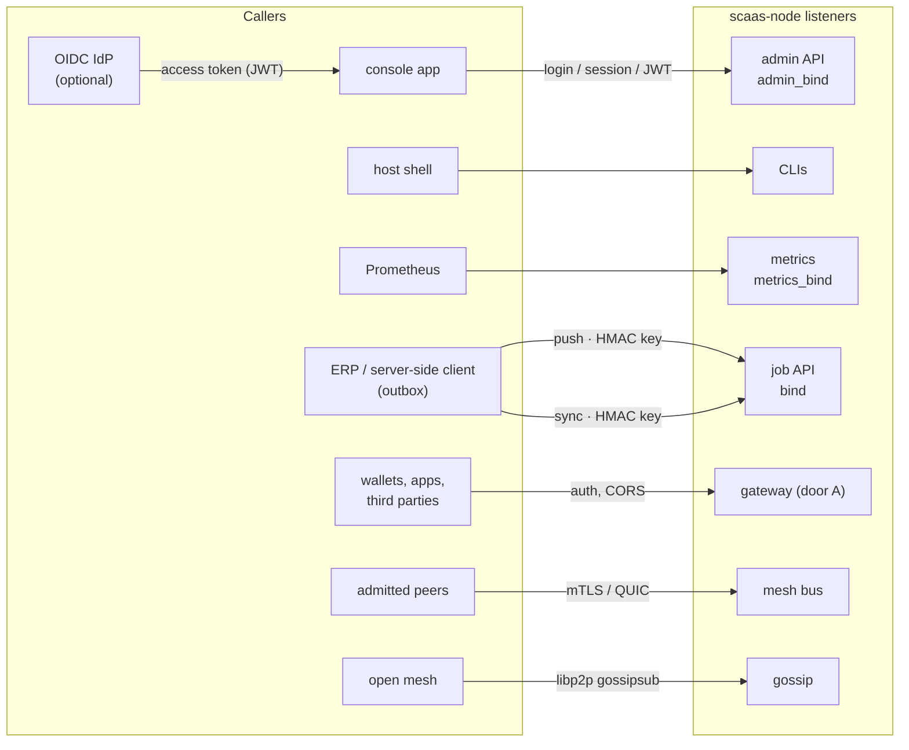

# scaas-node — overview

`scaas-node` is the SCaaS relayer: one Rust binary that accepts signed intents, submits them on chain from its own
lane accounts, indexes the resulting events behind a finality gate, and serves them to clients. It never holds
subject funds or subject keys. This folder is the normative description of the node; each file owns one area and
defines its rulings (`NODE-<TOPIC>-NN`). Rationale for every ruling is in [decisions.md](../decisions.md).

Status tags, as everywhere in these docs: **BUILT** (in the code today), **SPECIFIED** (designed, not built),
**PLANNED** (direction agreed, design to follow). A "Transitional (BUILT)" subsection says what runs today where the
built code differs from the target.

| File | Area |
|---|---|
| [store.md](store.md) | store schema, backends, owner lock and fencing, configuration authority, `node.toml` |
| [job-api.md](job-api.md) | job API for server-side clients: auth, routes, idempotency, cancel, call table, errors, legacy pull |
| [submit-lanes.md](submit-lanes.md) | adapters, signer, lane keys, journal, nonce plan, breakers, simulation, metering, batching |
| [indexer-feeds.md](indexer-feeds.md) | finality gates, event-set quorum, event normalization, `/v1/jobs` and `/v1/events` feeds |
| [gateway.md](gateway.md) | door A: `/v1/metatx`, `/v1/ops`, `/v1/gateway`, UA routes, intake, CORS, errors |
| [admin-auth.md](admin-auth.md) | admin API, built-in users, OIDC, roles, CLI, audit, app serving |
| [sponsorship.md](sponsorship.md) | gas sponsorship policies, budgets, receiver-pays touchpoints, SponsorshipPool (PLANNED) |
| [dex-venue.md](dex-venue.md) | order book, matching, intake, `/v1/dex/*`, watcher, book gossip, managed markets |
| [mesh.md](mesh.md) | intent envelope, pull bus, acceptance policy, exclusivity, private profile |
| [gossip.md](gossip.md) | libp2p gossip, PQ transport, validation, numbers, hints, announces |
| [ops.md](ops.md) | SLOs, metrics, alerts, traces, logs, FinOps, capacity |
| [runbooks.md](runbooks.md) | RACI, incident runbooks, backup/restore/DR, cutover, production gates |
| [threat-model.md](threat-model.md) | node, mesh and gossip threats and their controls |

## Scope

The node is **independent of any client system** ([ARCH-POS-05](../decisions.md#ARCH-POS-05)): it
keeps every durable fact it relies on in its own store, exposes a job API and an event feed, and never opens a
connection to an ERP or any other client. A client ERP keeps its own transactional outbox (rows written in the
business transaction) and is one client among others: it pushes jobs, follows the jobs feed and the events feed,
cancels and re-queues. The worked ERP example is in [integration.md](../integration.md).

In scope:

1. **Direction**: clients call the node; the node never calls a client (no webhooks, no callbacks). Latency is bounded
   by client polling ([indexer-feeds.md#feeds](indexer-feeds.md#feeds)).
2. **Store** — one store, always on, on SQLite, PostgreSQL or MySQL ([store.md](store.md)): jobs, job events, chain
   index ranges, configuration, key metadata, audit log, DEX book, mesh and gossip tables.
3. **Multi-tenancy without companies**: namespaces and per-namespace machine credentials
   ([job-api.md#namespaces](job-api.md#namespaces)).
4. **Admin API** for configuration, used by operators and the console app, authenticated by built-in users or
   optional OIDC, with roles ([admin-auth.md](admin-auth.md)). API keys are for external server-side clients only.
5. **Migration** from the built pull path: per-chain flag, a transitional binary that runs both paths, one-step
   removal ([job-api.md#legacy-pull](job-api.md#legacy-pull), [runbooks.md#cutover](runbooks.md#cutover)).
6. Every safety property of the built relayer is preserved ([invariants](#invariants)): consumption checks, the
   in-flight digest set, journal-before-broadcast, `plan()` restart, `consumed` semantics, no double broadcast,
   journaled nonces. Two gaps of the built code close: door A work becomes journaled and digest-guarded, and
   relayer-bound jobs go to their lane.
7. Gateway capability route, CORS, error contract, `/v1/ops`, UA routes and app serving; denylist, FinOps, restore and
   integrity tooling; sponsorship, receiver-pays and registered chain contracts; UA jobs and records; planned asset
   snapshots, batching and non-EVM DEX books.

Non-goals:

| Out | Why / where it goes |
|---|---|
| Node calling a client for anything (webhooks, callbacks) | [ARCH-POS-05](../decisions.md#ARCH-POS-05). Latency: the client re-triggers its own polling. |
| Two nodes owning jobs of one (client, chain), or HA on a shared database | [NODE-JOB-06](job-api.md#NODE-JOB-06), [NODE-STO-06](store.md#NODE-STO-06). Failover = restore the store on another host ([limitations](#limitations)). |
| Uploading lane keys, RPC URLs, database URLs, the master key or OIDC issuers through the admin API | [NODE-STO-03](store.md#NODE-STO-03): secrets and dial targets stay in `node.toml`/keystores. The one exception is `mesh_peer.url`. |
| Opaque-token introspection (RFC 7662), DPoP, mTLS-bound tokens | [NODE-ADM-02](admin-auth.md#NODE-ADM-02): JWT access tokens only; follow-up. |
| Admin credentials (sessions, OIDC) on the job API; API keys on admin routes; API keys in client-side apps | [NODE-ADM-06](admin-auth.md#NODE-ADM-06): external clients keep HMAC API keys server-side; config automation uses OIDC client credentials or the host CLI. |
| The console app itself | node requirements only ([admin-auth.md#app-serving](admin-auth.md#app-serving)); the app is [clients/app.md](../clients/app.md). |
| Re-importing in-flight jobs of a client's legacy journal into the store | [NODE-JOB-10](job-api.md#NODE-JOB-10): legacy in-flight jobs drain on the legacy path. |
| Client-side copies of node metrics | Prometheus on the node ([ops.md#metrics](ops.md#metrics)). |

## Roles

One binary; modules are switched on in configuration. Every role works without any client system.

| Role | What it does | Listener | Status |
|---|---|---|---|
| **gateway** (door A) | Public intake of signed meta-txs, signed family ops and DEX orders from anyone; normalize ([NODE-LANE-10](submit-lanes.md#NODE-LANE-10)), simulate, enqueue | `[modules] gateway_bind` (default `127.0.0.1:8547`), auth `none` (loopback only) / `bearer` / `hmac` | `/v1/metatx`, `/v1/dex/*` **BUILT**; durable, journaled door A, `/v1/gateway`, `/v1/ops`, `/v1/ua-metatx`, `/v1/ua/register`, error contract **SPECIFIED** ([gateway.md](gateway.md)) |
| **job API** | External server-side clients push jobs, cancel, read feeds, push watch lists and token subsets | `[api] bind` (default `127.0.0.1:8548`), HMAC per API key | **SPECIFIED** ([job-api.md](job-api.md)) |
| **submit** | Per-chain lanes: lease → simulate → journal → sign → broadcast → follow → replace/gap-fill; consumption checks | — | **BUILT** ([submit-lanes.md](submit-lanes.md)) |
| **indexer** | Finality gate + RPC quorum → normalized events → `feed_item(range)`; drift A/C | — | **BUILT** (writes to the legacy client sink); feed **SPECIFIED** ([indexer-feeds.md](indexer-feeds.md)) |
| **dex venue** | Price-time order book per market (limit, IOC, FOK, partial fills), settle jobs (target: `mtxSettle`, one taker against several makers), final-event watcher | gateway `/v1/dex/*` | **BUILT** (book persisted in the legacy client); store-backed **SPECIFIED** ([dex-venue.md](dex-venue.md)) |
| **mesh** | Envelope `scaas-intent/1.2`, acceptance policy, store, exclusivity, pull bus, gossip, hints, announces, DEX book replication | `[mesh] bind` (HTTPS mTLS), `[gossip] listen` (QUIC/TCP) | Envelope/digest/accept/hubsig/export library **BUILT** (43 conformance cases); transports and pipeline **SPECIFIED** ([mesh.md](mesh.md), [gossip.md](gossip.md)) |
| **admin** | `/healthz`, `/readyz`, `/metrics` (open); `/v1/admin/*` (roles) | `[modules] admin_bind` (default `127.0.0.1:9108`) | health/metrics **BUILT**; admin API **SPECIFIED** ([admin-auth.md](admin-auth.md)) |

### Modules and shapes

**NODE-MESH-20** — The node is a capability matrix, not a
set of modes: a **module** is switched on in `[modules]`; a **shape** is a set of modules. Supported shapes:

| Shape | Modules | Notes |
|---|---|---|
| Full node | `submit`, `indexer`, `gateway`, `mesh` | job API + gateway + bus + gossip |
| Mesh relayer | `submit`, `mesh` | a partner node that submits peers' intents |
| Forwarder | `mesh` only | policy rows `support = forward_only`; no keys needed for a chain that is only forwarded |

The mesh "pool" is not a separate switch: the store **is** the mesh-facing queue. Exclusivity
([NODE-MESH-04](mesh.md#NODE-MESH-04), [NODE-GSP-10](gossip.md#NODE-GSP-10)) is a courtesy between relayers; there is
no promote-to-open of pooled intents and no forward score in v1 ([mesh.md#limitations](mesh.md#limitations)).

**NODE-GEN-17** — One codebase, one binary, roles by configuration: the
daemon tier is a single Rust application. Custody broker and key oracle are **not** roles of this binary: they sit
behind the signer seam ([NODE-LANE-03](submit-lanes.md#NODE-LANE-03)) as separate processes when used.

## Listeners

- console app: node-served, same origin, `[app]` files + CSP on `admin_bind`; admin API with CORS.
- host shell: `scaas-node admin|key|store|lane|index|report …` (CLIs).
- Prometheus: `/healthz` `/readyz` `/metrics` on `metrics_bind`.
- ERP push: `POST /v1/jobs`, cancel, `PUT` watch/tokens; ERP sync: `GET /v1/jobs?cursor=`, `GET /v1/events?cursor=`.
- gateway: `/v1/gateway` `/v1/metatx` `/v1/ops` `/v1/ua-*` `/v1/dex/*`.
- admitted peers: `/v1/mesh/*`, `/scaas/bus/1.2`; open mesh: libp2p gossipsub over QUIC (PQ) or TCP+Noise.
- Inside `scaas-node`: store, submit / lane_runner, indexer → feed, gateway (door A), mesh + gossip, dex venue.

| Listener | Config | Auth | Routes |
|---|---|---|---|
| gateway | `[modules] gateway_bind` | none / bearer / hmac (single secret) ([NODE-GW-02](gateway.md#NODE-GW-02)) | `/v1/gateway`, `/v1/metatx`, `/v1/ops`, `/v1/ua-metatx`, `/v1/ua/register`, `/v1/intents/{id}`, `/v1/dex/*` ([gateway.md#routes](gateway.md#routes)) |
| **job API** | `[api] bind` (default `127.0.0.1:8548`; `127.0.0.1:8547` is the gateway default, `127.0.0.1:9108` the admin default) | HMAC per key ([NODE-JOB-05](job-api.md#NODE-JOB-05)) | `/v1/info`, `/v1/jobs*`, `/v1/events`, `/v1/watch/*`, `/v1/tokens/*`; planned `/v1/snapshots*` |
| admin | `[modules] admin_bind` | open: `/healthz`, `/readyz`, `/metrics`, `/v1/admin/login`, `/v1/admin/auth-modes`, app files (`[app]`); admin credentials ([NODE-ADM-02](admin-auth.md#NODE-ADM-02)): other `/v1/admin/*` | [admin-auth.md#routes](admin-auth.md#routes) |
| metrics (opt.) | `[modules] metrics_bind` (default `""` = served on `admin_bind`) | none | only `/metrics`, `/readyz`, `/healthz` ([NODE-OPS-03](ops.md#NODE-OPS-03)) |
| mesh bus | `[mesh] bind` (default `0.0.0.0:8550`) and QUIC `/scaas/bus/1.2` | TLS 1.3 / QUIC client cert, SPKI pin of an active peer row; X25519MLKEM768 only | `/v1/mesh/*` ([mesh.md#bus](mesh.md#bus)) |
| gossip | `[gossip] listen` | libp2p Ed25519 identity, scoring | gossipsub, Kademlia, sync ([gossip.md](gossip.md)) |

Non-loopback `[api] bind` or `admin_bind` requires TLS in front. `Config::validate` refuses `modes = []`, an `oidc`
mode without an issuer, two enabled listeners on one port (same host, or either on the wildcard address),
`[app] enabled` without `dir/index.html`, and more than the capacity caps (16 chains, 8 lanes per chain, 32
namespaces, 64 tokens per chain, 256 watched wrapper legs; admin routes answer `422 LIMIT`,
[NODE-OPS-13](ops.md#NODE-OPS-13)). `MAX_BODY` is a per-listener parameter: gateway 64 KiB (1 MiB on the PQZ chain
profile only), job API 1 MiB.

Toml sections of the listeners (toml-only per [NODE-STO-03](store.md#NODE-STO-03), except the bootstrap list, which
is imported into the store):

| Key | Meaning |
|---|---|
| `[modules] gateway_cors_origins = []` | exact origins (no `*`, no reflection); `GET, POST`; header `Content-Type`; no credentials; `max_age = 600`; non-empty only with gateway auth `none` ([NODE-GW-04](gateway.md#NODE-GW-04)) |
| `[modules] metrics_bind = ""` | separate monitoring listener, above |
| `[app] enabled = false, dir, config, extra_connect_src = []` | serve the built app on the admin listener only ([NODE-ADM-11](admin-auth.md#NODE-ADM-11)); `config` served as `/config.json`, validated at start; a changed file sets `pending_restart` |
| `[log] format = "text" \| "json"` | JSON lines in production; fields and redaction in [ops.md#logs](ops.md#logs) |
| `[[sponsorship.policies]]` | bootstrap rows of `sponsor_policy` (import if absent) |

## Invariants

Normative for every path into and out of the node.

| Id | Invariant | Mechanism | Status |
|---|---|---|---|
| **NODE-GEN-01** | The node never holds subject funds or subject keys. Lane keys hold gas only; the relayer never needs a subject's confidential (Zether) key. | No allowance to relayers; a meta-tx moves only `from → to` as signed; custody broker and key oracle are separate processes | **BUILT** |
| **NODE-GEN-02** | No broadcast without a committed journal entry (`signed` with lane, outer nonce, tx hash). | Journal-before-send; failure ⇒ retry, nonce not spent | **BUILT** (journal in the legacy client); in the store **SPECIFIED** ([NODE-STO-04](store.md#NODE-STO-04)) |
| **NODE-GEN-03** | No outer nonce is ever abandoned. | Replacement up to the fee cap; expired job ⇒ 0-value self-send gap-filler at that nonce ([NODE-LANE-04](submit-lanes.md#NODE-LANE-04)) | **BUILT** |
| **NODE-GEN-04** | At most one live outer transaction per intent per node. | Per-chain in-flight digest set shared by every lane, gateway and mesh (G2); durable `job_live_digest` UNIQUE index ([NODE-JOB-02](job-api.md#NODE-JOB-02)) | set **BUILT**; index **SPECIFIED** |
| **NODE-GEN-05** | After observing consumption, never bump, resend or re-sign that intent. | Consumption read before every bump/resend and after every reverted receipt; fails closed ([NODE-LANE-09](submit-lanes.md#NODE-LANE-09), G3) | **BUILT** |
| **NODE-GEN-06** | A job is never `dead`/`reverted` because someone else landed it. | `consumed` state; the client marks it final from the event feed, or `dead` only if superseded after `valid_until + grace + 1 h` (G6) | **BUILT** |
| **NODE-GEN-07** | Wire values of unbound `relayer`/`feeRecipient` are never submitted. | normalization on every origin ([NODE-LANE-10](submit-lanes.md#NODE-LANE-10)) | **BUILT** for gateway; all origins **SPECIFIED** |
| **NODE-GEN-08** | Nothing is booked before finality. | The indexer delivers only final, quorum-agreed, contiguous ranges ([indexer-feeds.md](indexer-feeds.md)) | **BUILT** |
| **NODE-GEN-09** | Circuit breakers never block indexing, tracking of signed txs, rescues or gap-fillers. | Breakers gate new work only ([NODE-LANE-05](submit-lanes.md#NODE-LANE-05)) | **BUILT** |
| **NODE-GEN-10** | One owner process per store. | Backend lock + fencing epoch checked in every journal transaction ([store.md#backends](store.md#backends)) | **SPECIFIED** |
| **NODE-GEN-11** | Every outer tx the lane pays for is metered, and a subject cannot make the node pay repeatedly. | Breaker meters `fee + value_out + deposits` of every included tx (failures too); one requeue after a billed failure; `max_attempts`; per-subject grief score ([NODE-LANE-13](submit-lanes.md#NODE-LANE-13)–[NODE-LANE-15](submit-lanes.md#NODE-LANE-15)) | EVM metering **BUILT**; rest **SPECIFIED** |
| **NODE-GEN-12** | Fields the signed payload carries are read from it, never from job JSON. | `contract`, `valid_until`, `from`, lane, nonce, relayer binding, value/forward floors from the decoded payload; a differing JSON copy ⇒ `422 BAD_PAYLOAD`; unsigned fields may only narrow ([NODE-LANE-16](submit-lanes.md#NODE-LANE-16)) | mesh decoders **BUILT**; job paths **SPECIFIED** |
| **NODE-GEN-13** | No lane sends native value or funds deposits it cannot get back, beyond caps. | `chain.max_value_out` ([NODE-LANE-17](submit-lanes.md#NODE-LANE-17)), deposit rule ([NODE-LANE-18](submit-lanes.md#NODE-LANE-18)) | **SPECIFIED** |
| **NODE-GEN-14** | Mesh and gateway intents are signature-checked before any chain call. | Per-family local verify, `BAD_SIGNATURE` counts against the peer ([NODE-MESH-16](mesh.md#NODE-MESH-16)) | EVM `eoa` **BUILT**; rest **SPECIFIED** |
| **NODE-GEN-15** | Adapter state needed across restarts lives in the store. | `outer_tx` signed bytes, object refs, durable-nonce value; no local journal ([NODE-LANE-19](submit-lanes.md#NODE-LANE-19)) | **SPECIFIED** |
| **NODE-GEN-16** | The node serves no upgradeable program and holds each custody key in one family. | Upgradeability read at activation and start ⇒ `halted`, `PROGRAM_UPGRADEABLE` ([NODE-STO-07](store.md#NODE-STO-07)); `Config::validate` refuses one public key in two families ([NODE-LANE-20](submit-lanes.md#NODE-LANE-20)) | **SPECIFIED** |

### Guarantees

Hard (enforced by code or chain):

- **G1** — The contract executes an intent at most once: the per-subject nonce must equal `m.nonce` and is
  incremented on execution. A payer never pays twice, whatever the relayers do.
- **G2** — Our node holds **at most one live outer tx per intent** (NODE-GEN-04): the per-chain in-flight digest set
  is shared by every lane, the gateway and the mesh scheduler, and the store CAS admits one job per path. A restart may
  re-sign an intent at a new nonce after its old nonce was gap-filled; the old tx is then dead.
- **G3** — After a node observes consumption (simulation revert, reverted receipt, or the pre-bump/pre-resend
  re-check) it never broadcasts, resends or bumps that meta-tx again; on EVM the outer nonce is released by a
  gap-filler only. An unreadable nonce never leads to a bump (fail closed).
- **G4** — No outer nonce is abandoned, for every origin (job API, gateway, mesh, DEX).
- **G5** — A private-chain intent is served only by its origin and only to private peers that origin admitted for
  that chain ([mesh.md#private-profile](mesh.md#private-profile)).
- **G6** — A job of ours is never reported `dead`/`reverted` because another relayer executed it; it becomes
  `consumed`, then final (by the client, from the feed) or `dead` only if superseded.
- **G7** — We never submit wire values of `relayer`/`feeRecipient` that the signer left unbound.

Best effort (bounded): exclusivity holds only if every peer honours it; after the exclusive window several eligible
peers may submit and each loser pays one reverted outer tx (≈ 24–30 k gas on EVM, the token checks the nonce before
the signature); a node learns of a peer's landing from a hint or its own read ([gossip.md#hints](gossip.md#hints)).
"Never double broadcast" therefore holds per node (G2, G3), and holds network-wide only as best effort.

### Where each safety property lives

| Property | Mechanism |
|---|---|
| Journal before broadcast | `leased→signed` (items + `outer_tx`, [NODE-LANE-12](submit-lanes.md#NODE-LANE-12)) committed (SQLite `synchronous = FULL`; PG/MySQL durable commit) before `send_raw`; failed or unknown commit never sends until re-read proves the row is ours. A stale owner cannot journal (fencing) and therefore cannot broadcast. |
| `plan()` restart | Inputs from the store; `journal_max` = monotonic `lane.journal_max` (never an aggregate over purgeable rows), bumped in the journal transaction and on every legacy `signed` report in the transitional binary. |
| In-flight digest set (G2) | In memory **plus** durable `job_live_digest`; digests are node-computed, so neither can be bypassed or squatted by a client. |
| Consumption checks | sink is the store `transition` ([submit-lanes.md#consumption-check](submit-lanes.md#consumption-check)). |
| `consumed` | Node state table ([job-api.md#states](job-api.md#states)) mirrors the client's transition and late-no-op tables; shared vector file `transitions.json`. |
| No double broadcast | G2 + G3; cancel/lease race is a CAS; published jobs are held, not cancelled ([NODE-JOB-07](job-api.md#NODE-JOB-07)). |
| Journaled nonces (G4) | `job.outer_nonce` + `lane.journal_max`; mesh `intent` rows no longer journal ([NODE-JOB-02](job-api.md#NODE-JOB-02)). |
| Pause, breaker | Block `poll_store` ([NODE-STO-02](store.md#NODE-STO-02), [NODE-LANE-05](submit-lanes.md#NODE-LANE-05)); the client's own chain state blocks its push. |
| Normalization | Job API accept, gateway, mesh work builders ([NODE-LANE-10](submit-lanes.md#NODE-LANE-10)). |
| Denylist | intake on every door and again at lease; a job requeued from `signed` is re-checked ([NODE-OPS-14](ops.md#NODE-OPS-14)). |
| Restore | `store restored` pauses every chain; `lane accept-nonce` adopts chain-ahead nonces without lowering `journal_max` ([runbooks.md#backup-dr](runbooks.md#backup-dr)). |

## Module map

**NODE-GEN-18** — Code layout follows these docs: `docs/node/<x>.md`
maps to a module. The first steps are pure module moves inside the one crate and the job seam (`trait JobSource`,
`trait OutcomeSink`: the store and the legacy pull adapter both implement them; adapters take the core `Job`, never the
legacy client); splitting into a workspace (`scaas-core`, `scaas-store`, `scaas-chains` + the binary) waits until the
job path runs from the store. No step mixes a move with a behaviour change; tests stay green at every step.

| Doc | Module (target) |
|---|---|
| [store.md](store.md) | `store/` (backend trait, SQLite; PostgreSQL and MySQL behind features), `migrations/` |
| [job-api.md](job-api.md) | `api/` (`jobs.rs`, `events.rs`, `auth_hmac.rs`); `legacy/` (pull adapter, deleted whole at removal) |
| [submit-lanes.md](submit-lanes.md) | `lanes/` (EVM runner, generic lane runner, recover, batches, unwrap); `chains/` (`ChainAdapter`, `Signer`, keys, families) |
| [indexer-feeds.md](indexer-feeds.md) | `indexer/` (runner, drift, feed builder) |
| [gateway.md](gateway.md) | `gateway/` (routes, auth, `/v1/ops`, UA routes) |
| [admin-auth.md](admin-auth.md) | `admin/` (health, auth, users, OIDC, routes, audit) |
| [dex-venue.md](dex-venue.md) | `dex/` (pure book/matcher, venue I/O) |
| [mesh.md](mesh.md), [gossip.md](gossip.md) | `mesh/` (envelope, digest, hubsig, accept, export, bus, scheduler); `mesh/gossip/` behind a feature |
| [sponsorship.md](sponsorship.md) | `sponsor.rs` |
| [ops.md](ops.md) | `ops/` (metrics, usage) |

## Limitations

PLANNED or deferred:

- HA: two nodes for one (client, chain), or several nodes on one shared database, with a job-release protocol.
- A second, independent event source and client-side agreement before booking ([NODE-IDX-07](indexer-feeds.md#NODE-IDX-07)).
- OIDC introspection / revocation, DPoP or mTLS-bound tokens.
- Admin-API management of RPC URLs with a dial allowlist.
- Audit retention and export; per-key IP allowlists; signed feed pages (only with a second verifier).

## Tests

Node-wide test plan for the store-backed node (each item lands with the change it covers; component
docs add their own: [mesh.md#tests](mesh.md#tests), [gossip.md#tests](gossip.md#tests),
[dex-venue.md#tests](dex-venue.md#tests), [sponsorship.md](sponsorship.md), [ops.md#alerts](ops.md#alerts),
[runbooks.md#backup-dr](runbooks.md#backup-dr)).

Unit (`cargo test`, no network):

- `store.rs` (contract suite, run per backend): migrations; second owner refused; **fencing**: a stale owner's journal
  transaction aborts; state machine = `transitions.json`; `job_event` atomic with the CAS; `job_live_digest`;
  idempotency incl. tombstone and generations; unique violations classified by constraint (name, or the SQLite column
  list); `transition` never enters `cancelled`; journal fields only on their transitions; purge never deletes an
  unexpired origin; lease vs cancel race; published-job cancel ⇒ hold + `TOO_LATE`; tri-state `transition` (`Moved`
  after cancel, `Moved{signed, own hash}` proceeds, injected commit-outcome-unknown ⇒ re-read); `lane.journal_max`
  monotonic with out-of-order writes; byte-exact keys (`'0xAB' != '0xab'`, base58 case); nonces as i64.
- `jobs_api.rs`: every accept check and code; node-computed digest vs client digest; JCS KAT; snapshot in accept
  results; namespace isolation; `wait`; `410`; continuity fields in pages.
- `gwauth.rs`: `HmacKeys` (two keys, revoked/expired/rotated, nonce per key); shared KAT; per-listener body caps.
- `oidc.rs`: RS256/ES256/EdDSA (test keys generated with the crypto library); wrong `iss`/`aud`, expired, `nbf` future,
  missing `iat`, lifetime too long, `alg = none`, `HS256`, `alg`/`kty` mismatch, JWK `alg` mismatch, `jku` header,
  `typ` required, unknown `kid` ⇒ one refetch then reject, refetch rate limit, rotation (old key removed ⇒ old token
  rejected), stale-JWKS fail closed, `(iss, kid)` collision across two issuers, discovery redirect refused, `scope`
  mapping refused for a user token, `audience ∈ client_ids` config refused, role mapping (`role` string/array,
  `realm_access.roles`).
- `admin_auth.rs`: Argon2id hash/verify round trip; login ok/bad/unknown (same status and comparable timing via dummy
  hash)/locked/disabled; session MAC, expiry, refresh window, `session_epoch` revocation, role change ⇒ old token
  rejected; dispatch by prefix with each mode off; roles ⊆ caller's on user create; the [NODE-ADM-08](admin-auth.md#NODE-ADM-08)
  matrix (`key_custodian` alone ⇒ `403` on reset/disable/delete/demote of an `admin`; `409 LAST_ADMIN` incl. self; CLI
  allowed; target `session_epoch` bumped); API key create/rotate/revoke by `key_custodian` only (403 for `admin`
  alone); CLI writes while the node holds the owner lock.
- `admin.rs`: route × role matrix for both admin credential kinds; CORS preflight; audit row before/after + actor + hash
  chain, secrets masked; HMAC key on the admin listener ⇒ 401; session or OIDC token on the job API ⇒ 401; `LANE_BUSY`.
- `submit.rs`/`adapter.rs`: the submit tests rewritten on a temp store; `plan()` from `lane.journal_max`; `leased`
  mapped to `nonce_leased`; `lane_hint`; the foreign-nonce heuristic; gateway job digest present.
- `config.rs`: bootstrap import, drift, toml-only fields refused by the API, the legacy client section accepted
  (transitional) / refused (final), OIDC config validation.

Contract fixtures (node ↔ clients): `scaas/scaas-node/tests/api/`: `job_request.json`, `job_result.json`,
`jobs_page.json`, `events_page.json` (one `range` per family from the adapters' fixtures, plus `balances`),
`transitions.json`, `hmac_kat.json`, `jcs_kat.json`. Clients keep byte-identical copies (CI `cmp`).

e2e:

- `tests/e2e_push.rs` (`--ignored`, anvil + forge, no ERP): a fake client pushes through HMAC and follows both feeds to
  `mined` and a `range` with `MetaTransactionExecuted`; restart between `signed` and `broadcast` (no second outer tx);
  consumption by a second EOA ⇒ `consumed`; cancel/lease race; cancel of a published job ⇒ `TOO_LATE` and no lease by
  us; two namespaces isolation and digest squatting refused; gateway door A durable and deduplicated across restart;
  transitional run with a fake client on the legacy path for one chain and the store path for another, same lane
  (shared nonce counter, `journal_max` bumped by legacy `signed`); store indexer running on a `pull` chain then switched.
- `tests/e2e_oidc.rs`: in-test mock issuer (discovery + JWKS + EdDSA/RS256 minting): admin flows per role, rotation
  mid-run, issuer down ⇒ cached keys ⇒ fail closed after max stale; built-in login and OIDC against the same routes;
  OIDC off ⇒ JWTs refused.
- `tests/e2e_store_backends.rs` (`--ignored`, docker PG + MySQL): contract suite + lock loss (kill the lock session) ⇒
  fencing stops journaling ⇒ second owner takes over without a double broadcast.
- A nightly manual run with a real ERP test database + node + anvil: portal payment → push → mined → final; flip one
  chain `pull → push` with an in-flight legacy job.

Additions for the store-backed rulings (each lands with the change it covers):

- Store: new tables on every backend + DDL equivalence; `DUPLICATE_CALL` classification; concurrent `usage_day` /
  `sponsor_usage` upserts and decimal sums; `breaker_latch` across restart; `store restored` pauses and purges, and a
  job cancelled after the backup point is never leased; `accept-nonce` refusals and gap-filler
  ([NODE-RUN-03](runbooks.md#NODE-RUN-03)); `index reset`.
- Gateway: `/v1/gateway` schema; the [NODE-GW-06](gateway.md#NODE-GW-06) golden on every route; CORS preflight;
  `/v1/ops` accept order per family; 64-byte signatures accepted only on Hedera; UA routes (miss cached 60 s,
  `UA_KEY_IN_USE`, the [NODE-GW-03](gateway.md#NODE-GW-03) target); app headers byte-exact.
- Accept/lease: denylist per party, door and lease re-check (no address in logs, labels, audit mirror,
  [NODE-OPS-14](ops.md#NODE-OPS-14)); the [sponsorship tests](sponsorship.md); `receiver_fee` rules; `traceparent` →
  `trace_id`; cost fields per family; golden metrics with pre-emitted zeros; `/readyz` per-chain body. Client side:
  acknowledgement cancels, cursor reset ([job-api.md#client-tests](job-api.md#client-tests)).
- Cancel-by-origin tombstones: ungranted chain `403`, TTL over cap `422`, expired ⇒ no row, `max_tombstones` `429`,
  rate, purge at `valid_until + 1 d`. Empty token subset refuses every token, `all_tokens` admin-only and audited,
  reserved namespaces seeded; `job_live_call`: two namespaces with the same call both accepted, same namespace
  `DUPLICATE_CALL`.
- Authority races: suspension / grant revocation / subset replace / key revoke racing an accept, on every backend
  (PostgreSQL case: the change commits while the accept waits on the fencing row ⇒ refused after retry).
- `outer_tx` row per signed tx, restart replays per outer tx; gateway CORS with `bearer`/`hmac` refused at start.
- Sponsorship counters: counts at accept and released before broadcast, one payer bounded by
  `max_tx_per_payer_hour × max_cost_per_tx`, `SPONSOR_TOO_SHORT`, `sponsor_fallback` booking, `POLICY_INVALID` without
  `fallback_to_namespace`, the `~gateway` UA-registration policy accepted and any other `~gateway` `call` policy
  refused, `DUPLICATE_CALL {uid}`.
- Chain binding (T-CHAIN at the node, [gateway.md#chain-binding](gateway.md#chain-binding)): genesis hash, registry
  code or `chainUid()` mismatch holds the chain; two `evm:7622` profiles with different `chain_uid`. A 7702-delegated
  payer's ECDSA signature passes the local check.
- Planned: the [NODE-LANE-11](submit-lanes.md#NODE-LANE-11) batch journal and cost split over `outer_tx` (items never
  requeued alone after `signed`); unwrap terminal reverts; token kinds 0–4 (built) and flags 5–8 ([CTR-AS-17](../contracts/asset-suite.md#CTR-AS-17)), managed-market codes,
  `merkle_dist_vectors.json`.

## Code pointers

Where the behaviour described in these docs sits in `scaas-node` today (orientation only;
line numbers as of 2026-10-07 and will drift; the module map above is the target layout). "After" = the change from the
legacy pull path to the store ([job-api.md#legacy-pull](job-api.md#legacy-pull)).

| Topic | Today | After |
|---|---|---|
| Wiring | the legacy client handle is passed to `Submitter`, the lane runner, the index runner, `indexer::run`, `drift::step`, `admin::refresh_loop` and the venue (`main.rs:103-228`) | `Store` handle + `ConfigSnapshot` receiver; the legacy client module stays only until the one-step removal |
| Work intake | `poll_outbox` (`submit.rs:540-568`, `main.rs:181-186`) | `poll_store`: queued rows with `hold = 0` and `lane_hint IS NULL OR = lane`, oldest first, ≤ 10 → skip in-flight digest → CAS `queued→leased` |
| Outcome reports | `report(…) -> bool` (`submit.rs:244-261`, `adapter.rs:151-159`) | `store.transition(uid, from, to, fields) -> Ok \| Moved{state, tx_hash} \| Unknown(err)` |
| Journal before send | `signed` over HTTP before `send_raw`, `false` ⇒ retry (`submit.rs:308-316, 386-392`; `adapter.rs:419-423`) | CAS on the job row + `lane.journal_max` + fencing check; same tri-state in the non-EVM `step_once` |
| Cold start | `Submitter::start` / `recover_lane` from `node_config.inflight` + `journal_max_nonce` (`submit.rs:146-190`, `adapter.rs:232-248`); start refuses when the legacy journal is unreachable (`submit.rs:148-150`) | `store.inflight(chain, lane)`: leased rows + `signed/broadcast` outer-tx rows with `lane_label = lane`; `leased` maps to `"nonce_leased"` at this boundary (`nonce.rs:28` matches the literal) |
| Restart plan, nonces | `plan()` per nonce of one job (`nonce.rs:23-33`, `nonce.rs:23-32`; `submit.rs:98-105, 327`) | per outer transaction ([submit-lanes.md#nonce-plan](submit-lanes.md#nonce-plan)) |
| In-flight digest set (G2) | `submit.rs:63-90`; client-supplied digest today (`submit.rs:93-96`; fields `lane_label/outer_nonce/tx_hash`, states `submitting/broadcast/landed`) | node-computed digest ([NODE-JOB-02](job-api.md#NODE-JOB-02)) |
| Pause and breaker gate | block `poll_outbox` (`submit.rs:574-583`) | block `poll_store` the same way |
| Cost metering | EVM meters every receipt (`submit.rs:526-529`); non-EVM meters `Mined` only (`adapter.rs:270-276`, `tx_fee`) | every landed status ([NODE-LANE-13](submit-lanes.md#NODE-LANE-13)) |
| Attempts | `store/sqlite.rs:162` increments `attempt_count`; every `Rejected` goes back to `queued` (`adapter.rs:293-299`) | billed-failure rule ([NODE-LANE-14](submit-lanes.md#NODE-LANE-14)) |
| Unsigned job fields | Cosmos `relay_msg` (`cosmos.rs:177-198`), Soroban `max_time` (`soroban.rs:313`), TON forward amount (`ton.rs:1145`; `ton.rs:1140-1149`, `jetton.tact:149-161, 235`) | read from the payload ([NODE-LANE-16](submit-lanes.md#NODE-LANE-16), [NODE-LANE-17](submit-lanes.md#NODE-LANE-17)) |
| Adapter-local journals | Sui gas-coin `Pending` (`sui.rs:465-467`) | store ([NODE-LANE-19](submit-lanes.md#NODE-LANE-19)) |
| Gateway | unjournaled `Work`, in-memory `mpsc` (`gateway.rs:139-150`, `main.rs:139-153`); auth `gwauth.rs:5-8`, `gwauth.rs:23`, `gwauth.rs:74-104`, `gwauth.rs:108-116` | a job in `~gateway` ([gateway.md#door-a-intake](gateway.md#door-a-intake)) |
| Indexer | `index_step` / `indexer::step` (`adapter.rs:443-458`, `indexer.rs:106-118`); finality read from the client (`indexer.rs:113`); race fix `indexer.rs:81-82`; normalization `indexer.rs:21-59, 69-77`, `adapters/hedera.rs:14-15`, `adapters/cosmos.rs:278-290`, `adapters/sui.rs:364-393`, `adapters/aptos.rs:352-380`, `adapters/aptos.rs:555-572`, `adapters/ton.rs:1022-1024, 1263-1272`, `adapters/solana.rs:543-566`, `adapters/soroban.rs:191-198` | cursor in `chain_index`, one transaction per range ([indexer-feeds.md](indexer-feeds.md)) |
| Drift | `node_config.indexed_block` + `balance_report` (`drift.rs:30-50`) | `chain_index` + `feed_item(balances)` |
| Readiness | via the client (`admin.rs:125-153`) | store + RPC + lag ([ops.md#health](ops.md#health)) |
| Config sources | `main.rs:131-167`, `adapters/evm.rs:31`, `hedera.rs:14-15`, `ton.rs:940`, `indexer.rs:106-117`, `adapter.rs:445-450`, `drift.rs:31-33`; admin bind `config.rs:51-52`; validation `config.rs` | [store.md#config-authority](store.md#config-authority) |
| Store (first cut) | tombstones without quota (`store/sqlite.rs:357-373`); `accept_once` reads only `max_live_jobs` (`store/sqlite.rs:188-214`) | [NODE-JOB-11](job-api.md#NODE-JOB-11), [NODE-JOB-14](job-api.md#NODE-JOB-14) |
| Job builder | `job.rs` `build(&Job, …)` | unchanged |
| Keys in one process | relay and indexer keys both loaded (`main.rs:103, 117`) | [threat-model.md#node](threat-model.md#node) T7 |
| Mesh | `mesh/digest.rs:130-300` (`check_evm`, `:193-195`), `mesh/store.rs`, e2e `tests/e2e.rs`, `tests/e2e_<family>.rs`; adapters `adapters/cosmos.rs`, `adapters/hedera.rs`; wiring `main.rs` | [mesh.md](mesh.md) |
| DEX venue | `dex/venue.rs:1`, `dex/venue.rs:179-199`, `dex/venue.rs:403-421`, `venue.rs:188-196`, `venue.rs:317-324`, `venue.rs:500, 542`, matching `dex.rs:637-643`, watcher in `indexer.rs`; contract `SCaaSDex.sol:188-198` (`_validSig`, `_erc1271Gas(signer)`), tests `SCaaSDex.t.sol:667`, `SCaaSDexInvariant.t.sol` | [dex-venue.md](dex-venue.md) |
| Meta-tx contracts | `smartcontracts/src/common/MetaTxLib.sol`, `ERC20MetaTx.sol`, `smartcontracts/src/metatx/ERC20MetaTx.sol`, `smartcontracts/src/hedera/HederaMetaToken.sol` | [contracts/metatx.md](../contracts/metatx.md) |
| Console app | `scaas/app/` | [clients/app.md](../clients/app.md) |
