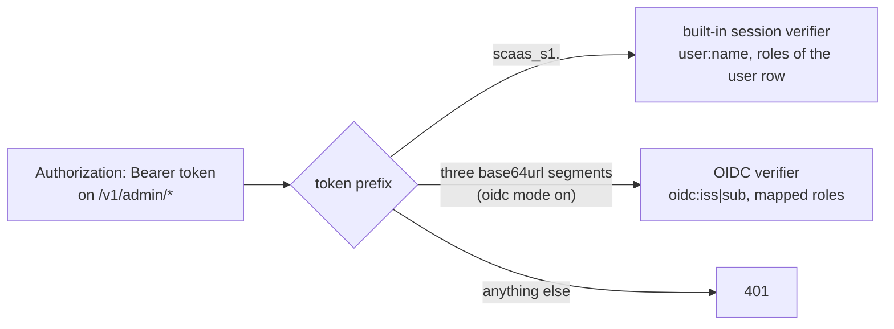
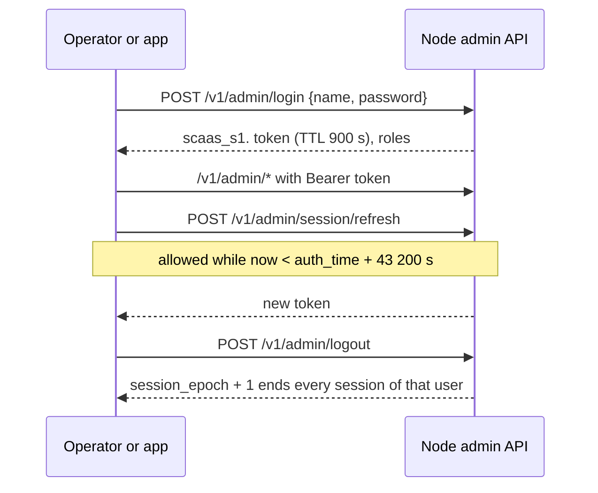

# Admin API and authentication

The admin API is the node's control plane: operators, the console app and configuration automation change the store
through it. It is served on `[modules] admin_bind` (default `127.0.0.1:9108`), next to `/healthz`, `/readyz`,
`/metrics`. Status: health/metrics **BUILT**; admin API, built-in users, OIDC, CLI credential commands and audit
**SPECIFIED** (store tables and the `store init`/`store restored` CLI **BUILT**).

**Contents**

1. [Modes](#1-modes)
   - 1.1 [Credentials and token validation](#11-credentials-and-token-validation)
2. [OIDC](#oidc)
3. [Built-in users](#built-in-users)
4. [Roles](#4-roles)
5. [CLI](#cli)
6. [Routes](#routes)
   - 6.1 [Mesh peer URL](#mesh-peer-url)
7. [CORS](#7-cors)
8. [Audit](#8-audit)
9. [Errors](#9-errors)
10. [App serving](#app-serving)

## 1. Modes

<a id="modes"></a><a id="NODE-ADM-02"></a>**NODE-ADM-02** — **Admin authentication has two modes**
(`[api.admin_auth] modes`, default `["builtin"]`): (1) **built-in users** in the store (`admin_user`: name + Argon2id
PHC hash + roles); login issues a short-lived node-signed session token ([built-in users](#built-in-users)); (2)
**OIDC** (optional, [OIDC](#oidc)). The token prefix selects the verifier (`scaas_s1.` session, otherwise a JWT when
`oidc` is on). **"API key" means only the external-client credentials** of [NODE-JOB-05](job-api.md#NODE-JOB-05) (ERP
backends and other services): namespace-scoped, `submit`/`read` on the job and event API, never admin, and
**server-side only** (never in browser/mobile/desktop apps or extensions). A node works with no IdP; built-in mode
makes the node a password store (Argon2id, lockout, [threat-model.md#node](threat-model.md#node) T21). The owner's
requirement was "as simple as possible". Opaque-token
introspection (RFC 7662), DPoP and mTLS-bound tokens are not supported (follow-up).

### 1.1 Credentials and token validation

<a id="credentials"></a>

```toml
[api]
bind = "127.0.0.1:8548"                       # job API; never the port of gateway_bind / admin_bind
master_key = { env = "SCAAS_API_MASTER_KEY" } # ≥ 32 bytes; SecretSource like [keys]; also keys session tokens
admin_cors_origins = ["https://app.example.com"]
lease_hold_after_start_secs = 15              # job-api.md#lease

[api.admin_auth]
modes = ["builtin"]                           # builtin and/or oidc; [] refused
session_ttl_secs = 900                        # built-in session token lifetime
session_max_age_secs = 43200                  # refresh allowed until login + this
login_max_failures = 10                       # then locked for login_lock_secs
login_lock_secs = 900

[api.oidc]                                    # only read when "oidc" ∈ modes
clock_skew_secs = 60
max_token_lifetime_secs = 3600
jwks_refresh_secs = 600
jwks_max_stale_secs = 86400

[[api.oidc.issuers]]
issuer = "https://auth.example.com"           # exact; https only (http only for a loopback host, tests)
audience = "scaas-node-admin"                 # the node API resource; must NOT be one of client_ids
client_ids = ["scaas-node-app"]               # optional: `azp`/`client_id` must be listed when present
algs = ["RS256", "ES256", "EdDSA"]
require_typ_at_jwt = false                    # true ⇒ header typ must be "at+jwt" (RFC 9068)
machine_only = false                          # true ⇒ every token of this issuer is a machine token
role_claim = "role"                           # e.g. "role"; Keycloak: "realm_access.roles"; machines: "scope"
roles = { "BlockchainViewer" = "viewer", "BlockchainOperator" = "operator",
          "BlockchainAdmin" = "admin", "BlockchainKeyCustodian" = "key_custodian" }
# jwks_uri = "https://…"                      # optional override; otherwise from discovery
```

`Authorization: Bearer <token>` on `/v1/admin/*` (except `login`) is dispatched by prefix, each verifier only when its
mode is enabled:

| Prefix | Verifier | Caller |
|---|---|---|
| `scaas_s1.` | built-in session | `user:<name>`, roles of the user row |
| three base64url segments | OIDC | `oidc:<iss>|<sub>`, mapped roles |

Anything else ⇒ `401`. API keys are never looked at here ([NODE-ADM-06](#NODE-ADM-06)).



<a id="credential-separation"></a><a id="NODE-ADM-06"></a>**NODE-ADM-06** — **API keys never reach admin routes, nor
client-side apps; admin credentials never reach the job API**: HMAC API keys are verified only on the job-API
listener; the admin router accepts only built-in session tokens and (when enabled) OIDC tokens. **Configuration
automation (CI, Terraform, scripts) has exactly two paths**: an IdP service account using OIDC client credentials whose
token carries `operator`/`admin` (via `role_claim`, or `scope` on a `machine_only` issuer; audited by `iss`/`sub`), or
the host CLI ([NODE-ADM-05](#NODE-ADM-05)) on nodes without an IdP — never a built-in user's password and never an API
key. **API keys are server-side only** (hard rule): never embedded in browser, mobile or desktop apps or extensions;
client apps sign user actions with their own keys (`clientkeys`) through the gateway, use built-in/OIDC login for admin
screens, and read namespace data through their own backend. The job API sends no CORS headers, so a browser cannot
call it cross-origin even with a leaked key. Structural separation instead of a grant table.

## <a id="oidc"></a>2. OIDC

<a id="oidc"></a><a id="NODE-ADM-03"></a>**NODE-ADM-03** — **OIDC mode validates JWT access tokens**: discovery with
exact `issuer`, JWKS cached by `(iss, kid)` with rotation, `iss` exact, `aud` contains the node audience, `exp` and
`iat` required, 60 s skew, lifetime cap; algs RS256/ES256/EdDSA per issuer, JWK `kty/crv/alg` must match; `none`,
`HS*`, `jku/x5u/jwk/x5c/crit` rejected; no redirects. Any standards-conforming IdP works (e.g. an ASP.NET-style auth
server with role claim `role`; Keycloak; others). **Several issuers allowed**, selected by exact `iss`; unknown `iss`
never causes a fetch. Verification uses the node's one crypto library, **`aws-lc-rs`** (ring-compatible `signature`
API; the crate is already in `Cargo.lock`); no JWT crate. An earlier text said "verification uses `ring`"; it is
`aws-lc-rs` now (one crypto library, [NODE-GSP-03](gossip.md#NODE-GSP-03)). An IdP that only issues opaque tokens cannot be used. `Config::validate` refuses `audience ∈
client_ids` (an ID token of the app would otherwise be accepted as an access token) and `role_claim = "scope"` unless
`machine_only = true` or the mapping is marked `scope_for_machines = true`.

Validation of `Authorization: Bearer <jwt>` (`src/oidc.rs`; `aws-lc-rs`, `base64`, `serde_json`):

1. Three base64url segments; header ≤ 2 KiB, token ≤ 8 KiB. Header `alg` ∈ the issuer's `algs`; no `jku`, `x5u`,
   `jwk`, `x5c`, `crit`; `typ = at+jwt` when required.
2. Payload decoded **unverified only to read `iss`**; `iss` must equal a configured `issuer` byte for byte, else `401`
   with no network activity.
3. Key from the cache keyed by **`(iss, kid)`** (absent `kid` ⇒ the single key of matching `kty`, else reject). Unknown
   `kid` ⇒ one refetch, at most once per 60 s per issuer. The JWK must fit the alg: `RS256` ⇒ `kty = RSA`, n ≥ 2048
   (`RSA_PKCS1_2048_8192_SHA256`); `ES256` ⇒ `kty = EC, crv = P-256` (`ECDSA_P256_SHA256_FIXED`); `EdDSA` ⇒
   `kty = OKP, crv = Ed25519`. A JWK with `use` ≠ `sig` is ignored; a JWK `alg`, when present, must equal the header
   `alg`.
4. Signature over `header.payload`.
5. Claims: `exp` and `iat` required; `exp > now − skew`; `nbf`, `iat` ≤ `now + skew`; `exp − iat ≤
   max_token_lifetime_secs`; `aud` (string or array) contains `audience`; `azp`/`client_id`, when present and
   `client_ids` set, is listed; `sub` non-empty.
6. Roles = `roles[v]` for each value at `role_claim` (string, array, or space-separated for `scope` — the latter only
   for machine tokens: `machine_only`, or `sub` equals `azp`/`client_id`). Empty ⇒ `403 NO_ROLE`.

Discovery and JWKS clients: `reqwest` with `redirect::Policy::none()`, HTTPS, 5 s timeout, 64 KiB cap. At start and
every `jwks_refresh_secs`, `GET {issuer}/.well-known/openid-configuration`; its `issuer` must equal the configured one;
`jwks_uri` must be `https` with **exactly** the issuer's scheme, host and port unless configured explicitly. Failures
keep the last good set for `jwks_max_stale_secs`, then the issuer fails closed (`/readyz` reason `issuer failed
closed`). Removed keys disappear on the next successful refresh. `# ponytail: hand-rolled JWS verify (3 algs); a JWT
crate if a fourth alg or JWE is needed.` The console app logs in with Authorization Code + PKCE `S256`, tokens in
memory only ([CLI-APP-11](../clients/app.md#CLI-APP-11)).

## <a id="built-in-users"></a>3. Built-in users

<a id="built-in-users"></a>

- **Password hashing**: Argon2id (`argon2` crate, RustCrypto), PHC string, parameters m = 19 MiB, t = 2, p = 1
  (OWASP minimum), stored per row so they can be raised later; verification runs in `spawn_blocking`. Passwords ≥ 12
  characters, ≤ 256 bytes.
- **Login**: `POST /v1/admin/login {"name", "password"}` (no auth, rate-limited 5/min per name and 20/min per source
  address). Disabled user, unknown user and wrong password all answer `401` after a full Argon2 verification (a dummy
  hash for unknown names: no timing oracle). `login_max_failures` consecutive failures ⇒ `locked_until = now +
  login_lock_secs`. Success resets the counter and returns `{"token", "expires_at", "roles"}`.
- **Session token**: `scaas_s1.` ‖ base64url(JSON `{sub: name, ep: session_epoch, roles, iat, exp, auth_time}`) ‖ `.` ‖
  base64url(HMAC-SHA256(K, payload)), K = HMAC-SHA256(`master_key`, `"scaas-admin-session/1"`). Valid iff MAC ok,
  `exp > now`, the user is active and `ep == session_epoch` and `roles` equal the row's (one indexed read per request).
  Wire form `scaas_s1.<b64url(json{sub, ep, roles, iat, exp, auth_time})>.<b64url(HMAC)>`; refresh until
  `auth_time + 43 200 s`. TTL 900 s; `POST /v1/admin/session/refresh` returns a new token while `now < auth_time + session_max_age_secs`
  (43 200 s). `POST /v1/admin/logout` increments `session_epoch` (logs out every session of that user — simple and
  sufficient).
- **External-client API keys** are managed by `key_custodian` users through `/v1/admin/keys`, the app, or the CLI; the
  secret is shown once; rotate = `generation + 1`; revoke is hot. They authenticate nothing on the admin listener.

The session of a built-in user:



## 4. Roles

<a id="roles"></a><a id="NODE-ADM-04"></a>**NODE-ADM-04** — **Roles**: `viewer ⊂ operator ⊂ admin`, plus
`key_custodian` (not implied by `admin`). **Every admin credential carries roles**: built-in users store them; OIDC maps
a configurable claim per issuer (scope-based mapping only for machine tokens: `sub == client_id`/`azp`, or
`machine_only`). Creating, rotating and revoking **external-client API keys** and managing built-in admin users needs
`key_custodian` (admin API, app or host CLI); a caller can only grant user roles it holds itself (no escalation:
creating an `admin` user needs `admin` + `key_custodian`); mutating an existing user follows
[NODE-ADM-08](#NODE-ADM-08). Roles separate look / run / configure / mint credentials; scopes are client permissions,
not user roles. One person doing everything holds all four roles.

| Capability | viewer | operator | admin | key_custodian |
|---|---|---|---|---|
| Read info, chains, lanes, tokens, namespaces, jobs (no payloads), audit, peers, policy, markets | ✓ | ✓ | ✓ | — |
| Pause/resume a chain, reset a breaker, cancel a job, suspend a peer, pause a market, ban a gossip peer | — | ✓ | ✓ | — |
| Change chain parameters, `fee_recipient`, tokens, lanes, namespaces, policy, peers, markets, gossip switches | — | — | ✓ | — |
| Create/rotate/revoke external-client API keys; manage built-in admin users | — | — | — | ✓ (roles ⊆ caller's) |

<a id="NODE-ADM-08"></a>**NODE-ADM-08** — **Admin-user mutations never exceed the caller.** Besides `key_custodian` on
the route, every API mutation of an existing built-in user (role change, password reset, unlock, disable, delete)
needs caller roles ⊇ the target's **current** roles ∪ the requested roles: resetting, disabling or deleting an `admin +
key_custodian` user needs `admin + key_custodian`, or the host CLI. A mutation that would leave **no active built-in
user holding `admin`**, or none holding `key_custodian`, while one exists ⇒ `409 LAST_ADMIN` (the caller's own account
included); the CLI may do it (break-glass). Each such mutation bumps the target's `session_epoch`. OIDC callers are
checked by their mapped roles. (A password reset is an account takeover: the session verifier takes roles from the user
row, so a lone `key_custodian` resetting an admin's password would become admin.)

<a id="NODE-ADM-09"></a>**NODE-ADM-09** (open; default applied) — `LAST_ADMIN` counts built-in users only; OIDC callers
never count as "last".

## <a id="cli"></a>5. CLI

<a id="cli"></a><a id="NODE-ADM-05"></a>**NODE-ADM-05** — **Bootstrap and break-glass = the host CLI**, which writes
credential rows straight into the store: `scaas-node admin create <name> --role … --config node.toml` (password
from stdin), `admin passwd`, `admin disable`, `key create|rotate|revoke` (the secret is printed once). The CLI may run while the node runs: it touches only `admin_user`, `api_key`,
`namespace` and `audit_log` (actor `cli:<uid>`), never jobs, so it needs no owner lock or fencing (it takes the
`store_owner` row lock only to serialize the audit chain, [store.md#backends](store.md#backends)). There is no
second (Unix-socket) admin listener: host access (to `node.toml` and the store) is already the root of trust.
Recovery when every admin is locked out needs shell access to the host.

```bash
scaas-node --config node.toml                                                        # run
scaas-node admin create alice --role admin --role key_custodian --config node.toml   # password from stdin, twice
scaas-node admin passwd alice --config node.toml
scaas-node admin disable alice --config node.toml
scaas-node key create --namespace acme-erp --scopes "submit read" --config node.toml  # external-client API key, secret printed once
scaas-node key rotate KEY_ID --config node.toml                                       # e.g. k_3f9a0c1d2e4b5a6c
scaas-node key revoke KEY_ID --config node.toml
scaas-node keystore new --kind mnemonic|secp256k1|ed25519 --out DIR --name FILE      # submit-lanes.md#lane-keys
scaas-node mesh-id --config node.toml                                                # peer_id, PeerId, SPKI pin
```

Every CLI action is audited (`actor_kind = 'cli'`, uid) and counted in `scaas_admin_cli_total`.

**Maintenance CLIs** (`scaas-node lane accept-nonce …`, `scaas-node index reset …`, …; node stopped, owner lock taken, epoch + 1, audited — the lock-free rule covers only the
credential CLIs above); read-only ones take no lock:

```bash
scaas-node store init|restored --config node.toml       # restored: restore_epoch + 1, every chain paused, purge
scaas-node lane accept-nonce --chain <key> --lane <label> [--confirm <n>] --config node.toml     # NODE-RUN-03
scaas-node index reset --chain <key> --to <block> --confirm <block> --config node.toml          # NODE-OPS-12 (c)
scaas-node addresses [--chain <key> --labels] --config node.toml                               # read-only
scaas-node report usage --from <day> --to <day> [--prices prices.csv] [--format csv|json]      # read-only, ops.md#finops
scaas-node snapshot verify <file>                       # planned: recompute a root from chain, store not trusted
```

`accept-nonce` ([NODE-RUN-03](runbooks.md#NODE-RUN-03)): max `pending` over every endpoint, refuses unless `pending −
1 > lane.journal_max`, lists `[journal_max + 1, pending)` with digest match, needs `--confirm = pending − 1`, then sets
`lane.journal_max` and writes `lane_adopted`; adopted nonces are tracked like journaled ones. Status: `addresses`,
`keystore new`, `store init`, `store restored` **BUILT**; the rest **SPECIFIED**. The node never creates its store at
start: a missing store file (unmounted volume, typo'd `[store] url`) refuses to start.

## <a id="routes"></a>6. Routes

<a id="routes"></a>

Summary (role to read / role to change):

| Routes | Read | Change |
|---|---|---|
| `GET /v1/admin/info`, `GET /v1/admin/chains[/{key}]`, `GET …/lanes`, `GET /v1/admin/jobs`, `GET /v1/admin/audit` | viewer | — |
| `PATCH /v1/admin/chains/{key}`, `PUT …/fee_recipient`, `POST/DELETE …/tokens`, `PUT …/lanes` (`409 LANE_BUSY`) | viewer | admin |
| `PUT /v1/admin/chains/{key}/state`, `POST …/breaker/reset`, `POST /v1/admin/jobs/{uid}/cancel` | — | operator |
| `GET/POST/PATCH/DELETE /v1/admin/users`, `/keys` (external-client API keys; `…/rotate`) | viewer | key_custodian |
| `/v1/admin/deny`, `/v1/admin/sponsorship/*`, `/v1/admin/usage`, `…/chains/{key}/contracts`, `…/watch` | viewer | operator / admin |
| `GET/POST/PATCH/DELETE /v1/admin/mesh/peers`, `/mesh/policy`; `PUT …/peers/{id}/state`; `PATCH /v1/admin/mesh/peers/{id}` (`multiaddr`), `PATCH /v1/admin/mesh/policy/{id}` (`gossip`), `PATCH /v1/admin/dex/markets/{id}` (`gossip`, `unbound`) | viewer | admin / operator |
| `POST /v1/admin/sponsorship/policies`, `PATCH …/{id}`, `DELETE …/{id}`; `PUT /v1/admin/sponsorship/policies/{id}/state` | viewer | admin; operator |
| `GET /v1/admin/gossip[/peers|/announces]`, `PUT/DELETE …/peers/{id}/ban`, `GET/PUT/DELETE …/trusted` | viewer | operator / admin |

Detail:

| Route | Role | Hot / restart |
|---|---|---|
| `GET /v1/admin/info` (version, store_id, incarnation, owner epoch, `pending_restart`, toml drift) | viewer | — |
| `GET /v1/admin/chains[/{key}]` (rpc URLs shown as host only) | viewer | — |
| `PATCH /v1/admin/chains/{key}` — `poll_ms`, `stuck_after_secs`, `max_gas_per_tx`, `max_fee_cap_gwei`, `max_index_lag`, `max_valid_for_secs`, `max_attempts`, `max_value_out`, `max_deposit_per_job`, `grief_cost_cap`, `breaker` (JSON merge patch, RFC 7396: absent keys kept), `profile`, `gossip`, `exclusive_ms` (refused: `gossip = 1` on a private chain) | admin | hot |
| `PATCH /v1/admin/chains/{key}` — `finality_*`, `index_from` (only while `chain_index` is empty), `ua_registry`, `ua_registry_gen`, `chain_uid` (`ua_registry` without `chain_uid` ⇒ `422 INVALID`) | admin | restart |
| `PUT /v1/admin/chains/{key}/state` `{"state": "active\|paused\|halted", "reason"}` (reason audited) | operator | hot |
| `PUT /v1/admin/chains/{key}/fee_recipient` | admin | hot (metric `scaas_fee_recipient_changed_total`) |
| `POST /v1/admin/chains/{key}/breaker/reset` `{"lane": "<label>\|*", "breaker": "<name>\|*"}`; also clears `breaker_latch` | operator | hot |
| `GET/POST/DELETE /v1/admin/chains/{key}/tokens` (`POST` sets `decimals`, `kind`, `features`; `DELETE` also stops indexing, so runbooks pause instead) | viewer / admin / admin | hot |
| `PATCH /v1/admin/chains/{key}/tokens/{address}` `{active: bool}` — `false` (`token.active = 0`) refuses intake of every op on the token on every door, **keeps indexing**; audited | admin | hot |
| `GET/POST/DELETE /v1/admin/chains/{key}/contracts` (`chain_contract`) | viewer / admin / admin | hot |
| `GET /v1/admin/chains/{key}/watch` (backing ratios per leg, last watched events) | viewer | — |
| `GET /v1/admin/chains/{key}/lanes` (address, balance, breaker, journal_max) | viewer | — |
| `PUT /v1/admin/chains/{key}/lanes` (account indexes) — `409 LANE_BUSY` while a removed lane has `leased/signed/broadcast` rows | admin | restart |
| `GET/POST/PATCH /v1/admin/namespaces[/{name}]` (grants, `allow_call`, `all_tokens`, quotas incl. `max_tombstones`, state; every change bumps `updated_at`) | viewer / admin | hot |
| `GET /v1/admin/auth-modes` (no auth: `{"builtin": bool, "oidc": [{issuer, client_id, audience}]}`) | — | — |
| `POST /v1/admin/login` (no auth), `POST /v1/admin/session/refresh`, `POST /v1/admin/logout` | — / any role | — |
| `GET /v1/admin/me` (caller, roles, expiry) | any role | — |
| `GET /v1/admin/users` (metadata only) | viewer | — |
| `POST/PATCH/DELETE /v1/admin/users[/{name}]` (create, roles, disable, unlock, reset password) — create: roles granted ⊆ caller's; existing user: caller ⊇ target's current ∪ requested roles; `409 LAST_ADMIN` | key_custodian | hot |
| `POST /v1/admin/users/{self}/password` (own password; bumps `session_epoch`) | any role | hot |
| `GET /v1/admin/keys` (external-client API keys, metadata only) | viewer | — |
| `POST /v1/admin/keys`, `POST …/{id}/rotate`, `DELETE …/{id}` | key_custodian | hot |
| `GET/POST/PATCH/DELETE /v1/admin/mesh/peers`; `PUT …/{id}/state`; `PATCH …/{id}` `multiaddr` (bus over QUIC) | viewer / admin; operator; admin | hot |
| `GET/POST/PATCH/DELETE /v1/admin/mesh/policy`; `PATCH …/{id}` `gossip` | viewer / admin | hot |
| `GET/POST/PATCH /v1/admin/dex/markets`, `PUT …/{id}/state`; `PATCH …/{id}` `gossip`, `unbound` | viewer / admin / operator | hot |
| `GET /v1/admin/dex/homes` (trust state, credited settles, counterparties, demotions) | viewer | — |
| `GET /v1/admin/jobs?namespace=&state=&chain=` (no payload, no counterparties) | viewer | — |
| `POST /v1/admin/jobs/{uid}/cancel` | operator | — |
| `GET /v1/admin/audit?since=` (with chain head) | viewer | — |
| `GET /v1/admin/deny[?address=]`; `POST /v1/admin/deny {chain_key, address, order_ref, document_sha256, valid_until?}`; `POST …/deny/{id}/lift {lift_ref}` ([NODE-OPS-14](ops.md#NODE-OPS-14)) | operator; admin; admin | hot |
| `GET /v1/admin/sponsorship/policies[/{id}]`; `POST`, `PATCH …/{id}`, `DELETE …/{id}` (`409 POLICY_BUSY` while live jobs reference it — pause instead; write validation failure ⇒ `422 POLICY_INVALID`); `PUT …/{id}/state` (`active`/`paused`) | viewer; admin; operator | hot |
| `GET /v1/admin/sponsorship/usage?policy=&since=&bucket=day\|hour` | viewer | — |
| `GET /v1/admin/usage?from=&to=&chain=&namespace=` (`usage_day` rows, no conversion, [ops.md#finops](ops.md#finops)) | viewer | — |
| `GET /v1/admin/gossip` — PeerId, peer_id, listen/external addrs, carriers on, topics (mesh size, peers), DHT mode/table size | viewer | — |
| `GET /v1/admin/gossip/peers` — per peer: PeerId, carrier (quic/tcp), PQ (bool), score + P1…P7 components, app score, announce version, landed/missed 7 d, connected since, banned | viewer | — |
| `GET /v1/admin/gossip/announces[/{peer_id}]` | viewer | — |
| `PUT /v1/admin/gossip/peers/{peer_id}/ban` `{until_ms?, reason}`, `DELETE …/ban` | operator | hot (disconnect now) |
| `GET/PUT/DELETE /v1/admin/gossip/trusted[/{peer_id}]` (`assign`; `dex` = 1 pre-trust / 0 automatic / −1 block) | viewer / admin / admin | hot |

<a id="NODE-ADM-01"></a>**NODE-ADM-01** — **Gossip is administered through the admin API**: the `/v1/admin/gossip/*` routes, `scaas_gossip_*`
metrics ([NODE-OPS-02](ops.md#NODE-OPS-02)) and
the gossip columns on `chain`, mesh policy and `dex_market` above; bootstrap, listen addresses, external addresses,
direct peers and the node key stay toml-only ([NODE-STO-03](store.md#NODE-STO-03)). Every mutation is audited. The
console app's gossip screens are requirements in [clients/app.md](../clients/app.md).

`POST /v1/admin/keys` returns `{"key_id", "secret": "<64 hex>", "namespace", "scopes"}` **once**. Write validation:
mesh policy `submit` only on registered contracts ([NODE-MESH-13](mesh.md#NODE-MESH-13)), `pool_visibility` vs
profile ([NODE-MESH-06](mesh.md#NODE-MESH-06)), peer pin = 64 lowercase hex. Policy `contract` and token addresses are
stored in the family's canonical form (`addresses.canonical`, KAT `tests/api/addresses.json`); policy selectors in
lowercase hex. Sponsor policies follow [sponsorship.md#admin](sponsorship.md#admin). Deny rows mirror to the log with
the address as `***` ([NODE-OPS-10](ops.md#NODE-OPS-10)). Request bodies: chain state `{"state":
"active|paused|halted", "reason": "…"}`; breaker reset `{"lane": "<label>|*", "breaker": "<name>|*"}`; chain patch with
`breaker` merged.

### <a id="mesh-peer-url"></a>6.1 Mesh peer URL

<a id="mesh-peer-url"></a>`mesh_peer.url` is a dial target that the admin API may create and change
(`POST`/`PATCH /v1/admin/mesh/peers`) — the one exception to toml-only dial targets
([NODE-STO-03](store.md#NODE-STO-03)): **`admin` role only** (never `operator`), every change audited with
before/after, and an **SSRF guard** applied at write and again at every dial (DNS rebinding):

- scheme `https://` or `quic://` only; `host[:port]`, no userinfo, path, query or fragment; no redirects followed;
- the literal address, or every address the host resolves to, is refused when it is loopback (`127.0.0.0/8`, `::1`),
  unspecified, link-local (`169.254.0.0/16`, `fe80::/10`), a cloud metadata endpoint (`169.254.169.254`,
  `fd00:ec2::254`, `100.100.100.200`, and the rest of `169.254.0.0/16`), multicast or broadcast — always, even with
  `allow_private`;
- private ranges (`10/8`, `172.16/12`, `192.168/16`, `100.64/10`, `fc00::/7`) only when the admin explicitly allows
  them **for that peer** (`mesh_peer.allow_private`, default 0, itself an audited admin change);
- normalization before classification: parse with `url` (in `Cargo.lock`), host IDNA-to-ASCII and trailing dot stripped; an IP literal
  must parse as `IpAddr` in canonical form (dotted-decimal IPv4 only: integer, octal and hex forms refused); IPv6 zone
  ids refused; IPv4-mapped/-compatible IPv6 (`::ffff:a.b.c.d`) classified as the embedded IPv4; resolved addresses go
  through the same classifier. SSRF tests pin each form.

Toml `[[mesh.peers]]` stays `https://` only until the full peer routes with the dial-time check are served.

## 7. CORS

<a id="cors"></a>Admin listener only: `tower-http` (in `Cargo.lock`, direct dependency; feature `cors`): exact `admin_cors_origins` (no `*`, no
reflection), methods `GET, POST, PATCH, PUT, DELETE` (`GET POST PATCH PUT DELETE`), headers `Authorization, Content-Type`, `allow_credentials =
false`, `max_age = 600`. Health/metrics are not CORS-enabled. No cookies are ever set or read.

## 8. Audit

<a id="audit"></a><a id="NODE-ADM-07"></a>**NODE-ADM-07** — **Audit and store loss**: every admin mutation appends a
hash-chained `audit_log` row (actor `user:<name>`, `oidc:<iss>|<sub>` or `cli:<uid>`, roles, route, target,
before/after, result) in the same transaction as the change (`row_hash = sha256(prev_hash ‖ canonical row)`) in the same transaction; head
exported as `scaas_audit_head_seq`. A client halts sync for a node when `store_id` or
`restore_epoch` changes, when `head_seq < cursor`, or when after an `incarnation` change the item at its cursor differs
from the one it applied ([indexer-feeds.md#cursors](indexer-feeds.md#cursors)). Re-pushing to a recreated or restored
store is an operator action on the client ([INT-ERP-19](../integration.md#INT-ERP-19)): a recreated or rewound store
has no record of signed jobs, and a blind re-push can re-sign intents whose old outer txs are still in a mempool (G1
keeps funds safe, gas is lost). One manual step after disk loss or restore.

Mutation handler: `before = SELECT …`, the change, `after = SELECT …`, `audit_log` INSERT with `prev_hash` = previous
`row_hash` (`row_hash = sha256(prev_hash ‖ canonical row)`), all in one transaction; a failed write is audited with
`result = <status>` in its own transaction. The chain head is exported as `scaas_audit_head_seq` (the hash is logged,
not a label) and logged at every start, so a rewrite needs the logs too. Every row is also mirrored as a `warn` log
event (`event = "audit"`, [NODE-OPS-10](ops.md#NODE-OPS-10)) for the off-host replay after a restore
([NODE-RUN-02](runbooks.md#NODE-RUN-02)); the chain is verified from the first row at start and every 24 h
(`scaas_audit_chain_ok`, `/readyz` reason `audit chain broken`, [NODE-OPS-12](ops.md#NODE-OPS-12)). No secrets in
before/after (`password_hash`, `secret_sha256` are written as `"***"`). Logins (success and failure) and CLI actions
are audited too. `request_id` echoed as `X-Request-Id`. `# ponytail: audit kept forever; add a retention knob when it
grows.`

## 9. Errors

<a id="errors"></a>`401 UNAUTHORIZED` (no/invalid token or password, locked user, unknown issuer, bad signature,
expired, wrong aud, stale session epoch — the body never says which); `403 NO_ROLE`/`FORBIDDEN`; `404`;
`409 CONFLICT`/`LANE_BUSY`/`LAST_ADMIN`/`POLICY_BUSY`; `422 INVALID`/`POLICY_INVALID`/`LIMIT`; `429` (10 rps per
`sub`); `503 IDP_UNAVAILABLE`.

## <a id="app-serving"></a>10. App serving

<a id="app-serving"></a><a id="NODE-ADM-10"></a>**NODE-ADM-10** — **The node can serve the console app with its
security headers.** (The node additions the app needs — gateway info route, gateway CORS, error contract, app
serving — are ~300 lines of Rust.) When `[app] enabled`, the admin listener serves the built app (static files + CSP with Trusted
Types), plus `GET /v1/admin/auth-modes`, admin CORS for the static mode and the gateway routes and error contract the
app needs. Requirements the app relies on: no API key in the app, user actions signed with `clientkeys` through the
gateway, admin tokens in memory only (only the OIDC redirect state `{issuer, code_verifier, state, nonce,
returnRoute}` sits in `sessionStorage`, ≤ 10 min), PKCE `S256` public client; roles gate the UI only (the node
enforces).

<a id="NODE-ADM-11"></a>**NODE-ADM-11** — **Node-served mode serves the app only on the admin listener**, never on the
gateway, job-API or mesh listeners (`nodes[].admin = "self"` in the app config). Same origin removes admin CORS; the
job API stays browser-unreachable. The admin listener needs TLS in front unless reached on `localhost` (operators
tunnel to a loopback `admin_bind`).

```toml
[app]
enabled = false
dir = "/opt/scaas/app"            # built dist/; not writable by the node's service user
config = "/etc/scaas/app-config.json"   # served as /config.json, validated at start
extra_connect_src = []            # added to the computed connect-src
```

| Path | Serves |
|---|---|
| `GET\|HEAD /`, `/index.html` | `Cache-Control: no-cache` |
| `/assets/{file}` (name `[A-Za-z0-9._-]+`) | immutable; `.wasm` = `application/wasm` |
| `GET /config.json` | the `[app] config` file, `no-store` |
| any other non-`/v1/`, non-health path | `404` |

Every app response carries the app's security headers ([clients/app.md#security](../clients/app.md#security): CSP
with Trusted Types, COOP/CORP, `nosniff`, `no-referrer`, Permissions-Policy); `connect-src` is computed at start from
the served `config.json` and `extra_connect_src`. A changed config means `pending_restart`. `Config::validate` refuses
`enabled` without `dir/index.html`. Implementation: `tower-http` `ServeDir` + a header layer; metric
`scaas_app_requests_total{path_class}`. A test checks the header bytes **and** behaviour (no CSP violation) of the
node-served app.
