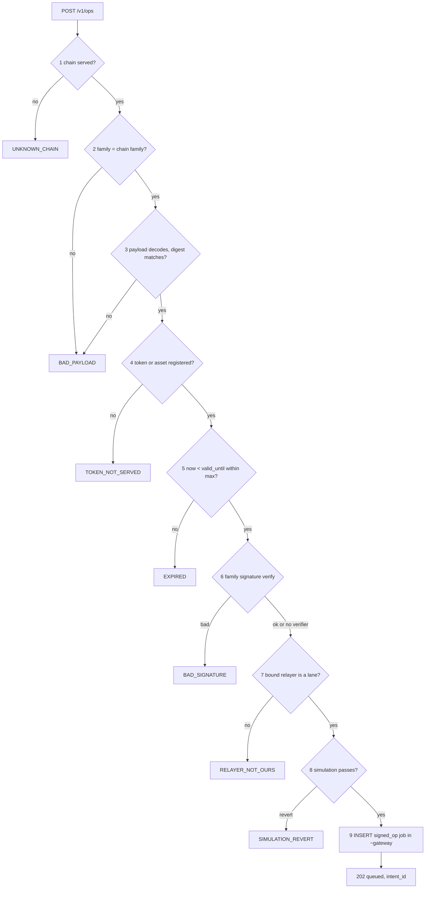

# Gateway (door A)

The gateway is the node's public intake: anyone — a wallet, the console app, a partner, an agent — may post a signed
meta-transaction, a signed family op, a UA meta-transaction or a DEX order. It is served on `[modules] gateway_bind`
(default `127.0.0.1:8547`, normally behind a reverse proxy). Status: `/v1/metatx` (EVM) and `/v1/dex/*` **BUILT**;
durable door-A jobs, `/v1/gateway`, `/v1/ops`, UA routes, CORS and the error contract **SPECIFIED**.

**Contents**

1. [Auth](#auth)
2. [CORS](#2-cors)
3. [Routes](#routes)
   - 3.1 [UA record cache](#31-ua-record-cache)
   - 3.2 [Chain binding](#chain-binding)
   - 3.3 [EIP-7702](#eip-7702)
4. [Intake](#4-intake)
5. [Errors](#errors)

## <a id="auth"></a>1. Auth

<a id="auth"></a><a id="NODE-GW-02"></a>**NODE-GW-02** — **Gateway auth is `none`, `bearer` or `hmac`** (`bearer|hmac` off loopback)
(`[modules] gateway_auth = "none" | "bearer" | "hmac"`; secret from `gateway_secret_env`, ≥ 16 bytes). `bearer`:
`Authorization: Bearer <secret>`, compared in constant time. `hmac`: `X-Scaas-Timestamp` + `X-Scaas-Signature =
hex(HMAC-SHA256(secret, ts ‖ "." ‖ nonce ‖ "." ‖ METHOD ‖ " " ‖ path?query ‖ "\n" ‖ body))`, clock skew ≤ 300 s,
`X-Scaas-Nonce` (header names are case-insensitive: `X-SCaaS-Nonce` is the same; `[A-Za-z0-9_-]{1,64}`) remembered until its own timestamp expires (ts + 300 s), so nothing replays;
method and path are in the signed string, so a signature for one route is useless on another. **`none` is refused when
the bind is not loopback** (a config error fails fast). Every decoder of untrusted input (`WireMetaTx::to_sol`, the
gateway body, job payloads, every family adapter's decoder — BCS/XDR/protobuf/BOC) has `proptest` fuzz tests
(dev-dependency): no panic, every error is an `Err`. The job API extends the `hmac` mode with per-namespace key ids
([NODE-JOB-05](job-api.md#NODE-JOB-05)).

Limits: body 64 KiB (1 MiB on the PQZ chain profile only; `POST /v1/ua/register` 160 KiB: a PQZL holder registration with its proof and KEM key is ≈ 51–67 KB binary (largest: a PQ `msig` at `n2816-kmax65536`, 66.8 KB), ≈ 103–134 KB as hex, and PQZH proofs of ≈ 187 KB register directly, not through the gateway); a global concurrency limit (`tower`
`ConcurrencyLimitLayer`, default 32) because every request costs a simulation; a per-IP rate limit at the reverse
proxy in front of an open gateway ([runbooks.md#production-gates](runbooks.md#production-gates)).

## 2. CORS

<a id="cors"></a><a id="NODE-GW-04"></a>**NODE-GW-04** — **Gateway CORS only with gateway auth `none`.**
`[modules] gateway_cors_origins`: exact list, no `*`, no reflection, methods `GET, POST`, header `Content-Type`, no
credentials, `max_age = 600`. `Config::validate` refuses a non-empty `gateway_cors_origins` when the gateway auth is
`bearer` or `hmac`: the CORS profile allows only `Content-Type`, so a preflight would refuse `Authorization` and
`X-Scaas-*` anyway. Browser apps use an unauthenticated gateway behind a host proxy
([CLI-APP-03](../clients/app.md#CLI-APP-03)).

## <a id="routes"></a>3. Routes

<a id="routes"></a><a id="NODE-GW-05"></a>**NODE-GW-05** — **The gateway announces what it serves, allows exact-origin
CORS and answers with one error contract.** `GET /v1/gateway` lists the served chains, tokens, fee recipient, DEX
address, relayer and order policy; without it a client cannot sign a bound DEX order, show the fee recipient, or reach
the gateway cross-origin. Every gateway route keeps the auth mode, the 64 KiB cap, `gateway_cors_origins` (auth `none`
only) and the error contract ([errors](#errors)).

`GET /v1/gateway` (gateway listener, gateway auth applies):

```json
{"api": 1, "chains": [
  {"chain": 100, "chain_key": "evm:100", "family": "evm", "routes": ["metatx", "dex"],
   "tokens": ["0x…"], "fee_recipient": "0x…", "breaker_open": false,
   "max_valid_for_secs": 3600,
   "dex": {"address": "0x…", "relayer": "0x…", "markets": [{"id": 1, "min_base_amount": "1000"}],
           "relayer_fee_policy": {"modes": [0, 1, 2], "max_ppm": 10000},
           "max_open_per_maker": 50, "min_ttl_secs": 5, "max_ttl_secs": 2592000}}]}
```

Shape: `{"api": 1, "chains": [{chain, chain_key, chain_uid?, family, routes, tokens, fee_recipient, breaker_open,
max_valid_for_secs, dex?: {address, relayer, markets: [{id, min_base_amount}], relayer_fee_policy: {modes, max_ppm},
max_open_per_maker, min_ttl_secs, max_ttl_secs}}]}`. `chain` is numeric for EVM and Hedera (the `/v1/metatx` body);
`chain_key` is always present. `routes` ⊆ `metatx`, `ops`, `ua-metatx`, `ua-register`, `dex`. `chain_uid` is present
for chains with a UA registry; clients compare it with the EIP-712 `salt` before signing; UA routes are listed only
while the [chain binding](#chain-binding) holds. Target (SPECIFIED): `chain_uid` is present for every EVM and Hedera
chain (every SCaaS domain carries it as `salt`, [NET-ALL-22](../networks/README.md#NET-ALL-22)); `dex.address`
becomes `dex.addresses`, the chain profile's DEX list ([NET-ALL-24](../networks/README.md#NET-ALL-24)), with the
venue's own DEX first; `relayer_fee_policy` disappears (the relayer is paid its share of the signed DEX fee,
[dex-venue.md#trade-orders](dex-venue.md#trade-orders)). A client checks both against its **own** pinned profile,
never against this answer alone ([CLI-SGN-33](../clients/signers-clientkeys.md#CLI-SGN-33),
[CLI-SGN-35](../clients/signers-clientkeys.md#CLI-SGN-35)).

Unlike the job API, gateway doors **simulate before INSERT**. An accepted item is a `~gateway` job (origin key = node
digest = `intent_id`, [NODE-JOB-02](job-api.md#NODE-JOB-02); intake steps 3, 6 and 7a–7c and the in-transaction
authority re-check of [job-api.md#intake](job-api.md#intake) apply) answered `202 {"status": "queued", "intent_id"}`.
A duplicate returns `200` with the stored state (idempotent).

| Route | Body / answer | Accept checks, in order |
|---|---|---|
| `GET /v1/gateway` | above | — |
| `POST /v1/metatx {chain, token, struct?, m, signature}` (`struct` = `call` \| `transfer`, default `transfer`; [CTR-MTX-15](../contracts/metatx.md#CTR-MTX-15)) | `202 {"status":"queued"}` today; the target adds `"intent_id"` (+ `exclusive` when published on the mesh) | token registered and active (`TOKEN_NOT_SERVED`); strict parse; normalization ([NODE-LANE-10](submit-lanes.md#NODE-LANE-10)) before simulation; the lanes' guard: chain binding, `data` shape and selector ([NODE-JOB-20](job-api.md#NODE-JOB-20)), refused ⇒ `400`; simulation, then `mtxDigest` / `mtxTransferDigest`; [door A rules](#door-a-intake). On Hedera chains (295–298) `sig_bytes` may be **64** bytes (HIP-632 ED25519); 65–2048 bytes elsewhere |
| `POST /v1/ops {chain, op}` | `op` = the job API `signed_op` payload; `202 {"status": "queued", "intent_id": "<digest hex>"}` | below |
| `POST /v1/ua-metatx {chain, token, struct?, m: WireUAMetaTransaction \| WireUAMetaTransfer, auth}` | `ua_metatx` job | token `features ∋ ua` (v3: `registry() ≠ 0`); `from >> 160 ≠ 0` ⇒ registry record ([UA record cache](#ua-cache), `UA_NOT_REGISTERED`); cheap kinds verified locally ([NODE-GSP-15](gossip.md#NODE-GSP-15)); node computes `uaDigest` |
| `POST /v1/ua/register {chain, kind, keyData, attrs?, pop, pqzPop?}` (`{chain, kind, keyData: 0x…, attrs: {pqzKey?: 0x…, pqzPopHash?: 0x…, kemVersion?: n, kemPk?: 0x…}, pop: 0x…, pqzPop?: 0x…}`; the PQZ and KEM attributes only for a PQ holder, [CTR-UA-16](../contracts/accounts.md#CTR-UA-16), [CTR-UA-32](../contracts/accounts.md#CTR-UA-32); `pqzPop` may be omitted and given later by a `storePqzPop` call job) | `call` job to `chain.ua_registry` ([NODE-GW-03](#NODE-GW-03)); a PQ registration whose full-call estimate exceeds min(block gas limit, relayer cap) is relayed split: `register` without the proof, then `storePqzPop` | id recomputed, `>> 160 ≠ 0`; not registered (`UA_ALREADY_REGISTERED`, `UA_KEY_IN_USE`); the node recomputes `h = keccak256(GROUP(pqz-mlwe) ‖ pqzKey)` and the KEM record hash and verifies the PoP of cheap kinds over the portable `registrationDigest` ([CTR-UA-07](../contracts/accounts.md#CTR-UA-07): no `chain_uid` in it); it never verifies `R_REG` locally (simulation does); body limit 160 KiB; per-chain registration quota |
| `GET /v1/intents/{intent_id}` | the `~gateway` job: `{"intent_id", "state", "consumed_kind"?, "tx_hash"?, "updated_at"}` | **only for gateway-origin rows**: rows from peers or from the job API (incl. private-chain intents) answer 404, the same as unknown or expired ids |
| `POST /v1/dex/orders`, `…/cancel`, `…/cancel-all`; `GET /v1/dex/{markets,depth,trades,ticker,orders}` (`GET /v1/dex/orders?maker=`), `GET /v1/dex/exchanges/{ref}` (SPECIFIED) | [dex-venue.md#routes](dex-venue.md#routes) | managed markets add `NOT_ELIGIBLE {reason}`, `UNBOUND_FORBIDDEN`, `FEE_FORBIDDEN`, `PAUSED`, `ATTESTATION_SHORTER`; mesh `route_order` ⇒ `MANAGED_LOCAL` ([dex-venue.md#managed-markets](dex-venue.md#managed-markets)) |
| `GET /v1/dex/depth?scope=network`, `GET /v1/dex/homes` | network depth and DEX homes ([dex-venue.md#gossip](dex-venue.md#gossip)) | — |

`POST /v1/ops` (six non-EVM families):

```json
{"chain": "sui:testnet",
 "op": {"family": "sui", "contract": "<account id | token | registry, family canonical>",
        "from": "<subject, family canonical>", "op_kind": "pay",
        "payload": "0x<MetaOp bytes / XDR / BOC, as the family encoder builds>",
        "signature": "<packSignature().signature>", "public_key": "<packSignature().publicKey | null>",
        "auth_kind": "seed | wallet | passkey", "digest": "0x… (optional; must equal the node's)",
        "valid_until": 1790000300, "extra": {"coin_type": "0x2::sui::SUI"}}}
```

`op` is exactly the `signed_op` payload of a job and what every adapter's `build` consumes; `op.family` must be the
chain's. Accept checks, in order:



In words:

1. `chain` is served (`UNKNOWN_CHAIN`).
2. `family` equals the chain's family (`BAD_PAYLOAD`).
3. The payload decodes; the node computes the digest; a client digest that differs fails (`BAD_PAYLOAD`).
4. The token or asset is registered (`TOKEN_NOT_SERVED`).
5. `now < valid_until ≤ now + max_valid_for_secs` (`EXPIRED`).
6. The family signature verify, where the node has one (`BAD_SIGNATURE`). A verifier that returns `None` (the key is
   not the payer's) goes on to simulation, which arbitrates ([NET-ALL-14](../networks/README.md#NET-ALL-14)).
7. A bound relayer must be a lane of the chain (`RELAYER_NOT_OURS`).
8. Simulation (`SIMULATION_REVERT`).
9. INSERT a `signed_op` job in `~gateway`, origin key = digest (G2 durable).

Soroban: accepted, never published on the mesh ([NODE-MESH-07](mesh.md#NODE-MESH-07)). GRAM: `attach_nanoton` is the
node's. Limits: 64 KiB body, the per-chain breaker and the gateway concurrency limit. `/v1/ops` needs lanes that lease
from the store: before that, the built gateway's in-memory `mpsc` feeds only the EVM submitter (Transitional (BUILT):
door A work is not journaled and has no digest guard until it becomes a `~gateway` job).

<a id="ua-register"></a><a id="NODE-GW-03"></a>**NODE-GW-03** — **Gateway `call` jobs exist only for the UA
registry's four writes.** Gateway `call` jobs in `~gateway` go only to the chain's `ua_registry` (node config `[[chains]] ua_registry`), for the four
UA-8 writes `register` (`0x0c936361`), `setKemKey` (`0x2d21c58e`), `storePqzPop` (`0x7fac161a`) and `setPqzKey`
(`0xbde71760`) — all relayable by anyone, gasless, no fee ([CTR-UA-31](../contracts/accounts.md#CTR-UA-31)); `POST
/v1/ua/register` builds the `register` calldata from the checked body. A relayed PQ registration whose `eth_estimateGas`
of the full call exceeds min(block gas limit, relayer per-transaction cap) is split: `register` without `pqzPop`, then
`storePqzPop` (the SCaaS testnet: 200 M block, relayer cap `max_gas_per_tx` 64 M, so every PQ registration with its
proof, 84.8–109.1 M, is relayed split there). Owner 2026-10-30, ruling R-node: the node relays all four writes (call
table rows, guard rule `Rule::UaRegistry`; a relayed `register` with its proof over the cap is refused `UA_REGISTER_SPLIT: <why>;
send register without pqzPop, then storePqzPop`) and the sponsor policy below covers all four; the call-table rows and the refusal
are built on `ua8` (`64c233d4`); **this route and the sponsor policy are not built** (no gateway route, no sponsor-policy code;
`TODO.md`), so relaying goes through job-API `call` jobs today. It is a gateway
capability, not an `allow_call` grant ("gateway capability, not a namespace grant") ([NODE-JOB-09](job-api.md#NODE-JOB-09) is unchanged for namespaces);
`job_live_call` dedupes retries; every registration lives in `~gateway`, so the per-namespace index
([NODE-JOB-13](job-api.md#NODE-JOB-13)) dedupes them node-wide. Sponsored registration spam is bounded by the per-chain
registration quota and the sponsor budget; the one `~gateway` `call` sponsor policy shape allowed is `contract =
chain.ua_registry` (node config `[[chains]] ua_registry`), `selector` ∈ {`register`, `setKemKey`, `storePqzPop`, `setPqzKey`}, `max_tx_per_payer_hour = 0`
([sponsorship.md#admin](sponsorship.md#admin)). The universal-account migration uses this route
([contracts/accounts.md#migration](../contracts/accounts.md#migration)).

### 3.1 UA record cache

<a id="ua-cache"></a>Per chain, `recordOf(from)` (the record and the PQZ key pointer, 0 = none) is read once from `chain.ua_registry`; records are immutable, so hits
stay in memory with no expiry and misses for 60 s; cheap kinds (webauthn-p256, p256, ed25519, bip340, schnorr-bn254)
are verified with the shared Rust kind library, the rest by simulation. No store table. Config per chain:
`ua_registry` address and generation; enabled kinds are read from the chain at onboarding. The node never holds UA
keys; lane keys are unaffected.

### <a id="chain-binding"></a>3.2 Chain binding

<a id="chain-binding"></a><a id="NODE-GW-07"></a>**NODE-GW-07** — **Every SCaaS contract the node relays for is bound
to the chain's `chain_uid`.** Status: **SPECIFIED**. At chain activation, at every start and on every RPC (re)connect, the node checks that the RPC's genesis
block hash (EVM/Hedera: block 0, from ≥ `finality_quorum` endpoints) equals `chain.chain_uid`, and that every
registered SCaaS contract of the chain has code and a `chainUid()` equal to `chain.chain_uid`: each registered token
implementation and the factory, every `chain_contract` row (DEX, account factory, tender, role-holder contracts that
sign with a SCaaS domain) and `ua_registry`.

A token clone needs no own check — it runs its implementation's code and
the factory registers only implementations whose `chainUid()` equals its own. Contracts deployed per user —
`MandateWallet`, `SmartKeyAccount` — are read once before the node relays anything for them (cached; a mismatch ⇒
`403 CALL_TARGET_REFUSED`, [NODE-JOB-19](job-api.md#NODE-JOB-19)). Non-EVM families compare the family's network id
where the RPC exposes it (Soroban network id, Solana genesis hash), else trust the profile constant
([NET-ALL-22](../networks/README.md#NET-ALL-22)). A mismatch of the genesis hash or of a chain-wide contract holds the
chain (readiness reason `chain_uid mismatch`, as `finality violated`): nothing is leased, UA routes answer
`UNKNOWN_CHAIN`.

Every EIP-712 domain `salt` the node computes (token, subject account, mandate wallet, DEX, registry),
and the `metatx-cancel` digest use `chain.chain_uid`, never the chain id alone (the registration PoP is portable and has no chain in it). The post-quantum Zether
chain profile adds the same binding for its registry and tokens (RPC genesis hash `==` profile `genesis_hash` `==`
`registry.chainUid()` `==` each token's `chainUid`, [ops.md#pqz](ops.md#pqz)). Why: a contract cannot read its own
genesis hash after block 256, so a wrong constructor value is caught only off chain; a wrong value makes correct
signatures fail, and is unsafe only if it equals another chain's `chain_uid`, which the comparison with the RPC's
genesis hash excludes. Cost: one `chainUid()` read per contract at start, and one per user-deployed wallet or
account.

Built (P5, legacy pull path): a lane does not start when the RPC's block 0 differs from `[[chains]] chain_uid` (unset:
block 0 is the `chain_uid`); every contract a meta-transaction, order entry or `call` targets is checked at lease
(`chainUid()`, cached once equal; a mismatch is `dead` with `CHAIN_UID_MISMATCH`). The multi-endpoint quorum is not built.

### <a id="eip-7702"></a>3.3 EIP-7702

<a id="eip-7702"></a>An EIP-7702 delegated `from` (code `0xef0100 ‖ address`) is an EOA: only its own key's ECDSA
counts, never ERC-1271 through its delegate ([CTR-UA-24](../contracts/accounts.md#CTR-UA-24), owner ruling D1,
2026-10-30). The node does not read a `from`'s code at accept. In code today:
- `POST /v1/metatx` runs no local signature check: it simulates the call, and the contracts refuse a designator's
  signature that does not recover (`MetaTxBadSignature` ⇒ `400 simulation: …`); a recovering one passes as for any EOA.
- The mesh check (`check_evm`) is synchronous and has no chain access: `sig_kind = "eoa"` ⇒ a local low-s `ecrecover ==
  from` (`BAD_SIGNATURE` otherwise), `"erc1271"` ⇒ no local check, left to simulation, which refuses a designator `from`.
- The `~gateway` sponsor-policy door's local `BAD_SIGNATURE` check ([sponsorship.md#evaluation](sponsorship.md#evaluation))
  is not built; when built, a designator `from` whose signature does not recover is `BAD_SIGNATURE`.
- The DEX venue's `valid_sig` reads the signer's code and takes a designator by its key only
  ([dex-venue.md](dex-venue.md#oog-pairs)); the gas guard gives a designator payer no ERC-1271 gas floor (`Chain::is_contract_at`,
  `guard::gas`).

## 4. Intake

<a id="intake"></a><a id="door-a-intake"></a><a id="NODE-GW-01"></a>**NODE-GW-01** — **Door A is not a free gas
faucet.** At gateway intake: (a) a `transfer`/`pay` op with `value == 0` ⇒ `422 ZERO_VALUE`; (b) the `~gateway` door
applies its `min_fee` floor (the mesh policy row's `min_fee`, [mesh.md#acceptance](mesh.md#acceptance)) to the
**effective** fee; a matching sponsor policy waives it and caps the spend with its budget
([NODE-SPN-01](sponsorship.md#NODE-SPN-01)); (c) defaults: `profile = private` keeps fee 0 (the B2B default),
`profile = public` refuses fee-0 door-A intents unless a sponsor policy matches; (d) a per-`from` token bucket
(default 60 per hour, in memory) on top of the reverse-proxy per-IP limit.

The hourly gas budget
([NODE-LANE-05](submit-lanes.md#NODE-LANE-05)) can then not be filled by unsponsored fee-0 traffic on public chains;
public fee-0 payers need a sponsor policy row. Every door also applies
[NODE-MESH-16](mesh.md#NODE-MESH-16), the node-wide grief score [NODE-LANE-15](submit-lanes.md#NODE-LANE-15) and
[NODE-LANE-16](submit-lanes.md#NODE-LANE-16)–[NODE-LANE-18](submit-lanes.md#NODE-LANE-18). Tests: `value == 0` ⇒
`ZERO_VALUE`; fee 0 on a `public` chain refused without a matching sponsor policy, accepted and booked with one; the
61st intent from one `from` within an hour refused.

The node may refuse fees below its floor; with a fee-taking intent whose `feeRecipient` is **not** bound, whoever
submits takes the fee — that is the open-relayer design (the signer binds the recipient to prevent it).

## <a id="errors"></a>5. Errors

<a id="errors"></a><a id="NODE-GW-06"></a>**NODE-GW-06** — **The gateway error contract is stable.** Every gateway route
(incl. `/v1/dex/*`, `/v1/ops`, `/v1/ua/*`) answers errors as `{"error": "<CODE>", "code": "<CODE>", "detail": "<≤ 300
chars>", "revert_data": "0x…"?}`; the legacy `"error"` keeps the code, so old clients still read a string. Codes:
`UNKNOWN_CHAIN`, `TOKEN_NOT_SERVED`, `BREAKER_OPEN`, `SUBMIT_BUSY`, `EXPIRED`, `BAD_SIGNATURE`, `BAD_PAYLOAD`,
`RELAYER_NOT_OURS`, `SIMULATION_REVERT` (raw `0x…` revert data), `RPC_UNAVAILABLE`, `QUOTA`, `ZERO_VALUE`,
`SUBJECT_DENIED`, `SPONSOR_BUDGET`, `SPONSOR_RATE`, `SPONSOR_TOO_SHORT`, `UA_NOT_REGISTERED`, `UA_ALREADY_REGISTERED`,
`UA_KEY_IN_USE`, `VALUE_OUT_TOO_HIGH`, `DEPOSIT_NOT_ALLOWED`, `SUBJECT_THROTTLED` (with `retry_after`), (SPECIFIED) `SELECTOR_NOT_ALLOWED`
([NODE-JOB-20](job-api.md#NODE-JOB-20)), `DEX_NOT_LISTED` and `FEE_TOO_LOW`
([dex-venue.md#trade-orders](dex-venue.md#trade-orders)), and the
managed-market codes above. Clients decode revert data with their own ABI and map codes (the console app maps
`errors.node.<code>`); no logic keys on free text. The gateway and the job API keep per-listener code sets over the same checks (gateway
`TOKEN_NOT_SERVED` and `EXPIRED` for too long a validity, job API `UNKNOWN_TOKEN` and `VALID_TOO_LONG`).
