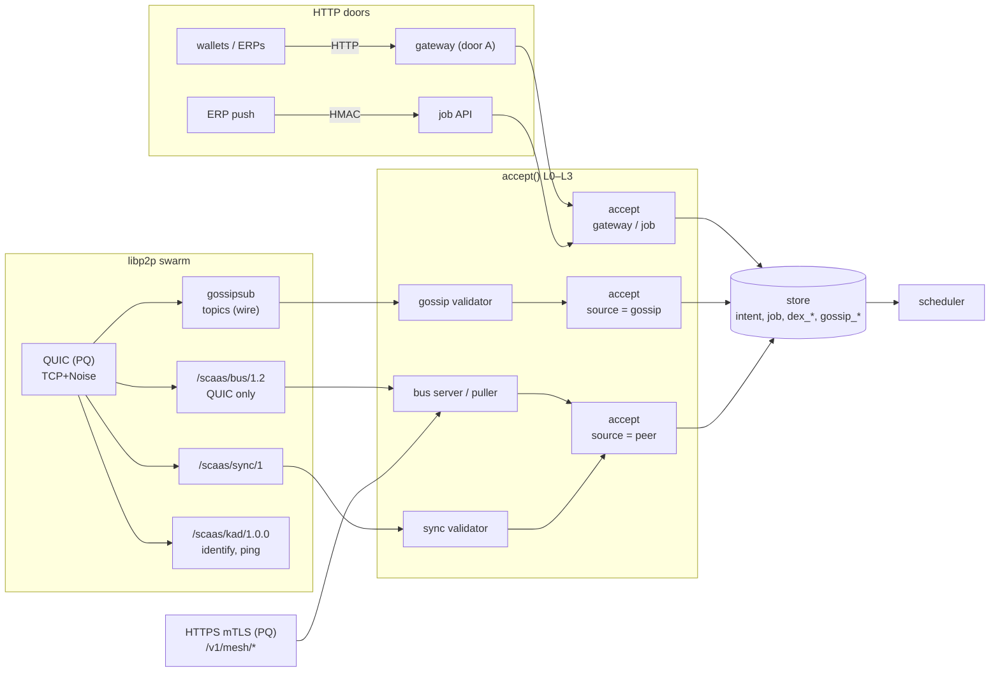

# Gossip

The open mesh: nodes that have not admitted each other exchange public intents, landed hints, DEX book traffic and
node announces over libp2p gossipsub. It feeds the same pipeline as the pull bus ([mesh.md](mesh.md)). Status: all
**SPECIFIED** (the envelope library it reuses is BUILT; the node has no TLS server, QUIC, Noise or libp2p yet, only an
outbound rustls client).

**Contents**

1. [Scope](#scope)
2. [Architecture](#architecture)
3. [Transport](#transport)
4. [Identity](#identity)
5. [Names](#5-names)
6. [Wire](#wire)
   - 6.1 [Sync](#61-sync)
7. [Validation](#validation)
8. [Numbers](#numbers)
   - 8.1 [Discovery](#81-discovery)
9. [Intents](#intents)
   - 9.1 [Exclusivity](#91-exclusivity)
   - 9.2 [Scoring](#92-scoring)
10. [Hints](#hints)
11. [Announce](#announce)
12. [Private isolation](#private-isolation)
13. [Crates](#13-crates)
14. [Tests](#tests)
15. [Limitations](#limitations)

## <a id="scope"></a>1. Scope

<a id="scope"></a><a id="NODE-GSP-01"></a>**NODE-GSP-01** — **Gossip is required alongside the pull bus.** The pull bus
is no longer "transport v1, libp2p later"; it is the **admitted-peer** transport (consortium/private); libp2p gossipsub v1.1 is the **open-mesh** transport. Same
envelope, same store, same `accept()`, same dedup/tombstones, same policy table. Admission on the open mesh = scoring +
limits ([NODE-GSP-08](#NODE-GSP-08)), not an allowlist. The model is an open relayer mesh in the style of 0x-mesh:
validate before forwarding, any relayer may race to land. The pull bus keeps what gossip cannot give: cursor catch-up
and a single export function for private data. Two transports to operate, behind one pipeline.

In scope:

1. **Three carriers, one pipeline.** (a) libp2p **QUIC** (default), (b) libp2p **TCP + Noise + yamux**, (c) the
   **HTTPS mTLS pull bus**. Gossip (open mesh) runs over (a)/(b); the pull bus runs over (c) **and** over (a) as a
   libp2p request-response protocol carrying the same pages ([NODE-GSP-02](#NODE-GSP-02)). All carriers feed the same
   `accept()`, the same store, the same dedup, the same scheduler.
2. **Four gossip payloads**: intents (`scaas-intent/1.2` envelopes), landed hints, DEX book traffic (orders, cancels,
   book state), node announces.
3. **Open admission**: Kademlia discovery + bootstrap list, gossipsub v1.1 peer scoring, graylist/ban, per-peer and
   per-origin rate limits replace the allowlist **for the open mesh only**; the allowlist (SPKI pins) stays for the pull
   bus.
4. **Anti-entropy** for late joiners and healed partitions (`/scaas/sync/1`, [NODE-GSP-13](#NODE-GSP-13)).
5. **PQ key exchange** on QUIC and HTTPS; Ed25519 authentication everywhere ([NODE-GSP-03](#NODE-GSP-03)).
6. Admin API, metrics and app screens for gossip ([NODE-ADM-01](admin-auth.md#NODE-ADM-01)).

Non-goals:

| Out | Why |
|---|---|
| Private-visibility or private-chain data on any gossip topic | [NODE-MESH-06](mesh.md#NODE-MESH-06)/[NODE-MESH-12](mesh.md#NODE-MESH-12) unchanged; [private isolation](#private-isolation) proves it |
| Private gossip topics among a consortium | gossipsub re-forwards to any subscriber; origin-only serving cannot hold. Consortium exchange is the pull bus, over HTTPS or QUIC |
| NAT traversal (relay v2, DCUtR, AutoNAT), mDNS, WebRTC/WebTransport, browser nodes | nodes are servers; a NAT'ed node is a DHT client with outbound connections only. Wallets use the gateway |
| Gossipsub peer exchange (PX) | discovery is Kademlia; PX is an eclipse vector with no gain here |
| Rewards, stake, PoW, lottery | [NODE-MESH-05](mesh.md#NODE-MESH-05) unchanged; scoring is a network control, not an economy |
| Zether intents on gossip | needs `W = 0` + single-flight design; gossip removes only the latency objection |
| Cross-home matching of **home-bound** orders | a bound order is settled only by its home; network-wide liquidity is the per-market **relayer-unbound** mode ([dex-venue.md#gossip](dex-venue.md#gossip)) |
| ML-DSA / hybrid signatures | libp2p has no ML-DSA key type; seam only ([NODE-GSP-03](#NODE-GSP-03)) |
| Compression (snappy) of gossip payloads | ≤ 32 KiB messages at ~10 msg/s; decompression bombs are a cost with no gain |

## <a id="architecture"></a>2. Architecture

<a id="architecture"></a>



- `accept()` runs the acceptance levels L0–L3 ([mesh.md#acceptance](mesh.md#acceptance)) for every source.
- The swarm carries gossipsub, `/scaas/bus/1.2` (QUIC only), `/scaas/sync/1` and `/scaas/kad/1.0.0`, identify, ping over QUIC (PQ) or TCP+Noise; the bus also runs over HTTPS mTLS (PQ) on `/v1/mesh/*`.
- Store tables: intent, job, `dex_*`, `gossip_*`; the scheduler reads the store.
- Publishers: `may_export` (bus) · `may_gossip` (gossip + sync) — the only two exits.

`src/mesh/` keeps the transport-neutral parts; `src/gossip/` holds the swarm task, validator, scoring glue, announce,
hints, sync and the DEX replica. The swarm runs in **one tokio task** that owns the `Swarm`; every store or RPC call it
needs goes through `spawn_blocking`/a bounded channel, so the event loop never blocks on I/O
([NODE-GSP-07](#NODE-GSP-07)).

```toml
[identity]
key = { file = "/etc/scaas/node.key" }      # Ed25519 PKCS#8 PEM (NODE-GSP-05); SecretSource like [keys]

[transport]
quic  = true                                # default carrier (NODE-GSP-02)
tcp   = true                                # TCP + Noise + yamux, open-mesh gossip only
https = true                                # pull bus on [mesh] bind

[mesh]                                      # pull bus (store.md#config-file)
bind = "0.0.0.0:8550"
cert = "/etc/scaas/mesh.crt"                # self-signed X.509 holding [identity] key

[gossip]
enabled = true
listen   = ["/ip4/0.0.0.0/udp/4001/quic-v1", "/ip4/0.0.0.0/tcp/4001"]
external = ["/dns4/node.example.net/udp/4001/quic-v1"]   # announced + DHT server mode; empty = DHT client
bootstrap = ["/dns4/boot1.example.net/udp/4001/quic-v1/p2p/12D3KooW…"]
direct = []                                 # explicit gossipsub peers (multiaddr with /p2p/), e.g. partners
allow_private_addrs = false                 # network-learned addresses only (NODE-GSP-09)
max_established = 50                        # in 30, out 20 (numbers)
```

All other numbers of [numbers](#numbers) have defaults in code and are overridable under `[gossip.limits]` /
`[gossip.score]`. Toml-only ([NODE-STO-03](store.md#NODE-STO-03)): `[identity]`, `[transport]`, `[gossip]`
listen/external/bootstrap/direct/allow_private_addrs. Hot from the store: per-chain/per-policy/per-market `gossip`
switches, `exclusive_ms`, `gossip_trusted`, bans.

## <a id="transport"></a>3. Transport

<a id="transport"></a><a id="NODE-GSP-02"></a>**NODE-GSP-02** — **Carriers are selectable in `[transport]`**: `quic`
(default on), `tcp` (Noise, default on), `https` (default on). Open-mesh gossip runs on `quic` and `tcp`. The pull bus
runs on `https` **and** on `quic` as request-response protocol `/scaas/bus/1.2` with the same two operations
(`policy`, `intents?since`) and the same `may_export`. **Admitted peers (any class) are served only over `https` or
`quic`, never over a TCP+Noise connection** — the bus handler refuses (`TRANSPORT_NOT_PQ`) on a TCP connection. Putting
the bus over QUIC (not over gossip topics) keeps origin-only serving and the cursor discipline; one connection per peer
serves both bus and gossip. A partner without QUIC/UDP egress uses HTTPS.

<a id="NODE-GSP-03"></a>**NODE-GSP-03** — **PQ key exchange, classical identity, one crypto library** (replacing the earlier "ring provider
explicit, no aws-lc-rs" choice; the ring provider has no ML-KEM group). One
process-wide rustls `CryptoProvider` = **`aws-lc-rs`** with **X25519MLKEM768** (codepoint `0x11EC`); installed once at
start and passed explicitly to every rustls builder. **QUIC and the HTTPS bus offer only X25519MLKEM768** (no classical
group: a QUIC/HTTPS connection is PQ by construction). TCP+Noise (XX, X25519) is classical and carries **only**
open-mesh gossip, i.e. data that is public by definition. Identity and every signature stay **Ed25519**: PQ here
protects **confidentiality against harvest-now-decrypt-later only**; a future quantum adversary could forge identities
*live*, not retroactively. Seam: every new signed message names its algorithm in its domain tag ([wire](#wire)) and the
announce reserves `pq_pubkey`. `aws-lc-rs` is also the node's JWS verification library
([NODE-ADM-03](admin-auth.md#NODE-ADM-03)): one crypto library node-wide (rustls ≥ 0.23.27 ships the hybrid group in
`aws-lc-rs`; ring has no ML-KEM). Two providers compiled in make `ServerConfig::builder()` panic, so every config is
built with `builder_with_provider`. `aws-lc-sys` is C + cmake: one long first build; a third-party node must speak
X25519MLKEM768 on QUIC or fall back to TCP (open mesh only).

| Carrier | Default | Key exchange | Carries |
|---|---|---|---|
| libp2p QUIC (`/ip4/…/udp/4001/quic-v1`) | on | **X25519MLKEM768 only** (codepoint `0x11EC`), rustls provider `aws-lc-rs` | gossip, sync, Kademlia, bus `/scaas/bus/1.2` |
| libp2p TCP + Noise XX + yamux | on | X25519 (classical) | open-mesh gossip, sync of public data, identify, ping, Kademlia — **never** bus or private data |
| HTTPS mTLS bus (`[mesh] bind`, default `0.0.0.0:8550`) | on | **X25519MLKEM768 only** | bus `/v1/mesh/*` |

- `rustls = { version = "0.23.27+", default-features = false, features = ["aws_lc_rs", "prefer-post-quantum", "std",
  "logging"] }`. `tls12` stays compiled in (hyper-rustls/reqwest enable it additively; RPC endpoints may need 1.2); the
  bus and QUIC configs pin `with_protocol_versions(&[&rustls::version::TLS13])`. At start, **before any alloy provider
  or reqwest client is built**: `rustls::crypto::aws_lc_rs::default_provider().install_default()`; every bus/QUIC
  config is built with `builder_with_provider(provider_pq())` where `provider_pq()` = the aws-lc-rs provider with
  `kx_groups = vec![X25519MLKEM768]`.
- **HTTPS bus** (server and client): `provider_pq()`. A client without the hybrid group fails the handshake
  (`HandshakeFailure`). Metric `scaas_tls_handshake_failures_total{listener="mesh",reason}`.
- **QUIC** (libp2p-quic → quinn → rustls via libp2p-tls): `provider_pq()` on both sides. **Verify at build start**:
  whether `libp2p-tls` in the pinned version builds its rustls configs from a caller-supplied provider. If it hardcodes
  `rustls::crypto::ring::default_provider()`, then, in order of preference: (a) a `libp2p-quic` config hook that
  accepts our `QuicClientConfig`/`QuicServerConfig`; (b) `[patch.crates-io] libp2p-tls = { path =
  "vendor/libp2p-tls" }` switching the provider, the cipher-suite imports and the crate's rustls feature line (small,
  but more than one line; upstream PR opened in parallel); (c) a custom QUIC transport wrapping quinn with the
  libp2p-TLS verifier. The QUIC part is not done until a test asserts the negotiated group on a QUIC connection —
  through quinn's `handshake_data()`/rustls `negotiated_key_exchange_group()` if exposed, otherwise by a classical-only
  client that must fail to connect.
- **Verify** that feature resolution leaves exactly one rustls provider feature in use: `cargo tree -e features -i
  rustls` shows `aws_lc_rs`; `reqwest` uses **`rustls-tls-webpki-roots-no-provider`** (picks the installed default
  provider; plain `rustls-tls-no-provider` has no root store and would break every `https://` RPC call); `quinn-proto`
  uses its aws-lc-rs feature; alloy's `reqwest` feature does not re-enable `reqwest/rustls-tls`. The `ring` crate may
  remain in the lock as a library (e.g. quinn token/reset keys); what is forbidden is a second rustls provider in use.
- **TCP + Noise**: XX handshake, X25519, ChaChaPoly — classical. Allowed only for gossip, sync of public data,
  identify, ping and Kademlia. The bus handler checks `ConnectedPoint`'s transport and refuses on TCP.
- PQ costs: the hybrid ClientHello is ~1.2 KiB larger (ML-KEM-768 share 1 184 B); on QUIC the Initial spans two
  packets. Irrelevant at our connection rates.
- **Limit (stated)**: authentication (TLS certs, Noise binding, `hub.sig`, announces) is Ed25519. PQ here defends
  recorded traffic, not live impersonation by a future quantum adversary. Upgrade path: an announce field `pq_pubkey`
  (ML-DSA-65) signed by **both** keys, then new domain tags `scaas-*/mldsa65/1` or hybrid `scaas-*/ed25519+mldsa65/1`
  for payload signatures and a `hub.alg` field in a 1.3 envelope minor. libp2p PeerIds stay Ed25519 until libp2p
  defines a PQ key type.

Consequence for the private profile: admitted peers (bus) are reachable only over carriers with a PQ-only offer (HTTPS,
QUIC). Private-chain and private-visibility rows travel only on the bus. Hence **every byte of private data on the wire
is under a hybrid ML-KEM key exchange.**

## <a id="identity"></a>4. Identity

<a id="identity"></a><a id="NODE-GSP-05"></a>**NODE-GSP-05** — **One node key** (Ed25519, 32-byte seed) is: the
`hub.sig` key, the self-signed TLS cert key of the HTTPS bus ([NODE-MESH-03](mesh.md#NODE-MESH-03)), the libp2p
identity (`PeerId` = identity-multihash of the protobuf Ed25519 public key; QUIC's libp2p-TLS cert and Noise
static-key signature are made with it). Config `[identity] key` (replaces the never-built `[mesh] key`). The canonical id everywhere in envelopes, store and admin API stays `peer_id =
SHA-256(SPKI DER)`; `PeerId ↔ peer_id` is a pure function of the public key. Config: `[identity] key`. One thing to
pin, one thing to rotate; an announce, a `hub.sig` and a gossip connection are attributable to the same operator
without a binding certificate. Compromise of the key = all three identities; rotation = new identity (new `peer_id`;
bus partners re-pin). The node identity key is separate from lane keys.

- Seed: `[identity] key` (PKCS#8 parsing as for the bus key). `libp2p::identity::Keypair::ed25519_from_bytes(seed)`.
- `peer_id = SHA-256(302a300506032b6570032100 ‖ pubkey)`; `PeerId` from the same pubkey. A received `PeerId` is
  converted by extracting the Ed25519 key from its identity multihash; a non-Ed25519 `PeerId` is refused at connection
  establishment (`handle_established_*_connection` returns a denial).
- `scaas-node mesh-id` prints `peer_id`, `PeerId` and the SPKI pin.

Signing contexts with the one key:

| Use | Signed bytes begin with | Defined by |
|---|---|---|
| TLS 1.3 `CertificateVerify` (HTTPS bus only; on QUIC it is signed by libp2p-TLS's ephemeral cert key, not ours) | 64 × `0x20` ‖ `"TLS 1.3, server/client CertificateVerify"` | RFC 8446 §4.4.3 |
| libp2p-TLS cert extension (QUIC: the identity key signs only this) | `"libp2p-tls-handshake:"` | libp2p TLS spec |
| Noise static-key binding | `"noise-libp2p-static-key:"` | libp2p Noise spec |
| `hub.sig` | `"scaas-hub/v1"` | [mesh.md#hubsig](mesh.md#hubsig) |
| announce / hint / dex book / dex head | `"scaas-announce/ed25519/1"`, `"scaas-hint/ed25519/1"`, `"scaas-dexbook/ed25519/1"`, `"scaas-dexhead/ed25519/1"` | [wire](#wire) |

All prefixes are distinct and none is a prefix of another, so no signature is valid in two contexts.

## 5. Names

<a id="names"></a><a id="NODE-GSP-04"></a>**NODE-GSP-04** — **Wire names use `scaas` and topics use the `chain_key`**:
envelope `scaas-intent/1.2`, `hub_msg` domain tag `scaas-hub/v1` (12 bytes), protocol ids `/scaas/…`, topics below,
env `SCAAS_*`, metrics `scaas_*`, store/key paths `/var/lib/scaas`, `/etc/scaas`. Topics carry the **`chain_key`**
(`evm:100`), not CAIP-2: every wire object already keys on `chain_key`.

## <a id="wire"></a>6. Wire

<a id="wire"></a><a id="NODE-GSP-06"></a>**NODE-GSP-06** — **The gossip wire is the bus JSON, with a content
message-id.** Every gossip payload is the **same UTF-8 JSON** as on the pull bus, one object per message, kind
determined by the topic and by `spec`. New kinds are signed over **fixed binary messages** like `hub_msg`, never over
JSON. No CBOR, no protobuf. gossipsub runs **`ValidationMode::Anonymous`** (StrictNoSign: no `from`, `seqno`,
`signature` fields); authorship is in the payload. **Message-id = `SHA-256("scaas-msgid/1" ‖ topic ‖
payload)[0..20]`**, not `intent_id`: a message-id equal to `intent_id` would let a poisoned copy (same `intent_id`,
other `body_hash`) occupy the seen-cache and **censor the honest copy at the gossip layer**; content addressing makes
only identical bytes dedup, and the store dedups by `intent_id`. JSON is already mandatory for `body_hash` and the
vectors; a second encoding doubles the conformance surface for ~30 % bytes at ~10 msg/s.

Topics (gossipsub `IdentTopic`):

| Topic | Payload `spec` | Who publishes | Subscribed when |
|---|---|---|---|
| `/scaas/intent/1.2/<chain_key>` | `scaas-intent/1.2` | origin only ([intents](#intents)); everyone else forwards via gossipsub | chain known, `profile = public`, `chain.gossip = 1` |
| `/scaas/hint/1/<chain_key>` | `scaas-hint/1` | lander only ([NODE-GSP-11](#NODE-GSP-11)) | same as the intent topic |
| `/scaas/dex/1/<chain_key>/<dex>/<base>/<quote>` | `scaas-dex/1` | home (book, head), anyone (route) | market known and `dex_market.gossip = 1`, chain public |
| `/scaas/announce/1` | `scaas-announce/1` | every node, its own | always (gossip on) |

Addresses in topics are the family's canonical lowercase form; `base < quote` bytewise. gossipsub protocol ids are
prefixed **`/scaas/meshsub/1.2.0`, `/scaas/meshsub/1.1.0`** (custom prefix: our mesh never merges with an
IPFS/Ethereum mesh); v1.0 and floodsub are not offered (no scoring there). Verify the config method for the prefix in
the pinned gossipsub version.

Message-id and size:

```
msg_id = SHA-256("scaas-msgid/1" ‖ u16be(len(topic)) ‖ topic ‖ payload)[0..20]
```

**Canonical payloads**: a gossip payload must be byte-identical to the canonical JSON of the parsed object (the
envelope's canonical-JSON rules applied to the whole object: keys sorted, no whitespace) and intents are published with
`hop_count = 0`; anything else is `Reject` (deterministic). One message therefore has exactly one msg-id, and byte
variants cannot be minted from a valid message. Length prefixes in every signed message below are `u16be`.
`max_transmit_size = 65 536` (whole RPC frame). Per-kind payload caps (checked first in V0): intent 32 KiB, dex 8 KiB
(ERC-1271 passkey signatures), announce 16 KiB, hint 512 B.

Schemas (same JSON rules as the envelope: hex/decimal strings, `chain_key`, canonical addresses). Unknown top-level
fields: ignored on the bus, **ignored but counted** on gossip (they are inside the canonical bytes, so they do not
create variants). Every node-signed message carries its signer's raw Ed25519 `pubkey`; receivers check
`SHA-256(SPKI_ED25519_PREFIX ‖ pubkey) == signer/home` and the signature **without any announce**.

**Hint** (`scaas-hint/1`):

```json
{"spec": "scaas-hint/1", "chain_key": "evm:100", "intent_id": "0x…", "kind": "landed",
 "tx": "0x…", "block": 41233001, "signer": "64 hex", "pubkey": "64 hex", "issued_at": 1756500030, "sig": "128 hex"}
```
```
hint_msg = "scaas-hint/ed25519/1" ‖ u16be(len) ‖ chain_key ‖ intent_id(32) ‖ u8(kind: 0 landed)
         ‖ u16be(len) ‖ tx (ASCII, family tx id) ‖ u64be(block) ‖ signer peer_id(32) ‖ pubkey(32) ‖ u64be(issued_at)
```

**Announce** (`scaas-announce/1`, [announce](#announce)): `{spec, peer_id, pubkey, version, issued_at, expires_at,
body, sig}` with `body` = `{chains: [...], endpoints: {...}, agent, pq_pubkey?}` and

```
announce_msg = "scaas-announce/ed25519/1" ‖ peer_id(32) ‖ u64be(version) ‖ u64be(issued_at)
             ‖ u64be(expires_at) ‖ SHA-256(canonical JSON of body)
```

**DEX** (`scaas-dex/1`, [dex-venue.md#gossip](dex-venue.md#gossip)), `type` ∈ `route_order | route_cancel |
route_invalidate | book | head`:

```json
{"spec": "scaas-dex/1", "type": "book", "chain_key": "evm:100", "dex": "0x…", "base": "0x…", "quote": "0x…",
 "order": {…Order fields of the DEX…}, "signature": "0x…", "sig_kind": "eoa",
 "home": "64 hex", "pubkey": "64 hex", "home_seq": 812, "state": "resting", "filled_total": "0",
 "claim_until": 0, "published_at": 1756500040, "sig": "128 hex"}
```
```
dexbook_msg = "scaas-dexbook/ed25519/1" ‖ u16be(len) ‖ chain_key ‖ dex(20) ‖ order_hash(32) ‖ home(32) ‖ pubkey(32)
            ‖ u64be(home_seq) ‖ u8(state: 0 resting, 1 closed) ‖ filled_total(32, uint256 BE)
            ‖ u64be(claim_until)                     # 0 for home-bound orders; unbound: the claim window
            ‖ u64be(published_at)
dexhead_msg = "scaas-dexhead/ed25519/1" ‖ u16be(len) ‖ chain_key ‖ dex(20) ‖ base(20) ‖ quote(20) ‖ home(32)
            ‖ pubkey(32) ‖ u64be(max_home_seq) ‖ digest(32) ‖ u32be(count) ‖ u64be(published_at)
```

For an unbound order `home` is the **claimant** (the node that ran intake and signs the `book`). `route_*` messages
carry only maker-signed objects (`order`+`signature`, `CancelOrder`, `InvalidateNonces` with their signatures) and **no
node signature**: the maker's EIP-712 signature is the authenticity; rate limits attach to the propagation source and to
the maker. `order_hash` is always recomputed (EIP-712, DEX domain).

Protocols over libp2p connections:

| Protocol | Kind | Carrier | Purpose |
|---|---|---|---|
| `/scaas/meshsub/1.2.0`, `/1.1.0` | gossipsub | QUIC, TCP | topics above |
| `/scaas/kad/1.0.0` | Kademlia | QUIC, TCP | [NODE-GSP-09](#NODE-GSP-09) |
| `/scaas/sync/1` | request-response, JSON | QUIC, TCP | [NODE-GSP-13](#NODE-GSP-13) (public data only) |
| `/scaas/bus/1.2` | request-response, JSON | **QUIC only** | bus `policy` / `intents?since` for admitted peers ([NODE-GSP-02](#NODE-GSP-02)) |
| `/ipfs/id/1.0.0`, `/ipfs/ping/1.0.0` | identify, ping | QUIC, TCP | standard |

`/scaas/bus/1.2` request `{"op": "policy"}` or `{"op": "intents", "since": n, "limit": n}`; responses are
byte-for-byte the HTTPS bus bodies ([mesh.md#bus](mesh.md#bus)). Admission = the connection's `peer_id` is an
**active** row of the bus peer table (same check as the TLS verifier), evaluated per request; suspended ⇒ `{"error":
"PEER_SUSPENDED"}`. Rate limits `peer_rps` as on HTTPS. The puller prefers QUIC when the peer row has a `multiaddr`,
HTTPS when it has a `url` (peer row optional `multiaddr`, admin-validated: `/dns|ip4|ip6/…/udp/<p>/quic-v1/p2p/<PeerId>`
whose PeerId matches the pin). **Connections to bus peers are QUIC-only**: `handle_established_{inbound,outbound}_connection`
denies a TCP connection for any `PeerId` in the bus peer table, and the swarm dials bus peers only at their row's
`multiaddr`; the puller sends `/scaas/bus/1.2` only on a QUIC `ConnectionId` and the server re-checks the carrier
(`TRANSPORT_NOT_PQ`). A bus peer may still take part in gossip over that same QUIC connection.

### 6.1 Sync

<a id="sync"></a><a id="NODE-GSP-13"></a>**NODE-GSP-13** — **Anti-entropy protocol** `/scaas/sync/1` (libp2p
request-response, JSON codec): `intents` (stored gossip-eligible rows, cursor = store `seq`), `announces`, `book` (one
market, one home/claimant, after `home_seq`). Items are the same signed objects and go through the same validator
(without gossip forwarding). Triggered on first contact and on reconnection (≤ 1 per peer per 60 s, ≤ 3 peers at once)
and by book-head mismatch; served ≤ 1 full `intents`/`announces` sync per peer per 60 s within a global sync egress
budget of 2 MiB/s. gossipsub only caches ~6 heartbeats; the cursor catch-up of the bus must exist on the open mesh too.

| Request | Response |
|---|---|
| `{"kind": "intents", "chains": [...], "since": seq, "limit": ≤200}` | `{"store_id", "items": [envelope…], "next": seq, "more": bool}`; rows with `may_gossip(row)`, non-terminal, `valid_until > now`, ordered by store `seq` (no ties); a first sync starts at `since = 0`; ≤ 1 MiB |
| `{"kind": "announces"}` | `{"items": [announce…]}`, live only, ≤ 1 MiB |
| `{"kind": "book", "chain_key", "dex", "base", "quote", "home", "after_seq": n}` | `{"items": [book…], "more": bool}` ordered by `home_seq`, ≤ 200 per page |

## <a id="validation"></a>7. Validation

<a id="validation"></a><a id="NODE-GSP-07"></a>**NODE-GSP-07** — **Validation pipeline and the Reject rule.** gossipsub
`validate_messages()`; every message is held until the node reports `Accept` (forward), `Reject` (drop + P4 penalty)
or `Ignore` (drop, no penalty). **Reject only for faults decidable from the message bytes alone** — size,
non-canonical encoding, spec major, digest, signatures **over a public key carried in the message**, topic/chain
mismatch, a `private` label — and only when the message's spec minor ≤ the highest minor we implement (otherwise every
failure is `Ignore`, so a rolling upgrade never penalizes). Anything that depends on announces, our config (chain
profile, known chains), the clock or the store is `Ignore`. One table `gossip_acceptance(Code) -> MessageAcceptance`
maps every code. Policy outcomes never stop forwarding ("refused locally, still forwarded"). The checks run cheapest
first (shape, then dedup and rate, then digest and signatures, then policy); one bounded RPC freshness read (subject
nonce, balance) runs **off the event loop**, ≤ 500 ms, and **fails open for forwarding**; full simulation stays on the
submit path. Nothing is persisted before L2 passes. Honest forwarders validate before forwarding, so a Reject-class
message is evidence against the sender; anything two honest nodes can judge differently must not penalize. RPC-less
pool nodes must still forward. A spam intent with a valid signature and a fresh nonce reaches every node's store
(bounded by the caps); submitters still simulate. There is no `nonce_unverified` cache tier.

Cheapest first; the first failing stage decides. V0–V3 run inline on the swarm task (pure CPU, ≤ ~100 µs); later
stages run on the validation pool: semaphore 16, **bounded queue 1 024** (overflow ⇒ Ignore), and a message not
reported within 5 s ⇒ Ignore (before it ages out of mcache).

| Stage | Check (intent topic; other kinds below) | Fail ⇒ |
|---|---|---|
| V0 rate | propagation-source bucket ([numbers](#numbers)), before any parse; graylisted/banned peers are dropped by gossipsub earlier | Ignore |
| V1 shape | payload ≤ cap; UTF-8 JSON object; **canonical bytes** and `hop_count = 0`; spec major known | Reject; unknown major, or minor above ours ⇒ Ignore |
| V2 topic | `chain_key` in payload = topic's | Reject; chain unknown to us or family we do not run ⇒ Ignore |
| V3 dedup | in-memory `seen_intent` (`intent_id`, TTL = `valid_until + clock_skew_secs`, ≤ 262 144 entries ≈ 16 MiB, evicting the soonest-expiring), then store row / `(intent_id, body_hash)` tombstone | Ignore |
| V4 crypto | digest recompute, EVM sig low-s, `hub.pubkey ↔ hub.id`, `hub.sig`, family signature ([NODE-MESH-16](mesh.md#NODE-MESH-16)) | Reject (only if minor ≤ ours) |
| V4 clock | `EXPIRED`, `VALID_TOO_LONG`, `FUTURE_PUBLISHED` | Ignore |
| V5 isolation | envelope `visibility = private` | Reject + metric. Our `chain_profile(chain) = private` (config) ⇒ Ignore + metric |
| V6 origin limits | per `hub.id` 10/s, per `from` 10/min (EVM `from`, decoded subject otherwise) — charged **only on the first sight of an `intent_id`** (after V3), so replays cannot spend an honest origin's bucket | Ignore |
| V7 policy (L3) | `support = none` or `!may_submit` ⇒ forward, **do not store**; a denylisted party ⇒ Ignore, not forwarded ([NODE-OPS-14](ops.md#NODE-OPS-14)); otherwise continue | Accept |
| V8 freshness | node has RPC for the chain and `gossip_rpc_checks = true`: one batched read of subject nonce `n_s`. `nonce < n_s` ⇒ stale; `n_s ≤ nonce ≤ n_s + 16` ⇒ fresh (pipelined nonces pass); `nonce > n_s + 16` ⇒ Ignore. Balance (EVM) is **advisory**: short ⇒ Accept, do not store. RPC error, timeout 500 ms or the per-chain V8 budget exhausted ⇒ Accept | stale ⇒ Ignore |
| store | INSERT `source = 'gossip'`, `source_peer` = propagation source `peer_id`, **`hop_count = 1`**. `gossip_max_rows` full ⇒ evict the gossip row with the lowest effective fee, then the oldest (never `gateway`/`job`/`peer` rows) | Accept |

Accept ⇒ gossipsub forwards the original bytes. Simulation runs only on the submit path. A node that stores nothing
(forward-only, no RPC) still dedups through `seen_intent`.

| MessageAcceptance | Codes |
|---|---|
| Reject (only when spec minor ≤ ours) | `BAD_ENVELOPE` (shape only), `NON_CANONICAL`, `TOPIC_MISMATCH`, `DIGEST_MISMATCH`, `BAD_SIGNATURE`, `RELAYER_BOUND_ZERO`, `BAD_HUB_SIG`, `PRIVATE_LABEL`, `BAD_NODE_SIG` (hint/announce/dex `pubkey ↔ id` or signature), `BAD_POP`, `BAD_MAKER_SIG` (EOA) |
| Ignore | `UNSUPPORTED_SPEC`, `UNKNOWN_CHAIN`, `FAMILY_NOT_SUPPORTED`, `EXPIRED`, `VALID_TOO_LONG`, `FUTURE_PUBLISHED`, `DUPLICATE`, `RATE_LIMITED`, `PRIVATE_CHAIN_LOCAL`, `STALE_NONCE`, `UNKNOWN_SIGNER`, `NOT_HOME`, `NOT_CLAIMANT`, `UNTRUSTED_HOME`, `STALE_VERSION`, `QUEUE_FULL` |
| Accept | `UNSUPPORTED` (policy `none`), forward-only outcomes, `STORE_FULL` |

For gossip, the acceptance library splits a future `hub.published_at` out of `BAD_ENVELOPE` as `FUTURE_PUBLISHED`, and
splits `PRIVATE_FROM_OPEN_PEER` into `PRIVATE_LABEL` (envelope) and `PRIVATE_CHAIN_LOCAL` (our profile).

Other kinds:

- **hint**: V0; V1; V2; V3 (one per `intent_id` per 10 s; `intent_id` neither in `seen_intent` nor stored ⇒ Ignore — we
  only forward hints about intents we know); V4 `pubkey ↔ signer` + Ed25519 over `hint_msg` ⇒ Reject; signer not
  credited/trusted ⇒ `UNKNOWN_SIGNER` Ignore; per-signer bucket ⇒ Ignore. Then Accept; the chain read happens after
  ([hints](#hints)).
- **announce**: V0; V1; V4 `pubkey ↔ peer_id`, Ed25519 over `announce_msg`, every lane PoP, `expires_at ≤ issued_at +
  24 h` ⇒ Reject; `version ≤ stored` ⇒ `STALE_VERSION` Ignore; `now > expires_at` ⇒ Ignore; admission priority when
  the announce cap is reached ([numbers](#numbers)).
- **dex**: [dex-venue.md#gossip](dex-venue.md#gossip).

<a id="NODE-GSP-15"></a>**NODE-GSP-15** — **UA intents are verified natively before gossip.** For a `ua` intent the node
reads the registry record once (cached), recomputes the id and verifies every single-key kind and every structure with
the shared kind library; only ERC-1271 kinds go to simulation; a failed check is `Ignore` (no penalty)
([mesh.md#ua-intents](mesh.md#ua-intents)).

## <a id="numbers"></a>8. Numbers

<a id="numbers"></a><a id="NODE-GSP-08"></a>**NODE-GSP-08** — **Peer scoring and limits** are the numbers below, all
configuration, **all arbitrary** except where a source is cited. Score thresholds gossip −10 / publish −50 / graylist
−80; one Reject on the intent topic graylists a fresh peer for ~3 min (other topics: no graylist); **auto-ban 1 h only
after ≥ 2 Reject-class events within 1 h** (store `gossip_ban`); admitted bus peers are never auto-banned (gossipsub-level
blacklist only; the connection and the bus stay); per-propagation-source token buckets (`Ignore` on overflow);
per-origin and per-`from` buckets (in process: one process per store). Gossip rows are capped separately from the store
(`gossip_max_rows`) so the open mesh cannot `STORE_FULL` our own and consortium work. P3 (mesh delivery deficit) is off
because traffic is bursty and low (it punishes honest peers on quiet topics). Re-tune after a multi-site run.

gossipsub:

| Parameter | Value | Note |
|---|---|---|
| `mesh_n / mesh_n_low / mesh_n_high / mesh_outbound_min` | 6 / 4 / 12 / 2 | small mesh, low rate; outbound min against eclipse |
| `gossip_lazy`, `heartbeat_interval` | 6, 1 s | |
| `history_length / history_gossip` | 6 / 3 | IWANT window ≈ 3 s |
| `duplicate_cache_time` (seen) | 120 s | `seen_intent` (V3) covers up to `valid_until` |
| `max_ihave_length / max_ihave_messages` | 500 / 10 per heartbeat | IHAVE/IWANT budget (default 5 000 is for high-rate meshes) |
| `iwant_followup_time` | 3 s | broken IWANT promise ⇒ P7 |
| `gossip_retransimission` (rust-libp2p spelling) | 3 | max IWANT retransmissions of one id per peer (not the P7 counter) |
| `connection_handler_queue_len` | 128 | bounded per-peer send queue (default is in the thousands: 50 slow readers × 32 KiB × thousands is GiB-scale) |
| publish / forward queue timeouts | 5 s / 1 s | slow peers lose messages, not our RAM |
| `flood_publish` | true | origin latency on a small mesh |
| `prune_backoff / unsubscribe_backoff` | 60 s / 10 s | |
| PX (`do_px`) | off | [NODE-GSP-09](#NODE-GSP-09) |
| IDONTWANT (v1.2) | on when both peers speak 1.2 | saves duplicate large intents |
| protocols | explicit `ProtocolId` list `/scaas/meshsub/1.2.0`, `/scaas/meshsub/1.1.0` | a bare `protocol_id_prefix` may also emit `/1.0.0` (verify) |
| authenticity | `MessageAuthenticity::Anonymous` **with** `ValidationMode::Anonymous` | [NODE-GSP-06](#NODE-GSP-06) |

Score (rust-libp2p computes P4 as `weight × counter²` and multiplies every topic term by `topic_weight`; positive topic
contributions are capped by `topic_score_cap`):

| Item | Value |
|---|---|
| thresholds gossip / publish / graylist / opportunistic graft | −10 / −50 / −80 / +5 |
| decay interval / decay to zero / retain score | 1 s / 0.01 / 3 600 s |
| topic weight | intent 1.0, dex 0.5, hint 0.5, announce 0.2; `topic_score_cap` 50 |
| P1 time in mesh | weight 0.01, quantum 1 s, cap 3 600 (≤ +36) |
| P2 first deliveries | weight 1, decay 0.999/s, cap 20 |
| P3, P3b mesh delivery / failure | **0** (off) |
| P4 invalid deliveries | weight −100, decay 0.9994/s. One Reject costs −100 (intent), −50 (dex, hint), −20 (announce). Only the intent topic graylists a fresh peer (≈ 187 s: counter 1 → 0.894); a peer at the +50 cap drops to −50 (publish threshold), not graylisted. Two intent Rejects (−400) graylist anyone |
| P5 application | weight 1, clamped [−100, +20] = +0.5 × credited landings 7 d (cap +10) + 5 if `gossip_trusted` − 10 × exclusive violations 24 h − 20 × false hints 24 h − 10 × missed assignments 24 h |
| P6 IP colocation | weight −50, threshold 3; whitelist = IPs of `bootstrap`, `direct` and bus peers resolved at start (`IpAddr` list); test profile weight 0 |
| P7 behaviour | weight −10, threshold 6, decay 0.99/s |
| ban | **auto 1 h only after ≥ 2 Reject-class events from the peer within 1 h** (any topic); never for exclusivity violations (P5 + metric only); **never for bus-table peers** (gossipsub `blacklist_peer`, connection and bus kept); admin bans persistent, via `allow_block_list` |

Unit test: the score after 1 and 2 Rejects per topic kind, for a fresh and a capped peer, equals the table.

Rate limits (token buckets, burst = 2 × rate):

| Bucket | Rate | Overflow |
|---|---|---|
| per source: intent / hint / dex route / dex book+head / announce | 20/s / 50/s / 20/s / 200/s / 1/s | Ignore |
| per origin `hub.id` / per `from` (intents, first sight only) | 10/s / 10/min, 100/h | Ignore |
| per hint signer | 5/s | Ignore |
| per maker (dex route) / per claimant (unbound `book`) | 5/s / 20/s | Ignore |
| per announcer | 1 version / 60 s; publishers coalesce to ≥ 60 s | Ignore |
| RPC: V8 freshness / hint reads / DEX `checkOrder` | 50/s / 10/s / 20/s per chain, separate budgets, 4 concurrent each | V8: Accept; hints: Ignore; checkOrder: defer |
| sync serving | ≤ 1 full `intents`/`announces` per peer per 60 s; `book` pages 2/s per peer; ≤ 3 concurrent; global egress 2 MiB/s | refused |
| gossip ingest into the store | 200 rows/s global | Accept without storing + metric |
| caps | `gossip_max_rows` 100 000 (`may_submit` rows only, evict lowest effective fee then oldest); replica orders 100 000 total, ≤ 10 000 per DEX-trusted home, ≤ 500 per untrusted home and 5 000 for all untrusted homes together (needed to count their settles); unbound orders ≤ 1 000 per claimant; announces 5 000 admitted in priority order connected/bus/trusted/track record, untrusted ≤ 4 per /24 (/48), LRU-evicted | as above |

Connections and DHT: `max_established` 50 (inbound 30, outbound 20, ≤ 10 outbound from DHT-learned peers), 1 per peer
(bus peers: QUIC only), pending inbound 16, idle timeout 60 s; QUIC `max_stream_data` 256 KiB, `max_connection_data`
1 MiB, keep-alive 15 s; yamux connection receive window 1 MiB, ≤ 32 streams (verify the `yamux::Config` method names
in the pinned version). Kad: k = 20, α = 3, record/provider TTL 48 h, republish 12 h, max packet 16 KiB, ≤ 2 peers per
/24 (/48) per bucket, store ≤ 1 024 records / 1 024 provider keys, inbound requests ≤ 10/s per peer.

### 8.1 Discovery

<a id="discovery"></a><a id="NODE-GSP-09"></a>**NODE-GSP-09** — **Own Kademlia DHT with a dial filter.** Protocol
**`/scaas/kad/1.0.0`** (its own DHT, never the IPFS one); bootstrap multiaddrs are **toml-only** (dial targets); DHT
server mode only when `[gossip] external` is set, else client; provider records `SHA-256("scaas-provider/1" ‖
chain_key)` per subscribed chain. **Network-learned addresses** (DHT, identify, announces) are dialed only if global
unicast (`allow_private_addrs = true` for tests/LAN); admin/toml addresses (bus peer `multiaddr`, `bootstrap`, `direct`)
bypass the filter. Routing-table inserts are manual with ≤ 2 peers per /24 (IPv4) or /48 (IPv6) per bucket;
DHT-learned peers fill at most half of the outbound slots; ≥ 2 outbound mesh peers (`mesh_outbound_min`); Kad record
store capped (1 024 records, 1 024 provider keys), inbound Kad requests ≤ 10/s per peer; no Kad record content is
trusted beyond "this PeerId may be reachable here". Identify (`/ipfs/id/1.0.0`, agent `scaas-node/<ver>`) advertises
**only `[gossip] external`** (listen/VPC interfaces hidden); ping on. Eclipse resistance is cheapest at the routing
table and the outbound slots; address filtering is the libp2p form of "never dial a network-supplied URL". A LAN-only
deployment must set `allow_private_addrs`.

## <a id="intents"></a>9. Intents

<a id="intents"></a>`bus_scope = public` is a separate opt-in from `open`: the consent behind `open` (it "exposes … to admitted
peers") covered partners, not the world. Publish rule — `may_gossip`, the second and last exit (the first is `may_export`,
[mesh.md#private-profile](mesh.md#private-profile)):

```
may_gossip(row) =
      row.visibility == open                                  # after strictest()
  and chain_profile(row.chain_key) == public
  and chain.gossip(row.chain_key)
  and ( row.source == 'gateway' and policy(row).gossip        # door A, per policy row
     or row.source == 'job'     and job(row).bus_scope == 'public'
     or row.source == 'gossip' )                              # only for /scaas/sync/1 re-serving
```

- A row whose `source = 'peer'` (pulled from an admitted peer) **never** satisfies it: a partner's intent is not
  introduced to the open mesh by us, whatever its label (provenance rule).
- The origin publishes once, when the row is created (`gateway`, `job` after its private window). Forwarding is
  gossipsub's own; we never re-publish. `/scaas/sync/1` serves rows with `may_gossip`.
- `may_export` (bus) is unchanged. A gossip-received row (`source = 'gossip'`, open, public chain) may be served on the
  bus to admitted peers like any open row.

Ingest: the validator calls `accept(env, Source::Gossip{peer})` (treated as an `open`-class peer, stored `hop_count =
1`); the bus hop and `peer_intents_per_sec` checks are replaced by V0/V6 for this source; `PRIVATE_FROM_OPEN_PEER` is
V5. Rows go `pooled`/`submittable` as for bus rows; the scheduler turns submittable rows into `job` rows in `~mesh`, so
the `job_live_digest` UNIQUE index is the single admission point for every submission path — **gossip adds no path
around G2**.

Store and scope: `intent.source` gains `'gossip'`; `source_peer` holds the propagation source's `peer_id`;
`job.bus_scope` is `restricted | open | public` (`public` = also the open mesh, a separate client opt-in — consent to
admitted partners is not consent to the world); `mesh_policy.gossip`, `chain.gossip` (default 0; a private profile
forces `gossip = 0`), `chain.exclusive_ms` (default 7000), `dex_market.gossip`/`unbound` (`unbound = 1` requires
`gossip = 1` and a public chain). Tables in [store.md#gossip-tables](store.md#gossip-tables).

### 9.1 Exclusivity

<a id="exclusivity"></a><a id="NODE-GSP-10"></a>**NODE-GSP-10** — **Exclusivity over gossip, with automatic trust.**
*Origin side*: the eligible set ([mesh.md#exclusivity](mesh.md#exclusivity)) adds gossip peers that (a) have a live
announce advertising `submit` for `(chain, token_of, selector)`, **and** (b) are in the admin list `gossip_trusted.assign
= 1` **or** have ≥ `assign_min_landed = 3` **credited** landings in 7 days (one `peer_id` per lane, intents not
originated by the peer, ≥ 3 distinct `from`); (c) not excluded for misses (admin-trusted: 3 misses in 1 h ⇒ out 1 h;
auto-trusted: 1 miss ⇒ out 1 h, and at most one round-robin slot in three). *Receiver side*: an `exclusive` arriving
from gossip or an open bus peer is honoured only if its assignee is in **our own** eligible set and `assignee ≠
hub.id`; otherwise `exclusive_until = NULL`. The origin signs `exclusive.until = published_at + chain.exclusive_ms`,
per chain, **default 7 000 ms** (arbitrary: gossip p99 ≤ 1 s + one 5 s Gnosis block + 1 s). Receivers keep the clamp
`[mesh] exclusive_ms = 10 000`. Own jobs are still never assigned. Permissionless peers cannot get assignments by
announcing alone (sybil delay attack); track record is measured from chain logs, not claims. W must cover propagation
**and inclusion**: other submitters simulate first, so after inclusion they see the consumed nonce and spend nothing. A
new honest partner waits for 3 landings (or an admin flag) before it receives assignments.

```
eligible(chain, token, selector, visibility) = sorted_by_peer_id(
      {self if may_submit}
    ∪ {bus peers as in mesh.md#exclusivity}
    ∪ {g : announce(g) live, lists submit for (chain, token|*, selector|*),
           (trusted(g).assign or credited_7d(g) ≥ assign_min_landed),
           not excluded(g), visibility == open})
auto-trusted members (not admin-trusted) take at most one round-robin slot in three
until = published_at + chain.exclusive_ms / 1000            # default 7 000 ms; receiver clamp 10 000 ms unchanged
```

- **Credit** (`credited_7d(g)`): our own consumption classifications `landed_elsewhere` whose log `relayer` is a lane
  that **only g** proves (a lane proved by two live announces credits nobody), plus verified hints; a landing counts
  only if the intent's origin `hub.id ≠ g`; the 3 landings must come from ≥ 3 distinct `from`. Only facts read from the
  chain.
- **Misses**: for every intent we assigned to g, at `until + one block` the origin's scheduler does its consumption
  read; not consumed, or consumed by a lane not proved by g ⇒ `missed`. Admin-trusted: 3 in 1 h ⇒ `excluded` 1 h.
  Auto-trusted: 1 ⇒ `excluded` 1 h.
- **Receiver rule**: an `exclusive` on an envelope from `Source::Gossip` or an open bus peer is honoured only if
  `relayer_id ≠ hub.id` and `relayer_id` ∈ **our** eligible set (computed as above) or is ourselves; otherwise
  `exclusive_until = NULL` (vector 24 behaviour). A sybil that re-originates a public intent with an exclusive to itself
  or another sybil therefore delays nobody. Admitted private/consortium peers keep the bus rule as is.
- **Violation**: a lane proved by g lands an intent inside another assignee's window ⇒ P5 −10, metric
  `scaas_mesh_exclusive_violations_total{peer}`. No auto-ban: copies legitimately diverge on the open mesh
  (re-origination, clamps, skew), so a ban is an admin decision.
- Jitter after `until` unchanged. On the open mesh exclusivity binds only nodes that follow this spec; bots that submit
  without announcing are bounded only by G1 and normalization ([threat-model.md#gossip](threat-model.md#gossip) G-F1).

### 9.2 Scoring

<a id="scoring"></a><a id="NODE-GSP-16"></a>**NODE-GSP-16** (open) — Sybil resistance of forward scoring is not solved:
forward scores are not built; the exclusivity credit counts only landings of intents the peer did not originate, from
≥ 3 distinct subjects — a partial answer.

## <a id="hints"></a>10. Hints

<a id="hints"></a><a id="NODE-GSP-11"></a>**NODE-GSP-11** — **Landed hints only trigger a chain read** (this closes the earlier "no receipt gossip in v1" with
no new trust). Hints are
published only by the node whose lane landed the intent; processed only from signers with ≥ 1 credited landing or
`gossip_trusted`, on their own RPC budget; a hint is **a trigger for the consumption read
([NODE-LANE-09](submit-lanes.md#NODE-LANE-09)), never a state change**. Our row/job changes state only from the chain
read (subject nonce moved + classification). A hint never cancels, bumps or gap-fills our job by itself. Nodes without
RPC for the chain ignore hints. Hints exist only for rows that pass `may_gossip`. Zero new trust: the proof is on chain,
the hint only saves the wait. Cost: one nonce read per hinted intent (deduped, rate-limited).

1. **Publish**: our submit path reaches `mined` (receipt success, our lane) for a row/job whose intent row passes
   `may_gossip` ⇒ one hint on `/scaas/hint/1/<chain_key>`. Nobody else publishes (no "consumed" hints, no
   re-publication of others' hints; gossipsub forwards).
2. **Gate**: hints are processed only from signers with ≥ 1 credited landing or `gossip_trusted`, within the per-signer
   bucket and the per-chain hint budget (10/s, separate from V8, so a hint flood cannot switch V8 off).
3. **Receive**: after Accept, if we hold a non-terminal row for `intent_id` and have RPC for the chain, queue one
   **consumption read** (deduped per `intent_id` for 10 s). For our own live job the read runs in the ordinary
   `track()` order — receipts among our `s.hashes` first, then `metaNonce` — exactly as if the job had become `stuck`
   now; only the chain's answer decides: subject nonce moved past the intent's nonce ⇒ classification ⇒ `landed` (an
   earlier hash of ours) / `landed_elsewhere` / `superseded` / `unknown`, and our job then follows the consumption rule
   (no bump, gap-filler, `consumed`); not moved ⇒ nothing changes; read error ⇒ nothing changes (fail closed).
4. **False hint**: judged only once our head ≥ `hint.block + finality_depth`, and only if
   `eth_getTransactionReceipt(tx)` **is found** without `MetaTransactionExecuted(digest = intent_id)` ⇒
   `false_hints[signer]++`, P5 −20. Receipt not found (reorg, lagging RPC) ⇒ no verdict.
5. **Never**: a hint does not move a row or job, does not cancel, does not stop serving, and feeds `credited_7d` only
   through the attribution of the chain log.
6. Non-EVM families: the read is `ChainAdapter::op_consumed`; classification `unknown`.
7. Hints are forwarded only by nodes that know the intent, so forward-only and RPC-less nodes leave holes in hint
   propagation. Accepted: a hint only saves a wait; the scheduler's own consumption reads still happen.

## <a id="announce"></a>11. Announce

<a id="announce"></a><a id="NODE-GSP-12"></a>**NODE-GSP-12** — **Signed, versioned announces.** `scaas-announce/1`,
signed by the node key, `version` strictly increasing, `expires_at ≤ issued_at + 24 h`, re-published every 10 min and
on change; carries the public policy (the `/v1/mesh/policy` shape filtered as for an **open** peer), fees, chains,
lanes with **proof of possession**, DEX homes, client endpoints. It **replaces `/policy` for gossip peers**; `/policy`
stays for bus peers. URLs in announces are **never dialed** by the node; multiaddrs go through the discovery filter.
Signed and versioned ⇒ replayed copies cannot roll a node back; PoP stops a node from claiming another's track record
or DEX relayer.

```json
{"chains": [{"chain_key": "evm:100", "submit": true, "fee_recipient": "0x…",
             "contracts": [{"contract": "0x…", "selector": "*", "min_fee": "0", "fee_recipient_allow": "any"}],
             "lanes": [{"address": "0x…", "pop": "0x…65 bytes"}],
             "dex": [{"dex": "0x…", "relayer": "0x…", "markets": [["0x…base", "0x…quote"]]}]}],
 "endpoints": {"gateway": "https://gw.example.net", "multiaddrs": ["/dns4/…/udp/4001/quic-v1"]},
 "agent": "scaas-node/0.x", "spec": ["scaas-intent/1.2", "scaas-dex/1", "scaas-hint/1"]}
```

`chains` = what `GET /v1/mesh/policy` would return to an **open** bus peer: public chains only, `submit` rows on
registered tokens only. Private chains never appear. `pq_pubkey` reserved.

Lifecycle: version = unix ms at signing (strictly increasing per node; a restored store that would go backwards uses
`max(stored + 1, now)`). Re-published every 10 min and after a relevant admin change, coalesced so that two versions are
≥ 60 s apart (the receivers' 1 version / 60 s bucket); `expires_at = issued_at + 3 600` by default (≤ 24 h). Receivers
keep the highest valid version until `expires_at`; an expired announce removes the peer from exclusivity and from DEX
homes. Discovery of `/policy` for gossip peers is the announce only; bus peers keep `GET /v1/mesh/policy` (60 s cache).

Lane proof of possession: EVM/Hedera lanes (and the DEX relayer address): `pop = secp256k1_sign(keccak256("scaas-lane-pop/1"
‖ u16be(len) ‖ chain_key ‖ peer_id(32)))`, verified by `ecrecover == address`. Stable across versions (rotation = new
lane). Non-EVM lanes are listed without `pop` and are not used for attribution in v1 (assignment then needs
`gossip_trusted`). Two live announces proving the same address ⇒ both rows kept in `gossip_lane`, **neither gets credit
for that lane** (a lane key could otherwise sign PoPs for any number of sybils) and neither is a DEX home for it; metric
`scaas_gossip_shared_lane_total`. Accepted side channel: PoPs link our lane addresses to our node identity publicly,
including lanes that also submit private-visibility intents on public chains (the on-chain sender of those txs is public
anyway).

A node uses an announce to build exclusivity eligibility, the DEX home map (DEX-trusted homes only), the app's peer
view, and nothing else. It never dials `endpoints.gateway`; it may hand it to clients (gateway `GET /v1/dex/homes`).
Multiaddrs are added to Kademlia through the discovery filter.

## <a id="private-isolation"></a>12. Private isolation

<a id="private-isolation"></a>Claim: no byte derived from a private-visibility row or from a private-profile chain
leaves the node on a libp2p gossip topic, on `/scaas/sync/1`, in an announce or in a hint; it leaves only on the bus,
PQ-protected, to admitted private peers, from the origin. Proof sketch:

1. **Exits are enumerated.** Code that writes to the network: bus server (HTTPS, `/scaas/bus/1.2`) → `may_export`;
   gossip publish and `/scaas/sync/1` intents → `may_gossip`; hints → published only for rows passing `may_gossip`;
   announce → built from the open-peer view of `/policy`; DEX `book`/`head` → markets with `dex_market.gossip = 1` on
   public chains. A CI guard (grep test) asserts `gossipsub.publish(` and the sync handler appear only in
   `gossip/publish.rs`, whose entry points take a row and call `may_gossip` first.
2. **`may_gossip` excludes private.** It requires `visibility == open` (strictest of envelope, policy, chain —
   monotone) **and** `chain_profile == public`. Private visibility or profile ⇒ false.
3. **Provenance.** `source = 'peer'` never passes, so a private peer's row (even if mislabelled) is never introduced by
   us; origin-only bus serving of private rows is untouched.
4. **Subscriptions.** Topics exist only for chains with `profile = public` and `gossip = 1`; switching a chain to
   `private` sets `gossip = 0` in the same transaction and unsubscribes within one config reload (≤ 2 s); its chain_key
   never appears in a SUBSCRIBE frame or a provider record. (Already-published public intents stay public: visibility
   never relaxes, so nothing published was private at the time.)
5. **Ingress.** A private-labelled envelope on any topic ⇒ V5 Reject; one for a chain we hold private ⇒ V5 Ignore
   (config-dependent). Either way it is neither stored nor forwarded.
6. **Carriers.** Bus traffic (the only private exit) runs on HTTPS or QUIC with an X25519MLKEM768-only offer; bus peers
   get QUIC-only libp2p connections and the bus refuses TCP+Noise. A gossip-level ban of a bus peer never drops that
   connection.
7. **Logs** unchanged (no payload, amounts or counterparties of a private intent).

Each step is a unit test and E-G5 is the end-to-end check.

## 13. Crates

<a id="crates"></a><a id="NODE-GSP-14"></a>**NODE-GSP-14** — **Gossip crates and resource budget**: `libp2p` **0.56.x**
pinned, `default-features = false`, features below; `rustls` with `aws_lc_rs` + `prefer-post-quantum`; reqwest switched
to its no-provider rustls feature. Gossip subsystem budget: ≤ 64 MiB added RSS at 50 peers, < 5 % of one core at 200
msg/s validated. The node runs small; the box runs one heavy job at a time.

| Crate | Status | Use |
|---|---|---|
| `libp2p = { version = "=0.56.x", default-features = false, features = ["tokio", "quic", "tcp", "noise", "yamux", "dns", "gossipsub", "kad", "identify", "ping", "request-response", "json", "macros", "ed25519"] }` | **new** | swarm. `allow_block_list` and `connection_limits` behaviours from the facade. Verify the newest 0.56 patch and exact feature names when the build starts; MSRV ≤ our 1.90 |
| `rustls` features `aws_lc_rs`, `prefer-post-quantum`, `std`, `logging` (no default features) | direct | [NODE-GSP-03](#NODE-GSP-03) |
| `tokio-rustls` `default-features = false, features = ["aws_lc_rs"]` | direct | HTTPS bus |
| `hyper-util` 0.1, `rustls-webpki` 0.103 | in lock; direct deps | serving axum over TLS (`TowerToHyperService`); SPKI extraction |
| `ed25519-dalek`, `sha2` | direct already | `hub.sig`, `peer_id`; the PEM key is parsed by hand (fixed PKCS#8 prefix, no `pkcs8` feature) |
| `reqwest` `rustls-tls-webpki-roots-no-provider` instead of `rustls-tls` | changed | single provider with a root store; `install_default()` runs before any alloy provider is built |
| `aws-lc-rs` | **new** (pulled by rustls) | also the JWS verification library of the admin API (ring-compatible `signature` API) |

No CBOR/protobuf crate of our own; `serde_json` canonical body unchanged. Store access is `sqlx`
([store.md#backends](store.md#backends)); no `rusqlite`.

| Item | Bound |
|---|---|
| RSS added by gossip | ≤ 64 MiB at 50 peers / 10 msg/s. Bounded by: QUIC 1 MiB and yamux 1 MiB connection windows per peer, gossipsub handler queue 128 × ≤ 64 KiB per peer with timeouts, validation queue 1 024 × ≤ 64 KiB, `seen_intent` ≈ 16 MiB. **Measured** with a slow-reader test (50 peers reading nothing) when the swarm is built |
| caches | seen 120 s × ≤ 200 msg/s × 20 B; mcache 6 s; Kademlia ≈ 1 MiB |
| replica books | on disk (`dex_replica`), not RAM; depth aggregation cached 1 s |
| CPU | Ed25519 verify ≈ 50 µs, ecrecover (alloy, pure-Rust k256) ≈ 100–150 µs, parse + canonical check ≈ 20 µs / 2 KiB ⇒ < 5 % of one core at 200 msg/s (estimates) |
| build | first build with `libp2p` + `aws-lc-sys` (C, cmake): one long compile; run alone with `CARGO_BUILD_JOBS=4`; peak RAM not measured — **measure** at first build and record it here |

## <a id="tests"></a>14. Tests

<a id="tests"></a>In-process tests use one tokio runtime, loopback, ephemeral ports, `allow_private_addrs = true`, P6
weight 0. Heavy runs one at a time.

Unit (`cargo test`, no network beyond loopback):

- `mesh/accept`: `Source::Gossip` (open class, hop 1); `FUTURE_PUBLISHED` split from `BAD_ENVELOPE`; `PRIVATE_LABEL` vs
  `PRIVATE_CHAIN_LOCAL`; `gossip_acceptance` table test per code; a spec minor above ours turns every failure into
  Ignore.
- `gossip/msgid`: identical bytes ⇒ same id; non-canonical bytes or `hop_count ≠ 0` ⇒ Reject; poisoned copy then honest
  copy ⇒ both validated, honest one stored.
- `gossip/validate`: table over every stage and mapping; `support = none` / `!may_submit` ⇒ Accept, not stored; V8
  timeout ⇒ Accept; stale nonce ⇒ Ignore; **pipelined nonce n+1 ⇒ Accept**; short balance ⇒ Accept, not stored; replay
  after 120 s ⇒ Ignore via `seen_intent`, origin/`from` buckets not charged; queue overflow ⇒ Ignore.
- `gossip/score`: score after 1 and 2 Rejects per topic kind, fresh and capped peer; ban only after 2 Rejects; a
  bus-table peer is never auto-banned and keeps its connection.
- `gossip/publish`: `may_gossip` every branch (gateway+policy, job `public`/`open`/`restricted`, `peer` never, private
  visibility, private profile); CI grep guard; no `route_*` for `erc1271`.
- `gossip/announce`: sig with the carried key, version monotone (replay of an old version to a fresh node, then the
  newer one wins), expiry, PoP valid/invalid, **shared lane ⇒ credit 0 for both**, body = open-peer `/policy` view (no
  private chain), publish coalescing ≥ 60 s, priority admission at the cap.
- `gossip/hint`: hint never changes state alone; consumed read ⇒ classification; RPC error ⇒ nothing; uncredited
  signer ⇒ Ignore; false hint only at finality with a found receipt; reorged tx ⇒ no verdict; our live job + hint ⇒
  `track()` order (receipts first), then the gap-filler path (fake chain); hint for a terminal row ⇒ Ignore.
- `gossip/exclusive`: eligible set (announce, trust, credit rules: shared lane, self-originated, < 3 `from` ⇒ no
  credit), auto-trusted 1-in-3 slots and 1-miss exclusion; **receiver rule**: re-originated envelope with an exclusive
  to `hub.id` or to a non-eligible peer ⇒ `exclusive_until = NULL`; violation ⇒ P5 only.
- `gossip/dex`: [dex-venue.md#tests](dex-venue.md#tests).
- `transport/pq`: HTTPS bus negotiates X25519MLKEM768 (rustls `negotiated_key_exchange_group`); classical-only client
  fails; QUIC assertion; bus request on a TCP+Noise connection ⇒ `TRANSPORT_NOT_PQ`; TCP connection to a bus-table peer
  denied at establishment; reqwest reaches an `https://` RPC with webpki roots.
- `identity`: `PeerId ↔ peer_id` vectors; non-Ed25519 PeerId refused; signing-context prefixes distinct.
- `addr`: network-learned private addresses refused, admin/toml ones dialed; identify advertises only `external`.
- Conformance file `tests/vectors/scaas-gossip-v1.json` (hint, announce, dexbook, dexhead, msg-id, canonical-bytes
  golden cases) next to the envelope vector file.

Multi-node e2e (`tests/e2e_gossip.rs`, `--ignored`, anvil + forge, in-process nodes, then 2 cases as processes):

| # | Scenario | Pass when |
|---|---|---|
| E-G1 | **Propagation + no double broadcast**: 6 nodes; the same intent posted concurrently to A's gateway, to B as a bus peer and on gossip from C | all 6 hold it < 2 s; per node one row and at most one `job` row; exactly one outer tx lands; no node ingests twice |
| E-G2 | **QUIC default, TCP fallback**: node F with `quic = false` | F joins over TCP, receives intents; F's bus request to a consortium peer is refused |
| E-G3 | **Partition and heal**: block A,B,C ↔ D,E,F for 60 s; intents and DEX orders on both sides; heal | via `/scaas/sync/1` and heads, every node holds every live intent; replica digests equal to home digests ≤ 35 s |
| E-G4 | **Scoring**: node M forwards invalid intents (bad `hub.sig`) | M graylisted after the first, auto-banned after the second within 1 h; honest traffic unaffected; M's spam never stored |
| E-G4b | **Fresh join under traffic**: N joins while A publishes `book`, hints and announces at full rate | no honest peer has P4 > 0 at N after 5 min; N's mesh intact |
| E-G4c | **Version skew**: A sends a `scaas-intent/1.3` envelope whose extra signed field old nodes cannot verify | old nodes Ignore it; nobody's P4 > 0 |
| E-G5 | **Private isolation**: chain private at A with B as private bus peer (QUIC) and C as open-mesh peer; B first dials A over TCP | A denies B's TCP connection and the bus works over QUIC; B lands the intent; C never receives it, never sees the chain in A's announce, A never subscribes the topic (inspect SUBSCRIBE); a private-labelled intent injected by M ⇒ Rejected everywhere; a chain private only at C ⇒ C Ignores, nobody penalized; a gossip ban of B at A leaves the bus up |
| E-G6 | **Exclusivity**: A assigns trusted G; G stopped; after `until` + jitter H lands | no tx before `until`; G's miss counted; untrusted sybil S with a `submit` announce is never assigned |
| E-G6b | **Re-origination**: sybil S re-originates A's public intent with an exclusive to itself, flooding first | honest nodes do not wait (`exclusive_until = NULL`); H lands within one block of A's own schedule |
| E-G7 | **Hints**: B lands, C has the intent `pooled` with `may_submit` after exclusivity | C publishes no tx; C's row `consumed/landed_elsewhere` from its own read; a forged hint from uncredited M changes nothing, costs no RPC read |
| E-G8 | **DEX across homes**: maker order rests at trusted home A; taker signs bound to A and posts to B's gateway (`route_order`) | A matches and settles once; B and C replicas show the fill and the close; B never attempts a settle |
| E-G9 | **Book spoofing / untrusted home**: M publishes `book` for an order bound to A's relayer; untrusted home U publishes its own book, then settles 20 trades with 5 independent counterparties | M's ⇒ Ignored, replicas unchanged; U not in `/v1/dex/homes` until the 20th final credited settle, then listed trusted; U then publishes a `book` the chain contradicts ⇒ demoted after 120 s |
| E-G10 | **Restart**: kill B during sync; restart | announces/replica reload from store; resync completes; no duplicate job rows; B's `home_seq` continues upward |
| E-G11 | **Unbound order, two takers**: market `unbound = 1`; maker order posted to A and C; after `claim_ms` B and C each hold a crossing bound taker | both nodes agree on the claimant; at most the remaining size fills on chain; the losing pair fails `MatchFailed`, its taker restored; no node showed a fill before `mined` |
| E-G12 | **Unbound cancel**: maker cancels at A; B and a raw EOA try to settle it before the on-chain cancel mines | A and B stop matching at once; A's cancel tx is sent at once; in the 1-block-wait variant the cancel lands first and the EOA's settle reverts; the wallet shows "final when mined" |
| E-G13 | **Budgets**: 50 slow-reader peers; sync flood from 30 peers; hint flood | RSS stays ≤ budget; sync egress ≤ 2 MiB/s; V8 keeps running |

Bus cases E1–E12 ([mesh.md#tests](mesh.md#tests)) also run with the bus over QUIC (parameterized carrier).

## <a id="limitations"></a>15. Limitations

<a id="limitations"></a>Not built in v1: NAT traversal; ML-DSA (or hybrid) identities and payload signatures (seam in
[NODE-GSP-03](#NODE-GSP-03)); forward scoring ([NODE-GSP-16](#NODE-GSP-16)); Zether on gossip.
