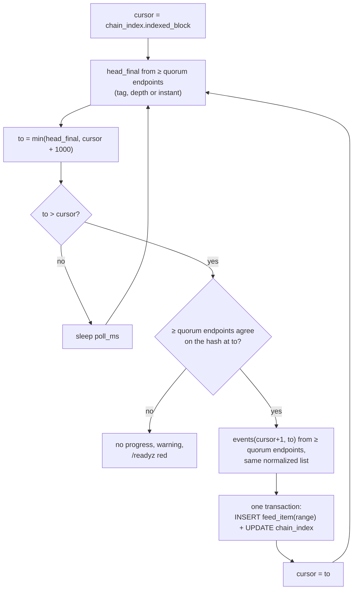

# Indexer and feeds

The indexer turns chain data into **final, quorum-agreed, contiguous ranges** of normalized events and writes them to
the events feed; job state changes go to the jobs feed. Clients book only from these feeds (nothing is booked before
finality, [NODE-GEN-08](README.md#NODE-GEN-08)). Status: finality gate, ranges ≤ 1 000 blocks, normalization and
drift on EVM **BUILT** (written to the legacy client sink); store-backed feeds and the event-set quorum on every family
**SPECIFIED**.

**Contents**

1. [Finality](#finality)
   - 1.1 [Event-set quorum](#11-event-set-quorum)
2. [Event normalization](#event-normalization)
3. [Feeds](#feeds)
4. [Event items](#event-items)
   - 4.1 [Cursors](#cursors)
5. [Drift and readiness](#5-drift-and-readiness)
6. [Snapshots](#snapshots)
7. [Limitations](#limitations)

## <a id="finality"></a>1. Finality

<a id="finality"></a><a id="finality-gate"></a><a id="NODE-IDX-02"></a>**NODE-IDX-02** — **The node decides finality;
clients receive only final ranges.** Each chain has `finality = {mode, depth, quorum}` in the node store
([NODE-STO-05](store.md#NODE-STO-05)): mode `depth` (final head = `latest − depth`), `tag` (the chain's `finalized`
tag), or `instant` (the family finalizes at inclusion). A flow tied to a payment uses hard finality: the booking delay
equals the chain's finality depth (e.g. ~3 minutes on Gnosis). The indexer follows the chain by **polling** the RPC
endpoints (no WebSocket subscriptions): a missed push message cannot lose a range, and the cursor is the only state.

`rpc_urls.len() ≥ quorum` or the node refuses to start; ranges are at most 1 000 blocks (`MAX_SPAN`); `/readyz` fails
when `final_head − indexed > max_index_lag` (default 100). The indexer writes the `range` item and advances
`chain_index` in one transaction; no token registered ⇒ the cursor holds. A client refuses a range that is not
contiguous (`from_block != indexed + 1`), so a restarted or doubled indexer never creates a hole or a duplicate; events
are further deduplicated by `(chain, tx_hash, log_index)`. There is no "observed" state: a non-final log can never
become a booking.

```
cursor = chain_index.indexed_block
loop:
  head_final = mode == 'tag'   ? min over quorum of eth_getBlockByNumber('finalized').number
             : mode == 'depth' ? min over quorum of latest.number − depth
             : min over quorum of latest committed height                 # instant
  to = min(head_final, cursor + 1000);  if to <= cursor: sleep poll_ms
  quorum: ≥ quorum endpoints return the same hash at 'to'; else no progress, warning, /readyz red
  events = adapter.events(cursor+1, to, contracts) from ≥ quorum endpoints; must be the same normalized list
  one transaction: INSERT feed_item(range) + UPDATE chain_index
  cursor = to
```

The same loop as a picture:



Finality per family (values re-checked per chain before it is enabled, [runbooks.md#production-gates](runbooks.md#production-gates);
family details in [networks/](../networks/README.md)):

| Family | Mode | Final head | Height unit | Notes |
|---|---|---|---|---|
| EVM private (SCaaS testnet, Clique 1 signer) | `depth`, 1 | `latest − 1` | block | Reorg-free by construction |
| EVM public (Gnosis) | `tag` `finalized`, quorum ≥ 2 | `eth_getBlockByNumber('finalized')` | block | ~160–240 s; quorum 2 required before `active` |
| EVM L2 (Celo OP Stack) | `l1_batch` | L1-finalized batch | block | **PLANNED** (tracker item 13); until then `tag` |
| Hedera | `instant` | latest record file via JSON-RPC relay | block | aBFT |
| Cosmos | `instant` | latest committed block (`/status`) | height | CometBFT |
| Soroban (Stellar, Pi) | `instant` | `getLatestLedger` | ledger | SCP closed ledger |
| Sui | `instant` | latest certified checkpoint (quorum on digest) | checkpoint | |
| Aptos | `instant` | committed `block_height` (bounded by indexer progress) | block | AptosBFT |
| GRAM | `depth`, 0 | `masterchainInfo.last` | masterchain seqno | |
| Solana | `tag` `finalized` | `getSlot(finalized)`, min slot over quorum | slot | ~12.8 s TowerBFT |

Transitional (BUILT) loop, with the cursor read from the client:

```
cursor = node_config(chain).indexed_block
loop:
  head_final = mode == 'tag' ? eth_getBlockByNumber('finalized').number : latest.number - depth
  to = min(head_final, cursor + 1000); if to <= cursor: sleep
  hash_to = block(to).hash on the primary endpoint; quorum on hash_to (now: on the event set, NODE-IDX-01)
  logs = eth_getLogs(from = cursor + 1, to, address = [tokens…, dex], topics = [MetaTransactionExecuted, PaymentSettled, TradeSettled])
  chain_event_ingest(chain, cursor + 1, to, hash_to, decoded(logs))   # atomic on the client
  cursor = to
```

The client refuses a non-contiguous batch (`from_block != indexed_block + 1`), so a restarted or doubled indexer never
leaves a hole or writes twice; dedup also by `UNIQUE(chain_id, tx_hash, log_index)`. The store feed keeps the same
property with `from_block = indexed + 1`.

Other EVM networks (Ethereum L1, Arbitrum, Base, Polygon, …) are **unsupported until configured**: a chain is a
profile only once its finality has been measured ([networks/evm.md](../networks/evm.md)). Soft finality (booking small
amounts before hard finality under an exposure cap) is **PLANNED** and never applies to payment-bound flows.

<a id="no-reorg-after-finality"></a><a id="NODE-IDX-03"></a>**NODE-IDX-03** — **No reorg handling after hard
finality.** A reorg below the finality gate is outside the model (Gnosis `finalized` and a one-signer Clique chain do
not reorg); a booked entry would need a manual reversal. Before finality a reorg is invisible to clients: only final
ranges are sent. A suspected violation is detected and held, never rewound automatically
([NODE-OPS-12](ops.md#NODE-OPS-12)).

### 1.1 Event-set quorum

<a id="event-set-quorum"></a><a id="quorum"></a><a id="NODE-IDX-01"></a>**NODE-IDX-01** — **Finality authenticates the
events, not one block hash, on every family.** `final_head` = the minimum height reported by ≥ `quorum` endpoints,
with the same block/ledger/checkpoint hash at that height (`tag` mode: min `finalized`; `depth` mode: min `latest`);
`events(from, to)` is evaluated against ≥ `quorum` independent endpoints and must return the **same normalized list**
(the adapter's own output, so one comparison serves every family; EVM: sorted `(block_number, block_hash, tx_hash,
log_index, address, topics, data)`); disagreement ⇒ no ingest, warning, `/readyz` red. `quorum = 1` is
single-provider trust: allowed, reported at start and as gauge `scaas_finality_quorum{chain}`.

Receipt proofs
(`eth_getBlockReceipts` against `receiptsRoot`) may replace the set comparison where providers serve them; not
required. Per family: EVM/Hedera `eth_getLogs`; Aptos per-transaction agreement (**BUILT**; the Indexer-API hint may
omit transactions, which only delays booking); Sui event query per checkpoint range; Solana per-signature transaction
(`emit_cpi` inner data) agreement; Soroban `getEvents` per ledger range; **Cosmos and GRAM honour the configured
quorum**: Cosmos `status` + `block` at the min height and the tx events of that range, GRAM `masterchainInfo` + the
jetton wallets' transactions of the range, each from ≥ `quorum` endpoints. Why: a primary provider sees every pending
payment through the node's own simulate calls and could fabricate a `PaymentSettled` at a real token address or report
`finalized = latest`. Cost: `quorum ×` reads per range. Status: Aptos **BUILT**; the other families read one endpoint
today and are **SPECIFIED**.

RPC endpoints are independent providers listed in `rpc_urls` (toml-only, [NODE-STO-03](store.md#NODE-STO-03)); the
quorum is the failover: a failed or lagging endpoint costs liveness only while ≥ `quorum` agree; a lying one is outvoted
or holds the indexer ([runbooks.md#incidents](runbooks.md#incidents) RB-05). There is no latency-based routing
between endpoints. Residual trust: clients trust their node's feed (a compromised node can lie on `/v1/events`,
[threat-model.md#node](threat-model.md#node) T7).

At start and every 600 s the indexer re-reads the hash at `indexed_block` from ≥ quorum endpoints; a mismatch holds that
chain (`finality violated at <block>`, [NODE-OPS-12](ops.md#NODE-OPS-12)).

## <a id="event-normalization"></a>2. Event normalization

<a id="event-normalization"></a>Every adapter emits one normalized event object; the feed changes nothing in it:
`{event, contract, block_number, block_hash, tx_hash, log_index, from, to, amount, fee, fee_recipient, entry_ref |
digest}` with family-canonical addresses (EVM lowercase `0x`, bech32, `0x`+64, `G…/C…` strkeys, raw `wc:hex`,
base58) ([INT-ERP-10](../integration.md#INT-ERP-10)). Events: `PaymentSettled`, `MetaTransactionExecuted`, and on EVM
`Transfer` to watched receiving wallets (drift A). Heights: block / height / ledger / checkpoint / masterchain seqno /
slot.

| Family | Height = | `tx_hash` | Events | Family-specific keys |
|---|---|---|---|---|
| EVM | block | `0x`+64 | `PaymentSettled`, `MetaTransactionExecuted`, `Transfer` (watched wallets only, drift A) | `relayer`, `batch`, `nonce`, `fee_recipient` |
| Hedera | block (JSON-RPC relay) | `0x`+64 | as EVM, via `index_runner` | as EVM |
| Cosmos | block height | `0x`+64 | `PaymentSettled`, `MetaTransactionExecuted` | bech32 addresses |
| Sui | checkpoint | `0x`+64 | same two | `entry_ref`, `digest` from Move events |
| Aptos | block | `0x`+64 | same two | |
| GRAM | masterchain seqno | `0x`+64 | same two | raw `0:…` addresses |
| Solana | slot | `0x`+128 (first signature) | same two (`emit_cpi!`) | base58 (case-sensitive) |
| Soroban | ledger | `0x`+64 | same two | `G…`/`C…` strkeys (case-sensitive) |

Common keys: `event`, `contract`, `block_number`, `block_hash`, `tx_hash`, `log_index`, `from`, `to`, `amount`, `fee`,
`fee_recipient` (families with relayer fees), `entry_ref` (`PaymentSettled`), `digest` (`MetaTransactionExecuted`); on EVM a
`PaymentSettled` with its `PaymentMeta` also carries `pay_no` (0x-hex `bytes32`, all zero = none; was text) and `meta_save` (BUILT, plan
T83 `ba280ade`, [CTR-MTX-26](../contracts/metatx.md#CTR-MTX-26)).
Clients validate addresses in their own decoder.

Further events, same object, same filters (decoders for a new kind ship before the first such token is created,
[CTR-TOK-25](../contracts/token-wrappers.md#CTR-TOK-25)):

- token wrappers: `Wrapped`, `Unwrapped`, `ReserveAdded`, `RateChangeProposed`, `RateChanged`, `RateChangeCancelled`,
  `RateAdminRenounced`, `WrapDisabled`, `GuardianRenounced`, `MinterRenounced`, `MetaNonceCancelled`; factory
  `TokenCreated` (built; the node still reads the v1 `TokenDeployed`), `EnvPublished`, `ImplementationDeployed`, `TokenImplementationDeprecated`, `TokenKindEnabled` (plan 5g-Z2; was `ImplementationRegistered`);
- token-verified trade orders (SPECIFIED, [dex-venue.md#trade-orders](dex-venue.md#trade-orders)): on the sell token
  `TradeFilled(orderHash, from, sellFill, receiveFill, dexFee)`, `OrderCancelled(orderHash, from)`,
  `NoncesInvalidated(from, batch, minNonce)`; on the DEX `LegSettled(ref, orderHash, from, destination, sold, received,
  dexFee, refund, relayerShare, treasuryShare)` (the accounting record of a settled leg), on the exchange path
  `ExchangeLegSettled(ref, orderHash, from, destination, sold, receivedFloor, surplus, dexFee, refund, limitReceive)`
  ([CTR-DEX-20](../contracts/dex.md#CTR-DEX-20)), `FeeSplitSet`, `MarketSet`, `ExchangeTargetSet`, `ListedOnlySet`.
  The DEX watcher reads them with its own cursor ([NODE-DEX-04](dex-venue.md#NODE-DEX-04)); a `TradeFilled` alone is
  never booked as a trade (a leg pulled into the DEX for escrow shows the whole amount with nothing received);
- `UAPayeeFeePaid` and the tender events of `chain_contract` rows (indexed like token events; a namespace receives
  them when the contract is in its token subset);
- universal accounts: `UATransfer`, `UAMetaTransactionExecuted`, `UARegistered` (with key data), balances per 32-byte
  id; `Transfer` to/from `UA_POOL` ([CTR-UA-18](../contracts/accounts.md#CTR-UA-18)) is paired with the
  `UATransfer` of the same log batch and reported as the UA movement, never as a `UA_POOL` balance; balances feed
  `/v1/events` per canonical id; native ids keep today's form;
- post-quantum Zether: `MetaTransactionExecuted`, `UAMetaTransactionExecuted`, `Transfer` and `UATransfer` of a PQZ
  token normalized like any meta token's, beside the `Pqz*` events ([contracts/pq-zero-knowledge.md](../contracts/pq-zero-knowledge.md));
- <a id="pqz-verifier-rows"></a>PQZ op rows and the verifier mode (group 3f; **BUILT** on the legacy pull path, T47 `75ddccc4`…`062133b6`,
  `indexer::tests::indexer_joins_proof_offchain_with_position`; [NODE-JOB-22](job-api.md#NODE-JOB-22)): `ConfidentialTransfer`
  (`entry_ref`, `from_ua`, `to_ua`, `beneficiary`, `fee`, `send_counter`, `blob`), `ConfidentialTransferMulti` (the same plus
  `recipients`, `mode`), `Unshielded` (`ua`, `amount`, `recipient`, `blob`), each with `tx_index`; ids as `bytes32` hex, never in
  `from` / `to`. A `PqzVerified` is joined to the first later op event of the same token in the same transaction as `pqz_verified:
  {statement_hash, proof_hash, verifier, pqz_verifier_epoch}`, with the op row's position, for the audit replay at the exact
  transaction position; it is never a row of its own. `PqzVerifierProposed` (`current`, `next`, `eta`) and `PqzVerifierRevoked`
  (`previous`, `pqz_verifier_epoch`) are rows with `alert: true`; `PqzVerifierSet` (`previous`, `next`, `pqz_verifier_epoch`) and
  `PqzVerifierCancelled` (`next`) rows without. **Health signal:** per `OFFCHAIN` token the indexer keeps, across ranges,
  `pqz_last_verdict_at` (the block of the last joined `PqzVerified`), `pqz_verifier_epoch`, `pqz_verifier_revoked` and (group 3t)
  `pqz_verifier_fee` (the last `VerifierFeeSet`'s `next`, `null` until one is seen), stamped on the token's verified op rows and
  verifier rows. The state lives in memory and starts unknown: `pqz_verifier_revoked` and `pqz_verifier_epoch` are `null` until the
  indexer sees what sets them (a joined `PqzVerified`: not revoked, its epoch; `PqzVerifierRevoked`: revoked; `PqzVerifierSet`: not
  revoked), so a restart never stamps a revoked verifier "not revoked" (Fable review of ua-mtx-merge E N-9; BUILT,
  `indexer::tests::pqz_health_is_unknown_until_seen`). **Operator note:** `pqz_verifier_revoked` may be `null` (it was `false`
  before anything was seen). **The verifier fee** (group 3t, [CTR-PQZ-36](../contracts/pq-zero-knowledge.md#CTR-PQZ-36); BUILT,
  `indexer::tests::verifier_fee_rows`): `VerifierFeeProposed` (`current`, `next`, `eta`) a row with `alert: true` (the hostage
  notice, T29), `VerifierFeeSet` (`previous`, `next`) a row without (`previous == next`: a cancel of a pending increase).
  **Operator note:** `ConfidentialTransfer.fee` and `ConfidentialTransferMulti.fee` are the whole word, now three payees
  (`txFee`, `verifierFee`, `M·d`): a consumer that credits the beneficiary with `fee − M·d` over-credits it by the verifier fee;
  the split is in the same transaction's pool moves (`Transfer` / `UATransfer` from `SHIELD_POOL`). **The token view** (SPECIFIED, not built): the job API's `GET /v1/tokens/{chain}`
  per-token row gains `pqz_verifier: {mode, verifier, epoch, revoked, pending, eta, last_verdict_at, endpoints_reachable}` and
  (group 3t) `verifier_fee: {fee, max, pending, eta}`;
- PQZ proof storage (group 3h; **BUILT**, T63 `39fa296c`): a `ProofStoreSet(previous, next)` row with `alert: true` (a token switched
  its storage mode); no rows for `PqzDebitProof` (the log is read on demand by the holder, not indexed);
- <a id="pqz-key-version-rows"></a>PQZ key versions (group 3g; **BUILT**, T55; [NODE-JOB-23](job-api.md#NODE-JOB-23)): `UAPqzKeyAdded`
  (feed `pqz_pending`), `UAPqzPopStored`, `UAPqzKeyCurrent` (feed `pqz_current`); `Credited`, `Debited` and `PqzRolledOver` carry
  `key_version`;
- regulated kinds 8–13 (BUILT on EVM, ua-mtx-merge T35, `indexer.rs`; regulated-kinds spec §7, M-08): `AccountFrozen`,
  `AccountUnfrozen`, `ForcedTransfer`, `Paused`, `Unpaused`, `OrderRecorded`, `OrderRevoked`, `OperatorTransfer` and the
  governance events `RelaxProposed`, `FeatureDisabled`, `RoleRevoked`, ids as `bytes32` hex but `from` / `to` in the address
  form above (`UA_POOL` and `<k>_ua` for a derived id); `alert: true` on every `OrderRecorded`, `RelaxProposed`,
  `AccountFrozen` and `Paused` (and a `warn` log line naming it); `derived` = `every_freeze_ended` on `FeatureDisabled(5)`,
  `every_record_backed_freeze_ended` on `FeatureDisabled(10)`, `holder_lost_bit` on `RoleRevoked`; group 3s (CTR-GOV-24): the
  topics gain `FeatureEnabled`, `AllowedSet`, `DeniedSet` (11 -> 14), `derived` `allow_list_on` / `deny_list_on` / `kyc_on` on
  `FeatureEnabled(8 / 9 / 28)` and `kyc_off` on `FeatureDisabled(28)`, `alert` on `FeatureEnabled` and on a restricting edit
  (`DeniedSet` on, `AllowedSet` off; test `lists_and_enable_rows`). Test:
  `indexer::tests::alert_on_relax_proposed`;
- planned asset suite: `OrderRecorded`, `OrderRevoked`, `AccountFrozen`, `AccountUnfrozen`, `ForcedTransfer`, `Paused`,
  `Unpaused`, `FeatureDisabled`, `RoleGranted`, `RoleRevoked`, `Attested`, `AttesterSet`, `GrantCreated`, `Released`, `Revoked`,
  `RevocationRenounced`, `MilestoneApproved`, `ExcessSwept`, `DistributionCreated`, `Claimed`, `Cancelled`, `Swept`,
  `OfferCreated`, `Exchanged`, `Closed`, `Rescued`; `TokenCreated` (flags 5–8 are fields of the token, [CTR-AS-17](../contracts/asset-suite.md#CTR-AS-17)).

<a id="NODE-IDX-08"></a>**NODE-IDX-08** (owner 2026-11-03; SPECIFIED, not built) — **The node keeps and serves the bytes of an `msig`'s
member signatures.** On EVM an `msig` record keeps hashes only: `popOf` returns `keccak256(pop)`, `memberSigHashOf(ua, index)` the hash of
each slot's signature object, and the bytes are only in `UAMemberSig(ua, member, index, purpose, sig)`, a `pop` slot (`PURPOSE_POP_V2`)
or an acceptance (`PURPOSE_MEMBERSHIP`) ([CTR-UA-33](../contracts/accounts.md#CTR-UA-33) A, [CTR-UA-37](../contracts/accounts.md#CTR-UA-37)).
History expiry drops those logs, so the node indexes every `UAMemberSig` of the registries it watches after finality
([NODE-IDX-02](#NODE-IDX-02)), keeps the `sig` bytes with `(chain, registry, ua, index, purpose, member)` for as long as the record lives,
and serves them by `(ua)` and `(ua, index)`, together with the `msig`'s `pop` rebuilt from its `pop` slots in `index` order. It checks
each slot against `memberSigHashOf` and the rebuilt `pop` against `popOf` before serving them, and serves none that fails. A reader
checks again: the node is not trusted for these bytes, only for keeping them. Since T66a the registry also tells the `pop` slot set from
state: `popSlotsOf(ua)` returns the set indices with each `memberSigHashOf` ([CTR-UA-33](../contracts/accounts.md#CTR-UA-33)), so the
keeper may read the set from it when it is built.

**The factory index is the authority** (PLANNED; [CTR-TOK-27](../contracts/token-wrappers.md#CTR-TOK-27)): a mirror built from
`TokenCreated` / `DexCreated` / `InstanceCreated` (backfilled by the paged views after history expiry) is a cache, never the source.
Creators are 32-byte UA ids; the node decodes no `TokenCreated` / `DexCreated` today.

## <a id="feeds"></a>3. Feeds

<a id="feeds"></a><a id="NODE-IDX-04"></a>**NODE-IDX-04** — **Change feeds** (a client's data platform may land them in its own
`raw` tables; that platform is outside the node): `GET /v1/jobs?cursor=` (job state
changes) and `GET /v1/events?cursor=` (`GET /v1/events?cursor=…`: index ranges, balances, DEX items). `seq` comes from the store's counter row,
filtered per namespace; every page carries `store_id`, `incarnation`, `restore_epoch`, `head_seq`; the client cursor
rule is the bus overlap rule ([cursors](#cursors)); `wait ≤ 25 s` long-poll for clients that want it (an ERP cron uses
`wait=0`, so no client worker is held). Cursor older than retention ⇒ `410 CURSOR_EXPIRED`. Results reach clients
only through the feeds: the node never dials a callback URL taken from an intent, and its only outbound call to a client is
the doorbell of [NODE-IDX-09](#NODE-IDX-09). A client
that polls every minute, and every ~10 s while it has live pushed jobs, sees job states ≤ ~10 s after the node while
jobs are live, ≤ 1 min otherwise ([INT-ERP-18](../integration.md#INT-ERP-18), [INT-ERP-20](../integration.md#INT-ERP-20)).

<a id="NODE-IDX-09"></a>**NODE-IDX-09** — **Doorbell: a signed, content-free ping per API key** (owner 2026-11-08; PLANNED, node round P4). An
API key may register one `https` URL (off by default). When a feed of its namespace gains items, the node sends at most one
ping per interval: `POST {url}` with `{"namespace", "feed": "jobs" | "events", "head_seq", "at"}` and an HMAC signature by
that key over the body and a timestamp header (the client refuses a stale or replayed ping). The ping carries no job or
event data; the client then reads `/v1/jobs` and `/v1/events` from its cursor as before. **The feeds stay the only source of
truth:** a lost, late or duplicated ping changes nothing, so the node keeps no delivery guarantee and retries only with a
short backoff. Outbound guard (fail closed): `https` only, the resolved address is checked after DNS and refused when it is
loopback, link-local, private, multicast or the node's own listeners; no redirects; a short connect and total timeout; a
per-namespace rate limit; pings run on their own worker and never hold a lane, the indexer or the store. A refused or failing
URL is reported on the key (`last_ping_error`) and in `/v1/ops`, never to a third party.

`GET /v1/jobs?cursor=901&limit=200&wait=0`:

```json
{"store_id": "32 hex", "incarnation": "32 hex", "restore_epoch": 0, "head_seq": 950, "next": 902,
 "items": [{"seq": 902, "uid": 17, "client_ref": "erp:1234", "origin": {"scope": "6f1c…:1", "producer": "…", "key": "0x8d…",
            "generation": 0}, "state": "signed", "tx_hash": "0x…", "outer_nonce": 42, "signer": "0x…", "error": null, "at": 1790000000123}]}
```

Each item is a **snapshot** of the job after that transition (state + journal fields: `queued`, `leased`, `signed`,
`broadcast`, `mined`, `reverted`, `consumed`, `dead`, `cancelled`), so a client that missed earlier items can still
reach the right state. `final` never appears here (finality comes from the events feed). Every item carries
`trace_id`; `mined`/`reverted` items add `gas_used`, `gas_price`, `cost_native`, `sponsor: {policy, account} | null`
and `sponsor_fallback: <policy name> | null` (`sponsor_fallback: <policy> | null`) ([sponsorship.md#feed](sponsorship.md#feed),
[NODE-OPS-11](ops.md#NODE-OPS-11)). Error values a client must recognise on `dead`/`reverted` items: `cancelled`,
decoded contract errors (`MetaTxBadNonce`, `MetaTxExpired`, …), `ATTEMPTS_EXHAUSTED` (`attempt_count` passed
`chain.max_attempts`, default 5), and a `reverted` after one billed retry (the chain charged the lane for a failure the
subject could make deterministic, e.g. Hedera `INSUFFICIENT_GAS`, Aptos out-of-gas, Solana CU exhaustion — the subject
must re-sign; [NODE-LANE-14](submit-lanes.md#NODE-LANE-14)).

## <a id="event-items"></a>4. Event items

<a id="event-items"></a><a id="NODE-IDX-05"></a>**NODE-IDX-05** — **Event feed items are the indexer's normalized
ranges, unchanged**: `kind = range` = `{chain_key, from_block, to_block, to_block_hash, events}`, one finalized block
range per chain, **always served even when empty** (`from_block = previous to_block + 1`: continuity is what a client
checks). Drift C = `kind = balances` items written right after their range, so a balance never runs ahead of the
events (a client's decoder can be reused as is, and a race between balance and range reads cannot happen). DEX mirror
items are `dex_order`, `dex_trade`, `dex_range` ([dex-venue.md#persistence](dex-venue.md#persistence)).

```json
{"seq": 77, "kind": "range", "chain_key": "evm:7622", "from_block": 41233001, "to_block": 41233040,
 "to_block_hash": "0x…",
 "events": [{"event": "PaymentSettled", "contract": "0xtoken…", "block_number": 41233017, "block_hash": "0x…",
             "tx_hash": "0x…", "log_index": 3, "from": "0xpayer…", "to": "0xpayee…", "amount": "100000000",
             "fee": "0", "fee_recipient": "0x0000…", "entry_ref": "0x8d…"},
            {"event": "MetaTransactionExecuted", "contract": "0xtoken…", "block_number": 41233017, "tx_hash": "0x…",
             "log_index": 4, "from": "0xpayer…", "relayer": "0xlane…", "batch": "7412…", "nonce": "0",
             "digest": "0x…", "fee_recipient": "0x0000…", "fee": "0"}]}
```

A non-EVM range looks the same: `{"seq": 77, "kind": "range", "chain_key": "sui:localnet", "from_block": 101,
"to_block": 140, "to_block_hash": "0x…64 hex", "events": [ … ]}`.

Serve-time filter per namespace (the stored item is chain-wide): drop `Transfer` not to one of the namespace's `watch`
pairs; drop events whose `contract` is outside the namespace token subset (empty = all dropped unless `all_tokens`,
[NODE-JOB-12](job-api.md#NODE-JOB-12)). **A range item is always served**, even with empty `events`.

Index-time: the indexer filters `Transfer` by the union of all watch lists; a watch added later is not retroactive
(clients push watch lists right after approving a receiving wallet).

`kind = balances` (drift C, EVM): written hourly right after a range, read at `height = chain_index.indexed_block`,
served filtered to the namespace's watch pairs:

```json
{"seq": 78, "kind": "balances", "chain_key": "evm:7622", "height": 140,
 "balances": [{"token": "0x…", "address": "0x…", "balance": "1000000"}]}
```

<a id="NODE-IDX-06"></a>**NODE-IDX-06** (owner, 2026-10-07) — **A repeated `entryRef` is flagged by the node and checked by
the client — both.** The first `PaymentSettled` per `(chain_key, token, entryRef)` is the payment; every later one is
an overpayment and a reconciliation exception, never a second payment
([CTR-MTX-10](../contracts/metatx.md#CTR-MTX-10)). The node keeps the first finalized `PaymentSettled` per
`(chain_key, token, entryRef)` in its store and marks every later `PaymentSettled` item on `/v1/events` with
`repeat_of` = the first event's `(tx_hash, log_index)` (`null` on the first). The client still detects repeats from
the events itself and books them; it never relies on the flag alone, because a node only knows the history it has
indexed (a new or restored node may start after the first payment). A repeat keeps payer, amount, fee and
transaction so that the business can decide a refund to the payer; a refund is a business decision and a new,
separate payment, never automatic. Status: SPECIFIED.

### <a id="cursors"></a>4.1 Cursors

<a id="cursors"></a>Both feeds:

- Rows with `seq > cursor` visible to the namespace, ordered by `seq`, ≤ `limit` (≤ 500) and ≤ 1 MiB; at least one
  item when one is due. `cursor = -1` returns no items and `next = head_seq`.
- `wait` (0–25 s): await a per-store `Notify` fired on feed inserts, re-query once; ≤ 4 waits per key.
- Client rule: `cursor = max(0, last − 200)`, apply idempotently (skip `seq ≤ applied seq` per job), persist `next` with
  `store_id`, `incarnation`, `restore_epoch` and the last applied `(seq, uid, state)`.
- **Continuity checks**: `store_id` or `restore_epoch` changed ⇒ halt; `head_seq < stored cursor` ⇒ halt;
  `incarnation` changed (a restart) ⇒ read `cursor = last_seq − 1, limit = 1` and compare with the stored
  `(seq, uid, state)`; different or missing (not `410`) ⇒ halt; equal ⇒ accept the new incarnation. Re-pushing to a
  recreated or restored store is an operator action ([NODE-ADM-07](admin-auth.md#NODE-ADM-07)).
- Retention: `job_event`/`feed_item` older than `feed_retention_secs` (7 d) are deleted; the same purge transaction
  raises `meta('<table>_floor')` to the highest purged `seq` (never lowered); `cursor < floor` ⇒ `410 CURSOR_EXPIRED`
  (an empty table with `head_seq > 0` cannot tell "expired" from "nothing new"). Recovery: jobs — `GET /v1/jobs/{uid}`
  for each non-terminal pushed job, then `cursor = -1`; events — reset to 0 (idempotent by block range: a client drops
  events at or below its indexed block when a range straddles it).

## 5. Drift and readiness

Drift A (inbound transfers that match no payment) and drift C (balances of watched receiving wallets at the indexed
height) are computed by the indexer from the watch lists and delivered as events; the client compares them with its
books ([INT-ERP-09](../integration.md#INT-ERP-09)). Non-EVM drift needs a family `balanceOf` and transfer events
(PLANNED per family). `/readyz` per chain: ≥ quorum RPCs answer within 3 s, indexer lag ≤ `max_index_lag`, finality
not violated ([ops.md#health](ops.md#health)).

## <a id="snapshots"></a>6. Snapshots

<a id="snapshots"></a>(PLANNED) Deterministic Merkle snapshot of a token at a final block, for distributions
([contracts/asset-suite.md#snapshot](../contracts/asset-suite.md#snapshot), format there). Input: `(chain_key,
recordToken, recordBlock, policy)` with `recordBlock` final under the chain's finality gate. Balances = replay of every
finalized `Transfer` of `recordToken` from its creation block (indexer watch list) to the end of `recordBlock`; must
equal `balanceOf(a)` at `recordBlock` for a sampled set (archive RPC quorum) or the build fails. Policy (canonical JSON,
`policyHash = keccak256` of its RFC 8785 bytes): excluded addresses and attribution of protocol clones; the builder
**must** classify every leaf that has code — every `AssetFactory` clone (known from its events, including
counterfactual grant addresses funded before `GrantCreated`, found with `predictGrant` of pending client grants) and the
token's own address are excluded or attributed — and any other contract leaf **fails the build** unless the policy
lists it.

Tree: OZ `StandardMerkleTree` v1, leaf encoding `["uint256","address","uint256"]` = `(index, account,
amount)`, leaf = `keccak256(bytes.concat(keccak256(abi.encode(index, account, amount))))`, `sortLeaves = true`,
sorted-pair node hashing as `MerkleProof.verify`. Output: root, total, leafCount, leaves file (CSV + JSON), proofs. API (job-API conventions, namespace-scoped):
`POST /v1/snapshots {chain, token, block, policy}` → `{id}`; `GET /v1/snapshots/{id}` → `{state, root, total,
leaf_count, policy_hash}`; `GET /v1/snapshots/{id}/leaves`; `GET /v1/snapshots/{id}/proof?account=` (public data).
CLI `scaas-node snapshot verify <file>` recomputes a root from chain without trusting the store. The node is not
trusted for the root: the review window and independent recomputation are the control. Vectors
`test/vectors/merkle_dist_vectors.json` (Solidity, Rust node, client) include 1, 2, 3, 7 and 2¹⁰ + 1 leaves.

## <a id="limitations"></a>7. Limitations

<a id="limitations"></a><a id="NODE-IDX-07"></a>**NODE-IDX-07** (open; PLANNED) — **A second, independent event
source.** The event-set quorum bounds what one dishonest RPC provider can inject; it does not bound a compromised node,
which can lie on `/v1/events`. A second event source (another node or an independent indexer) and client-side
agreement before booking are PLANNED; signed feed pages make sense only with such a second verifier.

**NEAR feed stall (accepted risk until fixed).** The NEAR adapter reads transactions sent directly to a watched token,
router or DEX and refuses a range that holds one not yet `FINAL`, retrying it on the next poll: one such transaction
stops the chain's feed (the client cursor does not move). A NEP-519 yield keeps a transaction non-final for about 200
blocks and can yield again, so anyone can stall the feed cheaply; payments made through third-party contracts or
NEP-366 delegate actions are not seen at all. Relaying is not affected and no funds are lost. Both are one TODO item:
index the watched receipts themselves, with non-final transactions parked
([near.md limitations](../networks/near.md#limitations)).
