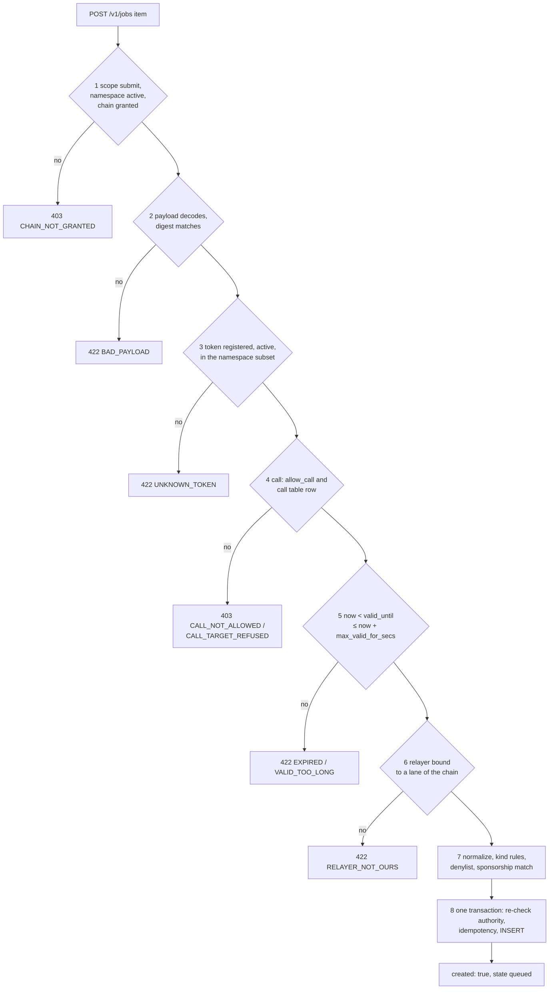
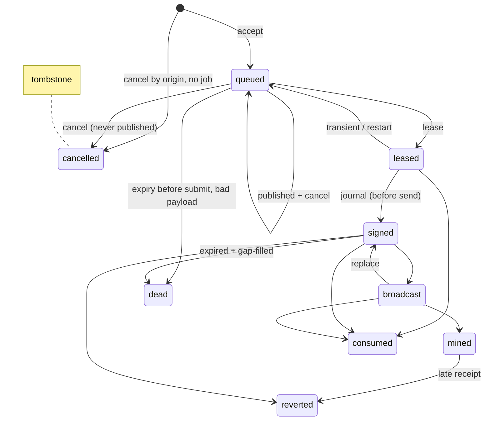

# Job API

The job API is how server-side clients (an ERP backend, a payment service, any other system that keeps a
transactional outbox) hand signed work to the node and learn what happened to it. It is served on `[api] bind`
(default `127.0.0.1:8548`). Status: **SPECIFIED**; the built path is the legacy pull adapter
([legacy pull](#legacy-pull)). The client side of every route is in [integration.md](../integration.md).

All bodies JSON, body cap 1 MiB, no cookies, no redirects, no CORS (a browser cannot call it cross-origin even with a
leaked key). Authentication [NODE-JOB-05](#NODE-JOB-05) on every route. Errors:
`{"error": "<CODE>", "detail": "<text ≤ 300 chars>", …}`, i.e. `{"error": "<CODE>", "detail": "<text ≤ 300 chars>"}`
plus code-specific fields (the gateway's contract is
`{error, code, detail, revert_data?}`, [NODE-GW-06](gateway.md#NODE-GW-06)).

**Contents**

1. [Namespaces](#namespaces)
2. [Authentication](#2-authentication)
3. [Journal and digests](#3-journal-and-digests)
4. [Idempotency](#4-idempotency)
5. [Routes](#5-routes)
   - 5.1 [`POST /v1/jobs`](#post-v1jobs)
   - 5.2 [Meta-transaction data](#52-meta-transaction-data)
   - 5.3 [Named entries](#named-entries)
6. [Intake](#intake)
7. [Lease](#7-lease)
8. [Lane pinning](#8-lane-pinning)
9. [Token subsets](#9-token-subsets)
10. [Call jobs](#10-call-jobs)
11. [Call table](#call-table)
12. [Job states](#12-job-states)
13. [Cancel](#cancel)
14. [Errors and limits](#14-errors-and-limits)
15. [Client conformance](#15-client-conformance)
16. [Legacy pull](#legacy-pull)

## <a id="namespaces"></a>1. Namespaces

<a id="namespaces"></a><a id="NODE-JOB-03"></a>**NODE-JOB-03** — **Namespaces are the node's tenant unit**
(`[a-z0-9-]{3,40}`; names starting `~` are reserved: `~gateway`, `~mesh`, `~dex`, and `~lane` — a booking label only,
for gap-fillers of adopted nonces, never a job namespace). A namespace has granted chains and a token subset pushed by
the client ([NODE-JOB-12](#NODE-JOB-12)). The node has no notion of company or legal entity (owner: "the node doesn't know companies"): a client maps its own
tenants to a node endpoint + namespace credential. A namespace shared by several of a client's entities sees their
combined feed; the client routes by `origin`.

<a id="NODE-JOB-16"></a>**NODE-JOB-16** (open; default applied) — Several entities of one client may share one
namespace by using distinct `origin.scope` values; the default is one namespace per client database.

## 2. Authentication

<a id="auth"></a><a id="NODE-JOB-05"></a>**NODE-JOB-05** — **Machine credentials are namespaced HMAC keys.** The
signing scheme is the gateway's `hmac` mode ([NODE-GW-02](gateway.md#NODE-GW-02)) plus header `X-Scaas-Key:
<key_id>`. Each key belongs to one namespace, scopes `submit` and/or `read`. Secret =
`HMAC-SHA256(master_key, "scaas-api-key/1" ‖ 0x00 ‖ key_id ‖ 0x00 ‖ u32be(generation))`; the store keeps **no
secret**. `master_key` is a `SecretSource` in toml (≥ 32 bytes). The scheme is fuzzed and binds method, path and body
and blocks replay; stealing the store yields no credential. Rotating `master_key` revokes every machine key at once; a
restore can resurrect a revoked key ([threat-model.md#node](threat-model.md#node) T19).

```
X-Scaas-Key: k_3f9a0c1d2e4b5a6c
X-Scaas-Timestamp: 1790000000                # unix seconds; ±300 s accepted
X-Scaas-Nonce: 9b2c…                         (1–64 [A-Za-z0-9_-], remembered until ts + 300 s)
X-Scaas-Signature: hex(HMAC-SHA256(secret, ts "." nonce "." METHOD " " path_with_query "\n" body))
```

Verification (`Auth::HmacKeys { keys, seen }`): look up `key_id` in the hot key snapshot (active, not expired,
namespace active), derive the secret, verify as the gateway check does, put `Caller { namespace, key_id, scopes }` in
the request extensions. Nonce cache keyed by `(key_id, nonce)`. Unknown key and bad signature both answer
`401 UNAUTHORIZED`. `MAX_INFLIGHT` (64) still bounds unauthenticated work. A shared KAT
(`scaas-node/tests/api/hmac_kat.json`) pins the byte layout; clients must test against it.

API keys are for **external server-side clients only** ([NODE-ADM-06](admin-auth.md#NODE-ADM-06)): never on admin
routes, never in a browser, mobile or desktop app or extension. Keys are created, rotated (`generation + 1`) and
revoked (hot, ≤ 2 s) by a `key_custodian` (`POST /v1/admin/keys`, `POST /v1/admin/keys/{id}/rotate`, CLI,
[admin-auth.md#cli](admin-auth.md#cli)); the secret (64 hex) is shown once.

## 3. Journal and digests

<a id="journal"></a><a id="NODE-JOB-02"></a>**NODE-JOB-02** — **One journal, node-computed digests.** Every local
submission — job API, gateway door A, mesh scheduler, DEX `mtxSettle` — is a `job` row; mesh `intent` rows reference
`job_uid` instead of carrying their own lane, outer nonce and tx hash. `job.digest` is **derived by the node** from
the decoded payload with the mesh digest library ([mesh.md#intent-id](mesh.md#intent-id) per family; Soroban: SHA-256
of the `HashIdPreimage` the payload's named fields rebuild); a client `digest` that differs ⇒ `422 BAD_PAYLOAD`. A unique
live-digest index (`(chain_key, digest)` over live states; emulated on MySQL) makes G2
([README.md#invariants](README.md#invariants)) durable across namespaces and restarts. Two journals would mean two
`plan()` inputs and two outcome sinks; a client-supplied digest would let one tenant squat another's intent or bypass
G2.

## 4. Idempotency

<a id="idempotency"></a><a id="NODE-JOB-04"></a>**NODE-JOB-04** — **Idempotency key** = `(namespace, origin.scope,
origin.producer, origin.key, origin.generation)`, plus `payload_hash` = SHA-256 of **RFC 8785 (JCS)** of the parsed
`payload`, **computed by the node** (shared KAT `jcs_kat.json`). Same key + same hash ⇒ `200` with the job's current
snapshot; different hash ⇒ `409 IDEMPOTENCY_MISMATCH` carrying the existing `uid`; lower generation live ⇒
`409 PREVIOUS_GENERATION_LIVE` with its `uid`. `generation` increments on operator requeue. A cancel by origin may
create a **tombstone** under the key ([NODE-JOB-07](#NODE-JOB-07), bounded by [NODE-JOB-11](#NODE-JOB-11)). A client
sends a stable `scope` (e.g. `"<database uuid>:<legal entity id>"`) matching its own unique outbox key. A mismatch
means "the node holds a job under this key", never "dead".

## 5. Routes

<a id="routes"></a>

| Route | Scope | Purpose |
|---|---|---|
| `GET /v1/info` | read | api version, `store_id`, `incarnation`, `restore_epoch`, both `head_seq`s, granted chains with lanes, tokens, fee_recipient, profile, state, lane `journal_max` |
| `POST /v1/jobs` | submit | accept ≤ 50 jobs, per-item results |
| `GET /v1/jobs/{uid}` | read | one job snapshot (own namespace only, else 404) |
| `POST /v1/jobs/{uid}/cancel`, `POST /v1/jobs/cancel` (`{"origin": {…}, "chain_key", "valid_until"}`) | submit | [cancel](#cancel) |
| `GET /v1/jobs?cursor=&limit=&wait=` (`limit` ≤ 500) | read | jobs change feed ([indexer-feeds.md#feeds](indexer-feeds.md#feeds)) |
| `GET /v1/events?cursor=&limit=&wait=` | read | events feed ([indexer-feeds.md#event-items](indexer-feeds.md#event-items)) |
| `GET/PUT /v1/watch/{chain_key}` | read / submit | namespace's receiving wallets (full replace) |
| `GET/PUT /v1/tokens/{chain_key}` | read / submit | namespace's token subset (full replace; ∩ node registry incl. `chain_contract` rows; unknown ones listed in the response as `missing`) |
| planned: `POST /v1/snapshots {chain, token, block, policy}` → `{id}`; `GET /v1/snapshots/{id}` → `{state, root, total, leaf_count, policy_hash}`; `GET …/{id}/leaves`; `GET …/{id}/proof?account=` | submit / read | deterministic Merkle snapshot of a token at a final block ([indexer-feeds.md#snapshots](indexer-feeds.md#snapshots)), namespace-scoped |

### <a id="post-v1jobs"></a>5.1 `POST /v1/jobs`

```json
{"jobs": [{
  "origin": {"scope": "6f1c…:1", "producer": "payment.request", "key": "0x8d…", "generation": 0},
  "client_ref": "erp:1234", "chain_key": "evm:7622", "kind": "metatx",
  "payload": {"op": {"entry": "mtxUnwrap", "contract": "token", "token": "0x…",
                     "envelope": {"from": "0x…", "batch": "7", "nonce": "0", "validUntil": "1790000300", "mode": 1,
                                  "relayer": "0x…", "fee": "0", "feeRecipient": "0x0000000000000000000000000000000000000000"},
                     "args": {"wrapped": "100", "recipient": "0x…", "minOut": "99"}, "signature": "0x…"}},
  "bus": {"scope": "restricted", "private_window_secs": 120}}]}
```

| Field | Rule |
|---|---|
| `origin.scope` | Client-chosen, stable: e.g. `"<database uuid>:<legal entity id>"` |
| `origin.producer` | Business object type that produced the job (e.g. `payment.request`, `purchase.tender`) |
| `origin.key` | Natural key of the business event (e.g. the payment `entryRef`, `invoice:42:attempt:1`) |
| `origin.generation` | `0` initially; `+1` on an operator requeue of a dead job |
| `client_ref` | Echoed in feeds; for the client's own lookup |
| `kind` | below |
| `payload.digest` / `op.digest` | Optional; if present must equal the node's digest |
| `bus.scope` | `restricted` (own lanes only; default), `open` (admitted peers after the window), `public` (also the open mesh) ([NODE-MESH-15](mesh.md#NODE-MESH-15)) |

Payload by kind:

| Kind | Payload |
|---|---|
| `metatx` | One named entry: `{op: {entry, contract, token, envelope, args, signature}}` ([named entries](#named-entries)); the node builds the calldata and the typed digest from the one parse. A token transfer or payment keeps its explicit struct: `{token, contract?, signature, struct: "transfer", metatx: {…}}`, the 11 fields of `MetaTransfer` (`entryRef = 0` transfer, else payment, [CTR-MTX-23](../contracts/metatx.md#CTR-MTX-23)); `contract` = `token` \| `zether` \| `pqz` (absent = `token`) names its digest's domain. `uint256` as decimal strings; addresses lowercase. Idempotency and the mesh `intent_id` are the typed digest; one `(from, batch, nonce)` lane space spans every entry and the struct. Hex is refused on every kind (`HEX_DATA_REFUSED`, [NODE-JOB-20](#NODE-JOB-20)). `receiver_fee` on a job is `dead`, never relayed without it: receiver-pays is the entry `mtxPayReceiverFee` ([sponsorship.md#receiver-pays](sponsorship.md#receiver-pays)) |
| `signed_op` | `{op: {op_kind: "call"\|"transfer", function?, payload: "0x<exact signed bytes>", signature, public_key, auth_kind: "wallet"\|"passkey", extra: {…native params}}}`; `from`, lane, nonce, `valid_until`, relayer are decoded from `payload` (non-EVM `MetaCall`/`MetaTransfer`, [NET-ALL-26](../networks/README.md#NET-ALL-26)); as built `op_kind: "pay"` over `MetaOp` v1. Soroban names its `payload` and never takes these bytes: [Soroban `signed_op`](#soroban-signed-op) |
| `call` | A plain entry, no typed struct of its own: `{op: {entry, token, args, validUntil}}` (`token` = the target; `SmartKeyAccountFactory.deploy`, the registry's writes, the DEX's settlement entries, `mtxExecuteAsOwner`), every argument named JSON; the signature, if any, is one of the `args`; entry and target must match the [call table](#call-table); no native value |
| `ua_metatx` (EVM outbox path **BUILT**, node-ua-jobs 2026-10-30; Soroban **BUILT**, [its own form](#soroban-ua-metatx-jobs); the rest SPECIFIED; `kind = ua_metatx`) | A `ua*` named entry: `{op: {entry, contract, token, envelope, args, auth}}` with `auth` the `UASig` object `{keyData, signature, members: [{index, keyData, sig}]}` ([named entries](#named-entries)), or a transfer on the UA ledger: `{token, contract?, struct: "transfer", m: WireUAMetaTransfer, auth}` (the address struct's wire fields, `from` / `to` as bytes32; `metatx`, `signature` refused). Same lifecycle as `metatx`; idempotency on `(chain, token, from, batch, nonce)`; digest = the typed digest the node computes. Built: relayed on a registered token whose UA ledger is on (`registry() ≠ 0`, else `FEATURE_UNSUPPORTED`); the kind and registration are the exact call's simulation; a refused simulation is `consumed` when `uaNonce(from, batch)` has passed the nonce. Not built: the record cache ([gateway.md](gateway.md#ua-cache)), mesh `evm.ua_meta_tx`. **Soroban (BUILT, UA-Soroban T9; [NET-SOR-23](../networks/soroban.md#NET-SOR-23)):** `{op: {contract, function, args, auth?, valid_until?}}` by named fields ([Soroban `ua_metatx` jobs](#soroban-ua-metatx-jobs)), no `op.kind`; `op.valid_until` is optional and never read (the signed argument decides, [NET-SOR-15](../networks/soroban.md#NET-SOR-15)); `function` is allow-listed per contract class (token `ua_transfer`, `ua_pay`, `ua_pay_meta`, `ua_burn`, `ua_cancel_nonce`; router `ua_relay`; DEX `settle`, `ua_cancel`; mandate `mtx_set_mandate`, `mtx_set_payee`, `mtx_revoke`, `mtx_withdraw`, `mtx_mandate_pay`) with the exact arity; a lane-bound `relayer` gets one `SourceAccount` entry rooted at the call and any other recorded `SourceAccount` entry fails the job; a payee, destination or mandate delegate that is the router or the executor is refused; a delegate job refused `StaleEpoch` returns the signed and the current epoch, the client re-signs; the digest is recomputed and is the job id; archived entries are restored within `params.max_deposit_per_job` (stroops; absent = none) |
| `pqz_call` (SPECIFIED; private chain only) | **Direct open calls only**: `{chain, contract, selector ∈ {mtxConfidentialTransfer, mtxUnshield, mtxRollOver}, calldata}` to a configured PQZ token (direct `mtxShield` moves the caller's public units into the pool and `mtxWrapShield` pulls the caller's underlying: neither is a node job; `mtxRollOver` and `mtxPrepareAcc` are allowlisted self-calls too, so a keeper may call them directly or relay them as ordinary `metatx` jobs, owner 2026-10-20); stored like `call`: `digest` NULL, `call_hash` set |
| PQZ and Zether ops | **No new kind** ([CTR-PQZ-15](../contracts/pq-zero-knowledge.md#CTR-PQZ-15)): every envelope op is a named entry, `metatx` or `ua_metatx`, `contract` = `pqz` or `zether`, the explicit struct as JSON in `args` ([named entries](#named-entries)); `pqzAuth`, `ownerSig` are `UASig` objects in `args`, unsigned by the envelope; outer fee `NONE`/`FIXED` only; never batched, never on the mesh; 1 MiB job body on the `pqz` profile |

<a id="paymeta-relayfee-jobs"></a>**Pay-meta and relay-fee jobs ([CTR-MTX-26](../contracts/metatx.md#CTR-MTX-26), [CTR-MTX-27](../contracts/metatx.md#CTR-MTX-27); BUILT, metatx-split T17).** No new job kind.
- *EVM, address payers.* A pay-meta job is a `metatx` job with `struct = transfer` that also carries `salt` (32 B) and `meta`
  (hex). Before any simulation the node checks `entryRef == metaPayId(salt, meta)`, `batch == payLane(entryRef)`, `nonce == 0`
  and `len(meta) <= max_pay_meta_bytes` (chain `params`, default 2,048), then relays `mtxPayMeta` (on-chain meta) or the plain
  `mtxExecuteTransfer` (off-chain meta). A relay-fee job is the named entry `mtxRelayFee` with `call`
  ([named entries](#named-entries)): `{entry: "mtxRelayFee", contract, token: <fee token>, args: {from, payee, value, validUntil,
  relayer: <router>}, call: {entry, contract, token, envelope, args, signature}, signature}`. The node builds the inner calldata
  from `call`, `target` and `callDataHash` from it, and sends the router's `relay` to `args.relayer`, which must be
  `params.relay_fee.router`; a hex call is refused.
  *EVM, UA payers* (BUILT, node-ua-jobs 2026-10-30): a UA pay-meta job is a `ua_metatx` job with `struct = transfer`,
  `salt` and `meta`, the same checks on ids, relayed as `uaPayMeta` (off-chain meta: `uaExecuteTransfer`); a UA relay-fee job
  is the entry `uaRelayFee` on a `ua_metatx` job, `from` and `payee` as ids, `auth` a `UASig`, sent as `uaRelay` (the payee never
  `pad(executor)`, open mode `payee = pad(router)`).
- *EVM, the fee covers the quote.* After the simulation, a relay fee that reaches this lane (open mode or bound to it) must be
  worth, at `params.relay_fee.min_wei_value[token]`, at least the quote: the gas limit × the job's **fee ceiling**
  (`FEE_HEADROOM` = 2 × the max fee per gas of its first send) + 2 × the L1 data fee on an OP-stack chain
  (`params.l1_fee = "op-stack"`: `GasPriceOracle.getL1Fee` of the signed transaction at `0x420…0F`; an oracle that does not
  answer refuses the job). Below the quote ⇒ `RELAY_FEE_REFUSED`, nothing sent, the job `queued` (the quote follows the fees
  of the moment: a retry, never a kill). Every replacement of a stuck send stays at or under the ceiling; at it the lane
  waits, and an expired job's nonce is gap-filled at the operator's cap (the gap-fill runs no job). After a restart a tracked
  priced job is re-checked at its tracked transaction's max fee (now its ceiling) before it is ever re-signed; uncovered,
  unknown, or on an OP-stack chain ⇒ gap-fill only. Required for `uaRelay` (a UA's verify gas depends on its kind,
  millions for a Solidity PQ verify; no price ⇒ refused, terminal); for `relay` only when the token has a price (else T17's
  `min_amount`, owner ruling 2026-10-28 item 7). A sponsored fee (bound elsewhere) is not priced. The generic lane runner
  (Hedera) refuses a priced job on an OP-stack chain (it signs once and does not price the L1 fee).
- *EVM, the payer is held* (review I2). While a relay-fee job of payer S (`relay`: its address, `uaRelay`: its id) is in
  flight on a token, no lane signs another job of S on that token (`ua_metatx`, `metatx`, another relay-fee job of S), and
  a relay-fee job of S waits while any job of S is in flight: `queued` with `SUBJECT_HELD`, retried later. Other ways to
  lower S's balance (a DEX leg, `mtxWrap`, a plain ERC-20 transfer, another relayer's send) are the recorded residual.
- *Other families.* The same `signed_op` job; `op.kind` is absent (a plain pay), `"pay_meta"` (`op.salt`, `op.meta` hex) or
  `"relay_fee"` (per-family fields, `op.extra`). Any other `op.kind`, including a non-string, is refused; a plain pay that carries
  `salt` / `meta` is refused; a plain pay or pay-meta whose recipient is the router, marker or executor is refused.
- *Config* (`[chains.params]`): `relay_fee = { router, min_amount (default 1), relay_bound_payee (default false) }` (EVM adds
  `min_wei_value = { "<token address>" = price }`, the price an integer or decimal string of wei per base unit, or
  `"<wei>/<10^k>"` for wei per 10^k base units (an 18-decimal token below 1 wei per unit); the fee covers the quote when
  `floor(fee × wei / 10^k) >= quote`, so round a price down; 0 refuses every priced job; set without `router`, or one
  token under two spellings, is a startup error; and `l1_fee = "op-stack"`, any other value a startup error),
  `max_pay_meta_bytes`; TON adds `relay_fee.min_ton_value = { "<master>" = nanoton }`, Solana `min_lamports_value` (first-use lane
  rent). An unparsable `router`, `min_amount` or key is a startup error. A bound-payee fee (not the node's lane) is refused unless
  `relay_bound_payee = true`, then relayed as a sponsored job.
- *NEAR* ([near.md](../networks/near.md#relayer)). `network` = the genesis hash in base58; `payload` = hex of label ‖ Borsh
  `MetaOp`, `signature` = hex Borsh(`Auth`); a relay fee adds `op.extra.call`, `op.extra.route` (`wrapper` | `router`); the
  node sets `target_gas` / `target_deposit` from the target's view. Keys `relay_fee.min_yocto_value = { "<token>" = "<yocto
  per base unit>" }`, `relay_fee.targets = { "<account>" = ["method", …] }` (strict, per method) and `params.dex`. Every
  payment, wrapped op, target op, DEX order and leg and mandate expiry must be valid ≥ 120 s ([NET-NEAR-26](../networks/near.md#NET-NEAR-26)).
  A router job is followed while in flight: past the entry's deadline the relaying lane sends `relay_timeout` (`wait_until
  = INCLUDED`, retried every 120 s) and the job is reported `reverted` ("refunded", the payer not charged) 3,600 s past the
  deadline even while anyone's later `relay_timeout` can still refund the entry. The node reads the action fees from
  `EXPERIMENTAL_protocol_config` at start and refuses to start without them, refuses a chain whose implicit-account
  transfer costs more than the contracts' `IMPLICIT_TRANSFER_GAS` (11 Tgas, read back from the router's and the DEX's
  `implicit_transfer_gas()`), and needs an RPC with `max_gas_burnt_view` ≥ 300 Tgas ([NET-NEAR-21](../networks/near.md#NET-NEAR-21),
  [NET-NEAR-22](../networks/near.md#NET-NEAR-22)). Quote = prepaid gas × the node's gas price + deposits (+ one
  `relay_timeout` for a router job, [NET-NEAR-23](../networks/near.md#NET-NEAR-23)). The adapter logs a subject's key set
  per token for key-op jobs. Events: one non-final transaction to a watched token, router or DEX stops the chain's
  NEAR event feed until it is final (a NEP-519 yield holds it ≈ 200 blocks, re-yieldable): an accepted risk until the
  indexer fix ([near.md limitations](../networks/near.md#limitations)).
- *Algorand* ([algorand.md](../networks/algorand.md#relayer)). `network` = the genesis hash in base64; `payload` = hex of
  label ‖ ARC-4 `MetaOp`, `signature` = hex of the entry's `auth`; a relay fee adds `op.extra.call` and the target's
  `accounts`, `apps`, `boxes`, `carries` (other keys refused). Keys `params.account_app` (required), `mandate_app`,
  `dex_app`, `relayfee_app` (`relay_fee.router` is refused with a pointer to it), `algod_token_env`,
  `relay_fee.min_microalgo_value = { "<token app id>" = µALGO }` and `relay_fee.targets = { "<app id>" = ["method(args)ret",
  …] }` (ARC-4 selectors). The check is algod `simulate`: a discovery run with the extra opcode budget the group can still
  gain, then the exact group on its own budget, one bare budget call appended per "dynamic cost budget exceeded" up to 16
  transactions ([NET-ALG-17](../networks/algorand.md#NET-ALG-17)). Quote = the group's fee + its exact MBR payments, no
  resend term; a refused group costs nothing. There is no refund, so `op_consumed` answers for every job kind.
- *Job errors:* `CALL_TARGET_REFUSED` (not the configured router), `TOKEN_NOT_SERVED`, `RELAY_FEE_SHAPE` (the payee is the executor;
  the `RelayFee` struct signs everything else), `RELAY_FEE_REFUSED` (fee below `min_amount` or bound elsewhere; EVM: below the quote at
  `min_wei_value` (retried), or a `uaRelay` on a token without one, or an OP-stack chain whose oracle does not answer),
  `SUBJECT_HELD` (EVM: retried), `PAYEE_REFUSED` (EVM: a `MetaTransfer` / `UAMetaTransfer` to the
  relay-fee router or its executor), `PAY_META_TOO_LONG` (EVM: `mtxPayMeta` / `uaPayMeta`'s `meta` above `max_pay_meta_bytes`),
  `FEATURE_UNSUPPORTED` (EVM `ua_metatx`: the token's UA ledger is off), `BAD_PAYLOAD`; TON also
  `RELAY_CALL_REFUSED` (the relayed call would fail on its target by the getters: envelope, owner, deadline, relayer,
  executor, target code, lane nonce, signature, set_key record, a passkey signature (not relayed until the node checks
  P-256); or it is a no-op: a revoke of an already revoked Mandate, refused so the payer does not pay for nothing, owner
  rulings list item 6; reported as `simulation: RELAY_CALL_REFUSED: …`, [ton.md](../networks/ton.md#paymeta-relayfee)).
- *Indexer:* `PaymentMeta` and `RelayFeePaid` are never rows of their own; they enrich the `PaymentSettled` of the expected token
  in the same transaction with the same `(from, entry_ref)` (TON: `from` via the message's `MetaTransactionExecuted`) and
  `amount`; without a settlement they prove nothing. A `PaymentMeta` with more than one ref is rejected. EVM: the UA ledger's
  `UAPaymentSettled` / `UAMetaTransactionExecuted` are `PaymentSettled` / `MetaTransactionExecuted` rows: a native id is its
  address; a derived UA is `UA_POOL` (the ERC-20 holder of every UA balance, as the chain's own `Transfer`s show it) with the
  bytes32 id in `from_ua` / `to_ua` (`relay_payee_ua` for a derived payee), because the client's ingest takes 20-byte
  addresses only on EVM (fix 1, review C1). Joins compare the ids (`*_ua` when present), never `UA_POOL`.

`payload` is exactly what every adapter `build` consumes. A W3C `traceparent` header applies to every item of the batch ([NODE-OPS-09](ops.md#NODE-OPS-09)).

### 5.2 Meta-transaction data

<a id="selector-table"></a><a id="NODE-JOB-20"></a>**NODE-JOB-20** — **The node never reads client hex: it builds the call.**
Status: **BUILT** (typed-signing N1, owner Option B, 2026-10-31: "explicit named JSON fields per operation instead of opaque
hex blobs; the node builds the XDR / calldata"). On EVM and Hedera a job names an entry of the node's table and its fields
([named entries](#named-entries)); the guard allows a selector per contract kind, and nothing else
([call table](#call-table)). `data` / `calldata` as a field of a job, an op, a `metatx` or `m` body, a `call: {calldata}` object, a hex string as `op` or `op.call`, or
`struct = call` is refused by name on every job kind and at the gateway: `HEX_DATA_REFUSED`. A `bytes` field an entry declares
(`Execute.data`, `proof`, `ciphertext`) is a named parameter and passes. The contracts keep `mtxExecute` / `mtxBatch` /
`uaExecute` / `uaBatch` and their `mtxSelectors()` for other callers (owner 2026-10-31); the node relays no hex through them.

Non-EVM families: the node keeps per registered contract the `mtx_` entries it relays (`function`,
[NET-ALL-27](../networks/README.md#NET-ALL-27)); a `signed_op` naming another function ⇒ `422 SELECTOR_NOT_ALLOWED`, and
the breaker counts per `(from, function)`.

No role function (mint, rate administration, guardian) is an entry, so a role holder never calls one through a token: it
acts through its own contract ([NODE-JOB-19](#NODE-JOB-19)). Why: a fixed table is a node release per operation, and hex a
client built is what the lane would sign; the owner chose the release. Not built: pricing by the decoded call, the breaker per
`(from, selector)`.

### <a id="named-entries"></a><a id="metatx-entries"></a>5.3 Named entries

Status: **BUILT** (typed-signing N1, `scaas-node/src/typed.rs`). One table: every row is an entry, its struct and its arguments in
order. `typed_ops_kat_every_entry` pins the rows against [`smartcontracts/vectors/typed/typed_ops.json`](../../smartcontracts/vectors/typed/typed_ops.json):
encodeType, struct hash, digest, selector, calldata. Whoever reads this API next (an ERP backend, a payment service) builds this
JSON; the struct names are the vector file's keys.

```json
{"entry": "mtxUnwrap", "contract": "token", "token": "0x…",
 "envelope": {"from": "0x…", "batch": "7", "nonce": "0", "validUntil": "1790000300", "mode": 1, "relayer": "0x…", "fee": "0",
              "feeRecipient": "0x…"},
 "args": {"wrapped": "100", "recipient": "0x…", "minOut": "99"},
 "signature": "0x…"}
```

| Key | Rule |
|---|---|
| `entry` | The contract function: `mtxUnwrap`, `uaUnshield`, … |
| `contract` | The target's kind: `token`, `zether`, `pqz`, `wallet`, `account`, `dex`, `registry`, `factory`. Names the rule and the EIP-712 domain (`SCaaS MetaToken`, `SCaaS ZetherToken`, `SCaaS PqzToken`, `SCaaS MandateWallet`, `SCaaS SmartKeyAccount`, `SCaaS Dex`). May be left out when the entry exists on one kind |
| `struct` | Only when an entry has two rows on a kind (`ENTRY_AMBIGUOUS`): `CancelOrder` / `CancelWrapOrder`, `CancelUAOrder` / `CancelUAWrapOrder`, `RollOverSigned` / `ZetherRollOver`, `SetRollOverMode` / `ZetherSetRollOverMode`, `CancelDexOrder` / `mtxCancelOrders`, `PayUnderMandate` (the named form) / `mtxPayUnderMandate` (the flat builder) |
| `token` | The call's target; a `RelayFee`'s fee token; a wrap order's wrapper |
| `envelope` | `from` + `batch`, `nonce`, `validUntil`, `mode`, `relayer`, `fee`, `feeRecipient`, on every entry whose struct ends with them; exactly these keys |
| `args` | The struct's other fields under their struct names, plus what the entry takes unsigned; exactly these keys, nested structs as objects, arrays as arrays. An entry with no envelope has its whole struct here |
| `signature` | Hex, an entry that takes `bytes` (`uaShield` too: its `auth` is `bytes`) |
| `auth` | The object: `UASig` `{keyData, signature, members: [{index, members: [{index, sig}], sig}]}` on `ua*` ([below](#member-sig-shape)), `AccountSig` `{keyIndex, proof, signature}` on the account's own entries |
| `validUntil` | Job deadline, decimal string: required when nothing else gives one (an owner rollover, `mtxCancelOrders`, a plain entry without its own). It narrows a deadline the chain enforces, never extends it: the job's deadline is the minimum. A cancel has none, so there it stands alone (else the order's) |

<a id="member-sig-shape"></a>**A slot of `MemberSig` (operators: the job shape changed, EVM, branch `msig-nested`, [CTR-UA-38](../contracts/accounts.md#CTR-UA-38)).** An `msig` slot in EVM job JSON, `pop`, `sig`, `auth`, `pqzAuth`, `ownerSig`, `memberSig`, is
`{index, members, sig}`, no longer `{index, keyData, sig}`: a signing member `{"index": 1, "members": [], "sig": "0x…"}`, an `msig` member `{"index": 0, "members": [{"index": 0, "sig": "0x…"}], "sig": "0x"}`.
A job in the old shape is refused `BAD_PAYLOAD: …keyData: unknown field`. Every selector holding `MemberSig` moved with it, so a client on the old ABI must update with the node. The decode is bounded by the type: two levels, no field `members` on an inner slot; and by
16 slots at each level, `BAD_PAYLOAD: …: more than 16 slots`, checked before an element is read. The node builds the calldata from these fields, so overlapping offsets, which make the registry copy far more than the calldata holds before its first index check, cannot leave
it from a named job. Soroban jobs keep `{index, key_data, sig}` until that family's round.

Values: `uint` as canonical decimal strings (`uint8`, `uint16`, `uint32` may be JSON numbers), addresses `0x` + 20 bytes, `bytes32` /
`bytes16` `0x` + exact length, `bytes` `0x`-hex, `bool` as JSON. Anything else is `BAD_PAYLOAD` naming the path. An unbound `relayer` /
`feeRecipient` is normalized ([NODE-LANE-10](submit-lanes.md#NODE-LANE-10)) and hashed as 0, as `MetaTxLib.canon`.

| Kind | Entries |
|---|---|
| Base, every token | `mtxCancelNonce` (also `wallet`, `account`; `args.lane`), `mtxBurn`, `uaBurn`, `uaCancelNonce` (`args`: `ua`, `batch`, `validUntil`, no envelope) |
| Wrapped | `mtxWrap`, `mtxWrapLeg`, `mtxUnwrap`, `uaUnwrap`, `mtxUnwrapLeg`, `uaUnwrapLeg`, `mtxAddReserve`, `mtxWrapToUA`, `mtxUnwrapToUA`, `uaUnwrapToUA` |
| Orders | `mtxWrapOrder` / `uaWrapOrder` (`token` = wrapper; `args` = the whole order + `underlying`; the digest is in the **underlying's** domain), `mtxCancelOrder` / `uaCancelOrder` (`args.order`), `mtxInvalidateNonces` (`token` or `dex`; `args`: `from`, `batch`, `minNonce`), `uaInvalidateNonces`, `mtxCancelOrders` on `dex` |
| Receiver fee | `mtxPayReceiverFee` / `uaPayReceiverFee`: `args`: `payment` (the `MetaTransfer` / `UAMetaTransfer`), `payerSig` (hex / `UASig`), `fee`, `feeRecipient`, `validUntil`; `signature` / `auth` is the payee's |
| Zether (`zether`) | `mtxShield`, `uaShield`, `mtxWrapShield`, `mtxRollOver`, `uaRollOver`, `mtxConfidentialTransferSingle`, `mtxConfidentialTransfer`, `mtxConfidentialTransferCompact`, `mtxUnshield`, `mtxUnshieldUnwrap` and `ua*` twins, `mtxRollOverSigned` / `mtxSetRollOverMode` (+ `args.ownerSig`) and twins, `mtxRollOverBatch`, `uaRollOverBatch` |
| PQZ (`pqz`) | `mtxShield`, `uaShield`, `mtxWrapShield`, `mtxRollOver`, `uaRollOver`, `mtxPrepareAcc`, `uaPrepareAcc`, `mtxConfidentialTransferSingle`, `…SingleCompact`, `mtxConfidentialTransfer`, `…Compact`, `mtxUnshield`, `mtxUnshieldUnwrap` and `ua*` twins (+ `args.pqzAuth`, a `UASig`) |
| `MandateWallet` (`wallet`) | `mtxSetMandate`, `mtxSetPayee`, `mtxRevokeMandate`, `mtxPayUnderMandate` (`struct: "PayUnderMandate"`), `mtxDelegateRevoke`, `mtxExecute` (`args.data` is `bytes`). The flat builders, plain, which sign the generic `MetaTransaction` and take `args.sig` (owner 2026-11-01): `mtxPayUnderMandate` (`struct: "mtxPayUnderMandate"`; `token`, `payee`, `amount`, `entryRef`, `epoch`, `validUntil`, `sig`), `mtxRevoke` (`token`, `epoch`, `validUntil`, `sig`; the kill switch), `mtxExecuteAsOwner`, `mtxExecuteAsOwnerRaw` |
| `SmartKeyAccount` (`account`) | `mtxAddKey`, `mtxRemoveKey`, `mtxRotateKey`, `mtxSetGuardian`, `mtxCancelRecovery`, `mtxExecute`, plain `mtxExecuteAsOwner` |
| Relay fee | `mtxRelayFee`, `uaRelayFee` with `call` ([above](#paymeta-relayfee-jobs)). The node parses `call` without its `fee_recipient`: the payer hashed those bytes, so an unbound inner `relayer` / `feeRecipient` is 0 in what it signs |
| `dex`, plain | `mtxSettle`, `mtxExchange`, `mtxExchangeVia`, `mtxExchangeBatch`, `mtxHybrid`, `mtxHybridVia`, `mtxCancelOrders`: legs as `{sellToken, shape, order, uaOrder, sig, auth, fill}` |
| `registry`, plain | `register`, `registerMsig`, `registerWebAuthn`, `registerMuSig2`, `registerFrost`, `setKemKey`, `storePqzPop`, `setPqzKey`, `acceptMembership` (`args`: `ua`, `memberSig` `{index, keyData: "0x", sig}`, [CTR-UA-37](../contracts/accounts.md#CTR-UA-37): the member signs, the relayer submits, so a member needs no gas) |
| `factory`, plain | `deploy` |

**Mandate lanes.** The named `mtxPayUnderMandate` runs with `batch = mandatePayLane(entryRef)`, `mtxDelegateRevoke` with
`batch = mandateRevokeLane(token, epoch)`, both at nonce 0 (a revoke is the kill switch, it must not queue behind a pending nonce on
a shared lane); anything else is `MANDATE_LANE`, nothing sent. The flat builders derive their lanes in the contract.

**The digest is the key.** The node computes the typed digest from the op, in the domain `(name of contract, "1", chainId, target,
chain_uid)`: no chain view. It is the job's in-flight key and what `MetaTransactionExecuted.digest` is compared to. The bytes sent are a
second key, held with it on every lane: `contract` is not in the calldata, so one call never flies twice under another claim. A
receiver fee's key is its outer digest; the chain reports the payment's `MetaTransfer` digest, which is what its job is compared to.

**The signature pre-check** (every path, before the simulation). For a native signer (`from`, `ua`, `order.from`, a receiver fee's
payee) with a 65-byte signature the node recovers over its digest. Recovered to the signer: good. To anyone else: an account without code
is `BAD_SIGNATURE`, nothing simulated or sent; one with code is an ERC-1271 signer, its simulation answers. Any other length (a 64-byte
Hedera account signature, [CTR-MTX-25](../contracts/metatx.md#CTR-MTX-25)), a derived UA, a member set or an account key is the simulation's.

Gateway: `POST /v1/op {chain, op}` takes the same object, for an `mtx*` entry on a registered token only ([gateway.md](gateway.md#routes));
every other row, `ua*` entries included, is a job of a namespace with the grant.

| Refusal | When |
|---|---|
| `HEX_DATA_REFUSED` | `data` / `calldata` where no entry declares one, at the top of a job too, `call: {calldata}`, a hex string as `op` or `op.call`, `struct = call` |
| `UNKNOWN_ENTRY` | no such entry on that kind (a `transfer`, `mtxTrade`) |
| `ENTRY_AMBIGUOUS` | `contract` or `struct` needed |
| `OP_KIND_MISMATCH` | a `ua*` entry on a job that is not `ua_metatx`, or the reverse |
| `BAD_PAYLOAD` | a field missing, unknown, or not its type (the path is named) |
| `MANDATE_LANE` | above |
| `BAD_SIGNATURE` | above |
| `CALL_TARGET_REFUSED` / `TOKEN_NOT_SERVED` | the target does not meet the kind's rule ([call table](#call-table)); `TOKEN_NOT_SERVED` also a Soroban mandate job's `token` ([NET-SOR-29](../networks/soroban.md#NET-SOR-29)) |

## <a id="intake"></a>6. Intake

<a id="intake"></a>Accept checks, in order (no RPC except a cached UA record read,
[gateway.md#ua-cache](gateway.md#ua-cache); simulation stays at lease time,
[NODE-LANE-23](submit-lanes.md#NODE-LANE-23)):

1. scope `submit`; namespace active; `chain_key` granted ⇒ else `403 CHAIN_NOT_GRANTED`.
2. payload decodes (`work_from_job` for EVM, family op parse otherwise); node computes `digest`
   ([NODE-JOB-02](#NODE-JOB-02)) and `payload_hash` (JCS, [NODE-JOB-04](#NODE-JOB-04)); client digest differs ⇒
   `422 BAD_PAYLOAD`. Every field the signed payload carries is taken from the payload; a job-JSON copy that differs ⇒
   `422 BAD_PAYLOAD`; unsigned fields may only narrow ([NODE-LANE-16](submit-lanes.md#NODE-LANE-16)).
3. token registered + active and in the namespace subset (empty = none unless `all_tokens`,
   [NODE-JOB-12](#NODE-JOB-12)) ⇒ `422 UNKNOWN_TOKEN` (the registered-token rule of
   [NODE-MESH-13](mesh.md#NODE-MESH-13) for every origin).
   - 3a. Hex `data` / `calldata` ⇒ `422 HEX_DATA_REFUSED`; an entry not in the table ⇒ `422 UNKNOWN_ENTRY` ([NODE-JOB-20](#NODE-JOB-20)).
4. `kind = call` requires `allow_call` ⇒ `403 CALL_NOT_ALLOWED`, **and** its selector and target must match the
   [call table](#call-table) ⇒ `403 CALL_TARGET_REFUSED` (re-checked at lease).
   - 4a. Native value the job makes the lane send beyond fees ≤ `chain.max_value_out` (GRAM 0.05 GRAM above the fixed
     attach, every other family 0) ⇒ `422 VALUE_OUT_TOO_HIGH` (also at lease, config is hot;
     [NODE-LANE-17](submit-lanes.md#NODE-LANE-17)). A lane-funded deposit a third party can reclaim (e.g. a Solana
     ATA of an unconfigured recipient) ⇒ `422 DEPOSIT_NOT_ALLOWED` (re-checked before signing;
     [NODE-LANE-18](submit-lanes.md#NODE-LANE-18)).
   - UA-Soroban. The payload's `from` is over the grief threshold (≥ 10 billed failures in 24 h, or cost ≥
     `chain.grief_cost_cap`) ⇒ `429 SUBJECT_THROTTLED {retry_after}`; from 3 in 24 h it gets one live job per chain
     ([NODE-LANE-15](submit-lanes.md#NODE-LANE-15)).
5. `now < valid_until ≤ now + chain.max_valid_for_secs` (default: `now < valid_until ≤ now + 3600`) ⇒ `422 EXPIRED` / `VALID_TOO_LONG`.
6. relayer bound ⇒ a lane of this chain ⇒ `lane_hint`, else `422 RELAYER_NOT_OURS` ([NODE-JOB-08](#NODE-JOB-08)).
7. normalization (unbound `feeRecipient`/`relayer`) of the stored work ([NODE-LANE-10](submit-lanes.md#NODE-LANE-10));
   `payload_hash` is over the client's payload, so a retry hashes identically.
   - 7a. Kind rules: `receiver_fee` needs `token.features ∋ receiver_fee` (`422 FEATURE_UNSUPPORTED`), sets
     `valid_until = min(m.validUntil, receiver_fee.validUntil)` and `bus.scope = restricted`
     ([NODE-MESH-17](mesh.md#NODE-MESH-17)); `ua_metatx` needs `token.features ∋ ua` and a registered `from`
     (`422 UA_NOT_REGISTERED`, record cache); `call` and `pqz_call` compute `call_hash`.
   - 7b. Denylist: any listed party (`m.from`, `m.to`, op signer/payee, decoded `call` addresses) ⇒
     `403 SUBJECT_DENIED`, no order detail ([NODE-OPS-14](ops.md#NODE-OPS-14)).
   - 7c. Sponsorship match on job data only ([sponsorship.md#evaluation](sponsorship.md#evaluation)); on
     `~gateway`/`~mesh` a matched metatx/op needs a valid local payer signature (`422 BAD_SIGNATURE`; an EIP-7702
     delegated payer signs by its own key only, per [gateway.md#eip-7702](gateway.md#eip-7702)); a matched job with `valid_until < now +
     p.min_valid_secs` is not sponsored (a sponsored job needs `valid_until ≥ now + min_valid_secs`) (`429 SPONSOR_TOO_SHORT` or unsponsored per `on_exhausted`).
8. In one transaction: **re-check steps 1, 3, 4 from store rows with locking reads** ([NODE-JOB-14](#NODE-JOB-14)),
   then `SELECT … FOR UPDATE` by the idempotency tuple (all generations) — existing same generation: same hash ⇒
   return it (`created: false`); tombstone ⇒ `created:false, state:cancelled`; different hash ⇒
   `409 IDEMPOTENCY_MISMATCH {uid}`; a higher generation present ⇒ `409 SUPERSEDED {uid}` (a stale push, e.g. after
   its own generation was purged); `valid_until` passed ⇒ `422 EXPIRED` again inside the transaction (a purged key is
   never re-accepted, [states](#states)); lower generation non-terminal ⇒ `409 PREVIOUS_GENERATION_LIVE {uid}`; then
   `INSERT`. A unique violation is classified **by constraint** (per backend: the constraint or index name, or on
   SQLite the column list, [store.md#backends](store.md#backends)): `job_live_digest` ⇒ `409 DUPLICATE_DIGEST`;
   `job_live_call` ⇒ `409 DUPLICATE_CALL {uid}` (the live job of this namespace, to follow or cancel);
   `job_origin` (lost race) ⇒ re-run the SELECT. Live count ≥ `max_live_jobs` (read under the lock) ⇒ `429 QUOTA`.
   A matched sponsor policy is admitted in this transaction (bucket locks, the day reservation **and** the
   day/hour/payer-hour `tx_count`, `sponsor_day`/`sponsor_hour` on the job); `429 SPONSOR_BUDGET | SPONSOR_RATE
   {policy}`, or unsponsored per `on_exhausted` with `job.sponsor_fallback = p.name` (client namespace: booked to the
   namespace, [NODE-SPN-01](sponsorship.md#NODE-SPN-01)). Deadlock/serialization failure ⇒ retry the transaction
   (≤ 3).

The checks as a flow, each refusal with its code:



<a id="NODE-JOB-14"></a>**NODE-JOB-14** — **Intake authority is re-checked inside the insert transaction.** The
transaction that inserts a job (or a tombstone) re-reads, with locking reads (`FOR SHARE`; SQLite: inside
`BEGIN IMMEDIATE`), the namespace row (`state`, `allow_call`, `all_tokens`, quotas), the `namespace_chain` row, the
token's `namespace_token` row and the caller's `api_key` row, and refuses with the same codes as above. Every
admin/CLI change to a namespace, its grants, subset or keys also updates `namespace.updated_at`, so a concurrent change
commits first and is seen, or fails the accept with a serialization error that is retried. Pre-transaction checks stay
as fast rejects. (On PostgreSQL `REPEATABLE READ` the snapshot predates the wait on the fencing row, so plain reads
would miss a change committed meanwhile.)

Response `200` for a well-formed batch; each accepted item carries its **current snapshot**:

```json
{"results": [{"client_ref": "erp:1234", "uid": 17, "created": false, "state": "signed", "tx_hash": "0x…",
              "outer_nonce": 42, "signer": "0x…", "last_seq": 902},
             {"client_ref": "erp:1235", "error": "UNKNOWN_TOKEN", "detail": "0x… is not registered on evm:7622"}]}
```

A fresh accept answers `{"client_ref": "erp:1234", "uid": 17, "created": true, "state": "queued", "last_seq": 902}`.
Paused chain: accepted, waits `queued` ([NODE-STO-08](store.md#NODE-STO-08)). Halted: `409 CHAIN_HALTED`.

## 7. Lease

<a id="lease"></a><a id="NODE-JOB-06"></a>**NODE-JOB-06** — **A claim is a CAS inside the one owner process**:
`queued → leased` inside the single owner of the store ([NODE-STO-04](store.md#NODE-STO-04)); no `SKIP LOCKED` is
needed ([store.md#durability](store.md#durability)). Each accepted job is owned by exactly one store; reassigning
needs a release protocol nobody needs yet. **Two nodes for one client entity** only on **different chains**: a
client routes each (entity, chain) to one node and takes events of a chain from one node. The same lane keys in two
stores is forbidden and detected heuristically on sequence families ([store.md#durability](store.md#durability)).

The lane scheduler leases queued rows of its chain with `hold = 0` and `lane_hint IS NULL OR = lane`, oldest first,
≤ 10 per round, skipping digests already in flight; after a restart, queued jobs are not leased for
`lease_hold_after_start_secs` (15 s), so queued cancels land first.

<a id="NODE-JOB-21"></a>**NODE-JOB-21** — **The node's own queue claims by kind: a stopped kind never hides another**
(owner decision 2026-11-02; SPECIFIED). A kind can be stopped on a lane while others run, today Soroban `call` jobs at
`breaker.call_budget_pct` of the hour's budget, with a plain `signed_op` that is no token payment. The scheduler leases past a stopped kind inside the store, so its queued rows
take no slot of the round and the oldest job of a running kind is always reached, however long the backlog. Each namespace has a
`call` quota (`max_live_call_jobs`, beside `max_live_jobs`; over it `429 QUOTA` at `POST /v1/jobs`), so one namespace's backlog
of free jobs stays bounded. This is the node's guarantee, not a consumer's: the node is open and any consumer can run it. The
built legacy pull path has a limit of its own, [NODE-JOB-10](#NODE-JOB-10).

## 8. Lane pinning

<a id="lane-pinning"></a><a id="NODE-JOB-08"></a>**NODE-JOB-08** — **Relayer-bound jobs are pinned to their lane**: a
meta-tx with `MODE_RESTRICT_RELAYER` (or a family op that binds the relayer) gets `lane_hint`; only that lane leases
it; a relayer that is none of the chain's lanes ⇒ `422 RELAYER_NOT_OURS`. Otherwise any lane could claim a bound job
and it would revert in simulation; with pinning a DEX chain may run several lanes.

## 9. Token subsets

<a id="token-subsets"></a><a id="NODE-JOB-12"></a>**NODE-JOB-12** — **An empty namespace token subset means no
tokens.** `namespace.all_tokens` (default 0; `admin` only, audited) is the one way to serve every registered token of
the granted chains; `store init` creates the reserved `~gateway`, `~mesh`, `~dex` rows with it. A client pushes
`PUT /v1/tokens/{chain}` before its first job push on that chain (its push waits until the route's `tokens_hash`, the
hash of the last pushed subset, is set); until then its jobs get `422 UNKNOWN_TOKEN`.
("Empty ⇒ all" would give a new, copied or misconfigured namespace every token of its chains until the first sync.)

## 10. Call jobs

<a id="call-jobs"></a><a id="NODE-JOB-09"></a>**NODE-JOB-09** — **`call` jobs are a namespace capability**
(`allow_call`, default `false`). **Precondition**: a target qualifies only if it enforces its own replay protection
(`MandateWallet` `refUsed[entryRef]`, idempotent account deploy, DEX fills consumed), because a `call` job has no node
digest and no subject nonce; after a restore a re-pushed `call` could otherwise execute twice. `allow_call` is
necessary but not sufficient: every `call` must also match the [call table](#call-table). The `~gateway` `call` jobs
are only the UA registration of [NODE-GW-03](gateway.md#NODE-GW-03). A `call` job makes our lane call a contract;
with several tenants this must be granted.

<a id="NODE-JOB-13"></a>**NODE-JOB-13** — **Live-call uniqueness is per namespace**: `job_live_call` =
`(namespace, chain_key, call_hash)` over live states (`call_hash = keccak256(target ‖ calldata)`). UA registrations
all live in `~gateway`, so they stay deduplicated node-wide. A duplicate across namespaces is left to the target's own
replay protection, which [NODE-JOB-09](#NODE-JOB-09) already requires of every `call` target. `job_live_digest` stays
global (a digest is the intent's identity; a call hash is not). An earlier key `(chain_key, call_hash)` let a tenant
with `allow_call` hold another tenant's retry at `409 DUPLICATE_CALL`. Two tenants may each queue the same call; the target
refuses the second.

<a id="NODE-JOB-15"></a>**NODE-JOB-15** (open; default applied) — The namespace created for an ERP client that
migrates from the legacy pull path gets `allow_call = true` (mandates and subject accounts need it).

<a id="soroban-call-jobs"></a>**Soroban `call` jobs** (UA-8 Part B, `ua8-soroban` B6; BUILT; [NET-SOR-23](../networks/soroban.md#NET-SOR-23),
[NET-SOR-27](../networks/soroban.md#NET-SOR-27); the owner's explicit-parameter rule of 2026-10-31 replaced the plan's
`op.extra.call` XDR). The Soroban `call` job has no selector table: its target is the chain's UA registry only, and its
function one of the registry's eight writes. Payload: `{kind: "call", op: {contract, function, args, valid_until}}`, every
field required and any other field refused at every level (no XDR, `auth`, `extra` or `payload` can enter).

- `contract`: a `C…` equal to the chain's `params.ua_registry`; unset means every Soroban `call` job is refused.
- `valid_until`: unix seconds, the transaction's `max_time`; after now and at most 3,600 s later (`MeshParams.max_valid_for_secs`,
  no `node.toml` knob), else refused.
- `args`: the contract's own argument names, bytes as `0x…` hex, a `#[contracttype]` struct as an object of its fields, `relayer`
  null or a `G…`. A number outside what the record's bytes hold is refused at the node (`kind`, `threshold`, `weight`, `index`
  above 65,535, `scheme` above 255). The names are the contract's, not `portable.json`'s camelCase EVM `args`.

| `function` | `args` |
|---|---|
| `register` | `kind, key_data, attrs, pop, pqz_pop, relayer` |
| `register_msig` | `structure {threshold, members [{kind, id, weight}]}, attrs, pop [{index, key_data, sig}], pqz_pop, relayer` |
| `register_webauthn` | `key {x, y, rp_id_hash}, attrs, pop, pqz_pop, relayer` |
| `register_musig2` | `kind, key {agg_key, member_keys}, attrs, pop, pqz_pop, relayer` |
| `register_frost` | `kind, key {group_key, threshold, members [{commitments, r, z}]}, attrs, pop, pqz_pop, relayer` |
| `set_kem_key` | `ua, version, kem, sig, relayer` |
| `set_pqz_key` | `ua, pqz_key, pqz_pop_hash, sig, relayer` |
| `store_pqz_pop` | `ua, pqz_pop` |

`attrs` is `{pqz_key, pqz_pop_hash, kem, kem_pk_hash}`, `kem` is `{scheme, mlkem_ek, x25519}`, `sig` is `{key_data, signature, members}`.

Rules at `build`: `relayer` must be null or this lane, and this lane only when it is in the registry's `relayers()` (read once
and kept: the list is immutable); a part the chain cannot verify needs a `relayer` (refused before simulation otherwise) and is
checked off chain first (`scaas_ua::ua8::check_*`, feature `pq`), a part the chain verifies is not; the transaction carries one
`SourceAccount` entry (the relayer's attestation over `attest_digest` of the call's arguments) only when a relayer is named; a
simulation that records any other signer is refused before signing; a finished transaction over `tx_max_size_bytes`, or a largest
entry over the entry limit, is `Revert`: the job is `dead` on one claim and nothing is signed. A failed `relayers()` read holds
only the relayer-mode jobs, never payments. The `UA_REGISTER_SPLIT` rule is EVM's; a Soroban job splits a proof off by sending
`store_pqz_pop` itself. `call` jobs are free to the client, so a job's cost to the lane is bounded by
`params.max_resource_fee_per_job` ([NET-SOR-29](../networks/soroban.md#NET-SOR-29)) and the spend breaker
([NET-SOR-14](../networks/soroban.md#NET-SOR-14)); whether they should stay free is an open owner question. `store_pqz_pop` reads
`pqz_pop_of` first: a proof already stored is `dead`, unsent, since on chain it is a no-op on the lane's fee. A `call` job that carries the call in a field other than `op` is `job without op` and fails closed; consumers
follow this interface.

<a id="soroban-ua-metatx-jobs"></a>**Soroban `ua_metatx` jobs** (`ua8-soroban` N2; BUILT; [NET-SOR-23](../networks/soroban.md#NET-SOR-23); the
owner's explicit-parameter rule of 2026-10-31 replaced hex XDR `op.args`). Payload: `{kind: "ua_metatx", op: {contract, function,
args, auth?, valid_until?}}`, any other field refused. The node builds the `InvokeContractArgs` from `args`, in the contract's
order, and takes the op digest (the job id), `valid_until` and every check from that one value.

- `args`: every argument by the contract's name, `auth` included, each required, any other refused.
- <a id="soroban-job-values"></a>Values by contract type: `BytesN<32>` and `Bytes` are `0x…` hex; `i128`, `u128`, `u256` and `i256` decimal strings; `u32` and `i32`
  numbers; `u64`, `i64`, `Timepoint` and `Duration` a number or a decimal string (a client that cannot write one past 2^53, such as
  an order `salt`); `bool` a boolean; `Address` a `G…` or `C…`; `Option<Address>` null or an address; `Symbol` and `String` strings;
  `Holder` `{"Addr": "G…"}` or `{"Ua": "0x…"}`; `UaSig` `{key_data, signature, members}`, as a `call` job's `sig`; `MemberSig` `{index,
  key_data, sig}`, flat, `key_data` empty, a filled one refused at build (Soroban has no `msig` member until its round, [CTR-UA-38](../contracts/accounts.md#msig-staging)); `Order` `{maker, destination, relayer, sell_token, sell_amount, buy_token, buy_amount, max_fee_ppm, expiry, salt}`.
- `ua_relay`'s `args` is the relayed call's arguments, whose types the contract does not declare: a list of `{type, value}`, `type` one of
  the names above, `Vec<Val>` (a list of `{type, value}`), `Map` (a list of `{key, val}`, each a `{type, value}`, in any order; the
  node sorts it) or `Void` (`value` null). `Error` and the host's ledger-key values are no argument a job can name.
- `op.auth`: `[{payload, from, signature}]`, a native leg's authorization, `payload` as [below](#soroban-signed-op). A job never names
  a `SourceAccount` entry; the lane's own entry is the node's. `op.valid_until` is optional and never read: the deadline is the
  built call's, also after a restart, and the transaction's `max_time` is that deadline capped at `now + 3,600 s`
  ([NET-SOR-15](../networks/soroban.md#NET-SOR-15)); a deadline already past is `dead`, unsent. `accept_membership` alone names no
  deadline in its arguments, so there it is required and bounded as a `call` job's.
- A job on a mandate runs only on a Wasm of `params.mandate_wasm_hashes`, else `MANDATE_WASM_REFUSED`, `dead`, nothing simulated; unset,
  none runs. Its `token` is a token of the chain's list, else `TOKEN_NOT_SERVED`, `dead`, nothing simulated. Any job's declared resource fee over `params.max_resource_fee_per_job` is `RESOURCE_FEE_OVER_CAP`
  ([NET-SOR-29](../networks/soroban.md#NET-SOR-29)). A job with no `op.auth` whose simulation records another signer is refused before signing.

| Contract | `function` | `args` |
|---|---|---|
| token | `ua_transfer` | `from, to, amount, lane, nonce, valid_until, relayer, auth` |
| token | `ua_pay` | `from, to, amount, pay_ref, valid_until, relayer, auth` |
| token | `ua_pay_meta` | `from, to, amount, salt, meta, valid_until, relayer, auth` |
| token | `ua_burn` | `from, amount, lane, nonce, valid_until, relayer, auth` |
| token | `ua_cancel_nonce` | `ua, lane, valid_until, auth` |
| router | `ua_relay` | `payer, target, func, args, salt, token, to, amount, valid_until, relayer, auth` |
| DEX | `settle` | `maker, taker, maker_fill, maker_auth, taker_auth` |
| DEX | `ua_cancel` | `order, auth` |
| mandate | `mtx_set_mandate` | `token, delegate, max_per_payment, max_per_period, period_seconds, expiry, lane, nonce, valid_until, relayer, auth` |
| mandate | `mtx_set_payee` | `token, payee, allowed, lane, nonce, valid_until, relayer, auth` |
| mandate | `mtx_revoke` | `token, by, epoch, lane, nonce, valid_until, relayer, auth` |
| mandate | `mtx_withdraw` | `token, to, amount, lane, nonce, valid_until, relayer, auth` |
| mandate | `mtx_mandate_pay` | `token, payee, amount, pay_ref, epoch, valid_until, relayer, auth` |
| registry | `accept_membership` | `ua, member_sig, relayer` |

<a id="soroban-accept-membership"></a>`accept_membership` ([NET-SOR-28](../networks/soroban.md#NET-SOR-28), `ua8-soroban` MA-S; BUILT): a member of an `msig` accepts its
slot and holds no XLM: the member signs, the lane submits. `contract` must equal `params.ua_registry` (unset: refused); this function
is a `ua_metatx` so that `op.auth` can carry a `G…` member's entry, which a `call` job cannot, and it is the only `ua_metatx` on the
registry: a `signed_op` still never runs there, and `call` jobs stay the eight writes. `op.valid_until` is required, after now and at most
3,600 s later. `member_sig` is the slot: `key_data` `0x`, `sig` the member's signature (`clientkeys`: `acceptMembershipOp`).

| Slot's member | `sig` | `relayer` | `op.auth` |
|---|---|---|---|
| `evm-eoa` | ECDSA over the typed digest | null | none |
| a registered `Chain` kind | under `member` over `memberDigest` | null | none |
| `G…` | `0x` | null | the member's entry over `(ua, PURPOSE_MEMBERSHIP, typed)` (`clientkeys`: `membershipInvocation`, `signedAuth`) |
| a relayer-checked kind | as a `Chain` kind | this lane, listed in `relayers()` | none |

Rules at `build`, as a `call` job's: a slot the chain cannot verify needs a `relayer` and passes `scaas_ua::ua8::check_membership` before
simulation, a refused one is `dead` and nothing is sent; the lane's one entry is over `attest_digest` of `(ua, member_sig, relayer)`; an
`evm-contract` slot is `NotVerifiable` here, no off-chain check reaches ERC-1271. With no `op.auth`, a simulation that records another
signer is refused before signing. The job has no op digest (the job's own id), is free to the client and counts in the call share
(`call_budget_pct`, [NET-SOR-14](../networks/soroban.md#NET-SOR-14)). `build` reads `member_accepted` first: a slot already accepted is `consumed`, nothing simulated or sent, since on chain it is a no-op on the lane's fee. A relayer-checked slot beside a `G…` member is `UAKeyData`, `dead`: see [NET-SOR-28](../networks/soroban.md#NET-SOR-28).

<a id="soroban-signed-op"></a>**Soroban `signed_op`** (`ua8-soroban` N2 review, owner rulings of 2026-11-02; BUILT). Payload: `{kind: "signed_op", op: {payload,
from, signature, contract, valid_until, kind?, extra?}}`.

- `payload`: `{nonce, expiry, invocation}`, `nonce` the `i64` of the auth entry, `expiry` the `u32` signature expiration ledger, and
  `invocation` `{contract, function, args: [{type, value}], sub_invocations: [invocation]}`, values as [above](#soroban-job-values). The
  node rebuilds the auth entry from these fields on its own network id, and the host checks `signature` over what it rebuilt: the
  account signs `sha256` of that `HashIdPreimage` (`clientkeys`: `authPreimage`, `authDigest`, `signedAuth`). `op.auth[]` and `extra.auth[]` carry
  the same `{payload, from, signature}`.
- `signature` stays `0x…` hex, one crypto object: 64 bytes of a `G…` account, or the `ScVal` XDR a `C…` subject's `__check_auth` reads, at
  most 8,192 B and nested at most 64 XDR levels.
- `valid_until`: unix seconds, nothing the node reads signs it, so it is required, after now and at most 3,600 s later, as a `call` job's; `0`
  would be no `max_time` on chain.
- The call is the invocation the subject signed; no field names it. A `G…` account or a `C…` contract only signs: the lane submits.
- Contracts: it runs only on a token, a mandate (`params.mandates`, `C…`), the DEX or the router of the chain's `params`, and never on
  the registry, even one listed there; anything else is `CALL_TARGET_REFUSED`, `dead` on its one claim, nothing sent. A `G…` `msig`
  member whose signature the registry needs submits that write itself, a `call` job carrying no other signer; its acceptance alone is
  relayed, as [`accept_membership`](#soroban-accept-membership).
- Budget: a plain `signed_op` (no `op.kind`; a job with no kind is one) whose root is a token payment, `invocation.function` `pay`,
  `pay_meta` or `transfer` on a contract of the chain's tokens, runs to all of the hour's budget. The host call is exactly that root,
  so a client cannot mislabel one, and `build` refuses a job read as one that builds any other call (`CALL_TARGET_REFUSED`, nothing
  sent). Every other plain `signed_op`, and one that does not parse, counts in the `call` share and stops at
  `breaker.call_budget_pct`. `ua_metatx` jobs and a `signed_op` with `op.kind` run to all of it.
- Its relay fee (`op.kind = "relay_fee"`) is built from the signed root, the eight `relay` arguments, with `payer` the signer and
  `relayer` this lane, so the job carries `payload`, `from`, `signature`, `contract`, `valid_until` and `ref`, and no call of its own. A
  multi-party DEX `settle` is a `ua_metatx` job, its native legs in `op.auth`.

<a id="soroban-hex-refused"></a>**No blob on any Soroban job.** `op.args` as a string, `op.extra.call` at all, or a string where a job has
named fields (`payload`, an invocation tree, an `auth`, an order, a holder, a relayed list) is `HEX_ARGS_REFUSED`: the job goes `dead`
on its one claim and nothing is sent. Only signature bytes stay hex. A value nested past 64 XDR levels is refused the same way, with
its reason.

## <a id="call-table"></a>11. Call table

<a id="call-table"></a><a id="NODE-JOB-01"></a>**NODE-JOB-01** — **`call` jobs are limited to a selector/target
table.** A lane signs a job as `msg.sender`. The node builds a job's call from a row of [its table](#named-entries) and runs it
only if the target meets the rule of the contract kind the op names: a token entry on a registered token, a wallet's or account's
entry **never** on a registered token (any kind) or the token factory, and the rows below; `call` jobs carry no native value. Lane keys never hold
a role on any contract ([NODE-GEN-01](README.md#NODE-GEN-01), owner 2026-10-07): a role-restricted call reaches its
target only through a Safe of the role holders (the `Safe.execTransaction` row, [NODE-JOB-19](#NODE-JOB-19)), and the
lane only relays an `execTransaction` the role holders already signed.

Refusal: `403 CALL_TARGET_REFUSED` at accept (step 4), re-checked at lease; on the legacy
pull path `dead` with `CALL_TARGET_REFUSED` before simulation. A new call shape needs a table row (a node release).
Selector matching suffices outside the token/role set: a lane's authority is only `msg.sender` of the direct call,
never of calls the target makes. One operator session (or a stolen one) could otherwise turn a lane that holds fee
income into an arbitrary transaction. The client side keeps its outbox rows
immutable after creation ([INT-ERP-05](../integration.md#INT-ERP-05)).

<a id="NODE-JOB-19"></a>**NODE-JOB-19** — **Rows for permissionless and self-authenticating calls; role holders call
through their own contract.** Besides the account, mandate, DEX and UA rows, the table has rows only for
permissionless or self-authenticating selectors on registered targets: tender `commitBid` (carries the signed deposit
intent), `revealBid`, `withdrawDeposit`, `settleTender` (anyone after the award window); vesting `release` and
distribution `claim`, `claimMany`; `ExchangeOffer.exchange` legs.

Every **role-restricted** call (`createTender`,
`cancelTender`, `disqualifyWinner`, bond release/claim, issuer and compliance interventions, `attest`, factory
`create*`, a token's `mint`, rate administration and guardian calls) goes through the role holder's own contract —
`SmartKeyAccount.mtxExecuteAsOwner`, or `Safe.execTransaction` on a registered role-holder contract — so a lane is never
`msg.sender` of a privileged call; no token allowlist carries a role function, so the token gateway is no second path
([NODE-JOB-20](#NODE-JOB-20)). The factory stays excluded (a lane would become token creator/admin). A target that
signs with a chain-bound EIP-712 domain (subject account, mandate wallet, DEX) qualifies only while its `chainUid()`
equals `chain.chain_uid` ([NODE-GW-07](gateway.md#NODE-GW-07)); a mismatch ⇒ `403 CALL_TARGET_REFUSED`.

| Selector | Target rule | Typical producer |
|---|---|---|
| `SmartKeyAccountFactory.deploy((uint8,bytes32,bytes32,bytes32,bytes32),address)` | the chain's account factory (`chain_contract.kind = account_factory`) | client subject-account onboarding |
| `SmartKeyAccount.mtxExecuteAsOwner(bytes,uint256,uint256,bytes)` (built in P4) | runtime code = EIP-1167 clone of that factory's `IMPLEMENTATION` (checked at lease, cached); the account address is predicted per chain (the factory's constructor takes `chain_uid`, so the same owner has a different account address on each chain) | client subject accounts; role holders that are subject accounts |
| `MandateWallet` named entries (`mtxPayUnderMandate`, `mtxDelegateRevoke`) and flat builders (`mtxPayUnderMandate`, `mtxRevoke`), all epoch-bound: the job re-reads `epoch(token)` and re-signs on `StaleEpoch`, [CTR-ACC-07](../contracts/mandates.md#CTR-ACC-07); `mtxExecuteAsOwner`; `HederaMandateWallet.mtxExecuteAsOwnerRaw` | any address that is not a registered token and whose `chainUid()` equals `chain.chain_uid` (self-authenticating: the target checks the delegate/owner signature; a wallet is deployed per user with a deployer-chosen value, so it is read at lease and cached) | client payment requests, auto-pay |
| `SCaaSDex.mtxSettle` / `mtxExchange` / `mtxExchangeVia` / `mtxHybrid` / `mtxHybridVia` / `mtxExchangeBatch` ([CTR-DEX-20](../contracts/dex.md#CTR-DEX-20), [-27](../contracts/dex.md#CTR-DEX-27), [-28](../contracts/dex.md#CTR-DEX-28), BUILT on the new `SCaaSDex` (P2c); the node side, [NODE-DEX-17](dex-venue.md#NODE-DEX-17), SPECIFIED) / `mtxCancelOrders` / `mtxInvalidateNonces` | a DEX on the chain profile's DEX list (`chain_contract.kind = dex`, [NET-ALL-24](../networks/README.md#NET-ALL-24)); never any other address | DEX venue (`~dex`) |
| `UARegistry.register`, `registerMsig`, `registerWebAuthn`, `registerMuSig2`, `registerFrost`, `setKemKey`, `storePqzPop`, `setPqzKey`, `acceptMembership` (the UA registry, deployed on every chain since UA-3; `deployments/<chainid>.json` `ua_registry`; the nine writes of [CTR-UA-36](../contracts/accounts.md#CTR-UA-36), each relayable by anyone, owner 2026-10-30 ruling R-node, built on `ua8` in `64c233d4`, the typed rows in `typed-signing` Part R; one registry per chain, so once a chain runs a generation 2 the writes for generation-1 records are not relayable; a relayed `register` / `registerMsig` with its proof over min(`max_gas_per_tx`, block gas limit) is refused `UA_REGISTER_SPLIT`) | `Rule::UaRegistry`: the chain's `[[chains]] ua_registry` (unset ⇒ refused), bound to this chain ([NODE-GW-03](gateway.md#NODE-GW-03)) | namespaces with `allow_call`, relayers; the node gateway once `POST /v1/ua/register` is built |
| `SealedBidTender.commitBid`, `revealBid`, `withdrawDeposit`, `settleTender` | `chain_contract.kind = tender` | client tender flows ([contracts/tender.md](../contracts/tender.md)) |
| `VestingGrant.release`; `Distribution.claim`, `claimMany` | runtime code = EIP-1167 clone of the registered asset-suite implementation (codehash checked at lease, cached) | client asset-suite flows ([contracts/asset-suite.md](../contracts/asset-suite.md)) |
| `ExchangeOffer.exchange(MetaTransaction,bytes)` | EIP-1167 clone of the registered `ExchangeOffer` implementation (like `SCaaSDex.mtxSettle`: the leg carries the holder's own signature) | client corporate actions |
| `Safe.execTransaction` | a registered role-holder contract (`chain_contract.kind = role_holder`); the owners' signatures are inside the calldata | issuer / compliance / buyer role holders |

`pqz_call` jobs are not `call` jobs: their own selector list is in the kinds table above.

Built (`guard.rs`, every lane before simulation; refusal `dead` with `CALL_TARGET_REFUSED`): the allow-list is the table of
`typed.rs`, per selector and contract kind. `guard_allows_every_named_entry_only` sends every entry of `typed_ops.json` through the
guard on its rule's target and on one it excludes, and every selector outside the table on every kind. Rows whose contracts are not
built (tender, vesting, distribution, `ExchangeOffer`, `Safe`) are absent, so their selectors are refused.

## 12. Job states

<a id="states"></a>Node job states (store; one transaction = CAS + `job_event` INSERT + `job.last_seq` + fencing
check). The table mirrors the client-side transition table (`TRANSITIONS`) and late-no-op table (`LATE_NOOP`); both
sides read the vector file `scaas/scaas-node/tests/api/transitions.json` (clients keep a byte-identical copy; CI
`cmp`). Status: client-side state machine incl. `consumed` **BUILT**; node store state machine **SPECIFIED**.



- `[*]` is "(none)": no job row yet. A cancel by origin with no job writes a `cancelled` tombstone.
- lease = CAS with `lane_hint`; `signed` is journaled before the send.
- `published + cancel` ⇒ the job stays `queued` with `hold = 1` and the cancel gets `409 TOO_LATE`.
- `broadcast → signed` (replace) re-signs at the same nonce; `dead` from the in-flight side means expired and gap-filled.
- `consumed` comes from `leased`/`signed`/`broadcast` through the consumption classification.

| From | To | Who |
|---|---|---|
| — | `queued` | job API accept / gateway / mesh scheduler / DEX venue |
| — | `cancelled` (kind `tombstone`) | cancel by origin with no job ([NODE-JOB-07](#NODE-JOB-07); granted chain, capped TTL, quota, [NODE-JOB-11](#NODE-JOB-11)) |
| `queued` (`hold = 0`, past `lease_hold_after_start_secs` = 15 s) | `leased` (`lane_label`, `claim_block`, `attempt_count + 1` = `attempt_count+1`) | lane scheduler (replaces the legacy `relay_claim`) |
| `queued`, `leased` (never published) | `cancelled` | cancel |
| `queued` (published) | `queued` + `hold = 1` | cancel ⇒ `409 TOO_LATE, published: true` |
| `queued`, `leased` | `dead` | expiry before submit; `bad payload`; `attempt_count > chain.max_attempts` (default 5) ⇒ `ATTEMPTS_EXHAUSTED` ([NODE-LANE-14](submit-lanes.md#NODE-LANE-14)); at lease `SUBJECT_DENIED`, `SPONSOR_TX_CAP` (`SPONSOR_RATE` is an accept-time `429`, never a lease-time death) |
| `queued`, `leased` | `dead` (never published) or `hold = 1` (published) | deny entry added ([NODE-OPS-14](ops.md#NODE-OPS-14)) |
| `leased` | `queued` | transient simulate/fee/RPC error; restart before signing; in flight on another path; outcome **not included** (precheck/CheckTx/mempool reject, `BUSY`, dropped: nothing billed) |
| `broadcast` | `queued` once, then `reverted` | outcome **included and billed** ([NODE-LANE-14](submit-lanes.md#NODE-LANE-14)): at most one requeue per job, only where the family doc names the parameter the retry raises (gas or CU limit to its cap: Hedera, Aptos, Solana); otherwise, or the second time, `reverted` with the decoded reason (consumption checked first) |
| `leased` | `signed` (`outer_nonce`, `tx_hash`, signer; `lane.journal_max` bumped) | **journal, before send** |
| `leased`, `signed`, `broadcast` | `consumed` | consumption classification ([NODE-LANE-09](submit-lanes.md#NODE-LANE-09)) |
| `signed`, `broadcast` | `broadcast`, `mined`, `reverted`, `queued` (gap-filled at cold start), `dead` | submit / follow |
| `mined` | `reverted` | late receipt |
| `consumed` | (late `mined`/`reverted`/`consumed` = no-op, not stored) | `LATE_NOOP` |

A sponsored job that ends `dead`, `consumed` or `cancelled` before broadcast releases its reservation and its day, hour
and payer-hour `tx_count` (buckets of `sponsor_day`/`sponsor_hour`) in the terminal transaction; after broadcast it
books its measured cost and keeps its counts ([sponsorship.md#evaluation](sponsorship.md#evaluation)).

`final` is **not** a node job state: finality is a property of the event feed. A client marks its own job final when
a final `MetaTransactionExecuted(digest)` arrives on `/v1/events` (so a job is also final when someone else executed
it — `MODE_OPEN`, payee self-relay, a mesh peer). Node `cancelled` is reported to clients that have no such state as
`dead` with `error = 'cancelled'`. Terminal rows are purged only when `updated_at < now − job_retention_secs` (30 d)
**and** `valid_until < now − 86 400`: a purged origin key can never be re-accepted because its payload is expired.
Tombstones skip the 30 d ([NODE-JOB-11](#NODE-JOB-11)). `plan()` never aggregates over job rows (they are purgeable):
it reads `lane.journal_max`.

## <a id="cancel"></a>13. Cancel

<a id="cancel"></a><a id="NODE-JOB-07"></a>**NODE-JOB-07** — **Cancel is a node CAS, by uid or by origin.**
`POST /v1/jobs/{uid}/cancel` or `POST /v1/jobs/cancel {origin}` succeeds from `queued`/`leased` only if the job was
**never published on the bus**; otherwise `409 TOO_LATE` with `state` and `published`. A published, still-queued job
is put on local hold (never leased by us) but reported `TOO_LATE` because peers may land it. Cancel by origin with no
job writes a `cancelled` tombstone (bounded, [NODE-JOB-11](#NODE-JOB-11)), so a late push of that key returns
`created:false, state:cancelled`. A client kills a job locally only if it never attempted the push. During a node
outage a kill waits for the node; the window is ≤ the job's `valid_until` (e.g. an auto-pay signing window of 300 s).

| Node state | Result |
|---|---|
| `queued`/`leased`, never published | `cancelled` (reported as `dead`, `error = "cancelled"`) |
| no job yet for the origin | tombstone written; a late push of that key returns `created: false, state: cancelled` |
| `queued` but published on the bus | `409 TOO_LATE {state, published: true}`; job held (never leased by us) but a peer may still land it |
| `signed` or later | `409 TOO_LATE {state}` |

A subject can always invalidate its own pending intents with `cancelMetaNonce(batch)` (EVM, direct call) — the
authoritative cancel.

<a id="NODE-JOB-11"></a>**NODE-JOB-11** — **Cancel-by-origin tombstones are bounded.** Body `{origin, chain_key,
valid_until}` (`valid_until` = the client job's); the chain must be granted (`403 CHAIN_NOT_GRANTED`); `valid_until ≤
now + chain.max_valid_for_secs` (`422 VALID_TOO_LONG`); `valid_until ≤ now` ⇒ `cancelled` with no row (such a key
can never pass intake step 5). A tombstone stores that `chain_key`/`valid_until`, counts toward
`namespace.max_tombstones` (default 1000, over ⇒ `429 QUOTA`) until purged, and is purged at `valid_until < now −
86 400` (no 30-day retention). Tombstone-creating cancels: 2 rps per key, burst 10. (A row per unknown origin with a
caller-chosen TTL and no quota would be ~1.7 M durable rows/day per key.)

<a id="NODE-JOB-17"></a>**NODE-JOB-17** (open; default applied) — A cancel of a published job reports "already sent"
and the client keeps its request open until final or expiry. (Client handling: `cancelled` ⇒ local dead + side
effects; `TOO_LATE` ⇒ already sent; transport error ⇒ `cancel_requested`, retried first on the next sync.)

<a id="NODE-JOB-18"></a>**NODE-JOB-18** (open; default applied) — Defaults: `max_tombstones = 1000`, tombstone
cancels 2 rps (burst 10).

## 14. Errors and limits

<a id="errors"></a>

| HTTP | Code | When |
|---|---|---|
| 400 | `BAD_REQUEST` | malformed JSON, batch > 50, `limit`/`wait` out of range |
| 401 | `UNAUTHORIZED` | missing/unknown key, bad signature, stale timestamp, replayed nonce |
| 403 | `FORBIDDEN`, `CHAIN_NOT_GRANTED`, `CALL_NOT_ALLOWED`, `CALL_TARGET_REFUSED`, `SUBJECT_DENIED` | scope, grant, [NODE-JOB-09](#NODE-JOB-09), [call table](#call-table), denylist |
| 404 | `NOT_FOUND` | job of another namespace or unknown |
| 409 | `IDEMPOTENCY_MISMATCH`, `PREVIOUS_GENERATION_LIVE`, `SUPERSEDED` (all with `uid`), `DUPLICATE_DIGEST`, `DUPLICATE_CALL` (with `uid`), `TOO_LATE` (with `state`, `published`), `CHAIN_HALTED` | [intake](#intake), [cancel](#cancel) |
| 410 | `CURSOR_EXPIRED` | [indexer-feeds.md#cursors](indexer-feeds.md#cursors) |
| 413 | `TOO_LARGE` | body > 1 MiB |
| 422 | `BAD_PAYLOAD`, `HEX_DATA_REFUSED`, `UNKNOWN_ENTRY`, `ENTRY_AMBIGUOUS`, `OP_KIND_MISMATCH`, `MANDATE_LANE`, `UNKNOWN_CHAIN`, `UNKNOWN_TOKEN`, `EXPIRED`, `VALID_TOO_LONG`, `RELAYER_NOT_OURS`, `FEATURE_UNSUPPORTED`, `UA_NOT_REGISTERED`, `BAD_SIGNATURE`, `VALUE_OUT_TOO_HIGH`, `DEPOSIT_NOT_ALLOWED` | per item; `BAD_PAYLOAD` also when a job field differs from the signed payload |
| 429 | `RATE_LIMITED`, `QUOTA`, `SPONSOR_BUDGET`, `SPONSOR_RATE`, `SPONSOR_TOO_SHORT` (all three with `policy`), `SUBJECT_THROTTLED` (with `retry_after`) | per key: POST 20 rps (burst 40), GET 10 rps, tombstone-creating cancels 2 rps (burst 10); `Retry-After` |
| 503 | `NOT_READY`, `STORE_FULL`, `NOT_OWNER` | store not open; `max_rows`; fencing lost |

Terminal reasons that are not HTTP codes: job `dead` with `error = ATTEMPTS_EXHAUSTED` (`attempt_count >
chain.max_attempts`); chain `halted` with reason `PROGRAM_UPGRADEABLE` ([NODE-STO-07](store.md#NODE-STO-07)).

## 15. Client conformance

<a id="client-tests"></a>What a client of this API must test (the reference client's suite runs against a fake node):

- Push: the outbox marker is committed before the HTTP call; a rollback after accept ⇒ the re-push applies the returned
  snapshot; feed items for an unknown uid are adopted by origin; permanent vs transient errors;
  `IDEMPOTENCY_MISMATCH`/`PREVIOUS_GENERATION_LIVE` ⇒ `attention`, never `dead`; a prerequisite job is not pushed
  until `mined`; paused chain; no route ⇒ creating the request raises; a copied database (bound values mismatch)
  refuses.
- Sync: the ladder from `queued` to every target state; `FEED_LATE_NOOP` (`final` absorbs a late `mined`); overlap
  no-op; poison item skipped; gap halts; straddle; unregistered contract dropped and counted; `balances` at the right
  height; `store_id`/`restore_epoch` change, `head_seq < cursor`, incarnation mismatch ⇒ halt; acknowledgement
  re-pushes.
- Cancel: never pushed ⇒ local; `cancelled`; `TOO_LATE` signed and published; transport error ⇒ `cancel_requested`
  retried first. Requeue bumps `generation`.
- Server-only node-sync fields on every client record (explicit values and default-context injection, as user and as
  superuser); transitional gates; cutover preconditions incl. tokens ⊆ node and journal continuity; the database
  neutralization effect; DEX mirror seq guard; the new UNIQUE constraints exist in the database catalog (checked with
  SQL, not trusted from code).

<!-- example:odoo -->
Reference client: `dms_blockchain/tests/test_node_client.py` (fake node via `_client()`), `push_attempted` false ⇒
local cancel, `bound_*` mismatch, `default_*` context, `action_switch_to_push` preconditions, `pg_constraint` check;
nightly `scripts/e2e_odoo_node.sh` (real Odoo test DB + node + anvil).
<!-- /example -->

## <a id="legacy-pull"></a>16. Legacy pull

<a id="legacy-pull"></a><a id="NODE-JOB-10"></a>**NODE-JOB-10** — **Per-chain pull/push flag, then one-step removal** (the decision on "flag or hard cut").
A client chain flag `node_transport ∈ pull|push` (default `pull`) selects the path. A transitional node runs both
paths in one process (legacy pull for `pull` chains, the store for `push` chains; same lane, same nonce counter, one
`lane.journal_max`). Legacy in-flight jobs drain on the legacy path; they are never imported into the store. After the
proof criterion ([runbooks.md#cutover](runbooks.md#cutover)) one release deletes the pull adapter, its config section,
the flag and the client's service methods; the final node refuses the legacy section ("removed"). A hard cut was
rejected: the in-flight journal lives in the client, so a hard cut means importing it (a one-off path that can
double-sign) or a stop-the-world drain (≥ one `valid_until` window per chain, payers re-sign), with no rollback.

Limit of this path: `relay_poll` hands a chain's oldest jobs and clamps `limit` to 50, with no notion of kind. So while Soroban
`call` jobs are stopped the node reads 50 and skips them, and a backlog over 50 `call` jobs can hide a payment, across windows
while it lasts. [NODE-JOB-21](#NODE-JOB-21) is the node's own queue, which has no such limit.

Transitional (BUILT). The node pulls work from the client database over the client's JSON-RPC (`POST
/json/2/<model>/<method>`, `Authorization: Bearer <api key>`, database header), and reports outcomes back:

| Method | Caller key | In | Out / effect |
|---|---|---|---|
| `node_config` | relay worker or indexer | `evm_chain_number, relayer_address?` | chain params, finality, `indexed_block`, token `[{address, decimals}]`, `journal_max_nonce` and `inflight` (jobs `nonce_leased/signed/broadcast` of the relayer, with payload) for cold start |
| `relay_poll` | relay worker | `evm_chain_number, limit` (clamped to 50) | `queued` jobs with the full meta-tx (struct + signature + token), oldest first |
| `relay_claim` | relay worker | `job_ids, worker` | the ids claimed (CAS `UPDATE … WHERE chain_state='queued' RETURNING id`) |
| `relay_report` | relay worker | `job_id, chain_state, tx_hash?, outer_nonce?, error?` | transition per the client's allowed-transition table |
| `chain_event_ingest` | indexer | `evm_chain_number, from_block, to_block, to_block_hash, events[]` | record events + apply effects + advance the cursor, **one transaction** |

Each client method checks its service group explicitly and takes no tenant id from the caller. Further legacy methods:
`relay_stats` (readiness counts), `balance_report` (drift C), and the DEX book methods `dex_markets`,
`dex_book_load`, `dex_book_commit`, `dex_sync`, `dex_cursor`, `dex_fill_ingest`. Two service keys (relay worker,
indexer) with minimal scope; the indexer key can force bookings, so it is a separate user and is rotated.
The legacy pull rules: the signed report is idempotent ([NODE-LANE-02](submit-lanes.md#NODE-LANE-02)); `call` jobs
are checked against the [call table](#call-table) before simulation; a job the client moved to `dead` cannot be
journaled `signed` (the client refuses the transition), which acted as a client-side veto that the node CAS
([NODE-JOB-07](#NODE-JOB-07)) now replaces.

<!-- example:odoo -->
**Reference ERP client (Odoo) names.** The legacy pull path and the transitional node were built against one
reference ERP client, an Odoo addon (`dms_blockchain*`; DEX in `dms_blockchain_dex`). Its names, for readers of that
code (orientation only; line numbers as of 2026-10-07):

| Concept here | Reference client name |
|---|---|
| Legacy node client module (Rust) | `odoo.rs` (`odoo::Odoo`, `odoo::Job`, `odoo.rs:90-108`), config section `[odoo]`, marked with `// legacy(…)` comments until removal |
| Per-chain flag | `blockchain.chain.node_transport ∈ pull|push`; cutover `action_switch_to_push` sets `node_transport = 'push'`, rollback `node_transport = 'pull'` |
| Chain, its key and profile, DEX cursor, readiness counts | `blockchain.chain`, `blockchain.chain.chain_key`, `blockchain.chain.chain_profile`, `blockchain.chain.dex_indexed_block`, `blockchain.chain.relay_stats(chain_key)` |
| RPC endpoints (moved to `node.toml`) | `blockchain.rpc.endpoint` |
| Job (outbox row) and its payload builder | `blockchain.relay.job`, `blockchain.relay.job._payload` / `blockchain_relay_job._payload()` (`blockchain_relay_job.py:160-187`); allowed transitions `blockchain_relay_job.py:20-26`; idempotency `UNIQUE(company_id, origin_producer, origin_key)` (`blockchain_relay_job.py:99-101`); expiry cron `_cron_expire`; finality `_mark_final`; executed `_mark_executed`; dependents `_fail_dependents` / `_fail_dependents()` (`blockchain_subject_account.py`, `blockchain_subject_account.py:180-195`); autopay `blockchain_autopay.py:101-113`; durability around `blockchain_relay_job.py:121-138`; dependency field `prerequisite_job_id` |
| Locked `call` jobs (the client half of the call table) | group `group_blockchain_operator`; ACL `1,0,0,0`; `action_requeue` guarded by `has_group('dms_blockchain.group_blockchain_operator')` and `sudo()` (`blockchain_relay_job.py:249-262`); immutable fields `_MUTABLE` on `blockchain.metatx` (`blockchain_metatx.py:10,65`) |
| Legacy RPC methods | `relay_poll`, `relay_claim`, `relay_report(signed)` = `relay_report(job, 'signed', tx_hash, n)`, `chain_event_ingest` (`blockchain_chain_event.py:20-27`, `blockchain_chain_event.py:79`) |
| Digests the client stores | `blockchain.metatx.digest_hash`, `blockchain.signed.op.digest_hash` |
| Node record, route, attention state | `blockchain.node` (writable by `base.group_system` only), `blockchain.node.route` (`UNIQUE(company_id, chain_id)`), `blockchain.node.needs_attention` / `needs_attention`, acknowledgement `action_acknowledge_store_change`, event node `event_node_id`, crons `cron_node_push` / `cron_node_sync`, "never pushed" flag `push_attempted = False` |
| Copy protection | `neutralize.sql` deletes node secrets; push/sync compare `database.uuid` and `web.base.url` with the `bound_*` values stored when the secret was set |
| Secrets and server-only fields | node secrets in `ir.config_parameter`; `SERVER_ONLY` on every node-sync field; service users from `res.users.apikeys` |
| Bus scope per company | `res.company.blockchain_bus_scope` |
| Target acceptance policy (old design, now the node's `mesh_policy`) | `blockchain.target.policy`, `blockchain.target.policy.pool_visibility` |
| Old mesh client methods (superseded) | `mesh_config`, `mesh_publish_claim`, `mesh_report` |
| Payment request, settlement, tender | `blockchain.payment.request`, `blockchain.settlement`, `blockchain.tender`, `blockchain.tender.bid` |
| DEX mirrors | `blockchain.dex.order` / `blockchain.dex.order/trade` with server-only `node_seq`; `_apply_dex_order(item)`, `_apply_dex_trade(item)` (skip when `item.seq <= node_seq`), `_upsert`, `_create_from_node`, `_dex_ingest_range`, fee booking `_book_fees` with `move_ids`, errors as `UserError` (`dex_order.py:106-141`, `dex_order.py:151-152`, `dex_trade.py:58-76`, `dex_trade.py:195-198`, `dex_trade.py:203`, `dex_trade.py:207`) |
| Relayer address per chain | `chain_relayer_address` |
| Development custody | `dms_blockchain.allow_dev_custody` (`ir.config_parameter`), `is_dev_chain = True`, `signer_ref`; Python `cryptography` / `secp256k1.py` (`secp256k1.sign`, RFC 6979) |
| Roles | compliance officer `compliance_officer`; templates with flags 5–8 |
| Client-side family libraries and vectors | `lib/eip712.py`, `lib/fam_*.py` (`lib/fam_cosmos.py`, `lib/fam_sui.py`, `lib/fam_aptos.py`, `lib/fam_ton.py`, `lib/fam_solana.py`; also cited as `fam_sui.py`, `fam_aptos.py`, `fam_ton.py`, `fam_solana.py`), `dms_blockchain/lib/addresses.py`, vectors `dms_blockchain/tests/data/mesh-envelope-v1.2.json` run by `dms_blockchain/tests/test_mesh_vectors.py`; test data under `dms_blockchain/tests/data/` |
| Idempotency scope the client sends | `scope = "<database.uuid>:<company_id>"` |
| Tender client | models `blockchain.tender` (`tender_id`, `chain_id`) and `blockchain.tender.bid` (encrypted `(price, salt)`, `SERVER_ONLY`); purchase order only from the finalized `TenderSettled`; reveal reminder at `commitDeadline` |
| Receiver-pays request fields | `fee_paid_by_receiver`, `receiver_fee_amount`, digest `paymentDigest` |
| DEX book location (old choice "Odoo hay SQLite": ERP or SQLite) | built in the ERP; target the node store; mirrors keyed by `order_hash`/`trade_ref`, market gains server-only `node_market_id` |
| Revert root cause on the client | `blockchain.transaction.revert_reason` |
| Other models | `blockchain.chain.event` (event rows), `blockchain.dex.market`, DEX order helper `dex_order.py:144-149` |
| Identity provider of the reference deployment | ABP AuthServer (`addons/bamboo_abp_auth`, role claim `role`) |
<!-- /example -->
