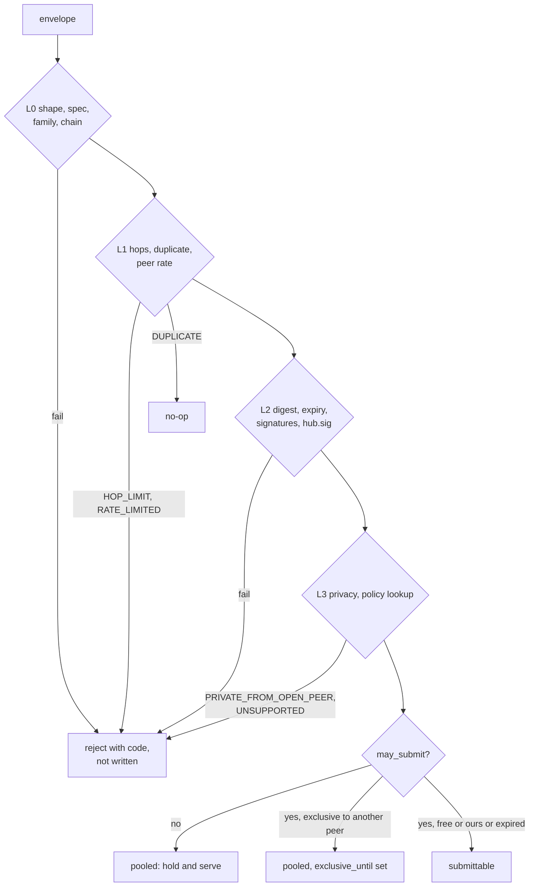
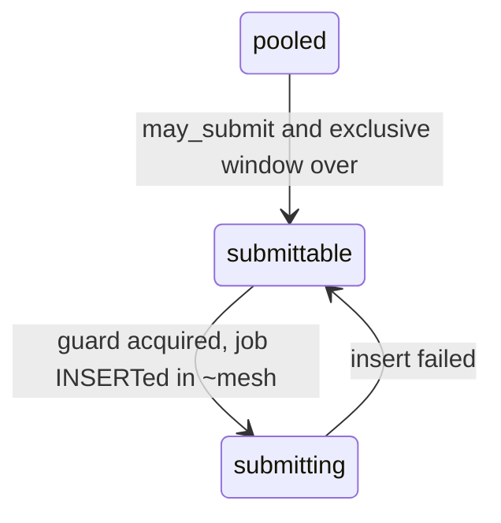

# Relayer mesh

Nodes of different operators exchange signed intents so that any of them can land them: a payer's intent is not stuck
behind one relayer. Two transports feed **one pipeline**: the **pull bus** for admitted peers (consortium and private
data) and **libp2p gossip** for the open mesh ([gossip.md](gossip.md)). Same envelope, same `accept()`, same store,
same dedup, same scheduler. This file covers the envelope, the bus, the acceptance policy, exclusivity and the private
profile. Status: envelope, per-family digests, hub signature, acceptance L0–L3 and export filter **BUILT** as a library
(46 conformance cases; 43 in the design); bus, scheduler and pipeline **SPECIFIED**.

| Aspect | Pull bus (admitted peers) | Open mesh (gossip) |
|---|---|---|
| Admission | Peer row with SPKI SHA-256 pin, class `open`/`private`, allowed chains; checked at handshake **and** per request ([NODE-MESH-03](#NODE-MESH-03)) | gossipsub v1.1 scoring, graylist/ban, per-source/origin/`from` buckets ([NODE-GSP-08](gossip.md#NODE-GSP-08)); Kademlia `/scaas/kad/1.0.0` discovery, toml bootstrap ([NODE-GSP-09](gossip.md#NODE-GSP-09)) |
| Carriers | HTTPS mTLS (`/v1/mesh/policy`, `/v1/mesh/intents?since=`) or QUIC `/scaas/bus/1.2`; never TCP+Noise (`TRANSPORT_NOT_PQ`) | QUIC (default) or TCP+Noise+yamux |
| Catch-up | Cursor with `store_id`, overlap 200, page ≤ 200 rows / 1 MiB | `/scaas/sync/1` anti-entropy ([NODE-GSP-13](gossip.md#NODE-GSP-13)) |
| Private data | Only private-class peers, only from the origin ([NODE-MESH-12](#NODE-MESH-12)) | Never ([gossip.md#private-isolation](gossip.md#private-isolation)) |
| Topics | — | `/scaas/intent/1.2/<chain_key>`, `/scaas/hint/1/<chain_key>`, `/scaas/dex/1/<chain_key>/<dex>/<base>/<quote>`, `/scaas/announce/1` |

Gossip adds landed hints (a hint only triggers the consumption read, never a state change), signed announces
(strictly increasing `version`, `expires_at ≤ issued_at + 24 h`, re-published every 10 min, lanes with proof of
possession `secp256k1_sign(keccak256("scaas-lane-pop/1" ‖ chain_key ‖ peer_id))`, URLs never dialed) and DEX book
replication (home model: only the node that proves the order's `relayer` matches and settles; others hold read-only
replicas merged by `home_seq`, last-writer-wins, joined with chain facts `filled = max`, `closed = or`;
[dex-venue.md#gossip](dex-venue.md#gossip)). `bus_scope = public` is a separate opt-in; DEX books carry home-bound
**and** relayer-unbound orders per market; exclusive-assignment trust is automatic after 3 verified landings; QUIC
offers only the PQ group; DEX homes are auto-trusted on chain evidence. UA intents travel as `scaas-intent/1.3`
(`evm.ua_meta_tx` body only, same topic; 1.2 nodes ignore them).

**Contents**

1. [Scope](#scope)
2. [Bus](#bus)
   - 2.1 [Authentication and connection limits](#21-authentication-and-connection-limits)
   - 2.2 [Routes](#22-routes)
   - 2.3 [Errors](#23-errors)
   - 2.4 [Forwarding, hops, idempotency](#24-forwarding-hops-idempotency)
3. [Envelope](#envelope)
   - 3.1 [Family qualification](#31-family-qualification)
   - 3.2 [Wire encoding](#32-wire-encoding)
   - 3.3 [Fields](#33-fields)
   - 3.4 [`intent_id` and decoded fields per family](#34-intent_id-and-decoded-fields-per-family)
   - 3.5 [hub.sig](#hubsig)
   - 3.6 [Conformance vectors](#36-conformance-vectors)
4. [Acceptance](#acceptance)
   - 4.1 [Evaluation order (no RPC before L4)](#41-evaluation-order-no-rpc-before-l4)
   - 4.2 [Forward vs submit vs reject](#42-forward-vs-submit-vs-reject)
5. [Exclusivity](#exclusivity)
   - 5.1 [Sources](#51-sources)
   - 5.2 [Assignment (origin only)](#52-assignment-origin-only)
   - 5.3 [Scheduler (every 250 ms, `mesh/sched.rs`)](#53-scheduler-every-250-ms-meshschedrs)
6. [Numbers](#6-numbers)
7. [Bus scope](#bus-scope)
8. [Private profile](#private-profile)
9. [Reward](#9-reward)
10. [Tests](#tests)
11. [Limitations](#limitations)
   - 11.1 [Open questions](#111-open-questions)

## <a id="scope"></a>1. Scope

<a id="scope"></a>In scope:

1. A **bus between `scaas-node` processes** of different operators: admitted peers pull each other's intents over HTTPS
   with mutual TLS or over QUIC ([NODE-MESH-01](#NODE-MESH-01), [NODE-MESH-03](#NODE-MESH-03)), with a `bus_seq` cursor
   from the node store ([NODE-MESH-02](#NODE-MESH-02)); plus open-mesh gossip ([gossip.md](gossip.md)).
2. A **transport-neutral envelope** `scaas-intent/1.2` for every qualifying family ([NODE-MESH-09](#NODE-MESH-09),
   [NODE-MESH-07](#NODE-MESH-07)), with public conformance vectors ([NODE-MESH-11](#NODE-MESH-11)).
3. **Acceptance policy** as one lookup table in the node store, evaluated before any RPC ([acceptance](#acceptance));
   submission only on registered tokens ([NODE-MESH-13](#NODE-MESH-13)).
4. **Soft exclusivity** assigned by the origin node, round-robin over eligible submitters ([NODE-MESH-04](#NODE-MESH-04)).
5. **Cancel/dedup correctness on every submit path**: consumption re-checked before every bump or resend and after every
   reverted receipt ([NODE-LANE-09](submit-lanes.md#NODE-LANE-09)); clients learn of consumption at detection time
   (outcome `landed_elsewhere`, written `LANDED_ELSEWHERE` in the first draft).
6. **Private profile**: a chain's `profile`; private-chain intents only travel from the origin to private peers it
   admitted itself ([private profile](#private-profile)).
7. **Per-job bus scope**: default keeps the job on our own lanes; opt-in publishes relayer-unbound jobs after a private
   window ([bus scope](#bus-scope)). Publication is done by the node over its own job rows.

Non-goals (v1):

| Out | Why / where it goes |
|---|---|
| PoW, stake, lottery, `beacon` | admission (bus) and scoring (gossip) are the anti-sybil controls |
| Rewards other than the intent's own `fee` / `feeRecipient` | [NODE-MESH-05](#NODE-MESH-05): no `SponsorshipPool` reward, no statement payouts, no forwarder pay |
| Soroban on the mesh | [NODE-MESH-07](#NODE-MESH-07), [NODE-MESH-24](#NODE-MESH-24): replay protection is the host's auth nonce, not a per-subject nonce in our contract |
| Zether intents on the mesh (classical and post-quantum) | `W = 0` and single-flight per confidential subject (`from_schnorr`) need their own design; pull latency does not fit a 20 s budget |
| EVM `call` jobs (mandate calldata), DEX `mtxSettle` jobs, non-EVM op kinds other than `pay` | no subject-signed digest whose replay guard is a lane nonce a peer can check (TON revoke uses `next == nonce + 1`, Solana mandate revoke uses a generation) |
| Multi-hop private routing | [NODE-MESH-12](#NODE-MESH-12): private intents are served by their origin only; needs an origin-signed recipient set and a ruling |
| Callback subject registry, ban-list sharing | no callbacks exist ([NODE-IDX-04](indexer-feeds.md#NODE-IDX-04)); ban lists stay local |
| Promote-to-open of pooled intents ("private pool") | the only "private then open" path is the per-job window on own jobs ([bus scope](#bus-scope)); a pooled bus intent never changes visibility |
| `nonce_unverified` cache tiers; a cache of rejected intents | federation volume does not need them; the submitter's simulation is the check |
| Client-side mesh counters | `/metrics` on the node only ([ops.md#metrics](ops.md#metrics)) |

<a id="NODE-MESH-24"></a>**NODE-MESH-24** (open; default applied) — Soroban stays on the job API, not the mesh, until a
contract-level per-subject nonce (or acceptance of the host authorization nonce as equivalent) qualifies it.

## <a id="bus"></a>2. Bus

<a id="bus"></a><a id="NODE-MESH-01"></a>**NODE-MESH-01** — **The pull bus is the transport for admitted peers.** Each
node serves `GET /v1/mesh/intents` and pulls its peers'. No push, no publish/claim/receipt routes between peers. Pull
gives catch-up after downtime (cursor) and puts the export filter for private intents in one server-side function
([private profile](#private-profile)). The open mesh is gossip ([NODE-GSP-01](gossip.md#NODE-GSP-01)). Latency ≤ (poll
+ lag) per hop, ≤ 6 s at 4 hops: fine for EVM `validUntil` of 300 s; wrong for Zether (out).

<a id="NODE-MESH-02"></a>**NODE-MESH-02** — **Commit-ordered bus `seq`, and a `store_id` that resets cursors.** Intents
live in the node store ([store.md#mesh-tables](store.md#mesh-tables)); `bus_seq` comes from a counter row incremented
in the inserting transaction (the single-writer equivalent of SQLite `INTEGER PRIMARY KEY AUTOINCREMENT`; one writer ⇒ seqs in commit order, so a seq can never be allocated before its commit); a
random `store_id` names the store and is sent with every page, so a peer whose store was recreated is detected (cursor
reset). A lost disk loses pooled intents; signers re-send.

Served by the mesh module on `[mesh] bind` (HTTPS) and as `/scaas/bus/1.2` on QUIC ([gossip.md#wire](gossip.md#wire)).
**Every** route requires mTLS (or the QUIC peer identity) of an active peer. JSON responses, `Content-Type:
application/json`, no cookies, no redirects. Version prefix `/v1/mesh` follows the spec major.

### 2.1 Authentication and connection limits

- TLS 1.3 only, X25519MLKEM768 only ([NODE-GSP-03](gossip.md#NODE-GSP-03)). Server: `rustls::ServerConfig` built with
  the process-wide provider and a custom `ClientCertVerifier` that **requires** a client cert, accepts self-signed certs
  (no chain building), lets rustls verify the TLS 1.3 `CertificateVerify` signature with the cert's own key
  (`verify_tls13_signature`), then computes `peer_id = sha256(spki)` and fails the handshake unless `peer_id` is an
  **active** peer in the current snapshot (`Arc<RwLock<PeerTable>>`). Unknown peers never reach HTTP parsing.
- **Per request**: the accept loop stores `peer_id` in a request extension; a middleware looks it up in the *current*
  snapshot on every request and answers `403 PEER_SUSPENDED` when it is no longer active (a suspended peer cannot keep
  using a keep-alive connection).
- Accept loop: `tokio::sync::Semaphore` of `max_conns`; `tokio::time::timeout(handshake_timeout_ms,
  TlsAcceptor::accept)`; each connection is closed after `max_conn_age_secs` (graceful shutdown of the hyper
  connection).
- Client: one `reqwest::Client` per peer built with `use_preconfigured_tls(rustls::ClientConfig)`: our cert+key as
  client auth, a `ServerCertVerifier` that accepts only a leaf whose SPKI hash equals that peer row's pin (ignores
  names, dates, CA). `redirect(Policy::none())`, timeout 10 s.
- Peer rotation of a key = a new peer row with the new pin; the old row is suspended after cut-over.
- Handler plumbing: `tokio_rustls::TlsAcceptor` → `server::TlsStream::get_ref().1.peer_certificates()` → `hyper_util`
  auto connection with `TowerToHyperService` over the axum router. SPKI extraction with `rustls-webpki`
  (`webpki::EndEntityCert::try_from(&der)` → `subject_public_key_info()`, which re-wraps the outer SEQUENCE). The PEM
  key is parsed by hand: base64 body = fixed prefix `302e020100300506032b657004220420` ‖ 32-byte seed. No
  `axum-server`, no `rcgen`, no `x509-parser`.

<a id="peer-identity"></a><a id="NODE-MESH-03"></a>**NODE-MESH-03** — **Peers are pinned by SPKI: TLS 1.3 mutual auth
with self-signed X.509 certs; trust = SPKI SHA-256 pin per peer row; no CA.** Key type **Ed25519** — the node key of
[NODE-GSP-05](gossip.md#NODE-GSP-05), which also signs `hub.sig` and is the `pubkey` in `/v1/mesh/policy`. `peer_id` =
SHA-256 of the DER SubjectPublicKeyInfo. Admission is checked at the handshake **and** on every request. Ed25519
signatures are deterministic (the vectors need fixed `hub.sig` bytes) and keys are 32 bytes; secp256k1 is not a TLS
signature scheme, so lane keys cannot double as peer keys. An HSM that only does P-256 cannot hold this key.

### 2.2 Routes

#### 2.2.1 `GET /v1/mesh/policy`

What this node accepts and how it serves, filtered for the caller (an `open` peer never sees a private chain). Callers
cache it 60 s.

```json
{"spec": ["scaas-intent/1.2"], "peer_id": "64 hex", "pubkey": "64 hex", "store_id": "32 hex",
 "max_hops": 4, "cursor_overlap": 200, "publish_lag_ms": 500, "exclusive_ms": 10000, "page_max": 200,
 "chains": [{"chain_key": "evm:100", "submit": true, "fee_recipient": "0x…",
             "contracts": [{"contract": "0x…", "selector": "*", "min_fee": "0",
                            "fee_recipient_allow": "any"}]}]}
```

`chains[].contracts` lists only rows with `support = full`, `submit = true` and a registered contract
([NODE-MESH-13](#NODE-MESH-13)); it is what an origin uses to build the round-robin set ([exclusivity](#exclusivity)).
`mode_known_mask` / `fee_modes_supported` are fixed by the contract (`0xF3`, NONE/PERCENT/FIXED) and are not repeated.

#### 2.2.2 `GET /v1/mesh/intents?since=<seq>&limit=<n>`

(Summary form `GET /v1/mesh/intents?since=&limit=`.)

- `since` default 0, `limit` ≤ `page_max` (200). Full envelopes only (no summary/by-id two-step: an admitted peer could
  ask for full anyway, and a second round trip per hop is not in the latency budget).
- Server returns rows with `seq > since`, `received_at ≤ now − publish_lag_ms`, non-terminal, `valid_until > now`,
  stored `hop_count < max_hops`, and `may_export(row, caller)` ([private profile](#private-profile)). Ordered by
  `seq`. The page ends early when the next envelope would take the body past `page_max_bytes` (1 MiB); at least one
  item is always returned when one is due.

```json
{"store_id": "32 hex",
 "items": [{"seq": 9101, "envelope": {…}}],
 "next": 9101}
```

The served envelope is the stored one with `hop_count` = stored value. `next` = seq of the last item (or `since` when
empty). There is no `head` field (it would count rows the caller cannot see; [threat-model.md#mesh](threat-model.md#mesh)
MT7).

Client rule: request `since = max(0, cursor − cursor_overlap)`, dedup by `intent_id`, set `cursor = next`, persist it
with the peer's `store_id` in `peer_cursor`. A `store_id` different from the stored one resets the cursor to 0 (the
peer's store was recreated). With the single-writer store the lag and overlap are not needed for correctness; they stay
in the protocol so another implementation can rely on them.

Gateway additions: rows written by door A carry `source = 'gateway'`; `POST /v1/metatx` normalizes before simulation; its response carries `intent_id` and, when
published, `exclusive` (`202`); a duplicate returns `200` with the stored state. `GET /v1/intents/{intent_id}` serves
only gateway-origin rows ([gateway.md#routes](gateway.md#routes)).

### 2.3 Errors

Body `{"error": "<CODE>", "detail": "<text>"}`.

| HTTP | Code | When |
|---|---|---|
| — | (TLS alert) | client cert missing, bad `CertificateVerify`, peer not admitted/active, handshake timeout, no X25519MLKEM768 |
| 400 | `BAD_REQUEST` | bad query (`since` not a u64, `limit` out of range) |
| 403 | `PEER_SUSPENDED` | the connection's peer was suspended after the handshake |
| 403 | `TRANSPORT_NOT_PQ` | a bus request on a TCP+Noise connection |
| 429 | `RATE_LIMITED` | caller over `peer_rps`; header `Retry-After: <s>` |
| 503 | `NOT_READY` | store not open, or not the owner |

Ingest outcome codes (local; metrics label `code`; also returned by the gateway for door-A intents as 4xx `error`):
`UNSUPPORTED_SPEC`, `BAD_ENVELOPE`, `FAMILY_NOT_SUPPORTED`, `UNKNOWN_CHAIN`, `EXPIRED`, `VALID_TOO_LONG`,
`HOP_LIMIT`, `DIGEST_MISMATCH`, `BAD_SIGNATURE`, `RELAYER_BOUND_ZERO`, `BAD_HUB_SIG`, `PRIVATE_FROM_OPEN_PEER`,
`UNSUPPORTED` (policy `support = none`), `STORE_FULL`, `RATE_LIMITED`. `DUPLICATE` is not a rejection (no-op).

### 2.4 Forwarding, hops, idempotency

- The origin stores `hop_count = 0`. A receiver stores `served hop_count + 1` and rejects `> max_hops` (`HOP_LIMIT`); a
  node never serves a row whose stored `hop_count ≥ max_hops`. "Forwarding" in a pull bus = holding the row and serving
  it; there is no other forward action. Private rows are not forwarded at all ([NODE-MESH-12](#NODE-MESH-12)).
- Idempotency: `intent.intent_id` is UNIQUE; ingest of a known id is a no-op whatever its hop/hub (first seen wins).
  All bus routes are GET and side-effect free except rate-limit counters.
- `hop_count` is unsigned and a malicious peer can reset it; dedup is the real loop breaker, hops only trim waste.
  Gossip loops are broken by the message-id and store dedup ([gossip.md#wire](gossip.md#wire)).
- Pull latency per hop ≤ `poll_ms + publish_lag_ms` (1.5 s); 4 hops ≤ 6 s.

## <a id="envelope"></a>3. Envelope

<a id="envelope"></a><a id="NODE-MESH-09"></a>**NODE-MESH-09** — **Envelope spec `scaas-intent/1.2`.** JSON on the
wire: `spec`, `intent_id`, `chain_key`, `family`, `contract`, `visibility`, the family body (`evm` with domain,
11-field `meta_tx`, signature, `sig_kind` `eoa|erc1271`; or `op` with the exact signed `payload`),
`hub{id, pubkey, published_at, sig}`, `exclusive{relayer_id, until}?`, `hop_count`. `hub.sig` covers a fixed binary message ([hub.sig](#hubsig)) that includes `body_hash` = SHA-256 of the canonical
JSON of the family body. Drafts 1.0/1.1 were never implemented by any node and are void: receivers reject `1.0`/`1.1`
and any other major with `UNSUPPORTED_SPEC` (1.1's `hub_sig_payload` used `address(relayer_id)` and a lottery `beacon`;
changing both is a breaking change). `body_hash` stops forwarders swapping the signature, `sig_kind` or native
params.

<a id="NODE-MESH-18"></a>**NODE-MESH-18** — **UA intents use `scaas-intent/1.3`** (only for this body; everything else
stays 1.2): EVM body `evm.ua_meta_tx = {token, m: UAMetaTransaction (hex fields), auth}`; `from` decoded from `m.from`
(32-byte hex, canonicalised per [CTR-UA-03](../contracts/accounts.md#CTR-UA-03)). `intent_id` = `uaDigest(m)`.
`sig_kind` values: `eoa`, `erc1271`, `ua`. No `from_kind`: the kind comes from `recordOf` (an unsigned JSON field would
be a second source of truth). 1.2 nodes refuse/ignore 1.3 envelopes (no penalty, no forwarding).

<a id="ua-intents"></a>UA intents: topic is the existing `/scaas/intent/1.2/<chain_key>`; pre-gossip, a `ua` intent
makes the node read `recordOf(from)` once per chain (immutable; cache with no expiry; negative results cached 60 s),
recompute the id from `auth.keyData` (or read `keyPtr` for stored kinds), and verify every single-key kind and every
structure natively ([NODE-GSP-15](gossip.md#NODE-GSP-15)); only ERC-1271 goes to simulation. A failed UA check is
`Ignore` for gossip acceptance (the kind and stored keys come from our store): the intent is dropped and never
simulated, without penalising the forwarder. Rate limits and freshness reads key on the **canonical** `from` (an EOA is
the same 20-byte key whether it arrives via 1.2 or padded via 1.3); `uaNonce(from, batch)` is the freshness source.

### 3.1 Family qualification

<a id="families"></a><a id="NODE-MESH-07"></a>**NODE-MESH-07** — **Families on the mesh v1: EVM (`evm`, and `hedera`
which runs the same Solidity), Cosmos, Sui, Aptos, TON, Solana. Soroban is out.** Criterion: our contract computes a
meta-tx digest and keeps a per-subject sequential nonce that a peer can read; without it a peer cannot run the
consumption check. Non-EVM op kind limited to `pay` in v1. Soroban partners relay through the job API only.

| Family | Digest (contract) | Per-subject nonce (contract) | Readable by a peer | Qualifies |
|---|---|---|---|---|
| EVM | `ERC20MetaTx.mtxExecute` (as built `ERC20MetaTx.executeMetaTransaction`, kept as an alias): `_hashTypedDataV4(m.hashStruct())` over the salted domain, emitted in `MetaTransactionExecuted.digest` | `_metaNonce[from][batch]`, must equal `m.nonce`, `+1` after execution | `mtxNonce(from, batch)` view (deployed tokens: `metaNonce`) | **yes** |
| Hedera | the Hedera token tiers, on the same `ERC20MetaTx` base | same | same, via the JSON-RPC relay | **yes** (envelope family `hedera`, EVM body) |
| Cosmos | `sha256(payload)`, emitted as `digest` attribute | `NONCES: Map<(&Addr, lane), u64>`, `op.nonce == next` | `QueryMsg::Nonce { owner, lane }` | **yes** |
| Sui | `personal_digest(bcs(MetaOp))` | `Account<T>.lanes: Table<lane, u64>`, `next == nonce` | `lane_nonce<T>(account, lane)` | **yes** |
| Aptos | `sha3_256(bcs(MetaOp))` | `Account.lanes: Table<lane, Lane{next}>` | `#[view] lane_nonce(owner, lane)` | **yes** |
| TON | `MetaOp` cell digest checked and emitted in `MetaTransactionExecuted` | jetton wallet `lanes: map<uint256, uint64>`, `next == m.nonce` (revoke: `next == nonce + 1`) | getter `get_lane_nonce(lane)` | **yes** (`pay`; lanes rotate every `LANE_TTL` — a check after `valid_until` is meaningless, expiry decides) |
| Solana | `sha256(MetaOp)` | `LanePda{next}` seeded `["lane", subject, lane]`, `lp.next == args.nonce` | read the `LanePda` account | **yes** (`pay`; lane PDA prunable after `valid_until`) |
| Soroban | `op_digest` = sha256(XDR) emitted by the token | **none in our contract**: replay protection is the host's `SorobanAddressCredentials` nonce (`i64(sha256("scaas.soroban.nonce" ‖ entryRef ‖ validUntil)[0..8])`, a per-entry value, not a per-subject sequence); our contract only has a one-shot `pay_ref` | `ref_used(pay_ref)` only | **no** |

Contract source lines (orientation, as of 2026-10-07, before the single `ERC20MetaTx` base replaces the earlier
token lines): EVM `smartcontracts/src/metatx/ERC20MetaTx.sol` digest l.62–103,
nonce l.26, l.80, l.102, view l.44; Hedera `smartcontracts/src/hedera/HederaMetaToken.sol` l.15 (`MetaToken is
ERC20MetaTx`); Cosmos `chains/cosmos/metaop/src/lib.rs` l.119, `chains/cosmos/token/src/lib.rs` l.81, l.194–197, query
l.239; Sui `chains/sui/sources/meta.move` digest l.322, lanes l.104, l.285–287, view l.484; Aptos
`chains/aptos/sources/meta.move` l.114, l.110, l.278–279, view l.666; TON `chains/ton/contracts/jetton.tact` l.233,
lanes l.121, l.226–230 (revoke l.229), getter l.359; Solana `chains/solana/programs/scaas/src/account.rs` l.197
(`lib.rs` l.125), lane check l.159–161, l.202; Soroban `chains/soroban/contracts/token/src/lib.rs` l.102, `pay_ref`
l.203–206.

### 3.2 Wire encoding

- UTF-8 JSON object, at most 32 KiB per envelope.
- Receivers **ignore unknown top-level fields** (minor bump rule) and reject an unknown major. The family body (`evm` /
  `op`) is covered by `body_hash`, so unknown fields inside it are hashed, not ignored.
- Integers that fit in `u64` (timestamps, `hop_count`): JSON numbers. `uint256` values: canonical decimal strings (no
  sign, no leading zero; exactly `metatx.rs` `uint()`).
- Bytes and hashes: `0x` + lowercase hex. `peer_id`, `pubkey`, `sig`: lowercase hex **without** `0x`.
- Addresses: the family's canonical form: lowercase `0x` 20 bytes on EVM/Hedera, bech32 on Cosmos, `0x` + 64 hex on
  Sui/Aptos, raw `wc:hex` on TON, base58 on Solana.
- `chain_key` = `family:network`, exactly as the node's `ChainCfg::chain_key()` (`evm:100`, `hedera:296`, `cosmos:scaas-1`, `sui:localnet`, `aptos:4`, `ton:-239`,
  `solana:<genesis base58>`). Not CAIP-2: the node and its clients key on `chain_key`; CAIP-2 stays a display field.
- **Canonical body JSON** (for `body_hash` only): the `evm` or `op` object serialized with object keys sorted bytewise,
  no whitespace, no floats (integers must fit `i64`), every string printable ASCII `0x20–0x7e` (all values are hex,
  decimal, base58, bech32 or enum words; anything else ⇒ `BAD_ENVELOPE`). Rust: `serde_json::to_vec` of a `Value`
  (default `BTreeMap`, no `preserve_order` feature). Python: `json.dumps(o, sort_keys=True, separators=(',', ':'))`.
  Vector cases pin the bytes.

### 3.3 Fields

```json
{
  "spec": "scaas-intent/1.2",
  "intent_id": "0x9f3c…64 hex",
  "chain_key": "evm:100",
  "family": "evm",
  "contract": "0xf17…",
  "visibility": "open",
  "evm": {
    "domain": {"name": "SCaaS MetaToken", "version": "1"},
    "meta_tx": {"from": "0xa1…", "to": "0xb2…", "value": "100", "data": "0x…", "batch": "7412…",
                "nonce": "0", "validUntil": "1756500900", "mode": 32, "relayer": "0x00…00",
                "fee": "5000", "feeRecipient": "0x00…00"},
    "signature": "0x…",
    "sig_kind": "eoa"
  },
  "hub": {"id": "64 hex", "pubkey": "64 hex", "published_at": 1756500012, "sig": "128 hex"},
  "exclusive": {"relayer_id": "64 hex", "until": 1756500022},
  "hop_count": 0
}
```

| Field | Req | Meaning |
|---|---|---|
| `spec` | yes | `scaas-intent/1.2` |
| `intent_id` | yes | [NODE-MESH-08](#NODE-MESH-08); recomputed by every receiver |
| `chain_key`, `family` | yes | `family` must equal the prefix of `chain_key`; `soroban` ⇒ `FAMILY_NOT_SUPPORTED` |
| `contract` | yes | EVM: the token = EIP-712 `verifyingContract` (no forwarder). Others: the contract that verifies the op |
| `visibility` | yes | `open` \| `private`, as set by the origin; receivers apply the stricter of this and their own policy |
| `evm` | iff `family ∈ {evm, hedera}` | `struct` = `call` \| `transfer` and `meta_tx` = `WireMetaTx` (`scaas-node/src/metatx.rs`, camelCase; the 9 fields of `MetaTxLib.MetaTransaction` or the 11 of `MetaTxLib.MetaTransfer`, [CTR-MTX-15](../contracts/metatx.md#CTR-MTX-15)); `intent_id` is that struct's digest; `domain` = EIP-712 `name`/`version` of the token (implementation name/version on clones, [CTR-MTX-02](../contracts/metatx.md#CTR-MTX-02)); `sig_kind` `eoa` (65 bytes, low-s) or `erc1271` (contract wallet, no local recover); `hedera_ed25519` (64-byte HIP-632 signature, [NODE-MESH-16](#NODE-MESH-16)). The origin writes **zeros** in unbound `relayer`/`feeRecipient` ([NODE-LANE-10](submit-lanes.md#NODE-LANE-10)) |
| `op` | iff other families | the `op` object of a `signed_op` job: `op_kind` (`pay` in v1), `payload` (hex of the exact signed bytes), `signature`, `public_key`, `auth_kind`, `extra` (native params for building the tx). `from`, `valid_until`, lane, nonce and relayer are **not** taken from the clear JSON: receivers decode them from `payload`. `contract` is lifted to the top level |
| `hub.id` | yes | origin `peer_id` = SHA-256(SPKI DER) |
| `hub.pubkey` | yes | raw 32-byte Ed25519 key; receivers check `sha256(SPKI_ED25519_PREFIX ‖ pubkey) == hub.id`, with `SPKI_ED25519_PREFIX = 302a300506032b6570032100` |
| `hub.published_at` | yes | origin clock, unix seconds |
| `hub.sig` | yes | Ed25519 (RFC 8032, pure) over `hub_msg` |
| `exclusive` | no | absent = anyone admitted may submit now |
| `hop_count` | yes | not signed; incremented by each receiver |

Not in the envelope: `tokenContract`, `bus_seq` (in the page wrapper, a property of the serving node), a top-level
`published_at` (signed inside `hub`), `beacon`, `pow`, `sponsor`, `zether`, `hints` (a receiver re-simulates anyway;
hints would leak shape on public chains).

### 3.4 `intent_id` and decoded fields per family

<a id="intent-id"></a><a id="NODE-MESH-08"></a>**NODE-MESH-08** — **`intent_id` is the digest the contract emits** in
`MetaTransactionExecuted.digest`: EIP-712 `_hashTypedDataV4(hashStruct(m))` on EVM, the family digest otherwise. It
equals the digest a client stores for its own meta-tx or signed op. Dedup is by `intent_id` (an earlier note said "dedup by digest, not intent_id", assuming a
sender-chosen id; with id = digest the two are one value).

| Family | `intent_id` = | Routing fields decoded from | Implementations that must agree |
|---|---|---|---|
| `evm`, `hedera` | `keccak256(0x1901 ‖ domainSeparator(name, version, chainId, contract, salt) ‖ hashStruct(canonical(m)))`; `chainId` = number in `chain_key`; `salt` = the receiver's own `chain.chain_uid`, never a value from the envelope ([NODE-GW-07](gateway.md#NODE-GW-07); a chain known only from the policy table has none ⇒ `UNKNOWN_CHAIN`); a self-call `data` must be canonical before hashing ([NODE-JOB-20](job-api.md#NODE-JOB-20)) | `meta_tx` (all signed) | `MetaTxLib.hashStruct` (`smartcontracts/src/common/MetaTxLib.sol`), `metatx.rs` `digest()`, client libraries |
| `cosmos` | `sha256(payload)` | payload JSON (`MetaOp`) | contract `metaop` (`metaop/src/lib.rs` = `chains/cosmos/metaop/src/lib.rs`), client libraries |
| `sui` | `blake2b256([3,0,0] ‖ bcs(vector<u8>(payload)))` | `adapters/sui.rs` `MetaOp::decode` (l.136) | `meta.move` `op_digest`, `adapters/sui.rs` `personal_digest`, client libraries |
| `aptos` | `sha3_256(payload)` | `adapters/aptos.rs` `MetaOp::decode` (l.149) | `meta.move`, client libraries |
| `ton` | representation hash of the `MetaOp` cell tree carried in `payload` (BOC) | `adapters/ton.rs` `boc_parse` + `parse_metaop` (l.486) | `jetton.tact`, `adapters/ton.rs`, client libraries |
| `solana` | `sha256(payload)` (336-byte `MetaOp`) | `adapters/solana.rs` `MetaOp::decode` (l.154) | `account.rs` `digest()`, `adapters/solana.rs`, client libraries |

`scaas-node/src/mesh/digest.rs`: `pub fn decode(env: &Envelope) -> Result<Decoded>` returning `{intent_id, from, lane,
nonce, valid_until, relayer, fee_effective, selector, token}` by calling the existing helpers and decoders above
(`metatx::digest`, the adapters' `MetaOp::decode`/`parse_metaop`, `sha2`/`sha3`). No new family encoder; one new
decoder: a small `serde` struct for the Cosmos `MetaOp` JSON (on the fuzz list). The job API uses the same library for
its node-computed digests ([NODE-JOB-02](job-api.md#NODE-JOB-02)); Soroban: SHA-256 of the `HashIdPreimage` the payload
carries (job API only).

`token` (= `token_of`, [NODE-MESH-13](#NODE-MESH-13)) per family, with the account-derivation check that binds `contract`
to it:

| Family | `contract` is | `token_of` | Check |
|---|---|---|---|
| EVM, Hedera, Cosmos | the token | `contract` | — |
| Sui | the payer's `Account<T>` | `extra.registry` (bound by `body_hash`) | `derive_account(registry, from) == contract` |
| Aptos | the payer's Account object | `asset` from the payload | `account_of(from) == contract` |
| TON | the payer's jetton wallet | `extra.jetton_master` (bound by `body_hash`) | `jetton_wallet_address(from, master, code) == contract` (code hash from the token record) |
| Solana | the payer's SmartKeyAccount PDA | `asset` (payload field; `extra.asset` must equal it) | `account_of(program, from) == contract` |

Reference lines: Sui account derivation in the reference client library l.167 (formula l.159); Aptos l.233 and
`adapters/aptos.rs` l.207; TON l.296–312 and `adapters/ton.rs` l.526; Solana l.185 (check l.176).

A failed check makes the intent `may_submit = false` (held and served, never submitted); it is not a rejection.

L2 checks beyond the hash: EVM — `mode` known (`MODE_KNOWN_MASK`, fee nibble ≤ 2), `MODE_RESTRICT_RELAYER` with
`relayer == 0` ⇒ `RELAYER_BOUND_ZERO` (a dead intent), `sig_kind = eoa` ⇒ `ecrecover(intent_id, signature) == from`
with low-s. Other families: decoded `network`/`contract` fields of the payload must match `chain_key`/`contract`, and
the signature is verified before any chain call ([NODE-MESH-16](#NODE-MESH-16)). Unsigned parts that could still be
wrong (`erc1271` signature, non-EVM `signature`/`public_key`/`auth_kind`/`extra`) are bound by the origin's `hub.sig`
through `body_hash`; only a malicious *origin* can get them wrong, and its row is deleted when simulation fails so an
honest copy can still be ingested.

<a id="decoders"></a><a id="NODE-MESH-16"></a>**NODE-MESH-16** — **Mesh and gateway decoders verify the signature before
any chain call.** Families on the mesh: EVM `eoa` as above; EVM `erc1271` by one `eth_call isValidSignature` charged to
a per-peer simulate budget; Hedera 64-byte ED25519 as `sig_kind = "hedera_ed25519"` (length, long-zero `from`, key
from the mirror node, cached; [NET-HED-13](../networks/hedera.md#NET-HED-13)); Cosmos ADR-036 secp256k1 (address from
the signed pubkey) and passkey P-256 locally; Solana ed25519 locally; Aptos ed25519 against the account's auth key, TON
ed25519 against the wallet key, Sui against the `Account` keys (one cached state read each). Failure ⇒
`BAD_SIGNATURE`, never simulated, and counts against the publishing peer (peer score). Otherwise every peer pays a
simulation or view per garbage intent. Status: EVM `eoa` **BUILT**; the rest **SPECIFIED**.

### <a id="hubsig"></a>3.5 hub.sig

<a id="hubsig"></a>

```
hub_msg =  "scaas-hub/v1"                 12 bytes ASCII, domain tag
         ‖ u8(len(chain_key)) ‖ chain_key  ASCII
         ‖ intent_id                       32 bytes
         ‖ body_hash                       32 bytes = sha256(canonical body JSON)
         ‖ hub.id                          32 bytes
         ‖ u64be(hub.published_at)
         ‖ u8(visibility)                  0 = open, 1 = private
         ‖ u8(has_exclusive)               0 | 1
         ‖ exclusive.relayer_id            32 bytes (zeros when absent)
         ‖ u64be(exclusive.until)          0 when absent
hub.sig = Ed25519_sign(origin_key, hub_msg)          64 bytes
```

A forwarder cannot change `exclusive.*`, cannot downgrade `private` to `open`, cannot move `published_at`, cannot swap
the signature, `sig_kind`, wire `relayer`/`feeRecipient` or native params. It does **not** stop an admitted peer from
re-originating someone else's intent under its own `hub` — first-seen-wins dedup, the `exclusive_ms` clamp and
failed-row deletion bound that ([threat-model.md#mesh](threat-model.md#mesh) MT6).

### 3.6 Conformance vectors

`scaas-node/tests/vectors/mesh-envelope-v1.2.json`, published with the node so any second implementation (including
client libraries that compute the same digests) checks against it; clients keep byte-identical copies (CI `cmp`).
Generated by `cargo test --test mesh_vectors -- --ignored regenerate`; checked by the non-ignored test. A client's copy
also checks that the client's own digest functions (`build_terms`/`digest` per family) produce the same `intent_id`.

```json
{"spec": "scaas-intent/1.2",
 "hub_key_seed": "01…32 bytes hex",          // Ed25519 seed of the test origin; peer_id derived
 "now": 1800000000, "fee_recipient": "0x…",  // our cold wallet for normalization cases
 "tokens": {"evm:100": ["0x…"], "sui:localnet": ["0x…registry"], …},   // registered tokens per chain
 "cases": [{"name": "…", "envelope": {…}, "from_peer_class": "open", "chain_profile": "public",
            "expect": {"accept": true, "intent_id": "0x…", "body_hash": "0x…", "hub_msg": "0x…", "hub_sig": "…",
                       "selector": "0x…", "valid_until": 1800000300, "fee_effective": "5000",
                       "may_submit": true, "submit_meta_tx": {…}}}]}
```

`submit_meta_tx` is the struct the submitter would encode after normalization. Required cases (accept unless a code is
given):

1. EVM open FIXED fee, a payment `MetaTransfer` (`entryRef ≠ 0`); case 3a is the `metatransfer_kat.json` vector verbatim.
2. EVM open mode with garbage in `relayer` and `feeRecipient` ⇒ **same** `intent_id` as case 1;
   `submit_meta_tx.feeRecipient` = `fee_recipient`, `relayer` = 0.
3. EVM `MODE_RESTRICT_RELAYER` with a lane address (accepted; `may_submit` only for that lane's node).
4. EVM `MODE_RESTRICT_RELAYER`, `relayer = 0` ⇒ `RELAYER_BOUND_ZERO`.
5. EVM `MetaTransfer` ⇒ selector `"transfer"` (`entryRef = 0`) or `"pay"`; a `MetaTransaction` ⇒ its 4-byte selector.
6. EVM `sig_kind = erc1271` (no local recover, accepted).
7. EVM high-s signature ⇒ `BAD_SIGNATURE`.
8. Hedera `hedera:296` (chain id 296 in the domain); an EVM chain whose `chain_uid` the receiver lacks ⇒ `UNKNOWN_CHAIN`.
9–13. Cosmos, Sui, Aptos, TON, Solana `pay` ops whose payload/digest are the existing cross-language vectors
   (`chains/cosmos/tests`, `adapters/aptos.rs` `payload_and_digest_match_move_and_python`, `adapters/solana.rs`
   `payload_digest_and_addresses_match_python_and_the_program`, `adapters/sui.rs` tests,
   `chains/ton/vectors/ton-vectors.json`); expected decoded `from`/`lane`/`nonce`/`valid_until`/`token`, and
   `may_submit = true` **computed** from the file's `tokens` map and a full/submit policy on `token_of`. Each of 10–13
   has a twin whose `contract` is another payer's account ⇒ `may_submit = false`.
14. Soroban op ⇒ `FAMILY_NOT_SUPPORTED`.
15. `spec = "scaas-intent/1.1"` and `"scaas-intent/2.0"` ⇒ `UNSUPPORTED_SPEC`.
16. Unknown extra top-level field ⇒ accepted, ignored.
17. `hop_count = 4` arriving ⇒ `HOP_LIMIT` (stored would be 5 > `MAX_HOPS`).
18. `validUntil = now + 3601` ⇒ `VALID_TOO_LONG`; `validUntil = now + 10` (inside skew) ⇒ `EXPIRED`.
19. `intent_id` off by one byte ⇒ `DIGEST_MISMATCH`.
20. `visibility` flipped `private` → `open` after signing ⇒ `BAD_HUB_SIG`.
21. `exclusive.until` changed after signing ⇒ `BAD_HUB_SIG`.
22. `hub.pubkey` not matching `hub.id` ⇒ `BAD_HUB_SIG`.
23. Private-visibility intent with `from_peer_class = open` ⇒ `PRIVATE_FROM_OPEN_PEER`.
24. `exclusive.until − published_at > exclusive_ms` ⇒ accepted, `exclusive` ignored (clamp).
25. `open`-labelled intent of a `chain_profile = private` chain from an open peer ⇒ `PRIVATE_FROM_OPEN_PEER`.
26. `sig_kind` flipped `eoa` → `erc1271`, or `signature` swapped, after signing ⇒ `BAD_HUB_SIG` (body_hash).
27. Non-EVM `extra` changed after signing ⇒ `BAD_HUB_SIG`.
28. `published_at = now − 3000`, `validUntil = now + 300` ⇒ accepted (catch-up); `published_at = now + 60` ⇒
    `BAD_ENVELOPE`.
29. NONE-mode intent with `fee = 10^30`, or a PERCENT `MetaTransaction`, policy `min_fee = 1` ⇒ accepted, `fee_effective = "0"`, `may_submit = false`.
30. Unregistered contract with a `full`/`submit` policy ⇒ accepted, `may_submit = false`.
31. Body string with a non-ASCII character ⇒ `BAD_ENVELOPE`.
32. Body whose object keys are deliberately **unsorted** on the wire ⇒ the expected `body_hash` is that of the sorted
    form. Fails loudly if `serde_json`'s `preserve_order` feature ever gets switched on by feature unification.

A client library uses the file to check that its own digest functions produce the same `intent_id` for cases 1–13
and that `json.dumps(sort_keys=True, separators=(',', ':'))` gives the same `body_hash` (a third implementation of the
digest). The built library has 46 cases (the list above plus the per-family twins and gossip-era splits).

## <a id="acceptance"></a>4. Acceptance

<a id="acceptance"></a><a id="acceptance-policy"></a><a id="NODE-MESH-21"></a>**NODE-MESH-21** — **One policy lookup
table with static columns**, in the node store (`mesh_policy`, managed through the admin API,
[NODE-STO-03](store.md#NODE-STO-03)). One row per `(chain, contract, selector)`:

| Column | Type | Meaning |
|---|---|---|
| `chain_key` | text | |
| `contract` | text | `token_of` (the token itself; never a per-payer account) as canonical address, or `*` |
| `selector` | text | EVM: first 4 bytes of `meta_tx.data` of a `MetaTransaction` as `0x` + 8 hex, `transfer`/`pay` for a `MetaTransfer`, or `*`; other families: `pay` or `*` |
| `support` | enum | `none` ⇒ reject `UNSUPPORTED`; `forward_only` ⇒ hold and serve, never submit; `full` |
| `submit` | bool | this node submits for this row (requires `support = full`, a concrete registered contract, a lane for the chain) |
| `pool_visibility` | enum | `open` \| `private` \| `none` (hold, never serve); defaults from the chain profile |
| `min_fee` | uint256 | floor compared with the **effective** fee; non-EVM intents have fee 0, so `submit` on non-EVM needs `min_fee = 0` |
| `fee_recipient_allow` | enum | `any` \| `self_or_zero`; only consulted when the intent **binds** `feeRecipient` (`MODE_RESTRICT_FEE_RECIPIENT`), since unbound recipients are normalized |
| `gossip` | bool | door-A intents on this row are published on gossip ([gossip.md#intents](gossip.md#intents)) |

Lookup order (most specific wins, no merging): `(contract, selector)`, `(contract, *)`, `(*, selector)`, `(*, *)`, no row ⇒
`forward_only`.
Every column is static data; nothing in the table calls out (evaluable before simulation).

<a id="NODE-MESH-14"></a>**NODE-MESH-14** — **A missing policy row means forward only**, with `pool_visibility` derived
from the chain profile: default deny for submission, routing kept. An explicit `support = none` rejects.

<a id="NODE-MESH-13"></a>**NODE-MESH-13** — **`may_submit` requires `token_of(intent)` to be a registered token** of an
active chain (node token table; formerly the client's `node_config.tokens`, or `[[chains]] tokens` standalone; the
gateway already gated on registered tokens via `gateway.rs` `chain_of`); the admin API refuses `submit` on `contract = '*'`. `token_of` = `contract` on
EVM/Hedera/Cosmos; on Sui/Aptos/TON/Solana, where `contract` is the payer's own account, it is the token named in the
payload or body, and the node checks that `contract` is that payer's account derived from it. The policy `contract`
column holds `token_of`. Fee checks use the **effective** fee as `FeePolicy.compute` (NONE ⇒ 0, PERCENT ⇒ `value × fee
/ 10^6`, FIXED ⇒ `fee`). Otherwise a peer feeds attacker-deployed token clones with worthless fees that simulate fine
(gas drain), and a NONE-mode intent with a huge `fee` field passes `min_fee`. Partners must register their tokens on our
node before we submit for them; the gateway and the job API apply the same registered-token gate.

<a id="NODE-MESH-19"></a>**NODE-MESH-19** — **Fee-0 intents are allowed; the acceptance policy decides.** A policy may
set `min_fee = 0`; relayers are mostly paid outside the intent ([NODE-MESH-05](#NODE-MESH-05)). No rule filters fee 0
by itself.

### 4.1 Evaluation order (no RPC before L4)

```text
accept(env, source, peer?) -> Result<Row, Code>          // mesh/accept.rs, pure except store + clock
  L0  size ≤ 32 KiB, JSON object, spec major == 1 and minor ≥ 2, family supported, chain_key known
      (in the chain table or in any policy row), fields well-formed, body canonicalizable
                                                       → BAD_ENVELOPE / UNSUPPORTED_SPEC / FAMILY_NOT_SUPPORTED /
                                                         UNKNOWN_CHAIN
  L1  source == peer: hop = env.hop_count + 1 ≤ max_hops                            → HOP_LIMIT
      intent_id already a row in the store, or (intent_id, body_hash) tombstoned    → DUPLICATE (no-op)
      peer rate: token bucket peer_intents_per_sec                                  → RATE_LIMITED (the puller stops
                                                                                       the page there; the cursor
                                                                                       does not pass the item)
  L2  decode: recompute intent_id, decode from/lane/nonce/valid_until/relayer       → DIGEST_MISMATCH / BAD_ENVELOPE
      valid_until > now + clock_skew_secs                                           → EXPIRED
      valid_until ≤ now + max_valid_for_secs                                        → VALID_TOO_LONG
      EVM mode/relayer/sig checks; family signature (NODE-MESH-16)                  → RELAYER_BOUND_ZERO / BAD_SIGNATURE
      hub: sha256(prefix‖pubkey) == hub.id, Ed25519 verify(hub_msg incl. body_hash) → BAD_HUB_SIG
      hub.published_at ≤ now + clock_skew_secs (a past value only means an expired exclusive) → BAD_ENVELOPE
  L3  private = env.visibility == private OR chain_profile(chain_key) == private
      source == peer AND private AND peer.class == open                             → PRIVATE_FROM_OPEN_PEER
      a listed (denied) party                                                       → ignored, not forwarded (NODE-OPS-14)
      policy = lookup(chain_key, token_of, selector); support == none               → UNSUPPORTED
      visibility = strictest(env.visibility, policy.pool_visibility, chain_profile)
      may_submit = support == full && submit && token_of ∈ registered tokens
                   && account-derivation check passes
                   && we have a lane for chain_key && relayer_ok && fee_ok && source not our own job
        relayer_ok: relayer unbound (EVM RESTRICT bit off / non-EVM decoded relayer zero), or the decoded relayer
                    equals one of our lanes' canonical addresses (adapter.lanes()[i].address — not the `pk:<hex>`
                    log label)
        fee_ok:     EVM — fee_effective (FeePolicy.compute) ≥ min_fee && (feeRecipient unbound
                    || fee_recipient_allow == any || feeRecipient ∈ {0, fee_recipient}); others — min_fee == 0
  decide and INSERT (from_block = cached head of the chain, or NULL when the node has no RPC for it)
```

L4 (RPC) happens only on the submit path ([submit-lanes.md#shared-submit](submit-lanes.md#shared-submit)): simulation,
`metaTxDigest(m) == intent_id` on EVM, consumption check. L5 (`debug_traceCall`) is not used. The gossip validator runs
the same `accept()` with its own rate stages ([gossip.md#validation](gossip.md#validation)).

### 4.2 Forward vs submit vs reject



| Outcome | Condition | Store |
|---|---|---|
| reject | any L0–L3 code | not written; counted |
| hold + serve | accepted, `!may_submit` | `pooled`, served if visibility ≠ none and the export rule allows |
| hold, submit later | `may_submit` and a valid `exclusive` for another peer still running | `pooled`, `exclusive_until` set |
| submit now | `may_submit` and (no exclusive, or exclusive to self, or exclusive expired) | `submittable` |

Submit and serve are not exclusive: a `submittable`/`submitting`/`broadcast` row is still served (if visible), so the
network keeps the intent if this node dies ("still forward, but with `exclusive_until`").

## <a id="exclusivity"></a>5. Exclusivity

<a id="exclusivity"></a><a id="NODE-MESH-04"></a>**NODE-MESH-04** — **Signed round-robin exclusivity.** The origin node
signs `exclusive{relayer_id, until}` in `hub.sig`, choosing `relayer_id` round-robin over the eligible set = admitted
active peers that advertise `submit` for `(chain, contract)` and may see the intent, gossip peers per
[NODE-GSP-10](gossip.md#NODE-GSP-10), **plus the origin itself when it can submit** (the origin is a member of its own
round-robin). After `until` any eligible node may submit, after a deterministic per-node jitter. **Own jobs are never
assigned to a peer**: they are published without `exclusive`, and the origin keeps processing them through its own job
store; only still-`queued` jobs are published. Deterministic assignment needs no round-trip. `exclusive` is a courtesy,
not a lock: a peer that ignores it causes at most one reverted outer tx per loser
([README.md#guarantees](README.md#guarantees)).

### 5.1 Sources

| Source | Origin of envelope | Exclusive | Who submits |
|---|---|---|---|
| `gateway` (door A) | this node signs `hub` | round-robin when bus-eligible | assignee, then anyone after `until` |
| `job` (a job-API job with `bus_scope = open`/`public`, after its window) | this node signs `hub` | **none** | this node through its own job (unchanged path); peers immediately |
| `peer` (bus) | as received | as received (clamped) | per the acceptance outcome |
| `gossip` | as received | honoured only per [NODE-GSP-10](gossip.md#NODE-GSP-10) (clamped) | per the acceptance outcome |

Bus-eligible = `pool_visibility ≠ none` after the export rule and not relayer-bound to one of our lanes. A gateway
intent that is not bus-eligible is still written to the store with `visibility = 2` (durable) and submitted locally.
When publication of an own job hits a `DUPLICATE` (the same digest already arrived from a peer, e.g. the payer's wallet
also posted it elsewhere), the existing row is flipped to `may_submit = 0`, `source = 'job'`, `job_uid = …` (first draft: `may_submit = 0,
source = 'outbox', odoo_job_id = …`): the job path owns it from then on.

### 5.2 Assignment (origin only)

```
eligible(chain_key, contract, selector, visibility) =
      sorted_by_peer_id( {self if local policy may_submit}            # contract below = token_of
                       ∪ {p ∈ active peers : p.policy (cached /v1/mesh/policy) lists (chain_key, contract|*, selector|*)
                                              with submit, and may_export(visibility, p)}
                       ∪ {gossip peers per NODE-GSP-10} )
assignee = eligible[rr[chain_key] % len]; rr[chain_key] += 1        # in memory; reset on restart is harmless
exclusive = {relayer_id: assignee, until: published_at + exclusive_ms/1000}   # omitted when eligible is empty
```

So `until = published_at + exclusive_ms`, and the post-window jitter is keyed by `sha256(intent_id ‖ peer_id)`.
Receivers honour `exclusive` only if `hub.sig` verified and `0 < until − published_at ≤ exclusive_ms/1000` of the
**receiver's** config; otherwise they store `exclusive_until = NULL` (clamp, vector 24).

### 5.3 Scheduler (every 250 ms, `mesh/sched.rs`)

```text
for row in pooled where may_submit and (exclusive_until IS NULL or now ≥ exclusive_until + jitter(row)):
    CAS pooled → submittable
for row in submittable (oldest first):
    guard = inflight[chain_key].try_acquire(intent_id) else continue   # shared with every submit path
    CAS submittable → submitting; INSERT the job in ~mesh (origin key = intent_id), release on refusal
    insert failed ⇒ CAS submitting → submittable (dropping the guard releases the digest)
jitter(row) = u16(first 2 bytes of sha256(intent_id ‖ self.peer_id)) mod post_exclusive_jitter_ms   # differs per node
```



The first draft handed the work to the lane channel with `try_send`; inserting a job in `~mesh` replaced it, so every
submission goes through the job store. `exclusive_self` rows go straight to `submittable`. The `job_live_digest` index is the single admission point for every
submission path, so the mesh adds no path around G2.

## 6. Numbers

<a id="numbers"></a><a id="NODE-MESH-10"></a>**NODE-MESH-10** — **Mesh numbers, all configuration**: `MAX_HOPS = 4`,
`cursor_overlap = 200`, `publish_lag_ms = 500` (**arbitrary**); receiver clamp `exclusive_ms = 10 000` (**arbitrary**);
per-chain origin `chain.exclusive_ms = 7 000` for gossip-era assignment ([NODE-GSP-10](gossip.md#NODE-GSP-10));
`post_exclusive_jitter_ms = 2000`, `max_valid_for_secs = 3600` (per chain, [store.md#schema](store.md#schema)),
`private_window_secs = 120`, `poll_ms = 1000`, page 200 rows / 1 MiB, handshake timeout 5 s, connection age 300 s
(**arbitrary**), clock skew 30 s. The smallest values that cover one pull hop + simulation + one 5 s block; re-tune
after a real multi-site run. Gossip numbers: [gossip.md#numbers](gossip.md#numbers).

<a id="NODE-MESH-23"></a>**NODE-MESH-23** (open) — `MAX_HOPS = 4` is arbitrary; it is re-tuned after a multi-site run.

## <a id="bus-scope"></a>7. Bus scope

<a id="bus-scope"></a><a id="NODE-MESH-15"></a>**NODE-MESH-15** — **Bus scope arrives per job** (`bus.scope`,
`bus.private_window_secs`), set by the client from its own per-tenant setting ([INT-ERP-15](../integration.md#INT-ERP-15)):
`restricted` (default) — the job stays on our lanes and **never reaches the bus**; `open` — a still-`queued`
relayer-unbound job is offered to admitted bus peers after `private_window_secs` (default 120 s); `public` — also the
open gossip mesh (a separate opt-in). The node publishes its own eligible jobs (sets `published_at`); there is no
client-side publication claim. Policy and peers are node store tables managed in the node admin API. 120 s, not 300 s:
with ERC-20 `validUntil` of 300 s a 300 s window never opens. A tenant that opts in exposes payer, payee, amount and
timing to admitted peers of the matching class (or the world, for `public`).

<a id="NODE-MESH-17"></a>**NODE-MESH-17** — **Jobs carrying a receiver-fee co-signature use the restricted bus scope**:
the envelope has no slot for the payee co-signature ([sponsorship.md#receiver-pays](sponsorship.md#receiver-pays)), so
the job API forces `bus.scope = restricted`.

## <a id="private-profile"></a>8. Private profile

<a id="private-profile"></a><a id="NODE-MESH-06"></a>**NODE-MESH-06** — **Chain profile, default private.** A chain's
`profile` = `public` | `private`, **default `private`** (the default must be derived, not a flag someone remembers;
private fails closed; the open-relayer research and the client-design study, line 408, derive it; the enterprise
relay-pool study proposed `public` and was overruled). A policy's `pool_visibility` defaults from it. A private-chain intent is served **only** to peers
of class `private` whose allowed chains include it, over mTLS/QUIC; it is never exported to an `open` peer and never
promoted. A node rejects a private-chain intent (by label **or** by its own chain profile) arriving from an `open` peer.
Visibility is signed in `hub.sig` and only gets stricter. An operator who forgets to set `public` on a public chain gets
a bus that only private peers see: a liveness loss, never a leak.

<a id="NODE-MESH-12"></a>**NODE-MESH-12** — **Private-visibility rows are served only by their origin** (stored
`source != 'peer'`). Every private recipient must be admitted by the origin directly; otherwise a correct private peer
would re-serve to peers *it* trusts, outside the origin's allowlist (owner: "allowlisted private peers"). Private liveness depends on the origin being up.

```
chain_visibility(chain) = private if chain_profile == 'private' else open
effective(row) = strictest(env.visibility, policy.pool_visibility, chain_visibility)   # none > private > open

may_export(row, peer) =
      row.visibility == open    and peer.active and (peer.chains empty or row.chain_key ∈ peer.chains)
                                and not (peer.class == open and chain_profile(row.chain_key) == private)
   or row.visibility == private and row.source != 'peer'                                # origin only
                                and peer.active and peer.class == private and row.chain_key ∈ peer.chains
```

Rules:

1. `may_export` (bus) and `may_gossip` (gossip, [gossip.md#intents](gossip.md#intents)) are the **only** two functions
   that decide what leaves the node; the list route and the `/policy` chain list call `may_export`. One unit test per
   branch (incl. "private row received from a peer is never re-served"); one e2e (E5).
2. Visibility is monotone: it can only get stricter at each hop, and the origin's choice is signed.
3. `profile = private` forces `pool_visibility ∈ {private, none}` and `gossip = 0` (admin-API validation and a node check
   when loading toml). There is no promote path, so never-public holds by construction.
4. A private-chain intent from an `open` peer — labelled private **or** belonging to a chain we hold as private — is
   rejected (`PRIVATE_FROM_OPEN_PEER`) and counted; the peer is misconfigured or leaking and the operator must see it.
5. Logs never contain `data`, `payload`, amounts or counterparties of a private intent: `tracing` fields are
   `intent_id`, `chain_key`, `state`, `code`, `peer` only.
6. A private peer is still a peer: private-class peers also receive open intents.
7. Private data travels only on carriers with an X25519MLKEM768-only offer (HTTPS, QUIC); see
   [gossip.md#private-isolation](gossip.md#private-isolation).

## 9. Reward

<a id="reward"></a><a id="rewards"></a><a id="NODE-MESH-05"></a>**NODE-MESH-05** — **The mesh reward is the intent's
own `fee` / `feeRecipient` only.** No sponsorship pool reward, no statement payouts, forwarders unpaid. A non-EVM
`MetaOp` has no fee field, so peers relay non-EVM intents unpaid. Relayers are mostly paid outside the intent: peers
with no off-chain agreement have no reason to submit our fee-0 jobs; liveness then rests on our own node. An opt-in
`SponsorshipPool` is an application contract, not a mesh reward ([NODE-SPN-04](sponsorship.md#NODE-SPN-04)). Any third
party may run a relayer: it advances gas in the native coin and recovers it from the intent's fee, paid in the token
itself to `feeRecipient` (unbound: `msg.sender`) — the role EIP-1776 gives `rewardToken`/`rewardAmount` — or from
issuer sponsorship; relayers compete on latency and accepted fee.

**Break-even of a fee-earning relayer** (an order-of-magnitude argument): a meta-tx on Gnosis costs ≈ $0.00015 of gas;
at a 10× markup the margin is ≈ $0.0015 per tx; a relayer with SLA RPC, a small VPS and gas float costs ≈ $45–70 per
month ⇒ break-even ≈ $60 / $0.0015 = **40 000 tx per month**. Most enterprises do not reach this early. Consequences
(normative):

1. Relayers are run by parties with aligned business interest (issuer, distributors, partners, the payee), not by a fee
   market. The only in-protocol reward is the intent's own `fee`/`feeRecipient`: no sponsorship pool reward, no
   forwarder pay, no stake.
2. **B2B default `fee = 0`** (`MODE_FEE_NONE` + `MODE_RESTRICT_RELAYER` to the company relayer,
   [INT-ERP-06](../integration.md#INT-ERP-06)): gas is an operating expense of the company relayer, booked per
   transaction ([ops.md#finops](ops.md#finops)). `MODE_FEE_NONE` is also the cheapest mode (≈ 8 300 gas less than a
   fee-taking meta-tx).
3. Payee-side relaying removes relayer dependence entirely for incoming payments
   ([contracts/metatx.md#payers](../contracts/metatx.md#payers)).
4. Sponsorship policy (gas subsidy for qualifying inbound payments, e.g. "inbound to wallet W ≥ X currency units ⇒ fee
   0, booked to account Y") is a node policy row, never a contract feature ([sponsorship.md](sponsorship.md)).
5. Metric W3B-06 (relayer fee spread) may be negative by design.

## <a id="tests"></a>10. Tests

<a id="tests"></a><a id="NODE-MESH-11"></a>**NODE-MESH-11** — **The wire spec is public with conformance vectors, and
the test topology is several processes of one binary**: N `scaas-node` processes with different configs + one anvil +
a fake job-API client. Two processes of one binary catch wire-format errors; the vectors catch the rest (spec-reading
errors of a second implementation are only caught by the vectors).

Unit (`cargo test`, no network):

- `gateway.rs`: garbage `feeRecipient`/`relayer` with bits off ⇒ the `Work` calldata decodes to normalized fields (our
  fee wallet / 0, relayer 0); bound fields untouched; digest unchanged.
- `mesh/envelope.rs`: decode/encode round trip; unknown fields ignored; canonical body bytes; every L0 code; proptest
  fuzz.
- `mesh/digest.rs`: `intent_id` and decoded fields per family against the vectors; `token_of` and the account-derivation
  check per family; Cosmos JSON decoder fuzzed.
- `mesh/hubsig.rs`: `hub_msg` bytes golden; sign/verify; pubkey↔id check; PEM seed parsing.
- `mesh/accept.rs`: table-driven over every L-code and every outcome; policy lookup order; no-row default; poisoned copy
  first, then the honest copy is accepted; old `published_at` accepted; unregistered contract, NONE-mode huge fee;
  relayer bound to our lane's canonical address; open label on a private chain.
- `mesh/export.rs`: `may_export` all branches, including "private row from a peer never served".
- store: schema, every intent transition, failed-row deletion + `(intent_id, body_hash)` tombstone (same body skipped,
  different body evaluated), UNIQUE dedup, retention, `max_rows`, seq order, cursor + `store_id` reset.
- `mesh/sched.rs`: exclusivity wait, deterministic jitter, round-robin set from cached peer policies, insert failure
  returns the row to `submittable`.
- `mesh/tls.rs`: pin verifier accepts only the pinned SPKI; client verifier rejects another key; handshake with an
  unknown client fails; suspended peer on an open connection gets 403 (in-process, loopback).
- config: `[mesh]` validation, private chain with `pool_visibility = open` refused, `submit` with `contract = "*"`
  refused.
- submit (fake chain): consumed before bump ⇒ gap-filler, no meta-tx resend, `consumed`; `metaNonce` RPC error ⇒ no
  bump; earlier hash mined ⇒ settled from that receipt; simulate revert + consumed ⇒ `consumed` not `dead`; **reverted
  receipt + consumed ⇒ `consumed` not `reverted`**; normalization for mesh work; the same digest from the job path and
  the mesh ⇒ one signature; outcome for every origin on transient errors.
- adapter (fake adapter): `op_consumed = Some(true)` on resend ⇒ `consumed`, no resend, lane released after terminal
  status; `TxStatus::Reverted` + consumed ⇒ `consumed`; `op_consumed = None` for non-`pay` ops never stops a job.
- `nonce.rs`: `plan` with non-terminal store rows (below/above `pending`); terminal rows only raise `journal_max`.
- `Inflight` guard: every exit path of `submit()`/`step_once` without a `Sent` releases the digest; a job whose digest
  is in flight is skipped before it is claimed; a non-EVM lane and an EVM lane never both sign one digest.
- `GET /v1/intents/{id}` answers 404 for peer and job rows.

Conformance: `tests/mesh_vectors.rs` runs all vector cases through `accept()` and the normalizer; client copies are
checked by the clients' own suites; CI `cmp`s the files.

Multi-node e2e (`tests/e2e_mesh.rs`, `--ignored`, anvil + forge + a fake job-API client; nodes A, B, C started as
**separate processes** of the built binary (`env!("CARGO_BIN_EXE_scaas-node")`) with generated configs and temp stores; self-signed Ed25519 certs generated
by the test with `openssl`, skipped with a clear message if absent). Each scenario asserts chain state (balances,
`metaNonce`) and store states. The same scenarios also run with the bus over QUIC.

| # | Scenario | Pass when |
|---|---|---|
| E1 | **Forward**: A (gateway, `forward_only` for the token) receives a meta-tx with garbage unbound `feeRecipient`; B (`full`, submit) pulls and lands it | one outer tx on chain, from B; the fee lands in **B's** configured fee wallet; B's row `landed`; A's row stays `pooled` until `valid_until`, then `expired` (A never submits) |
| E2 | **Dedup**: A and C both serve the same intent to B (C pulled it from A) | B ingests once (`duplicate` counted), submits once |
| E3 | **Exclusivity expiry**: A assigns B; B is stopped; after `until + jitter` C submits | C lands it; no tx from anyone before `until` |
| E4 | **Landed elsewhere, cancel**: `anvil_setNextBlockBaseFeePerGas` above B's `maxFeePerGas` (B's `max_fee_cap_gwei` keeps headroom for a bump), so B's tx stays pending; C lands the same intent with a higher fee cap; `stuck_after_secs = 1`; B's `track()` re-checks before bump | B never re-sends the meta-tx, replaces its outer nonce with a gap-filler at bumped fees, row `consumed/landed_elsewhere`; B's lane nonce not abandoned |
| E5 | **Private never exported**: chain profile private; A has B as private peer and C as open peer; B also lists C as private | B receives and can land; C never receives the intent, neither from A nor re-served by B; C never sees the chain in A's `/policy` |
| E6 | **Peer not admitted / suspended**: D with an unpinned key pulls A ⇒ handshake fails; B is suspended while its keep-alive connection is open ⇒ B's next request gets 403 within one config refresh; an open peer that injects a private-chain intent is rejected and counted | as stated |
| E7 | **Restart durability**: kill B (SIGKILL) after it journaled `outer_nonce`/`tx_hash` and sent; restart | B resumes tracking (no re-sign, no second outer nonce), row ends `landed`; puller cursor resumes from `peer_cursor`; A's gateway intent survives A's restart |
| E8 | **Own-job publication**: a job with `bus_scope = open` passes its window; A publishes without `exclusive`; A's breaker is forced open so A cannot submit; B lands it | the client receives no `dead`/`reverted` for the job; it becomes final from the feed; B landed |
| E9 | **Restricted job**: `bus_scope = restricted` | nothing of it is ever served |
| E10 | **Catch-up**: C is down for 120 s while A accepts intents with `validUntil` 300 s; C starts | C ingests all of them (none rejected for age) and the still-valid ones are submittable |
| E11 | **Store recreated**: A's store is deleted and A restarted | B detects the new `store_id`, resets its cursor, and ingests A's next intent |
| E12 | **Race lost on our own job**: our node's tx for a job is mined and reverts because C landed first | the jobs feed reports `consumed`, never `reverted` |

Non-EVM multi-node e2e is not in v1 (each family needs its own localnet, several GB of RAM); non-EVM coverage =
vectors + adapter unit tests with fakes.

## <a id="limitations"></a>11. Limitations

<a id="limitations"></a>Deferred (PLANNED unless noted):

- Zether on the mesh: `W = 0`, single-flight per confidential subject (`from_schnorr`), push latency.
- Soroban: a contract-level per-subject nonce (or the host nonce accepted as equivalent) would qualify it
  ([NODE-MESH-24](#NODE-MESH-24)).
- Non-EVM op kinds other than `pay` (TON revoke `next > nonce + 1`, Solana mandate generation) on the mesh and in
  `op_consumed`.
- Multi-hop private routing with an origin-signed recipient set.
- Non-EVM multi-node e2e on one localnet (Cosmos `wasmd` is the lightest).
- Consumption classification for non-EVM before finality (adapter event lookup for one tx range).
- Forward scoring and receipts once rewards exist.
- Per-lane channels for gateway/mesh EVM work (today lane 0 only).
- Tune the mesh numbers after a multi-site run ([NODE-MESH-23](#NODE-MESH-23)).
- Ban-list sharing between operators.
- ML-DSA identities and NAT traversal ([gossip.md#limitations](gossip.md#limitations)).

### 11.1 Open questions

<a id="open-questions"></a><a id="NODE-MESH-22"></a>**NODE-MESH-22** (open) — Two lifecycle questions remain open: the
hop limit value ([NODE-MESH-23](#NODE-MESH-23)) and Sybil resistance of forward scoring
([NODE-GSP-16](gossip.md#NODE-GSP-16)); the promote-after window and the callback registry were resolved by the per-job
window ([NODE-MESH-15](#NODE-MESH-15)) and the no-callback rule.
