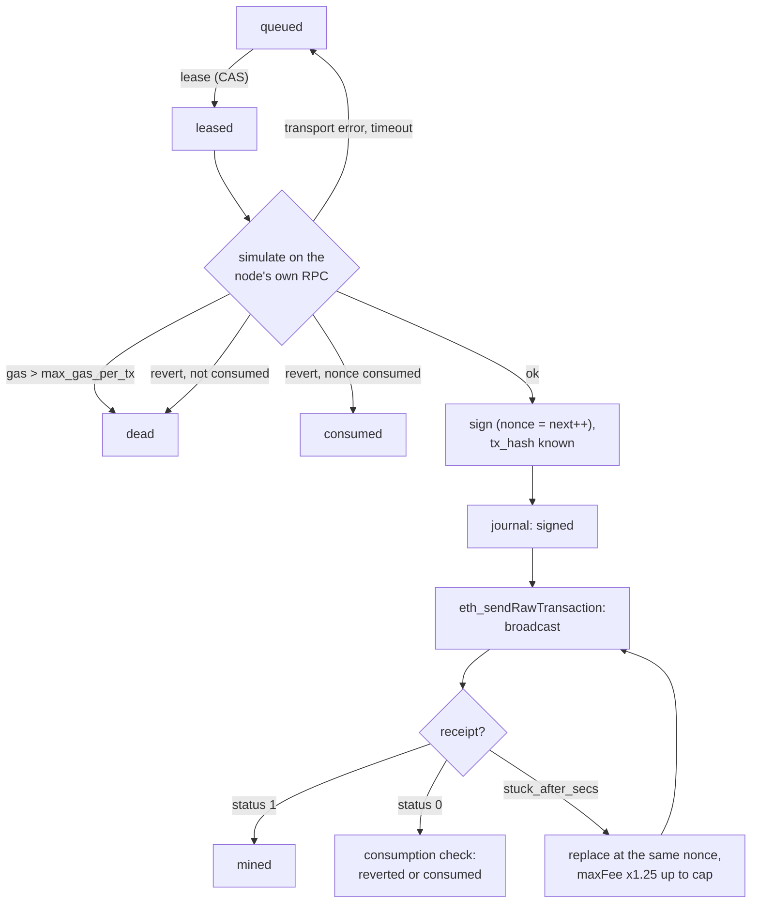

# Submit lanes

A **lane** is a relayer account of the node on one chain: it pays the outer transaction fee and is the
`msg.sender` (or family equivalent) of every transaction the node sends. Lanes hold gas only, never subject funds
([NODE-GEN-01](README.md#NODE-GEN-01)). This file covers how a job becomes an outer transaction: adapters, signer,
lane keys, journal and nonce plan, simulation, breakers and cost metering, consumption checks, batching. Status: EVM
runner, generic lane runner, simulation, breakers (in memory), consumption checks **BUILT**; store-backed journal,
`outer_tx`, metering of failures, grief score, batching **SPECIFIED**.

**Contents**

1. [Adapters](#1-adapters)
2. [Signer](#2-signer)
3. [Lane keys](#lane-keys)
4. [Journal](#journal)
5. [Nonce plan](#nonce-plan)
   - 5.1 [EVM runner](#evm-runner)
6. [Simulation](#simulation)
7. [Breakers](#7-breakers)
8. [Cost metering](#8-cost-metering)
9. [Consumption check](#consumption-check)
   - 9.1 [Shared submit path](#91-shared-submit-path)
10. [Normalization](#10-normalization)
11. [Batching](#batching)
12. [Unwrap jobs](#unwrap-jobs)

## 1. Adapters

<a id="adapters"></a><a id="NODE-LANE-06"></a>**NODE-LANE-06** — Every family implements one `ChainAdapter` trait and
is driven by a per-lane runner. EVM keeps its own pipelined runner ([EVM runner](#evm-runner)); every other family
(Hedera included) uses the generic `lane_runner`: one job in flight per lane (claim → build/simulate → sign → journal
`signed` → submit → follow to `mined`/`reverted`/expiry), no pipelining inside a lane, parallel across lanes. An
expired signed payload whose tx did not land ⇒ `dead` (the chain refuses an expired payload; no retry). The built
trait in `scaas-node/src/adapter.rs` is the reference:

```rust
#[async_trait]
pub trait ChainAdapter: Send + Sync {
    fn family(&self) -> Family;                        // the eight families of the family taxonomy
    fn chain_key(&self) -> &str;                       // "evm:7622", "sui:localnet", "cosmos:wasmd-1"…
    // chain_key alone does not identify a chain (a chain id is not assumed unique): chain = (chain_key, chain_uid),
    // chain_uid = genesis hash reported by the RPC (NET-ALL-22); the adapter compares it at start.
    fn lanes(&self) -> &[Lane];                        // relayer address per lane
    async fn build(&self, job: &Job, lane: usize) -> Result<Built, SimError>;   // build + simulate
    async fn sign(&self, built: Built, lane: usize, seq: u64) -> Result<Signed>; // through the Signer
    async fn submit(&self, signed: &Signed) -> Result<()>;
    async fn tx_status(&self, tx_id: &str) -> Result<TxStatus>;   // Pending | Mined{height} | Reverted{why} | Rejected{billed} | Unknown
    async fn sequence(&self, lane: usize) -> Result<u64>;         // nonce / sequence / seqno (Sui: 0, unused)
    async fn final_head(&self) -> Result<Option<Head>>;           // final height + hash (quorum)
    async fn block_hash(&self, height: u64) -> Result<String>;
    async fn events(&self, from: u64, to: u64, contracts: &[String]) -> Result<Vec<Value>>; // normalized events
    async fn lane_balance(&self, lane: usize) -> Result<U256>;
    async fn tx_cost(&self, tx_id: &str) -> Result<Option<TxCost>>; // fee + value_out + deposits (NODE-LANE-13)
    async fn resend_journaled(&self, lane: usize) -> Result<()>;
    async fn op_consumed(&self, job: &Job) -> Result<Option<bool>>; // NODE-LANE-09
}
```

In prose: `events(from, to, contracts)` returns normalized events, `final_head -> Option<Head>` the quorum head; the
earlier `tx_fee` became `tx_cost`. The legacy indexer handed each range to the client's `chain_event_ingest`.

The EVM runner implements the trait over `chain.rs`; its nonce pipelining, replacement and gap-fill behaviour is
unchanged and covered by its tests. The EVM indexer runs through `final_head`/`events`. `final_head` and `events` must
agree across ≥ `quorum` endpoints on every family ([NODE-IDX-01](indexer-feeds.md#NODE-IDX-01)). Normalized event
object (every family): `{event, contract, block_number, block_hash, tx_hash, log_index, from, to, amount, fee,
fee_recipient, entry_ref}` with addresses in the **family's canonical form**
([indexer-feeds.md#event-normalization](indexer-feeds.md#event-normalization)). Head-of-line rules per family (which
account sends, why one stuck tx locks nothing else) are in [NET-ALL-03](../networks/README.md#NET-ALL-03); every
family has an anti-lock test (a subject signs X on contract 1 and Y on contract 2; X held back; Y succeeds; then X
succeeds).

Code changes when lanes run from the store (current behaviour after the job seam,
[README.md#module-map](README.md#module-map)):

| Built | Target |
|---|---|
| The legacy client handle passed to the submitter, `lane_runner`, `index_runner`, indexer, drift, admin refresh and DEX venue | `Store` handle + `ConfigSnapshot` receiver; the pull client kept only as the legacy path until removal |
| `poll_outbox`: legacy poll → skip in-flight digest → legacy claim | `poll_store`: queued rows of the chain with `hold = 0` and `lane_hint IS NULL OR = lane`, oldest first, ≤ 10 → skip in-flight digest → CAS `queued→leased` |
| `report(…) -> bool` to the client | `store.transition(uid, from, to, fields) -> Ok \| Moved{state, tx_hash} \| Unknown(err)` |
| Journal `signed` over HTTP before `send_raw`; `false` ⇒ `retry` queue | see [journal](#journal) |
| Start / `recover_lane` from the client's in-flight list + `journal_max_nonce` | `store.inflight(chain, lane)` = `leased` job rows plus `signed/broadcast` **`outer_tx` rows** ([NODE-LANE-12](#NODE-LANE-12)); `plan()` tracks/replaces per outer tx, `Inflight.job_id` becomes the outer tx key, a `Work` carries its items; state mapped `leased → "nonce_leased"` at this boundary (`nonce.rs` matches the literal); `journal_max = lane.journal_max`. Transitional: union with the legacy in-flight list; **start refuses** when the legacy journal is unreachable and the chain has ever been `pull` |
| Gateway: unjournaled `Work`, digest `None`, in-memory `mpsc` | the gateway INSERTs a job in `~gateway` (origin key = `intent_id`, node-computed digest) and fires the chain's `Notify` ([gateway.md](gateway.md)). **Safety gain**: door A becomes journaled and G2-guarded |

## 2. Signer

<a id="signer"></a><a id="NODE-LANE-03"></a>**NODE-LANE-03** — **Outer-transaction keys sit behind the `Signer`
trait; custody is pluggable and chosen at deployment.** The built `LocalSigner` reads env/file/keystore keys; a custody
broker or KMS is a separate process behind the same trait. Two process boundaries are kept: custody (signing keys) and
a key oracle (a narrow interface that never returns a decryption key; a decrypt request needs a chain witness). Until a
broker is used, the hot key sits in a process that parses untrusted bytes: lanes therefore hold only the minimum gas.

<a id="NODE-LANE-07"></a>**NODE-LANE-07** — Local `Signer` for secp256k1 and ed25519; the KMS/remote signer is a seam
(no KMS adapter in the binary yet; production gate in [runbooks.md#production-gates](runbooks.md#production-gates)).

```rust
pub enum Curve { Secp256k1, Ed25519 }
pub trait Signer: Send + Sync {
    fn curve(&self) -> Curve;
    fn public_key(&self) -> Vec<u8>;               // compressed 33 B / 32 B
    fn sign(&self, msg: &[u8]) -> Result<Vec<u8>>; // secp: prehash 32 B → 65 B r‖s‖v (low-s); ed25519: 64 B
}
```

`LocalSigner`: secp256k1 via alloy's k256 (deterministic RFC 6979 nonces, constant-time), ed25519 via
`ed25519-dalek`. The trait in short: `curve()`, `public_key()`, `sign(msg)`.

## <a id="lane-keys"></a>3. Lane keys

<a id="lane-keys"></a><a id="NODE-LANE-08"></a>**NODE-LANE-08** — **Lane keys are a raw key or a 24-word mnemonic.**

```toml
[keys]
mnemonic = { env = "SCAAS_MNEMONIC" }          # or { file = "/run/secrets/mnemonic" } (0600)
                                                # or { keystore = "/etc/scaas/m.json", passphrase_env = "…" }
bip39_passphrase_env = "SCAAS_BIP39_PASSPHRASE" # optional
[[chains]]
family = "sui"; network = "localnet"
lanes = [0, 1, 2, 3]                            # lanes = [account indexes] per BIP-44/SLIP-44
# or: private_key = { env = "…" } | { file = "…" } | { keystore = "…", passphrase_env = "…" }  (one lane)
```

- BIP-39: **24 words** (256 bit), checksum verified, English wordlist; seed = PBKDF2-HMAC-SHA512(2048).
- Derivation paths by SLIP-44 coin type — `i` = the lane's account index:

| Family | Coin | Curve | Path | Note |
|---|---|---|---|---|
| EVM | 60 | secp256k1 BIP-32 | `m/44'/60'/0'/0/i` | as common browser wallets |
| Hedera | 3030 | secp256k1 BIP-32 | `m/44'/3030'/0'/0/i` | the JSON-RPC relay needs an ECDSA account (EVM alias) |
| Sui | 784 | ed25519 SLIP-10 | `m/44'/784'/i'/0'/0'` | Sui standard (all levels hardened) |
| Stellar | 148 | ed25519 SLIP-10 | `m/44'/148'/i'` | SEP-0005 |
| Cosmos | 118 | secp256k1 BIP-32 | `m/44'/118'/0'/0/i` | |
| TON | 607 | ed25519 SLIP-10 | `m/44'/607'/i'` | **not** the native TON mnemonic (PBKDF2 "TON default seed"); a TON wallet imports it through its "BIP-39 /Ledger path" option |

Aptos and Solana lane paths are in [networks/aptos.md](../networks/aptos.md) and
[networks/solana.md](../networks/solana.md).

- Sources (`SecretSource`): `{env}`, `{file}` (refused unless mode 0600/0400), `{keystore, passphrase_env}` (encrypted
  keystore). Keystore:
  **Web3 Secret Storage v3** (scrypt + AES-128-CTR, MAC keccak) for **both** curves — a 32-byte secret (secp256k1 key
  or ed25519 seed) or a mnemonic (UTF-8); extra field `"scaas": {"kind": "secp256k1"|"ed25519"|"mnemonic"}`. CLI:
  `scaas-node keystore new --kind … --out …` (`--kind mnemonic|secp256k1|ed25519 --out DIR --name FILE`) (secret from stdin, passphrase
  from env).
- Secrets are never logged or written to config files; at start the node prints **only the derived address** of each
  lane. `scaas-node addresses --config node.toml` prints the addresses and exits (`--chain <key> --labels` prints lane
  labels).
- The relayer key (`authKey`, secp256k1 or ed25519, pays gas) lives in the node's env/file/keystore behind `Signer`;
  its loss costs the lane's gas balance; recovery = rotate the key and update the relayer address clients know.
- Lanes hold gas only; funding from treasury and balance monitoring (`scaas_relayer_balance{chain,lane}`) are
  operator tasks ([runbooks.md#production-gates](runbooks.md#production-gates)). The node identity key (Ed25519,
  `[identity] key`) is separate from lane keys (secp256k1 is not a TLS signature scheme,
  [gossip.md#identity](gossip.md#identity)).
- Test vectors: BIP-39 (Trezor, passphrase "TREZOR"), SLIP-10 ed25519 (test vector 1), SEP-0005, BIP-32/BIP-44
  secp256k1 (mnemonic "abandon…art" ⇒ the published browser-wallet address).
- Custody of a client's own wallets (custodial or delegated wallets of an ERP) is the client's business: an env-held
  key is **development only** there, and production needs a KMS/HSM adapter ([INT-ERP-08](../integration.md#INT-ERP-08)).
  The same rule holds for lane keys on public chains: a KMS/HSM signer before production funds.

<a id="custody-keys"></a><a id="NODE-LANE-20"></a>**NODE-LANE-20** — **One custody key per family for raw-digest
signers.** A key the node holds (lane key, mandate delegate, custody adapter key) signs in exactly one family;
`Config::validate` refuses the same public key in two families, and imported keys carry their family tag. Family
connector sections state the same rule for client connectors. (Hedera ED25519 accounts, Stellar and the TON mandate
delegate all sign raw 32-byte digests with ed25519: one key across two families turns a compromised signer into a
cross-chain oracle.)

**Same lane keys in two stores** is forbidden and detected ([store.md#durability](store.md#durability)): on sequence
families `nonce_at(latest) > journal_max + 1 + tracked` ⇒ the lane refuses to lease, `/readyz` reason, metric
`scaas_lane_foreign_nonce_total`.

## <a id="journal"></a>4. Journal

<a id="journal"></a>The journal is the job row plus its `outer_tx` row. `leased → signed` is the journal write and
happens **before** the transaction is sent (NODE-GEN-02): CAS `WHERE uid=? AND (state='leased' OR (state='signed' AND
tx_hash=?))` + `lane.journal_max` + fencing check. Outcomes: `Ok` ⇒ send. `Moved{signed, our hash}` ⇒ send
(idempotent retry). `Moved{other}` (cancelled, consumed…) ⇒ drop the work, release the G2 guard, **do not** consume
the nonce (`self.next` unchanged). `Unknown` ⇒ reconnect, re-read the row, decide as above; unreadable ⇒ keep in
`retry` (no send). The non-EVM `step_once` uses the same tri-state, so a cancel costs no 60 s backoff. SQLite commits
with `synchronous = FULL`; PG/MySQL with a durable commit; a stale owner cannot journal (fencing) and therefore
cannot broadcast.

<a id="outer-tx"></a><a id="NODE-LANE-12"></a>**NODE-LANE-12** — **The outer transaction is a store row.**
`outer_tx` (key `(chain_key, lane_label, outer_nonce)`, [store.md#schema](store.md#schema)) holds `tx_hash`, state and
raw cost fields; it is written in the `leased → signed` transaction of **every** signed tx (one item, or a
[batch](#batching)). `plan()` in-flight, tracking, fee replacement, receipts and cost are per outer tx; item rows
transition in the same transaction as their parent (each with its `job_event`), their final state from the parent plus
the item's decoded result; after `signed` no item is requeued, replaced or cancelled on its own. (Per-job nonce
tracking would invite independent requeue or replacement of 50 rows sharing a nonce after a restart.)

<a id="NODE-LANE-21"></a>**NODE-LANE-21** (open; default applied) — An `outer_tx` row is written for every signed
transaction, not only for batches.

<a id="adapter-journals"></a><a id="NODE-LANE-19"></a>**NODE-LANE-19** — **Adapter-local journals live in the
store.** Per-lane state an adapter needs across restarts to avoid equivocation or a double send (Sui gas-coin
`Pending`, built today as `params.lane_journal`; Solana durable-nonce value; TON seqno generation) is part of the
`outer_tx` row: signed bytes, consumed object refs and versions, resolved flag; written in the `leased → signed`
transaction, kept until the outer tx is terminal, one row per unresolved tx (never "last one only"). No
local-directory journal: failover is "restore the store on another host", and a local journal does not move with the
owner lock ([NET-SUI-10](../networks/sui.md#NET-SUI-10)).

Transitional (BUILT): the journal is the client's job row, written by a `signed` report over the pull protocol before
`send_raw`; a failed report puts the work in the `retry` queue without sending.

<a id="legacy-pull"></a><a id="NODE-LANE-02"></a>**NODE-LANE-02** — **Legacy pull: the `signed` report is idempotent
and the nonce is held.** A `signed` report repeated with the same `(tx_hash, outer_nonce, signer_address)` (per signer: `(tx_hash,
outer_nonce)`) succeeds unchanged
on the client; other values are an error. When the report fails (for example a timeout after the client committed),
the work keeps its signed `(raw, hash, n)`; the retry re-reports those values before anything else; success ⇒
consume `n`, broadcast; `n` is given to no other job while the retry is pending. Transitional (BUILT) pull path only;
removed with the pull adapter ([NODE-JOB-10](job-api.md#NODE-JOB-10)).

## <a id="nonce-plan"></a>5. Nonce plan

<a id="nonce-plan"></a><a id="NODE-LANE-04"></a>**NODE-LANE-04** — **An outer nonce is never abandoned.** Fees rise to
the cap; a job that must be dropped (its meta-tx expired) is replaced by a 0-value self-send at that nonce
(gap-filler, 21 000 gas); cold start uses `max(pending, journal + 1)` plus gap filling. One abandoned nonce blocks every
later transaction of the lane, and a journal without gap filling leaves a permanent hole; the cost is a few minimal
0-value transactions.

- **Cold start** (`nonce.rs::plan`, BUILT): `next = max(getTransactionCount(pending), journal_max + 1)` (RPC
  `eth_getTransactionCount` at block tag `pending`). Every
  journaled nonce in `[pending, journal_max]` = `[getTransactionCount(pending), journal_max]` whose tx is no longer in the mempool (`eth_getTransactionByHash` of the
  job that journaled it returns null) is gap-filled and its job returns to `queued` (the subject nonce prevents double
  execution). Jobs `nonce_leased` without a tx hash ⇒ `queued`; jobs `signed`/`broadcast` with a hash ⇒ ask receipt /
  mempool and keep tracking — **never re-signed** (no double submission of one meta-tx, no wasted gas).
- **Inputs** (SPECIFIED): from the store; `journal_max` = monotonic `lane.journal_max`, bumped in the same transaction
  as `leased → signed` (and on every legacy `signed` report in the transitional binary); never an aggregate over
  purgeable rows. Nonces are `BIGINT` (i64); adapters refuse values above `i64::MAX`. Non-terminal mesh rows follow
  the rules of job rows; terminal ones only raise `journal_max`; the in-flight digest set is rebuilt from tracked
  entries; non-EVM `recover_lane` walks its lane's rows the same way. (Mesh rows entered `plan()` as `Inflight` entries
  keyed by `Origin::Mesh`; a row with `outer_nonce < pending` is settled from its receipt. Store rows replace that
  special case now.)
- **Replacement:** stuck after `stuck_after_secs` (default 60) ⇒ same nonce, `maxFee`/`priority` × 1.25 (≥ +1 wei),
  repeated up to `max_fee_cap_gwei` (default 500); at the cap, wait (a same-fee replacement is rejected as
  underpriced); the operator may raise the cap (hot) ([runbooks.md#emergency](runbooks.md#emergency)).
- **Generic lanes** (non-EVM): one transaction in flight per lane, status poll 500 ms, backoff 1 s → 60 s, expiry
  grace 30 s; Sui re-sends its journaled signed bytes on start so a gas coin is never equivocated; Solana lanes use a
  per-lane durable nonce account ([NODE-LANE-19](#NODE-LANE-19)).
- After a restore the chain may be ahead of the journal; `lane accept-nonce` adopts those nonces
  ([NODE-RUN-03](runbooks.md#NODE-RUN-03)).

### <a id="evm-runner"></a>5.1 EVM runner

<a id="evm-runner"></a>One task per chain **owns** the outer nonce of each lane (one process ⇒ the next nonce is an
in-memory value). Loop every `poll_ms`:

```text
loop every poll_ms:
  jobs = lease(chain, limit=10)                     # CAS queued→leased (store); legacy: relay_poll + relay_claim(node_id)
  for job:
     sim = eth_estimateGas(token.executeMetaTransaction(m, sig), from=lane, block=pending)
     revert → consumption check; consumed ⇒ 'consumed'; else 'dead' with the decoded error (MetaTxBadNonce, Expired…)
     gas > max_gas_per_tx → 'dead'
     ok → sign EIP-1559 (nonce = next++) → tx_hash known BEFORE sending
          → journal 'signed' (tx_hash, nonce)       # journal first
          → eth_sendRawTransaction → 'broadcast'        # legacy: relay_report(chain_state = signed|broadcast|…)
  track in-flight: receipt present → status 0: consumption check, then 'reverted' or 'consumed'; status 1: 'mined'
                   older than stuck_after_secs → consumption re-check (eth_call metaNonce), then replace at the same nonce, maxFee ×1.25,
                   repeated up to max_fee_cap; NEVER abandon a nonce: a job that must be dropped (meta-tx
                   expired) is replaced by a 0-value self-send to the lane at that nonce (gap-filler)
```

One job through the runner, in order:



The gateway's and the mesh scheduler's work go through the same runner, the same nonce counter and the same simulation
gate. `final` of a job never comes from the runner: it comes from the event feed
([job-api.md#states](job-api.md#states)), so a job is final also when someone else executed it.
<a id="NODE-LANE-24"></a>**NODE-LANE-24** — **Per-lane in-flight depth is a tunable default:** `max_inflight` on the
chain entry (`[[chains]] max_inflight` in node.toml, column `chain.max_inflight`, [store.md](store.md#NODE-STO-03)), **default 16** (owner 2026-10-07). An execution client keeps at most
`txpool.accountslots` (16 by default) pending transactions per sender, so the default follows that network ceiling; it
is not a design constant — an operator raises it where the chain's nodes accept deeper per-sender pools and lowers it
where they accept fewer. As built the runner does not cap it (PLANNED).

## <a id="simulation"></a>6. Simulation

<a id="simulation"></a><a id="NODE-LANE-23"></a>**NODE-LANE-23** — **Simulation before signing is mandatory**, on the
node's own RPC endpoints (no third-party simulation service). EVM: `eth_estimateGas` from the lane address at
`pending` (gas limit = estimate + 20 %); non-EVM: `ChainAdapter::build` = build + family simulation (Soroban
`simulateTransaction`, Sui dry-run/dev-inspect (`sui_dryRun`), Cosmos `tx/simulate`, Aptos simulate, TON emulation, Solana
`simulateTransaction`; per-family details in [networks/](../networks/README.md)). Simulation narrows but cannot rule out
a revert: state can change between simulation and inclusion (a race, an allowance spent, a pause switched on, a
confidential `zetherNonce` used first, or the subject moving its own funds), so the node
measures post-simulation reverts ([NODE-OPS-06](ops.md#NODE-OPS-06)) and handles lost races as consumption
([NODE-LANE-09](#NODE-LANE-09)) instead of promising a zero revert rate. Failures and their decoded reasons are logged
with the job and counted (`scaas_simulation_total`).

| Simulation result | Job outcome |
|---|---|
| ok | journal + send |
| revert with data, subject nonce consumed | `consumed` ([NODE-LANE-09](#NODE-LANE-09)) |
| revert with data, not consumed | `dead` with decoded error (`MetaTxBadNonce`, `MetaTxExpired`, …) |
| transport error, timeout, unreadable nonce | `queued` (retry), never `dead` |
| gas > `max_gas_per_tx` | `dead` |

Unwrap jobs ([unwrap jobs](#unwrap-jobs)) simulate the full outer transaction and re-simulate immediately before
signing. A subject that crossed the grief threshold gets a re-simulation right before signing too
([NODE-LANE-15](#NODE-LANE-15)).

## 7. Breakers

<a id="breaker"></a><a id="NODE-LANE-05"></a>**NODE-LANE-05** — **Circuit breakers never block indexing.** Per lane
and chain, in memory (latched ones in `breaker_latch`), sampled every 15 s; an open breaker stops **new** work only —
never indexing, tracking or replacing signed transactions, rescues or gap-fillers (NODE-GEN-09).

| Breaker | Rule | Defaults |
|---|---|---|
| `base_fee_spike` (EVM) | current `baseFeePerGas` > `spike_ratio` × 1 h trailing mean, with ≥ 4 samples and fee > `spike_min_base_fee_gwei`; reopens when back below | ratio 3.0 (0 disables), min 1 gwei |
| `gas_budget` | gas spent in the fixed hour window ≥ `gas_budget_per_hour` (smallest gas-coin unit, per lane × chain); metered per [NODE-LANE-13](#NODE-LANE-13) | warn (log + metric) at 90 %; stop new work until the window ends at 100 % |
| `balance_floor` | lane balance < `min_relayer_balance` ⇒ that lane takes no new job | warn below 120 % of the floor |
| structural | simulated gas > `max_gas_per_tx` ⇒ job `dead` | 3 000 000 (classical Zether chains ≥ 4 500 000; post-quantum Zether chain 16 000 000; [NODE-STO-10](store.md#NODE-STO-10)) |
| `revert_streak` (chain) | ≥ 3 post-simulation reverts of class `other` in 15 min | [NODE-OPS-06](ops.md#NODE-OPS-06), latched |

Non-EVM families use budget + balance floor (no EIP-1559 base fee). The private chain 7622 (formerly 9000) is a
pre-London Clique chain with `MinGasPrice = 0`: it has no base fee, so `base_fee_spike` does not apply there. Metric `scaas_breaker_open{chain,lane,breaker}`;
manual reset `POST /v1/admin/chains/{key}/breaker/reset` (operator, [admin-auth.md#routes](admin-auth.md#routes)).

<a id="selector-breaker"></a><a id="NODE-LANE-25"></a>**NODE-LANE-25** — **A breaker per `(from, selector)` for
self-calls.** Status: **SPECIFIED**. A meta-transaction self-call ([NODE-JOB-20](job-api.md#NODE-JOB-20)) that passed
simulation and reverted on chain counts against the pair `(from, selector)`; ≥ 2 such reverts in 24 h ⇒ intake refuses
that pair (`429 SUBJECT_THROTTLED {retry_after}`) until 24 h after the last one, on every door, in addition to the
subject's grief score ([NODE-LANE-15](#NODE-LANE-15)). The usual causes are outside the relayer's control and specific
to one function: a rate change paused wraps, a reserve fell short, a confidential send counter moved, or the signer
front-ran its own intent. Why: a self-call can fail after simulation in ways a plain transfer cannot, and a per-subject
counter alone would also stop that subject's unrelated payments. Cost: a store row per pair with a recent revert.

<a id="NODE-LANE-01"></a>**NODE-LANE-01** (open; PLANNED where a seam exists) — Gas velocity limits denominated in a
reporting currency (per agent and per enterprise, per hour) are an owner requirement that is not yet ruled: node
budgets are in the family's smallest native unit ([NODE-SPN-02](sponsorship.md#NODE-SPN-02)) and the node holds no
prices. The seam is the `gas_budget` breaker plus the FinOps price file ([ops.md#finops](ops.md#finops)).

## 8. Cost metering

<a id="cost-metering"></a><a id="NODE-LANE-13"></a>**NODE-LANE-13** — **The gas breaker meters what the lane pays, not
what succeeds.** Every included outer tx of ours (mined, reverted, or failed and billed) feeds `Breaker::spend` with
`fee + value_out + deposits`: `fee` = the fee the chain charged, failures included; `value_out` = native value the tx
moved out of the lane beyond fees, net of excess observed coming back (TON forward and attached TON, EVM `value`);
`deposits` = rent or storage the lane funded (Solana account rent, Sui storage net of rebate, Aptos storage fee,
Soroban rent). So `Breaker::spend(fee + value_out + deposits)`; adapter method `tx_cost(tx_id) → TxCost`
(`tx_cost(tx_id) -> Option<TxCost { fee, value_out, deposits }>`) for every landed
terminal status; the three are `outer_tx` cost fields. Status: the EVM path meters every receipt (**BUILT**); the
generic runner metering every terminal status is **SPECIFIED**. Under attack the hourly budget trips earlier, as
intended.

<a id="retries"></a><a id="NODE-LANE-14"></a>**NODE-LANE-14** — **A billed failure is retried at most once; every job
has an attempt cap.** Adapters classify each outcome as **not included** (precheck, CheckTx or mempool reject,
`BUSY`, dropped: nothing billed) ⇒ `queued`; included failures such as `OUT_OF_GAS` are billed; or **included and billed** ⇒ at most **one** requeue per job, and only
when the family doc names the parameter the retry changes (gas or CU limit raised to the configured cap); otherwise,
and on the second time, `reverted` with the decoded reason (consumption still checked first). `Rejected` carries
`billed: bool`. Independently, `chain.max_attempts` (hot, default 5) caps `job.attempt_count` (incremented at
`leased`): over it ⇒ `dead`, `ATTEMPTS_EXHAUSTED`. Each family doc keeps its own code → class table (Hedera, Aptos,
Solana, Cosmos, Soroban, Sui, TON). A genuinely transient billed failure costs the payer a re-sign after two tries.

<a id="grief"></a><a id="NODE-LANE-15"></a>**NODE-LANE-15** — **Per-subject grief score, node-wide, every family.**
Store table `subject_grief (chain_key, subject, day, billed_failures, cost)` = `subject_grief(chain_key, subject, day,
billed_failures, cost)` (the `origin_grief_score` that earlier
designs assumed), `subject` = the payload's
family-normalised `from` (the UA id once UA tokens are used), written in the transaction that records the outcome. It
counts every billed failure of an included tx of ours ([NODE-LANE-14](#NODE-LANE-14)), and a `consumed` outcome of a
job never published on the bus (only the subject or someone it gave the payload to can have landed it), minus the
exemptions of unwrap jobs ([unwrap jobs](#unwrap-jobs)) and of regulated-token compliance refusals
([contracts/asset-suite.md](../contracts/asset-suite.md)). ≥ 3 in 24 h ⇒ the subject gets one live job per chain and
a re-simulation right before signing; ≥ 10 in 24 h, or `cost ≥ chain.grief_cost_cap` ⇒ intake refuses `429
SUBJECT_THROTTLED` until 24 h after the last count.

A namespace aggregate feeds a `scaas_grief_*` metric and alert; the
chain-level breaker stays `revert_streak`. Fresh lanes per request (Cosmos, Sui, Solana, Aptos) make per-lane counting
useless, and a new signature costs the subject nothing: only a counter keyed by subject bounds post-simulation flips
(balance moved, nonce burnt, key changed). Fresh subjects are cheap on some families; the namespace aggregate and
[NODE-LANE-13](#NODE-LANE-13) cover that residual.

<a id="payload-fields"></a><a id="NODE-LANE-16"></a>**NODE-LANE-16** — **Fields the signed payload carries are read
from the payload.** `contract`, `valid_until`, `from`, `lane`, `nonce`, the relayer binding and any value or forward
floor come from the decoded signed payload ([NODE-JOB-02](job-api.md#NODE-JOB-02)), never from job JSON; a JSON copy
that differs ⇒ `422 BAD_PAYLOAD`. Unsigned job fields may only narrow (shorter tx bounds), never widen. (An unsigned
field could hold a lane past the payload's death, query the wrong contract — a false `consumed` — or widen value out.)
The mesh decoders already read the signed body.

<a id="value-out"></a><a id="NODE-LANE-17"></a>**NODE-LANE-17** — **Value out per job is capped.** A job makes our lane
send native value beyond fees only up to `chain.max_value_out` (hot; TON default 0.05 TON above the fixed attach, i.e.
50000000 nanoton; every other family 0). A signed floor or job field above the cap ⇒ `422 VALUE_OUT_TOO_HIGH` at intake
and again at lease (config is hot). (One signed TON `pay` with a large forward floor would otherwise send the lane's
balance to an address the signer chooses, [NET-TON-14](../networks/ton.md#NET-TON-14).) A flow that needs more forward
value needs config.

<a id="deposits"></a><a id="NODE-LANE-18"></a>**NODE-LANE-18** — **Lane-funded deposits come back to the lane, or are
bounded.** A job may make the lane fund rent or storage only if (a) the contract refunds it to the lane (`rent_payer` +
`prune`, [NET-SOL-08](../networks/solana.md#NET-SOL-08); Aptos `prune`), (b) it is for an account only a configured
receiving wallet controls, or (c) it is ≤ `chain.max_deposit_per_job` and metered by [NODE-LANE-13](#NODE-LANE-13) and
[NODE-LANE-15](#NODE-LANE-15). A deposit a third party can reclaim (a Solana ATA closed by its owner) is refused unless
(b): `422 DEPOSIT_NOT_ALLOWED` at intake, re-checked before signing ([NET-SOL-21](../networks/solana.md#NET-SOL-21)).
Each family doc lists its deposits and their class. First payments to a new, unconfigured recipient on Solana need an
existing ATA.

## <a id="consumption-check"></a>9. Consumption check

<a id="consumption-check"></a><a id="NODE-LANE-09"></a>**NODE-LANE-09** — **Consumption is checked before every bump
and every resend, and after every reverted receipt/status.** If the subject nonce moved past the intent's nonce, never
bump or resend the meta-tx; report `consumed` instead of `reverted`/`dead`; on EVM free the outer nonce with a
gap-filler ([NODE-LANE-04](#NODE-LANE-04)). A failed consumption read **fails closed**: no bump this round, retry next
round. The job state `consumed` (legacy client: `chain_state = 'consumed'`) is non-terminal for the client's business: a job is never `dead`/`failed` because
someone else landed it; the client marks it final from the event feed (landed elsewhere), or the expiry rule makes it
`dead` when superseded. One per-chain in-flight digest set prevents our node from holding two live outer txs for one
intent. Cost: one `eth_call` per stuck tx per `stuck_after_secs` (60 s) and per reverted receipt.

**Classification after consumption:**

| Family | How | Result |
|---|---|---|
| EVM/Hedera | `eth_getLogs` on `token`, topic0 `MetaTransactionExecuted`, topic1 `from`, topic3 `batch`, from the row's `from_block` (mesh) or the block at job claim (kept with the `Sent`) to `latest`; pick the log with `nonce == m.nonce` | `digest == intent_id` and `relayer` ∈ our lanes ⇒ `landed` (an earlier hash of ours); `digest == intent_id` otherwise ⇒ `landed_elsewhere`; different digest ⇒ `superseded`; no log yet (lagging RPC) ⇒ `unknown` |
| others | `unknown` in v1 (the adapter `events()` scan is per block range and belongs to the indexer) | resolved at finality from the event feed |

After `valid_until` the subject nonce of TON/Solana/Aptos/Sui lanes may be pruned (Sui: permissionless `prune`) and read as 0; consumption checks are
only made while `now ≤ valid_until + clock_skew_secs`, and expiry decides after that.

EVM view names: the target tokens expose the nonce and digest views as `mtxNonce(from, batch)` and `mtxDigest(m)`, and
the gateway as `mtxExecute` (the alias `executeMetaTransaction` stays, [contracts/metatx.md](../contracts/metatx.md)).
Transitional (BUILT): deployed tokens and the code paths above use `metaNonce`, `metaTxDigest` and
`executeMetaTransaction`; the adapter switches by implementation when the renamed tokens are deployed.

### 9.1 Shared submit path

<a id="shared-submit"></a>Every origin (job API, gateway, mesh, DEX) uses one submit path:

```rust
pub enum Origin { Job(u64), Mesh([u8; 32]), Gateway([u8; 32]) }   // legacy pull adds Legacy(i64) until removal
pub struct MetaRef { pub token: Address, pub from: Address, pub batch: U256, pub nonce: U256, pub digest: B256 }
pub struct Work { pub origin: Origin, pub to: Address, pub data: Bytes, pub valid_until: u64,
                  pub meta: Option<MetaRef> }                      // None for `call` jobs
struct Sent { work: Option<Work>, hashes: Vec<B256>, gas: u64, fees: (u128, u128), at: Instant }
pub type Inflight = Arc<Mutex<HashSet<B256>>>;                     // one per chain, all lanes + mesh scheduler
```

`job_id: Option<i64>` became `origin`; `work_from_job` fills `meta` for `kind = metatx`. The outcome sink is the store `transition` for every origin, and a
landed or consumed job CASes its mesh `intent` row (if any) to the same outcome, so we stop serving an intent we landed.
Transient errors, gas over `max_gas_per_tx`, expiry in the channel and the `retry` queue all produce an outcome for
every origin (the first cut's `requeue()`/`fail()` did nothing without a job id, `submit.rs` l.247–259; legacy store
rows were matched by digest with `source = outbox`).

**In-flight digest set (G2).** Members: every EVM lane, the gateway, the mesh scheduler **and every non-EVM
`lane_runner`/`step_once`** of the chain. Lifecycle is an RAII guard, so no exit can leak a digest:

```rust
impl Inflight { pub fn try_acquire(&self, d: B256) -> Option<InflightGuard> }   // None = already in flight
impl Drop for InflightGuard { fn drop(&mut self) { /* remove d */ } }
```

- The guard travels inside `Work` / the lane's job and is moved into `Sent` when a tx is broadcast; it is dropped when
  `Sent` is removed (terminal receipt, consumption, gap-fill settled).
- Every exit that leaves no `Sent` behind drops it: transient simulate/fee error (`requeue`), simulate revert (`dead`
  or `consumed`), journal-write retry (the `retry` queue keeps the guard; a dropped retry drops it), breaker open,
  expiry, channel send failure.
- The lease skips a job whose digest is in flight **before** claiming it — no claim, no `queued` report, no
  `attempt_count` growth; only if the digest enters the set between read and claim does the path report `queued` once
  ("in flight on another path").
- Restart rebuilds the set from tracked entries.

`submit(w)`, in order:

1. `valid_until ≤ now` ⇒ `expired`.
2. Mesh origin, first attempt: `eth_call token.metaTxDigest(m)` must equal `intent_id` ⇒ else `failed`
   (`DIGEST_MISMATCH`: the envelope's `domain` lied).
3. Simulate. On `SimError::Revert`: if `meta` is set, read `metaNonce(from, batch)`; `> nonce` ⇒ **consumed**
   (classification above), else `failed`/`dead`. A failed `metaNonce` read ⇒ transient (requeue).
4. Journal before send ([journal](#journal); the first mesh draft used `UPDATE intent SET lane_label, outer_nonce,
   tx_hash`). Journal write fails ⇒ do not send, do not consume the nonce.
5. Send; `broadcast`.

Receipt handling — **reverted receipt** with `meta` set: read `metaNonce`; consumed ⇒ classify and report `consumed`
(never `reverted`, which a client would book as a failed business payment and use to fail dependent jobs; code:
`track()`, `submit.rs` l.280–292; client dependents l.459); read
failed ⇒ keep the entry and retry next round.

`track()` for stuck txs (`chain.nonce_at(lane, latest)` = `get_transaction_count(addr).latest()`; the first cut had only
`pending_nonce()`). For each in-flight
outer nonce `n` whose newest hash has no receipt:

```
if any receipt among s.hashes:                       # an EARLIER hash of ours mined
    settle from that receipt (reverted ⇒ consumption check above); remove; continue
if not stuck (elapsed < stuck_after_secs): continue
count = chain.nonce_at(lane, latest)        ; on RPC error: no bump this round, continue   (fail closed)
if count > n:                                         # outer nonce used by a tx we no longer track
    remove; if meta: classify; continue
if s.work.meta is Some(m):
    v = metaNonce(m.from, m.batch)          ; on RPC error: no bump this round, continue   (fail closed)
    if v > m.nonce:                                   # consumed — before EVERY bump
        classify; report consumed
        replace at n with the gap-filler (self-send, 21 000 gas) at bumped fees   # never the meta-tx again
        keep tracking n until the gap-filler mines; continue
existing logic: live ⇒ bump the meta-tx; expired ⇒ gap-filler + dead
```

At the fee cap the wait branch also applies to the gap-filler: a same-fee replacement is rejected as underpriced, so
the consumed meta-tx is simply left to mine and revert (cost ≈ 24–30 k gas).

Generic lane runner (non-EVM, and Hedera):

- `ChainAdapter::op_consumed(&self, job: &Job) -> Result<Option<bool>>` (default `Ok(None)`), taking the `Job` so
  Hedera (`metatx` jobs) is served too. `Some(true)` iff the lane nonce has moved past the op's nonce; `Ok(None)`
  (unknown ⇒ never stop on it) for every op kind whose replay guard is not the lane nonce: v1 answers only for `pay`
  (Cosmos `QueryMsg::Nonce`, Sui `lane_nonce`, Aptos view `lane_nonce`, TON `get_lane_nonce`, Solana `LanePda.next`,
  absent ⇒ 0) and Hedera `metaNonce`. TON revoke would be `next > nonce + 1`; not needed in v1.
- `step_once`: on `SimError::Revert`, call `op_consumed`; `Some(true)` ⇒ report `consumed`, not `dead`.
- `follow()`: on `TxStatus::Reverted`, call `op_consumed`; `Some(true)` ⇒ `consumed`, not `reverted`. Before every
  resend (`sent.is_err()` branch) call `op_consumed`; `Some(true)` ⇒ report `consumed`, stop resending, keep following the tx until its status is
  terminal or `valid_until + EXPIRY_GRACE`. RPC error ⇒ no resend this round.
- `Built`/`Signed` carry `origin: Origin` instead of `job_id: i64`; reports go to the outcome sink.

## 10. Normalization

<a id="normalization"></a><a id="NODE-LANE-10"></a>**NODE-LANE-10** — **The submitter normalizes the fields the
canonical digest zeroes, for every origin.** Before building any meta-tx — `feeRecipient := chains.fee_recipient or 0` when `mode & MODE_RESTRICT_FEE_RECIPIENT == 0`,
`relayer := 0` when `mode & MODE_RESTRICT_RELAYER == 0` — i.e. `MODE_RESTRICT_FEE_RECIPIENT` off ⇒
`feeRecipient := chains.fee_recipient` (our cold wallet) or `0` (the contract pays `msg.sender`);
`MODE_RESTRICT_RELAYER` off ⇒ `relayer := 0`. Wire values of unbound fields are never submitted (NODE-GEN-07);
`intent_id` is unchanged. The token pays `m.feeRecipient` whenever it is non-zero (`ERC20MetaTx.sol` l.87), but the digest zeroes it when
unbound (`MetaTxLib.canon`, the fields `canon()` zeroes), so without this a client or forwarder would take the fee while we pay gas. `metatx.rs`
has `pub fn normalize(m: &mut MetaTransaction, fee_recipient: Option<Address>)`, called **once, where the `Work`/`Job`
is built from a request or an envelope** (job API accept, gateway `post_metatx`, mesh work builder), not in the runner, so Hedera
work through `lane_runner` → the Hedera adapter's `build` gets it too. A job-API job built by an ERP with fee 0 and
recipient 0 is unchanged in effect.

## <a id="batching"></a>11. Batching

<a id="batching"></a><a id="batches"></a><a id="NODE-LANE-11"></a>**NODE-LANE-11** (PLANNED) — **A batch is several
jobs journaled together.** `mtxBatchTransfer` groups `metatx` jobs with `struct = transfer`, and `mtxBatch` jobs with
`struct = call`, of one `(chain_key, token)` whose relayer is bound to the submitting lane — never the two structs in
one batch ([CTR-MTX-11](../contracts/metatx.md#CTR-MTX-11), [CTR-MTX-24](../contracts/metatx.md#CTR-MTX-24)), so no other relayer can consume an item between
simulation and inclusion; a subject's `cancelNonce` remains the only race. One `leased → signed` transaction writes
the batch's `outer_tx` row, journals every item with the same `lane_label`, `outer_nonce`, `tx_hash` and bumps
`lane.journal_max` once; each item keeps its own digest (G2), state and `job_event`.

A failing batch is re-simulated
and resubmitted without the failing item (`dead` with its decoded reason; the item counts toward
[NODE-LANE-15](#NODE-LANE-15)). Measured cost is split evenly over the items (remainder to the lowest `uid`), so
`usage_day` sums to the fee paid. **Never batched**: unwrap ops, `receiver_fee` jobs, `call` jobs, sponsored jobs
(their cap is per tx, [NODE-SPN-02](sponsorship.md#NODE-SPN-02)), PQZ envelopes. Flush: 50 items or 3 s. One journal
transaction per outer tx keeps journal-before-broadcast and `plan()` unchanged; batched jobs wait ≤ 3 s.

## <a id="unwrap-jobs"></a>12. Unwrap jobs

<a id="unwrap-jobs"></a><a id="NODE-LANE-22"></a>**NODE-LANE-22** — **The node simulates unwrap jobs in full and never
batches them.** For gasless unwrap ops ([CTR-MTX-12](../contracts/metatx.md#CTR-MTX-12)):

- Shape (contract side): a self-call through `mtxExecute` whose `data` is the token's own allowlisted `unwrap`
  calldata — single-underlying `unwrap(uint256 amount, address recipient, uint256 minOut)`, multi-underlying
  `unwrap(address underlying, uint256 amount, address recipient, uint256 minOut)`, confidential-token public
  `unwrap(uint256, address)` — with `m.to = m.value = 0` ([NODE-JOB-20](job-api.md#NODE-JOB-20)); the contract checks
  `recipient ∉ {0, address(this)}`, `0 < out ≤ reserve`, `out ≥ minOut`, burns `⌈out·q⌉`. Transitional (BUILT): the
  deployed tokens use the `unwrap(address underlying, address recipient, uint256 minOut)` pseudo-op (100 bytes, amount =
  `m.value`, `m.to == recipient`) with the entry points `mtxUnwrap` and `mtxUnwrapWithFee`, which the allowlist tokens
  delete.
- The simulation gate runs the full outer transaction (`eth_call`/`eth_estimateGas` at `pending`), so it executes the
  underlying's transfer, `balanceOf` reads and the exact-amount check; it re-simulates immediately before signing the
  outer transaction, as for every job.
- A revert after simulation is a **terminal** job error reported with the decoded reason, not a retry.
- The signer chooses the recipient and can change its state between simulation and inclusion (Hedera dissociation or
  KYC removal, a recipient hook that reverts on block context, a blacklist the signer controls). So a revert is exempt
  from the subject's grief score ([NODE-LANE-15](#NODE-LANE-15)) **only** when it does not depend on the recipient:
  `InsufficientReserve`, `ReserveShortfall`, `UnwrapBelowMin` after a rate change, or an underlying revert that the
  node reproduces with the recipient replaced by its own lane address (paused underlying, wrapper blacklisted). Every
  other post-simulation revert counts, as for transfers. For underlyings known to call recipient hooks (ERC-777,
  ERC-1363) the node may refuse gasless unwraps to recipients that have code.
- Unwrap items are **never batched** (`mtxBatch`): their failure modes are outside the signer's and the relayer's
  control. The outer gas limit comes from the simulation plus the usual margin; `max_gas_per_tx` applies unchanged.
