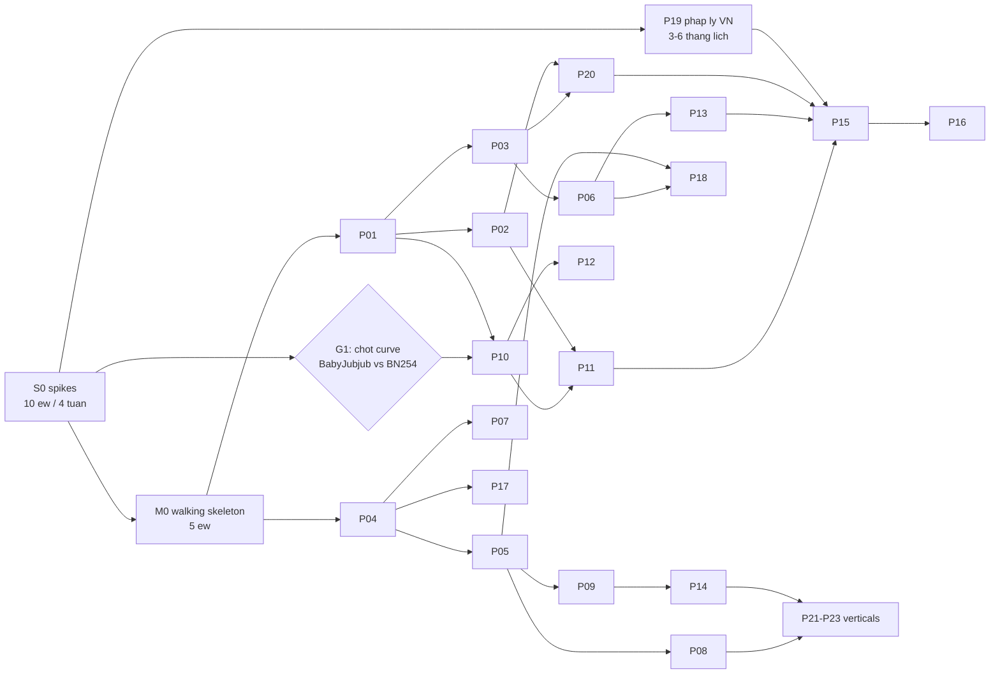

## 16. Chia nho thanh sub-project va thu tu thuc hien

> Phạm vi: biến 15 section thiết kế thành một chuỗi gói việc **ship được độc lập**. Đơn vị ước tính là
> **engineer-week (ew) = 5 ngày làm việc thực của một senior engineer**, đã trừ họp và ngắt quãng.
> Mọi con số kích thước là **ước tính**, cơ sở ghi ngay cạnh. Con số tiền audit lấy từ §12.8 (bản đã
> sửa: **$173k–345k**, không phải $120k–240k như bản nháp trước của chính section này ghi).
>
> `ew` là **công sức**, không phải **lịch**. Quy đổi dùng xuyên suốt tài liệu này:
> `calendar_weeks = ew / (headcount × 0.70)`, hệ số 0.70 là utilization thực của một kỹ sư có on-call,
> code review, và CI 25 phút mỗi PR (§14.14). Cộng thêm **4–6 tuần ramp** cho mỗi người mới trên stack
> này (Odoo 19 + Foundry + Rust ZK là ba thứ ít ai biết cùng lúc). Mọi con số lịch ở §16.5 đã áp
> công thức này; nếu bạn muốn chuyển ew sang lịch ở chỗ khác, dùng đúng nó, đừng chia cho headcount.

---

### 16.0. Nguyên tắc phân rã và những điều không ai nói ra

#### 16.0.1. Ba điều `blockchain.md` không nói

`blockchain.md` là một **architecture note**, không phải một plan: nó liệt kê 6 hệ sinh thái, Zether,
EIP-1776, Open Relayer Network như những thứ tồn tại song song và đồng thời, không có thứ tự, không có
gate, không có ngân sách. Ba hệ quả phải sửa ngay ở tầng chương trình, không phải ở tầng code:

1. **"Hỗ trợ độc quyền 6 hệ sinh thái" không phải một scope thi công.** Theo quyết định đã chốt (#4),
   chỉ Gnosis xDAI rồi Celo được **xây**; HBAR/TON/SUI/Soroban/CosmWasm là **paper design** (P17). Nếu
   cả 6 nằm trong plan xây, mỗi chain thêm ≈ 8–14 ew adapter + indexer + custody + test, tức là
   +50–70 ew cho giá trị nghiệp vụ bằng 0 trong 24 tháng đầu. Riêng Zether trên SUI còn là **hai bộ
   audit và hai bộ tài liệu** vì thiết kế phải bỏ epoch/`rollOver` (§08.11 Q5) — nó không phải "một
   adapter nữa", nó là một sản phẩm thứ hai.
2. **"Simulation Gate với tỷ lệ revert bằng 0%" không phải một acceptance criterion khả thi.** State
   thay đổi giữa lúc `eth_call` và lúc inclusion; một allowance bị tiêu, một pause bật lên, một
   `zetherNonce` bị người khác dùng trước — đều làm revert dù sim pass. Thay bằng SLO đo được:
   **revert-rate ≤ 0.5 % trên cửa sổ trượt 7 ngày, và mọi revert phải có root-cause code** ghi vào
   `blockchain.transaction.revert_reason`. Một mục tiêu 0 % biến gate thành lời nói dối trong nghiệm thu.
   Kèm theo một câu hỏi mà cả note lẫn bản nháp bỏ trống: **ai trả tiền gas cho một tx revert?**
   §08.4c và §06.6(c) đã chốt là relayer vẫn thu được `fee` — nhưng điều đó phải nằm trong contract,
   nên nó là một ràng buộc lên P03, không phải một chính sách vận hành.
3. **Open Relayer Network không phải một deliverable có deadline.** Ta ship được *hạ tầng* (intent bus,
   reference client, sponsorship pool — P13); ta **không** ship được *nhu cầu* của bên thứ ba. §5.9 đã
   chốt: consortium trước, open sau. Trong plan, P13 nghiệm thu bằng "một relayer thứ hai do **distributor**
   vận hành xử lý được 1 000 intent", không phải bằng "có N relayer ẩn danh". Và §5.3.4 đã định lượng
   lý do: điểm hoà vốn của một relayer độc lập là **17 000–39 000 tx/tháng**; khối lượng DMS thực tế
   không ở gần đó, nên relayer thứ hai sẽ luôn là một bên **có lý do khác** để chạy.

#### 16.0.2. Mười một giả định bản nháp trước của section này đã dùng mà không nói ra

Nói ra để còn kiểm chứng được. Mỗi cái kèm hệ quả nếu sai.

| # | Giả định ẩn | Hệ quả nếu sai | Xử lý trong bản này |
|---|---|---|---|
| A1 | `ew` quy đổi tuyến tính sang lịch bằng cách chia cho headcount | Lịch 10–11 tháng ở §16.5 lệch 30–40% | Công thức utilization 0.70 + ramp, ở đầu section |
| A2 | Đội đã tồn tại và có sẵn kỹ năng Rust/ZK | P10 (14 ew) không có người làm; ZK engineer ở VN là hàng hiếm | §16.5.1 skills matrix + lead time tuyển 2–4 tháng |
| A3 | Audit đặt được ngay khi cần | Hàng đợi của hãng ZK tuyến 1 là **2–4 tháng**; P15 trượt cả quý | S9 (đặt lịch audit) nằm trong S0, không nằm ở cuối |
| A4 | Chỉ có công việc kỹ thuật | §13 (NĐ 52/2024, NĐ 13/2023, giấy phép custodial) là workstream song song, không phải phụ lục | P19, bắt đầu cùng S0 |
| A5 | Curve của ElGamal chốt được ở P11 | §3.3.9: đổi curve sau khi có số dư ⇒ **mọi người phải withdraw công khai, lộ toàn bộ số dư** | S7 nâng thành gate G1, chốt **trước** dòng contract đầu tiên |
| A6 | Native precompile là chi tiết triển khai | Nó là **consensus change** (§3.3.9) và là bề mặt tấn công mới cần audit B2 $30k–60k (§12.1.1) | S8 + P15 phase B2 |
| A7 | Verifier chạy đủ nhanh nếu gas đủ rẻ | Gas rẻ ≠ verify nhanh: 536 `ecMul` = 21–64 ms CPU/tx, nối tiếp trong block (§3.3.9) | S1 đo **cả** gas **và** wall-time CPU |
| A8 | Không cần đội vận hành | Relay-pool giữ khoá ký, có SLA khác Odoo, cần on-call 24/7 (§07.14 Q10) | P18 + câu hỏi 16 |
| A9 | Audit thay được cho giới hạn on-chain | §12.8: "mọi hệ thống bị hack đều đã từng được audit"; thiếu `WithdrawLimiter` là phân bổ sai ngân sách | P20, gate trước mọi đồng tiền thật |
| A10 | Ba use case dùng chung một custody | §07.12b: loyalty + end-user chạy được ở cấu hình C **~$107/tháng**; B2B cần A/B **$2.9k–9.75k/tháng** | Thứ tự use case đổi theo chi phí, xem câu hỏi 3 |
| A11 | `dms_blockchain` chỉ `depends: ['base','mail']` | §11.5 yêu cầu `bamboo_idempotency` (addon **đã tồn tại** tại `/home/dockers/odoo19/addons/bamboo_idempotency`) — mâu thuẫn với §10.2 | Chốt trong P04 DoD; bài test standalone phải cài kèm nó |

#### 16.0.3. Nguyên tắc sắp xếp

**Thí nghiệm rẻ nhất giết dự án sớm nhất đi trước.** Một spike 1 ew trả lời được "Zether có chạy nổi
trên public chain không" đáng giá hơn 20 ew contract viết trước khi biết câu trả lời.

Nguyên tắc thứ hai, ít hiển nhiên hơn: **cái không đảo ngược được đi trước cái đảo ngược được, kể cả
khi nó đắt hơn.** Curve của ElGamal, `schnorrAddress` derivation, storage layout của registry, và
ngữ nghĩa `mode` của forwarder đều là quyết định một chiều. Một quyết định sai ở đó không sửa được
bằng một release; nó sửa bằng một cuộc di cư làm lộ số dư của tất cả mọi người.

**Ngoài phạm vi 24 tháng đầu, nói thẳng để không ai lập kế hoạch dựa vào nó:** 5 hệ sinh thái non-EVM
(chỉ paper design), M8 streaming, M9 escrow, M16 fiat ramp, M19, anonymity set > 2, cross-chain
bridge, và bất kỳ token nào bán ra công chúng.

---

### 16.1. Spike phase S0 — bắt buộc xong trước khi commit bất kỳ build nào

Chín spike, tổng **≈ 10 ew**, chạy bởi 3 người trong ~4 tuần lịch (áp công thức 0.70:
10 / (3 × 0.7) ≈ 4.8 tuần). Mỗi spike có một câu hỏi đóng, một tiêu chí kill/go **có số**, và một
artifact kiểm chứng được. **Không spike nào được phép "gần xong".** Bản nháp trước có 6 spike; ba cái
thêm vào (S7, S8, S9) đều đóng một quyết định **không đảo ngược được** hoặc một **lead time** mà
không headcount nào rút ngắn được.

| ID | Câu hỏi đóng | Cách đo | Size | Kill/Go (đã sửa: có số, có thể fail thật) |
|---|---|---|---|---|
| **S1** | Verify một Bulletproof Zether (`n_v=32`, `n_b=64`) tốn bao nhiêu gas **và bao nhiêu ms CPU**, trên Besu QBFT private và trên Gnosis Chiado? | Deploy `BulletproofsVerifier.sol` trần, gọi `verifyTransfer()` với test vector, đọc `gasUsed`. Đồng thời `perf` trên validator để lấy wall-time. Genesis Besu phải đặt `contractSizeLimit: 65536` (EIP-170 mặc định 24 576 không đủ, §3.3.5). | 2 ew | Ước tính §3.3.6 là **1.88 M gas ±25%**. **Kill public Zether** nếu đo được > **2.5 M** — không vì tiền ($0.002–0.006/tx là không đáng gì) mà vì **block space**: ở 20% block space Gnosis (17 M gas / 5 s) trần là ~31 300 tx/ngày ở 1.88 M, tụt còn ~23 500 ở 2.5 M. **Kill private-với-Solidity-verifier** nếu wall-time > 40 ms/proof (⇒ < 25 tx/s ở block 2 s, không đủ cho B2B) — khi đó S8 trở thành bắt buộc, không phải tuỳ chọn. |
| **S2** | Prove time thật của cùng proof đó: WASM+SIMD trong browser, và ARM64 native trên Android tầm trung **đang bật battery saver**? | Rust `zether-core` build ra `.wasm` và `.so` ARM64, đo p50/p95 trên 3 máy thật (Snapdragon 6xx/7xx ~2020). Đối chiếu bảng §3.8.2. | 1.5 ew | Ước tính §3.8.2: ARM64 native **0.20–0.50 s**, ×2–3 khi hạ clock ⇒ 0.4–1.5 s. **Kill ENDUSER_PAY dùng Zether** nếu p95 ARM64 native > **1.0 s** (không phải 3 s như bản nháp — ngưỡng 3 s rộng đến mức không thể fail, tức là không phải một gate). **Kill nhánh browser cho ENDUSER_PAY** nếu p95 WASM+SIMD > 2.5 s. Nhánh **JS thuần đã chết** theo §3.8.4 (15–45 s); dành 0.1 ew ghi một con số cho hồ sơ, không hơn. |
| **S3** | Có nhà cung cấp HSM/MPC nào làm được scalar-mul trên curve tuỳ ý (BN254 **hoặc** Baby Jubjub) bên trong ranh giới FIPS 140-3 L3 không? Và có ký được **Ed25519 thuần** + **secp256r1** không (§08.11 Q3)? | Gửi câu hỏi kỹ thuật + thử API tới AWS CloudHSM, GCP KMS, Thales Luna (Functionality Module), Fireblocks, Fordefi, Turnkey. Ghi lại **văn bản** trả lời + báo giá FM. | 1 ew | Kết quả gần như chắc chắn là **không** cho curve tuỳ ý. Khi đó §07.14 Q1 trở thành **câu hỏi hợp đồng phải trả lời trước P10**. §07.2b đã hạ chi phí thoát: một Functionality Module là ~**4–8 tuần phát triển + chu kỳ tái chứng nhận**, không phải 6 tháng — nên câu trả lời "không" **không** giết Zether, nó chỉ đặt giá cho nó. Kết quả Ed25519/secp256r1 quyết định HBAR/TON/Soroban có khả thi ở wave 2 hay không. |
| **S4** | Một relayer bên thứ ba **có sẵn** (Gelato hoặc OpenZeppelin Defender) có relay được một intent EIP-1776 qua `EIP1776ForwarderAdapter` mà không sửa phần mềm của họ không? | Deploy adapter + forwarder trên Chiado, đăng ký task, chạy 100 intent end-to-end, đo inclusion rate và p95 latency. **Và hỏi thẳng: họ có ký hợp đồng với một pháp nhân VN không.** | 1.5 ew | Cả hai nhà này nói **ERC-2771**, nên adapter phải làm một intent 1776 trông giống một forward 2771 — và điều đó đổi **ai thu `fee`** và **fee có thu được khi inner call revert không** (§04.6.7). **Go** = EIP-1776 có đường sống ngay cả khi không ai viết relayer riêng. **No-go** = P13 phải tự nuôi 100 % lưu lượng, cost model §5.7 viết lại, và ngân sách bootstrap $30 000 (§5.9) trở thành bắt buộc chứ không phải tuỳ chọn. |
| **S5** | `MAX_DECRYPTABLE_RAW` và `scale_exponent` nào cho phép giải mã số dư trên Android trong ≤ 1 s? | BSGS/kangaroo bench trên ARM64 với bảng 2 MB / 34 MB, đo thời gian + RAM đỉnh. | 0.5 ew | Chốt cứng `range_bits_value = 32`, `range_bits_balance = 64`, `scale_exponent` theo token (§3.2.4). **Đây là thứ giết `MAX = 2^128 − 1` của note bằng số liệu, không bằng lý luận**: trần thật là `MAX_DECRYPTABLE_RAW ≈ 1.76e13`, và chọn 64-bit thay 128-bit giảm **~46 % gas và ~46 % CPU validator** (§1.12.3). |
| **S6** | Odoo 19 `payment.provider` với `selection_add=[('chain', …)]` có chạy được vòng hai pha `_set_pending` → (chờ finality) → `_set_done` không? | Một addon ~200 dòng, provider giả, cron đẩy trạng thái. Chạy checkout thật trên DB sạch. | 0.5 ew | Xác nhận M1 khả thi (§09.5). **Câu trả lời cho vế "số tiền bị ẩn" đã có, spike chỉ xác nhận**: `_extract_amount_data` trả `None` là đường opt-out hợp pháp duy nhất (`payment/models/payment_transaction.py:807`, tiền lệ `payment_custom`), và hệ quả là một `payment.transaction` `done` mà không ai chứng minh được số tiền ⇒ **Zether phải đi M4, không đi M1** (§09.9). Spike phải chứng minh **cả hai** vế đó bằng test chạy được. |
| **S7** | ElGamal đặt trên **BN254 G1** hay **Baby Jubjub**? | Prove + verify cùng một statement trên hai curve: đo prove time (ARM64, WASM), gas verify Solidity, kích thước proof. Đối chiếu bảng quyết định §3.3.9. | 1 ew | **Quyết định một chiều, và nó là gate G1.** §3.3.9 khuyến nghị **Baby Jubjub** vì nó giữ được đường Groth16 public (~215 k gas) mà không phải đổi curve; đi BN254 G1 trước rồi muốn Groth16 sau ⇒ non-native field arithmetic ~50× constraint ⇒ **phải đổi curve ⇒ lộ toàn bộ số dư**. Spike xác nhận con số ÷1.9 cho prove time và ~7 M gas cho BP-trên-BabyJubjub-Solidity. Nếu 7 M được xác nhận: **public profile bắt buộc là Groth16**, và S9 phải khởi động ceremony. |
| **S8** | Native BN254/BabyJubjub MSM precompile chạy được trên **Besu** (qua `besu-native`/JNI tới gnark) hay bắt buộc phải đổi sang geth-QBFT? | Viết precompile ở `0x…0100`, chạy 4 node, đo tx/s và xác nhận không node nào fork. | 1.5 ew | **Spike này tồn tại vì hai section của chính tài liệu này mâu thuẫn nhau:** §3.3.9 khuyến nghị **go-quorum/geth-QBFT** (gnark-crypto là Go, ~150 dòng vào `core/vm/contracts.go`), còn §08.10 **loại go-quorum** vì đã ở maintenance mode và chọn Besu. Sự thật kỹ thuật cần kiểm chứng: `besu-native` **đã có** JNI binding tới gnark cho altbn128 (EIP-196/197), nên đường Besu có thể rẻ hơn ước tính "gấp 5 lần công" của §3.3.9. **Go** = giữ Besu, mở đường ~500 tx/s. **No-go** = hoặc chấp nhận trần ~45 tx/s với Solidity verifier (§1.12.2 — vẫn **thừa** cho B2B, **không đủ** cho bán lẻ quốc gia), hoặc nuốt chi phí đổi client. Kèm theo: bật precompile ⇒ bật **audit B2 $30k–60k** (§12.8). |
| **S9** | Hãng audit ZK tuyến 1 nhận việc sớm nhất khi nào, giá bao nhiêu, và một Powers-of-Tau + phase-2 ceremony mất bao lâu? | Gửi RFP tới 2 hãng ZK (ZKSecurity / Least Authority / Veridise / ABDK) + 2 hãng EVM. Lấy **văn bản** về lead time, giá, và điều khoản remediation retest. | 0.2 ew | **Không phải một spike kỹ thuật, nhưng nó nằm trong S0 vì nó là lead time thuần.** Hàng đợi hãng ZK tuyến 1 điển hình **2–4 tháng**; nếu đặt lịch lúc P10 xong thì P15 trượt cả quý mà không ai làm gì sai. Nếu Groth16 nằm trong roadmap public: ceremony đúng chuẩn (≥ 20 người tham gia độc lập, transcript công khai) mất **4–8 tuần lịch** (§3.8.5) và phải bắt đầu **trước** khi code xong. |

**Gate S0:** không viết dòng production nào của P02, P03, P10, P11 trước khi **S1, S2, S5, S7** có số.
S3 và S8 phải có số trước khi commit ngân sách P07 và P11. S4, S6, S9 có thể trễ 1 tuần mà không chặn ai.

**Điều gì xảy ra nếu S1 và S2 cùng fail** — bản nháp không có kịch bản này, và nó là kịch bản đắt nhất:
Zether rút về **private-only vĩnh viễn**, `ENDUSER_PAY` bỏ Zether (dùng token công khai), P15 mất phase
B2 nếu không bật precompile, và tổng chương trình giảm **~22 ew** (P10 co lại còn verifier private +
prover server-side) nhưng **mất use case B2B trên public chain**. Đó là một dự án khác, và nó phải
được nói ra trước khi tiêu 14 ew, không phải sau.

---

### 16.2. M0 — Walking skeleton (thin slice xuyên suốt)

Mục tiêu duy nhất: **một đồng token đi từ ví người dùng, qua meta-transaction do relayer trả gas, lên
chain, qua Finality Gate, và biến thành một record đã thu tiền trong Odoo** — với ít code nhất có thể.

| Thành phần | Nội dung tối thiểu |
|---|---|
| Chain | Besu QBFT 4 node, 1 mạng, `chain_profile = 'private'`, `chainId = 1337001`, `zeroBaseFee: true`, `contractSizeLimit: 65536` (§08.10) |
| Token | **Một** `ERC20` cố định, không factory, không proxy, không peg, 6 decimals |
| Meta-tx | `EIP1776Forwarder.executeMetaTransaction()` một hàm, `MODE_OPEN`, 2D nonce có nhưng chỉ dùng `batchId = 0` |
| Relayer | **Một** process Python trong Odoo cron, khóa trong `ir.config_parameter`, không HSM, không intent bus |
| Odoo | `dms_blockchain` với đúng 4 model: `blockchain.chain`, `blockchain.account`, `blockchain.transaction`, `blockchain.settlement` |
| Indexer | Poll `eth_getLogs` mỗi 5 s trong một `ir.cron` gọi **một** method model, watermark trong `blockchain.chain.last_indexed_block` |
| Finality | Depth cố định = 3 block, hardcode. Chỉ khi đạt depth mới `blockchain.settlement.state = 'final'` |
| Payment | `dms_blockchain_payment` với `code='chain'`, `_set_pending()` lúc broadcast, `_set_done()` **chỉ** ở Finality Gate |

**Cố ý bỏ (và phải ghi vào README của M0 để không ai tưởng là quên):** Zether và toàn bộ mật mã học;
token factory / CREATE2 / proxy / peg; `ZetherAccountRegistry`; HSM/MPC (khóa nằm trong config — M0
**không bao giờ** được chạy với tiền thật, và điều này phải được cưỡng chế bằng một `assert` chặn
`chain_profile='public'` trong code M0, không bằng một dòng README); intent bus và relayer bên thứ ba;
`MetaTxBatcher`; simulation gate; gas circuit breaker; reorg handling (private chain QBFT có instant
finality, reorg không xảy ra — đây chính là lý do M0 chạy private trước); multi-chain adapter;
multi-company; 18 mode thanh toán còn lại; bridge sang `dms`; `WithdrawLimiter`.

**Cái M0 tuyệt đối không được dùng làm:** nền cho P04. M0 là một **thí nghiệm được ném đi có kiểm
soát** — 4 model của nó là tập con của §10.4, nhưng ACL, record rule, multi-company và outbox của P04
sẽ viết lại chúng. Nếu đội bắt đầu "mở rộng M0", 5 ew tiết kiệm được sẽ đổi lấy 15 ew gỡ nợ. Ghi
`# M0 THROWAWAY` ở đầu mỗi file.

**Definition of done của M0** (mỗi dòng phải chạy được trong CI, không phải mô tả được):

1. `docker compose up` dựng Besu 4 node + Odoo 19 + Postgres từ số 0 trong < 10 phút.
2. Một test integration: user A ký meta-tx offline → POST `/json/2/blockchain.transaction/submit_intent`
   → relayer broadcast → 3 block sau, `payment.transaction.state == 'done'`.
3. Test tiêu cực: dừng relayer sau broadcast, giả lập 2 block confirm rồi rollback → `state` vẫn
   `pending`, **không bao giờ** `done`. Đây là bài kiểm tra nguyên tắc *"broadcast không phải là đã thu tiền"*.
4. Test replay: gửi lại đúng payload đã dùng → contract revert, Odoo ghi `duplicate_nonce`, không sinh
   settlement thứ hai.
5. `SELECT conname FROM pg_constraint WHERE conrelid='blockchain_transaction'::regclass;` trả về
   constraint UNIQUE thật (không tin code — CLAUDE.md bẫy #2: `_sql_constraints` dạng list bị Odoo 19
   **bỏ qua hoàn toàn**; phải dùng `models.Constraint('UNIQUE(x)', 'msg')`).
6. **Một job CI riêng** (không phải một bước thủ công) cài `dms_blockchain` vào một DB **chưa bao giờ**
   có `dms`, chạy suite, rồi `uninstall`. Ràng buộc standalone #7 chỉ có giá trị khi nó là một job đỏ được.
7. Test cả hai đường RPC: cùng một method public gọi được qua `/web/dataset/call_kw/blockchain.transaction/submit_intent`
   **và** `/json/2/blockchain.transaction/submit_intent` (CLAUDE.md §6). Method không bắt đầu bằng `_`,
   không có `@api.private`, và **không nhận `allowed_company_ids` từ client**.
8. Không field nào trong 4 model trùng tên kiểu Odoo (`date`, `json`, `text`, …) — một test grep trong CI.
9. Mọi field computed stored có `store=True` phải có nhánh gán giá trị trong **mọi** đường đi của
   compute; test bằng cách tạo record ở trạng thái tối thiểu và assert không có NULL trên cột `required`.

**Size: 5 ew** (bản nháp ghi 4; thiếu job CI standalone, test hai đường RPC, và guard `chain_profile`).
Cơ sở: 4 model Odoo ≈ 1 ew (§10.4 đã có schema), forwarder + ERC20 ≈ 0.5 ew (dựa OpenZeppelin), relayer
cron ≈ 0.5 ew, indexer + finality ≈ 1 ew, payment provider ≈ 0.5 ew (S6 đã dò đường), compose + 9 test
+ 2 job CI ≈ 1.5 ew.

---

### 16.3. Danh mục sub-project

#### 16.3.1. Bảng tổng hợp

| ID | Tên | Mục tiêu (một câu) | Phụ thuộc | Size | Rủi ro được gỡ |
|---|---|---|---|---|---|
| **P01** | `smartcontracts/` toolchain + CI | Foundry + Slither + Echidna + Halmos + test-vector harness chạy trong CI, ngoài addon, ở gốc repo (§14.1). | — | 2 ew | Không có oracle chung giữa Solidity và Rust ⇒ lỗi Fiat-Shamir im lặng (§3.8.4). |
| **P02** | Token Factory & lifecycle | CREATE2 factory + implementation registry + 3 nguồn gốc token (mint/wrap/peg) theo §01. | P01, M0 | 6 ew | Địa chỉ token không dự đoán được cross-chain; front-run `initialize()`; peg de-peg không phát hiện. |
| **P03** | EIP-1776 forwarder + `MetaTxBatcher` | Forwarder production với 2D nonce, mode bitmask, bubbling revert có guard return-bomb, thu fee **kể cả khi inner call revert**, và batch N≤50 với `try/catch` từng item. | P01, M0 | 5 ew | Nút cổ chai custody 5–30 sign/s (§06.6) — batch là đòn bẩy 50×. Griefing miễn phí nếu fee không thu khi revert. |
| **P04** | `dms_blockchain` core | Data model đầy đủ §10.4, ACL, record rule, cron, RPC surface hai đường, multi-company, outbox. | M0 | 8 ew | Addon phình depend `dms`; ACL rò rỉ cross-company; `base.group_system` = RCE (§12.6.1). |
| **P05** | Indexer + Finality Gate | Ba đường nạp (WS, poll, backfill), watermark, reorg compensation, exactly-once qua `bamboo_idempotency`. | P04 | 6 ew | Reorg trên public chain lật một `_set_done` ⇒ ghi nhận doanh thu sai; event giả (§11.8b). |
| **P06** | Relay pool nội bộ | Nonce manager (Redis Lua lease, **không** `INCRBY`), stuck-tx replacement, simulation gate, gas circuit breaker, multi-RPC failover. | P03, P04 | 6 ew | Stuck nonce làm tê liệt toàn bộ luồng; gas spike đốt ngân sách; RPC nói dối (§12.7.1). |
| **P07** | Custody pluggable | `ICustodyProvider` 1 interface, 5 backend (hsm/mpc/custodial/non-custodial/smart-account), `blockchain.custody.policy`, key ceremony, rotation. | S3, P04 | 6 ew | Vi phạm ràng buộc "cấm plaintext key"; khóa mất ⇒ số dư Zether không giải mã lại được (§07.10). |
| **P08** | `dms_blockchain_payment` (M1+M6+M11) | `payment.provider code='chain'` production, state machine gắn Finality Gate. | S6, P05 | 6 ew | Mode 1 không tương thích Zether (§09.9) — phải phát hiện ở đây, không ở lúc go-live. |
| **P09** | Sub-ledger M4 + `dms_blockchain_account` | `blockchain.payment.entry` + `blockchain.reconciliation.run` + sinh `account.move` theo lô. | P05 | 6 ew | Post từng settlement = **1.83 triệu `account.move`/năm** ở 5 000 outlet × 1 collection/ngày (§15.4.4) — 5.5–8 GB/năm và đóng sổ tính bằng chục phút. |
| **P10** | Zether crypto core | Rust `zether-core` (prover + verifier tham chiếu), `BulletproofsVerifier.sol`, transcript, test vector chung. | S1,S2,S3,S5,**S7**, P01, **quyết định 07.14 Q1 & Q2** | 14 ew | Toàn bộ tính bảo mật. Đây là sub-project **đắt nhất và rủi ro nhất**. |
| **P11** | Zether contracts trên private chain | `ZetherAccountRegistry` singleton + `ZetherToken` per-asset, deploy Besu, đối soát escrow invariant. | P10, P02, **G1 (curve)** | 8 ew | Registry là **một chiều** ("register once, use everywhere") — sai là không sửa được. |
| **P12** | Client prover SDK | Cùng một Rust core đóng gói `.so` ARM64 / `.xcframework` / `.wasm+SIMD`, prove ngoài main thread, reproducible build + SBOM. | P10 | 6 ew | JS thuần không dùng được (§3.8.4) — build system phải có từ đầu. Supply-chain của SDK là vector trộm `x` (§12.3.10). |
| **P13** | Intent bus + reference relayer + sponsorship pool | Federated hub, Docker image relayer hai mức (`--mode=simple` ~500 dòng, `--mode=production` ~1 800–2 400 dòng TS), `SponsorshipPool` policy `bootstrap`. | P03, P06 | **8 ew** | Không ai relay được vì không có phần mềm chạy sẵn (§5.9). |
| **P14** | `dms_blockchain_bridge` | Nối `dms.trade.settlement.line.payout_line_ids`, `dms.payment.collection`, `dms.incentive.rule.line` sang `blockchain.settlement`. | P04, P09 | 4 ew | Ghép sai seam ⇒ hai nguồn sự thật về tiền. |
| **P15** | Public hardening + audit | Audit B (crypto) → B2 (precompile, nếu S8 go) → C (contract) → C2 (Certora) → D (pentest) → D2 (SDK), bug bounty, deploy Gnosis mainnet. | P11, P13, P20, S9 | **8 ew nội bộ + $173k–345k ngoài + $300k float bounty** | Không audit ⇒ không được phép chạm tiền thật (§12.8). |
| **P16** | Celo adapter | `chain_profile` thứ hai, `feeCurrency` CIP-64/CIP-52, relayer trả gas bằng cUSD. | P06, P15 | 2 ew | Chứng minh trục chain adapter thật sự tách được. |
| **P17** | Paper design 5 hệ sinh thái | HBAR/TON/SUI/Soroban/CosmWasm: chỉ tài liệu + interface mapping, **không code**. | P04 | 3 ew | Cam kết xây sớm cho 5 chain chưa có nhu cầu. |
| **P18** | Vận hành & quan trắc | 6 metric + ngưỡng (§11.11b), runbook sự cố, đường pause on-chain (§12.10), on-call rotation, alerting. | P05, P06 | 4 ew | Phát hiện sự cố trong vài ngày thay vì vài phút; không ai biết ai bấm nút pause lúc 3 giờ sáng. |
| **P19** | Pháp lý & tuân thủ VN | NĐ 52/2024 (custody), NĐ 13/2023 (dữ liệu xuyên biên giới), Travel Rule, hạch toán dust, escheatment. | — (bắt đầu cùng S0) | **0 ew kỹ sư**, 3–6 tháng lịch, ngân sách luật sư | `custody_mode='custodial'` bị chặn cứng cho tới khi có `license_ref` (§07.5); Nitro (Singapore) có thể bị NĐ 13 loại. |
| **P20** | `WithdrawLimiter` + circuit breaker on-chain | Trần rút theo tài khoản/ngày/toàn hệ, pause phân tầng, guardian, timelock nâng cấp. | P02, P03 | 3 ew | §12.8: "audit không thay thế được `WithdrawLimiter`". Đây là **cái duy nhất** giới hạn thiệt hại của một lỗ hổng chưa biết. |
| **P21–P23** | Ba vertical nghiệp vụ | `LOYALTY_ACCRUE`, `B2B_SETTLEMENT`, `ENDUSER_PAY` trên nền đã có. | P08 hoặc P09, P14 | 3–5 ew mỗi cái | Nền tảng không có người dùng. |

**Tổng: ~111 ew sub-project + 10 ew spike + 5 ew M0 = 126 ew nền tảng, cộng 9–15 ew vertical
≈ 135–141 ew ≈ 2.7 engineer-year**, chưa tính tiền audit ($173k–345k), float bounty ($300k), ngân sách
bootstrap relayer ($30 000 trong 6 tháng, §5.9), và chi phí hạ tầng custody ($107/tháng ở cấu hình C
cho loyalty/end-user; $2 900–9 750/tháng ở cấu hình A/B khi bật B2B — §07.12b).

Bản nháp trước ghi ~103 ew. Chênh 32–38 ew đến từ: P13 +3 (số dòng thật của relayer-ref, §5.9), P15 +2,
P07 +1, M0 +1, spike +3, và ba sub-project bản nháp không có: P18 (4), P20 (3), P19 (0 ew nhưng chặn
go-live), cộng vertical được đưa vào tổng thay vì để ngoài.

#### 16.3.2. Definition of done — mỗi sub-project một dòng chạy được

Bản nháp trước chỉ có DoD cho M0. Không có DoD thì "xong" là một cuộc thương lượng.

| ID | Definition of done (kiểm chứng được, không phải mô tả được) |
|---|---|
| P01 | Một PR rỗng chạy hết pipeline §14.14 trong ≤ 25 phút, đỏ được ở cả 11 gate. `kat + differential` chạy cùng vector trên Rust verifier, Solidity verifier và (nếu có) precompile Go, **giống nhau cả trên case invalid, cùng lý do fail**. |
| P02 | Deploy cùng một token trên Besu và Chiado ra **cùng địa chỉ** từ cùng salt; test front-run `initialize()` fail; `peg_state` chuyển sang `depegged` tự động khi rate lệch > ngưỡng, có test. Invariant `totalSupply == Σ balances` chạy 50k run xanh. |
| P03 | Fuzz 50k run: fee **luôn** được thu kể cả khi inner call revert; batch 50 item với 1 item cố tình revert ⇒ 49 item kia thành công; test griefing 63/64 (EIP-150) fail đúng chỗ; gas snapshot có baseline. |
| P04 | Job CI standalone (M0 DoD #6) xanh, có kèm `bamboo_idempotency`; test ACL: user company A `search()` trên mọi model `blockchain.*` trả 0 record của company B; `pg_constraint` có đủ UNIQUE thật; `ir.cron` XML chỉ gọi **một** method model (không có `fields.` hay `relativedelta` trong body — chúng không tồn tại trong eval context). |
| P05 | Bơm một reorg 5 block trên devnet ⇒ mọi `settlement` bị lật trở về `pending`, không `account.move` nào bị post sai, và log có dòng "lost the insert race" của `bamboo_idempotency`. Backfill 100k block từ số 0 hoàn tất và watermark khớp. |
| P06 | Chạy 10 000 job đồng thời qua 4 relayer EOA: **0 stuck nonce**, revert-rate ≤ 0.5 %, mọi revert có `revert_reason`. Giết Redis giữa chừng ⇒ cold-start protocol (§06.1.2) phục hồi không double-spend nonce. |
| P07 | Cùng một `blockchain.account` chạy được lần lượt trên cả 5 backend chỉ bằng đổi cấu hình, suite giống hệt nhau. Key ceremony có biên bản ký. Test: `custody_mode='custodial'` bị `_check_license` chặn khi thiếu `license_ref`. |
| P08 | Checkout thật trên DB sạch: `_set_pending` lúc broadcast, `_set_done` **chỉ** sau Finality Gate; test rollback giữ nguyên `pending`; `_extract_amount_data` trả `None` cho Zether và test chứng minh `_validate_amount` **không** `_set_error`. |
| P09 | 100 000 settlement → **≤ 400** `account.move` (lô ngày × journal × flow); đối soát tìm ra một drift được cấy có chủ ý; đóng sổ tháng < 60 giây. |
| P10 | Bộ `zether_transfer_v1.json` (8 case, gồm 4 case invalid) xanh trên cả ba implementation. Halmos/Echidna trên transcript. Prove time đo được khớp S2 ±30 %. **Không** deploy gì có giá trị trước audit B. |
| P11 | Invariant escrow: `ERC20.balanceOf(zetherToken) == Σ deposit − Σ withdraw` sau 50k run fuzz. `register()` idempotent. Diễn tập nâng cấp: deploy v1, có số dư, nâng lên v2, số dư giải mã lại được. |
| P12 | Build reproducible (hai máy khác nhau ra cùng hash), SBOM sinh tự động, `.wasm` phát hiện SIMD **lúc chạy** có fallback, prove chạy trên worker/coroutine với test chứng minh main thread không bị block > 16 ms. |
| P13 | Một relayer **do bên khác vận hành** (distributor, không phải team) xử lý 1 000 intent với inclusion ≥ 99 %. `--mode=simple` chạy được từ `docker run` một dòng trong ≤ 10 phút bởi một kỹ sư chưa từng đọc repo. |
| P14 | Gỡ `dms` khỏi DB ⇒ bridge tự gỡ (cascade), core và dữ liệu settlement sống sót, suite core vẫn xanh. Ba luồng DMS map đúng, có test đối soát ngược. |
| P15 | Mọi finding Critical/High **đã fix và được chính reviewer xác nhận bằng văn bản**; commit SHA audit được đóng băng và mọi delta sau đó có xác nhận lại; bounty mở trên testnet 3 tháng trước go-live với float $300k thanh khoản. |
| P16 | Cùng một suite conformance (§08.10b) xanh trên Gnosis và Celo mà **không** rẽ nhánh `if chain == 'celo'` ở tầng Odoo — mọi khác biệt nằm trong adapter. |
| P17 | Mỗi hệ có một bảng map 12 method `ChainAdapter` → cơ chế bản địa, một đoạn "cái gì không map được", và một ước tính ew. Zero dòng code. |
| P18 | Cấy một sự cố (indexer tụt 500 block, relayer hết gas, RPC nói dối) ⇒ alert nổ trong ≤ 5 phút, runbook dẫn tới hành động đúng, và người trực **chưa đọc code** thực hiện được. |
| P19 | Có ý kiến pháp lý bằng văn bản cho: (a) 1-of-3 share B2B có cấu thành custody theo NĐ 52/2024 không, (b) Nitro Singapore có vi phạm NĐ 13/2023 không, (c) dust do mất khóa hạch toán thế nào. |
| P20 | Trần rút cưỡng chế được on-chain, có test vượt trần bị revert; đường pause có guardian và timelock, diễn tập pause + unpause có biên bản; **và một bài test chứng minh pause không khoá vĩnh viễn tiền người dùng** (§1.10.1). |
| P21–P23 | Mỗi vertical: một giao dịch thật end-to-end trên môi trường đã chọn, một báo cáo đối soát khớp, và một người dùng nghiệp vụ (không phải kỹ sư) hoàn thành luồng. |

---

### 16.4. Thứ tự và điều gì chặn điều gì

Bảy ràng buộc **phải serialise**, không thương lượng:

1. **S1/S2/S5 → P10.** Nếu Zether không chạy nổi ở kích thước đã đo, 14 ew của P10 đổi hình dạng hoàn
   toàn (Groth16 thay Bulletproofs, hoặc private-only vĩnh viễn). Xây trước khi đo là cách chắc chắn
   nhất để vứt 14 ew.
2. **G1 (chốt curve, từ S7) → P10 và P11.** §3.1.7 và §3.3.9: keypair Zether gắn chặt vào curve; đổi
   curve sau khi có số dư nghĩa là toàn bộ mọi người phải `withdraw` → `deposit` công khai, **và số dư
   của tất cả bị lộ tại đúng khoảnh khắc đó**. Bản nháp đặt gate này ở P11; **sai** — prover Rust của
   P10 cũng bị khoá vào curve, nên gate phải đứng trước P10. Đây cũng là lý do kỹ thuật mạnh nhất cho
   việc private chain đi trước: nó cho ta một lần "làm lại" mà public không cho.
3. **Audit B (crypto) → B2 (precompile) → C (contract) → tiền thật.** Một lỗi tầng giao thức làm vô
   hiệu kết quả audit contract (§12.8 quy tắc 1). Và vì registry là singleton "register once", nó phải
   qua audit **trước** lần deploy đầu tiên có giá trị, không phải trước lần deploy public.
4. **P05 (Finality Gate) → P08 (`_set_done`).** Không có gate thì `_set_done` là một lời nói dối. M0 đã
   cài nguyên tắc này; P08 chỉ được nâng cấp nó, không được đi vòng.
5. **P20 (`WithdrawLimiter`) → mọi đồng tiền thật.** Không phải "→ P15". Trần rút phải sống trước cả
   deploy private có giá trị, vì một lỗ hổng chưa biết trên private chain vẫn mất tiền thật.
6. **S9 (đặt lịch audit) → P10 khởi động.** Hàng đợi 2–4 tháng là lead time, không phải công sức. Đặt
   lịch lúc P10 xong = trượt một quý mà không ai làm gì sai.
7. **P19 (pháp lý) → bật `custody_mode='custodial'` và → go-live có tiền thật.** Nó không tiêu ew của
   kỹ sư nhưng nó chặn ngày go-live, nên nó phải khởi động ở tuần 1, không phải tuần 40.

Điều **giết dự án sớm nhất nếu hỏng**, xếp theo thứ tự phải kiểm tra:

| Thứ tự | Giả định | Chi phí kiểm tra | Chi phí nếu phát hiện muộn |
|---|---|---|---|
| 1 | Curve chọn đúng ngay lần đầu | S7 = 1 ew | Migration làm **lộ số dư của tất cả**; không có bản vá nào sửa được việc đó |
| 2 | Zether verify vừa gas **và vừa CPU** trên chain đích | S1 = 2 ew | 22 ew (P10+P11) + tiền audit đã trả |
| 3 | Prove time chấp nhận được trên thiết bị thật (battery saver bật) | S2 = 1.5 ew | Mất toàn bộ use case `ENDUSER_PAY` sau khi đã xây UI và SDK |
| 4 | Hãng audit nhận việc trong cửa sổ mình cần | S9 = 0.2 ew | Trượt một quý ở cuối chương trình, chỗ đắt nhất để trượt |
| 5 | `x` được phép ra ngoài biên FIPS L3 (hoặc trả tiền FM) | S3 = 1 ew + một quyết định hợp đồng | Zether bị compliance chặn sau khi hoàn thành |
| 6 | Precompile chạy được trên client đã chọn | S8 = 1.5 ew | Trần 45 tx/s vĩnh viễn, hoặc đổi chain client sau khi đã deploy |
| 7 | Odoo `payment` khớp mô hình hai pha | S6 = 0.5 ew | 6 ew P08 phải viết lại thành M3/M4 |
| 8 | Có đường cho relayer bên thứ ba | S4 = 1.5 ew | Cost model §5.7 sai, phải tự gánh 100 % gas |

---

### 16.5. Song song hoá: bốn pod, và chỗ chúng chạm nhau

Từ sau M0, các pod chạy độc lập được **nếu** và **chỉ nếu** hợp đồng giao diện giữa chúng bị đóng băng
trước:

| Pod | Sub-project | Người | Interface bị đóng băng ở ranh giới |
|---|---|---|---|
| **A — Contracts** | P01, P02, P03, P11, P16, P20 | 2 Solidity | ABI + `testvectors/*.json` trong `smartcontracts/`, versioned. Pod B chỉ đọc ABI đã commit. |
| **B — Odoo platform** | P04, P05, P08, P09, P14, P17 | 2–3 Python/Odoo | `ChainAdapter` **12 method** (§08.2 — bản nháp của section này ghi 9; §08.2 đã sửa và giải thích tại sao 9 là sai theo hướng nguy hiểm) + schema event đã decode + **outbox**, không phải HTTP đồng bộ (§08.2b). |
| **C — Crypto & client** | P10, P12 | 1–2 Rust/crypto | `zether_transfer_v1.json` test vector — **oracle chung bắt buộc** giữa prover Rust và verifier Solidity. |
| **D — Relay & ops** | P06, P13, P18 | 1 TS + 1 SRE | HTTP API của hub (§5.1.2) + ABI forwarder + 6 metric của §11.11b. |

Pod D bắt đầu ngay sau P03 và chạy song song hoàn toàn. P07 (custody) là một mảnh nằm ngang: nó chạm
cả B và D, nên nó nên do **một người của B** làm với review của D, không phải một pod riêng.

**Chỗ phải serialise dù có bao nhiêu người:**

- **P10 → P11** (verifier Solidity không tồn tại trước khi transcript được chốt).
- **Mọi thứ → P15.** Audit không song song hoá được, và mọi thay đổi chạm verifier, transcript, storage
  layout, ngữ nghĩa `mode`, sinh nonce, hoặc thêm chain adapter đều kích hoạt **re-audit 3–5 ngày**
  (§12.8 phase E).
- **Chuỗi audit** B (3–4 tuần) → B2 (2 tuần) → C (2–3 tuần) → C2 (1–2 tuần) → D (2 tuần) → D2 (3–5
  ngày) = **11–14 tuần lịch** nếu chạy nối tiếp hoàn toàn. C2 và D chạy song song được với nhau ⇒
  **9–12 tuần**. Cộng remediation retest. **Không headcount nào rút ngắn con số này.**
- **Ceremony** (nếu Groth16 vào public profile): 4–8 tuần, song song với code nhưng phải xong trước
  deploy public.

#### 16.5.1. Kỹ năng, và cái không mua được bằng headcount

| Kỹ năng | Ai cần | Có sẵn ở VN? | Lead time tuyển |
|---|---|---|---|
| Odoo 19 backend (ORM, ACL, payment module) | Pod B | Có | 3–6 tuần |
| Solidity + Foundry + invariant testing | Pod A | Có, ít | 6–10 tuần |
| **Rust + Bulletproofs + transcript/Fiat-Shamir** | Pod C | **Rất hiếm** | **2–4 tháng**, hoặc thuê ngoài |
| Go + geth/Besu internals (nếu S8 go) | S8, P11 | Hiếm | 2–3 tháng |
| SRE trên đường tiền, on-call 24/7 | Pod D | Có | 4–8 tuần |

**Đây là ràng buộc thật, không phải ngân sách.** P10 là 14 ew trên **một hoặc hai** người có kỹ năng
hiếm nhất; nếu chỉ có một người, P10 chiếm 14/0.7 = **20 tuần lịch** một mình và không có headcount nào
khác rút ngắn được. Hai lựa chọn: thuê một hãng ZK làm P10 theo hợp đồng (và họ cũng là ứng viên audit
B — **xung đột lợi ích, phải là hai hãng khác nhau**), hoặc chấp nhận 20 tuần.

#### 16.5.2. Lịch, tính bằng công thức chứ không bằng cảm giác

| Kịch bản | Headcount | Effort thuần | + serialise (P10, audit, ceremony) | **Lịch thực tế** |
|---|---|---|---|---|
| 1 pod | 3 | 141/(3×0.7) = 67 tuần | +16 tuần | **~22–24 tháng** |
| 4 pod | 8–9 | 141/(8×0.7) = 25 tuần | +20 tuần (P10 một mình 20 tuần, audit 9–12 tuần chồng một phần) | **~12–14 tháng** |
| 4 pod + thuê ngoài P10 | 8–9 + hãng ZK | 25 tuần | +12 tuần | **~10–11 tháng** |

Bản nháp ghi "10–11 tháng với 8–9 người". Con số đó **chỉ đúng nếu P10 được thuê ngoài** hoặc có sẵn
hai kỹ sư ZK. Với đội tự làm P10, **12–14 tháng** là con số nên ký.

---

### 16.6. Câu hỏi còn phải người quyết

Mỗi câu trả lời được bằng **có/không** hoặc bằng **chọn một**. Không câu nào cần thêm nghiên cứu.

1. **Private chain (QBFT) có được coi là môi trường production thật trong 12–18 tháng đầu không, hay
   chỉ là staging?** (chọn: `production` / `staging-only`) — đổi P15 từ "bắt buộc trước mọi tiền thật"
   thành "hoãn được 12 tháng". Lưu ý: chọn `production` **không** miễn P20.
2. **Ngân sách audit $173k–345k (bản đã sửa của §12.8, không phải $120k–240k) có được duyệt trước khi
   khởi động P10 không?** (có/không) — nếu **không**, Zether bị giới hạn vĩnh viễn ở private chain và
   P15 rút xuống còn pentest D + D2.
3. **Có duyệt riêng $300 000 float thanh khoản cho bug bounty (§12.9) không?** (có/không) — một bounty
   không trả được là một bounty trả bằng danh tiếng.
4. **Use case nào chạy đầu tiên ngay sau M0?** (chọn một: `LOYALTY_ACCRUE` / `B2B_SETTLEMENT` /
   `ENDUSER_PAY`) — loyalty rẻ nhất, không cần Zether, và chạy được ở custody cấu hình C **$107/tháng**;
   B2B là cái duy nhất *cần* Zether và là cái duy nhất buộc lên cấu hình A/B **$2 900–9 750/tháng**;
   end-user là cái duy nhất bị prove-time giết.
5. **Curve của ElGamal: chọn một** — `babyjubjub` (khuyến nghị §3.3.9, giữ được đường Groth16) /
   `bn254_g1` (rẻ hơn một chút ở private, **đóng vĩnh viễn** đường Groth16 public). Đây là quyết định
   **không đảo ngược**, phải chốt trước dòng contract đầu tiên.
6. **Chấp nhận rằng `x` của Zether nằm ngoài biên FIPS 140-3 L3 lúc sử dụng?** (có/không) — chặn cứng
   P10. Trả lời "không" nghĩa là trả tiền Functionality Module (**4–8 tuần dev + chu kỳ tái chứng
   nhận**, §07.2b) hoặc bỏ Zether. *Và:* có đồng ý sửa mọi câu "FIPS 140-2 Level 3" trong `blockchain.md`
   và hồ sơ thầu thành "FIPS 140-3 Level 3 hoặc CMVP đương thời" không? (có/không)
7. **Relayer EOA được phép ký trong Nitro Enclave/SGX thay vì HSM L3 không?** (có/không) — chặn P06;
   "không" ⇒ chấp nhận trần **10–30 action/s** và bắt buộc `MetaTxBatcher` (batch 50 ⇒ ~500 action/s).
8. **Enclave chạy ở đâu: `aws_nitro_singapore` hay `sev_snp_onprem_vn`?** (chọn một) — NĐ 13/2023 có
   thể loại lựa chọn đầu; lựa chọn sau thêm **4–8 tuần + $60k–90k capex** và hai đường không dùng chung
   code attestation (§07.14 Q7).
9. **Nền private chain: chọn một** — `besu-qbft` / `geth-qbft`. **`polygon-edge` đã bị loại khỏi danh
   sách chọn** vì Polygon ngừng sản phẩm này từ 2024 (§08.10); để nó trong một bảng quyết định là một
   cái bẫy. Câu trả lời phụ thuộc S8; nếu S8 chưa xong thì đây là câu hỏi treo, không phải câu hỏi mở.
10. **Zether token: `6 decimals + range 64-bit` hay `18 decimals + 128-bit` như note đang viết?**
    (chọn một) — 64-bit rẻ hơn **~46 % gas và ~46 % CPU validator** (§1.12.3), và trần thật đằng nào
    cũng là `MAX_DECRYPTABLE_RAW ≈ 1.76e13`, không phải `2^128 − 1`.
11. **Fee trong Zether: công khai (`uint256`) hay bí mật (`C_fee`)?** (chọn một) — note đang có **cả
    hai** mà không có mệnh đề buộc chúng khớp; đó là dư thừa hoặc là một lỗ hổng. Triết lý "Public
    Relayer Fee" nói là công khai; chọn công khai thì bỏ được một range proof.
12. **`fee_model` cho Zether v1: chọn một** — `flat` (khuyến nghị §5.3.4) / `gas_reimburse` /
    `bps_of_value`. `bps_of_value` là chỗ **duy nhất** có biên lợi nhuận thật cho relayer, nhưng với
    Zether nó cần thêm một range proof (+~525 000 gas, +0.1–0.3 s prove trên Android) và nó có nghĩa
    là luồng tiền có biên lợi nhuận lại chính là luồng phải bị mã hoá.
13. **Duyệt $30 000 ngân sách bootstrap relayer (`X = $0.05`, trần 10 relayer, 6 tháng, giảm dần
    $0.05 → $0.02 → $0.01)?** (có/không) — ở $0.01 như đề xuất ban đầu, relayer kiếm $30–95/tháng, dưới
    ngưỡng đáng chú ý và sẽ không ai chạy qua tháng thứ hai (§5.9).
14. **`relayer-ref/` phát hành công khai (Apache-2.0) hay chỉ nội bộ?** (chọn một) — mở nguồn là điều
    kiện **cần** để có Open Relayer thứ ba, mà đó là toàn bộ luận điểm của EIP-1776; nhưng nó đổi toàn
    bộ tiêu chuẩn chất lượng và ngân sách test của thư mục đó (§14.15 Q6).
15. **Có chạy M2 (acquirer crypto bên thứ ba, 2 ew) cho `ENDUSER_PAY` song song để có dòng tiền sớm
    không?** (có/không) — không ảnh hưởng kiến trúc, chỉ tiêu 2 ew và một hợp đồng. §09.2 M2: nếu
    doanh số crypto < ~$300k/năm thì M2 rẻ hơn tự chạy.
16. **Ai on-call 24/7 cho relay-pool?** (chọn một: `cung_doi_odoo` / `doi_sre_rieng`) — nếu là đội
    Odoo, phải chấp nhận `on_device` làm mặc định cho mọi thứ có thể, để signer down không dừng luồng
    nào của người dùng cuối (§07.14 Q10).
17. **Chấp nhận đổi mục tiêu "revert-rate 0 %" của note thành SLO ≤ 0.5 %/7 ngày có root-cause bắt
    buộc?** (có/không).
18. **`_set_done` trên L2/public: soft finality hay hard, theo từng money flow?** (chọn một ma trận:
    `loyalty=soft, b2b=hard, enduser=soft` / `tất cả hard`) — không có một ngưỡng chung nào đúng cho cả
    ba (§08.11 Q9). Chọn "tất cả hard" nghĩa là `ENDUSER_PAY` trên public chain chết vì độ trễ.
19. **5 hệ sinh thái còn lại dừng ở paper design (P17) trong 24 tháng đầu?** (có/không) — "không" thêm
    ~50–70 ew, và với SUI là thêm một bộ audit thứ hai.
20. **Quy mô đội: chọn một** — `1_pod_3_nguoi` (~22–24 tháng) / `4_pod_8_9_nguoi` (~12–14 tháng) /
    `4_pod_thue_ngoai_P10` (~10–11 tháng). Đây là biến duy nhất trong tay người quyết mà đổi được lịch;
    mọi thứ khác đã bị chặn bởi hàng đợi audit (9–12 tuần), bởi thứ tự G1 → P10 → P11, và bởi việc
    P10 chạy trên nhóm kỹ năng hiếm nhất.
