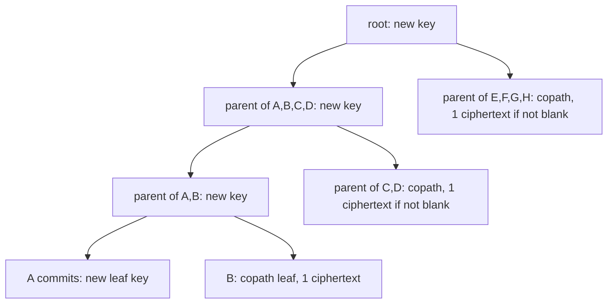

> **Research note — background and rationale only, not normative; the current rules are in docs/ (see decisions.md).**

# TreeKEM (MLS, RFC 9420) for PqChat and PqVault groups

Research of 2026-11-23 for the owner's request to study TreeKEM alongside the pqchat-sigs fixes, written while branch `pqchat-sigs`
changes `PqChat` and `PqGroupBase`. Nothing here is built or specified; every design below is a proposal and **UNAUDITED**.
Tags: **[F]** fact with its source, **[I]** inference, **[E]** estimate. Gas figures are paper estimates on the pinned PqChat
rows, not measurements. Web sources were read on 2026-11-23.

**Decided while this note was written (owner 2026-11-23):**

- A group runs in one of two modes, flat wraps (today's) or TreeKEM.
- The field is added now, in `pqchat-sigs`: `PqChatSession` gains `uint8 groupMode` (0 = flat, 1 = TreeKEM), fixed at creation; the
  release built now accepts only 0, and a later release accepts 1 with the same struct. `PqVaultCreate` gains the same field as
  a controller call.

**The answer in short.**

1. Beyond `groupMode`, TreeKEM needs **no other field** in `PqChatSession`, `PqChatEpoch`, `MemberKey` or `Wrap`, **no reserved
   storage** and **nothing in the UA registry** before the pre-freeze tag (§7). One condition, which costs no byte: the rule
   text must define `groupMode` as a **protocol id** (1 = TreeKEM with RFC 9420's tree rules over KEM scheme 1; 2–255 later
   variants), so a cipher-suite field is never needed.
2. TreeKEM is a cost structure, not a stronger key agreement: it pays from about **7 KEM keys** up and only in a **warm**
   tree (§4). At 2 members, PqChat's main case, it costs 44 % more than flat. PqVault has no use for it.
3. Use RFC 9420's tree algorithms with SCaaS records and the scheme-1 KEM in `ua-rs`; do not embed an MLS library (§3).
4. Updates without a contract change are possible today: a TreeKEM commit fits `postMessage` (§7.2). Only log-cost Add and
   Remove need the later release.
5. Building mode 1 now, in `pqchat-sigs`, is possible but costs 15 to 20 agent-days (minimal: 10 to 13) against 1.5 to 2.5
   days to the tag, and adds a new cryptographic protocol to the pre-freeze audit (§8). Recommended: the field now, the mode
   in a later release.

**Contents**

1. [TreeKEM as in RFC 9420](#1-treekem-as-in-rfc-9420)
2. [What MLS needs from a delivery service, and the chain as one](#2-what-mls-needs-from-a-delivery-service-and-the-chain-as-one)
3. [The PQ state of MLS; MLS itself or a TreeKEM of our own](#3-the-pq-state-of-mls-mls-itself-or-a-treekem-of-our-own)
4. [Cost model on chain](#4-cost-model-on-chain)
5. [The two modes: choice, binding, switching](#5-the-two-modes-choice-binding-switching)
6. [What the contract of a TreeKEM release does; the client side](#6-what-the-contract-of-a-treekem-release-does-the-client-side)
7. [The hook question](#7-the-hook-question)
8. [Can mode 1 be built now, in `pqchat-sigs`, before the tag?](#8-can-mode-1-be-built-now-in-pqchat-sigs-before-the-tag)
9. [Recommendation, risks, owner questions](#9-recommendation-risks-owner-questions)
10. [Sources](#10-sources)

## 1. TreeKEM as in RFC 9420

All of this section is **[F]** RFC 9420 (July 2023), by section number.

**The ratchet tree (§4, §7).** A left-balanced binary tree. Each **leaf** is one member (a `LeafNode`: its HPKE encryption key,
its signature key and credential, signed by the member). Each **parent** node holds an HPKE public key, a `parent_hash` and a
list of `unmerged_leaves`. A node may be **blank** (no key). A member knows the private keys of the nodes on its **direct path**
(its leaf up to the root) and of no other node. The group secret is derived from the root.

**Path secrets (§7.4).** A committer picks a fresh random `path_secret[0]` for its leaf's parent and derives up the path:

```text
path_secret[k+1] = DeriveSecret(path_secret[k], "path")
node_secret[k]   = DeriveSecret(path_secret[k], "node");   (node_priv[k], node_pub[k]) = KEM.DeriveKeyPair(node_secret[k])
commit_secret    = DeriveSecret(path_secret[last], "path")          one step above the root
```

**UpdatePath and its encryption targets (§7.5, §7.6, §4.1.2).** The commit carries the committer's new `LeafNode` and, per node
of its (filtered) direct path, the new public key and the node's `path_secret` encrypted with HPKE to the **resolution** of the
**copath** child (the sibling subtree at that level):

- the resolution of a non-blank node is the node itself plus its unmerged leaves;
- the resolution of a blank leaf is empty;
- the resolution of a blank parent is the resolutions of its two children, joined.

So a non-blank sibling subtree costs **one** ciphertext however many members it holds, and a blank one costs one ciphertext per
non-blank node found below it, in the worst case one per leaf. A receiver decrypts the one ciphertext addressed to a node it
holds, then derives the rest of the path upward itself.



**Blanks and cost.** A `Remove` blanks the removed leaf and every node on its direct path; an `Add` puts the new leaf in the
`unmerged_leaves` of its non-blank ancestors (one extra ciphertext each until a commit rewrites them); a tree whose members have
never committed has blank parents everywhere. Commit size is therefore between `log2 n` ciphertexts (a warm, full tree) and
`n − 1` (a cold one). A blank is filled only when a member below it commits.

**Proposals and Commits (§12).** `Add` (a `KeyPackage`), `Update` (the sender's new `LeafNode`), `Remove` (a leaf index), plus
`PreSharedKey`, `ReInit`, `ExternalInit`, `GroupContextExtensions`. A `Commit` lists proposals and may carry an `UpdatePath`; the
path is required unless the commit only adds. A commit starts a new **epoch**.

**Welcome (§12.4.3.1).** Each added member gets, HPKE-encrypted to the init key of its `KeyPackage`, the `joiner_secret` and the
`path_secret` of its lowest common ancestor with the committer, plus the encrypted `GroupInfo` (the tree or its hash). A Welcome
is one ciphertext per new member: a flat wrap.

**Tree hash and parent hash (§7.8, §7.9).** The tree hash commits to every node's public content and enters the `GroupContext`,
so the epoch's keys depend on the tree every member sees. The parent hash chains each parent node to the leaf whose signed
`LeafNode` set it, so a member can check every parent key was put there by a member, without the history.

**The key schedule (§8, §9).**

```text
init_secret[n-1] + commit_secret -> joiner_secret -> (+ psk_secret) -> epoch_secret (bound to GroupContext[n])
epoch_secret -> sender_data_secret, encryption_secret (the secret tree: one hash ratchet per sender, §9),
                exporter_secret, confirmation_key, membership_key, resumption_psk, init_secret[n]
```

Each epoch chains from the previous one through `init_secret`; a Commit carries a confirmation tag over the transcript.

## 2. What MLS needs from a delivery service, and the chain as one

**[F]** RFC 9420 §14 and RFC 9750 (the MLS architecture): members must process the Commits of a group **in one order**, one
Commit per epoch. Two members committing on the same epoch make a **fork**; the delivery service picks one and the loser sends
again on the new epoch. The service is not trusted for confidentiality, but it can drop or hold messages, and a member who sees
a different order is out of the group.

**[F]** PqChat's home instance already is that service for epochs: an epoch names its parent, its number is the parent's plus
one, and in the session's home instance the first child of a parent to complete takes `childOf(parent)`; no other child lands
there ([CTR-CHAT-08](../contracts/pqchat.md#CTR-CHAT-08); `PqGroupBase._parentOf`, `_slotFree`, `_land`). The earlier research
states the same ([pqchat-architecture.md](pqchat-architecture.md), "the chain acting as the MLS Delivery Service").

**[I]** A chain is a better delivery service than MLS assumes: the order is final and public, every commit stays readable, and
a client checks it against several nodes (ARCH-POS-15). Forks then exist only as records the home refused, and in replicas,
which order nothing; a client follows the home's `epochsOf`. What a chain adds as a cost is that every commit byte is state.

## 3. The PQ state of MLS; MLS itself or a TreeKEM of our own

### 3.1 Drafts and implementations (read 2026-11-23)

| Item | State | Maturity |
|---|---|---|
| RFC 9420 (MLS), RFC 9750 (architecture) | published 2023-07 and 2025-04; suites 1–7 are classical | stable |
| `draft-ietf-mls-pq-ciphersuites-06` | 2026-07-21, Standards Track, expires 2027-01-22 (Mahy, Barnes). Eleven suites, every code point still "TBD": ML-KEM-768 + X25519, ML-KEM-768 + P-256, ML-KEM-1024 + P-384, pure ML-KEM-768 and -1024, three with ML-DSA-44 / -65 / -87 signatures. Hybrids come from `draft-irtf-cfrg-concrete-hybrid-kems`. The first eight keep a classical signature (PQ confidentiality only) | working-group draft, not final; the suite list changed across revisions (X-Wing in the 2025 `-00`, gone in `-06`) |
| `draft-ietf-mls-combiner` (amortized PQ MLS) | `-02` of 2025-10; datatracker "In WG Last Call", updated 2026-01-16, milestone 2026-12. Runs a classical and a PQ MLS group side by side and commits the PQ one rarely | draft |
| OpenMLS (Rust) | v0.9.0 (changelog 2026-08-03) adds "P-384, ML-DSA and additional PQ ciphersuites"; an X-Wing suite since v0.6 (2024, suite `0x004D`, no IANA code point); a libcrux provider | usable, pre-1.0; no third-party audit named on its release page |
| mls-rs (Rust, AWS Labs) | README lists the RFC 9420 suites 1–7 only and states the library "has not yet received a full security audit by a 3rd party" | classical only, as documented |

**[F]** No draft suite is ML-KEM-1024 + X25519, which is SCaaS's scheme 1 (`kemPk = 0x01 ‖ ek (1,568) ‖ pk_X (32)`, combiner
`SHA3-256(ss_M ‖ ss_X ‖ E ‖ pk_X ‖ "scaas.kem.1")`; `clients/ua-rs/src/wallet/kem.rs`, CTR-UA-32).

### 3.2 MLS itself, or TreeKEM over scheme 1

| | MLS library with a PQ suite | RFC 9420's tree rules, SCaaS records, scheme 1 |
|---|---|---|
| Interoperability | none to gain: no other MLS client reads a PqChat contract; the suite would be private-use anyway (no scheme-1 suite exists) | none, and none needed |
| Signing | MLS signs TLS-encoded `FramedContent` and `LeafNode` with a raw signature key. A UA signs `uaMessage(kind, purpose, typed(record))` and the registry checks it (`requirePortable`); an `msig` author has no raw key. The contract could not check an MLS signature without an MLS parser in Solidity | typed EIP-712 records, the registry's check, as every PqChat record |
| One signer, one crypto home (CLI-UAL-01) | the library brings its own KEM, HPKE, HKDF and AEAD (libcrux or RustCrypto) beside `ua-rs`; a provider shim over `ua-rs` is possible but the HPKE and key-schedule code stays the library's | KEM, AEAD and HKDF stay in `ua-rs`; the tree code is pure logic above them |
| Explicit parameters | commits are opaque TLS blobs on chain | named, typed fields; one crypto object per `bytes` |
| Audit | a large codebase (credentials, extensions, external commits, PSKs, ReInit) of which a chain-ordered group uses a part; a draft suite list that still moves | a small protocol of our own: **UNAUDITED** until an AI audit round covers it; the published analyses of TreeKEM (§10) apply only where we keep RFC 9420's structure |
| Byte formats | the IETF's, final only for the classical suites | ours: new vectors in every client at once |

**[I] Conclusion.** Take the algorithms, not the wire format: RFC 9420's tree math, resolution, filtered direct path, path-secret
derivation, parent hash, tree hash and the shape of its key schedule, with SCaaS's typed records, the UA signature and the
scheme-1 KEM, all cryptography in `ua-rs`. The structural parts are checked against the MLS working group's tree-math and
TreeKEM test vectors. No crate is added for it. Every deviation from RFC 9420 is listed in the spec, because each one leaves
the published proofs.

## 4. Cost model on chain

### 4.1 Inputs

| Input | Value | Source |
|---|---:|---|
| ML-KEM-1024 `ek`, ciphertext | 1,568 B each | **[F]** FIPS 203; `kem.rs` |
| X25519 public key, ephemeral | 32 B each | **[F]** |
| A sealed 32-B secret (AES-256-GCM) | 48 B | **[F]** `PqGroupBase.SEALED_KEY` |
| A flat wrap as stored | 1,688 B | **[F]** `PqGroupBase.WRAP_BYTES` |
| A tree node public key | 1,600 B (`ek ‖ pk_X`) | **[E]** |
| One path ciphertext | 1,648 B (`ct ‖ E ‖ sealed path secret`) | **[E]** |
| One path level, warm | 3,248 B (key + one ciphertext) | **[E]** |
| State gas | 1,530 per byte; 97,920 per new slot; 183,600 per new blob | **[F]** EIP-8037 as the repo pins it |
| One more flat wrap | +2,876,400 state, about +0.107 M regular | **[F]** `PqChatGas.t.sol` on `pqchat-sigs` (1,688 B, a slot, 128 B in the record) |
| A flat `rekey`, fixed part | about 2.33 M state with the stand-in signature | **[E]** from the 2-member (8,034,030) and 20-member (59,907,150) rows |
| A real signature kept in state | +5,385,600 (ML-DSA-65), +1,321,920 (FN-DSA-512) | **[F]** the `pqchat-sigs` plan §1.4 |

A tree commit is given the same fixed part as a flat rekey, so the two columns compare. Depth `d = ⌈log2 n⌉`. `n` counts **KEM
keys**, not UAs: under the owner's (M) ruling a UA holds up to 8 keys in an epoch (`KEYS_PER_UA_MAX`), each key a leaf.

### 4.2 One rekey or commit

Bytes of key material, and state gas with the fixed part (**[E]**):

| n keys | d | Flat rekey: n × 1,688 B | Flat state gas | Tree commit, warm: 1,600 + d × 3,248 B | Warm state gas | Flat / warm | Tree commit, cold: n − 1 ciphertexts | Cold state gas |
|---:|---:|---:|---:|---:|---:|---:|---:|---:|
| 2 | 1 | 3,376 | 8.1 M | 4,848 | 9.7 M | 0.8 | 4,848 | 9.7 M |
| 8 | 3 | 13,504 | 25.3 M | 11,344 | 19.7 M | 1.3 | 17,936 | 29.8 M |
| 64 | 6 | 108,032 | 186.4 M | 21,088 | 34.6 M | 5.4 | 115,024 | 178.3 M |
| 256 | 8 | 432,128 | 738.7 M | 27,584 | 44.5 M | 16.6 | 434,640 | 667.3 M |
| 1,000 | 10 | 1,688,000 | 2,878.7 M | 34,080 | 54.5 M | 52.8 | 1,663,952 | 2,548.2 M |

- **The break-even is 7 keys** in a warm tree (flat 12,712 B with its record entries, tree 11,344 B). At 2 to 6 keys the tree
  costs more; at 2 it costs 44 % more, because a tree publishes a new node key beside each ciphertext.
- **A cold commit costs what a flat rekey costs.** A tree is cold after creation and wherever members have not committed. With
  `m` well-spread members having committed, a commit costs about `n / m + log2 n` ciphertexts **[I]**. A group whose admin is
  the only committer never leaves the flat cost.
- **After one removal** the next commit pays at most about `2 d` ciphertexts instead of `d` **[I]** (64.7 M state at 256 keys).
- **Creation is flat in both modes**: a Welcome is one ciphertext per member (§1), so epoch 0 costs `n` wraps either way.
- **ML-KEM-768 for tree nodes** (`ek` 1,184 B, ciphertext 1,088 B) would cut a warm commit by about a quarter (25,056 B and
  40.7 M at 1,000 keys); the same question as the TODO's "ML-KEM-768 for ratchet steps (owner to rule)".

### 4.3 Storage over time

- **State grows by each commit's bytes**; nothing is removed ("never lose ciphertext": a member that was away needs the path
  ciphertext of every commit since it joined, §6.2).
- **The live tree** is `n − 1` parent keys of 1,600 B: 1.6 MB at 1,000 keys, 2.45 G state gas, paid inside the commits that set
  them, not on top. Leaf keys start as the members' registry keys by reference (`kemKeyAt(ua, keyId)`), at no byte.
- **A node index** (which blob and offset holds each node's live key, as `wrapAt` does for wraps) is one slot per node, new once
  (97,920; 195.7 M in total for 1,999 nodes at 1,000 keys) and overwritten afterwards at no state gas.

### 4.4 Block-limit fit (EIP-8037, EIP-7825)

A transaction fits when `(regular + state) × 1.05` is within the block limit and its regular gas is under 2^24 (CTR-TOK-30).
With an ML-DSA-65 author on an `sstore2` home (signature kept 5.4 M state, verified in software about 5.8 M regular) **[E]**:

| | 60 M block | 200 M block (the SCaaS testnet) |
|---|---|---|
| Flat wraps per transaction | about 14 | about 59 |
| Flat rekey of 256 keys | about 18 transactions | 5 |
| Flat rekey of 1,000 keys | about 69 transactions | 17, each most of a block |
| Warm tree commit, 64 keys | 1 (asks about 50 M) | 1 |
| Warm tree commit, 256 keys | at the line (asks about 60 M): 2 chunks | 1 |
| Warm tree commit, 1,000 keys | 2 chunks (asks about 71 M) | 1 |

Regular gas is never the binding figure: a warm 1,000-key commit is about 34 KB of calldata, about 2.2 M regular at the 60 gas
per byte the wrap rows show, plus the signature check. A tree commit must still land in chunks like wraps do (CTR-CHAT-07): no
block-limit assumption.

## 5. The two modes: choice, binding, switching

**The choice is per session** (decided: `groupMode` in `PqChatSession`). One home instance holds many sessions, and a 2-person
chat wants flat while a large group wants a tree, so a setting per instance would split instances by mode for no gain.

**Binding and downgrade.** **[F]** `sessionId = keccak256(tag, creator, nonce)` does not commit to the record, so the mode is
bound by the creator's signature over the `PqChatSession` record the home keeps. On an `sstore2` home (CTR-CHAT-23) the client
verifies that signature itself and pins the mode per session, as it pins the instance's signature-storage setting; on a `none`
home the record is a trusted read like every other. An endpoint that misreports the mode gains nothing a refusal to answer
would not give it: a tree session read as flat finds no wrap for later epochs and opens nothing. The signature-storage setting
was rejected per session because a lying endpoint could switch the check off; the mode switches no check off. **[I]** The
later spec binds `groupMode` into the tree mode's KDF labels, which costs nothing.

**One release carries both** (decided: the later release accepts 1 with the same struct). The rules of `PqGroupBase` are
mode-independent: the parent and number rule, the home slot, the rights of a plain rekey and of a membership change, `leave`,
`remove`, the nonce scopes, the blobs. What differs is what delivers the epoch key: one wrap per member, or a path. Whether the
tree code is a body module, as `PqChatTopics` is, is a size question for that release and the owner's to rule then.

**No switching.** The mode is fixed at creation. A switch from flat to tree would start a cold tree, whose first commit costs
`n − 1` ciphertexts: the cost of creating a new session. A switch saves no gas and adds a second rule for what a member list
means at an epoch. A group that outgrows flat creates a tree session; the client links the two inside `sealedInfo`. A tree
session still uses flat records where RFC 9420 does: its epoch 0 (the Welcome) and each wrap for an added member.

**PqVault.** A vault has one member or a few and every rekey is an admin's; a tree never gets warm and never reaches 7 keys.
`PqVaultCreate.groupMode` keeps the two contracts on one base; a vault release accepting 1 is not foreseen.

**One `pqchat-core`.** Both modes end in the same thing, an epoch key `K` per epoch id. Sender chains, `sealedInfo`, messages,
stores and consent sit above `K` and do not change. The core branches once, at "obtain `K` of this epoch": open the own wrap,
or replay the commits. Until the tree mode is built it refuses a session with `groupMode ≠ 0` by a named error (fail closed),
and `pqvault-core` likewise.

## 6. What the contract of a TreeKEM release does; the client side

A sketch for the later release, so the hook question can be judged; the spec decides.

### 6.1 The contract

| Duty | How |
|---|---|
| Order commits | unchanged: one child per parent in the home instance (CTR-CHAT-08). A commit is an epoch |
| Keep what recovery needs in state | the commit record, every new node key and every path ciphertext in SSTORE2 blobs, landed in chunks against signed hashes as wraps are; a slot per tree node naming its live key. No log-only data |
| Authorize | unchanged rights: a commit with no membership change by any member that has not left or been removed, an Add or Remove by a live admin (CTR-CHAT-09); `PqChatRemove` and `PqChatLeave` stay as they are and act as RFC 9420's Remove proposals: the next commit must blank those leaves, as `_noneRemoved` forces today |
| Check what it can | the signature and nonce; the author's leaf; the path length (tree math); the ciphertext count of each path node against the resolution it computes from its blank and unmerged state; each field's size; each landed piece against its signed hash. It can keep a running tree hash: `d` hashes and `d` slot overwrites per commit, about 55 k regular gas at 1,000 keys **[E]** |
| Cannot check | that a node key derives from its path secret, or that a ciphertext opens to the right secret. Only the addressed member can, each for its own ciphertext; RFC 9420 has the same limit. A flat wrap has it too |
| Signature storage | a tree session needs an `sstore2` home or agreed reads (below) |

**Why the signature bytes matter more in tree mode. [I]** A committer encrypts path secrets to node keys it read from the
contract. A lying endpoint that substitutes a node key receives the path secret. Registry KEM keys are protected by the
registry's own checks; a tree node key is vouched for only by the signature of the commit that set it. So the client verifies
that signature before it encrypts to the node (possible on an `sstore2` home, CTR-CHAT-23) or reads under strict majority
(CLI-RPC-05). The later release may refuse tree sessions on a `none` home; that is its rule and needs nothing now.

```mermaid
sequenceDiagram
  participant M as member client
  participant H as home instance
  participant O as other members
  M->>H: read the tree: node slots, the signatures of the commits that set them
  M->>M: verify, pick path secrets, new node keys, one ciphertext per resolution entry
  M->>H: commit record (signed: parent epoch, proposals, node hashes) and the first path nodes
  M->>H: remaining path nodes in chunks, by anyone, each against its signed hash
  H->>H: order, rights, path shape, counts; the last piece takes the parent's slot
  O->>H: read the commit, open the one ciphertext addressed to a node they hold
  O->>O: derive the path upward, compare each derived public key with the stored one, then the epoch key
```

### 6.2 The client

- **Recovery from state alone.** Flat recovery is random access: one `wrapAt` read gives one epoch's `K`. Tree recovery is a
  **replay**: a device starts from its Welcome wrap and processes every commit since, one decapsulation each, because the key
  that opens commit `k` was delivered by an earlier commit. All of it is in state, so nothing is lost; it is slower, and a
  history of 10,000 commits is 10,000 reads.
- **The committer's own commit.** RFC 9420 encrypts a path secret to everyone but the committer, who keeps it in memory. A
  device restored from the seed would lose its own commits' epochs. Two fixes: derive the committer's `path_secret[0]` and new
  leaf key from the seed (`HKDF` over the KEM seed, the session, the parent epoch and the nonce; no byte on chain, and the seed
  recovers everything, as today), or add a self-wrap of 1,648 B to each commit. The first matches today's recovery promise.
- **Tree validation.** Verify the signature of each commit whose node keys are live; recompute the tree hash and the parent
  hashes from state; after decapsulation compare every derived public key with the stored one; then the confirmation tag.
- **A bad ciphertext and ARCH-POS-13.** A committer can address garbage to one member; that member is then out until re-added.
  It must not react in a way the committer can observe as a result of the decryption: no automatic complaint, re-join or
  rekey. The existing rule already says so for wraps (UA-7 spec P12), and the no-loss frame's point 5 repeats it. ML-KEM is
  IND-CCA with implicit rejection, so this is not PQZ's key-recovery case, but the rule holds regardless.
- **Forks.** None at home. A client reads the tree only from the home instance, never from a replica.
- **Per-device leaves (M).** A leaf is a `(ua, keyId)` entry; a UA with three devices has three leaves, adjacent in the sorted
  list, hence under one small subtree. Rights, `leave` and `remove` stay per UA: removing a UA blanks all its leaves. A device
  key that is random and never leaves the device makes that device's commits unrecoverable from the seed, by design.
- **ARCH-POS-15.** Tree reads feed both an encryption and a decryption: the node list, failover without mixing nodes, and the
  discovered-node rule (strict majority, at least three) apply as written.

### 6.3 The high-forward-secrecy frame

The six points of the TODO's no-loss frame, against a tree:

| Point | With TreeKEM |
|---|---|
| 1. Every message carries what decrypts it | unchanged: the tree delivers the epoch key, not message keys; ratchet headers stay in the envelope |
| 2. A lost message loses only itself | unchanged. A commit is never lost: it is state |
| 3. Skipped keys within a bound | unchanged (sender chains) |
| 4. A step advances only on receipt | a commit is a step every member receives in the same order, from the chain |
| 5. The safety net is the epoch rekey through the chain | the tree **is** that rekey, made cheaper: a warm commit refreshes a leaf key and the epoch key for `log2 n` ciphertexts, so the scheduled rekey can run more often in a large group. Never triggered by a failed decryption |
| 6. One ratchet per device pair | per-device leaves; in groups the frame's sender-key chain per sender, reset by each commit |

**[I]** This is where a tree earns its bytes. Flat wraps to fresh keys give the same forward secrecy and post-compromise
security as a tree at the same refresh rate; the tree only makes the refresh affordable above about 7 keys.

## 7. The hook question

After the freeze TreeKEM can only arrive as a new catalogued `PqChat` release: contracts are immutable and versions live in the
factory's catalogue. A new release has its own code, its own storage namespace and may add structs and entries of its own. So
the only things that must be right **before the tag** are the bytes a later release is meant to share with this one: the signed
structs and the ids.

### 7.1 Decided: `groupMode` in `PqChatSession` (and `PqVaultCreate`)

| | |
|---|---|
| Size | one ABI word in the stored record: +32 B per session; a refusal of any value but 0 and a named error: tens of bytes of code **[E]** |
| Gas | +48,960 state per `createSession` (32 × 1,530; the 2-member row 8,082,990 → about 8,131,950 **[E]**), about +140 regular (calldata). No other write moves |
| What moves | the `PqChatSession` and `PqVaultCreate` typehashes and their pins; the selectors of `createSession` and `sessionOf` (the tuple type), so `interfaceId`, `selector_audit.json` and the node's typed rows; `smartcontracts/vectors/pqchat/` and the vault's rows, hence clientkeys, `ua-rs`, `pqchat-core`, `pqvault-core` and every reader of them at once; the gas pins above. `pqchat-sigs` already moves `interfaceId` and the vectors, so this rides the same round |
| Audit | one field, one refusal, one negative test with its positive control (0 accepted, 1 refused) and a mutant that accepts 1 |
| Against a later struct | a release with a second session struct would leave two typehashes for one record in every client for good, and a session record could not be replicated between releases. The field now is the cheaper side |

Two notes for the builder. The stored blob is read by head offset in `PqGroupBase._authorOf` and by `abi.decode` in `_lists`:
appending the field at the end of the struct keeps every earlier head word in place. And a client refuses `groupMode ≠ 0` until
it implements the mode.

### 7.2 Every other candidate

| Candidate | Would cost | Verdict |
|---|---|---|
| A cipher-suite or tree-KEM id in the session | 32 B, +48,960 state per session | **Not needed**, if `groupMode` is defined as a protocol id: 1 names the tree rules **and** the node KEM (scheme 1); another node KEM (ML-KEM-768) or another tree rule is 2, 3, … Leaf keys already carry their scheme byte in the registry's `kemPk`. This needs one sentence in the rule, no byte |
| An initial tree commitment in the session | 32 B, +48,960 state per session, flat ones too | **Not needed.** A tree session starts cold: leaf `i` is `members[i]`'s registry key, every parent blank; the tree and its hash follow from the signed member list. Epoch 0 is the Welcome, one 48-B sealed `K` per member, exactly the flat record. A creator-filled path (RFC 9420's first commit) only halves the first commits' cost, and a later release can take it as a creator-signed record of its own |
| `groupMode` in `PqChatEpoch` | 32 B per epoch | **Not needed.** The mode is fixed per session; the contract reads it from the session it stores (as `PqVault` reads `modes[vaultId]`, CTR-PQV-17) and a client from the creator-signed session record. A tree commit is a new struct of the later release; `PqChatEpoch` stays the flat record |
| `groupMode` in the `sessionId` preimage | every id in every vector moves | **No.** The creator's signature over the record already binds it (§5) |
| A change to `MemberKey` or `Wrap` | typehashes | **Not needed.** A leaf's identity is `(ua, keyId)` already; `Wrap`'s crypto fields are `bytes`, and the Welcome fits today's 1,568-B and 48-B rules |
| A generic ordered "commit" entry | a new signed write, its typehash, rights and tests | **Exists.** `postMessage` stores a member's signed bytes in the session's order, in state, refused once the epoch has a child. A tree commit with no membership change fits it: 34,080 B at 1,000 keys against a 65,535-B blob, or about 32 keys on a 24,576-B chain with an ML-DSA-65 signature kept. A client-only tree for **Updates** inside a flat chain epoch can therefore be built after the freeze with no contract change; Add and Remove stay flat rekeys there |
| Reserved storage layout | slots, a layout pin | **No.** An instance is never upgraded, and each release has its own namespace; a slot reserved now is never read. This release needs no storage for the field either: it refuses every value but 0 |
| Anything in the UA registry | a registry change | **Nothing.** Leaves start from registry KEM keys; node keys live in `PqChat` state; signatures use `PURPOSE_PQCHAT` |

**Verdict.** With `groupMode` in, nothing else has to land before the tag. No speculative hook is proposed. The one thing to
settle now is wording: `groupMode` is a protocol id, not a flag.

## 8. Can mode 1 be built now, in `pqchat-sigs`, before the tag?

Owner question 2026-11-23: can it be built now, in pqchat-sigs, without waiting for a later release? The answer: **it can be built,
but not inside the tag's window**; it multiplies the time to the tag by three to five and puts a new cryptographic protocol in
the pre-freeze audit, for a mode that helps no group that exists today. Every figure below is **[E]**.

### 8.1 Contract scope of mode 1

**Entries and records** (typed EIP-712 in `DS_C` under `PURPOSE_PQCHAT`, one entry per operation, every field named; only a
key, a ciphertext or a signature is `bytes`):

| Entry | Record | Purpose |
|---|---|---|
| `createSession(s, wraps, sig)` | `PqChatSession`, `groupMode = 1` | unchanged entry: epoch 0 is the Welcome, one wrap of `K` per member key; the tree starts cold (§7.2) |
| `commit(c, nodes, wraps, sig)` | `PqChatCommit(bytes32 sessionId, bytes32 author, uint64 nonce, uint64 epoch, bytes32 parentEpochId, uint64 leafKeyId, bytes leafKey, bytes32[] admins, MemberKey[] adds, bytes32[] removes, bytes32[] nodeHashes, bytes32[] wrapHashes, bytes32 treeHash, bytes sealedInfo)` | an epoch of a tree session: the author's new leaf key, its path, the adds with their Welcome wraps, the removes |
| `addPath(epochId, first, nodes)` | `PathNode(bytes nodeKey, PathCt[] cts)`, `PathCt(bytes mlkemCt, bytes32 x25519Eph, bytes sealedSecret)` | unsigned chunks from anyone, each node against its signed `nodeHashes[i]`, as `addWraps` |
| `addWraps`, `leave`, `remove`, `postMessage` | unchanged | Welcome chunks; a leave or removal the next commit must honour; messages |
| views | `treeSize`, `leafAt`, `nodeAt`, `unmergedOf`, `commitOf`, `pathNodeAt`, `commitSig` | recovery from state alone |

**Storage.** The commit record (with its signature on an `sstore2` home), every new node key and every path ciphertext in
SSTORE2 blobs; per session the leaf count, a slot per tree node (`pointer | offset`, zero = blank), the leaf-to-`(ua, keyId)`
map and each parent's unmerged leaves. Nothing only in an event or in calldata.

**Checks.** By the contract: the parent, number and home slot (`_parentOf`, `_slotFree`); rights per UA (`_rights`,
`_liveAdmin`: a commit without adds or removes by any live member, any other by a live admin); the signature and nonce; the
author's leaf; removed and left UAs blanked (`_noneRemoved`'s rule); the path length; **the ciphertext count of each node
against the resolution it computes** (a walk of blank subtrees, at most `n` cold slot reads: about 0.5 M regular at 256 keys);
sizes; hashes at landing. The signed `treeHash` is stored and compared by clients; a running tree hash on chain is optional.
By clients only: every derived public key against the stored one, the parent hashes, the confirmation of the epoch key.

**With (M) and signature storage.** A leaf is a `(ua, keyId)`; the `KEYS_PER_UA_MAX` cap, the sort order and the per-UA
rights carry over; removing a UA blanks all its leaves. Mode 1 is accepted only on an `sstore2` home (§6.1).

**Size and the gate.** `PqChat` is 31,897 B on `pqchat-sigs` (`size-baseline.json`), and the size gate stops a plain contract
at 35,286 B (the 60 M deployment line): 3,389 B are left. The tree code is about 8 to 14 KB, so it cannot go into `PqChat`:
it needs a **new DELEGATECALL body module** beside `PqChatTopics` (its own line 35,570 B), far under the 131,072-B ceiling.
A module split is the owner's to approve, and it brings the library-split checks (storage, `this`, `msg.sender`, return data).

**Gas per commit** (state, with the fixed part; add 5.4 M for a kept ML-DSA-65 signature; §4):

| n keys | Warm | After one removal | Cold | Block fit, warm |
|---:|---:|---:|---:|---|
| 8 | 19.7 M | 27.3 M | 29.8 M | one transaction at 60 M |
| 64 | 34.6 M | 49.7 M | 178.3 M | one transaction at 60 M (asks about 50 M) |
| 256 | 44.5 M | 64.7 M | 667.3 M | at the 60 M line: two chunks; one at 200 M |

### 8.2 Client scope

| Part | Work |
|---|---|
| clientkeys (the JS reference) | tree math, resolution, filtered path, path-secret derivation, node key derivation, commit build and process, tree and parent hash, the typed records; the vector generator |
| `ua-rs` | every secret step behind handles (C1, A-3): `path_secret` derivation, the node key pair from a secret (the 96-byte KEM-seed form `kem.rs` already has), encapsulation to a node key, opening the own path ciphertext, deriving upward, the epoch key; the record digests and verification. No secret leaves `ua-rs` |
| `scaas-sdk` | thin calls and the named ABI rows for `commit`, `addPath` and the views |
| `pqchat-core` | the public tree state from views, validation, building a commit, **replay recovery**, the store's tree rows, the mode branch; errors |
| `pqvault-core` | refuses `groupMode ≠ 0`; no tree logic |
| vectors | new rows under `smartcontracts/vectors/pqchat/` read by forge, clientkeys, `ua-rs`, `scaas-sdk`, `pqchat-core` and the node's `typed.rs`; RFC 9420's tree-math vectors as a control |
| node | `typed.rs` `TYPED` / `PLAIN` rows, `guard.rs`, `selector_audit.json` for the two writes, both directions |
| bindings | `pqchat-core`'s generated bindings regenerate with the new calls |

### 8.3 Build or reuse

| | OpenMLS with a PQ suite | mls-rs | Our own minimal TreeKEM over scheme 1 |
|---|---|---|---|
| Maturity | v0.9.0, pre-1.0; its PQ suites are three months old and follow a draft with unassigned code points | no PQ suite documented | new code |
| Licence | MIT | Apache-2.0 or MIT | the repo's |
| Suite | no ML-KEM-1024 + X25519: a private suite and a custom crypto provider | — | scheme 1 as is |
| One signer, crypto in `ua-rs` | brings its own HPKE, key schedule and signing interface; an `msig` or a registry-checked `UASig` does not fit a raw-key signer | same | fits: pure logic above `ua-rs` |
| On chain | TLS-encoded opaque commits the contract cannot check or name field by field | same | typed records the contract checks |
| Dependency weight | a large tree (TLS codec, HPKE, provider crates); not measured; a new heavy dependency of `ua-rs` needs the owner's word, as chain libraries do | same | none |

**Pick: our own minimal TreeKEM**, RFC 9420's algorithms only. The library's value is interoperability and its analysed
wire format, and a PqChat contract can use neither.

### 8.4 Effort, gates, audit, timeline

| Part | Agent-days |
|---|---:|
| Spec of the protocol and the records; Fable review (design, security, crypto); fixes | 1.5–2 |
| Contract: the module, tree state, resolution, landing, views; red tests first, mutants, layout, gas and size pins | 3–4 |
| clientkeys reference and vectors | 2 |
| `ua-rs` secret core, handles, vector tests | 2–3 |
| SDK calls; `pqchat-core` tree logic, replay recovery, store; anvil e2e | 3–4 |
| Node rows and tests; docs and decisions | 1 |
| Review findings and their fixes (each crypto round so far had some) | 2–3 |
| The round's matrix: every forge directory at the default set, the set-sensitive tests and `modules` at the other three, node and e2e, the client matrix, vectors | 0.5–1 |
| **Total** | **15–20** |

With the streams in parallel that is about **6 to 9 calendar days** to a green tree, against the 1.5 to 2.5 days estimated to
the tag. The pre-freeze audit target grows by a new cryptographic protocol in three implementations (the module, clientkeys,
`ua-rs`) plus `pqchat-core`'s replay; it is `UNAUDITED` until that round covers it, and a finding after the tag costs a new
release either way.

### 8.5 A minimal mode 1

Commit with UpdatePath, Add and Remove; Welcome by wraps; a cold start; the committer's secret derived from the seed. Left out:
external commits, pre-shared keys, ReInit, group-context extensions, proposals sent apart from their commit, **unmerged
leaves** (an Add blanks the new leaf's direct path instead: simpler resolution on chain, and the commits after an Add pay up
to about `2 d` ciphertexts), a tree hash kept by the contract, a creator-filled first path.

It gives up: joining without an admin's Add, cheap commits right after an Add, and a tree that is warm from the start. It
saves about a third: **10 to 13 agent-days, 4 to 6 calendar days**. The audit growth is nearly the same, because the key
derivation, the resolution rule and the replay are all still there.

### 8.6 Recommendation

**Keep the field now; build mode 1 as a later release.**

| | Field now, release later (recommended) | Minimal mode 1 now | Full mode 1 now |
|---|---|---|---|
| Time to the pre-freeze tag | 1.5–2.5 days, unchanged | +4–6 days | +6–9 days |
| Audit target | unchanged | + a new crypto protocol | + the same, larger |
| Who gains at the tag | nobody loses | groups of 7 keys or more whose members commit; none exists (every chain is test-only) | the same |
| 2-member chats, the main case | unchanged | unchanged; mode 1 would cost them 44 % more | the same |
| What waiting costs | nothing: a later `PqChat` release is one catalogue entry, new sessions name it as home, and flat sessions would not switch anyway (§5) | — | — |

The freeze does not make mode 1 harder later: with `groupMode` in the struct, the later release shares the session record, its
typehash and its vectors. Building it now would freeze a tree contract before any client has run the protocol against it. If
large groups need cheap key refresh sooner, the client-only tree for Updates over `postMessage` (§7.2) needs no contract.

## 9. Recommendation, risks, owner questions

**Controller's recommendation.**

1. In `pqchat-sigs`: add `groupMode` as ruled, appended to the struct, accepted only as 0, with the rule text calling it a
   protocol id (0 flat; 1 TreeKEM by RFC 9420's tree rules over KEM scheme 1; 2–255 unassigned). Nothing else.
2. After the freeze, first the client-only high-forward-secrecy mode; if large groups need cheap refresh before a contract
   release exists, a tree for Updates over `postMessage` (§7.2) is the smallest step.
3. A TreeKEM contract mode only when a real group of some tens of keys exists whose members commit; below 7 keys and for
   admin-only groups it costs more than flat. Its own spec, Fable review, vectors in every client, an AI audit round.
4. RFC 9420's algorithms with SCaaS records and scheme 1 in `ua-rs`; no MLS crate.

**Risks.**

- **A cold or admin-only tree never pays** and still costs the node keys: the mode can be chosen where it loses.
- **Replay recovery** is slower than flat's random access and grows with the commit count.
- **A protocol of our own** is new cryptographic code: UNAUDITED, and every deviation from RFC 9420 leaves its analyses.
- **Insider denial of service**: a member can cut one member off with a bad ciphertext; neither contract nor others see it.
- **Substituted node keys** on a `none` home with one endpoint (§6.1).
- **The draft PQ suites still move**; nothing here depends on them, by choice.
- **Size**: tree code in the release may need a body module; the size gate and the owner decide then.

**Owner questions.**

1. `groupMode` as a **protocol id** (1 = RFC 9420 tree rules over scheme 1, other values later variants), so no suite field is
   ever added: confirm, so the rule text in `pqchat-sigs` says it.
2. `PqVaultCreate.groupMode` is there for the shared base only; PqVault is not expected to accept 1. Confirm.
3. Which group size is TreeKEM for? The figures say: not under 7 keys, and only where many members commit.
4. TreeKEM of our own over scheme 1 in `ua-rs` (recommended) rather than an MLS library: confirm.
5. Recovery of a committer's own commits: seed-derived path secrets (recommended; no byte, today's promise) or a self-wrap
   (1,648 B per commit)?
6. ML-KEM-768 for tree nodes (a quarter fewer bytes per commit), together with the TODO's same question for ratchet steps.
7. Should a tree session be refused on a `none` home in the later release?
8. Mode 1 now or later (§8.6): the field now and a later release (recommended), a minimal mode 1 now (+4–6 days to the tag),
   or the full one (+6–9 days)? If now, the tree code needs a new body module: the owner's approval.

## 10. Sources

- RFC 9420, "The Messaging Layer Security (MLS) Protocol", 2023-07: <https://www.rfc-editor.org/rfc/rfc9420>
- RFC 9750, "The Messaging Layer Security (MLS) Architecture", 2025-04: <https://www.rfc-editor.org/rfc/rfc9750>
- `draft-ietf-mls-pq-ciphersuites-06`, 2026-07-21: <https://datatracker.ietf.org/doc/html/draft-ietf-mls-pq-ciphersuites-06>
  (and the 2025 `-00` with X-Wing: <https://www.ietf.org/archive/id/draft-mahy-mls-pq-00.html>)
- `draft-ietf-mls-combiner`, `-02` of 2025-10, state read on the datatracker: <https://datatracker.ietf.org/doc/draft-ietf-mls-combiner/>;
  a benchmark of it, ePrint 2026/034: <https://eprint.iacr.org/2026/034>
- OpenMLS releases (v0.9.0; X-Wing in v0.6): <https://github.com/openmls/openmls/releases>; "Post-Quantum OpenMLS", 2024-04:
  <https://cryspen.com/post/pq-openmls/>
- mls-rs README: <https://github.com/awslabs/mls-rs>
- FIPS 203 (ML-KEM sizes). Background, not re-read for this note: Alwen, Coretti, Dodis, Tselekounis, "Security Analysis and
  Improvements for the IETF MLS Standard for Group Messaging" (CRYPTO 2020); Alwen, Jost, Mularczyk, "On the Insider Security
  of MLS" (CRYPTO 2022).
- Repo: `smartcontracts/evm/src/pqgroup/PqGroupBase.sol`, `smartcontracts/evm/src/pqchat/`,
  `smartcontracts/evm/test/pqchat/PqChatGas.t.sol`, `clients/ua-rs/src/wallet/kem.rs`, [pqchat.md](../contracts/pqchat.md),
  [pqvault.md](../contracts/pqvault.md), the specs `docs/superpowers/specs/2026-11-17-pqchat-core.md`,
  `docs/superpowers/specs/2026-11-17-pqvault.md` and `docs/superpowers/specs/2026-10-25-ua7-pq-e2e-sessions.md`. The
  signature-storage setting, the (M) ruling and their gas rows are on branch `pqchat-sigs` (commit `cbcfe9883` and its working
  tree), not yet on `ua-rs-sign`; its plan is `docs/superpowers/plans/2026-11-23-pqchat-signatures.md` there.
