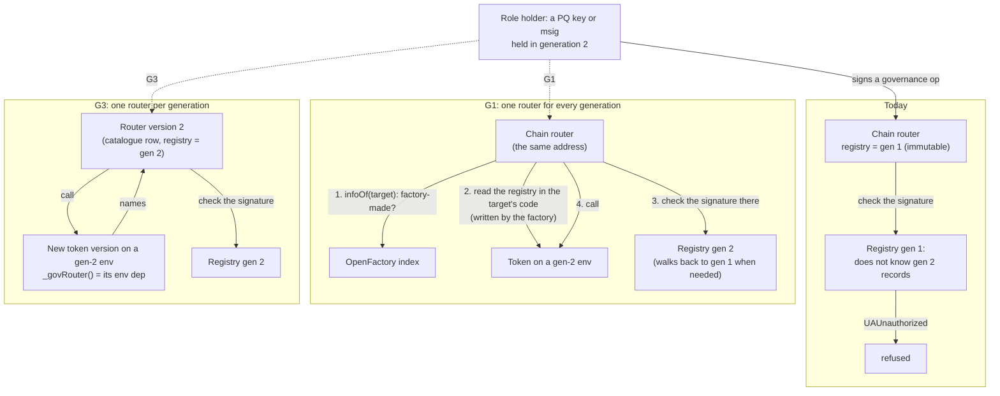

> **Research note — background and rationale only, not normative; the current rules are in docs/ (see decisions.md).**

# NFT and multi-token kinds

Research of 2026-11-24 for the owner ("Bây giờ cần là xem xét NFT (multi NFT)": now we need to look at NFTs, multi-NFT).
Nothing here is built, specified or ruled, except where §8 records an owner answer of 2026-11-24. Every design
below is a proposal. All SCaaS code named here is **UNAUDITED**
([ARCH-POS-14](../decisions.md#ARCH-POS-14)).

Tags:
- **[F]** a fact with its source: a SCaaS fact cites a repository path or a rule id, an external fact a URL in §9;
- **[I]** our inference;
- **[E]** an estimate.

EIP statuses were read on eips.ethereum.org on 2026-11-24.

**Contents**

1. [Why now: the use cases](#1-why-now-the-use-cases)
2. [The standards survey](#2-the-standards-survey)
3. [Non-EVM equivalents](#3-non-evm-equivalents)
4. [SCaaS constraints and what they imply](#4-scaas-constraints-and-what-they-imply)
5. [Design options and a recommendation](#5-design-options-and-a-recommendation)
6. [The relayer and SDK side](#6-the-relayer-and-sdk-side)
7. [The pre-freeze question](#7-the-pre-freeze-question)
8. [Open questions, TODO items, effort](#8-open-questions-todo-items-effort)
9. [Sources and what could not be verified](#9-sources-and-what-could-not-be-verified)

## 1. Why now: the use cases

**Today [F].**
- Items are `NORMAL` tokens with `decimals 0`: one token per item kind, recipes as burn and mint
  ([guides/item-economies.md](../guides/item-economies.md) §1, §6).
- "NFTs for unique items" is **PLANNED** there (§8), in [integration.md](../integration.md) (row "NFT kinds"), in
  [token-wrappers.md §13](../contracts/token-wrappers.md#13-limitations) and in
  [asset-suite.md](../contracts/asset-suite.md) ("Non-fungible in-app assets (ERC-721/1155 with meta-tx)").
- The features catalogue sends allocated lots to "the non-fungible kinds (ERC-721 / 1155, PLANNED)"
  ([token-features-catalogue.md](token-features-catalogue.md), row "Lot or serial tracking"). It sends partitions to "P3
  only as a future multi-token kind" (D11).

| Use case | Fungibility | Served today by `decimals 0`? |
|---|---|---|
| Game items, stackable (potions, ingots, arrows) | fungible per kind | **yes**: one token per kind (item-economies §5) |
| Game items with state (a sword with durability 37, a numbered axe) | non-fungible: each unit has its own state | no. The workaround is one kind per level (item-economies §7), which cannot carry per-unit state |
| Tickets and passes, unnumbered (general admission, ten-session pass) | fungible per event or tier | **yes** |
| Tickets, seated or numbered | non-fungible (seat, row) | no. One token per seat is possible but costs one clone each [I] |
| Certificates (diploma, course completion, warranty) | non-fungible: names one holder and one document | no |
| Soulbound credentials (membership, KYC badge) | non-fungible, non-transferable | partly: the receiver allowlist is SPECIFIED, not built (item-economies §7) |
| Allocated lots and serials (gold bars, warehouse lots) | non-fungible (bar number, assay) | no: the catalogue says "allocated lots wait for the non-fungible kinds" |
| Receivables and invoices, one token per claim | non-fungible (debtor, due date, amount) | no |
| RWA units (a share class, a bond tranche) | semi-fungible: fungible within a class, classes differ | yes, one token per class (D11: "a class is its own token") |
| Collectibles (art, editions of N) | unique (1 of 1), or semi-fungible (edition of N) | editions yes as one kind; 1-of-1 needs a token each |

**Inference [I].**
- The gap is not fungible items. It is **many distinct ids under one issuer**, often with **per-id state**: durability,
  seat, bar number, due date.
- A `NormalToken` clone per id is possible today. But it means a clone per id (~45,000 gas each,
  [CTR-TOK-18](../contracts/token-wrappers.md#CTR-TOK-18)), a factory record per id, and no atomic multi-id operation.
- So the need is a **multi-token** in which some ids have supply 1, more than a pure ERC-721.

## 2. The standards survey

Statuses and interface ids are from eips.ethereum.org on 2026-11-24 (§9) [F].

| Standard | Status | Approvals / operators | Receiver callbacks | Batch | Metadata | Notes |
|---|---|---|---|---|---|---|
| ERC-721 | Final | `approve(to, id)` (cleared on transfer), `setApprovalForAll` | `onERC721Received`, only on `safeTransferFrom` to a contract | none | `tokenURI` (extension `0x5b5e139f`) | id `0x80ac58cd`; plain `transferFrom` can strand a token in a contract |
| ERC-1155 | Final | `setApprovalForAll` only, no per-id approval | `onERC1155Received` / `onERC1155BatchReceived`, **mandatory** on every transfer and mint to a contract | `safeBatchTransferFrom`, `balanceOfBatch` | `uri(id)` with `{id}` substitution | id `0xd9b67a26`. The hook runs after the balance update, so it is a reentrancy point |
| **ERC-6909** | Final | `approve(spender, id, amount)`, `setOperator(spender, bool)`, `allowance`, `isOperator` | **none**, removed on purpose | **none**, removed on purpose | optional: `name/symbol/decimals(id)`, `contractURI()`, `tokenURI(id)`, `totalSupply(id)` | id `0x0f632fb3`. The order of the operator and allowance checks is left to the implementation |
| ERC-2981 | Final | — | — | — | — | `royaltyInfo(id, salePrice)`. The spec says payment "must be voluntary": nothing enforces it. id `0x2a55205a` |
| ERC-4906 | Final (extends 721) | — | — | `BatchMetadataUpdate(from, to)` | events `MetadataUpdate(id)` | id `0x49064906` (stated by the EIP, not recomputed by us) |
| ERC-5192 | Final (721) | — | — | — | — | minimal soulbound: `locked(id)`, events `Locked` / `Unlocked`. id `0xb45a3c0e` |
| ERC-5484 | Final (721) | — | — | — | — | consensual soulbound: `burnAuth(id)` ∈ {IssuerOnly, OwnerOnly, Both, Neither}, event `Issued` |
| ERC-4907 | Final (721) | `setUser(id, user, expires)` | — | — | — | rental: `userOf` is 0 once expired. id `0xad092b5c` |
| ERC-6551 | **Review** | the NFT holder is the account's signer | the account takes `receive()` and ERC-1271 | — | — | token-bound accounts from one registry. Known risks: a seller drains the account before a sale settles; ownership cycles lock assets |
| ERC-3525 | Final | `approve(tokenId, operator, value)`: value allowances | `onERC3525Received` | — | `contractURI`, `slotURI(slot)` | semi-fungible: ids carry a value and a slot; value moves between ids of one slot |
| ERC-7518 | **Review** | inherits ERC-1155 | inherits ERC-1155 | `batchPayout` | inherits ERC-1155 | partitions as ids on ERC-1155, with `freezeAddress`, `forceTransfer`, `restrictTransfer` and an EIP-712 voucher |
| ERC-404 | **not an EIP** (no page on eips.ethereum.org) | ERC-20 and ERC-721 approvals on one surface | — | — | — | "experimental … not fully tested or audited" (its README). Amounts and ids share one number space, so one `transferFrom` means either, decided by range: an integration that misses this can release an NFT the caller does not own. v1 minted and burned NFTs on fungible transfers (gas, pool whitelists) |

**Callbacks and reentrancy [F].**
- HypeBears (February 2022): the attacker re-entered `mintNFT` from `onERC721Received` before the per-address counter was
  written.
- Revest Finance (March 2022, about USD 2 M): the attacker re-entered `depositAdditionalToFNFT` from
  `onERC1155Received`.
- Both are mandatory-hook designs that call into the receiver mid-operation. ERC-6909 drops the hooks for this reason
  and for gas.

**Gas, by design [I].**
- ERC-721 keeps one owner slot per id, plus a balance counter per holder.
- ERC-1155 and ERC-6909 keep one balance slot per (holder, id).
- For a unique id moving to a fresh holder, 721 rewrites an existing owner slot. 1155 and 6909 create a new (holder, id)
  slot, at about 97,920 state gas under EIP-8037 ([pq-zero-knowledge.md](../contracts/pq-zero-knowledge.md), the new-slot
  figure) [F], and zero the sender's slot. See §4.6.

**Marketplaces [F].**
- Seaport needs approvals for the Seaport contract, or for a conduit, for every offered ERC-20, 721 or 1155 item.
- For 721 and 1155 that means `approve` or `setApprovalForAll`.
- Seaport's item types are native, ERC-20, ERC-721 and ERC-1155 (with criteria). ERC-6909 is not one of them.

## 3. Non-EVM equivalents

How SCaaS holds balances per family today [F]:

| Family | SCaaS holding today |
|---|---|
| Solana | SPL and Token-2022 through `token_interface`, in a program-level `SmartKeyAccount` PDA; a mint that is `NonTransferable`, has a transfer hook or a transfer fee is refused at every transfer ([NET-SOL-09](../networks/solana.md#NET-SOL-09)) |
| NEAR | per-token records; the relayer pays storage ([NET-NEAR-09](../networks/near.md#NET-NEAR-09)) |
| Algorand | **app boxes, not ASAs**: "An ASA needs the receiver's opt-in, which a UA id cannot give" ([algorand.md §1](../networks/algorand.md#overview)); `OptIn` refused everywhere ([NET-ALG-04](../networks/algorand.md#NET-ALG-04)) |
| Soroban | own SEP-41 contract; `approve` only to a contract spender ([soroban.md §4](../networks/soroban.md#contracts)) |
| Aptos | the `Account` object's primary fungible stores ([aptos.md §2](../networks/aptos.md#accounts)) |
| Sui | a shared `Account<T>` per subject ([NET-SUI-01](../networks/sui.md#overview)) |
| TON | a Tact jetton whose wallet verifies `SignedOp` ([NET-TON-04](../networks/ton.md#NET-TON-04)) |
| Cosmos | CW20 with a contract-level meta-op; allowances only to contract spenders ([cosmos.md §4](../networks/cosmos.md#contracts)) |
| Hedera | HTS only behind an EVM wrapper; HTS allowances cannot be restricted ([hedera.md §7](../networks/hedera.md#hts)) |

The native NFT standards (§9 sources) and how each maps:

| Family | Native standard (status) | Maps | Does not map |
|---|---|---|---|
| Solana | **Metaplex Core** (Metaplex: "the recommended NFT standard for new projects"): one account per asset, plugins (royalties enforced by default, freeze, permanent delegates), collections. **Token Metadata** (legacy): an SPL mint with supply 1 and 0 decimals, a metadata PDA, a master edition; pNFTs freeze the token account and route every operation through rule sets. **Bubblegum v2** compressed NFTs: leaves of a concurrent Merkle tree, read through the DAS API. **Token-2022**: `MetadataPointer` / `TokenMetadata`, `NonTransferable`, group and member pointers | Core assets owned by the `SmartKeyAccount` PDA and moved by its CPI [I]; a Token-2022 mint of supply 1 per unique id in the existing `token_interface` path [I] | `NonTransferable` mints are refused by NET-SOL-09 today, so a soulbound id needs that policy revisited for this kind. pNFT rule sets and the Bubblegum proofs are extra programs and accounts per operation. Bubblegum v2: Phantom, Solflare and Backpack can display but not transfer them yet; Magic Eden and Tensor do not support them yet |
| NEAR | **NEP-171** core (Final), NEP-177 metadata, NEP-178 approvals, NEP-181 enumeration, NEP-199 royalties (all Final). **NEP-245** multi-token (Final): `mt_transfer`, `mt_batch_transfer`, `mt_transfer_call` with `mt_on_transfer` | **NEP-245 maps almost 1:1 onto an ERC-6909-shaped kind**, batch included. The SCaaS path adds a signed `MetaOp` entry beside the native ones | NEP-178 approvals (refused for non-contracts, CTR-TOK-01's rule); `*_transfer_call` is a callback, off by default as on EVM; the native 1 yoctoNEAR deposit sits on the relayer's side |
| Algorand | **ASA** (total 1, decimals 0) with **ARC-3** (Final), **ARC-19** (Final; mutable CID in the reserve address), **ARC-69** (Final; JSON in the note). **ARC-72** (Living): an app-based NFT with `arc72_ownerOf`, `arc72_transferFrom`, optional approvals | **ARC-72's shape** in SCaaS app boxes, keyed (id, holder) [I] | **ASA-based NFTs do not map**: the receiver's opt-in, which a UA id cannot give (the same reason SCaaS tokens are not ASAs). No multi-token ARC was found |
| Soroban | **SEP-0050** (Draft v0.1.0): ERC-721-like, `approve(…, live_until_ledger)`, `approve_for_all`. **OpenZeppelin Stellar** NFT module (v0.8.0): Base, Enumerable or Consecutive, Burnable, Royalties | the SEP-50 shape for unique ids, signed through Soroban authorization ([NET-SOR-01](../networks/soroban.md#overview)) | `approve` / `approve_for_all` to non-contracts. No multi-token SEP was found |
| Aptos | **Digital Asset** standard: a token is an object in a collection; `object::transfer` without opt-in; soulbound by `disable_ungated_transfer` and `aptos_token::mint_soul_bound` | unique ids as objects owned by the SCaaS `Account` object; fungible ids as fungible assets in its primary stores [I] | royalty enforcement on chain (not stated in the docs) |
| Sui | objects with `key` (+ `store` for `public_transfer`). **Kiosk** and `TransferPolicy<T>`: a purchase returns a `TransferRequest` that must satisfy the policy's rules (royalty, for example); a policy enforces nothing by default | unique ids as objects held inside the subject's shared account (a dynamic object field), so a meta-op can move them as it moves `Balance<T>` today [I] | Kiosk sales would be a second path with its own policy; a `key`-only type cannot leave its module's rules |
| TON | **TEP-62**: one contract per item plus a collection; TEP-64 content; TEP-66 royalty parameters; **TEP-85** SBT | item contracts that verify a `SignedOp` as the GRAM wallet does [I]; fungible ids as one jetton master per id | one contract per item makes a 10,000-item collection 10,000 deploys; no on-chain owner query (asynchronous). No multi-token TEP was found |
| Cosmos | **CW-721** (cw-nfts v0.22.0, community-maintained): `TransferNft`, `SendNft` → `ReceiveNft`, per-token `Approve` with expiry, `ApproveAll`. **CW-1155** was removed from cw-plus in 2022 and is not in cw-nfts | the CW-721 shape for unique ids with a contract-level signed op | `Approve` / `ApproveAll` to non-contracts; `SendNft`'s hook (off by default). The multi-token would be our own |
| Hedera | HTS NFTs (not checked in this round, §9) | the EVM kind under `IS_HEDERA`, as for the token wrappers | an HTS NFT directly: protocol allowances cannot be restricted ([NET-HED-04](../networks/hedera.md#NET-HED-04)) |

**One rule on every chain [I].** The common rule is not a standard's ABI. It is:

1. A collection holds ids.
2. Each id has a supply cap (1 = unique), a metadata commitment and flags fixed when the id is defined.
3. Holders are UA ids.
4. Every move is a subject-signed typed operation, relayable at fee 0.
5. Approvals exist only between contracts.
6. There are no receiver callbacks by default.

Each family realises this in its own holding model. It uses the native NFT object where that object can sit under a SCaaS
account (Solana, Aptos, Sui), and a ledger in the contract where it cannot (Algorand, Soroban, Cosmos, NEAR's NEP-245
contract). Wallet display of the native standards is a by-product, not the rule.

## 4. SCaaS constraints and what they imply

### 4.1 No `approve`, no `setApprovalForAll`

The rule [F]:
- **[CTR-TOK-01](../contracts/token-wrappers.md#CTR-TOK-01):** only a contract may call `approve`, a spender must be a
  contract, and only a contract may call `transferFrom`. No permit, no meta-tx `approve`. A UA has no `uaApprove`
  ([CTR-UA-27](../contracts/accounts.md#CTR-UA-27)).
- Contract accounts (a Safe, `SmartKeyAccount`) approve through their own call path.

What replaces allowances today [F]:
- **service pull** ([CTR-MTX-32](../contracts/metatx.md#CTR-MTX-32)): one signed transfer bound to the service and one
  operation;
- **mandates** ([CTR-ACC-06](../contracts/mandates.md#CTR-ACC-06)): a `MandateWallet` pays under caps;
- **DEX orders** ([CTR-DEX-15](../contracts/dex.md#CTR-DEX-15)): the sell token verifies the order and moves funds only
  into `dex`;
- **liquidity orders** ([CTR-DEX-30](../contracts/dex.md#CTR-DEX-30)), which also refuse `setApprovalForAll`
  (`0xa22cb465`) in every DEX interaction.

**What interop is lost [I].**
- An EOA or UA holder cannot list on OpenSea / Seaport, because Seaport needs an approval to its contract or conduit (§2).
- A contract-wallet holder could approve a Seaport conduit, which is a contract and therefore allowed by CTR-TOK-01.
  That works only if the kind speaks ERC-721 or 1155.
- Blur-style operator listings are lost the same way.
- Wallet galleries and indexers that read ERC-721 / 1155 events lose the kind unless it emits those events.

**What SCaaS offers instead [I].**
- A signed listing: the seller's typed `IdSaleOrder` in the collection's domain, settled by a SCaaS market contract (§4.7).
- An offer: the buyer's pay-token `UAMetaTransfer` bound to that market as a service pull.
- Both relayable at fee 0, PQ-signed, and with no standing approval anywhere.
- For Seaport reach: an opt-in adapter (option B's adapter, §5) that the holder enters and leaves knowingly.

### 4.2 Holders, receivers and callbacks

Holders [F]:
- Holders are UA ids (`bytes32`). Derived UAs live in a separate `bytes32` ledger, seen by ERC-20 observers as the
  sub-ledger of `UA_POOL` ([CTR-UA-18](../contracts/accounts.md#CTR-UA-18)).
- Every operation open to a native id is open to a registered signing UA, sender and receiver alike
  ([CTR-UA-27](../contracts/accounts.md#CTR-UA-27)).
- A 7702-delegated caller is refused (`CallerDelegated`, [CTR-UA-24](../contracts/accounts.md#CTR-UA-24)).

Receivers [I]:
- Under no-7702, a receiver that runs code is a deployed contract, never an EOA. A derived UA has no code at all.
- So a callback could reach only real contracts, which are exactly the services that should take custody by service pull
  instead: the service executes the holder's signed transfer and then acts in the same call.
- Callbacks therefore add a reentrancy point (Revest, HypeBears) and buy nothing the service pull lacks. Recommendation:
  **no callbacks** in the kind.
- The ERC-6909 risk of stranding an id in a contract that cannot move it stays, as with every ERC-20. Two mitigations:
  - the registry already refuses a receive to an unregistered derived id ([accounts.md §1](../contracts/accounts.md));
  - wallets warn on contract receivers.

### 4.3 Metadata and media

Today [F]:
- The integration's commitment format: `commitment = keccak256(abi.encode(REC_TAG, salt, payloadHash))`, where
  `payloadHash = SHA-256(JCS(payload))` ([INT-ERP-23](../integration.md#INT-ERP-23)).
- A hash of a guessable payload is not a commitment.

Proposal [I]:
- **A content hash beside every URI, never a URI alone.** Per id: `metadataHash` (`bytes32`, SHA-256 of the canonical
  JSON) and `uri` (a string). Defining an id with a URI and a zero hash is refused.
- Public metadata needs no salt. Private metadata uses the salted commitment above, with the document shared by KEM
  (§4.8).
- **Mutable or frozen, per id.**
  - The metadata is a version list: each `setMetadata(id, hash, uri)` appends a version and emits a `MetadataUpdate`-shaped
    event.
  - `freezeMetadata(id)` is one-way, and a collection may be created with every id frozen at definition.
  - Nothing deployed changes its code. Only data versions move, visibly, as PqVault keeps item versions
    ([pqvault.md](../contracts/pqvault.md)).
- **Per-unit state (durability)** belongs in the game's own contract, keyed by (collection, id), not in the NFT kind. The
  kind stays generic and its audit surface small.

**Arweave [F].** [ARCH-POS-19](../decisions.md#ARCH-POS-19) makes Arweave "a store of ciphertext only": PqChat messages and
images, and files in messages and vault items, encrypted on the client.
- Public NFT media on Arweave is **outside that ruling**: owner question Q3.
- The Arweave credit payer in [sponsorship.md](../node/sponsorship.md) is SPECIFIED, nothing built.
- An Arweave transaction id does not commit to the content by itself [I]. The on-chain `metadataHash` stays the check
  whatever store holds the bytes: Arweave, IPFS (whose CID is a content hash) or a web server.

### 4.4 The factory catalogue and the kind

The factory today [F]:
- `TokenKind` is a fixed enum 0–13 in `IOpenFactory.sol`.
- The generic catalogue takes **a new class or kind without a factory change**: `ReleaseId {contractClass ≥ 3, kind,
  version}`, `publishClassEnv`, `deployImplementation`, `setClassKindEnabled`, `createInstance`
  ([CTR-TOK-28](../contracts/token-wrappers.md#CTR-TOK-28)).
- Class 3 is `PqChat` ([CTR-CHAT-02](../contracts/pqchat.md#CTR-CHAT-02)) and class 4 is `PqVault` (owner 2026-11-17, O6
  (a)).
- Every instance is a clone with its `ChainEnv` appended ([CTR-TOK-29](../contracts/token-wrappers.md#CTR-TOK-29)).

The kind [I]:
- The kind is a **new generic class**, for example class 5, `MultiToken`, kind 0, or a kind per variant (plain,
  regulated). It is never a token kind 14, which would need a factory change.
- **One instance per collection**, with ids inside, not one instance per item kind. Reasons:
  - one clone per collection instead of per id;
  - atomic multi-id operations (a recipe that burns three ids and mints one is one contract's internal move);
  - one EIP-712 domain per collection.
- A game may still keep its fungible currencies as `NORMAL` tokens. The guide's one-token-per-kind items stay valid.

**Features and bits** [F for the bit table, `smartcontracts/vectors/governance/governance_bits.json`; [CTR-GOV-10](../decisions.md#ctr-gov-10--bit-bands-0-127-one-meaning-128-255-per-application-none-refused);
the rest I]:

| Feature | Bit | Notes |
|---|---|---|
| Define ids, mint | 1 `MINTABLE` (power) | minting is by holders of the role. Defining a new id could be the same power or a new one (Q5) |
| Holder burn / role burn | 2 `BURNABLE` / 30 `BURNER` | exclusive, as on tokens ([CTR-GOV-29](../decisions.md#CTR-GOV-29)); the recipe contract holds `BURNER` |
| Supply cap per id | none: an immutable field of the id's definition | cap 1 = unique; cap 0 refused or "uncapped" (Q5) |
| Non-transferable (soulbound) | **new capability bit**, plus a per-id flag at definition | the contract-wide bit allows the per-id flag. ERC-5192 `locked(id)` is a 721 extension; we would expose the view without claiming the id |
| Regulated (freeze, pause, allow / deny, KYC) | 5, 7, 8, 9, 28 | only in a regulated variant, as for tokens ([CTR-GOV-03](../decisions.md#ctr-gov-03--a-plain-transfer-stays-0-one-regulated-implementation-per-kind-never-per-feature)); per-id freeze would be a new meaning of 5, so a separate bit |
| Royalties | **new power bit** | `royaltyInfo(id, price)` per ERC-2981, voluntary by the EIP's own words; enforced only by the SCaaS market (§4.7) |
| Per-id metadata freeze | **new power bit** (set and append versions), its freeze one-way | locked at creation means "metadata frozen at definition" |
| Recipes | none in the kind | a recipe contract holds `MINTABLE` and `BURNER` (item-economies §6); inside one collection it is one call |
| Rescue | 17 `RESCUABLE` | as on every kind |

- Free bits: 13, 14 and 33–127 (the JSON lists 0–32 with 13 and 14 "unused").
- Allocating a bit is a data and doc change: the JSON row plus the bit's constant in the new release. No deployed contract
  changes [I].

### 4.5 Size

[F]:
- `NormalToken` is 14,100 B runtime and its body module `NormalTokenA` 25,073 B; `PqVault` is 31,786 B
  (`smartcontracts/evm/size-baseline.json`).
- The ceiling is 131,072 B on the reset chain ([CTR-TOK-24](../contracts/token-wrappers.md#CTR-TOK-24)).
- Every release fits one transaction and no release needs a code limit above 65,536 B
  ([CTR-TOK-30](../contracts/token-wrappers.md#CTR-TOK-30)).
- Sepolia accepts 65,536 B runtime ([networks/evm.md](../networks/evm.md)).

Estimate [E]:
- A multi-token on `UAMetaTxBase` and `GovernanceBase`, with the id ledger, the metadata versions and about ten typed
  entries, is 20–35 KB runtime, split into a stub and one module as the tokens are.
- It fits 64 KiB on every profile. It gets its own size-gate row; `size-baseline.json` is a ratchet, so the first row is
  a new baseline with its reason.

### 4.6 Gas and EIP-8037

[F]:
- A new slot costs about 97,920 state gas
  ([pq-zero-knowledge.md](../contracts/pq-zero-knowledge.md), the EIP-8037 figure).
- A transaction fits only if regular + state gas fits the block limit (AGENTS.md, "EIP-8037").
- Named `mtxTransfer` costs 33,681 execution gas ([token-wrappers.md §9](../contracts/token-wrappers.md#9-gas)).

Inference [I]:
- With a pure ERC-6909 ledger, each transfer of a unique id to a new holder creates one (holder, id) slot (≈ 98 k state
  gas) and zeroes another.
- An ERC-721-style **owner slot for ids with cap 1** rewrites one existing slot instead. The cost depends on whether the
  holder keeps a counter, which ERC-6909 does not need.
- Proposal: **ids with cap 1 store `ownerOf[id]`; other ids store `balance[holder][id]`**. `balanceOf(holder, id)`
  answers both. The saving is to be measured before it is relied on.
- **A batch** holds at most N items (N to measure; 32 is a placeholder). Each item is its own named fields, with no packed
  bytes.

### 4.7 The DEX

[F]:
- `TradeOrder` / `UATradeOrder` carry `receiveToken` (an address) and amounts, **no id** (`src/trade/ITradeToken.sol`).
- The sell token verifies the order ([CTR-DEX-15](../contracts/dex.md#CTR-DEX-15)).
- The DEX is class 2 with its own typed catalogue path ([CTR-TOK-28](../contracts/token-wrappers.md#CTR-TOK-28): "tokens
  and the DEX keep their typed paths").

Inference [I]:
- Today's DEX cannot trade ids.
- Fungible ids would need a new DEX release whose order names `(collection, id)`, with the collection verifying the seller
  as a SCaaS token does. Existing DEX instances stay as they are.
- Unique ids fit an order book badly. A small **id market** contract fits better, as its own generic class:
  - a fixed-price listing (the seller's typed order in the collection's domain);
  - an offer (the buyer's service pull in the pay token);
  - ERC-2981 royalties paid at settlement, which is where royalties can be enforced at all.
- Both are later items; the kind does not wait for them.

### 4.8 Confidential NFTs

[F]:
- PQZ and Zether are separate layers on the token kinds 2–5 and 10–13
  ([CTR-TOK-21](../contracts/token-wrappers.md#CTR-TOK-21)).
- Ciphertexts stay in state (AGENTS.md "Never lose ciphertext").
- Nothing decrypts a ciphertext someone else chose ([ARCH-POS-13](../decisions.md#ARCH-POS-13)).

Inference [I]. Later work, in two different problems:
- **Hidden amounts of a fungible id.** A PQZ layer per (holder, id): one ciphertext per holder per id in state, in the
  shape of today's per-token layer. Per id, state gas grows with the PQZ ciphertext size. It needs a statement that binds
  the id, so a new relation and a new `proofSystemId`, new vectors in every client and a full gate.
- **Hidden ownership of a unique id.** This hides *which* id moves, and the id is in the calldata of every account-based
  move. It needs a note-based design (commitments and nullifiers, an anonymity set), which is neither today's PQZ nor
  today's Zether.
- Zether would be a separate classical design with the same split. Keep the two apart.
- What can be private today without new cryptography: the metadata document. Store a salted commitment on chain and share
  the document by the hybrid KEM, which is outside ARCH-POS-13 by its Change of 2026-11-13.

## 5. Design options and a recommendation

| | (A) ERC-6909-shaped, typed `mtx*`, no callbacks | (B) ERC-1155-compatible with callbacks, plus an adapter | (C) ERC-721 for unique ids, beside `decimals 0` | (D) hybrid: an id class is fungible or unique (ERC-3525 slots) |
|---|---|---|---|---|
| Interop | ERC-6909 readers; no Seaport; NEP-245 alike | wallets and Seaport for contract-wallet holders only (CTR-TOK-01 still bars EOAs) | widest wallet display; Seaport for contract-wallet holders only | ERC-3525 readers are few |
| Safety | no hook, no reentrancy point added | mandatory hook on every transfer and mint to a contract | hook only on `safeTransferFrom`; the kind could offer only `transferFrom` | ERC-3525 has `onERC3525Received` |
| Gas | one slot per (holder, id); with the cap-1 owner slot of §4.6, as 721 for unique ids | as A plus the hook call | one owner slot per id; cheapest for unique ids | value moves between ids add writes |
| Code size [E] | smallest: no hooks, no `{id}` URI logic | larger: hooks, batch hooks, ERC-1155 metadata | small, but a second kind is needed for fungible ids | largest: slots, value allowances |
| Fit with no-approve and typed entries | natural: `approve` / `setOperator` exist for contracts only, every move is a named entry | `setApprovalForAll` is the only approval, so the ABI is mostly refusals for SCaaS holders | `approve` per id for contracts only | value approvals for contracts only; three transfer forms |
| Non-EVM mapping | NEP-245 1:1; ledgers elsewhere; native objects for cap-1 ids | the same, the hooks off | NEP-171, CW-721, SEP-50, Aptos DA, Core: closest to each family's native NFT | no native equivalent |

**Recommendation: (A), with (D)'s one useful idea folded in [I].** The kind:
- is an ERC-6909-shaped multi-token, one instance per collection, a new generic class;
- defines each id with a cap, where cap 1 means unique and is stored as an owner slot;
- gives each id a metadata hash and URI and a soulbound flag;
- has typed `mtx*` entries for every state change, relayable at fee 0;
- has no callbacks;
- allows `approve` / `setOperator` only between contracts, as CTR-TOK-01 does for tokens.

Reasons:
1. One collection serves stackable, numbered and unique ids alike.
2. It adds no reentrancy point and is the smallest of the four.
3. It matches the existing token rules almost word for word.
4. NEAR has the same standard (NEP-245).

(C) wins on wallet display for unique ids, but needs a second kind for fungible ids and still cannot reach Seaport for EOA
or UA holders. That limit comes from CTR-TOK-01, not from the standard.

**ERC-165 [I].** The kind reports:
- `0x01ffc9a7` (ERC-165) and `0x0f632fb3` (ERC-6909). The CTR-TOK-01 restriction is disclosed as for SCaaS ERC-20s,
  whose `approve` is likewise contract-only;
- `0x2a55205a` (ERC-2981) only when the royalty bit is set.

It does **not** report 721, 1155, 4906 or 5192, whose shapes it does not have. The ERC-6909 content-URI and metadata
extensions are implemented as functions. Whether they have their own interface ids was not checked (§9).

**The adapter (later, optional) [I].** An ERC-721 / 1155 wrapper instance holds a SCaaS id and mints a plain ERC-721 /
1155 twin for Seaport. The holder enters it by a service pull and leaves it by burning the twin. The disclosure says that
the twin follows ERC rules (approvals, hooks), not SCaaS rules.

## 6. The relayer and SDK side

Node [F, rules; the rows are I]:
- The node builds every call from named fields and refuses hex (`HEX_DATA_REFUSED`,
  [NODE-JOB-20](../node/job-api.md#NODE-JOB-20)).
- Allow-lists stay equal to the contract's per kind, in both directions: `typed.rs` `TYPED` / `PLAIN` rows and
  `guard.rs` against `mtxSelectors`, `_uaAllowed` and `selector_audit.json` (AGENTS.md "Node").
- The kind brings new rows: `defineId`, `mint`, `transfer`, `batchTransfer`, `burn`, `setMetadata`, `freezeMetadata`,
  `setRoyalty`, and the instance check "class 5, version ≠ 0", as PqChat's class 3 check.
- Every untrusted decode is bounded by length and depth.

Indexer [F]:
- The normalized event is `{event, contract, …, from, to, amount, fee, …}`, with **no id field**
  ([indexer-feeds.md §2](../node/indexer-feeds.md#event-normalization)).
- The kind needs a `token_id` field and its `Transfer(caller, sender, receiver, id, amount)` events normalized. An
  ownership feed answers "who holds id X" and "what does UA Y hold", through finality and the event-set quorum
  ([NODE-IDX-02](../node/indexer-feeds.md#NODE-IDX-02)).
- Job shape changes need a note for operators (AGENTS.md "Traps").

SDK and clients [F, rules]:
- `ua-rs` signs every SCaaS kind; `clientkeys` is the JS reference.
- Vectors are generated once in `smartcontracts/vectors/` and read by every language. Editing one reproducer alone is a
  defect (AGENTS.md "Clients and vectors").
- Reproducing a digest zeroes the unbound `relayer` / `feeRecipient` like `MetaTxLib.canon`.
- New: the typehashes and their pins, the domain (its own name, for example `"SCaaS MultiToken"`), an SDK surface (define,
  mint, transfer, batch, burn, metadata, read ownership), and a wallet display of the id's metadata after its hash is
  checked.
- Fees [F]: `MetaTxBase`'s `_chargeFee` reverts unless the fee mode is `NONE`
  ([CTR-MTX-22](../contracts/metatx.md#CTR-MTX-22)). A token fee for the relayer goes through `RelayFeeRouter`
  ([CTR-MTX-27](../contracts/metatx.md#CTR-MTX-27)). Fee 0 is always relayable.

## 7. The pre-freeze question

**Can come after the freeze, as a new catalogue class, with no change to deployed contracts:**
- the factory: the generic path takes class ≥ 3 with no factory change, [F] CTR-TOK-28;
- the UA registry: a chain-bound signature for any contract and purpose already works
  ([CTR-UA-45](../contracts/accounts.md#CTR-UA-45) path (B)), and the `metatx` purpose covers `UAMetaTransaction`
  ([accounts.md §1.5](../contracts/accounts.md#15-keys-purposes-tags)). No new purpose is needed [I];
- the bits: data plus the new release's constants [I];
- the DEX and an id market: new releases;
- the node, the SDK and the clients: not frozen.

**The one item that needs a decision before the freeze: the governance router [F, then I].**

The facts [F]:
- A role holder that is a derived UA, a PQ key or an `msig` acts through the chain's `GovernanceRouter`, which
  authenticates it and calls the target. The token reads `_govSubject()` ([CTR-TOK-22](../contracts/token-wrappers.md#CTR-TOK-22)).
- The router's ops are a **closed table**. Its mint is `mtxMint` for `mint(to, amount, chainUid_)`; no op takes an id. The
  governance spec says "a closed table takes none later"
  ([2026-11-02-governance.md](../superpowers/specs/2026-11-02-governance.md) §3.2, "Another router").
- The router is set once per chain by `configureChain` and appended to every clone's `ChainEnv` (`OpenFactory.sol`,
  CTR-TOK-29).
- The admin ops (`mtxGrantRole`, `mtxRevokeRole`, `mtxSetGrant`, `mtxDisableFeature`, `mtxTransferAdmin`, …) take a
  `target` and already work on any governed contract.

The options [I]:
- **P1.** Add id-aware role ops to the router before the freeze: `mtxMintId`, `mtxDefineId`, `mtxSetMetadata`,
  `mtxFreezeMetadata`, `mtxSetRoyalty`. The router is code that freezes, so this must land first. It also fixes the kind's
  ABI before the kind is specified.
- **P2.** The kind's role holders act directly when native. A derived or PQ holder acts through an issuer contract (as the
  recipe contract does) that checks the UA itself through `requireAuthorized`. No router change, but parity
  (CTR-UA-27) then rests on that contract.
- **P3.** A second router, "another child of `GovernanceRouterBase` with one typed entry per power"
  (governance spec §3.2). The kind's release would read it from its own env `deps` instead of `ChainEnv.govRouter`. It
  inherits every admin op. This needs no change to deployed code if a generic release may name its router in `deps`;
  that is to be checked against `validateEnv` and the module checks of CTR-TOK-28 / CTR-TOK-30.

**Answer [I].** Nothing *must* land before the EVM freeze **if P3 holds**. The kind is a new catalogue class after the
freeze. Only the bit numbers and the class number should be reserved early, as documentation. If P3 does not hold, P1 is
the only path that keeps parity without a contract in the middle, and P1 is pre-freeze work. The owner's choice is Q1.

### 7.1 N2 result (2026-11-24): P3 checked, router versions, the registry line

Test: `smartcontracts/evm/test/governance/RouterPerRelease.t.sol` (13 tests, green; `test/governance/*` 640 passed). Lines are
at the branch point `origin/ua-rs-sign`. No `src/` change. All code named is **UNAUDITED**.

**P3 checked: yes [F], for a generic release that inherits `GovernanceBaseCore` itself.**

- The factory checks only the count of `deps` (`OpenFactory.sol:973`, at most 4) and never reads them; the head's `govRouter` is
  always the factory's own, set once (`_chainEnv`, `:1002`; `configureChain`, `ChainAlreadyConfigured` `:164`). What a dep means
  is the release's call: `validateEnv` by staticcall (`:1070`, from `_checkRelease` `:1176`).
- `_govRouter()` is `internal view virtual` (`GovernanceBase.sol:44`); `_govSubject()` asks only `_govRouter()` (`:64-68`). A
  release overrides it with `ChainEnvCode.dep(0)` (`ChainEnvCode.sol:93`). `GOV_ROUTER()` (`GovernanceBase.sol:258`) then names
  the release's router, the client's discovery view.
- A second router is a child of `GovernanceRouterBase` (`GovernanceRouterBase.sol:271`) that calls the internal `_ua` (`:493`)
  per new op; it inherits every admin and holder op. It uses the same registry, `requireAuthorized` (a view with no caller
  check) and its own nonces. Its EIP-712 domain carries `verifyingContract` and the chain word (`SaltedEIP712.sol:103-105`), so
  two routers never accept each other's signatures (native: `MetaTxBadSignature`; derived: `UAUnauthorized`).
- Each router speaks only to contracts that name it: `_govSubject()` asks only `msg.sender == _govRouter()`. The chain's router
  on the new instance and the second router on an existing token each get `NotAdmin(pad(router))`.
- Pin: the env (governance publishes it; its hash sits in the release row) plus the release's `validateEnv`. In the test the
  release pins the router's code hash through `implArgs`, which the approval key binds. `SaltedEIP712` keeps `address(this)` and
  the separator as immutables (`:35`, `:37`), so a router's code hash names one deployment.
- A rogue router named by a release speaks for anyone on that release's instances only (`test_p3_rogueRouter_bindsOnlyItsRelease`).
  That is acceptable because a release and its env are governance's choice, as the env registry is under CTR-UA-67.
- Mutants, red: the release reading `ChainEnv.govRouter` instead fails 6 of 8 P3 tests at `NotAdmin(pad(r2))`. With
  `validateEnv`'s pin removed, the rogue dep passes.
- **Limit.** `MetaTokenBase._govRouter` (`MetaTokenBase.sol:158`) and `SCaaSDexAdmin._govRouter` (`SCaaSDexAdmin.sol:58`) are
  overrides without `virtual`. A later ERC-20 or DEX version built on them cannot name another router unless those sources gain
  `virtual`, a change expected to be bytecode-neutral. The multi-token kind is not ERC-20, so P3 holds for it without this.
- The governance spec §3.2 says a release takes its router "from its `Env.govRouter`". `Env` has no such field
  (`IFactoryToken.Env`): the built path is `deps`.

**The registry line: the chain's router does not follow it [F].** The router's registry is an immutable (`UAMetaTxBase.sol:35`,
`:51`, `:277`). The line walks back only: `_holderKind` asks the `predecessor` (`UARegistry.sol:996-1002`;
`UARegistryCoreLib.sol:136-144`). Generation N therefore never sees a record of N+1. Neither the views nor the signature check
reach forward.

- **Q1:** an `msig` held in generation 2, whose members are generation-1 keys, is refused by the chain's router (generation 1)
  with `UAUnauthorized(msig2)` (`UARegistry.sol:904-912`: holder 0, `via(0)` false).
- **Q2:** a kind only generation 2 has (`mldsa65`) is refused the same way, `UAUnauthorized(pq65)`. It is never `UAConfig`.
- **Controls:** a router bound to generation 2 serves holders of both generations (the walk back hands the check to the holder,
  CTR-UA-60). A mutant that binds the chain's router to generation 2 turns both refusals green.
- **Consequence:** a token from an env naming generation 2 (CTR-UA-67) checks its own `mtx*` on generation 2, but its
  governance goes through the generation-1 router. A PQ role holder of a generation-2-only kind cannot act, which breaks
  CTR-UA-27 parity. P3 helps only new releases that name a router bound to the newer generation. Instances of the existing
  kinds keep `ChainEnv.govRouter`.
- **Smallest pre-freeze fix (proposal, not built):** the router authenticates a factory-made target through the target's own
  env registry.
  - The router takes the factory as a constructor immutable (it is deployed before `configureChain`).
  - In `_uaCall` it uses the registry of `ChainEnv` (code offset 77) when `factory.infoOf(target)` names an instance, and its own
    registry otherwise (the factory itself, a compliance registry, applications).
  - That registry passed the CTR-UA-67 line check when its env was published, so governance and the token's own path use one
    generation. It costs one staticcall and one `EXTCODECOPY`.
  - What changes: `GovernanceRouterBase` (frozen). It must not trust a registry the target merely answers: a fake one could burn
    a victim's router nonce on any lane.
  - The alternative is a ruling that a new generation comes with a new router and a new factory line.

**Router versions (owner 2026-11-24: "each new kind carries its own child router, or register different versions?").**

| | R-a: release names its router in `deps` | R-b: router versions in the catalogue | R-c: user-supplied router |
|---|---|---|---|
| Who adds | registrar (env and release) | registrar: a router is a generic release of a router class | the creator, per instance (in `initCall`) |
| Pin | env + `validateEnv` (code hash = one deployment) | catalogue row `classReleaseOf(class, kind, version).implementation`, init-code and `implArgs` hashes bound by the approval | none intrinsic (a code hash cannot pin a template) |
| Today's code | works (P3 tests) | works: `test_rb_routerVersionInCatalogue_pickedByRelease` | works, release code only |
| Blast radius of a bad router | that release's instances | releases that pick that version | that creator's instances |

- **R-b, as tested.** A router child answers `factoryInfo`, ERC-165, `validateEnv` and `modules()`. `deployImplementation`
  CREATE2s it under the registrar's approval (`OpenFactory.sol:756`), and it is used at its catalogue address, never cloned. One
  wart: `initSelector` must be non-zero, so the router class's kind stays disabled. A twin of the same code outside the catalogue
  is refused, and so is a deprecated row at release deployment.
- **`ChainEnv`.** It holds one `govRouter` (head offset 97) plus `deps` (at most 4) and `params` (at most 2 words). A list or map
  of router versions in `ChainEnv` would be a factory and `ChainEnvCode` change; R-a and R-b do not need one. A kind using all 4
  deps (the Zether envs) could carry its router in a `params` word.
- **R-c precedent.** The compliance registry: the creator names it in `initArgs`, the release pins its code hash and requires its
  `govRouter()` to be the token's (`RegulatedLib.sol:147-153`). For a router the safe form of R-c is "the creator picks a
  catalogue version at creation", which is R-b per instance (mixed). An arbitrary user router needs its own marked class, and
  wallets and indexers must show "not a catalogued router": compare `GOV_ROUTER()` with the catalogue and `directory().govRouter`.
- **Upgrade path.** The router is fixed per instance (a dep in the clone's code). A new registry generation means a new router
  version, then a new env, then a new release, which serves new instances only, as "nothing deployed is upgraded" requires. An
  instance never switches routers.
- **Replay.** Separation comes from the domain's `verifyingContract`, chain id and chain word for any versions; the name may stay
  one.
- **Node.** `governance_routers` is already a list ("a second router is a config row", `scaas-node/src/config.rs:345-349`).
  The typed rows and the domain name are fixed per contract kind (`typed.rs:68`), so a router with new ops needs node rows. The
  node could learn the set from the router class's catalogue rows instead of config. Node work, not frozen.
- **SDK.** A client reads `GOV_ROUTER()` of the instance, already deployed in every `GovernanceBase` contract.
- **Before the freeze.** For R-a and R-b, nothing in contracts; reserve the router class number as documentation. For R-c,
  nothing in contracts; a rule. The registry-line fix above, if wanted, must land before the freeze. So must `virtual` on the
  two `_govRouter` overrides, if later ERC-20 or DEX versions should name a router.
- **Recommendation [I].** Take R-b as the default: router versions as registrar-approved catalogue rows, and a release names its
  version in `deps` and checks the row in `validateEnv`. Do not offer R-c in SCaaS releases. Rule on the registry-line fix
  before the freeze.

**Owner answers (2026-11-24).** Q10: owner direction, no ruling on the options yet; they are evaluated in §7.2. Q11 and
Q12: R-b plus opt-in user routers, ruled in [CTR-GOV-32](../contracts/token-wrappers.md#CTR-GOV-32). Q13: yes, built (the `virtual`
keywords, no bytecode change). The verbatim answers are in §8.

### 7.2 Registry generations and the router: G1 against G3

The owner's direction (2026-11-24, Q10): "Đồng ý là mỗi thế hệ Registry đi theo 1 Router, nhưng không nhất thiết phải new
router. Đánh giá việc này xem sao." (Agreed: each registry generation goes with a router, but not necessarily a new router.
Evaluate it.) This section evaluates. No option is ruled. Lines are at `origin/ua-rs-sign` plus the `virtual` commit of this
branch. All code named is **UNAUDITED**.

**Chosen: G1** (owner 2026-11-24, verbatim "G1 before the freeze"; then "việc kiểm không chỉ giới hạn ở T (token) mà ở các
app khác", the check covers every governed app, not only tokens). Built on branch `router-g1` as
[CTR-GOV-33](../contracts/token-wrappers.md#CTR-GOV-33), with the nonces keyed by `(registry, id)` (§7.2.7). The analysis below
is kept as it was written before the ruling.

#### 7.2.1 In plain words

- A **role holder** (an admin, a minter, …) that is a PQ key or an `msig` cannot send a transaction itself. It signs, and the
  chain's **governance router** checks the signature and calls the token. The token asks one thing: "did my router send
  this?" (`_govSubject()`, `GovernanceBase.sol:64-68`). It trusts whoever the router names.
- The router checks a PQ or `msig` signature in a **UA registry**. Registries come in **generations**: a new generation adds
  kinds (for example `mldsa65`) and new records. A later generation can read every earlier one (it walks back), but an
  earlier one never sees a later one (`UARegistry.sol:996-1002`).
- Today the router is bound to **one** generation, a constructor immutable (`UAMetaTxBase.sol:35`, `:51`). The factory may
  publish an env whose registry is a later generation (CTR-UA-67, `OpenFactory.sol:981-987`), but every instance still gets
  the one router (`_chainEnv`, `OpenFactory.sol:1002-1005`). So a token made on a generation-2 env checks its own signed calls
  on generation 2, while its governance is checked on generation 1. A role holder that only generation 2 knows is refused
  (`UAUnauthorized`, the four `RouterRegistryLineTest` tests).
- **G1** makes the one router ask, per call, "which registry does this token use?", and read the answer from the token's own
  code, which the factory wrote. **G3** gives each generation its own router (the same code, deployed again as a catalogue
  version) and makes new token versions name it.

#### 7.2.2 Out of the running

- **G1′, rejected (owner 2026-11-24).** A router that checks against "the newest generation" through a pointer the registrar
  sets. Owner, verbatim: "Do nguy hiểm của G1', registrar có quá nhiều quyền lực, nên loại nó. Cân nhắc G1 và G3." (Because
  G1′ is dangerous, the registrar has too much power, drop it; consider G1 and G3.) One wrong pointer would move the
  governance of every token at once. The mutant `address r = GEN2` in `RouterG1Test` is G1′ in miniature: it turns
  `test_g1_gen1Instance_staysOnGen1` red, because a generation-1 token's governance would then follow the pointer and leave
  the token's own path.
- **G2, out on cost and risk.** A forward walk needs a successor pointer in a registry that has no admin and an immutable
  `predecessor` (`UARegistry.sol:142`); anyone can deploy a registry naming generation 1 as its predecessor, so a "first
  successor" pointer is a squatting target, and a fake successor with a lying verifier passes any id it holds. Choosing the
  true successor needs an authority, which is what the env publication already is: that leads back to G1.
- **G4, out on cost.** A new router and a new factory line per generation: a second catalogue, index, directory and creator
  namespace, and the SDK and node learn every factory. It stays the fallback if neither G1 nor G3 is taken.

#### 7.2.3 G1: one router, the target's own env registry

**The change [I], in `GovernanceRouterBase` (frozen code).**
- A constructor immutable `FACTORY` (and a `factory()` view). Deploy order: the factory, then the router naming it, then
  `configureChain`, whose code-hash pin (`OpenFactory.sol:174`, `_checkRouter` `:181-190`) covers the immutable, so the
  factory needs no change.
- `_uaCall` (`GovernanceRouterBase.sol:508-524`) builds its pipeline context with the registry chosen for `target`: when the
  target's code has the EIP-1167 clone form and `IOpenFactory(FACTORY).infoOf(target).addr == target`
  (`OpenFactory.sol:943`, `_created` `:1134-1138`), the registry at code offset 77 (`ChainEnvCode.OFF_REGISTRY`,
  `ChainEnvCode.sol:28`), when non-zero; else the router's own registry. Today it passes `_mtxCtx()` unchanged (`:521`).
- Non-factory targets keep the router's registry: the factory itself (registrar ops, `mtxCreate*`), the compliance
  registry, applications.
- Smart-key hash and Hedera flag stay the router's: an env's `smartKeyAccountImpl` must already match the router's clone
  hash (`OpenFactory.sol:988-992`).

**Tested [F]** (`RouterG1Test`, a test-only `LineRouter` that does this in an `_mtxCtx` override, reading the target from
the op's calldata; the real change passes `_uaCall`'s `target`; the fixture answers `infoOf` as the clones' factory):
- `test_g1_gen2Instance_oneRouterServesBothGenerations`: today's router refuses the generation-2 holder on a token of a
  generation-2 env (`UAUnauthorized(pq65)`); `LineRouter` serves `pq65`, `msig2`, and the generation-1 `pq` and `msig`.
- `test_g1_gen1Instance_staysOnGen1`: a generation-1 env token stays on generation 1: `pq65` refused, `pq` served.
- `test_g1_notFactoryMade_ownRegistry_mutantAccepts`: a clone the factory did not make, whose code names generation 2, gets
  the router's own registry (refused, no nonce spent); the mutant that believes the code accepts it.
- Mutants, each red: no registry switch (2 of 3 red), no factory check (1 of 3), the G1′ pointer (1 of 3).

**Which instances it serves.** New instances only. A token made on a generation-1 env asks generation 1 on its own path and,
under G1, through the router too. Already-deployed tokens stay on generation 1 under both G1 and G3. A G1 router must be
deployed with the next chain reset; the router on the SCaaS testnet today has no `FACTORY`.

**Parity (CTR-UA-27): holds by construction.** Governance and the token's own signed calls use the same generation, so a
holder that can sign a transfer can sign a governance op, and the other way round.

**Replay.** One router, one EIP-712 domain, as today. The signature names `target`, so the registry chosen is a function of
signed data. A UA id is held in one generation only (a later generation refuses an id an earlier one holds,
`UARegistry.sol:84`), so the router's one nonce space per id does not alias.

**Risks.**
- *A fake registry.* The router believes only a registry the factory wrote into a factory-made clone, and that registry
  passed the env line check when the admin published the env (CTR-UA-67). That is the trust the token's own signed path
  already has; G1 adds none for the token. A target that merely answers a registry is never asked.
- *Nonce burning.* If the admin publishes an env with a bad registry, that registry could pass any id for calls to that env's
  instances. The router's nonces are shared, so such calls could burn any victim's router nonce on a lane (a denial of
  service; the subject is named only to the live target, which is one of that env's instances, so nothing is forged on other
  contracts). Today a bad env registry burns only that token's own nonces. Accepted as part of the env publication trust, or
  fixed by keying nonces per registry (more frozen code; not proposed).
- *Reentrancy through the lookup.* None: `infoOf` is a view on an immutable address, called under the router's lock
  (`_enter`, `:516`), and `EXTCODECOPY` runs no code.
- *Limit, shared with G3.* Factory ops keep the router's own generation. A UA only generation 2 knows cannot be the
  registrar or create an instance through the router; a native or generation-1 account creates and names it in the
  config.

**Gas [E], not measured** (no calibration without the owner): one `EXTCODECOPY` of 97 bytes on the target (the target's cold
access is paid once, by this or by the call that follows), one cold `CALL` to the factory (2,600) and its record slots
(`infoOf` returns the whole `Created`: about three cold `SLOAD`s), about 9 to 11 k per router op on a factory-made target;
nothing extra on another target beyond the code copy.

**Node and SDK.** No change. One router address, the same ABI, domain name and typed rows (`typed.rs:68`); one
`governance_routers` row (`scaas-node/src/config.rs:345-349`). The SDK keeps the profile's one `router`
(`clients/scaas-sdk/src/admin.rs:331-337`). Deploy scripts and books pass the factory to the router.

**Effort [E].** 2 to 4 days: the base change, the four line tests turned to G1 expectations, gas pins moved (old → new),
the size gate, deploy scripts and the node e2e deploy; every forge directory at the default set and the set-sensitive tests
at the other three (a shared base, AGENTS.md); a Fable review; the router falls under the audit round.

#### 7.2.4 G3: the same router code, one deployment per generation (R-b)

**The router.** `GovernanceRouter` itself answers no `factoryInfo`, `validateEnv` or `modules`, so a catalogue row needs a
thin child that adds those views (`CatalogueRouter` in `RouterPerReleaseTest`, `test_rb_routerVersionInCatalogue_pickedByRelease`).
Its domain name stays "SCaaS GovernanceRouter", so the node's typed rows fit. New code, but a post-freeze release.

**The key question: can a new instance of an existing kind choose router 2 without a factory change? Only through a new
release version, never through a new env alone [F].** `ChainEnv.govRouter` is the factory's one router
(`OpenFactory.sol:1002-1005`), and every existing kind reads it (`MetaTokenBase.sol:158`, `SCaaSDexAdmin.sol:58`). A new env
can name a generation-2 registry, but not another router. The next release version of a kind must override `_govRouter`
to read its env, which the `virtual` keywords now allow. Per kind:

| Kind | Router in its next version | What that version needs |
|---|---|---|
| Normal, Wrapped (kinds 0, 1) | `deps[0]` (unused today) | the override in the release and in every body module (the generated faces, `script/modules/gen_faces.py`; CTR-TOK-30), `validateEnv` pinning the catalogue row; a new env and release per generation |
| PQZ kinds (4, 5) | `deps[1]` (`deps[0]` is the verifier, `PqzLayer.sol:89`) | the same |
| Zether kinds (2, 3) | a `params` word (all four deps used, `ZetherLayer.sol:59-90`) | the same, plus a reader of the params word |
| Regulated kinds (8–13) | as their base kind | the same, plus a compliance registry bound to router N: the token requires the registry's `govRouter()` to be its own (`RegulatedLib.sol:150-152`), and the factory's one compliance entry must name the chain's router (`OpenFactory.sol:213`); so one compliance registry and its KYC set-up per generation, named in `initArgs` |
| `SCaaSDex` | `deps[0]` (unused today) | the override in the release and in `SCaaSDexGovernanceModule` |
| PqChat, PqVault (`PqGroupBase`) | none: not governed | nothing; they check signatures on their own env registry (`PqChat.sol:92`, `PqVault.sol:115`), so a generation-N env already serves generation-N users |
| Generic classes (≥ 3, e.g. a multi-token kind) | `deps` by design (P3) | nothing new |

**The operational rule: grant a role only to a UA the token's router can verify.**
- *Enforced on chain today?* Only at use. `grantRole` checks zero, pools, the bit, the feature and, for regulated
  contract-only roles, the `msig` kind (`GovernanceLib.sol:584-609`); it does not ask whether the router can verify the
  account. A grant to such an account is a dead role: the router refuses it at every use (fail closed), and the admin can
  revoke it.
- *Admin transfer is safe:* two steps, the new admin accepts through the router (`GovernanceLib.sol:487-502`).
- *The gap:* the initial admin and holders at `initialize` have no accept step (`GovernanceLib.init`, `initHolder`). A
  token whose admin only a later generation knows than its router's has no working admin, for good. Under G3 this
  happens whenever an existing release that reads `ChainEnv.govRouter` gets a generation-N env, which CTR-UA-67 allows
  today. Under G1 it cannot happen, because router and token use one registry.
- *Should `grantRole` refuse such a UA?* Not proposed. It needs a `holderOf` read in `GovernanceLib` (frozen code), costs gas
  on every grant, and would refuse a legitimate grant to a UA registered later.
- *SDK warning: yes, under either option.* Before a grant or a creation, resolve `holderOf(ua)` on the router's registry
  (under G1: the token's env registry) and warn when the holder is 0. Not frozen.

**Already-deployed tokens.** They stay on generation 1, as under G1.

**Replay.** Each router has its own domain (`verifyingContract`), so two routers never take each other's signatures
(`test_p3_replayAcrossRouters_refused`).

**Node and SDK.** Each router version is a `governance_routers` row, or the node learns them from the catalogue (node work).
The SDK must pick the router per target from the instance's `GOV_ROUTER()` (`GovernanceBase.sol:258`) instead of the
profile's one `router` (`admin.rs:331-337`), and keep the chain's router for factory ops. The creator path does not move:
the factory takes `subject()` only from its own router (`OpenFactory.sol:1095-1100`); a creation sent through router N
would be recorded under `pad(routerN)`, one namespace shared by all its users, so router N must not be used for `mtxCreate*`.

**Frozen code.** None beyond the `virtual` keywords, which are in.

**Effort [E].** First time: 1 to 2 weeks (the override as a compile-time variant in the generator and the kinds, the router
child, the regulated compliance path, SDK router choice, node rows, tests). Then per generation: a router deployment and row,
and a new env plus a release version of every governed kind (about 15 implementations and their modules), one compliance
registry, node config and SDK release data.

#### 7.2.5 Side by side

| | G1: one router, the target's env registry | G3: a router version per generation (R-b) |
|---|---|---|
| Frozen code before the freeze | `GovernanceRouterBase`: `FACTORY` immutable, registry chosen per target in `_uaCall` | none (the `virtual` keywords are in) |
| Serves | every new instance of every kind, on any generation's env | only new instances of new release versions that read the router from their env |
| Already-deployed instances | stay on generation 1 | stay on generation 1 |
| CTR-UA-27 parity | by construction | for new versions only; an existing release on a generation-N env breaks it |
| Replay separation | one domain; signed `target` decides the registry | one domain per router (tested) |
| Node rows | unchanged: one `governance_routers` row | one row per router version, or read from the catalogue |
| SDK discovery | unchanged: the profile's router | per target `GOV_ROUTER()`; the chain's router for factory ops |
| Risks | a bad env registry can burn router nonces of any id (denial of service); a frozen-code change before the audit | a dead initial admin when an old release meets a newer env; per-generation compliance registries; more moving parts per generation |
| Effort [E] | 2–4 days, once | 1–2 weeks, then a release round per generation |

#### 7.2.6 Recommendation [I]

**Take G1 before the freeze; keep R-b for routers with new ops.** G1 is one local change in one frozen contract. It makes
governance follow the token's own generation for every kind, with no new release per kind and per generation, and no node or
SDK change. It cannot be added later: after the freeze the chain's router is fixed and every existing kind reads it, so a
G1 router after the freeze would be a G3 deployment anyway. R-b still serves new kinds that need new ops, and a
catalogued router inherits G1 from the base.

If the owner prefers no frozen-code change, take G3 with these rules: no generation-N env for a release that reads
`ChainEnv.govRouter`, and the SDK warning above.

**Must land before the freeze, under G1:**
1. `GovernanceRouterBase`: the `FACTORY` immutable and `factory()` view; the per-target registry in `_uaCall` (clone form,
   then `infoOf(target).addr == target`, then code offset 77 when non-zero, else the router's own registry).
   `GovernanceRouter`'s constructor takes the factory.
2. Deploy order and scripts: the factory, the router naming it, `configureChain`; books and the node e2e deploy.
3. Tests: the four `RouterRegistryLineTest` cases turned to the G1 expectations, `RouterG1Test` on the real change and a real
   `OpenFactory`, gas pins with old → new figures, the size gate; every forge directory at the default set and the
   set-sensitive tests at the other three.
4. A decisions entry for the ruling and its rule in `docs/contracts/token-wrappers.md` §6.1; a Fable review; the audit
   round's scope.

Not frozen, either option: the SDK warning on grants and creations.

**Owner questions still open.** G1 or G3 (Q10). Whether a bad env registry's reach to router nonces (G1) is accepted. Whether
a UA only a later generation knows should be able to create instances or hold factory roles (neither option gives it).

#### 7.2.7 As built (branch `router-g1`)

- `registryFor(target)` in `GovernanceRouterBase`: the clone form, then the env registry at offset 77 (0 or the router's own
  stops here, no factory call), then `infoOf(target).addr == target`; else the router's own. A native signer skips it.
- **Every governed contract** (the owner's scope). The factory writes all its instances through one path (`_instance`,
  `ChainEnvCode`) and indexes them through one (`_index`), so one reader serves the token kinds, `SCaaSDex` and generic catalogue
  instances. No factory view returns an instance's registry (`infoOf`'s `Created` has no env version). The inventory, with the
  registry G1 uses per contract, is in [CTR-GOV-33](../contracts/token-wrappers.md#CTR-GOV-33). The fallback (the router's own
  registry) applies to the factory itself, `ComplianceRegistry`, every release and module, `SmartKeyAccount` and the wallets.
  Gap: a UA only a later generation knows cannot hold those contracts' roles.
- **Nonce burning, fixed.** A derived signer's nonce on a registry other than the router's own is keyed `(registry, id, lane)`
  (`scaas.govrouter.nonce`, `mtxNonceFor`), so a bad env registry spends only its own map. Native ids and the router's registry
  keep `mtxNonce`; `UACancelNonce` is unchanged and does not reach an env registry's map (open, below). The node
  (`subject_nonce`) and the SDK (`nonce_call`) read `mtxNonceFor` for a derived router op.
- Tests: `RouterRegistryLineTest` (the four line tests at G1's expectations) and `RouterG1Test` (a real `OpenFactory`: a token,
  the DEX, a generic class, the factory itself, a fake clone, the bad registry, replay, the cancel, a native id). Mutants and
  gates: `smartcontracts/evm/runs/2026-11-24-router-g1-summary.txt`.
- **Gas, measured [F]** (`test_g1_gas`, one `mtxMint` per transaction under `isolate`, a first mint on lane 0, a stand-in
  verifier): a generation-2 holder on a generation-2 env token through the chain's router 123,766, against 122,957 for the same
  op on a router whose own registry is generation 2: **+809** for the code copy's share, `infoOf` and the keyed nonce, much less
  than the +9 to 11 k estimated above, because `_preAt` runs inline where the router's own path pays the library's
  `DELEGATECALL` and its ABI copy. A generation-1 holder on a generation-2 env token: 138,803 (the generation-2 registry's walk
  back is the registry's cost). On a generation-1 env token: 122,352 against 121,870 on a router without a factory (+482, the code
  copy). A native signer: 105,498 either way (+0).
- **Open (owner):** a cancel for an env registry's map would be a new typed op (`UACancelNonce` names no registry), frozen code
  before the freeze.

## 8. Open questions, TODO items, effort

**Open questions for the owner** (no rulings here):

- **Q1.** The router: P1 (ops before the freeze), P2 (issuer contracts), or P3 (a second router through the release's
  env)?
- **Q2.** The shape: option (A) as recommended, or (C) / (B) for wallet display and Seaport reach?
- **Q3.** Public NFT media on Arweave: does ARCH-POS-19 (ciphertext only) extend to public, unencrypted media? Or does
  public media stay off Arweave (IPFS or a web host, with the on-chain hash either way)?
- **Q4.** Royalties: a power bit with ERC-2981 only (voluntary), or also enforced in a SCaaS id market?
- **Q5.** Ids: may the role define new ids after creation (open collection), or are all ids fixed at creation? Is cap 0
  "uncapped" or refused?
- **Q6.** Soulbound on Solana: NET-SOL-09 refuses `NonTransferable` mints. Should the multi-token kind take its own
  extension policy there?
- **Q7.** Family order: which non-EVM families get the kind, and when (NEAR's NEP-245 is the closest fit)?
- **Q8.** A regulated variant (freeze, force, KYC per id) in the first release, or later?
- **Q9.** Confidential amounts per id (PQZ): wanted at all, and in which order against the other PQZ work?
- **Q10.** The registry line (§7.1): before the freeze, should the chain's router authenticate a factory-made target through
  the target's env registry? Or is the rule "a new generation brings a new router and factory line"?
- **Q11.** Router versions (§7.1): R-b (catalogue rows, registrar only) as the default, with a router class number reserved?
- **Q12.** R-c: no user routers in SCaaS releases, or only in a marked opt-in class?
- **Q13.** Should `virtual` go on `MetaTokenBase._govRouter` and `SCaaSDexAdmin._govRouter` before the freeze (expected
  bytecode-neutral), so that later ERC-20 or DEX versions can name a router?

**Owner answers of 2026-11-24 to Q10–Q13** (relayed by the controller; the rulings live in [decisions.md](../decisions.md)):

- **Q10 (a), owner direction, not a ruling:** "Đồng ý là mỗi thế hệ Registry đi theo 1 Router, nhưng không nhất thiết phải
  new router. Đánh giá việc này xem sao." (Each registry generation goes with a router, but that need not be a new router.
  Evaluate it.) Options evaluated in §7.2; no ruling on G1–G4. Then, on G1′: "Do nguy hiểm của G1', registrar có quá nhiều
  quyền lực, nên loại nó. Cân nhắc G1 và G3." (G1′ is dangerous, the registrar has too much power: drop it; consider G1 and
  G3.) G1′ is rejected (owner); G1 against G3 is still open.
- **Q10, ruled (owner 2026-11-24):** "G1 before the freeze", the check covering every governed app ("việc kiểm không chỉ giới
  hạn ở T (token) mà ở các app khác"); [CTR-GOV-33](../contracts/token-wrappers.md#CTR-GOV-33), built on branch `router-g1`.
- **Q11 and Q12 (b), ruled:** "R-b + opt-in user routers": registrar-approved router versions in the generic catalogue are
  the default; a user-supplied router only in a marked opt-in class. [CTR-GOV-32](../contracts/token-wrappers.md#CTR-GOV-32), SPECIFIED.
- **Q13 (c), ruled and built:** "Yes, add" `virtual` to `MetaTokenBase._govRouter` and `SCaaSDexAdmin._govRouter` before the
  freeze. BUILT on branch `router-gen`, with every contract's init and runtime bytecode byte-identical
  ([CTR-GOV-32](../contracts/token-wrappers.md#CTR-GOV-32)'s Change).

**Proposed TODO items:**

| # | Item | Depends on | Effort [E] |
|---|---|---|---|
| N1 | Owner rulings on Q1–Q5 | — | — |
| N2 | Check P3: a generic release naming its router in `deps` (code reading, one test) | — | 1–2 days |
| N3 | Spec `docs/contracts/multi-token.md`: class, ids, entries, typehashes, bits, events, metadata versions; decisions entry | N1, N2 | 1 week |
| N4 | Reserve the class number and the bits (JSON rows, governance doc) | N3 | 1 day |
| N5 | (P1 only) router ops and their typehash pins, before the freeze | N1 | 3–5 days |
| N6 | EVM release: contract, module split, tests, mutants, layout and typehash pins, size-gate row, gas table (cap-1 owner slot against a balance slot) | N3 (N5 under P1) | 2–3 weeks |
| N7 | Node: `typed.rs` / `guard.rs` rows, instance check, indexer `token_id`, ownership feed, e2e | N6 | 1–1.5 weeks |
| N8 | Vectors and clients: generator rows, `clientkeys`, `ua-rs` and every `ua-*`, wallet metadata check | N6 | 1.5–2 weeks |
| N9 | SDK operations and docs; integration row "NFT kinds" from PLANNED to SPECIFIED / BUILT; item-economies guide update | N7, N8 | 1 week |
| N10 | Id market contract (listing, offer, royalties at settlement) | N6 | 2 weeks |
| N11 | DEX release with id-aware orders for fungible ids | N6 | 1.5–2 weeks |
| N12 | Per family: NEAR (NEP-245), Solana (Core or Token-2022), Aptos, Sui, Soroban, Algorand (ARC-72 shape), Cosmos, TON | N3, Q7 | 1–3 weeks each |
| N13 | Opt-in ERC-721 / 1155 adapter | N6, Q2 | 1–1.5 weeks |
| N14 | AI audit round for the new release ([ARCH-POS-14](../decisions.md#ARCH-POS-14)) | N6 | per the audit plan |
| N15 | Confidential ids (PQZ): research note first | Q9 | later |

## 9. Sources and what could not be verified

Read on 2026-11-24.

- ERC-721 <https://eips.ethereum.org/EIPS/eip-721>; ERC-1155 <https://eips.ethereum.org/EIPS/eip-1155>; ERC-6909
  <https://eips.ethereum.org/EIPS/eip-6909>; ERC-2981 <https://eips.ethereum.org/EIPS/eip-2981>; ERC-4906
  <https://eips.ethereum.org/EIPS/eip-4906>; ERC-5192 <https://eips.ethereum.org/EIPS/eip-5192>; ERC-5484
  <https://eips.ethereum.org/EIPS/eip-5484>; ERC-4907 <https://eips.ethereum.org/EIPS/eip-4907>; ERC-6551
  <https://eips.ethereum.org/EIPS/eip-6551>; ERC-3525 <https://eips.ethereum.org/EIPS/eip-3525>; ERC-7518
  <https://eips.ethereum.org/EIPS/eip-7518>.
- ERC-404: <https://github.com/Pandora-Labs-Org/erc404>; <https://forklog.com/en/security-concerns-arise-over-erc-404-tokens/>.
- Callback incidents: <https://blocksecteam.medium.com/when-safemint-becomes-unsafe-lessons-from-the-hypebears-security-incident-2965209bda2a>;
  <https://rekt.news/revest-finance-rekt>; <https://slowmist.medium.com/revest-finance-incident-analysis-6fcd9b6be207>.
- Seaport: <https://github.com/ProjectOpenSea/seaport/blob/main/docs/SeaportDocumentation.md>.
- Solana: <https://metaplex.com/docs/core>; <https://metaplex.com/docs/core/plugins>; <https://metaplex.com/docs/token-metadata>;
  <https://metaplex.com/docs/token-metadata/pnfts>; <https://metaplex.com/docs/bubblegum-v2>;
  <https://www.solana-program.com/docs/token-2022/extensions>.
- NEAR: <https://github.com/near/NEPs/blob/master/neps/nep-0171.md>; <https://github.com/near/NEPs/blob/master/neps/nep-0245.md>;
  <https://github.com/near/NEPs/blob/master/README.md>.
- Algorand: <https://dev.algorand.co/concepts/assets/asset-operations/>; <https://dev.algorand.co/arc-standards/arc-0003>;
  <https://dev.algorand.co/arc-standards/arc-0019>; <https://dev.algorand.co/arc-standards/arc-0069>;
  <https://dev.algorand.co/arc-standards/arc-0072>.
- Stellar: <https://github.com/stellar/stellar-protocol/blob/master/ecosystem/sep-0050.md>;
  <https://docs.openzeppelin.com/stellar-contracts/tokens/non-fungible/non-fungible>.
- Aptos: <https://aptos.dev/build/smart-contracts/digital-asset>. Sui: <https://docs.sui.io/standards/kiosk>;
  <https://docs.sui.io/develop/objects/transfers/transfer-policies>.
- TON: <https://github.com/ton-blockchain/TEPs/blob/master/text/0062-nft-standard.md>;
  <https://github.com/ton-blockchain/TEPs/tree/master/text>.
- Cosmos: <https://github.com/public-awesome/cw-nfts/blob/main/packages/cw721/README.md>;
  <https://github.com/CosmWasm/cw-plus/commits/main> (the 2022-10-18 removal of cw1155).

**Not verified:**
- ERC-4906's `0x49064906` was taken from the EIP, not recomputed.
- Who may call ERC-4907 `setUser`.
- Whether the ERC-6909 metadata and content-URI extensions have their own ERC-165 ids.
- A primary write-up of an ERC-404 `transferFrom` exploit; only the README warning and press were found.
- OpenSea's default conduit.
- Aptos on-chain royalty enforcement.
- Sui `public_transfer` of a `store` object outside a Kiosk policy.
- Whether a maintained CW-1155 exists outside cw-plus and cw-nfts.
- Hedera HTS NFT details (HIP-17): not read in this round.
- No multi-token standard was found for Algorand, Soroban or TON. That is "not found", not "does not exist".
- All gas and size figures marked [E] are unmeasured.
