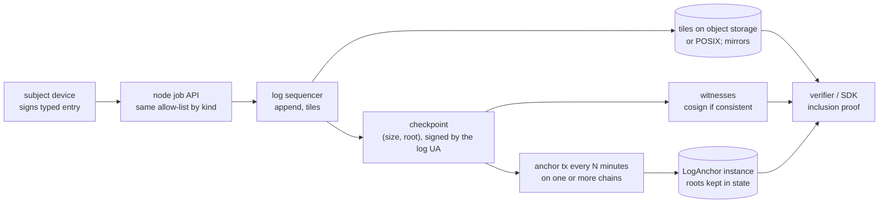

> **Research note — background and rationale only, not normative; the current rules are in docs/ (see decisions.md).**

# Off-chain ledger backends: SCaaS transactions on a verifiable store instead of a chain

Research of 2026-11-24 for the owner. Nothing here is built, specified or ruled; every design below is a proposal. Any SCaaS
cryptographic code it names is **UNAUDITED** ([ARCH-POS-14](../decisions.md#ARCH-POS-14)).

The owner's request, verbatim: "Nghiên cứu thêm về việc đẩy scaas transaction lên dịch vụ kiểu Supabase, hoặc S3, hoặc 1
imutable database nào đó - thay vì đẩy lên smart-chain." (Study pushing SCaaS transactions to a Supabase-style service, to S3,
or to some immutable database, instead of to a smart-contract chain.)

The owner's added focus and framing, verbatim: "Đặc biệt ở hai phần PqChat và PqVault. Những phần nào làm không được (yêu cầu
phải có chain - không ánh xạ được sang legacy service thì có thể bỏ qua). Lưu ý là các dịch vụ offchain vẫn có thể làm việc theo
mô hình client sign giao dịch, thay vì dùng JWT. Một số trường hợp có thể sign giao dịch để lấy JWT, rồi dùng JWT đó làm các việc
đặc thù riêng. Việc này đưa mô hình SCaaS chính xác về kiểu mà nó muốn: storage; năng lực xử lý; payment linh động, có thể free;
Chữ ký (Authentication) từ client, không hoặc giảm dùng JWT." (Especially PqChat and PqVault. Parts that cannot work, because
they need a chain and do not map to a legacy service, may be skipped. Off-chain services can still work on the model where the
client signs transactions instead of using a JWT. In some cases a client can sign a transaction to obtain a JWT and use it for
particular tasks. This brings SCaaS exactly to the shape it wants: storage; compute; flexible payment, possibly free;
signatures (authentication) from the client, with no or less JWT.)

Tags: **[F]** a fact with its source (a SCaaS fact cites a repository path or rule id); **[V]** a vendor's claim about its own
product, not checked by us; **[I]** our inference; **[E]** an estimate. Web sources were read on 2026-11-24 unless a date is
given. A companion note on traceability is being written on another branch as
`docs/research/2026-11-24-traceability.md`; this note refers to it by path only and does not depend on its content.

**Contents**

0. [Summary](#0-summary)
1. [The service model: signed services, with or without a chain](#1-the-service-model-signed-services-with-or-without-a-chain)
2. [What the chain gives that a database does not](#2-what-the-chain-gives-that-a-database-does-not)
3. [Candidate backends](#3-candidate-backends)
4. [Which SCaaS operations fit off chain](#4-which-scaas-operations-fit-off-chain)
5. [PqChat and PqVault off chain, part by part](#5-pqchat-and-pqvault-off-chain-part-by-part)
6. [The hybrid: a verifiable log anchored on chains](#6-the-hybrid-a-verifiable-log-anchored-on-chains)
7. [How it would sit in SCaaS](#7-how-it-would-sit-in-scaas)
8. [Rules check and the trust label](#8-rules-check-and-the-trust-label)
9. [Multi-company use](#9-multi-company-use)
10. [Recommendation, the pre-freeze question, owner questions, TODO items](#10-recommendation-the-pre-freeze-question-owner-questions-todo-items)
11. [Sources and what could not be verified](#11-sources-and-what-could-not-be-verified)

## 0. Summary

- **A database can carry what a subject signs; it cannot run the rules.** Off chain, every UA or EIP-712 signature stays
  verifiable by anyone, forever [F, [architecture.md §1.1](../architecture.md#authority-model)]. What is lost is execution:
  nonces, limits, balances and allow-lists are checked by the operator's code, and by a verifier only if it replays a complete
  log. Completeness, censorship resistance and double-spend prevention are the guarantees an operator can break [I].
- **Never off chain:** balances, tokens, the DEX settlement, PQZ and Zether value, mandates, governance, the UA registry and the
  KEM key directory. **Fits off chain:** traceability events and attestations, audit and journal logs, document commitments,
  chat messages (already off chain through Matrix), personal vault items, public topics, and session tokens.
- **Best backend shape [I]:** a C2SP transparency log (tiles on S3-compatible storage or a POSIX disk, through Tessera,
  Apache-2.0, v1.0.0 2025-09-22 [F]) with witnesses that cosign checkpoints, and a periodic **anchor** of the checkpoint on one
  or more chains. Postgres (Supabase) or S3 Object Lock alone give an operator-trusted store, tamper-resistant at best, with no
  proof anyone else can check. Amazon QLDB is gone (end of support 2025-07-31 [F]).
- **Hybrid cost [E]:** one anchor of about 0.2 M gas (regular plus EIP-8037 state gas) per log, per chain, per interval,
  whatever the batch size; about 29 M gas a day at a 10-minute cadence. A record kept in contract state costs about 3.5 M gas
  per 2 KiB [F, measured]; an event-only record about 63 k gas, but events expire with history.
- **PqChat and PqVault:** their records are already chain-free typed signatures ([CTR-CHAT-03](../contracts/pqchat.md#CTR-CHAT-03),
  [CTR-PQV-17](../contracts/pqvault.md#CTR-PQV-17)), and clients already verify each kept signature themselves
  ([CLI-PQC-15](../clients/pqchat-core.md#CLI-PQC-15)). So almost every rule maps to a service that runs the same checks, with
  clients replaying them. A personal PqVault fits off chain best. The UA registry and the KEM key directory stay on chain. For
  end-to-end-encrypted content the store is already untrusted; what remains is **availability, ordering and metadata**.
- **Pre-freeze: nothing must land before the EVM freeze [I].** An anchor contract is a new class on the generic catalogue
  ([CTR-TOK-28](../contracts/token-wrappers.md#CTR-TOK-28), BUILT), and the registry's portable app namespace
  ([CTR-UA-45](../contracts/accounts.md#CTR-UA-45), BUILT) already gives off-chain records and login intents their signature
  domain. One convention needs a decision before clients ship, but no contract change: how a PqChat or PqVault record names an
  off-chain home (§5.4).

## 1. The service model: signed services, with or without a chain

### 1.1 The four parts

The owner frames SCaaS as four things. Each is offered today by contracts on a chain; each can also be offered by an off-chain
service [I]:

| Part | On a chain today | Off chain |
|---|---|---|
| **Storage** | contract state (SSTORE2 blobs, slots), never only events: PqChat, PqVault and the registry keep every record in state ([CTR-CHAT-05](../contracts/pqchat.md#CTR-CHAT-05), [CTR-PQV-05](../contracts/pqvault.md#CTR-PQV-05)), because event logs expire with history ([accounts.md §1.4](../contracts/accounts.md#14-registration-and-proof-of-possession), "when logs are gone (history expiry)") [F] | a verifiable log, object storage (S3, with Object Lock), Postgres, Arweave for ciphertext ([ARCH-POS-19](../decisions.md#ARCH-POS-19)) |
| **Compute** | the contract runs the checks: signature, nonce, expiry, limits, rights, shapes ([architecture.md §1.1](../architecture.md#authority-model)) | the service runs the same checks in Rust (`ua-rs`, `pqchat-core`), with no gas bound; clients can replay them |
| **Flexible payment, free included** | relayer gas, fee 0 by default on private chains, sponsorship policies, `RelayFeeRouter` ([NODE-GW-01](../node/gateway.md#NODE-GW-01), [NODE-SPN-01](../node/sponsorship.md#NODE-SPN-01), [CTR-MTX-27](../contracts/metatx.md#CTR-MTX-27)) [F] | per-request or per-byte prices, a free tier, sponsor budgets, an operator payer as for Arweave ([NODE-SPN-05](../node/sponsorship.md#NODE-SPN-05)) |
| **Client signatures as authentication** | every valuable write carries the subject's signature; reads are unsigned ([architecture.md §1.1](../architecture.md#authority-model)) [F] | the same: every write is a typed, client-signed intent; reads by a short-lived token obtained by a signature (§1.3) |

So **the chain is one backend, and an off-chain verifiable store is another**. The constant is the request: a **typed, explicit,
client-signed intent** (a UA signature over an EIP-712 struct in a chain-bound domain, or in a portable app domain with no chain
and no contract, [CTR-UA-45](../contracts/accounts.md#CTR-UA-45), [CTR-UA-46](../contracts/accounts.md#CTR-UA-46)), checked by
the service itself as a contract checks it. What changes between the backends is who runs the checks, who orders, and who keeps
the bytes (§2).

### 1.2 What the repository already has for authentication

[F], read 2026-11-24:

- **Gateway (door A):** `none`, `bearer` or `hmac`, one shared secret per node; `hmac` signs timestamp, nonce, method, path and
  body, skew 300 s, nonces remembered until expiry; `none` only on loopback ([NODE-GW-02](../node/gateway.md#NODE-GW-02),
  `scaas-node/src/gwauth.rs`). The job API extends `hmac` with per-namespace key ids for server-side clients only
  ([NODE-JOB-05](../node/job-api.md#NODE-JOB-05)).
- **Admin API:** built-in users (Argon2id) issuing a short-lived node-signed session token `scaas_s1.` (default 900 s, refresh
  until 12 h), or OIDC JWT access tokens. "Opaque-token introspection (RFC 7662), DPoP and mTLS-bound tokens are not supported
  (follow-up)" ([NODE-ADM-02](../node/admin-auth.md#NODE-ADM-02)).
- **No sign-in by UA signature exists.** Nothing in the node issues a token against a subject's signature; end users never get
  an API key ([NODE-ADM-06](../node/admin-auth.md#NODE-ADM-06)).
- **Passkeys** sign the typed digest as the WebAuthn challenge ([CLI-SGN-24](../clients/signers-clientkeys.md#CLI-SGN-24)), so any
  typed intent, a login included, is signable by every SCaaS signer.

### 1.3 "Sign to get a token" (proposal)

A client signs one typed `Session` intent and gets a short-lived bearer token for bulk or special operations (reads of its own
metadata, paging, uploads of ciphertext it has already signed per record). Proposal [I]:

```solidity
// Portable app domain: name "SCaaS Session", version "1", salt = appId of the service (CTR-UA-46);
// signed as uaMessage(kind, appPurpose(appId), typed(record)), checked like requirePortableApp.
struct Session {
    bytes32 ua;          // the subject
    bytes32 service;     // audience: the service's id (one token, one service)
    bytes32[] scopes;    // named scopes, each keccak256 of a fixed scope string; no wildcard
    uint64  issuedAt;    // unix seconds
    uint64  expiresAt;   // at most issuedAt + 900
    bytes32 nonce;       // 32 random bytes, remembered by the service until expiresAt
    bytes32 cnf;         // SHA-256 of the client's ephemeral public key (proof of possession)
}
```

Its limits, plainly [I]:

- **A bearer token can be replayed** by whoever holds it. So bind it to the client: `cnf` names an ephemeral key, and every
  request carries a DPoP-style proof signed by that key over method, URL, time and a fresh id (RFC 9449, DPoP, 2023 [F]). A
  stolen token without the ephemeral key is useless; a stolen device is a stolen session until `expiresAt`.
- **Keep it short:** 15 minutes, the node's own session default ([NODE-ADM-02](../node/admin-auth.md#NODE-ADM-02)); no refresh
  without a new signature, or a refresh bounded as the admin session is.
- **It never authorises a valuable write.** A write that stores, changes, pays or grants stays signed per request, so the
  service and every verifier can check it without trusting the token. The token only gates reads, rate limits and cheap
  operations whose own bytes are signed anyway.
- **One key, one purpose** ([CTR-UA-10](../contracts/accounts.md#CTR-UA-10)): the login signature sits under its own app purpose,
  so it can never be replayed as a record. Sign-In with Ethereum (EIP-4361 [F]) is the same idea for EOAs; the typed form above
  shows the wallet every field ([CTR-MTX-29](../contracts/metatx.md#CTR-MTX-29)'s explicit-parameter rule).
- **Where it maps in the node:** a third gateway mode beside `bearer` and `hmac`, issued by the gateway, never valid on admin
  routes ([NODE-ADM-06](../node/admin-auth.md#NODE-ADM-06)); DPoP is the follow-up NODE-ADM-02 already names. The registry read
  that resolves the UA's key follows ARCH-POS-15 [I].

### 1.4 Payment

The same three shapes as the relayer [F, [NODE-GW-01](../node/gateway.md#NODE-GW-01), [NODE-SPN-01](../node/sponsorship.md#NODE-SPN-01)]:
**fee 0** (the private-profile default), **sponsored** (a policy row with a budget, matched per request), and **per request**
(a price per write or per stored byte). Off chain, the unit is bytes and requests instead of gas. A paid tier can take payment
on chain (an ordinary signed transfer) and credit the account off chain, as the Arweave payer does with per-credential and
per-IP budgets ([NODE-SPN-05](../node/sponsorship.md#NODE-SPN-05)); a free tier needs the per-UA and per-IP rate limits door A
already applies [I].

## 2. What the chain gives that a database does not

| Guarantee | On a SCaaS chain | On an off-chain store | Survives off chain? |
|---|---|---|---|
| **Rule enforcement** (signature, nonce, expiry, limits, rights, balances, allow-lists) | immutable contract code checks it on every call; no admin can move a subject's funds ([architecture.md §1.1](../architecture.md#authority-model)) [F] | signatures stay verifiable by anyone; every other rule is the operator's code, checked by others only by replaying a complete log | **Partly.** Signatures yes; rules only for a verifier who replays, and only over what it sees |
| **Ordering and finality** | consensus orders; the node books only after its finality gate and RPC quorum ([NODE-IDX-02](../node/indexer-feeds.md#NODE-IDX-02)) [F] | the operator orders; a signed checkpoint fixes the order of what it covers; "final" = cosigned by witnesses, or anchored | **Weaker:** one party orders; forks are detectable, not prevented |
| **Double-spend prevention** | state plus lane nonces; one transaction per nonce ([CTR-MTX-15](../contracts/metatx.md#CTR-MTX-15)) [F] | only the operator's honesty; it can show two histories to two parties (equivocation) | **No.** Witnesses detect it after the fact; nothing prevents it |
| **Censorship resistance** | a relayer can refuse or delay; another relayer, or the subject itself, submits ([architecture.md §1.1](../architecture.md#authority-model)) [F] | one operator can refuse an entry forever; a second log has no shared order | **No**, unless several independent logs accept the same entry and a reader merges them |
| **Public verifiability without trusting an operator** | anyone with a list of RPC nodes reads state, with failover or a strict majority ([ARCH-POS-15](../decisions.md#ARCH-POS-15)) [F] | inclusion and consistency proofs make tampering **evident**; completeness (no entry withheld) and absence are not provable in a plain append-only log | **Partly:** what is shown is provable; what is hidden is not |
| **Availability** | every full node keeps state; events may expire with history (§1.1) [F] | the operator's disks; mirrors, object-store replication and Arweave for ciphertext | **Weaker:** depends on how many independent copies exist |
| **Non-repudiation of the subject** | per-operation signature, publicly verifiable forever [F] | the same | **Yes** |
| **Time** | block time, bounded by consensus | the operator's clock; an anchor gives an upper bound, a reference block inside the signed entry a lower bound (§7.5) | **Weaker** |

The Supabase column of the repository's own comparison says the same in one line: in BaaS, "row-level security checks the `uid`"
and anyone with the `service_role` key bypasses it ([architecture.md §1.1](../architecture.md#authority-model)) [F]. An
off-chain store keeps SCaaS's signatures; it gives up SCaaS's executor.

## 3. Candidate backends

### 3.1 Table

| Backend | Status (read 2026-11-24) | Tamper | Split view (equivocation) | Proofs | Cost | Lock-in | Self-host | Licence |
|---|---|---|---|---|---|---|---|---|
| **Supabase / Postgres**: append-only table (REVOKE UPDATE/DELETE, a refusing trigger), RLS, `supa_audit` or `pgaudit` | Supabase repo v1.26.08 (2026-08-07); `supabase/postgres` 17.12 (2026-11-23) [F, GitHub] | neither proof nor evidence by itself: a table owner or superuser can drop the trigger, disable it, or edit files [I]; a hash chain over rows (as the node's `audit_log`, [NODE-ADM-07](../node/admin-auth.md#NODE-ADM-07)) makes edits evident to whoever kept an earlier head | none: the operator shows each reader what it wants [I] | none native; a hash chain or Merkle tree must be added | Pro from USD 25/month with 8 GB, extra disk USD 0.125/GB [V, supabase.com/pricing] | low (plain Postgres) | yes | Apache-2.0 (Supabase), PostgreSQL licence [F] |
| **S3 Object Lock, compliance mode**, plus checksums and conditional writes | current; conditional writes (`If-None-Match`) since 2024-08, enforceable by bucket policy since 2024-11 [F, AWS What's New] | **tamper-resistant for the retention period:** "can't be overwritten or deleted by any user, including the root user"; the documented way out is closing the account [V, S3 user guide] | none against AWS itself; against the customer's own staff, a key written once cannot be changed; withholding a write is still possible [I] | none; checksums prove bytes, not order | USD 0.023/GB-month and USD 0.005 per 1,000 PUT in us-east-1 [F, third-party pages; the AWS table did not render] | medium: the S3 API is common, Object Lock semantics less so [I] | MinIO and others implement the API (not verified here) | proprietary service |
| **immudb** (Merkle-tree verifiable database) | v1.11.2 (2026-09-03) [F, GitHub] | tamper-evident: clients keep a verified state and check later answers against it [V, README "clients don't have to trust the database"] | each client detects a fork from its own state; no standard witness network [I] | inclusion and consistency, through its verified reads (`VerifiableGet`, `immudb_verify_row`) [V] | free to run | medium (own API, SQL subset) | yes | **Business Source License 1.1**, Additional Use Grant forbids offering it as a competing service; Apache-2.0 four years after each version's publication [F, LICENSE] |
| **Amazon QLDB** | **end of support 2025-07-31**, announced 2024-07; AWS points to Aurora PostgreSQL [F, InfoQ 2024-07; the AWS developer guide pages answered 404 on 2026-11-24] | — | — | — | — | — | — | out |
| **Azure SQL ledger tables** (SQL Server 2022+, Azure SQL Database, Managed Instance) | current (page 2025-08-07, updated 2026-10-19) [F] | tamper-evident: rows hashed per transaction in a Merkle tree, blocks chained; "Ledger can't prevent such attacks but guarantees that any tampering will be detected when the ledger data is verified" [V, Microsoft Learn] | detected only if the digests were stored where the operator cannot change them: immutable blob storage or Azure Confidential Ledger [V] | verification by the database against stored digests; no portable per-row proof for a third party [I] | per SQL tier | high (SQL Server) | SQL Server 2022 on premises | proprietary |
| **Azure Confidential Ledger** | current (page 2026-10-16) [F] | "tamper protected and tamper evident"; three or more nodes in SGX enclaves, CCF consensus [V] | trust in Intel SGX attestation and the CCF consortium of nodes [V]; we found no outside witness [I] | per-transaction receipts with the Merkle path [V] | the public price page shows placeholders; the Basic SKU was free in its 2023 preview [F] | high | CCF itself is open (Apache-2.0, ccf-7.0.27, 2026-11-18) [F] | proprietary service over Apache-2.0 CCF |
| **Google Cloud** | Bucket Lock (locked retention policy) and Object Retention Lock; Google says Cohasset assessed it for SEC 17a-4(f), FINRA, CFTC [V, Google blog and docs] | as S3 Object Lock | as S3 | none | storage pricing | medium | — | proprietary |
| **Transparency logs:** Trillian, **Tessera**, Sigstore **Rekor v2**, certificate-transparency style | Trillian in maintenance mode, "new log operators first try Tessera" [F, repo]; Tessera v1.0.0 (2025-09-22), latest v1.0.4 (2026-07-16) [F]; Rekor v2 GA 2025-10-10, tile-backed, witnessing "not yet implemented" at GA [F, Sigstore blog]; `rekor-tiles` v2.4.6 (2026-11-22) [F] | tamper-evident; append-only proven by consistency proofs | **witnesses:** each checks a consistency proof from the last checkpoint it cosigned and refuses a fork; clients require a quorum of cosignatures (C2SP `tlog-witness`, `tlog-cosignature`) [F]; the witness spec says witnesses "SHOULD use ML-DSA-44" [F, read 2026-11-24] | inclusion and consistency (RFC 6962, RFC 9162), checkpoints (C2SP `tlog-checkpoint`), static tiles (`tlog-tiles`) [F] | the storage of tiles plus a small sequencer; cacheable reads behind a CDN [V, Sigstore] | low: open specs, several implementations [I] | yes: Tessera runs on GCP, AWS, "Vanilla S3+MySQL" or POSIX [V] | Apache-2.0 [F] |
| **Hyperledger Fabric** (a permissioned chain, for contrast) | v3.0 GA 2024-09-16 with a SmartBFT orderer; v3.1.5 (2026-06-18) [F] | rules enforced by chaincode under endorsement policies, ordered by BFT among the members [V] | prevented by consensus among the consortium's orderers, up to the BFT bound [V] | blocks, endorsements | a consortium's infrastructure | high | yes | Apache-2.0 [F] |
| **Dolt** | v2.7.6 (2026-11-21) [F] | Git-style commit hashes over its tables: tamper-evident to whoever kept a hash [V] | a fork is a branch; nothing stops showing two [I] | diffs and commit hashes, no transparency-log proofs [I] | free | medium (MySQL-compatible) | yes | Apache-2.0 [F] |
| **Datomic** | Pro 1.0.7491 (2026-01-26) [F, release page] | accumulate-only data model [V]; no cryptographic proofs [I] | none | none | free of licence fees since 2023 [F] | high | yes | binaries under Apache-2.0, source closed [F, Nubank FAQ] |

### 3.2 What the table means

- **Tamper-evidence is not tamper-proofing [I].** Object Lock is the only entry that stops a deletion, and it stops it only for
  the vendor's customers, not against the vendor. Everything with a Merkle tree makes a change visible to someone who kept an
  earlier root, and nothing more. The question is always **who kept the earlier root**: that is the job of witnesses and of
  chain anchors.
- **Equivocation is the real attack [I].** An operator who keeps two consistent histories and shows one to each party breaks
  nothing a single party can see. Only parties that compare checkpoints catch it: gossip between readers, witnesses that
  cosign, or one anchor on a chain everybody reads. Certificate Transparency built its whole ecosystem on that point (RFC 6962
  §5, RFC 9162 [F]).
- **The transparency-log family is the only one with open formats for every step** (tiles, checkpoints, proofs, witness
  protocol, mirrors in C2SP `tlog-mirror`), a Rust-friendly static read surface and Apache-2.0 code [F]. It is also the one
  whose ecosystem is moving to post-quantum witness keys (ML-DSA-44) [F], which fits SCaaS's PQ direction [I].
- **Postgres stays useful underneath:** the node already runs its store on SQLite, PostgreSQL or MySQL, "storage only"
  ([NODE-STO-06](../node/store.md#NODE-STO-06)) [F]. A log sequencer can keep its pending entries there and publish tiles to
  object storage; Postgres is the queue, not the proof [I].

## 4. Which SCaaS operations fit off chain

| Operation family | Verdict | Reason |
|---|---|---|
| Transparent transfers and payments (`UAMetaTransfer`, the pay entries, [CTR-MTX-31](../contracts/metatx.md#CTR-MTX-31)) | **never** | balances and double-spend need rule execution without a trusted operator |
| Mint, burn, wrap, unwrap, reserves, supply caps | **never** | value and supply |
| DEX settlement (`mtxSettle`) | **never** | value; the order book is **already** off chain (node book, gossip replicas, [dex-venue.md](../node/dex-venue.md)) and settlement is on chain [F] |
| PQZ and Zether (shield, transfer, unshield, rollover) | **never** | "never lose ciphertext" (ciphertext stays in contract state), double-spend, no decryption oracle ([ARCH-POS-13](../decisions.md#ARCH-POS-13)) |
| Mandates, `SmartKeyAccount` key operations, governance grants and roles | **never** | authority over value must be ordered against the value operations it governs |
| Tender commits, reveals and deposits | **never** | deposits are value; the deadline needs a shared order |
| UA registration, KEM key records, PQZ key records | **never off chain only** | the key directory every verifier resolves against; an operator that shows a different key to one reader enables a man-in-the-middle on KEM wraps (§5.3) |
| Traceability events and attestations (see `docs/research/2026-11-24-traceability.md`) | **fits**, with an anchor | signed by the subject UA, no value moves; existence and order are what matter |
| Audit and journal logs (the node's hash-chained `audit_log`, job journals, admin audit) | **fits**; anchoring adds what the chain alone does not | already hash-chained in the store ([NODE-ADM-07](../node/admin-auth.md#NODE-ADM-07)) [F]; anchoring the head makes a rewrite evident to outsiders [I] |
| Document hashes and commitments (`entryRef` metadata, `documentRef`, batch roots) | **fits** | already commitment-only and Merkle-batched ([INT-ERP-23](../integration.md#INT-ERP-23)); the architecture already advises a periodic Merkle root for high-frequency streams ([architecture.md §2](../architecture.md#service-model), condition 4) [F] |
| Verifiable credentials, status lists | **fits** | the `vc-anchor` purpose is reserved and `UAAttestations` is deferred ([accounts.md §1.5](../contracts/accounts.md#purposes), [§1.11](../contracts/accounts.md#111-credentials-optional)) [F]; a log plus an anchor serves the same purpose without publishing per-UA records on chain [I] |
| PqChat messages, topics, chat metadata | **fits** (messages already do, through Matrix) | §5 |
| PqVault items of a personal vault | **fits**, with replicas | §5 |
| Relayer cost metering, sponsorship accounting | **fits** (node-local already) | operator data, no subject value |
| Session and login tokens | **fits** (off chain by nature) | §1.3 |

## 5. PqChat and PqVault off chain, part by part

### 5.1 What makes them close to off chain already

- **Every record is a chain-free typed signature.** PqChat signs in `DS_C` ("SCaaS PqChat", "1"; no chain id, no contract), so "a
  record is the same bytes in every instance on every chain" ([CTR-CHAT-03](../contracts/pqchat.md#CTR-CHAT-03)) [F]. A portable
  PqVault signs in `DS_V` (no chain, no address) through `requirePortableApp` ([CTR-PQV-17](../contracts/pqvault.md#CTR-PQV-17))
  [F]. The same signed record can be accepted by a contract, a replica on another chain, or an off-chain service.
- **Clients already verify the signatures themselves.** On an `sstore2` home every control-plane record counts only with its
  author's kept signature, rebuilt and checked in the SDK ([CLI-PQC-15](../clients/pqchat-core.md#CLI-PQC-15)); every record read
  is checked, wrap hashes before decapsulation, epoch numbers, rights against the parent
  ([CLI-PQC-07](../clients/pqchat-core.md#CLI-PQC-07)) [F]. A tree session is followed by replaying the commits
  ([CLI-PQC-17](../clients/pqchat-core.md#CLI-PQC-17)) [F].
- **Messages already live off chain.** Matrix is a message store beside the chain stores
  ([CTR-CHAT-01](../contracts/pqchat.md#CTR-CHAT-01), [CLI-PQC-05](../clients/pqchat-core.md#CLI-PQC-05),
  [CLI-PQC-06](../clients/pqchat-core.md#CLI-PQC-06)); vault files stay off chain with their keys and hashes inside an item
  ([CTR-PQV-01](../contracts/pqvault.md#CTR-PQV-01), V7) [F].
- **What the contract adds** is the rest: it orders (the home's one child per parent,
  [CTR-CHAT-08](../contracts/pqchat.md#CTR-CHAT-08)), keeps nonce bitmaps, holds the indexes recovery reads (`sessionsOf`,
  `vaultsOf`), and keeps every byte available to anyone with an RPC node.

There is no `docs/clients/pqvault-core.md`; PqVault's client rules are the CLI-PQV rows of
[ua-libraries.md](../clients/ua-libraries.md) and the spec [2026-11-17-pqvault.md](../superpowers/specs/2026-11-17-pqvault.md) [F].

### 5.2 Function by function

Verdicts: **maps** (the service runs the same check and a client can replay it); **maps, weaker** (the guarantee named is lost
or depends on the operator); **does not map** (needs a chain; noted and skipped, per the owner).

**Identity and keys**

| Function / rule | Needs a chain? | Off-chain mapping | What changes |
|---|---|---|---|
| UA registry: `register`, the registration `pop`, `registrationOf` ([CTR-UA-07](../contracts/accounts.md#CTR-UA-07)) | **yes**, for a directory nobody administers | stays on chain; the service and clients read it under ARCH-POS-15 | nothing; an off-chain copy would be a key-transparency log with witnesses (weaker: a split view of a key is a man-in-the-middle) |
| KEM key versions: `setKemKey`, `kemKeyOf`, `kemKeyAt` ([CTR-UA-32](../contracts/accounts.md#CTR-UA-32)) | **yes**, as above | stays on chain | nothing |
| Revocation | — | the registry is monotonic: no revocation, rotation is a new UA or a new KEM version ([accounts.md §1.1](../contracts/accounts.md#scope)) [F] | nothing to map; §7.5 covers judging entries by time |
| Signature check `requirePortable` / `requirePortableApp` | no: the check is a pure function of key data | the service verifies with `ua-rs`; the key data comes from the registry | **maps** |

**Sessions, homes, replicas**

| Function / rule | Needs a chain? | Off-chain mapping | What changes |
|---|---|---|---|
| `createSession` (record, members, admins, `wrapHashes`, [CTR-CHAT-06](../contracts/pqchat.md#CTR-CHAT-06)) | no | the service appends the record and its signature; checks shapes, KEM keys, creator in both lists | **maps** |
| Home: `homeChain`, `homeChatContract` ([CTR-CHAT-21](../contracts/pqchat.md#CTR-CHAT-21)) | no, but the fields name a chain | an off-chain home named by convention (§5.4) | a client rule, not a contract change |
| Replicas ("a replica orders nothing", [CTR-CHAT-14](../contracts/pqchat.md#CTR-CHAT-14)) | no | log mirrors (C2SP `tlog-mirror`), or an on-chain instance acting as a replica of an off-chain home [I] | **maps**; replicas become the availability answer |
| `sigStore` `none` / `sstore2` ([CTR-CHAT-23](../contracts/pqchat.md#CTR-CHAT-23)) | no | off chain every signature is kept; there is no reason for `none` | **maps, stronger**: clients always verify (`require_signed_records` holds by construction) |
| `groupMode` ([CTR-CHAT-25](../contracts/pqchat.md#CTR-CHAT-25)) | no | a field of the record | **maps** |
| Ids and nonce bitmaps ([CTR-CHAT-04](../contracts/pqchat.md#CTR-CHAT-04)) | no | the service keeps the bitmaps; clients rebuild them from the records they hold | **maps, weaker**: a replayed nonce is caught by the service, and by a client only within what it has seen |

**Epochs and rekey ordering**

| Function / rule | Needs a chain? | Off-chain mapping | What changes |
|---|---|---|---|
| Epoch number = parent + 1, parent complete ([CTR-CHAT-08](../contracts/pqchat.md#CTR-CHAT-08)) | no | deterministic check | **maps** |
| **The home slot: the first complete child of a parent wins** ([CTR-CHAT-08](../contracts/pqchat.md#CTR-CHAT-08)) | yes, for an order nobody controls | a **sequencer** (the service) orders; its checkpoint fixes the order of what it covers | **maps, weaker**: the sequencer can (a) show child X to some members and child Y to others (equivocation; caught when members compare checkpoints, §5.3), (b) delay or refuse a rekey or a removal (censorship), (c) choose which of two racing children wins |
| Wraps in chunks, by anyone, each against its signed hash ([CTR-CHAT-07](../contracts/pqchat.md#CTR-CHAT-07)) | no | stored as pieces; the same hash checks | **maps, weaker in availability**: an operator that deletes a wrap locks its member out of that epoch; replicas, mirrors and the member's own cache answer it |
| Plain rekey vs membership change, admins ([CTR-CHAT-09](../contracts/pqchat.md#CTR-CHAT-09)) | no | the same test; clients already check rights against the parent (CLI-PQC-07) | **maps** |
| `remove` and the removed set ([CTR-CHAT-20](../contracts/pqchat.md#CTR-CHAT-20)) | no | the same test | **maps, weaker**: a censored removal leaves the removed member reading new messages under the old `K` until another service lands it. On chain any relayer can land it |
| `leave` ([CTR-CHAT-10](../contracts/pqchat.md#CTR-CHAT-10)) | no | the same flag | **maps** |

**TreeKEM (`groupMode = 1`)**

| Function / rule | Needs a chain? | Off-chain mapping | What changes |
|---|---|---|---|
| Acceptance checks: `treeId`, the author's live leaf, the tree of the commit computed on the head, root against `treeHash`, targets, key admission ([CTR-CHAT-27](../contracts/pqchat.md#CTR-CHAT-27)) | no | the service runs the same computation in Rust, without the gas bounds that shaped `TREE_LEAVES_MAX` | **maps**; clients already replay commits (CLI-PQC-17) |
| The own-UA rule: a non-admin commits only for its own UA's leaves ([CTR-CHAT-26](../contracts/pqchat.md#CTR-CHAT-26)) | no | the same check | **maps** |
| The no-return sets R14 / R16: `gone[ua]`, `goneOwnKey[ua][kemHash]`, `goneKey[kemHash]` (TreeKEM spec §1, C28) | no | the service keeps the sets; a client rebuilds them by replaying every commit since the session's creation | **maps, weaker**: a device that joined later verifies them only if the log gives it the full history (ciphertext and records, which it can read but not open); otherwise it trusts the service for the commits before its Welcome |
| Completion, "no fork", a closed session ([TreeKEM spec §11](../superpowers/specs/2026-11-23-pqchat-treekem.md#11-forks-refusals-named-errors)) | yes for "no fork" | one sequencer gives one order; the members compare checkpoints | **maps, weaker**: "no fork" becomes "a fork is detectable"; the commit's signed `parentTreeHash` already names the head it was built on, so a forked member's next commit exposes the fork [I] |

**Messages, topics, recovery**

| Function / rule | Needs a chain? | Off-chain mapping | What changes |
|---|---|---|---|
| `postMessage` (member of a complete epoch, fresh counter, [CTR-CHAT-11](../contracts/pqchat.md#CTR-CHAT-11)) | no | the service stores record and signature; Matrix already carries messages | **maps** |
| `storeMessage` (opaque, unsigned, [CTR-CHAT-13](../contracts/pqchat.md#CTR-CHAT-13)) | no | a blob store (object storage, Arweave for ciphertext) | **maps** |
| Topics: `createTopic`, `updateTopic` (`seq`), `setTopicWriter`, `postEntry`, `editEntry`, `voteEntry`, counts ([CTR-CHAT-15](../contracts/pqchat.md#CTR-CHAT-15) to [CTR-CHAT-18](../contracts/pqchat.md#CTR-CHAT-18)) | no | the same checks; a public forum is public data | **maps, weaker**: the `up` / `down` counts are the service's unless a reader recounts from a complete log; dropped votes are censorship |
| `sessionsOf`, `epochsOf`, `latestEpoch`: recovery from state alone ([CTR-CHAT-14](../contracts/pqchat.md#CTR-CHAT-14), [CLI-PQC-09](../clients/pqchat-core.md#CLI-PQC-09)) | no, but completeness is the chain's | **log-only recovery**: the service serves the same indexes from its log | **maps, weaker**: the service can leave a session out of `sessionsOf`, and a plain log cannot prove absence. A verifiable map (key-transparency style, with non-inclusion proofs) committed in each checkpoint answers it [I] |
| Events (notify only) | no | a feed or a doorbell ([NODE-IDX-09](../node/indexer-feeds.md#NODE-IDX-09)) | **maps** |
| `initialize`, `rescue`, `factoryInfo`, `chainEnv` | yes | — | **does not map** (chain mechanics); skipped |

**PqVault**

| Function / rule | Needs a chain? | Off-chain mapping | What changes |
|---|---|---|---|
| `createVault`, portable mode 0 (`DS_V`, [CTR-PQV-16](../contracts/pqvault.md#CTR-PQV-16)) | no | the service appends; `requirePortableApp`'s check in `ua-rs` | **maps** |
| Chain-bound mode 1 (`DS_B(this)`, one instance, no replica) | yes, by definition | — | **does not map**; skipped |
| Members ≥ 1, personal vault ([CTR-PQV-06](../contracts/pqvault.md#CTR-PQV-06)) | no | the same | **maps** |
| `rekeyVault`, removal, leave (the shared base, [CTR-PQV-12](../contracts/pqvault.md#CTR-PQV-12)) | as PqChat | as PqChat | as PqChat; for a **personal** vault the only racing writers are the user's own devices, so equivocation hurts nobody else [I] |
| `createItem`, `editItem` at `count + 1`, the refusal as the conflict signal ([CTR-PQV-08](../contracts/pqvault.md#CTR-PQV-08)) | no | the sequencer assigns the version | **maps, weaker**: two version-2 edits can be accepted and shown apart (fork), or an edit dropped; for a password item a lost edit can lock the user out of a service, so availability matters more than for chat [I] |
| `createItems` batch ([CTR-PQV-09](../contracts/pqvault.md#CTR-PQV-09)) | no | the same; sized by the service's limit, not a block | **maps** |
| A removed or departed member writes nothing; ciphertext 32 to 16,416 B; `sealedInfo` 28 to 16,412 B ([CTR-PQV-14](../contracts/pqvault.md#CTR-PQV-14)) | no | the same bounds (one rule) | **maps** |
| `sealedInfo` (`passKdf`, `passSalt`, `prev` key wrap; spec VC7, VC24) | no | opaque ciphertext kept; the service never opens it | **maps** |
| The share box: one shared vault per recipient set, filled by `createItems` (spec §6.7) | no | the same records | **maps**; cheaper: on chain a new shared vault is about 8 to 10 M gas and a password item about 1.3 to 1.4 M [F, spec §6.7] |
| `vaultsOf`, `itemsOf`, `latestRange`: recovery from state alone ([CTR-PQV-10](../contracts/pqvault.md#CTR-PQV-10)) | no | log-only recovery | **maps, weaker** in completeness, as `sessionsOf` |

**Payments and fees, both apps**

| Function / rule | Needs a chain? | Off-chain mapping | What changes |
|---|---|---|---|
| Every write relayable by anyone with a fee of 0; unsigned writes (`addWraps`, `storeMessage`, `addVaultWraps`) relayed by node policy ([CTR-CHAT-19](../contracts/pqchat.md#CTR-CHAT-19), [CTR-PQV-11](../contracts/pqvault.md#CTR-PQV-11)) | no | no gas; per-byte or per-request prices, a free tier, sponsor budgets (§1.4); unsigned pieces accepted only against a signed hash already stored, as today | **maps**; the spam question moves from gas to the service's budgets |

### 5.3 The trust model, plainly

For end-to-end-encrypted content **the store is already untrusted** for confidentiality and for integrity: the AEAD and the
authors' signatures decide what a client accepts, and the contract never reads a ciphertext or `sealedInfo`
([CTR-PQV-01](../contracts/pqvault.md#CTR-PQV-01)) [F]. Moving the store off chain changes three things only [I]:

1. **Availability.** The operator can delete or withhold a record, a wrap, a message or an item version. On chain every full node
   keeps state. Answers: at least two independent stores per session or vault (replicas already exist in the design), the
   client's own cache, and Arweave for the ciphertext pieces, which is what [ARCH-POS-19](../decisions.md#ARCH-POS-19) already
   allows for messages, images and vault files.
2. **Ordering.** The operator chooses which racing epoch or edit wins, can show different winners to different members, and can
   delay a removal. The first is the chain's behaviour too ("the first complete child wins"); the second is detectable when
   members compare the checkpoints they built on, and anchors make it evident to everyone; the third has a **confidentiality**
   effect (a removed member keeps reading until the removal lands), so a client should warn, and stop sending after a bound, when
   its own signed removal or rekey is not in the log [I].
3. **Metadata.** The operator sees who writes to which session, when, and how much. On a public chain everyone sees that; on a
   private service only the operator does; Arweave makes it public again. Off chain is no worse than the chain for metadata, and
   better when the service is private [I].

The key directory is the exception: an off-chain directory that shows Bob a KEM key the operator holds breaks confidentiality, so
the registry and KEM records stay on chain (or in a witnessed key-transparency log, never a plain table).

### 5.4 Naming an off-chain home (convention, no contract change)

`createSession` refuses `homeChain = 0` or `homeChatContract = 0`; an instance is the home only when both equal its own chain and
address ([pqchat.md §5](../contracts/pqchat.md#5-sessions-and-wraps)) [F]. So a record can name an off-chain home as
`homeChain = logId` (a non-zero 32-byte id that is no chain's genesis hash) and `homeChatContract` = a non-zero value the
convention fixes, for instance that log's anchor instance (§6.3) [I]. Every chain instance then reads it as "not home" and, as a
replica, stores every complete child and orders nothing, which is exactly the role a chain copy of an off-chain session should
have. The same holds for PqVault's `homeChain` / `homeVaultContract`. This is a client convention to decide before
`pqchat-core` and `pqvault-core` ship an off-chain home; no frozen contract changes [I].

### 5.5 Conclusions per product

- **PqVault, personal vault: can run fully off chain** with a verifiable log, clients verifying every record, and at least two
  stores. The only writers are the user's own devices; the risks are availability (keep replicas, Arweave for item ciphertext)
  and completeness of `vaultsOf` (a verifiable map, or the client's own list of vault ids backed up with the seed) [I].
  Needs an anchor only for outside evidence of time. Stays on chain: the registry and KEM keys.
- **PqVault, shared vault and share box:** off chain with a sequencer, witnesses or an anchor for the order of epochs and
  item versions; the same removal-censorship residual as chat.
- **PqChat, 1:1 and small groups: can run off chain** for messages (already so) and, with a verifiable log, for the control
  plane, when members accept one sequencer's liveness. Needs an anchor (or witnesses among members) for the epoch order.
- **PqChat public topics:** fully off chain; public data; counts trusted unless recounted from a complete log.
- **Must stay on chain:** the UA registry, the KEM key directory, the chain-bound PqVault mode, and any session whose users want
  a removal that no single operator can block.

## 6. The hybrid: a verifiable log anchored on chains

### 6.1 Shape



### 6.2 Cost per event, on chain against anchored [E]

Reference figures from the repository [F]: an `mtxExecuteTransfer` costs 41,799 execution gas on the built v2 path
([metatx.md](../contracts/metatx.md#CTR-MTX-11), the batching note); a new storage slot is 97,920 EIP-8037 state gas
([pq-zero-knowledge.md](../contracts/pq-zero-knowledge.md), [zether.md](../contracts/zether.md)); a 2,048-B SSTORE2 blob costs
150,424 regular plus 3,318,570 state gas ([fndsa1024-evm-gas.md](fndsa1024-evm-gas.md)); PQ signature checks cost far more than
secp256k1 (ed25519 0.17 M, FN-DSA-512 2.3 M, ML-DSA-65 up to 5.95 M cached, [accounts.md §1.6](../contracts/accounts.md#kinds)).

| Per event | Gas | Note |
|---|---|---|
| On chain, event only | ≈ 63 k (21 k intrinsic + ≈ 42 k) | events expire with history; SCaaS keeps records in state instead |
| On chain, one 32-B commitment kept in a new slot | ≈ 0.14 M (≈ 42 k + 22.1 k regular + 97.9 k state) | |
| On chain, a 2 KiB record in state (SCaaS's own rule) | ≈ 3.5 M | the measured SSTORE2 figure plus the call |
| Anchor, one per batch | ≈ 0.2 M per anchor: 21 k intrinsic, a secp256k1 UA check (a few k), a consistency proof of about 2·log2(n) SHA-256 calls at precompile prices plus its calldata (≈ 20 to 40 k), one new slot for the root (≈ 120 k with state gas) | independent of the batch size; a PQ log key adds its verify cost (up to millions) |

Per day, one log on one chain: every 10 minutes 144 anchors ≈ **29 M gas**; every minute ≈ 290 M; every hour ≈ 4.8 M. At 10,000
events a day and a 10-minute cadence that is about 2,900 gas per event (about 1,200 times cheaper than a 2 KiB record in state);
at a million events a day, about 29 gas per event. In money: gas × the chain's price, never assumed zero (AGENTS.md "No
assumptions about a chain").

Off-chain storage [E]: an entry is 0.5 KiB (secp256k1) to about 4 KiB (an ML-DSA-65 signature is 3,309 B, FIPS 204). A million
2 KiB entries a day is about 2 GiB a day: about USD 0.05 a day of new S3 storage (USD 0.023/GB-month) and a few thousand PUTs
when entries are packed 256 to a tile. Arweave at USD 46.19 per GiB (Turbo, read 2026-11-21 in
[2026-11-21-avax-polkadot-arweave.md](2026-11-21-avax-polkadot-arweave.md) §4.4) would be about USD 92 a day for the full
entries, about USD 2.8 a day for 64-byte leaf commitments only.

### 6.3 What anchoring proves, and what it does not

Proves [I]:

- the log had size `n` and root `r` **no later than** the anchor's block, so every entry under `r` existed by then, in that
  order;
- with a consistency proof checked by the contract against the previous anchored root, that **the anchored sequence on that
  chain never forks**: the contract itself becomes a witness that cannot be bribed into a split view, for everyone who reads
  that chain;
- with several chains, the same, per chain; agreement across chains is a check readers do (each with its list of nodes,
  ARCH-POS-15).

Does not prove [I]:

- that an entry submitted was **ever included** (withholding and censorship stay possible);
- that an entry obeys any rule beyond its signature (nobody executed it);
- that timestamps inside entries are true (only an upper bound, and a lower bound from a reference block, §7.5);
- that the tiles behind `r` are still **available** (needs mirrors or a data-availability layer);
- that the operator showed the same unanchored checkpoints to everyone between two anchors (witnesses cover that window).

### 6.4 The anchor contract (proposal)

A new generic catalogue class (`contractClass` ≥ 5, kind 0; [CTR-TOK-28](../contracts/token-wrappers.md#CTR-TOK-28)), one
instance per log, chain-neutral as every release ([CTR-TOK-29](../contracts/token-wrappers.md#CTR-TOK-29)) [I]:

```solidity
struct LogAnchor {            // typed EIP-712; one entry point, every field named
    bytes32 logId;            // the instance's own log
    uint64  size;             // new tree size
    bytes32 root;             // new root (RFC 6962 SHA-256 tree)
    uint64  prevSize;         // must equal the stored size
    bytes32 prevRoot;         // must equal the stored root
    uint64  checkpointTime;   // the log's claim, unix seconds; ≤ block.timestamp
    uint64  nonce;            // bitmap, as PqChat's
}
function mtxAnchor(LogAnchor calldata a, bytes32[] calldata consistency, UASig calldata sig) external;
```

- **Immutable configuration at `initialize`:** `logUA` (the log's signing UA: a single key or an `msig` of operators), the hash
  algorithm id, and **the allow-list of entry typehashes** the log accepts, so the node and every verifier read the allow-list
  from the contract, as AGENTS.md asks for allow-lists [I].
- **Checks:** `prevSize`/`prevRoot` equal the state, `size ≥ prevSize`, the consistency proof verifies (SHA-256 precompile `0x02`
  on EVM; the host's SHA-256 elsewhere, or software, ARCH-POS-18), `logUA` signed under the registry's chain-bound
  `requireAuthorized` (path B) or, for one signature valid on every chain, the portable app path A, then the root, size, block and
  time are written to state (`rootAt(i)`, never only an event).
- **Relayable by anyone, fee 0** (AGENTS.md "Every state-changing `mtx*` is relayable"): the signature binds everything; who
  sends changes nothing.
- **Several chains:** the same instance address on each chain ([CTR-TOK-29](../contracts/token-wrappers.md#CTR-TOK-29)); with the
  portable path the same signature lands everywhere; each chain enforces its own non-fork; readers compare roots at equal
  sizes across chains [I].
- **Arweave as the data-availability layer:** tile bundles or leaf commitments posted as ANS-104 items. ARCH-POS-19 admits Arweave
  "as a store of ciphertext only" for chat and vault files, so log bundles, even encrypted, are outside today's ruling and need
  the owner (Q4). Uploads are public forever with size, time and upload key (the ruling's own cost line) [F].

## 7. How it would sit in SCaaS

### 7.1 A log backend beside the chain adapters

The node drives every family through one `ChainAdapter` trait ([NODE-LANE-06](../node/submit-lanes.md#NODE-LANE-06)) [F]. A log
is not a chain (no gas, no lanes, no nonce), so a separate `LogBackend` seam fits better than a ninth family [I]:
`append(entry) -> index`, `checkpoint() -> (size, root, sig)`, `inclusion(index, size)`, `consistency(old, new)`,
`tiles()`; implementations: a node-run Tessera-compatible sequencer (pending entries in the store tables,
[NODE-STO-06](../node/store.md#NODE-STO-06); tiles to S3-compatible storage or a directory), or a remote log the node submits to
and reads from. The anchor itself is an ordinary relayed job (`mtxAnchor`) through the existing chain lanes.

### 7.2 The job API stays

A new job kind, `log`, whose payload is the named fields of a typed entry and its `UASig`; the node rebuilds the digest from the
fields and refuses hex forms ([NODE-JOB-02](../node/job-api.md#NODE-JOB-02), `HEX_ARGS_REFUSED`) [F, rules]; idempotency and the
journal as today ([NODE-JOB-04](../node/job-api.md#NODE-JOB-04)). The allow-list per kind is the anchor instance's typehash list,
checked both directions as `typed.rs` rows are checked against `mtxSelectors` today [I].

### 7.3 Feeds

`/v1/events` gains `kind = log_range` items: `{log_id, from_index, to_index, checkpoint, cosignatures, anchors: [{chain_key,
block, root}]}`, served contiguous and never skipping, as ranges are ([NODE-IDX-05](../node/indexer-feeds.md#NODE-IDX-05)) [I].
The booking rule mirrors NODE-GEN-08: an ERP books a log entry only once its checkpoint is anchored (or cosigned by the
configured witness quorum), the log's equivalent of the finality gate [I].

### 7.4 Verification in the SDK

`scaas-sdk` verifies an entry by: its UA signature (key data from the registry, read under ARCH-POS-15), its inclusion proof to a
checkpoint, the checkpoint's log signature and k-of-n witness cosignatures, and the checkpoint's consistency with a root read from
the anchor instance on each configured chain, each read through a list of nodes with the majority option for anything that feeds
a decryption (ARCH-POS-15) [I].

### 7.5 Keys and time

The UA registry stays on chain. It is monotonic: no revocation, rotation is a new UA ([accounts.md §1.1](../contracts/accounts.md#scope))
[F]. What can change over time is `msig` structures (`PURPOSE_MSIG_UPDATE` in `UAKinds.sol`), `SmartKeyAccount` keys, mandates
and ERC-1271 wallets. So an entry must be judged **at a time**. Proposal [I]: every entry signs a `refBlock` (hash and number of a
recent block of a named anchor chain); an entry is valid only if anchored within `W` blocks after `refBlock`, and its signer's
authority is evaluated at the anchor block's state. That gives each entry a window `[refBlock, anchor]`; a stolen key cannot
backdate an entry by more than `W`; a key changed before the anchor invalidates the entry (fail closed).

### 7.6 The node is open

The log module is generic: entry schemas are typehashes in an anchor instance, never names of a consumer in node code
(AGENTS.md "The node is open"; `docs_check.py consumer`). Subject keys stay on devices; the node appends what subjects signed.
The log's own signing key is a fourth class beside subject keys, lane keys and the node's mesh key, and it holds a contract role in
its anchor instance, so it can never be a lane key (Q5).

## 8. Rules check and the trust label

| Rule | Holds? | In what form |
|---|---|---|
| "The smart contracts are the API services; the contracts check everything themselves" | **No, for entries.** Yes for anchors | entries are checked by the service and replayed by verifiers; only the anchor sequence is checked by a contract. The model is therefore not SCaaS's contract model and needs its own label |
| "Never lose ciphertext" | **holds by exclusion** | PQZ and Zether ciphertexts never go off chain only; nothing of PQZ or Zether moves (§4). PqChat and PqVault ciphertext off chain keeps at least two copies (§5.3) |
| "Never a decryption oracle" (ARCH-POS-13) | holds | the service never decrypts; verifiers check signatures and hashes only |
| "The node never holds subject funds or keys; a lane key holds gas only and never a contract role" | holds for subject keys; **the log key needs a ruling** | the log key has a role in its anchor instance, so it is no lane key; where it lives (node Signer seam, KMS, outside the node) is Q5 |
| "One rule on every chain" | holds | one anchor release, one log rule set, the same checks on every chain; no chain-kind variant |
| "Explicit parameters" | holds | typed entries with named fields; `bytes` only for a signature or a ciphertext |
| "Every state-changing `mtx*` is relayable" | holds | `mtxAnchor` relayable, fee 0 |
| "Every RPC consumer takes a list of nodes" | holds | anchor reads, registry reads (§7.4) |
| "Maximal support" (ARCH-POS-18) | holds | SHA-256 in software where a host lacks it |

**Proposed label: `anchored-log`** [I], always beside the contract model, never instead of it: "signatures verifiable by anyone;
order and availability provided by the log operator, made evident by witnesses and anchors; rules replayed by verifiers, not
executed by a contract". What an operator **can** do: drop or withhold entries, refuse a subject, delay, choose the order of
racing entries, show different unanchored checkpoints to different readers when no witness checks, and lose data without mirrors.
What it **cannot** do: forge or alter a subject's entry, rewrite anything a witness cosigned or a chain anchored without the
change being evident, or fork an anchored sequence on a chain whose anchor contract checks consistency.

## 9. Multi-company use

The traceability direction is many companies, each on its own ERP. Three ways to run the log [I]:

| Who runs the log | Pros | Cons |
|---|---|---|
| (a) **One shared operator** (an industry body or the SCaaS operator) | one order, one feed, simplest integration | one censor; every company trusts its liveness; witnesses must be the companies themselves |
| (b) **Each company its own log, cross-anchored** | each company controls its own records; no common censor; a two-party event (shipped / received) is two entries, one per log, each naming the other's entry hash | no global order across companies; a reader merges several logs; each log needs its own witnesses and anchors |
| (c) **A consortium sequencer** (BFT among members) | one order no single member controls | this is a permissioned chain (Fabric, or SCaaS's own consortium profile on a PoA chain, [architecture.md §1.3](../architecture.md#profiles)); at that point running SCaaS contracts on that chain gives rule enforcement too |

**Witnesses among the companies:** each company's node cosigns the others' checkpoints over the mesh bus between admitted peers
(SPKI-pinned, [NODE-MESH-03](../node/mesh.md#NODE-MESH-03)) [F, transport], speaking the C2SP witness protocol; a reader accepts a
checkpoint with k of n company cosignatures plus the latest chain anchor [I]. Option (b) with company witnesses and a public-chain
anchor is the one that keeps "a relayer can refuse or delay, never forge" closest to true, per company [I]. Each ERP keeps using
its own node's job API and feeds ([integration.md](../integration.md)).

## 10. Recommendation, the pre-freeze question, owner questions, TODO items

### 10.1 Recommendation [I]

1. Keep every value, authority and key-directory operation on chain. Do not offer an off-chain backend for them.
2. Offer an **`anchored-log`** backend as a node service for traceability events, attestations, audit logs, document commitments
   and credentials: a C2SP transparency log (Tessera-compatible tiles), witnesses among operators or companies, and a periodic
   anchor on one or more chains through a new `LogAnchor` class.
3. For PqChat and PqVault, pilot an **off-chain home for personal vaults first** (single writer, E2EE, the clearest win: about 1.3
   to 1.4 M gas per item on chain [F]), then PqChat control planes under the same log, with the removal-censorship client rule.
4. Add "sign to get a token" (typed `Session`, DPoP-bound, ≤ 15 min, never for valuable writes) to the gateway as a third auth
   mode, independent of the rest.
5. Do not adopt Supabase, QLDB, Azure ledger, immudb or Datomic as the proof layer; Postgres stays the node store underneath.

### 10.2 Pre-freeze: does anything need to land before the EVM freeze?

**No contract change [I].** Reasons:

- a new class or kind is added after deployment through the generic catalogue, "without a factory change"
  ([CTR-TOK-28](../contracts/token-wrappers.md#CTR-TOK-28), BUILT) [F];
- the registry's portable app namespace is BUILT, the one registry entry added before the freeze so that
  "any app gets portable … records with no further registry change" ([CTR-UA-45](../contracts/accounts.md#CTR-UA-45)) [F], so
  log entries, `Session` intents and anchors get their signature domain without touching the registry;
- `LogAnchor` reads nothing from frozen code but the registry's existing entries;
- an off-chain PqChat or PqVault home is a client convention on the existing fields (§5.4).

A new `LogAnchor` release would be an add-on audit after the freeze, like later family rounds. The one thing that would force a
pre-freeze change is a frozen contract that must **read** a log or an anchor (for example a token gating on an attestation); that
is not recommended.

### 10.3 Open questions for the owner (no rulings here)

- **Q1** Is an off-chain `anchored-log` backend in SCaaS's scope, under its own label beside the contract model?
- **Q2** Which first: traceability and audit logs, or personal PqVault vaults off chain?
- **Q3** For many companies: one shared operator, a log per company with cross-anchoring and company witnesses, or a consortium
  (§9)?
- **Q4** Arweave as the data-availability layer for log bundles: extend ARCH-POS-19 beyond chat and vault ciphertext, and to
  encrypted bundles only or to leaf commitments too?
- **Q5** The log signing key: a UA held by the operator; may the node hold it (Signer seam, KMS), or must it live outside the
  node?
- **Q6** "Sign to get a token": adopt the typed `Session` with DPoP and ≤ 15 minutes, for reads and bulk work only?
- **Q7** Anchor cadence and chains: the default interval, and one chain or several per log?
- **Q8** The off-chain home convention for PqChat and PqVault records (§5.4).
- **Q9** The witness quorum a client requires before it accepts a checkpoint.
- **Q10** Should a client stop sending in a session when its own signed removal or rekey is missing from the log after a bound
  (§5.3)?

### 10.4 Proposed TODO items, dependencies and rough effort [E]

| Item | Depends on | Layer | Effort |
|---|---|---|---|
| **OL-1** Owner answers to Q1–Q10 | this note | — | — |
| **OL-2** Spec: the `anchored-log` trust model; typed `LogEntry`, checkpoint, `LogAnchor`, `Session`; vectors in every client; Fable and Codex review (crypto spec) | OL-1 | docs, vectors | 2–3 weeks |
| **OL-3** `LogAnchor` EVM release on the generic catalogue: consistency proof check, root history in state, mutants, gas pins, add-on audit | OL-2 | contracts | 1–2 weeks, then other families per round |
| **OL-4** Node `LogBackend`: sequencer, tiles to object storage or a directory, `log` job kind, `log_range` feed items, anchor jobs | OL-2 | node | 4–8 weeks |
| **OL-5** Witness role in the node (C2SP protocol, ML-DSA-44 keys), over the mesh bus | OL-4 | node | 2–3 weeks |
| **OL-6** SDK verifier: inclusion, consistency, cosignatures, anchor reads with lists of nodes | OL-2, OL-3 | clients | 2–3 weeks |
| **OL-7** Gateway `Session` mode with DPoP | OL-1 (Q6) | node, clients | 1–2 weeks |
| **OL-8** Personal PqVault off-chain home in `pqvault-core` and the service | OL-4, OL-6, Q8 | clients, node | 4–6 weeks |
| **OL-9** PqChat control plane on the log, the removal-censorship client rule | OL-8, OL-5, Q10 | clients, node | 4–6 weeks |
| **OL-10** Traceability events on the log, per `docs/research/2026-11-24-traceability.md` | OL-4, OL-6 | node, clients | with that note's plan |

None of these blocks the freeze or the audit (§10.2).

## 11. Sources and what could not be verified

**Web sources** (read 2026-11-24 unless stated):

- Amazon QLDB end of support 2025-07-31: [InfoQ, 2024-07](https://www.infoq.com/news/2024/07/aws-kill-qldb),
  [Classmethod](https://dev.classmethod.jp/articles/amazon-qldb-eos-announcement/),
  [AWS migration post](https://aws.amazon.com/blogs/database/migrate-an-amazon-qldb-ledger-to-amazon-aurora-postgresql/). The AWS
  developer-guide pages answered 404, so the exact notice text was read from search snippets only.
- S3 Object Lock: [user guide](https://docs.aws.amazon.com/AmazonS3/latest/userguide/object-lock.html); conditional writes:
  [What's New 2024-08](https://aws.amazon.com/about-aws/whats-new/2024/08/amazon-s3-conditional-writes),
  [enforcement 2024-11](https://aws.amazon.com/about-aws/whats-new/2024/11/amazon-s3-enforcement-conditional-write-operations-general-purpose-buckets),
  [guide](https://docs.aws.amazon.com/AmazonS3/latest/userguide/conditional-writes.html). S3 prices from third-party pages
  ([Upstash](https://upstash.com/blog/aws-s3-pricing-explained-2026), [ManageEngine](https://www.manageengine.com/cloudspend/articles/s3-pricing-guide.html));
  the [AWS pricing page](https://aws.amazon.com/s3/pricing/) did not render its tables.
- Supabase: [pricing](https://supabase.com/pricing) [V], [PGAudit](https://supabase.com/docs/guides/database/extensions/pgaudit),
  [supa_audit](https://supabase.com/blog/audit); licences and releases from the GitHub API (`supabase/supabase`, `supabase/postgres`).
- immudb: [repository](https://github.com/codenotary/immudb), LICENSE and latest release from the GitHub API.
- Azure: [SQL ledger overview](https://learn.microsoft.com/en-us/sql/relational-databases/security/ledger/ledger-overview),
  [Confidential Ledger overview](https://learn.microsoft.com/en-us/azure/confidential-ledger/overview),
  [pricing](https://azure.microsoft.com/en-us/pricing/details/confidential-ledger/) (placeholders only),
  [Basic SKU preview](https://azure.microsoft.com/updates/preview-new-basic-sku-functionality-for-azure-confidential-ledger/); CCF release from the GitHub API.
- Google Cloud: [Bucket Lock](https://docs.cloud.google.com/storage/docs/bucket-lock),
  [Object Retention Lock](https://cloud.google.com/blog/products/storage-data-transfer/introducing-cloud-storage-object-retention-lock) [V].
- Transparency logs: [Tessera v1.0](https://blog.transparency.dev/tessera-v1-0-is-here) (no date on the page; v1.0.0 tag
  2025-09-22 from the GitHub API), [Trillian](https://github.com/google/trillian),
  [Rekor v2 GA, 2025-10-10](https://blog.sigstore.dev/rekor-v2-ga/), [C2SP tlog-witness](https://github.com/C2SP/C2SP/blob/main/tlog-witness.md),
  [tlog-cosignature](https://github.com/C2SP/C2SP/blob/main/tlog-cosignature.md), the other C2SP `tlog-*` files (listed from the
  repository), [RFC 6962](https://www.rfc-editor.org/rfc/rfc6962), [RFC 9162](https://www.rfc-editor.org/rfc/rfc9162).
- Hyperledger Fabric: [v3.0 announcement](https://www.lfdecentralizedtrust.org/announcements/version-3.0-of-hyperledger-fabric-an-lf-decentralized-trust-project-now-available),
  [SmartBFT blog](https://lfdecentralizedtrust.org/blog/hyperledger-fabric-v3-delivering-smart-byzantine-fault-tolerant-consensus); v3.1.5 from the GitHub API.
- Dolt: GitHub API (`dolthub/dolt`). Datomic: [Datomic is free, 2023-04](https://blog.datomic.com/2023/04/datomic-is-free.html),
  [Pro releases](https://docs.datomic.com/releases-pro.html), [Nubank FAQ](https://building.nubank.com/datomic-is-available-free-of-licensing-fees/).
- DPoP: [RFC 9449](https://www.rfc-editor.org/rfc/rfc9449); Sign-In with Ethereum: [EIP-4361](https://eips.ethereum.org/EIPS/eip-4361);
  ML-DSA sizes: [FIPS 204](https://csrc.nist.gov/pubs/fips/204/final).

**Not verified:**

- The Azure Confidential Ledger price (the page shows placeholders) and whether the Basic SKU is still free.
- Whether Supabase's `postgres` role can bypass a REVOKE or a refusing trigger on a hosted project; the note assumes a table owner
  can (standard PostgreSQL), not checked against Supabase's role setup.
- That MinIO or other S3-compatible stores implement Object Lock compliance mode with the same semantics.
- The Tessera announcement's own date (taken from the v1.0.0 tag), and whether Rekor v2 has built in witnessing since its GA.
- immudb's proof formats in detail (the README names verified reads, not inclusion and consistency proofs as such).
- That Google Cloud offers no managed ledger database: inferred from finding none, not from a statement.
- Every gas figure in §6.2 marked [E] is an estimate from the repository's measured rows, not a measurement of a `LogAnchor`;
  the anchor's real cost needs a forge run after OL-3.
