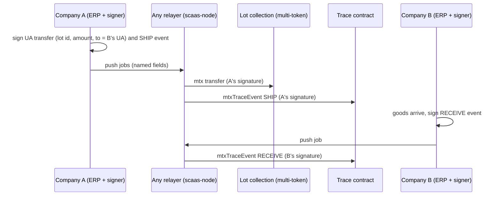

> **Research note — background and rationale only, not normative; the current rules are in docs/ (see decisions.md).**

# Traceability and provenance on SCaaS

Research of 2026-11-24 for the owner ("Truy xuất nguồn gốc": traceability). It is a companion to
[2026-11-24-nft-multi-token.md](2026-11-24-nft-multi-token.md), the NFT note. Nothing here is built, specified or ruled.
Every design below is a proposal. All SCaaS code named here is **UNAUDITED**
([ARCH-POS-14](../decisions.md#ARCH-POS-14)).

The owner added two hints:
- "ERP có thể dùng mô hình MRP của Odoo để quản lý sản xuất": the ERP can follow an MRP model such as Odoo's to manage
  production (§8).
- "Có thể phục vụ nhiều công ty khác nhau chạy Odoo OpenSource": the service can serve many companies, each running
  open-source Odoo (§7).

The main text is generic. One ERP appears only in the marked example subsections, as in
[integration-odoo-example.md](../integration-odoo-example.md).

Tags:
- **[F]** a fact with its source: a SCaaS fact cites a repository path or a rule id, an external fact a URL in §11;
- **[I]** our inference;
- **[E]** an estimate.

Web sources were read on 2026-11-24.

**Contents**

1. [Use cases](#1-use-cases)
2. [Standards and regulation](#2-standards-and-regulation)
3. [The data model on SCaaS](#3-the-data-model-on-scaas)
4. [On chain and off chain](#4-on-chain-and-off-chain)
5. [Confidentiality](#5-confidentiality)
6. [Trust limits](#6-trust-limits)
7. [A network of independent companies](#7-a-network-of-independent-companies)
8. [Integration](#8-integration)
9. [Fit with the NFT kinds](#9-fit-with-the-nft-kinds)
10. [Options, recommendation, pre-freeze, questions, TODO](#10-options-recommendation-pre-freeze-questions-todo)
11. [Sources and what could not be verified](#11-sources-and-what-could-not-be-verified)

## 1. Use cases

| Domain | Chain of custody | Unit traced | What a buyer or regulator asks |
|---|---|---|---|
| Agriculture and food | farm → processor → distributor → retail | a harvest lot, then processed lots; sometimes a pack | origin, inputs (pesticides), certificates (organic), cold chain, recall scope |
| Pharma | manufacturer → wholesaler → dispenser | a serialised pack (GTIN + serial + lot + expiry) | is this pack genuine, has it been dispensed already, which lot to recall |
| Luxury and anti-counterfeit | brand → retailer → owner → resale | a serialised item | is it genuine, who owned it, is it stolen |
| RWA and commodities | refiner → vault → owner | a gold bar (serial, refiner, fineness), a warehouse lot | which bars back a holding (the allocated lots of [token-features-catalogue.md](token-features-catalogue.md), row "Lot or serial tracking") |
| Batteries and EU product passports | cell maker → pack maker → vehicle → recycler | a battery (serial) | composition, carbon footprint, state of health, recycled content |
| Export compliance (EUDR) | plot → collector → exporter → EU operator | a shipment lot, linked to plot geolocations | deforestation-free since 31 Dec 2020, legality, the due-diligence statement |

**Inference [I].** Two shapes recur:
- **lots** (fungible quantities that split, merge and transform);
- **serialised items** (unique units).

Both need a signed event history by several independent parties. Most also need private documents (lab tests, contracts,
prices) shown only to the parties entitled to them.

## 2. Standards and regulation

Sources in §11.

| Standard / rule | Status | What it requires or defines |
|---|---|---|
| GS1 **EPCIS 2.0** and **CBV 2.0** | Ratified June 2022; also ISO/IEC 19987:2024 | event types ObjectEvent, AggregationEvent, TransactionEvent, TransformationEvent, and the new AssociationEvent; dimensions what, where, when, why and the new **how**; sensor data; XML and JSON / JSON-LD bindings |
| GS1 identifiers | in force | GTIN (AI 01), batch / lot (AI 10), serial (AI 21), GLN (AI 414, extension 254); SGTIN = GTIN + serial (Tag Data Standard 2.2, ratified February 2025) |
| **GS1 Digital Link** URI syntax | 1.7.0, ratified August 2026 | `https://id.gs1.org/01/{gtin}/10/{lot}/21/{serial}`, in the order 01, 10, 21; "Sunrise 2027": point-of-sale scanners read 2D codes (GS1 DataMatrix, or DataMatrix / QR carrying a Digital Link) by the end of 2027 (most sources; one says the start) |
| W3C **VC Data Model 2.0** | Recommendation, 15 May 2025 | signed claims by an issuer about a subject |
| W3C **DID Core 1.0** | Recommendation, 19 July 2022 | decentralised identifiers |
| EU **ESPR**, Regulation (EU) 2024/1781 | in force 18 July 2024; duties start per product delegated act, at least 18 months after it | the Digital Product Passport. The DPP registry has been live since 20 July 2026. Working plan 2025–2030: iron and steel Q4 2026; textiles, aluminium, tyres 2027; furniture 2028; mattresses, ICT 2029 (a later deck gives different mandatory dates) |
| EU **battery passport**, Regulation (EU) 2023/1542 | from 18 February 2027 | LMT batteries, industrial batteries above 2 kWh, EV batteries |
| EU **EUDR**, Regulation (EU) 2023/1115 | applies from 30 Dec 2026 to large and medium operators; 30 Jun 2027 to other micro and small ones (Regulation (EU) 2025/2650) | cattle, cocoa, coffee, oil palm, rubber, soya, wood; geolocation of every plot; a due-diligence statement in the EU Information System; cut-off 31 Dec 2020. A scope act, still under scrutiny in July 2026, would change some products from 30 Dec 2027 |
| US **DSCSA** | enhanced requirements since 27 Nov 2023, stabilisation to 27 Nov 2024; exemptions ended in 2025 by partner type; small dispensers exempt to **27 Nov 2027** (FDA, 6 Aug 2026) | interoperable, electronic, package-level tracing |
| EU **FMD**, Delegated Regulation (EU) 2016/161 | since 9 Feb 2019 | a unique identifier (2D DataMatrix) and an anti-tampering device; verification at the pharmacy against the repository system |
| **Vietnam: Circular 02/2024/TT-BKHCN** (Ministry of Science and Technology) | signed 28 Mar 2024, effective 1 Jun 2024 | mandatory for producers of the goods named in Decree 132/2008 Art. 19dd(4), voluntary for others, mandatory for anyone connecting to the national portal; a product trace code, a location trace code, a traceability code (product, location, batch, event time) and a data carrier, in the formats of TCVN 13274:2020 and TCVN 13275:2020; the portal run by the National Committee for Standards, Metrology and Quality |
| Vietnam: TCVN 12850:2019 | national standard | general requirements for traceability systems, built on the GS1 Global Traceability Standard; data answer who, what, where, when, why |
| Vietnam: Law 78/2025/QH15 (amended Law on Product and Goods Quality) | passed 18 Jun 2025, effective 1 Jan 2026 | a "digital product passport" (barcode, QR or online database); traceability mandatory for high-risk goods |
| Vietnam: Decree `37/2026/NĐ-CP` | 23 Jan 2026, effective that day | guides the amended law; covers barcodes in traceability, e-labels and the passport. Decree 132/2008 lapses on 1 Jul 2026 (from summaries; full text not read) |
| Vietnam: Decision `100/QĐ-TTg` (19 Jan 2019) | the national traceability scheme ("Project 100") | targets national standards and a national portal connected to the ministries' systems and solution providers |
| Vietnam: national traceability portal | live 28 Oct 2024, run by the National Barcode Center (GS1 Vietnam) | its URL was not confirmed (§11). Other official sites exist: `truyxuat.gov.vn` (Ministry of Industry and Trade, e-commerce), `verigoods.vn` (Ministry of Industry and Trade, from 23 Dec 2025), `txng.mae.gov.vn` (agriculture) |

Vietnamese platforms, one line each [F, their own descriptions]:
- **iCheck**: a consumer scanner and the iCheck Trace business platform (QR labels).
- **TE-FOOD**: livestock traceability with a blockchain; adopted by Dong Nai (pig collars).
- **VNPT Check**: QR origin check (Bến Tre pilot from 2016).
- **Viettel vMark**: QR traceability and fake-goods alerts (2022).
- **akaChain** (FPT): traceability of export goods.
- **VBChain**: a traceability portal for Cà Mau.
- **NDAChain / NDATrace**: the national permissioned blockchain, launched October 2025.

**What this means for SCaaS [I].**
- The regulations ask for identifiers, events and passports, not for a blockchain.
- EPCIS 2.0 is the event vocabulary to reuse.
- GS1 Digital Link is the carrier to reuse.
- A chain adds who signed what and when, held by no single operator.
- SCaaS should therefore **anchor and sign EPCIS events**, not invent an event language.
- It should export to the regulators' portals; Vietnam's portal is the National Barcode Center's.

## 3. The data model on SCaaS

### 3.1 Lots and items

[I], building on the NFT note's recommended kind (an ERC-6909-shaped multi-token class, cap-1 ids stored as owner slots):

- **A lot** is an id with a quantity, for example `amount` = grams or units. It splits by transfer of part of the amount,
  merges by burn-and-mint, and transforms by burn-and-mint ("recipes", [item-economies.md §6](../guides/item-economies.md)).
- **A serialised item** is an id with cap 1.
- One collection instance per brand owner or product line. The id encodes or maps to `(GTIN, lot)` or `(GTIN, serial)`;
  the mapping is in the id's metadata.
- A single-holder lot that never changes hands could also be a `NORMAL` token with `decimals 0` (built today), but one
  clone per lot does not scale (NFT note §1).

### 3.2 Events

Today [F]:
- Every state change is a typed EIP-712 struct with named fields, relayable at fee 0, signed by the subject (AGENTS.md
  "Explicit parameters", [CTR-MTX-19](../contracts/metatx.md#CTR-MTX-19)).
- A UA signs under a purpose tag; `metatx` covers `UAMetaTransaction`
  ([accounts.md §1.5](../contracts/accounts.md#15-keys-purposes-tags)).
- PQ kinds sign like any UA ([CTR-UA-27](../contracts/accounts.md#CTR-UA-27)).

A proposed event, signed by the acting party's UA [I]:

```solidity
struct TraceEvent {
    bytes32 actor;          // the signing UA
    address collection;     // the lot's multi-token instance
    uint256 id;             // lot or serial id
    uint8   eventType;      // HARVEST 1, PROCESS 2, TRANSFORM 3, SPLIT 4, MERGE 5, SHIP 6, RECEIVE 7, SELL 8, RECALL 9
    bytes32 counterparty;   // the partner UA, or a salted commitment to it (section 5), or 0
    bytes32 locationRef;    // salted commitment to a GLN or geolocation
    bytes32 docCommitment;  // INT-ERP-23 commitment to the EPCIS 2.0 event document
    uint64  eventTime;      // the actor's claim; the block time only bounds it
    bytes32 prevEvent;      // the actor's previous event hash on this id: a per-actor chain
    uint256 batch;          // lane
    uint256 nonce;
    uint256 validUntil;
    address relayer;
}
```

- One entry per operation (`mtxTraceEvent`, `mtxTransform`, `mtxSplit`, `mtxMerge`).
- A transform carries its inputs and outputs as arrays of named `(collection, id, amount)` items, never packed bytes.
- The EPCIS document stays off chain; its commitment is on chain.

### 3.3 Attestations and certificates

[F]:
- The repository's "attest" and "pqzver" research ([attest-codex-review.md](attest-codex-review.md),
  [pqzver-fable-review.md](pqzver-fable-review.md)) is about **PQZ verifier mode**: a UA signing a `PqzVerdict` on a
  proof. It does not apply to product certificates.
- The spec reserves "attest" for identity and compliance attestation
  ([2026-11-06-attested-verify.md](../superpowers/specs/2026-11-06-attested-verify.md)).
- The applicable pieces are:
  - the VC layer: optional; contracts consume credentials only through `ComplianceRegistry` flags; the on-chain anchor
    `UAAttestations` is deferred ([CTR-UA-20](../contracts/accounts.md#CTR-UA-20));
  - trust lists as signed JSON, not chain state ([accounts.md §1.11](../contracts/accounts.md#credentials));
  - the `ComplianceRegistry` with named providers ([CTR-AS-07](../contracts/asset-suite.md#CTR-AS-07)).

So a certifier (organic body, lab) [I]:
- signs a VC 2.0 credential about a lot, off chain;
- signs a `TraceEvent` of type `ATTEST` with its UA, whose `docCommitment` commits to the credential;
- relying parties check the certifier's UA against a signed trust list.

A **party** (a farm is certified organic) can also be a `ComplianceRegistry` flag. A **lot** certificate is an event,
not a registry flag.

### 3.4 Linking a physical label

[F external; I for the mapping] A GS1 Digital Link QR or NFC URI such as `https://id.example/01/{gtin}/10/{lot}/21/{serial}`
resolves to a page that names:
- the chain key (`<chain>-mainnet` / `<chain>-testnet`);
- the collection address;
- the id.

The resolver is one more untrusted server. The page verifies on chain itself (§8.5).

## 4. On chain and off chain

| Data | Where | Why |
|---|---|---|
| Event hash or commitment, actor UA, id, type, time claim | chain (state or log) | the signed, ordered record |
| Token balances of lots and items | chain state | custody and mass balance enforced by the contract |
| EPCIS documents, lab reports, photos | off chain: the company's store, or encrypted on Arweave if the owner extends ARCH-POS-19 (Q4) | size and privacy |
| Salts, keys, party identities | client only | [INT-ERP-22](../integration.md#INT-ERP-22), [INT-ERP-24](../integration.md#INT-ERP-24), [INT-ERP-25](../integration.md#INT-ERP-25) |

[F]:
- Commitments use `commitment = keccak256(abi.encode(REC_TAG, salt, SHA-256(JCS(payload))))`, leaves `keccak256(0x00 ‖
  commitment)`, nodes over sorted pairs ([INT-ERP-23](../integration.md#INT-ERP-23)).
- "Anchoring contracts and batch scheduling are out of scope" there ([integration.md](../integration.md#data-protection)).
- [ARCH-POS-19](../decisions.md#ARCH-POS-19) makes Arweave a store of **ciphertext only**, for PqChat and PqVault files.
  Encrypted traceability documents would be a new use (Q4).
- "Never lose ciphertext" covers PQZ and Zether ciphertexts (AGENTS.md), not a document sealed by KEM.

**Gas per event** [F where cited, else E]:

| Chain | Figure |
|---|---|
| EVM (Amsterdam) | a new 32-byte slot ≈ 97,920 state gas ([pq-zero-knowledge.md](../contracts/pq-zero-knowledge.md), the EIP-8037 figure); a bare relayed `mtxExecute` 63,205 regular + 195,840 state = 259,045 gas, and a fee-less call paid through `RelayFeeRouter` with an `mldsa65` UA payer 701,848 gas ([CTR-MTX-27](../contracts/metatx.md#CTR-MTX-27), cost). Log bytes cost regular gas only ([accounts.md](../contracts/accounts.md), the `msig` cost note). [E] an event as a log with one state-slot rewrite is ≈ 60–90 k regular with ECDSA, a few hundred k with a PQ signer |
| NEAR | storage from the attached deposit at `env::storage_byte_cost()` (10^19 yocto per byte on near-sandbox), paid by the relayer ([NET-NEAR-09](../networks/near.md#NET-NEAR-09)) |
| Solana | 5,000 lamports per signature, precompile-verified ones included; rent for new accounts ([solana.md §1](../networks/solana.md#overview), [NET-SOL-21](../networks/solana.md#NET-SOL-21)) |
| Algorand | fees pooled in a group; the relayer pays the boxes' exact MBR ([NET-ALG-02](../networks/algorand.md#NET-ALG-02)) |
| Others | not measured |

**Batching [I].**
- A party with many events (a packing line) signs one `TraceBatch {actor, root, count, seq, prevRoot}` over a Merkle root
  of INT-ERP-23 leaves, one leaf per event.
- One signature and one state write per batch; each event is proven later by its Merkle path.
- Cost: individual events lose their on-chain effect. Token moves (custody) stay individual entries, because a root
  cannot move a balance.
- A batch proves the events existed by the batch's block. It proves nothing about their order inside the batch beyond the
  actor's own claim.

## 5. Confidentiality

Suppliers do not want volumes, prices and partners public.

| What | Default proposal | Leaks [I] |
|---|---|---|
| Documents (contracts, lab tests, BoM, prices) | commitment on chain; the document encrypted and shared only with entitled parties by the hybrid KEM | nothing beyond the commitment and the timing |
| Partner in an event | `counterparty` as a salted commitment; opened to an auditor on request ([INT-ERP-26](../integration.md#INT-ERP-26)) | nothing in the event itself, but see token transfers |
| Location | `locationRef` salted commitment; EUDR geolocation opened only in the due-diligence file | — |
| Token transfers of lots | **public**: `from`, `to` (UA ids) and `amount` | **who supplies whom and how much**, readable by every competitor once a UA is linked to a company |
| Quantities, later | a PQZ layer for amounts per id (NFT note §4.8) | amounts hidden; parties still visible. Hiding parties is separate anonymity work |

[F]:
- PqVault shares single notes through a **share box**: one shared vault per recipient set, reused
  ([ua-libraries.md](../clients/ua-libraries.md#pqvault-clients)).
- The Zama note's §7a seals a bid to the buyer's KEM key with "the scheme-1 seal of PqChat and PqVault"
  ([2026-11-24-zama-lessons.md](2026-11-24-zama-lessons.md#7a-sealed-bids-where-losers-need-not-open)).
- ARCH-POS-13's Change of 2026-11-13 puts the hybrid KEM (ML-KEM-1024 + X25519, [CTR-UA-32](../contracts/accounts.md#CTR-UA-32))
  outside the no-oracle rule ([ARCH-POS-13](../decisions.md#ARCH-POS-13)).

So [I]:
- A document shared to a counterparty is a share-box item or a KEM-sealed file.
- Its decapsulation is outside ARCH-POS-13.
- No PQZ or Zether key is applied to it.

**Plainly [I].** On a public chain, a model where lots move as tokens between company UAs **publishes the supply graph
and the volumes**. Fresh UAs per relationship only delay the linking: the counterparty knows, and the UA registry is
public. Only an events-only model (no token moves, the partner committed) hides the graph, and it gives up on-chain mass
balance (§10). This is the main trade-off for the owner (Q1).

## 6. Trust limits

**The chain proves who signed what and when. It does not prove that the goods match the record.** This is the oracle
problem. Caldarelli et al. (2022) state it for supply chains: the data sources are run or paid by the producer, so
nothing on chain makes the data accurate (§11). GS1 says end-to-end traceability needs agreed processes and data
standards, with or without a blockchain.

Mitigations, none of them a proof [I]:
- **Certifier signatures** from named UAs on a trust list. They move trust to the certifier; they do not remove it.
- **Tamper-evident labels.**
- **Signed NFC chips with secure elements** [F]:
  - NXP NTAG 424 DNA uses AES-128 (five keys; SUN messages carry the UID, a counter and a CMAC) and Common Criteria EAL4.
  - It is symmetric, so the verifier holds the key or asks the issuer's server. The chip's tap is not a signature anyone
    can check against a public key.
  - Grover roughly halves AES-128's security margin [I].
- **Mass balance in contracts.** A party cannot ship more of a lot than it holds. This catches dilution (selling more
  "organic" than was produced), not substitution.
- **Audits and sampling** off chain, recorded as `ATTEST` events.

The block time bounds the event time; the `eventTime` field is the actor's claim. Every report and the verification page
must say "signed by X at T", never "verified genuine".

## 7. A network of independent companies

### 7.1 Cross-company chains

[I]:
- Each company (farm, processor, distributor, retailer) runs its own ERP instance and has its own UA, or a group UA
  (`msig`) with member keys.
- A lot moves between companies as **a token transfer between their UAs** plus **a SHIP event signed by the sender and a
  RECEIVE event signed by the receiver**.
- No company writes another's events. A discrepancy (received less) is the receiver's own event.



### 7.2 Who signs

[F]:
- "The subject signs every valuable write"; the node never holds subject keys; a lane key holds gas only (AGENTS.md).
- The ERP-held `env:` custody is dev-only ([INT-ERP-08](../integration.md#INT-ERP-08)).
- An `msig` names members, who accept by their own signature; members change by `updateMsig`
  ([CTR-UA-37](../contracts/accounts.md#CTR-UA-37), [CTR-UA-44](../contracts/accounts.md#CTR-UA-44)).
- A mandate pays under caps without an allowance ([CTR-ACC-06](../contracts/mandates.md#CTR-ACC-06)).
- A service takes custody by the payer's one signed transfer ([CTR-MTX-32](../contracts/metatx.md#CTR-MTX-32)).
- Roles carry `WHOLE` or `LIMITED` grants with a delay for widening ([CTR-GOV-04](../decisions.md#ctr-gov-04--two-call-grantdelay-and-holdercount),
  [CTR-TOK-22](../contracts/token-wrappers.md#CTR-TOK-22)).

Per-company signing [I]:
- **An operations key** on a device (a scanner, a line PC) or in an HSM, as a single-key UA that signs routine events.
- **Employees' passkeys** (P-256 UA kinds) as members of the company's `msig` for valuable writes: lot transfers,
  transforms, recalls.
- The ERP server prepares typed data and pushes signed jobs. It never holds a key in plain text.
- Routine events by the operations UA, bounded by a `LIMITED` grant on the company's own trace instance, if the trace
  contract is governed. Payments under a mandate.

### 7.3 Onboarding many companies

[I] unless cited:
- **UA and KEM key.** Each company registers its UA and its KEM record ([CTR-UA-32](../contracts/accounts.md#CTR-UA-32)),
  so documents can be sealed to it.
- **Master data and who mints.**
  - A GTIN belongs to the brand owner's GS1 company prefix. The brand owner's collection defines product ids.
  - A contract manufacturer mints lots of that brand's ids under a `LIMITED` grant of `MINTABLE` from the brand owner.
  - Each company also has its own collection for its own products.
  - The chain cannot check that a GTIN belongs to a company: that is a credential from GS1 or its member organisation,
    held off chain.
- **Certifiers.** Trust lists per network or market operator, as signed JSON whose hash may be anchored
  ([accounts.md §1.11](../contracts/accounts.md#credentials)).
- **A directory of companies** (UA → legal name, tax id).
  - [ARCH-POS-17](../decisions.md#ARCH-POS-17) [F]: business identifiers in clear on chain are "not recommended and never
    refused"; wallets warn; a clear identifier is "publicly searchable forever".
  - Proposal: an off-chain directory signed by its operator, plus VCs presented to counterparties.
  - An on-chain directory makes the supply graph of §5 readable by name.

### 7.4 Relayers

[F]:
- The node is open: any operator may relay, and the node has no company notion
  ([NODE-JOB-03](../node/job-api.md#NODE-JOB-03)).
- A client routes each `(company, chain)` to exactly one node ([INT-ERP-16](../integration.md#INT-ERP-16)).
- Fees: fee 0 is relayable ([CTR-MTX-19](../contracts/metatx.md#CTR-MTX-19)); a token fee goes to the relayer by
  `RelayFeeRouter` ([CTR-MTX-27](../contracts/metatx.md#CTR-MTX-27)).
- Sponsorship policies and budgets are SPECIFIED and `SponsorshipPool` is PLANNED ([sponsorship.md](../node/sponsorship.md)).

[I] A company may run its own `scaas-node` or use a shared one. The shared operator sees job metadata (addresses,
commitments) but no salts ([INT-ERP-22](../integration.md#INT-ERP-22)).

### 7.5 Example: Odoo Community, one connector per company

<!-- example:odoo -->

This subsection is an example only. The connector would live beside [integration-odoo-example.md](../integration-odoo-example.md).

- **One connector add-on per company instance.**
  - It maps that company's MRP and stock records to signed events (§8.2) and pushes them through the job API.
  - Never through a client-specific path in the node.
- **Several companies in one Odoo instance** (Odoo multi-company), against **one instance per company.**
  - Inside one instance, the connector keeps one route and one signer per company, as INT-ERP-16 already requires per
    `(company, chain)`.
  - Separate instances keep keys and data apart by construction.
  - [I] For competitors, separate instances are the safer default.
- **Community and Enterprise.**
  - [F] In the Community repository's 19.0 branch, `mrp`, `stock`, `mrp_subcontracting`, `product_expiry` and
    `stock_picking_batch` are present, licence LGPL-3.
  - `quality`, `quality_control`, `quality_mrp`, `mrp_plm`, `mrp_mps` and `mrp_workorder` are **absent**
    (`addons/<module>/__manifest__.py` returns 404).
  - [I] So in Community: manufacturing orders, BoMs, work orders in `mrp`, lots and serials, and the traceability report
    are available. Quality checks, PLM, the master production schedule and the shop-floor app are Enterprise or third
    party. Third-party comparisons disagree on quality, and the repository is the stronger source.
- **The licence question (open, not ruled).** Odoo Community is LGPL-3. This repository's code is
  `LicenseRef-Vegan-Community-1.0`. Open questions:
  - may a connector add-on carry the Vegan licence and still be installed next to LGPL-3 modules and distributed through
    the usual add-on channels?
  - should the add-on instead be LGPL-3, with only the protocol defined here?
  - Q9 asks the owner.

<!-- /example -->

### 7.6 Privacy between competitors on one public chain

[I], plainly:
- **Public:** the UA ids, every token transfer (from, to, id, amount) and every event's actor, type, id and time.
- **Linkable:** once one counterparty or a directory links a UA to a company, its whole history is readable, including
  that company A supplies company B.
- **Private:** hashed partner references, salted location and document commitments, and KEM-shared documents.
- With lots moving as tokens, competitors see volumes and partners. The options against that are events-only mode,
  aggregation through an intermediary UA (which only moves the trust), or PQZ amounts later (which still show parties).

## 8. Integration

### 8.1 ERP connectors and the push job API

[F]:
- The client keeps its own outbox, pushes jobs to the node's job API and polls two feeds
  ([integration.md §3](../integration.md#3-pushing-jobs)).
- The node builds every call from named fields and refuses hex ([NODE-JOB-20](../node/job-api.md#NODE-JOB-20)).
- The node allow-lists equal the contracts', per kind (AGENTS.md "Node").

New event entries need node rows (`typed.rs`, `guard.rs`) as every kind does [I].

### 8.2 Mapping MRP concepts to events (generic)

| MRP concept | Traceability event |
|---|---|
| bill of materials (BoM) | the transform recipe: inputs and outputs per unit; its document committed, its details shared only with permitted parties (§5) |
| manufacturing order (MO): consume input lots, produce an output lot | a **TRANSFORM** event: input lot ids burned (or linked, if they stay with another holder) and the output lot minted, in one entry |
| work orders / operations, quality checks | a **PROCESS** event, or a certifier's **ATTEST** event |
| lots and serial numbers | the lot / item token id |
| stock moves and transfers (receipt, internal, delivery) | **RECEIVE** / **SHIP** events; internal moves need no chain event unless custody changes |
| the upstream / downstream traceability report | the lot's signed history from the indexer feed (§8.4) |
| scrap, unbuild | a burn, or a reverse transform (output burned, inputs minted back) |

**Privacy [I].** An MO reveals volumes and recipes. The MO's on-chain trace is the transform's ids and amounts. While
lots are public tokens that exposure is the §5 trade-off. The BoM and the MO document stay off chain, committed and
shared by KEM.

### 8.3 Example: an MRP ERP (Odoo)

<!-- example:odoo -->

Example only. Model and field names were checked against the Community source, branch 19.0 (§11):

| Odoo record | Fields used | Event |
|---|---|---|
| `mrp.bom` | the BoM lines | transform recipe; document committed |
| `mrp.production` | `bom_id` (`mrp.bom`), `move_raw_ids` (`stock.move`, components), `move_finished_ids` (`stock.move`, finished products), `lot_producing_ids` (Many2many `stock.lot`; there is no singular `lot_producing_id` in 19.0), `workorder_ids` (`mrp.workorder`) | TRANSFORM at "done" |
| `mrp.workorder` | per operation | PROCESS |
| `stock.lot` | the lot / serial | token id mapping |
| `stock.move.line` | `lot_id` (`stock.lot`), `consume_line_ids` / `produce_line_ids` (Many2many on `stock.move.line`, table `stock_move_line_consume_rel`), `production_id` and `workorder_id` (added by `mrp`) | inputs and outputs of the transform; SHIP / RECEIVE for receipts and deliveries |
| `stock.traceability.report` | upstream / downstream through the move lines | compared with the chain's history; the chain is the signed copy |

The connector pushes signed events through the job API only. The node never sees an Odoo name.

<!-- /example -->

### 8.4 Indexer feeds and the SDK

[F]:
- The indexer writes final, quorum-agreed, contiguous ranges ([NODE-IDX-02](../node/indexer-feeds.md#NODE-IDX-02)).
- The normalized event has `amount` but **no id** ([indexer-feeds.md §2](../node/indexer-feeds.md#event-normalization)).

[I]:
- A lot history feed needs `token_id`, the event type and the commitment fields.
- A "history of id X" query walks the events by id and the transform links back to the input ids.
- SDK operations: `traceEvent`, `transform`, `split`, `merge`, `ship`, `receive`, `attest`, `history(id)`.

### 8.5 The public verification page

[F]:
- Every RPC consumer takes a list of nodes: reads fail over by default, never mixing nodes, and an option asks a strict
  majority to agree ([ARCH-POS-15](../decisions.md#ARCH-POS-15)).
- `scaas-rpc` is the reader (ARCH-POS-19 item 3 names its profiles).

[I] The page:
1. scans the QR, parses the Digital Link, maps it to (chain, collection, id);
2. reads the history from several RPC nodes, under the majority option for anything shown as verified;
3. checks each event's signature and the signer's UA against the trust list;
4. opens public documents by their hash;
5. shows "signed by X at T" for each step.

It does not depend on one indexer or on the brand's resolver.

## 9. Fit with the NFT kinds

[I]:
- **Lots** are fungible ids in the NFT note's multi-token kind (option A), quantity in `amount`.
- **Serialised items** are cap-1 ids.
- **Transforms** are burn-and-mint across ids, in one call when the ids share a collection. Across collections it is a
  transform contract holding `BURNER` on the inputs' collections and `MINTABLE` on the output's, exactly the recipe
  contract of item-economies §6.
- **Split** is a transfer of part of a lot, or a burn of one id and mints of two new lot ids when the parts need their own
  identity.
- **Merge** burns n ids and mints one.
- The lot's per-id state (best-before, grade) belongs in its metadata versions (NFT note §4.3).
- The same router question applies (NFT note §7, Q1 there): who mints and transforms when the role holder is a PQ UA or
  an `msig`.

## 10. Options, recommendation, pre-freeze, questions, TODO

### 10.1 Options

| | T1 events only (commitments, no tokens) | T2 tokens + events | T3 T2 with PQZ amounts (later) |
|---|---|---|---|
| Mass balance on chain | no | yes | yes, proven |
| Supply graph public | no (partner committed) | **yes** | yes (amounts hidden) |
| Volumes public | no | **yes** | no |
| Needs | a trace contract | the multi-token kind + trace contract | a PQZ relation over ids; full gate |
| Effort [E] | smallest | medium | large |

**Recommendation [I].**
- Build **one event schema (EPCIS 2.0 inside, `TraceEvent` outside)** that runs in both T1 and T2 per collection.
- Start with **T1 for confidential supply chains** and **T2 where mass balance matters more than secrecy** (pharma serials,
  gold bars, luxury items, EUDR-scale commodities with public volumes).
- T3 stays research.
- The trace contract is a small new generic factory class (append-only per-actor chains, batches, no admin power over
  events).

### 10.2 Pre-freeze

[I], from the facts of the NFT note §7:
- Nothing must land before the EVM freeze for traceability itself. The trace contract and the lot collections are new
  generic classes ([CTR-TOK-28](../contracts/token-wrappers.md#CTR-TOK-28)).
- Signatures use the existing `metatx` purpose or the built app paths ([CTR-UA-45](../contracts/accounts.md#CTR-UA-45)).
- The KEM record exists ([CTR-UA-32](../contracts/accounts.md#CTR-UA-32)).
- The one shared open point is the NFT note's router question (its Q1): if role uses by PQ or `msig` holders need router
  ops (its P1), that is pre-freeze work.

### 10.3 Open questions for the owner (no rulings)

- **Q1.** T1, T2, or both per collection? Is publishing the supply graph acceptable for T2 networks?
- **Q2.** Does the trace contract keep every event in state, or logs with a per-actor head in state? (Ciphertext is not
  involved, so "never lose ciphertext" does not decide it.)
- **Q3.** The EPCIS 2.0 subset and the event types to support first.
- **Q4.** Encrypted traceability documents on Arweave: an extension of ARCH-POS-19, or not?
- **Q5.** The company directory: off chain and signed (proposed), or on chain despite ARCH-POS-17's warning?
- **Q6.** Certifier trust lists: who publishes them, per network or per market?
- **Q7.** Export to regulators' portals (the Vietnamese national portal, the EU DPP registry and EUDR information system):
  in scope for SCaaS, or the ERP's job?
- **Q8.** NFC: accept AES-based chips (NTAG 424 DNA class) with issuer-server verification, or ask for public-key chips?
- **Q9.** The connector licence: may an ERP add-on carry `LicenseRef-Vegan-Community-1.0` beside LGPL-3 modules, or should
  it be LGPL-3?

### 10.4 Proposed TODO items

| # | Item | Depends on | Effort [E] |
|---|---|---|---|
| T-1 | Owner rulings on Q1–Q5 | NFT note N1 | — |
| T-2 | Spec `docs/contracts/trace.md`: `TraceEvent`, `TraceBatch`, transform / split / merge entries, typehashes, the class, events; decisions entry | T-1, NFT note N3 | 1 week |
| T-3 | EVM trace contract, tests, mutants, pins, size-gate row, gas table (log vs state, ECDSA vs `mldsa65`) | T-2 | 1.5–2 weeks |
| T-4 | Node rows, the indexer's `token_id` and event fields, the lot history feed | T-3, NFT note N7 | 1 week |
| T-5 | Vectors and clients for the new typehashes; `ua-rs` and `clientkeys` first | T-3 | 1–1.5 weeks |
| T-6 | SDK trace operations; EPCIS 2.0 JSON-LD canonicalisation to the INT-ERP-23 commitment | T-5 | 1 week |
| T-7 | Public verification page (Digital Link parser, multi-node reads, trust-list check) | T-6 | 1–1.5 weeks |
| T-8 | Document sharing by share box / KEM seal for counterparties | PqVault client work | 1 week |
| T-9 | Example connector for one MRP ERP (in the example doc's place) | T-6, Q9 | 2 weeks |
| T-10 | Regulator export adapters (per Q7) | Q7 | per portal |
| T-11 | Non-EVM families, after the NFT note's N12 per family | N12 | 1–2 weeks each |

## 11. Sources and what could not be verified

Read on 2026-11-24.

- GS1:
  - EPCIS <https://ref.gs1.org/standards/epcis/>, CBV <https://ref.gs1.org/standards/cbv>;
  - application identifiers <https://ref.gs1.org/ai/GS1_Application_Identifiers.jsonld>;
  - Tag Data Standard <https://ref.gs1.org/standards/tds>;
  - Digital Link <https://ref.gs1.org/standards/digital-link/uri-syntax/>;
  - Sunrise 2027 <https://ref.gs1.org/docs/2025/single-2D-barcode-for-private-label-products/>;
  - traceability and blockchain <https://GS1.org/sites/default/files/gs1_traceability_and_blockchain_wp.pdf>.
- W3C: <https://www.w3.org/TR/2025/REC-vc-data-model-2.0-20250515/>; <https://www.w3.org/2022/07/pressrelease-did-rec>.
- EU:
  - ESPR <https://eur-lex.europa.eu/eli/reg/2024/1781/oj/eng>;
  - DPP <https://single-market-economy.ec.europa.eu/single-market/digital-product-passport_en>;
  - batteries <https://single-market-economy.ec.europa.eu/single-market/digital-product-passport/batteries_en>;
  - EUDR geolocation <https://green-forum.ec.europa.eu/nature-and-biodiversity/deforestation-regulation-implementation/traceability-and-geolocation-commodities-subject-eudr_en>;
  - EUDR dates <https://taxnews.ey.com/news/2026-0237-eu-deforestation-regulation-application-postponed-to-30-december-2026>;
  - EUDR scope <https://environment.ec.europa.eu/news/commission-updates-product-scope-and-tools-support-eudr-2026-07-13_en>;
  - FMD <https://www.ema.europa.eu/en/news/new-safety-features-medicines-sold-eu>.
- US DSCSA: <https://www.fda.gov/drugs/drug-supply-chain-security-act-dscsa/exemptions-under-drug-supply-chain-security-act>.
- Vietnam:
  - Circular 02/2024 <https://english.luatvietnam.vn/khoa-hoc/circular-02-2024-tt-bkhcn-management-of-product-and-goods-traceability-308660-d1.html>;
  - Law 78/2025 <https://thuvienphapluat.vn/van-ban/Thuong-mai/Luat-Chat-luong-san-pham-hang-hoa-sua-doi-2025-so-78-2025-QH15-623226.aspx>;
  - Decree 37/2026 <https://thuvienphapluat.vn/van-ban/Thuong-mai/Nghi-dinh-37-2026-ND-CP-bien-phap-to-chuc-Luat-Chat-luong-san-pham-hang-hoa-691138.aspx>;
  - Decision 100 <https://accgroup.vn/quyet-dinh-100-qd-ttg-2019-de-an-trien-khai-ap-dung-quan-ly-he-thong-truy-xuat-nguon-goc>;
  - the portal <https://vcci.com.vn/tin-tuc/doanh-nghiep-nguoi-dung-huong-loi-tu-cong-nghe-truy-xuat-nguon-goc>;
  - TCVN 12850 <https://bavutex.baria-vungtau.gov.vn/public/tin-tuc/yeu-cau-doi-voi-he-thong-truy-xuat-nguon-goc-theo-tcvn-128502019.html>;
  - iCheck <https://vietnamnews.vn/society/1694905/scanning-for-safety-how-digital-solutions-assist-food-traceability.html>;
  - TE-FOOD <https://medium.com/te-food/dong-nai-province-in-vietnam-starts-to-roll-out-te-foods-traceability-system-from-may-b8bc009d604a>;
  - VNPT Check <https://tapchicongthuong.vn/truy-xuat-nguon-goc-hang-hoa-bang-vnpt-check-56031.htm>;
  - Viettel vMark <https://bavutex.baria-vungtau.gov.vn/public/tin-tuc/viettel-ra-mat-giai-phap-truy-xuat-nguon-goc-va-canh-bao-hang-gia.html>;
  - NDAChain <https://tuoitre.vn/viet-nam-co-nen-tang-blockchain-quoc-gia-xuyen-suot-tu-trung-uong-den-dia-phuong-2025101317482419.htm>.
- NFC: <https://www.nxp.com/products/NTAG424DNA>. Luxury: <https://www.businessoffashion.com/news/news-analysis/cartier-prada-link-up-with-lvmh-in-blockchain-alliance/>.
- Gold: <https://www.lbma.org.uk/gold-bar-integrity-ecosystem>; <https://www.lbma.org.uk/publications/good-delivery-rules/technical-specifications>.
- Oracle problem: Caldarelli et al., <https://arxiv.org/pdf/2202.13930>.
- Odoo source, branch 19.0:
  - <https://github.com/odoo/odoo/blob/19.0/addons/mrp/models/mrp_production.py>;
  - <https://github.com/odoo/odoo/blob/19.0/addons/mrp/models/stock_move_line.py>;
  - <https://github.com/odoo/odoo/blob/19.0/addons/stock/models/stock_move_line.py>;
  - <https://github.com/odoo/odoo/blob/19.0/addons/stock/report/stock_traceability.py>;
  - module presence checked by `addons/<module>/__manifest__.py` on the 19.0 branch.

**Not verified or conflicting:**
- The national traceability portal's URL.
- The traceability text of Decree 37/2026 (summaries only), and whether Circular 02/2024's mandatory scope now flows from
  Law 78/2025 and Decree 37/2026 once Decree 132/2008 lapses.
- Whether Circular 07/2024 amends Circular 02/2024 (one database says so).
- The battery regulation's article numbers.
- Sunrise 2027's start-versus-end wording.
- TE-FOOD's current chain.
- A role for the World Gold Council in LBMA's Gold Bar Integrity programme (none found).
- Odoo Enterprise's module list: inferred from absence in the Community repository, not read from Enterprise.
- Every gas figure marked [E].
