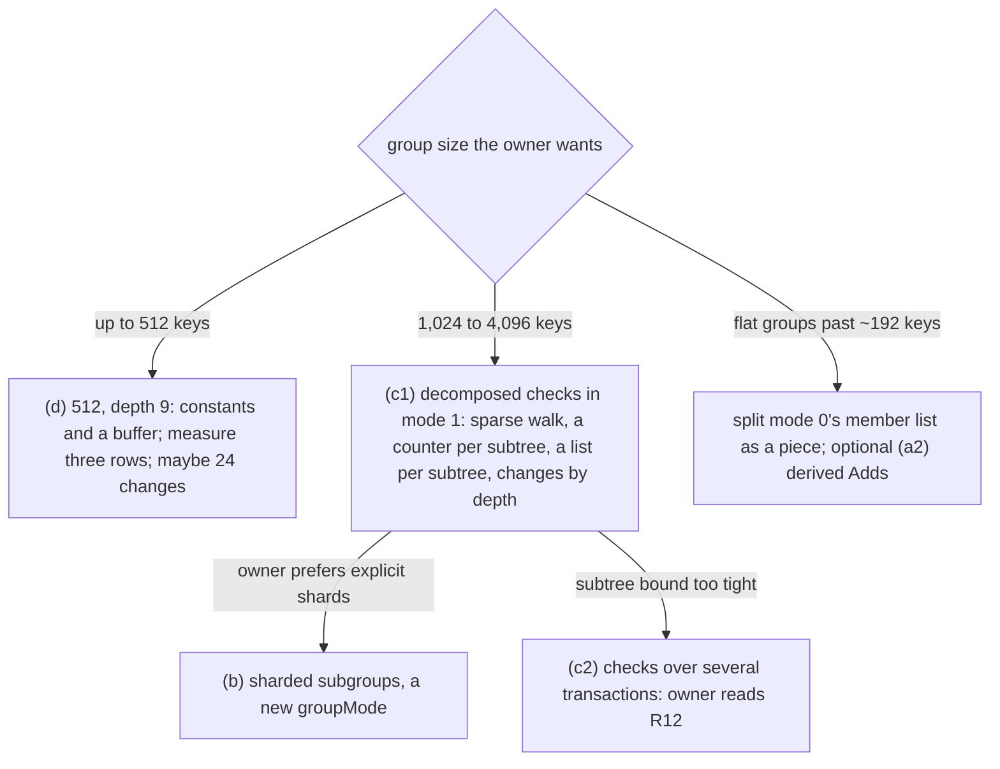

> **Research note — background and rationale only, not normative; the current rules are in docs/ (see decisions.md).**

# PqChat TreeKEM past 256 leaves: options and what each costs

Research of 2026-11-25 for the owner, who asked (paraphrased from Vietnamese): "research ways past TreeKEM's limit, for
example each add or remove bumps a version and members fetch the new key themselves". Nothing here is built, specified or
ruled. Every design below is a proposal, and all of it is **UNAUDITED** cryptographic design
([ARCH-POS-14](../decisions.md#ARCH-POS-14)). The rules this note works from are the TreeKEM spec
[`2026-11-23-pqchat-treekem.md`](../superpowers/specs/2026-11-23-pqchat-treekem.md) (cited "spec §n", its rulings R1–R16 and
calls C1–C40) and [`contracts/pqchat.md`](../contracts/pqchat.md) (CTR-CHAT-05 to -27). Background on TreeKEM against flat
wraps is in [`2026-11-23-treekem-pqchat.md`](2026-11-23-treekem-pqchat.md) ("note §n").

Tags: **[F]** a fact with its source. A gas figure tagged [F] is one of the plan T3d rows measured with forge, with the
verify's gas added from `accounts.md` ([CTR-CHAT-27](../contracts/pqchat.md#CTR-CHAT-27), "Measured"); forge does not enforce
2^24, so a [F] regular figure says nothing about the cap. **[E]** an estimate made for this note: paper arithmetic on the
measured rows, no run. No gas was measured or calibrated for this note. **[I]** an inference. **[B]** background from the
literature, cited from memory and not re-read for this note; check it before relying on it.

**Contents**

1. [Summary](#1-summary)
2. [Why the cap is 256 today](#2-why-the-cap-is-256-today)
3. [What grows with the group and what does not](#3-what-grows-with-the-group-and-what-does-not)
4. [Per-transaction figures past depth 8](#4-per-transaction-figures-past-depth-8)
5. [The options](#5-the-options)
6. [Rules and rulings, option by option](#6-rules-and-rulings-option-by-option)
7. [Ranked recommendation](#7-ranked-recommendation)
8. [Open questions for the owner](#8-open-questions-for-the-owner)
9. [Sources](#9-sources)

## 1. Summary

- **The cap counts KEM keys, not people.** `TREE_LEAVES_MAX` = 256 leaves, and one UA holds up to 8 keys
  (`KEYS_PER_UA_MAX`, CTR-CHAT-24). A tree of 256 leaves is 32 to 256 people [F, spec §12].
- **No single row fixes 256.** At 256 every piece of a commit fits a 60 M block, with about 10 M to spare on the dearest
  transaction (the completion at its bounds, 50.3 M asked [F]). A one-record creation already stops at about 192 keys [F],
  so 256 is reached by Adds. Doubling to 512 keeps every piece inside a block on paper. Two rows come close to a limit: the
  completion, at about 55 M asked [E], and the record at its bounds signed with ML-DSA-87, at about 16 to 17.5 M regular
  against the 16.78 M cap [E].
- **Mode 0 is not a way past it on a 60 M chain.** Mode 0 has no member constant. But its signed record carries 128 B per
  member key and lands whole, and so does a flat `rekey`'s. So a flat epoch holds about as many keys as a tree creation,
  about 192 at a 60 M block [F for the session record; I for `rekey`]. The owner's idea in its plainest form (a new
  version per add or remove, every member fetching its own wrap) is mode 0's `rekey` today. It passes ~192 keys only once
  the record's member list is split off as a piece (the "not done here" of spec §13). After that, every change costs
  N wraps: about 1.5 G state gas at 512 keys [E].
- **Removals carry the cost.** Fresh entropy has to reach every member left, under keys the removed member does not know.
  With per-member keys only, that is N − 1 ciphertexts per removal, however the version is announced or fetched [I].
  Only shared intermediate keys (a tree) make it smaller. Adds can be cheap without a tree: the old members derive the
  next key one-way and the joiners get one wrap each (option a2).
- **Past 512 a constant bump is not enough.** At 1,024 leaves the cold target list (36,828 B) no longer fits one blob on a
  24,576-B chain, nor one 60 M transaction. The completion at 32 changes has no margin left. The record at its bounds
  crosses 2^24 with ML-DSA-87 [E]. Going higher needs the contract's tree check broken up at 256-leaf subtrees, all of it
  still inside each commit's acceptance (option c1). That needs a counter per subtree, a target list per subtree, a
  sparse walk, and a change bound that shrinks with depth. C7 / R12 still hold as worded.
- **Rejected:** a key server (it breaks the node-holds-no-keys rule, contract authorization and state-only recovery). An
  optimistic commit with a fraud challenge (it is the opposite of C7 and of CTR-CHAT-08's slot rule). A validity proof
  for now (pairing SNARKs are not PQ, a hash-based proof costs more than the check it replaces at these sizes, and it
  leaves the dominant ciphertext bytes untouched). A federation of sessions run only by clients (room-level rights would
  rest on clients alone).
- **Ranked:** (1) 512 at depth 9, constants and one buffer only, no record change; the owner reopens R8, and the three
  near-limit rows are measured first. (2) For 1,024 to 4,096: decomposed checks inside mode 1 (c1). (3) Sharded
  subgroups as a new `groupMode` (b), only if the owner prefers explicit shard boundaries to one binary tree; c1 does the
  same at a lower gas cost per commit. (4) Splitting mode 0's record, the precondition for any flat path past ~192 keys,
  with derived-key Adds (a2) as an option.

## 2. Why the cap is 256 today

**The rulings [F].** R8 (owner): `TREE_LEAVES_MAX` = 256, confirmed on revision 2's figures, "one session record creates up
to about 200 keys at a 60 M block, the rest come by Adds" (spec §1, §16 O1). C10 (owner for the cap, controller for the
rest): depth 8, `TREE_CHANGES_MAX` = 32 adds plus removes per commit. C24: `TREE_ADMINS_MAX` = 32. R12 / C7 (owner): "the
contract keeps the tree hash and computes the commit's tree in memory **when the record is accepted**". The signed
`treeHash`, `ctCount`, the path length and the removed UAs are compared at that point, and the target list when it lands.
"A wrong value is never staged and never becomes an epoch, so no client ever has to reject an accepted commit."

**The per-transaction rule [F].** A transaction fits when (regular + state) × 1.05 is within the block limit (EIP-8037)
and its regular gas is under 2^24 = 16,777,216 (EIP-7825; Nethermind enforces it, `eth_call` included). There is one rule
on every chain and no assumption of a bigger block. On a smaller chain the planner refuses, by name, exactly the
operation that does not fit (spec §13, codex-r2-9).

**The measured rows at 256 [F]** (plan T3d, `test/pqchat/PqChatTreeGas.t.sol`, CTR-CHAT-27 "Measured"):

| Piece | Regular | Asked | Margin at a 60 M block or 2^24 |
|---|---:|---:|---|
| Completion at its bounds with the held ciphertext (352 new slots: 32 Adds of UAs with no session, scattered over a tree of 256 with one live leaf, admins 1 → 32) | 10.66 M | 50.3 M (37.27 M state) | 9.7 M of block |
| The record at its bounds (32 Adds, 32 admins, 4,124 B of `sealedInfo`, the tree check of C7 on a cold tree), ML-DSA-65 / -87 | 12.5 M / 15.4 M | about 37.6 M / 42.9 M | 1.4 M of 2^24 with ML-DSA-87 |
| The commit of the last live leaf at its bounds, one transaction by construction | 11.2 M / 14.2 M | about 42 M / 47 M | 2.6 M of 2^24 with ML-DSA-87 |
| Acceptance and completion in one transaction | 23.1 M | | over 2^24, so the record goes alone |
| The list of 255 targets / the node keys of depth 8 / one ciphertext | | 16.3 M / 22.1 M / 3.1 M | wide |
| The node keys as the last piece at the bound | | 63.8 M | over; C37's order (one ciphertext held back) avoids it |
| The session record at 192 / 256 member keys, with the verify | | 59.5 M / 75.8 M | 256 does not fit: creation stops near 192 |

**Where 256 sits in the code [F].** `PqChatCore.TREE_LEAVES_MAX = 256` (`src/pqchat/PqChatCore.sol`). The walk's path
buffer is sized for depth 8 (`new uint256` in `PqGroupTree._walkPath`). Spec A-6 makes the base refuse an inheritor's
bound above 256. The node's `typed.rs` repeats the bound (`TREE_LEAVES_MAX: u64 = 256`, with array bounds derived from it).
Clients and vectors carry depth 8. The acceptance and the completion each build the whole tree in memory: three arrays of
`2·leaves − 1` words (`st`, `th`, `kh`), a target buffer of `leaves`, and a hash loop over every parent
(`_walkInit`, `_walkHash`).

## 3. What grows with the group and what does not

N is the number of leaves and d = log2 N its depth.

| Item | Grows with | Figure at 256 | Why it matters past 256 |
|---|---|---|---|
| The record, the Welcome wraps, the admin list | the changes (≤ 32), not N | as today | nothing, apart from the tree check inside the record (below) |
| A warm commit's path | d: d node keys of 1,601 B, d to 2d ciphertexts | 44.9 M state warm, 66.3 M after one removal [F, spec §13] | +5.27 M state per level warm, about +7.9 M after a removal [E] |
| A cold or fragmented commit | up to N − 1 ciphertexts, the same as a flat rekey | 705.5 M state, 14 or more transactions [F, spec §13] | twice that at 512; inherent to TreeKEM where members do not commit (note §4.2) |
| The acceptance's tree check | O(N) memory and loop, O(ctCount) cold reads while resolving, O(changes × d) hashes and registry reads | about 3 M regular [E, spec §8] | the part that shares 2^24 with the 5.95 M / 8.86 M verify |
| The completion's new slots | the changes × d: the paths of 32 leaves cover at most 31 + 32·(d − 5) parents | 127 parents, 352 slots at the bound | +32 parent slots per level, about +4.2 M asked [E] |
| The target list | ctCount × 36 B in one blob and one transaction | 9,180 B, 16.3 M asked | one blob holds 682 entries on a 24,576-B chain |
| The node keys | d × 1,601 B in one blob | 12,808 B, 22.1 M asked | fits up to depth 15 (24,015 B) |
| Client restore and the forward walk | N authenticated registry key reads, every record since creation, N/64 `treeLeaves` calls | 256 reads, 4 calls | linear; the device pays it once and keeps its pin (spec §10 step 3) |
| A staged cold commit voided by an exit (fable-r3-9) | the number of transactions of a cold commit | 14 | about 30 at 512, about 57 at 1,024 [E] |

**A lower bound for every option [I].** After a removal the members left need fresh entropy under keys the removed member
does not hold. If the only keys are the members' own, that takes one ciphertext per remaining member, N − 1. Announcing a
"version" and having members fetch or derive it changes nothing here: whatever they fetch must be encrypted to something
the removed member cannot open. A tree lowers the count to the number of subtrees that cover the members left: about d
on a warm tree, N − 1 on a cold one. So "past 256" means two things: fitting each transaction for a deeper tree, and
paying per commit somewhere between log N and N ciphertexts, depending on how warm the tree is.

## 4. Per-transaction figures past depth 8

**Every figure in this section is [E]:** extrapolated from the measured rows at 256 (§2) with the model below. Nothing here
was run. The plan must measure each row, with 2^24 enforced, before a cap moves.

The model per extra level, at 32 changes:

- **completion:** +32 parent `hash` slots (3.13 M state, 0.71 M regular) and up to one more `keyAt` slot (0.1 M), plus
  0.3 to 0.8 M of walk and rehash: about +4.2 M asked per level;
- **record at its bounds:** the measured 15.4 M with ML-DSA-87 is 8.86 M of verify and about 6.5 M of the rest. The tree
  check part of that rest is partly O(N): the memory tree, the loop over every parent, one cold read per leaf of a cold
  resolution. So doubling N adds about 0.6 to 2 M regular;
- **list and keys:** in proportion to their bytes;
- **a cold commit:** N − 1 ciphertexts at about 19 a transaction, plus the record, the list and the keys.

| Leaves | d | Completion at the bounds, asked | Record at the bounds, regular (ML-DSA-65 / -87; cap 16.78 M) | Last live leaf, regular (-87) | Cold list (bytes, asked) | Node keys, asked | Cold commit, transactions |
|---:|---:|---:|---|---:|---|---:|---:|
| 256 | 8 | 50.3 M [F] | 12.5 / 15.4 M [F] | 14.2 M [F] | 9,180 B, 16.3 M [F] | 22.1 M [F] | 14 or more [F] |
| 512 | 9 | about 55 M | about 13 to 14.5 / **16 to 17.5 M** | about 14.7 to 15.5 M | 18,396 B, about 32 M | about 24.9 M | about 30 |
| 1,024 | 10 | about 59 M, no margin | about 14 to 16 / **over** | about 15.5 to 16.5 M | 36,828 B: **two blobs** on a 24,576-B chain, about 65 M: **over** | about 27.6 M | about 57 |
| 2,048 | 11 | about 63 M: **over** | **over** with -87 | at the cap | **over** | about 30.4 M | about 110 |
| 4,096 | 12 | about 67 M: **over** | **over** | **over** | **over** | about 33.2 M | about 220 |

**What the table says [I].**

- **512 holds on paper with the constants and one buffer changed.** The dearest transaction keeps about 5 M of block. One
  row straddles the regular cap: the record at its bounds signed with ML-DSA-87. If the measurement puts it over, the
  lever is the controller's `TREE_CHANGES_MAX` (C10). 24 changes take about 0.8 to 1.6 M off the record and about 3 M
  off the completion [E]. No kind is disabled for this: ML-DSA-87 stays an author ([ARCH-POS-18](../decisions.md#ARCH-POS-18)).
- **Past 512, three things fail together:** the list piece, the completion at 32 changes, and the O(N) part of the
  acceptance. Each has a fix, and all three fixes are option c1.
- **The change bound has to scale with depth.** At depth 12 with 16 changes the completion has 96 per-Add slots, 143
  parents, 12 `keyAt`, 31 admins and 2 epoch slots: about 284 new slots, 30.6 M state with the held ciphertext, about
  42 M asked [E]. With 32 changes it asks about 68 M [E]. A larger tree therefore takes a large eviction in more rounds
  (C21 bounds the owed leaves by the same constant).
- **Memory is not the limit before about 8,000 leaves.** The walk's arrays are about 3.6 k words at 512 (≈ 36 k gas of
  memory) and about 29 k words at 4,096 (≈ 1.7 M). Allocating them whole stops working near 16 k leaves (≈ 26 M) [E]. A
  sparse walk removes this item.

## 5. The options

Each option lists what it is, what changes for the contract and the clients, gas, security and recovery, the rulings it
touches and its complexity. §6 sums up the rule checks.

### (a) The owner's idea: a new version per add or remove, members fetch the new key

The idea has three precise readings. They differ in where the new key lives and in what the contract still checks.

**(a1) A flat epoch per change: today's mode 0.** A "version" is an epoch. An add or a remove is a `rekey`: a new random
`K` wrapped once to each member key. Each member then fetches its own wrap from state (`wrapAt`), which is already a pull
model, and recovery is from state alone (CTR-CHAT-07, -14).

- **The contract checks** the signature, the rights (CTR-CHAT-09), the member list, the KEM keys, one child per parent
  (CTR-CHAT-08), each wrap against its signed hash, and the exits (CTR-CHAT-10, -20). It does not check that a wrap
  opens to `K`: clients check that, as in every mode.
- **The ceiling [F, I].** `PqChatEpoch`, like `PqChatSession`, signs `members` and `wrapHashes`: 128 B per key, kept in state
  on an `sstore2` home, landed whole. The session record at 192 keys asks 59.5 M [F]. A flat `rekey` record has the same
  layout per key [I]. So on a 60 M chain a flat epoch stops near 192 keys, below the tree's 256. "Mode 0 has no member
  cap" holds for the protocol, not for a 60 M block.
- **Past the ceiling:** split the member list off as a piece: a record signing a hash of the list, and the list landing in
  chunks, as C14 did for the tree's target list. That changes `PqChatSession` and `PqChatEpoch` for both modes and for
  PqVault's shared base (spec §13 "Not done here"). It then costs N wraps per change: about 1.47 G state gas and 27
  transactions at 512 keys, about 2.95 G and 54 at 1,024 [E] (2,876,400 state per wrap [F]; about 19 wraps per
  transaction).
- **Security** is mode 0's: every change is a full rekey, with forward and post-compromise security at every epoch.
- **Complexity:** medium (one record split across both modes, vectors, node rows). The gas per change stays linear.

**(a2) Derived-key Adds: members compute the new version themselves.** On an Add with no removal, the old members derive
`K_{e+1} = H(K_e, label ‖ ctx_{e+1})` and need nothing on chain, while each joiner gets one wrap of `K_{e+1}`. A removal is
still a full rekey (mode 0) or a commit (mode 1).

- **Contract:** a new entry and record for "Add, derived" (the added keys and their wrap hashes only, so no O(N) record),
  with the admin's right, the KEM keys and one child per parent. The member set of the epoch is the parent's plus the
  Adds. It is kept in state so that `postMessage` can check membership without the full list; that is a storage change.
  The derivation itself is the clients' to check, like any wrap.
- **Gas:** an Add of k keys is about k wraps and a small record, against N wraps in a flat rekey.
- **Security [I]:** the derivation is one-way, so a joiner cannot read the epoch before its join. But nothing new
  enters, so a leak of `K_e` opens every derived epoch up to the next full rekey: no post-compromise security at Adds,
  the same as within one epoch.
- **Mode 1** already pays only O(adds + d) for an Add. A pathless Add there reopens C6 (owner, R7: "every commit carries a
  path"), and the gain is one path.
- **Complexity:** low to medium. It helps a flat group that mostly grows; it does not lift any cap.

**(a3) A key directory or server: members fetch the key from a service.** A party (a node, or a member's server) holds `K`
and hands it to members it authenticates.

- **Rejected [I].** The service holds subject keys, which the node never may ("the node never holds subject funds or
  keys"). Its member check becomes the only guard on who reads, against "authorization lives in contracts". `K` is not
  in state, against state-only recovery (CTR-CHAT-14). And it decrypts and serves on request, the shape that
  [ARCH-POS-13](../decisions.md#ARCH-POS-13) forbids.
- **The variant with wraps off chain** (ciphertexts in a store, hashes on chain) breaks "never lose ciphertext"
  (CTR-CHAT-05).

### (b) A tree of trees: sharded subgroups

**What.** A session holds up to S shards, each a ≤ 256-leaf ratchet tree checked exactly as today, plus a top layer that
carries the epoch secret across shards. Today's base already takes a group id (`gid`), so a shard is
`gid = H(sessionId, shard)`. The author's commit refreshes its path inside its own shard. The top secret is then
encapsulated to each other shard's root key, or, where that root is blank, to the resolution of the root inside that
shard. The epoch key derives from the top secret. This is TreeKEM with an S-ary top node.

- **Contract:**
  - a new `groupMode` (2) with its own records: a shard index, per-shard target counts and list hashes, typed and named;
  - the no-return sets of R14 / R16 and `gone` kept session-wide, not per shard;
  - a counter per shard of its root's resolution size, so that acceptance learns `ctCount` in O(S) without enumerating a
    cold shard;
  - a list piece per shard, each checked when it lands by a walk of that shard alone, as today's list is checked at
    landing;
  - a bound on the shards one commit may change. An admin's Removes in other shards blank paths there, and the
    resolution of those shards' roots must then be recomputed at acceptance. C21's `owed` becomes per shard and is
    honoured in at most T shards per commit.
- **Clients:** a member outside the author's shard opens its shard's top ciphertext with its shard root secret, or with
  the node its shard falls back to. The forward walk (C25) still needs every shard's tree to judge every author, so a
  fresh restore still reads N keys [I].
- **Gas [E]:** a warm commit at 2,048 keys (S = 8) is about 44.9 M of shard path plus 7 × 2.62 M of top ciphertexts, about
  63 M state. A binary tree of depth 11 asks about 60.7 M. At 4,096 keys (S = 16) the figures are about 84 M against
  66 M. A cold first commit still reaches N − 1 targets.
- **Security:** RFC 9420's guarantees per shard. The top behaves like a node with S children, so a removal in shard k must
  blank k's root before the top secret goes to it, exactly the binary rule at the shard boundary. A shard that the
  removed member's keys sat in heals only through those blanked paths [I].
- **Rulings:** a new protocol id is the owner's (R3 reserves 2–255 for later variants). A session-wide cap (S × 256) is a
  new bound and the owner's. R8 stays per shard. C7 / R12 hold as worded: everything public is compared at acceptance,
  and the list when it lands.
- **Complexity: high.** A new mode, new records, entries, views, vectors in every client, node rows and an audit round:
  about the size of the TreeKEM plan's T1–T4 again [I].

### (c) One binary tree, its check broken up

**(c1) Checks decomposed at 256-leaf subtrees, still one acceptance transaction.** The tree stays one binary tree in mode
1. What changes is how the contract checks it.

- **Contract:**
  - a **sparse walk** that allocates only the marked nodes and loops over the changed paths, instead of three arrays of
    2N − 1 words and a loop over every parent. That takes the O(N) memory and the hash loop out of acceptance;
  - a **resolution counter per level-8 subtree root**: one slot per subtree, written when a completion or a genesis wrap
    touches that subtree. Acceptance learns the targets of untouched cold subtrees from the counter (O(1) each) and
    walks only the author's subtree and the subtrees the commit changes (each ≤ 256: today's walk);
  - the **target list in one piece per subtree** (≤ 255 entries, 9,180 B: today's size), each checked against a walk of
    its subtree when it lands. The record signs one list hash per subtree, as a typed array, instead of one
    `ctListHash`;
  - a **change bound that shrinks with depth**: `TREE_CHANGES_MAX` about 24 at depth 10 and 16 at depth 12, so the
    completion fits (§4). A bound on the subtrees one commit may change (T, about 2 to 4), with C21's `owed` bounded in
    the same way, so that acceptance walks at most T + 1 subtrees.
- **Clients:** the same tree math (RFC 9420 is unchanged). Signing and building per-subtree lists. The subtree bound in
  the commit builder. A larger eviction in several rounds.
- **Gas [E]:** a warm commit is the binary figure, about 55.4 M state at 1,024 keys and 66.0 M at 4,096. Each piece is at
  most today's size. Acceptance is the verify (≤ 8.86 M) plus at most T + 1 subtree walks (about 1 to 3 M each, cold).
  With T = 2 that fits 2^24 with ML-DSA-87 [E], to be measured.
- **Security and recovery:** unchanged. C7 / R12 hold as worded: `ctCount` (from the counters), the path length, the
  tree hash and the removed UAs at acceptance; the list's targets when each piece lands, as today. The forward walk
  stays O(N) for a fresh restore.
- **Rulings:** R8 (the cap) and C10 (the change bound, the controller's) move. The `PqChatCommit` typehash moves (list
  hashes per subtree), so new vectors in every client. Before the freeze that is a revision of mode 1. After the freeze
  it would be a new `groupMode`.
- **Complexity: medium to high,** mostly contract and node, with a mechanical client change. It reuses the code it
  splits.

**(c2) Verification over several transactions.** A record's check is spread over a sequence: first the signature (the
record's hash kept as "verified, pending"), then one step per subtree storing intermediate subtree hashes, and a last
step that stores the record and accepts it. A completion that writes over several transactions needs versioned node
storage, so the live tree is never half updated.

- **What it buys:** no per-transaction limit on the tree check at any depth. Ciphertexts stay O(N) for cold trees.
- **What it costs:**
  - storage versioning in the base (a version per node, or a shadow tree swapped by a head pointer);
  - invalidation whenever the head moves during a sequence;
  - verifiers' gas exposed to griefing: anyone may start a sequence for a record that fails at its last step. The node
    can pre-check by `eth_call`, as it does for whole sets today (spec §8).
- **C7 / R12:** "a wrong value is never staged" still holds if only a hash is kept until the last step. But acceptance
  becomes a sequence of transactions instead of one, which reinterprets R12's "at acceptance". **That needs the owner.**
- **Complexity: highest.** Worth it only if c1's subtree bound turns out too tight.

### (d) Raise to 512, depth 9

- **Contract:** `TREE_LEAVES_MAX` 256 → 512, the base's refusal bound (A-6), and the walk's path buffer (9 → 10). The
  `keyAt` offset field (16 bits) and the `uint32` leaf fields already fit. `TREE_RANGE_MAX` and `TREE_LEAF_PAGE_MAX` stay,
  so a full tree takes 8 `treeLeaves` calls and 4 `treeNodes` pages.
- **Node:** `typed.rs` bounds (leaves, targets up to 511, keys up to 9).
- **Clients:** the constants in clientkeys and `ua-rs`; vector rows at depth 9.
- **Gas pins** move old → new (the T3d rows).
- **No record, typehash or derivation moves.**
- **Gas [E] (§4):**
  - dearest completion about 55 M asked, about 5 M of block left;
  - record at its bounds 16 to 17.5 M regular with ML-DSA-87, straddling 2^24. If the measurement says over,
    `TREE_CHANGES_MAX` = 24 at 512;
  - last live leaf about 15 M;
  - cold list about 32 M asked; node keys about 25 M;
  - warm commit about 50.2 M state (2 transactions), about 74 M after one removal; cold commit about 1.38 G (about 30
    transactions), against a flat rekey of about 1.47 G.
- **Security and recovery:** unchanged.
  - A cold commit is twice as long, so twice as exposed to being voided by an exit (fable-r3-9).
  - A fresh restore reads up to 512 registry keys.
  - The creation record still stops near 192 keys, so 512 is reached by about 10 commits of 32 Adds (each with its 32
    Welcome wraps).
  - "Every reachable tree has a next commit that fits" (spec §13, fable-3) must be measured again at the new bounds.
- **Rulings:** R8 (owner). C10's change bound if the measurement asks for it (controller).
- **Complexity: low.** A day of constants and tests, then a measurement run, which the owner must allow (no gas
  calibration without asking).

### (e) Optimistic acceptance with a challenge (fraud proof)

**What.** The contract stores a commit without the tree check. During a window anyone may submit a fraud proof: the
in-memory walk, showing that a signed value is wrong. A successful challenge undoes the commit.

**Why it conflicts [I].**

- It is the opposite of C7 / R12 ("a wrong value is never staged and never becomes an epoch, so no client ever has to
  reject an accepted commit"). Clients would again have to treat an accepted commit as provisional.
- A wrong commit that took the slot must be undone. That reverses CTR-CHAT-08's "the first child to complete takes the
  slot", and every child built on it falls too: an epoch reorganisation inside a session, which the forward walk and the
  pins (C25, C26) do not model.
- The window is counted in blocks, and its safety assumes challengers get included in time: an assumption about a chain.
- A non-interactive fraud proof is the same walk the direct check runs. If it fits one transaction the direct check fits
  too, so the gain needs an interactive bisection, with bonds held in a contract for the challengers.

**Verdict.** Rejected. It would need the owner to reopen R12 / C7 and CTR-CHAT-08.

### (f) A validity proof of the tree update

**What.** The author proves the transition (tree hash before and after, `ctCount`, path length, removed UAs) and the
contract verifies a succinct proof.

- **PQ constraint [B, I].** Pairing SNARKs (Groth16, PLONK with KZG) are not post-quantum. A forged proof would let an
  impossible commit through, which is exactly what R12 exists to stop. Hash-based proofs (FRI-based STARKs, Ligero) are
  plausibly PQ, but they run to 100–300 KB (the class in
  [pq-zero-knowledge.md](../contracts/pq-zero-knowledge.md)).
- **Proving cost.** keccak in a circuit is costly; a circuit-friendly tree hash would change §4's hash and every vector.
- **What it saves.** The direct check is a few M of regular gas up to about 1,024 leaves. A proof pays only once the
  check costs more than verifying the proof, and its calldata is not free.
- **What it does not save.** The dominant cost, ciphertext bytes in state, which no proof removes.
- **Process.** A new relation means a new proof system id, vectors, the full gate and an audit round.

**Verdict.** Not now. Reconsider only if (c1) turns out to be bounded by its subtree walks at a size the owner wants.

### (g) Hybrid: a tree up to 256, then mode 0 or a new session

- **In-session switch:** impossible without the owner. `groupMode` is fixed at creation (R3, CTR-CHAT-25).
- **A successor session:** an admin's new session, of either mode, with the members carried over and a link kept in
  `sealedInfo` (private; the contract sees none). It must be a user's action: no write of a tree session is automatic
  (C22) and clients react to nothing on their own (CLI-PQC-07).
- **Gas:** a creation of N wraps.
- **Rules:** every rule holds.
- **But on a 60 M chain mode 0 stops near 192 keys** (option a1), so moving above 256 to mode 0 gains nothing until mode
  0's record is split. Even then it pays N wraps per change.

**Verdict.** Useful only to move a group between modes or cap generations. It is not a way past 256.

### (h) A federation of sessions run only by clients (found while writing)

**What.** A room is several mode-1 sessions of ≤ 256 each, with a room key passed as an encrypted message inside each
session (`postMessage`, kept in state). There is no contract change at all.

**Why not normative [I].**

- The contract does not know that the sessions belong together. Room membership, no-return across shards (R14 is per
  session) and the room key's refresh after a removal would all be client rules, with no `owed` to force them.
- A removed member reads room messages until some client refreshes the key in every shard.
- That is "authorization in clients only", which the rules forbid as the only guard.

**Verdict.** An app could adopt it knowingly; it is no design for SCaaS.

### (i) Levers that lower the cost but lift no cap

- **ML-KEM-768 for node keys and path ciphertexts** cuts a warm commit by about a quarter (note §4.2). It reopens C2 (owner,
  R7: ML-KEM-1024 the one node scheme).
- **A multi-recipient KEM** [B: Katsumata, Kwiatkowski, Pintore, Prest, ASIACRYPT 2020]. Recipients whose ML-KEM keys share
  the public matrix share the 1,408-B `u` part, and each costs only its 160-B `v` part at ML-KEM-1024's sizes. Registry
  keys (the leaves, C5) each carry their own matrix seed, so only node targets could gain, and a cold tree's targets
  are leaves. It is also not FIPS 203: a new KEM scheme, the owner's. Small gain for a large change.
- **Warm trees by habit.** A commit costs about n/m + log n ciphertexts with m spread committers (note §4.2). A client
  hint that admins of big groups refresh now and then keeps commits near log N. Client only (C3), never automatic (C22).
- **Server-aided CGKA** [B: Alwen, Hartmann, Kiltz, Mularczyk, Schwabe, 2022]. It cuts what each member downloads. On
  chain each member already reads one ciphertext per commit, and the cost is the upload, so it does not apply.

## 6. Rules and rulings, option by option

✓ kept, ✗ broken, ~ kept with a stated change.

| Option | Ciphertext in state | No decryption oracle | Explicit params | One rule on every chain | Authorization in contracts | State-only recovery | Maximal support | R12 / C7 | Rulings to reopen (owner unless noted) |
|---|---|---|---|---|---|---|---|---|---|
| a1 mode 0 per change | ✓ | ✓ | ✓ (needs the record split to pass ~192) | ✓ | ✓ | ✓ | ✓ | n/a | the split of `PqChatSession` / `PqChatEpoch` (both modes) |
| a2 derived Adds | ✓ | ✓ | ✓ new typed record | ✓ | ✓ | ✓ | ✓ | n/a (mode 1: C6) | a new entry; C6 / R7 in mode 1 |
| a3 key server | ✗ (off-chain variant) | ✗ | ✓ | ✓ | ✗ | ✗ | ✓ | n/a | not proposed |
| b shards (new mode) | ✓ | ✓ | ✓ | ✓ | ✓ | ✓ | ✓ | ✓ | R3 (a new id), a session cap; C10 / C21 extended (controller) |
| c1 decomposed checks | ✓ | ✓ | ✓ | ✓ | ✓ | ✓ | ✓ | ✓ | R8; C10 by depth (controller); the commit typehash |
| c2 multi-transaction checks | ✓ | ✓ | ✓ | ✓ | ✓ | ✓ | ✓ | ~ (acceptance becomes a sequence) | R8; R12's reading |
| d 512 | ✓ | ✓ | ✓ | ✓ | ✓ | ✓ | ✓ | ✓ | R8; maybe C10 (controller) |
| e optimistic | ✓ | ✓ | ✓ | ✗ (a window in blocks) | ~ | ~ (epochs undone) | ✓ | ✗ | R12 / C7, CTR-CHAT-08 |
| f validity proof | ✓ | ✓ | ✓ | ✓ | ✓ (if the proof is PQ) | ✓ | ✓ | ✓ if sound | a new proof system |
| g hybrid | ✓ | ✓ | ✓ | ✓ | ✓ | ✓ | ✓ | ✓ | none (a successor session), R3 for an in-place switch |
| h client federation | ✓ | ✓ | ✓ | ✓ | ✗ (room level) | ~ | ✓ | per session only | not proposed |

## 7. Ranked recommendation

1. **(d) 512 at depth 9:** the smallest step, with no record, typehash or derivation change and every rule kept. The
   owner reopens R8. Before the cap moves, measure with 2^24 enforced, on the local Nethermind copy: the completion at its
   bounds, the record at its bounds with ML-DSA-87, and the commit of the last live leaf. Set `TREE_CHANGES_MAX` to 24 at
   512 if the record crosses 2^24.
2. **(c1) decomposed checks** for 1,024 to 4,096 keys. One binary tree and RFC 9420's rules, C7 / R12 as worded, each piece
   no larger than today's, and the binary top's log2 S ciphertexts instead of S − 1. It is a revision of mode 1's commit
   record (list hashes per subtree), best done before the freeze or as a later `groupMode`.
3. **(b) sharded subgroups:** only if the owner wants shard boundaries in the protocol. It needs the same machinery as c1
   (counters, per-shard lists, a bound on the shards per commit) and costs more per commit at the top [I].
4. **Split mode 0's member list** (spec §13 "Not done here"), the precondition for any flat group past ~192 keys on a
   60 M chain, the owner's version-per-change idea (a1) included. (a2) derived Adds is optional on top, for groups that
   mostly grow.

Not recommended: (a3), (e), (f) for now, (h); (c2) only if (c1) falls short.

## 8. Open questions for the owner

1. **Which size is the goal?** 512 keys (64 to 512 people), a few thousand, or more. It decides between (d), (c1) or (b),
   and (c2).
2. **R8:** raise `TREE_LEAVES_MAX` to 512 now, before the pre-freeze tag, with `TREE_CHANGES_MAX` possibly 24 at that size
   (C10, the controller's, on measured numbers)?
3. **May the three near-limit rows at 512 be measured** on the local Nethermind copy with 2^24 enforced? That is a gas
   run, so it waits for the owner's word and a quiet machine.
4. **For more than 512:** may mode 1's commit record change before the freeze (a list hash per 256-leaf subtree, a counter
   per subtree, the change bound by depth), or should that wait for a new `groupMode` after it?
5. **Is a bound on the subtrees one commit may change acceptable** (T about 2 to 4)? It means a large or scattered eviction
   takes several commits, as C21 already does past 32 leaves.
6. **Mode 0 past ~192 keys on a 60 M chain:** split the member list of `PqChatSession` and `PqChatEpoch` off as a piece? It
   is the precondition for the version-per-change idea and for any flat large group, in PqChat and in PqVault's shared
   base.
7. **Derived-key Adds (a2):** wanted in mode 0? They give up post-compromise security at Adds, which a full rekey or
   commit restores.
8. **ML-KEM-768 for node keys** (reopens C2), as a cost lever independent of the cap?

## 9. Sources

- Spec [`2026-11-23-pqchat-treekem.md`](../superpowers/specs/2026-11-23-pqchat-treekem.md): R8, R12, C6, C7, C10, C14,
  C21, C24, C37 (§1, §2), §4, §8 (acceptance, pieces, completion), §9, §10 (recovery), §13 (bounds and gas, the
  inclusion rows), §16.
- [`contracts/pqchat.md`](../contracts/pqchat.md): CTR-CHAT-05, -07, -08, -09, -10, -14, -20, -24, -25, -26, -27
  (the T3d measured rows), §17 (`PqGroupTree`).
- Code at this worktree: `smartcontracts/evm/src/pqgroup/PqGroupTree.sol` (`_walkInit`, `_walkPath`, `_walkHash`,
  `_treeApply`, `Node.keyAt`), `src/pqchat/PqChatCore.sol` (the bounds), `src/pqchat/PqChatTree.sol` (the list landing
  against the expected targets' hash), `scaas-node/src/typed.rs` (`TREE_LEAVES_MAX`).
- Research [`2026-11-23-treekem-pqchat.md`](2026-11-23-treekem-pqchat.md) §4.2–§4.4 (flat against tree, per byte, per
  transaction).
- RFC 9420 (MLS): §4.1.2 resolution, §7.5 UpdatePath, §7.8 tree hash, Appendix C array layout [B].
- [B] Katsumata, Kwiatkowski, Pintore, Prest, "Scalable Ciphertext Compression Techniques for Post-Quantum KEMs and their
  Applications", ASIACRYPT 2020 (mKEM); Alwen, Hartmann, Kiltz, Mularczyk, Schwabe, "Server-Aided Continuous Group Key
  Agreement", ACM CCS 2022. Cited from memory, not re-read for this note.

## Owner answers (2026-11-25) and the 100,000-member target

Owner, 2026-11-25 (paraphrased from Vietnamese): R8 stays at 256, no move to 512; groups past it go to **a new
`groupMode`**, and mode 1 changes no record; the member list leaves the session and epoch records **in the new mode
only**, modes 0 and 1 unchanged; the target is **about 100,000 members**; nothing is built yet, the approach and its
impact are to be described first. Every figure below is an estimate [E] scaled from the measured 256-leaf rows; none was
measured.

- **Depth.** 100,000 keys need 2^17 = 131,072 leaf positions, depth 17.
- **What must change from mode 1.** C7's in-memory walk of the whole tree (511 nodes at 256) cannot run over 262,143
  nodes in a transaction. The new mode keeps C7's guarantee (no wrong commit is ever staged) with an **incremental check**:
  every node's hash and resolution size stored, a commit checked along the paths it touches only (author's path, each
  Add's and Remove's path, the copath siblings read from storage), so acceptance is O(changes x depth), not O(n). The
  roster is the leaves: the session record carries the creator and a first batch, every other member comes by `TreeAdd`
  (no member list in a record, the owner's answer 5).
- **Per commit [E].** A full path is 17 node keys (17 x 1,601 B, about 27 KB) and up to 17 path ciphertexts for a full
  tree (about 27 KB), so about 55 KB kept in state, about 85-100 M gas, two or three transactions; blanks left by removals
  add ciphertexts until members commit again. Independent of n but for log n.
- **Per member joining [E].** One Welcome wrap (1,688 B, about 2.6 M state gas, kept in state by "never lose ciphertext")
  plus its leaf and about one new parent's slots: about 3-4 M gas. 100,000 members: about 350-400 G gas in all, paid as they
  join.
- **Throughput.** One child per parent slot (CTR-CHAT-08) serialises commits: at most about one commit per block or two.
  With 32 changes a commit, 100,000 joins take on the order of 3,000 commits. Contention between members racing for the
  slot grows with the group; a proposals-and-committer model (members post cheap Add / Remove / Update proposals, an admin
  or a committer role commits them in batches, as RFC 9420 allows) bounds it.
- **State growth.** About 210 MB of node keys for a full tree plus about 170 MB of Welcome wraps, then about 55 KB more per
  commit for ever (SSTORE2 blobs are never freed). An operator's concern on every chain that hosts such a group.
- **Clients.** Because the contract checks the tree, a client reads only its own path and copath (about 17 node keys) and
  the commits it walks: O(log n) per epoch, no full-tree download; state-only recovery holds.
- **Security.** Unchanged in kind, larger in scale: any of 100,000 devices that leaks reads the group until it is
  removed or commits (post-compromise security per device still holds); membership (the UAs at the leaves) is public on
  chain as today; nothing decrypts a ciphertext someone else chose (ARCH-POS-13).
- **Work.** A new base beside `PqGroupTree` (left as reviewed), new body modules and a new PqChat release in the factory's
  catalogue (contracts are immutable), a new spec with its rulings, node rows and allow-lists, ua-rs, clientkeys,
  pqchat-core, SDK, bindings, vectors, gas table, mutants, a Fable review and audit units: the size of the 256-leaf TreeKEM
  plan or more.

**Owner, 2026-11-25 (paraphrased): "or bound it: about 5,000 on chain, 100,000 on an off-chain immutable DB".** Not
ruled yet; the controller's reading [I]: one design (the new groupMode with the incremental check) and two bounds by
**where the check runs**, not by chain kind: a contract at depth 13 (8,192 leaf positions; 5,000 people at one or two
keys each, fewer at eight) or 14 (16,384), and the off-chain ledger service of the 2026-11-24 direction at depth 17
(131,072). The session would carry its depth and each checker refuse a depth above its own maximum, so the records stay
the same everywhere; a group grown off chain past the contract's bound cannot move on chain. At depth 13 [E]: a commit
about 13 node keys and 13 ciphertexts (about 42 KB, about 65 M gas, two or three transactions), a join about 3-4 M gas,
5,000 joins about 17-20 G gas in all; the incremental check is still needed (a 16,383-node walk does not fit a
transaction). Open: depth 13 or 14; whether the off-chain checker is the arbiter of order (it can refuse, delay or show
different heads, never forge a signed record; clients compare heads over several endpoints, ARCH-POS-15).

**Owner, 2026-11-25: 4,096 leaves on chain** (depth 12; 4,096 people at one key each, about 2,000 at two). [E] A commit
there carries about 12 node keys and 12 path ciphertexts (about 38 KB kept in state), about 65-70 M gas over two
transactions; a message is no commit: `postMessage` costs the same whatever the group size (1 KB measured at about 160 k
regular + 3.1 M state), and commits happen only when membership or keys change (adds, removals, leaves, device changes,
periodic updates for post-compromise security), up to 32 changes each.

**Owner, 2026-11-25 (later the same day): 1,024 leaves on chain instead** (depth 10; "a group of 1,000 is reasonable").
[E] A commit carries 10 node keys (about 16 KB) and up to 10 path ciphertexts (about 16 KB), about 32 KB kept in state at
about 1,530 gas a byte, about 49 M state plus 8-10 M regular: about 57-60 M, one or two transactions, close to a whole
60 M block, nearly fixed by the depth (the measured warm commit at 256 leaves is already 50.6 M). Storage of ciphertexts
and keys ("never lose ciphertext") is most of it. So on Ethereum L1 a commit takes about a block; on a chain with cheap
gas it is acceptable because commits are rare (messages cost the same at any group size). Levers, not ruled: ML-KEM-768
node keys (about 30 % less, reopens C2), or the off-chain ledger.

**Owner, 2026-11-25 (last answers):** no move to 512 ("Không cần tăng lên 512 nữa"): R8 stays 256 and mode 1 is unchanged.
**"Build small, grow by Adds" is the client default** ("OK, làm vậy đi"): a large tree session is created with the creator
and a few members and grown by commits of at most 32 Adds, each Add with its Welcome wrap, so no large creation record
(which stops near 192 keys anyway) and no cold commit of n − 1 ciphertexts. It lowers the typical cost only: the contract's
bounds hold for every reachable tree (a large creation, a mass removal), so the rows near the limits are not changed by it.
An Add blanks the new leaf's path too, so after a batch of scattered Adds the next commits pay up to about 2d ciphertexts per
blanked path until those members commit once. Larger groups: the off-chain question below.

**Owner, 2026-11-25 (off-chain):** larger groups go to **a new `groupMode` for the off-chain ledger only**, depth up to
**18** (262,144 leaf positions); **later, after the freeze, with the ledger service's spec** ("Có thể làm sau được chứ? Vì
không đụng đến contract?" — yes: contracts already refuse modes 2-255 with `PqChatModeUnsupported`, the mode reuses mode 1's
records and typehashes with `groupMode` = 2, the node never sees it; the work is the ledger service and the clients, depth a
parameter). To do now: reserve the value 2 for it in decisions.md beside CTR-CHAT-25. Open for that spec: whether the
ledger service orders commits (signed heads, an append-only log with signed checkpoints, clients comparing heads over at
least three endpoints, ARCH-POS-15), the change bound at depth 18, proposals and a committer role against slot contention.

### Anchoring an off-chain group on chain (controller's proposals, 2026-11-25; not specified, not measured)

Three levels, lightest first:

1. **Checkpoint anchor.** The ledger service posts one Merkle root of every session's head per period (one small
   transaction). Gives tamper evidence, a timestamp and equivocation evidence (two heads for one period cannot both be
   anchored unseen). Leaves the service the orderer between checkpoints and says nothing about availability.
2. **Session anchor.** At creation: `sessionId`, the genesis hash, the `groupMode` and the ledger's endpoints registered on
   chain, so no client is shown another genesis.
3. **Membership on chain, KEM bytes off chain (the owner's example: "member lên chain, còn kem thì không").** The contract
   holds who joins and leaves, admin rights, signatures, nonces, E-3's lag, the epoch slot (order), and the hashes
   (`nodeKeyHashes`, one hash per ciphertext, the tree hash); node keys, path ciphertexts and Welcome wraps stay in the
   ledger. C7 still holds structurally (the tree hash is over `keccak256(kemPk)`), with an incremental per-node hash check
   at depth 18. [E] a join about 0.3-0.6 M gas (against about 3-4 M on chain), 100,000 joins about 30-60 G gas. The open
   risk is **data availability**: a committer anchors hashes and withholds the blobs, the epoch moves and nobody opens it;
   completion would need the ledger's (or several replicas') signed receipt that the blobs are stored. It keeps
   ciphertexts out of contract state (an owner ruling for this mode) and needs a new contract.

**Owner, 2026-11-25:** record only, the rest stays as it is; **`groupMode = 3` is reserved for the off-chain immutable
variant** (the controller's reading: level 3, membership on chain and the KEM bytes in an immutable store; `groupMode = 2`
the fully off-chain ledger). Both after the freeze, with the ledger service's spec.

**Comparable systems (from memory, not checked against their current docs):** MLS deployments order commits with a
Delivery Service server, no chain; Signal and WhatsApp cap groups near 1,000 with sender keys; Matrix orders room state
across federated servers (state resolution), its encryption by sender keys (Megolm), MLS being explored; Farcaster keeps
identities and keys in an on-chain registry and messages off chain on hubs (level 2-3 shape); XMTP builds on MLS and, as
far as the controller recalls, orders identity and group updates on its own chain with payloads on nodes (the closest to
level 3); key and certificate transparency logs and OpenTimestamps anchor Merkle roots (level 1); validium rollups keep the
state root on chain and the data with a data-availability committee, which is level 3's availability risk and its usual
answer (committee signatures).

### The membership log and path-less Adds (owner's model, 2026-11-25; a proposal, not specified)

The owner's model (paraphrased): "each add or remove is written to a log on chain: I start from list A, an add makes it
B, then C, and so on". Mode 1 already keeps that log: the session record holds A (epoch 0), every commit records only the
change (`TreeAdd`: UA, key id, leaf; `TreeRemove`: the leaf), `treeLeave` / `treeRemove` record who is gone, all in the order
of `epochsOf`; a client replays it forward from the cold tree (C25 / C26) and compares the tree hash each commit signs. The
log is cheap (an Add is about 64 B, about 0.1 M gas [E]); mode 0 instead writes the whole list into every epoch record,
which is why a flat record stops near 192 keys.

What costs is the key of each version (the epoch key): only the new list may open it.
- **Add (proposal, "path-less Add"):** only the joiner needs the key: one Welcome wrap (about 2.7 M gas [E]); the members
  derive the new epoch key from the old one by a one-way ratchet (`K_new = KDF(K_old, "add", epoch, the change)`), so the
  joiner cannot go back to earlier epochs. RFC 9420 allows a commit of Adds only without an update path. Cost: an Add brings
  no post-compromise security (who held the old key derives the new one); a periodic path commit or a removal restores it.
  **It needs R9 / C23 reopened** (the owner's ruling): the spec derives the joiner secret without RFC 9420's init chain and
  every commit carries a path, so no epoch key is derived from the previous one today.
- **Remove:** the removed member knew the old key, so the remaining members need fresh randomness that it cannot read:
  with the tree, about log n path ciphertexts to nodes it never held; without node keys it would be n − 1 wraps (mode 0).
  Node keys and path ciphertexts stay in state for that, and for state-only recovery.
- **Periodic update:** a path commit, as today.

Open for the owner: reopen R9 / C23 for path-less Adds in mode 1 (and the ratchet's exact derivation, its vectors in every
client), or keep every commit with a path.

**How a committer draws the path (background for the owner, 2026-11-25).** On the committer's device, inside ua-rs handles:
a fresh 32-byte leaf secret `ps_0` from the device's CSPRNG; up the path `ps_{i+1} = KDF(ps_i, "path")`; each node's key pair
is ML-KEM KeyGen from the seed `KDF(ps_i, "node")`; for each level the parent's path secret is encrypted to the sibling's
public key (four leaves, A commits: `Enc(pk_B, ps(AB))` and `Enc(pk_CD, ps(root))`, two ciphertexts for four members);
`ps(root)` through the KDF, bound to the tree hash and the epoch, gives the epoch key. The contract checks the structure;
each member checks that the keys it derives match the signed `nodeKeyHashes`. A weak RNG loses everything.

**The risks of path-less Adds and their answers (2026-11-25; the owner: record them):**
1. **No post-compromise security at an Add:** who holds an old epoch key derives every key after any number of Adds,
   until a path commit. Answer: a removal always carries a path; a path commit is required after N Adds or T time (both
   to be set).
2. **The ratchet must bind the commit:** `K_new = KDF(K_old, "add")` alone gives two Add commits on one parent the same
   key, which happens (a replica stores every child; a staged commit can lose the slot), so a joiner of the losing child
   reads the winning one. Answer: the record hash / `epochId` and the change list in the KDF's input.
3. **The joiner must be able to check its key:** the contract cannot check a Welcome; a bad admin can hand a wrong key
   (denial of service, no leak). Answer: a confirmation tag `MAC(K_new, transcript)` in the commit, as RFC 9420 has, checked
   by old members and the joiner.
4. **The tree cools:** a joiner knows no private key of its ancestors (RFC 9420's unmerged leaves), so later commits also
   encrypt to it directly and pay more ciphertexts until it commits once.
5. **Rulings and crypto work:** R9 / C23 reopened (no key chain between epochs today); the derivation's vectors in every
   client; a Fable cryptography review and an audit unit.
With a path on every removal and periodic update, a ratchet bound to the record hash and a confirmation tag, it follows
what RFC 9420 does for Add-only commits.

**Owner, 2026-11-25 (final, reversing "no 512"): "OK, vậy lên 512 đi. Và làm 'tạo nhỏ, thêm dần'."** R8 moves to 512 leaves
(depth 9) in mode 1 (option (d)); `TREE_CHANGES_MAX` stays 32 unless the measurement puts the ML-DSA-87 record at its
bounds over 2^24, then 24 (C10, the controller's). "Build small, grow by Adds" is to be built as the client default.
Owner clarification the same day: "build small, grow by Adds" is not a mechanism to build but how users act — a group is
created by one user, who pays the creation, and members are added over time; the SDK and pqchat-core (T5 / T6) only offer
create-with-a-few and add-in-batches, perhaps with a fee estimate before sending.
