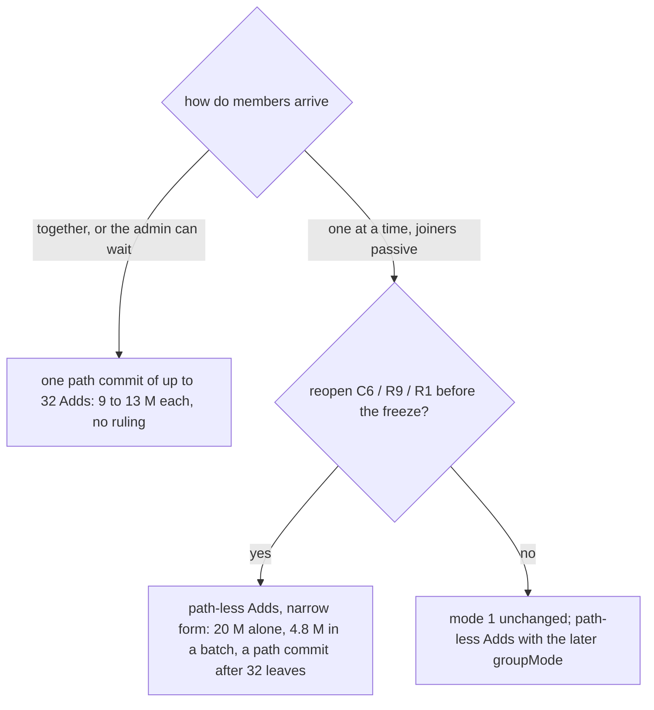

> **Research note — background and rationale only, not normative; the current rules are in docs/ (see decisions.md).**

# PqChat TreeKEM: path-less Add commits, what they save and what they break

Research of 2026-11-25 for the owner, who asked for a deeper study of the "membership log and path-less Adds" model
recorded at the end of `docs/research/2026-11-25-treekem-beyond-256.md` (on branch `review-fix-contract`, not committed
yet; cited "the 256 note"). The question: should a tree session (`groupMode = 1`) accept a commit of Adds only that
carries **no update path**, where the members derive the new epoch key from the previous one by a one-way step and
each joiner gets one Welcome wrap? Nothing here is built, specified or ruled. Every design below is a proposal and
**UNAUDITED** cryptographic design ([ARCH-POS-14](../decisions.md#ARCH-POS-14)). The rules this note works from are the
spec [`2026-11-23-pqchat-treekem.md`](../superpowers/specs/2026-11-23-pqchat-treekem.md) ("spec §n", rulings R1–R16,
calls C1–C40) and [`contracts/pqchat.md`](../contracts/pqchat.md) (CTR-CHAT-26, -27). R8 is taken at 512 leaves
(depth 9), the owner's last answer of 2026-11-25; the code and the spec at this tree still say 256.

Tags: **[F]** a fact with its source: the spec, the code at this tree, a measured row of plan T3d
([CTR-CHAT-27](../contracts/pqchat.md#CTR-CHAT-27), "Measured"), or RFC 9420 as fetched from rfc-editor.org for this
note. **[E]** an estimate made here: paper arithmetic on the spec's §13 rows and the measured rows; **no gas was run or
calibrated for this note**, and no row at depth 9 has been measured. **[I]** an inference. **[U]** a claim not verified
here; check it before relying on it.

**Contents**

1. [Summary](#1-summary)
2. [What RFC 9420 does](#2-what-rfc-9420-does)
3. [Gas: what goes, what stays, what comes later](#3-gas-what-goes-what-stays-what-comes-later)
4. [The key schedule change](#4-the-key-schedule-change)
5. [R9 and C23: does the ratchet bring the old failure back](#5-r9-and-c23-does-the-ratchet-bring-the-old-failure-back)
6. [Security, adversarially](#6-security-adversarially)
7. [The rules that do not bend](#7-the-rules-that-do-not-bend)
8. [Changes by layer](#8-changes-by-layer)
9. [Alternatives](#9-alternatives)
10. [Recommendation](#10-recommendation)
11. [Rulings needed and open questions](#11-rulings-needed-and-open-questions)
12. [Sources](#12-sources)

## 1. Summary

- **A path-less Add removes the path, not the record.** It drops the node keys, the path ciphertexts and their list:
  42.2 M of state gas at 256 keys, 47.4 M at 512 [E]. It keeps the signed record with its PQ signature checked in
  software and kept in state: about 15.9 M asked with ML-DSA-65, 21.2 M with ML-DSA-87 [E, spec §13]. So **one Add
  alone costs about 20 M asked, not 3.3 M**: 69 M → 20 M at 256 keys, 75 M → 20 M at 512 (3.4 and 3.7 times less).
  "About the Welcome only" holds for the **marginal** Add of a batch: about 4.3 M asked each [E].
- **In a batch the gain is small.** 32 Adds in one commit: 9.1 M per member today at 256 keys, 4.8 M path-less, and the
  next path commit then pays one ciphertext more per joiner (2.9 M), so 7.7 M against 9.1 M [E]. Path-less Adds pay for
  members that arrive **one at a time**; for members that arrive together, one path commit of many Adds already
  amortises the base.
- **One transaction holds 10 path-less Adds** with their Welcome wraps on a 60 M block (9 with an ML-DSA-87 author), at
  any depth. Today's path commit holds 2 at 16 keys, 1 at 64 and none from 256 up, where the commit alone is two
  transactions [E, §3.3].
- **The cost comes back at the next path commit:** one path ciphertext per joiner that has not committed yet, and up to
  d − 2 more where the Adds blanked warm nodes: for k path-less Adds, about k × 2.67 M of state gas (85.6 M at
  k = 32) [E]. Today's design pays that ciphertext in the Add's own commit **and again** in later commits while the
  joiner stays passive, so path-less Adds defer it once and skip the repeats [I].
- **Post-compromise security is what is given up:** whoever holds the chain secret of an epoch derives every path-less
  epoch after it, up to the next path commit. A contract counter bounds the run (proposal: 32 added leaves). A removal,
  a key change and an owed exit always need a path, and the code already refuses the path-less form there.
- **The controller's reading of R9 / C23 holds** (§5): a chain that exists only across path-less Add epochs and that
  every path commit restarts does not bring back the failure R9 removed. A path-less commit carries no ciphertext for
  an existing member, so nobody is locked out by its author. What it changes: a member that missed the last path commit
  waits for the next one, the run is as readable as its first epoch, and C12's confirmation needs a new reading.
- **Three owner rulings would be reopened, each narrowly:** C6's "every commit carries a path" (R7), R9 / C23 for the
  path-less case only, and R1's scope. The contract change is small (the walk skips the author's path, one counter).
  The client change is the larger part: the schedule, the replay, vectors in clientkeys and `ua-rs`, a Fable
  cryptography review.
- **Recommendation (a proposal, §10):** batching as the client default first, with no ruling. Path-less Adds as a
  mode-1 revision before the freeze only if the owner wants cheap one-at-a-time joins, in the narrow form of §4 and §8.

## 2. What RFC 9420 does

Read from the RFC text for this note [F].

- **Which commits may omit the path (§12.4).** "By default, the path field of a Commit MUST be populated. The path field
  MAY be omitted if (a) it covers at least one proposal and (b) none of the proposals covered by the Commit are of
  'path required' types." The types that do not require a path are `add`, `psk` and `reinit`; `update`, `remove`,
  `external_init` and `group_context_extensions` require one, and so does a commit with no proposal. The RFC calls the
  path-less form a "partial" Commit and says it "doesn't provide PCS with regard to the committer".
- **The key schedule (§8, Figure 22).** `joiner_secret = ExpandWithLabel(Extract(init_secret[n−1], commit_secret),
  "joiner", GroupContext[n])`, then `epoch_secret` under the same context, and `init_secret[n] =
  DeriveSecret(epoch_secret, "init")`. Without a path, `commit_secret` is "the all-zero vector of length KDF.Nh"
  (§12.4.1). So an RFC path-less epoch is a one-way function of the previous epoch's `init_secret` and the new
  GroupContext, and nothing else.
- **What the context binds (§8.1, §8.2).** The GroupContext holds the group id, the epoch, the tree hash and the
  `confirmed_transcript_hash`, a running hash over every Commit with its signature. Each Commit carries
  `confirmation_tag = MAC(confirmation_key, confirmed_transcript_hash)` (§6.1), and the `interim_transcript_hash`
  folds that tag into the next epoch. Two different commits on one parent therefore give different epoch secrets.
- **Unmerged leaves (§4.1.1, §4.2, §12.1.1).** An RFC Add does **not** blank the new leaf's direct path: it adds the
  leaf's index to the `unmerged_leaves` list of every non-blank ancestor. The resolution of a non-blank node is "the
  node itself, followed by its list of unmerged leaves", so later committers encrypt to that node and to each unmerged
  leaf below it. An UpdatePath that overwrites a node empties its list (§7.5). The tree hash covers the list (§7.8).
- **The Welcome (§12.4.3.1).** It carries the `joiner_secret`, encrypted to each new member, a `path_secret` only when
  the commit has a path, and the GroupInfo with the `confirmation_tag`. The joiner verifies the tag after it derived
  the epoch.
- **Security text (§16.6, §16.12).** Post-compromise security comes from members updating keys in commits with a path.
  A malicious insider can fragment a group with a malformed UpdatePath (§16.12); a path-less commit has no UpdatePath
  to malform.

**Where mode 1 already differs [F, spec §3, §5].** No unmerged leaves: an Add blanks the new leaf's direct path and the
added leaf is in the resolution of its own commit, so it gets a path ciphertext beside its Welcome wrap (C6). No `init`
chain: `joiner_e = H(commitSecret, …/joiner ‖ treeId ‖ epochId)` (C23, R9). No transcript hash and no confirmation tag:
the chain orders the transcript and `sealedInfo` confirms the key (C12). Every commit carries a path (C6).

## 3. Gas: what goes, what stays, what comes later

### 3.1 The parts of a commit

State gas per piece is the spec's §13 [E there]; the whole-commit sums match its rows (8.1 M + 8 × 5.27 M = 50.3 M at
256 keys; 39.7 M at 64). Regular gas is the spec's row or scaled from the measured rows (the record at its bounds
12.5 M and the completion fixture 8.11 M for 32 Adds give about 0.4 M per Add in one transaction) [E].

| Part of a commit | Regular | State | With a path-less Add |
|---|---:|---:|---|
| The record: its fixed part, a plain `sealedInfo`, the ML-DSA-65 verify in software (5.95 M) and its 3,309-B signature kept in state (5.39 M), the tree check of C7 | about 7 M | 8.1 M | **stays** (the tree check loses its path walk: under 0.3 M regular less [E]) |
| The same with ML-DSA-87 (8.86 M verify, a 4,627-B signature) | about 10 M | 10.1 M | **stays** |
| Node keys, one per level: 1,601 B, the `keyAt` slot, 32 B in the record | about 0.13 M | 2,596,410 | **removed** |
| Path ciphertexts, one per level on a warm tree: 1,648 B, its slot, 36 B in the list | about 0.11 M | 2,674,440 | **removed** |
| The path at depth 8 / depth 9, warm | 1.9 / 2.1 M | 42.2 / 47.4 M | **removed** |
| Per Add, the joiner's own part: the Welcome wrap (1,688 B and its slot: 2,680,560), `TreeAdd` and its wrap hash in the record (192 B: 293,760), the completion's slots (two leaf slots, `liveKey`, `keysOf`, `sessionsOf`, about one parent hash: 7 slots, 685,440) | about 0.4 M | 3.66 M | **stays** |
| Per Add today, the path ciphertext to the new leaf (C6: the added leaf is in the resolution) | 0.11 M | 2.67 M | **deferred** to the next path commit (§3.4) |

Two corrections to the figures the question started from [E]:

- The "fixed part of about 45 M at 256" is the path (42.2 M) plus the record's fixed bytes, without the kept signature.
  With the signature the plain warm commit is 50.3 M of state gas, 62.2 M asked, in two transactions (spec §13).
- The 256 note's "an Add is about 64 B, about 0.1 M gas" is low: `TreeAdd` has five words and one wrap hash, 192 B,
  0.29 M of state gas. The joiner's own part is 3.66 M of state gas, about 4.3 M asked, where the owner's 3.3 M counted
  the wrap and the leaf slots.

**What C7 still checks without a path [F for the code, I for the change].** Everything public: the session and
`treeId`, the head and `parentTreeHash`, the signature and the nonce, the author's live leaf, each Add (a blank leaf in
range, a UA that is not `gone`, `scheme == 1`, the `kemHash` against the registry, the admission check, not live, not
added twice, the three no-return sets of R16), `TREE_CHANGES_MAX`, `KEYS_PER_UA_MAX`, the rights of §9, `leaves`, and
the root after the Adds against the signed `treeHash`. What falls away is `_walkPath`: the filtered path, the
resolution of each copath child, the path length against `nodeKeyHashes`, the target count against `ctCount`, the
expected targets' hash. R12 holds as worded: nothing public is staged wrong.

### 3.2 Per commit and per member

Asked gas, (regular + state) × 1.05, a warm tree, an ML-DSA-65 author, all [E]. "Today" is a path commit that carries
the Adds; an ML-DSA-87 author adds 5.3 M per commit to every total.

| Adds per commit | Today, 16 keys (d 4) | Today, 64 (d 6) | Today, 256 (d 8) | Today, 512 (d 9) | Path-less, any depth |
|---:|---:|---:|---:|---:|---:|
| 1: total = per member | 46.2 M | 57.7 M | 69.3 M | 75.1 M | **20.1 M** |
| 10: total / per member | 110.8 / 11.1 M | 122.4 / 12.2 M | 134.0 / 13.4 M | 139.7 / 14.0 M | 58.5 / **5.9 M** |
| 32: total / per member | 268.9 / 8.4 M | 280.5 / 8.8 M | 292.1 / 9.1 M | 297.9 / 9.3 M | 152.3 / **4.8 M** |
| The same with ML-DSA-87, per member at 1 / 10 / 32 | 51.5 / 11.6 / 8.6 M | 63.1 / 12.8 / 8.9 M | 74.6 / 13.9 / 9.3 M | 80.4 / 14.5 / 9.5 M | 25.5 / 6.4 / 4.9 M |

The path-less figures leave out the ciphertext each joiner costs the next path commit, 2.9 M asked (§3.4). With it a
path-less Add is 23.0 M alone and 7.7 M in a batch of 32.

**The same members three ways [E]**, 256 keys (512 in brackets), k members that end in a warm, refreshed group:

| k members | One path commit each (today, as they arrive) | Path-less as they arrive, then one path commit | Wait, then one path commit of k Adds |
|---:|---:|---:|---:|
| 8 | 554 M (601 M) | 246 M (252 M) | 120 M (125 M) |
| 32 | 2,217 M (2,402 M) | 799 M (805 M) | 292 M (298 M) |

**The warm figure flatters today's Add [I].** A path commit pays one ciphertext for every leaf that has not committed
since it was added, unless a later commit from that leaf's own side set a node above it (C6 blanks the new leaf's path
and only the author's path is set again). In a group that one admin grows and whose joiners stay passive, the i-th
one-member commit carries about i leaf ciphertexts: 32 such Adds are about 528 path ciphertexts, 1.4 G of state gas,
where the warm table says 32 × 2.67 M. Path-less Adds pay none of them at Add time. This is the case the owner
describes ("a group is created by one user and members are added over time"), and there the saving is larger than the
table's 3.4 times.

### 3.3 How many Adds fit one transaction

A transaction fits when (regular + state) × 1.05 is within a 60 M block and its regular gas is under 2^24 (spec §13).
Record, pieces and completion in one transaction, a warm tree, each added UA new to the home (7 new slots) [E]:

| Tree after the Adds | Today's path commit, ML-DSA-65 | Today's path commit, ML-DSA-87 | Path-less Add commit, ML-DSA-65 | Path-less Add commit, ML-DSA-87 |
|---|---:|---:|---:|---:|
| 16 keys, depth 4 | 2 Adds (the plain commit asks 39.0 M) | 2 (44.3 M) | **10** | **9** |
| 64 keys, depth 6 | 1 (50.5 M) | 0: the plain commit fits alone (55.9 M) | **10** | **9** |
| 256 keys, depth 8 | none: the plain commit asks 62.1 M, two transactions | none (67.4 M) | **10** | **9** |
| 512 keys, depth 9 | none (67.9 M) | none (73.2 M) | **10** | **9** |

- The block binds, not 2^24: 10 path-less Adds ask 58.5 M with 11.0 M regular; 9 with ML-DSA-87 ask 59.6 M with
  13.7 M regular.
- More than that goes as today: the record with the first wraps, then `addWraps`, about 14 wraps per transaction [E].
  The last piece pays the completion (22 M of state gas and about 8 M regular at 32 Adds, from the measured fixture),
  so C37's rule becomes "hold one Welcome wrap back". 32 Adds are three or four transactions. Acceptance and completion
  of 32 Adds in one transaction were measured at 23.1 M regular, over 2^24, so 32 never go in one.
- Depth changes a path-less Add only through the hashes above the new leaf: under 0.05 M per level [E].

### 3.4 The cost later: the tree cools

Two ways to add a leaf without a path. **Variant A keeps C6:** the Add blanks the new leaf's whole direct path, as
today, and no author path sets the upper part again. **Variant B is RFC 9420's:** nothing is blanked and the leaf
joins `unmerged_leaves` of its non-blank ancestors.

For k path-less Adds before the next path commit [I for the counts, E for the gas]:

| | Variant A (C6 kept) | Variant B (unmerged leaves) |
|---|---|---|
| Extra path ciphertexts in the next path commit from outside the joiners | k for the leaves, plus one per warm node the Adds blanked below the committer's branch point: **at most k + d − 2** | **k** |
| In state gas (2,674,440 each; 2.9 M asked) | k = 1: 2.7 M to 21.4 M (24.1 M at 512); k = 8: 21.4 M to 40 M; k = 32: 85.6 M to 104 M | k = 1: 2.7 M; k = 8: 21.4 M; k = 32: 85.6 M |
| Appended at the right edge (the default: the leftmost blank leaf of a group that grows) | near k: the nodes above new leaves were empty; the right spine loses 1 to 3 warm nodes | k |
| Adds into holes left by removals, scattered | each Add costs a later committer up to d − 1 more targets, as one removal does today (the spec's "after one removal" row: +21.4 M at 256); bounded by the cold row | k |
| How long it lasts | for a committer on the joiners' side of a blank node, until a leaf under that node commits | until the nodes above the joiner are overwritten |
| Contract and hash | nothing new: `_resolve` and the tree hash as today | a list per parent in storage (up to d slot writes per Add) and in `TreeParent` (the tree hash and its typehash move), a new resolution rule; reopens C6's "no unmerged leaves" too |

**Compared with today [I].** Today's Add also blanks the new leaf's path (C6) and pays the leaf's ciphertext in its own
commit; every later path commit pays it again while that joiner has not committed (§3.2). So variant A does not add a
recurring cost. It moves the first ciphertext to the next path commit and blanks the one to three warm nodes that the
author's path would have set again. Variant B saves those at the price of a new tree-hash input and a second owner
ruling. **This note assumes variant A** below.

**The counter bounds it.** With at most 32 leaves added path-less since the last path commit (§6.1), the next path
commit carries at most 32 + d − 2 targets more than the tree before the run would have asked. Ciphertexts are pieces,
about 20 per transaction, so every reachable tree still has a next commit that fits (spec §13, fable-3) [I].

## 4. The key schedule change

A proposal, written with the spec's §5 notation (`H(ikm, info)` is HKDF-SHA-256, labels under the tree's prefix).

### 4.1 The derivation

```text
next_e      = H(S_e, "<prefix>/next")                      for every epoch, 0 included; kept in the epoch handle beside K_e
                                                           (RFC 9420's init_secret, §8)
a path commit, unchanged (C23):
joiner_e+1  = H(commitSecret, "<prefix>/joiner" ‖ treeId ‖ epochId)
a path-less Add commit, new:
joiner_e+1  = H(next_e, "<prefix>/add-joiner" ‖ treeId ‖ epochId ‖ hash(adds))
both, unchanged:
ctx_e+1     = keccak256(abi.encode(TAG_TREE_CONTEXT, treeId, epochId, epoch, parentEpochId, parentTreeHash, treeHash,
                                   keccak256(abi.encodePacked(admins))))
S_e+1       = H(joiner_e+1, "<prefix>/epoch" ‖ ctx_e+1)
K_e+1       = H(S_e+1, "<prefix>/key")
new, in the signed record:
confirmTag  = H(S_e+1, "<prefix>/confirm" ‖ ctx_e+1)
```

- **Bound to the previous epoch:** `next_e`, a branch of `S_e` apart from `K_e`. A leak of `K_e` or of a key derived
  from it (sender chains, `infoKey`, the hint) does not give the next epoch; only `S_e` or `next_e` does.
- **Bound to the commit:** `epochId` is `(sessionId, author, nonce)`; `hash(adds)` is the EIP-712 array hash of §6 (each
  Add with its leaf, UA, `keyId`, `via` and `kemHash`); `ctx` binds the parent's id and tree hash, the tree hash after
  the Adds (hence `leaves`) and the admin list. **Two Add children of one parent never share a key:** they differ in
  author or nonce, so in `epochId`; a twin under one id with other Adds differs in `hash(adds)` and `treeHash`.
- **Not bound: the whole record's hash.** `sealedInfo` and the Welcome wraps are sealed under keys from `S_e+1`, so the
  record cannot be an input: the same circle as C29's `genesisCtx`. Two records under one id that differ only in
  `sealedInfo` or `wrapHashes` share a key, as two path commits do today (codex-r3-2); the pin's comparison of the
  record that won covers it (spec §8 step 1).
- **One-way:** a joiner holds `joiner_e+1` and everything after it, not `next_e`, so it reads nothing before its join,
  as today.
- **The labels separate the two kinds.** A device decides which derivation applies from the signed record's shape
  (§8.1), never from a served hint.

### 4.2 The confirmation

The owner's recorded answer to risk 3 is a confirmation tag, as RFC 9420 has. Two forms:

- **(T1) A tag in the record:** `bytes32 confirmTag` in `PqChatCommit`, computed as above, checked by every member and
  by the joiner before `sealedInfo` is opened. It commits to `S_e+1`. C12 refused a tag because it "would sit outside
  the signed record"; inside the record it has a construction order (`ctx` and `S` need neither the tag nor
  `sealedInfo`), and the commit typehash moves.
- **(T2) `sealedInfo` alone, as C12 today:** no record change. It confirms that the author held `K_e+1`. The gap [U]:
  AES-256-GCM-SIV does not commit to its key, so an author that knows two keys can, on the published attacks on AEADs
  without key commitment, build one `sealedInfo` that opens under both. A malicious admin could then hand a joiner a
  wrong `joiner` that still passes the joiner's only check. Today's joiner is protected by a second source: its path
  ciphertext and the node keys it derives against the signed `nodeKeyHashes`. A path-less joiner has no such source.
  The effect would be a joiner cut off without knowing, no disclosure. Not verified for this AEAD and this message
  shape.

**Proposal: T1.** It is the owner's recorded answer, it gives the joiner a commitment that does not rest on an AEAD
property, and it makes a failed check at an old member unambiguous (§5).

### 4.3 Catching up from state alone

A device needs nothing but contract state and its own keys [I]:

- **A member through a run.** It holds `S_p` of the last path commit `p` it followed (from its path ciphertext, or from
  its own seed for its own commit). For each path-less epoch after `p` it reads the record, which the forward walk
  (C25) reads anyway, and derives. No ciphertext and no wrap is read: the read schedule stays fixed by public data
  (C22).
- **A joiner of a path-less epoch `j`.** `wrapAt(epochId_j, wrapIndex)` → `joiner_j` → `S_j`, the tag, `sealedInfo`;
  then forward by `next`. At the next path commit it opens the ciphertext sealed to its leaf: every node above a
  path-less leaf is blank, so the leaf itself is the target.
- **A device that did not follow epoch `e`** cannot derive the path-less epochs above `e`. It follows again at the
  next path commit whose target on its side is its leaf or a node it holds, or by a path commit of its own, as today
  (§5).
- **A device that restores** replays the same steps from the session record; the seed gives its own path commits, the
  chain gives the runs between them.
- **The author's device** must have followed the head to build a path-less Add: it needs `next_e`. A device that is
  "not followed" at the head builds a path commit instead, which needs no epoch secret.

### 4.4 Losing children and replicas

- **A tree session has no replica** (C4), so "a replica stores every child" does not arise in mode 1. It would arise
  for derived-key Adds in mode 0 (the 256 note's option a2), where the binding of §4.1 is needed for the same reason.
- **A staged child that loses the slot.** Its Welcome wraps may already be in state. Its joiners hold
  `joiner_L = H(next_e, … ‖ epochId_L ‖ hash(adds_L))`, which is independent of the winner's `joiner_W` under the usual
  PRF assumption on HKDF with distinct `info` [I]. They read neither the winner nor the parent.
- **A path-less Add that fits one transaction completes in it,** so it is never staged: 10 Adds or fewer (§3.3).

## 5. R9 and C23: does the ratchet bring the old failure back

**The controller's reading:** R9 dropped the `init` chain because a member that misses one epoch, or one commit with
bad ciphertexts, would be locked out for good. A path-less Add carries no ciphertext for an existing member, and a
member holding the previous secret derives the next one from the on-chain record alone. So a chain that exists only
across path-less Add epochs and that every path commit restarts may not bring R9's failure back.

**It holds [I].** The two failures the spec names for C23 (fable-4, codex-18):

| R9's failure | With the chain only across path-less epochs |
|---|---|
| One member's commit of bad ciphertexts to everyone leaves nobody but itself able to continue: the session is lost | A path-less commit has no ciphertext for a member. `S_e+1` is a function of `next_e` and the signed record, so every member that followed `e` follows `e+1` whatever its author did. The author cannot split or lock the group. A path commit still stands alone (C23 unchanged), so a bad path commit is healed by the next honest path commit, as today |
| A member that misses one epoch misses every later one | It misses the path-less epochs of that run only. The next path commit that reaches its leaf, or its own path commit, brings it back. The run is bounded by the contract's counter (§6.1) |

**What it still changes or breaks:**

1. **Healing waits for a path commit.** Today every commit is a path commit, so each Add was also a chance to follow
   again. A member that missed path commit `p` now sees up to a whole run as "not followed". The spec's sentences
   "follows again at the next commit that reaches its leaf" (R9, §10) must say "path commit".
2. **A bad path commit lasts longer.** An insider's garbage path commit at `p` followed by path-less Adds keeps its
   victims out for the run; a user-asked refresh still heals each of them at once.
3. **R10 changes for these epochs, mostly for the better.** In a path-less commit the author's signature no longer
   fixes the key: a stolen UA signing key without the epoch state gets a record accepted but cannot read the epoch it
   made, where today it reads at once. The leaf it added is a target of the next path commit, so the reconciliation of
   the roster (codex-r3-3) is still needed.
4. **C12 needs a new reading.** Today "`sealedInfo` does not open" means "this device did not follow". For a path-less
   epoch a device that followed the parent **has** the key by construction; a tag or a `sealedInfo` that fails means
   the **author** did not hold the epoch or sealed it wrong. That is a state of its own: shown to every member, naming
   the added leaves, with a path commit offered to the user. The epoch key stays the chain's, so one author cannot stop
   the group with it. Every member sees it, not only the author's own device as with today's compromise warning.
5. **The own-commit test of R10 has no path to compare** for a path-less commit of the device's own `(ua, keyId)`: the
   test is the tag (and `sealedInfo`), as for the last live leaf today (codex-r3-4).
6. **The run is as readable as its first epoch.** A leak of `S_e` or `next_e` opens every path-less epoch after `e`
   (§6.1). Of the four things the spec lists for the RFC's chain (§5, fable-r2-1), this brings back only the fourth,
   and only inside a run: a path-less commit is useful only to one who knew the previous epoch.

**How narrow the reopening can be.** R9 and C23 stay as worded for every commit that carries a path. One sentence is
added: a commit of Adds only may carry no path; its joiner secret then derives from the parent epoch's `next` secret
and the commit's context, and the chain so formed ends at the next commit with a path. Two more rulings are touched
whatever the wording: **C6's last clause, "every commit carries a path" (owner, R7)**, and **R1's scope** ("a commit
with UpdatePath, Add and Remove"). C6's "no unmerged leaves" and "an Add blanks the new leaf's direct path" stay under
variant A.

## 6. Security, adversarially

### 6.1 Post-compromise security

- **The exposure.** An attacker that holds `S_e` or `next_e` derives the key of every path-less epoch after `e`, up to
  the next path commit, joiners' messages included. `K_e` alone does not give it (§4.1).
- **Against today.** In mode 1 as specified, a leak of an epoch's keys opens that epoch and nothing later; a leak of
  node secrets lets the holder follow until a commit from under the lowest leaked node (spec §14); a leak of the
  `kemSeed` opens everything until the key is removed (R4). Leaves are registry keys and are not refreshed (C5), so a
  path commit never healed a seed leak. What path-less Adds give up is the fresh entropy every Add brought as a side
  effect, not a guarantee the design promised per Add.
- **In time, nothing changes.** No commit is automatic (C22): today an epoch whose key leaked lasts until some user
  commits. A run of path-less Adds lasts as long.
- **Bound by count (proposal).** A counter per session, `sincePath`: the leaves added without a path since the last
  commit with one. A path-less Add is refused when `sincePath + adds.length > PATHLESS_ADDS_MAX`; a path commit sets it
  to 0. Proposed value 32 (`TREE_CHANGES_MAX`): it also caps the ciphertexts deferred to the next path commit (§3.4).
  The author's client then builds a path commit, with the Adds in it.
- **Bound by time: the client's hint, not the contract's.** No tree rule reads the clock today (the exit lag counts
  epochs). A contract rule on `block.timestamp` would be the first; the client can show "n days since the last
  refresh" and offer one, never send it itself (C22, CLI-PQC-07).
- **"A path is required when the author's own leaf is old":** not proposed. The secret at risk is the group's chain
  secret on any member's device, not the author's; a rule on the author's last path commit does not bound it, and it
  adds a per-UA epoch to state and to the walk.

### 6.2 Forward secrecy and exclusion

- **A joiner reads nothing before its join:** the derivation is one-way, as in the RFC.
- **Against a later device or seed leak** nothing changes: mode 1 keeps every epoch recoverable from the seed (R4).
- **A removal must keep its path: confirmed.** The removed member knows `next_e`; a path-less step would hand it
  `S_e+1`. The same holds for a UA's own key taken out, and for the commit that honours a `treeLeave` or `treeRemove`.
  RFC 9420 says the same (§12.4: `remove` and `update` are path required).
- **Exits under E-3 between path-less Adds.** An exit lands on the head, which may be a path-less epoch; the UA is
  `gone` and its leaves are owed. The code as built already refuses a path-less commit there: without Removes the
  commit's count of owed leaves is 0, which differs from the head's `owed` (`PqChatRemovedKept`, `_walkJudge`) [F]. A
  path-less Add staged when the exit lands fails completion's step 1, as any staged commit. The exited UA reads the
  head until the honouring path commit, as today (sc-F-9), and derives nothing after it. One case needs a rule: a
  `gone` admin with no leaf (an `msig`) leaves `owed` at 0 and must still be dropped from `admins`; a path-less Add
  keeps the head's list, so it is refused while a head admin is `gone`.
- **R16's key sets.** A path-less Add runs the same Add checks (`gone`, `goneKey`, `goneOwnKey`, `liveKey`). It has no
  Remove, so it writes no key-set entry and judges no level. Replacing a UA's only key (a Remove and an Add in one
  commit) keeps its path.

### 6.3 A malicious or careless author

- **A wrong key to a joiner.** The contract cannot check a Welcome, as today. With the tag (T1) the joiner sees it: its
  tag fails, the epoch is "not followed" for that device, and the next path commit reaches its leaf. A denial of
  service on that joiner, no disclosure. The author cannot aim a consistent false view at a joiner and a true one at
  the members: there is one tag and one `sealedInfo` in the signed record.
- **A wrong tag on purpose.** Members keep the chain's key and see "the author did not hold the epoch" (§5 item 4).
  It costs the author a record and stops nobody.
- **An admin adds a party it should not.** An admin's right, as today; the review, the freshness rule of R13 before an
  Add and the warning of R16 (CLI-PQC-17) are unchanged.
- **A stolen UA signing key.** §5 item 3: weaker than today for the path-less form.

### 6.4 Front-running and races

- **Two Adds on one head:** one child per parent; the loser rebuilds. A path-less loser lost about 20 M, not a path.
- **Voiding an exit (C9) gets cheaper.** A front-runner must complete 17 epochs before an exit lands. With path-less
  Adds an epoch costs about 20 M asked instead of 62 M (256 keys) [E]. Who can use it: an admin, which can already
  front-run another admin (the spec's "equal power between admins"), and it needs a registered UA with a KEM key per
  Add; a non-admin only for keys of its own UA, at most 7 before `KEYS_PER_UA_MAX`, each a fresh registry KEM version
  (R16's pair set refuses a key it took out). C9's argument rests on the ratio between 17 epochs and one re-signed
  exit, which stays above 17 records to one. A tighter option: also cap the path-less **commits** of a run below
  `EXIT_LAG_MAX`. Left to the owner (§11).
- **A copied record or piece:** anyone may already send a signed record or a wrap (CTR-CHAT-19); nothing new.

### 6.5 Denial of service by cheap Adds

- **Tree size:** `TREE_LEAVES_MAX`, `TREE_CHANGES_MAX` per commit and `KEYS_PER_UA_MAX` per UA hold as today. A
  path-less commit needs at least one Add, every Add needs a registered key that is in no no-return set, and a leaf is
  freed only by a Remove, which needs a path. So cheap epochs cannot be looped.
- **C21:** `owed` is unchanged; a path-less Add is refused while anything is owed (§6.2).
- **A fresh restore's walk** grows by one record per epoch, as today (sc-E-8); a path-less epoch is cheaper to make
  than a plain commit at 256 keys (20 M against 62 M) and dearer than one in a small tree.
- **State growth:** one record and one wrap per Add, less than today's.
- **Relayers:** the node's whole-set guard applies to the record and its wraps (§8.2).

### 6.6 What only clients can check

That the Welcome opens to the chain's joiner secret; that the tag and `sealedInfo` match the derived key; the
derivation itself. The contract checks every public part at acceptance (§3.1). That is the same split as today, with
one check fewer on the client side: a path-less commit has no node key to compare with a path secret.

## 7. The rules that do not bend

| Rule | Where it holds |
|---|---|
| Never lose ciphertext | A path-less commit has one kind of ciphertext, the Welcome wrap, kept in state under `wrapAt` as today; the record with its signature is kept whole. Nothing that is in state today leaves it |
| No decryption oracle ([ARCH-POS-13](../decisions.md#ARCH-POS-13)) | An old member decrypts nothing for a path-less epoch: a KDF over its own secret and public data. The joiner opens one Welcome wrap under scheme 1 and reacts with no write (C22). A failed tag or `sealedInfo` is shown and nothing is sent. Fewer openings than today, none added |
| State-only recovery (CTR-CHAT-14) | §4.3: the records the forward walk reads anyway, the device's own Welcome wrap or path ciphertext, its keys |
| Explicit typed records | One typed field more (`confirmTag`) under T1; the path's absence is the signed, named, empty `nodeKeyHashes` with `ctCount` 0, or a named flag if the owner prefers (§8.1) |
| Every state-changing write relayable, fee 0 too | The same `commit` and `addWraps` entries, sent by anyone (CTR-CHAT-19) |
| One rule on every chain | The bound is a count of leaves; no clock, no block size, no chain kind |
| Authorization in contracts; fail closed | Rights, the counter, `owed`, the admin list and the no-return sets are the contract's; a refusal is a named error |
| The node is open | The whole-set guard and the piece order are the node's, for every consumer |

## 8. Changes by layer

All proposals. No count of lines was measured; "small" is a reading of the code at this tree.

### 8.1 The record

- **The shape.** Today a commit with at least one Add, no Remove, an empty `nodeKeyHashes` and `ctCount` 0 is always
  refused: the walk finds a path, because the added leaf is a target (`PqChatTreeTargets`) [F, `_walkPath`]. So that
  shape is free and can **be** the path-less Add, with no flag. The last live leaf's commit (an empty path, no Add
  that survives the walk) keeps today's meaning.
- **The alternative: a named flag** (`bool pathless`, or a `uint8` kind) in `PqChatCommit`. It says nothing the shape
  does not say and must be checked against it. Worth it only if the owner wants the kind named in the signer's typed
  data.
- **`admins`** in a path-less commit must equal the head's list: an admin change keeps its path, since it is often
  paired with a removal and it keeps the rule simple.
- **Does the typehash move?** With T1 (`confirmTag`) yes: `COMMIT_TYPEHASH`, its pin, every tree vector row with a
  commit. With T2 and the shape rule, no typehash, entry, selector or ABI moves.
- **C40** needs no change: `addPath`, `addPathList` and `addPathKeys` are never valid on a path-less commit (no list is
  expected), and they stay non-empty for path commits.
- **C37** reads "hold one Welcome wrap back" for a path-less commit sent in several transactions.

### 8.2 Contract, node, clients, vectors

| Layer | Change |
|---|---|
| `PqGroupTree` | `_treeCheck`: for the path-less shape, no Remove, `admins` the head's with no `gone` UA, the counter, and **no `_walkPath`** (the author's direct path is not blanked, no target is expected). `_treeApply`: the counter. `Tree` gains `uint32 sincePath`, which fits the slot of `used`, `leaves` and `owed` [F: 96 of 256 bits used]; the layout pin gains the field. No new hook unless the bound is the inheritor's (then `_treeBounds` gains a value) |
| `PqChatTree` | none for the shape: `Epoch.wraps` is already `adds.length + 1` when `ctCount` is 0, and `commit` and `addWraps` already complete such an epoch [F]. With T1 the struct and `hashCommit` gain the field |
| Size, gas | `PqChatTree` is 32,812 B today; the change is small. New gas rows (a path-less Add of 1, 10 and 32; the next path commit after 32) and their pins; no existing pin moves unless the typehash does |
| Tests | negatives that can fail: a Remove with an empty path, `owed > 0`, a `gone` head admin, the counter at its bound and one past it, a changed admin list, a path piece sent to a path-less epoch; a positive control each; mutants on the skipped walk and the counter |
| Node | no new row or selector; `typed.rs` bounds as today (and the field under T1); the whole-set guard on the record and its wraps; the order of C37 as read above. No job shape changes, so no note for operators |
| clientkeys, `ua-rs` | `next` in the epoch handle; building a path-less Add (a named choice of the commit-signing operation, with a review line "adds without refreshing the group's keys; n of 32 since the last refresh"); processing as a member, as a joiner and as the author; the forward walk's `apply` and bounds for the shape, with the counter; the new state "author did not hold the epoch"; the planner's order. No key byte leaves `ua-rs` |
| `scaas-sdk`, `pqchat-core` | the planner and its quote for the path-less form; the choice offered to the user with both prices; the hint after a long run; the fallback to a path commit when the device did not follow the head or the counter is full |
| Vectors | `smartcontracts/vectors/pqchat/tree.json` regenerated by its generator: a path-less Add (build, member, joiner, author), two children of one parent with different keys, a bad Welcome, a bad tag, the counter, a run followed by a path commit, a device that missed the run. Read by clientkeys, `ua-rs`, the forge tests and the node [F]. Under T1 every commit row moves |
| Docs | a spec revision (§3, §5, §8, §9, §10, §13, §14), `contracts/pqchat.md`, `clients/pqchat-core.md`, entries in `decisions.md` for each ruling |
| Review | a Fable design, security and cryptography review of the revised schedule; an audit unit. The code is `UNAUDITED` either way |

### 8.3 A mode-1 change or a new `groupMode`

**Before the freeze it fits mode 1 [I].** Nothing is live, every chain is test-only and mode 1 is unreleased, so a
revision of its commit rules and schedule needs no migration. A session created under the revised rules and one
created before differ in nothing a member must carry over. **After the freeze it would be a new `groupMode`:**
contracts are immutable, a path-less record is refused by the old code, and an old client would reject the new
derivation. Values 2 and 3 are reserved for the off-chain variants (owner 2026-11-25), so it would take the next one.

## 9. Alternatives

- **Batching Adds in one path commit (no ruling, no code in the contract).** One base for up to 32 members: 9.1 M per
  member at 256 keys against 69 M alone (§3.2). It keeps a path on every commit, so every rule and review stands. Its
  limit is the wait: joiners enter when the admin commits, and it does nothing for a single late joiner. The pending
  list is the admin's client's (`pqchat-core`), never the contract's.
- **RFC 9420's external commit (§3.3, §12.4.3.2).** The joiner adds itself with a commit of its own, from the group's
  public state and an `external_pub` key. It is "path required" (`external_init`), so it costs a whole commit and only
  moves the bill to the joiner. It needs the group's consent in another form, since mode 1 lets only an admin add a UA
  (§9, C8), and R1 puts it out of scope. No gain here.
- **Add by reference: proposals (§12.1, §12.4).** Members or joiners post Add proposals; a committer commits many by
  reference. On chain each proposal is a signed record of its own, so about the cost of a path-less record, and the
  commit still carries a path. It is batching with the queue in state instead of in the admin's client. It may matter
  for slot contention in very large groups (the 256 note), not for cost.
- **Sender keys (Signal's groups, Megolm) [U, from memory].** Each member has a chain of its own and a newcomer is
  handed the current keys; nothing is re-keyed on an Add, and a removal re-keys everything pairwise. On chain, handing
  a newcomer the group's current key is one wrap: that is the path-less Add, and mode 0's derived-key Add (the 256
  note's a2). Sender keys give no post-compromise security until a full rotation, which costs n wraps. So the
  comparison supports the path-less Add as the cheap half and the tree's path commit as the cheap rotation.
- **Making the record cheaper** (not proposed here): the record's 15.9 M is the PQ signature, 5.95 M to verify in
  software and 5.39 M to keep. A verify precompile, where a chain has one, lowers the first; C1 keeps the second.

## 10. Recommendation

A proposal; nothing is ruled.

1. **Batching first, as the client default, with no ruling.** "Add in batches" is already what the SDK and
   `pqchat-core` are to offer (T5, T6). It gives 13.4 M per member at 10 and 9.1 M at 32 (256 keys), with a path on
   every commit.
2. **Path-less Adds only if the owner wants cheap one-at-a-time joins, and then in the narrow form:**
   - Adds only: no Remove, no admin change, nothing owed, no `gone` admin at the head;
   - C6's blanking kept (variant A): no unmerged leaves, no change to the tree hash or the resolution;
   - the schedule of §4.1 with the tag T1;
   - a contract counter of 32 leaves since the last path commit, and a client hint on time;
   - the rights of §9 unchanged;
   - done as a mode-1 revision before the freeze, with new vectors and a Fable cryptography review before the code.
3. **What it buys, stated without the round figure:** a single Add at 20 M asked instead of 69 M (256 keys) or 75 M
   (512), no path ciphertext per passive joiner at each Add, and 10 members in one transaction. **What it costs:** no
   fresh entropy at an Add, a run that is as readable as its first epoch, three owner rulings reopened, a second
   derivation in two client implementations.
4. **If the owner wants no ruling reopened before the freeze:** keep mode 1 as it is, ship batching, and take path-less
   Adds into the later `groupMode` work, where the record changes anyway.



## 11. Rulings needed and open questions

Each is a proposal for the owner; none is ruled.

**Rulings that would be reopened:**

1. **C6 (owner, R7), last clause:** "every commit carries a path" → a commit of Adds only may carry none.
2. **R9 / C23 (owner):** kept for every commit with a path; for a path-less Add the joiner secret derives from the
   parent epoch's `next` secret, and that chain ends at the next commit with a path (§5).
3. **R1 (owner):** the minimal scope gains the path-less Add.
4. **R10 (owner):** its wording, for these epochs: a path-less commit proves more than a signature (§5 item 3).
5. **Controller calls to reword if the above is ruled:** C12 (the confirmation and the new state), C37 (the held
   wrap), C24 (the shape), and a new call for the counter.

**Open questions:**

1. **Is the one-at-a-time case worth it?** If members mostly arrive in batches, batching alone gives most of the
   saving and no ruling moves.
2. **The bound:** 32 leaves since the last path commit? Smaller (16, the exit lag) trades gas for a shorter run. Also
   cap the number of path-less commits per run, against the cheaper voiding of an exit (§6.4)?
3. **The confirmation:** a `confirmTag` field in `PqChatCommit` (the typehash moves, every commit vector moves), or
   `sealedInfo` alone with the residual of §4.2 (no record change)?
4. **The signal:** the empty path as the signal (no flag), or a named flag in the record?
5. **Who may:** the rights of §9 as they are (a member adds keys of its own UA path-less, an admin any UA), or admins
   only?
6. **When the tag fails:** members keep the chain's key and show a warning, as proposed, or treat the epoch as not
   usable until a path commit? The second lets one admin stall the group for the price of a record.
7. **Variant B (unmerged leaves)** is not proposed; say so if RFC 9420's own form is preferred. It reopens C6's first
   clause and moves the tree hash.
8. **Mode 0's derived-key Add** (the 256 note's a2) would use the same derivation with a per-replica binding; in or
   out of this round?
9. **May the rows be measured** once a form is chosen (a path-less Add of 1, 10 and 32; the next path commit after a
   run; the depth-9 rows, which do not exist yet)? A gas run, so it waits for the owner's word.

**Not verified in this note [U]:** every figure at depth 9; the regular gas per Add (0.36 to 0.5 M in the measured
rows, 0.4 M used); the key-commitment gap of T2 for AES-256-GCM-SIV in this message shape; the cost of a record signed
by a classical UA kind; the sender-keys description. The counts of §3.2's passive-joiner case and of §3.4 were worked
by hand on the tree rules, not run against clientkeys.

## 12. Sources

- Spec [`2026-11-23-pqchat-treekem.md`](../superpowers/specs/2026-11-23-pqchat-treekem.md): R1, R7, R9, R10, R12, R14,
  R16; C5, C6, C7, C9, C10, C12, C17, C20, C21, C22, C23, C24, C25, C26, C29, C33, C37, C38, C39, C40; §3 (deviations),
  §4, §5 (the schedule), §6, §8 (acceptance, pieces, completion), §9, §10, §13 (the rows used in §3), §14.
- [`contracts/pqchat.md`](../contracts/pqchat.md): CTR-CHAT-26, CTR-CHAT-27 with the rows measured in plan T3d, §17.
- `docs/research/2026-11-25-treekem-beyond-256.md` (branch `review-fix-contract`, not committed): "The membership log
  and path-less Adds", "The risks of path-less Adds", the owner's answers of 2026-11-25.
- Code at this tree: `smartcontracts/evm/src/pqgroup/PqGroupTree.sol` (`_treeCheck`, `_walkAdds`, `_walkJudge`,
  `_walkPath`, `_resolve`, `_treeApply`, `struct Tree`), `src/pqchat/PqChatTree.sol` (`_accept`, `_done`, the pieces),
  `test/pqchat/PqChatTreeGas.t.sol` (the pins), `clients/ua-rs/src/wallet/tree.rs` (`joiner_secret`, `schedule`,
  `info_key`, `finish`), `clients/clientkeys/src/treekem.js` (`joinerSecret`, `schedule`), `scaas-node/src/typed.rs`
  (the tree rows and bounds).
- RFC 9420, "The Messaging Layer Security (MLS) Protocol", fetched from rfc-editor.org on 2026-11-25: §3.3, §4.1.1,
  §4.1.2, §4.2, §6.1, §7.5, §7.7, §7.8, §8 (Figure 22, Table 4), §8.1, §8.2, §12.1.1, §12.4, §12.4.1, §12.4.3.1,
  §12.4.3.2, §16.6, §16.12.
- [U] Key commitment of AEADs: Len, Grubbs, Ristenpart, "Partitioning Oracle Attacks" (USENIX Security 2021);
  Albertini, Duong, Gueron, Kölbl, Luykx, Schmieg, "How to Abuse and Fix Authenticated Encryption Without Key
  Commitment" (USENIX Security 2022). Cited from memory, not re-read for this note.

## Owner, 2026-11-25: the path-commit bound

The owner chose **24** for the bound of path-less Adds ("Ok, ghi 24 vào research note"), if path-less Adds are built: at most 24
leaves added by path-less Adds since the last path commit; the next commit must then carry a path. The controller's figures
[E] at 256 keys: a forced path commit about 115-140 M asked over three transactions (its base 45-62 M plus about 2.9 M per
joiner that has not committed), about 0.5-0.6 M more per member than a bound of 32 (16: about 1.4-1.9 M more), and the window
without post-compromise security at most 24 leaves. 24 equals the `TREE_CHANGES_MAX` the 512-leaf measurement may ask for;
the two constants stay independent. Whether path-less Adds are built at all, and R9 / C23's narrow reopening, are still the
owner's open questions.

## The two inputs of the key schedule, and the trade-off of using both (controller, for the owner, 2026-11-25)

RFC 9420 derives each epoch from two inputs: (1) the previous epoch's `init_secret` (a chain across epochs) and (2) the
commit's own `commit_secret` from its path (0 for a commit of Adds only). Three ways to use them:

| Way | Inputs | Where |
|---|---|---|
| A path commit today | (2) only | this design (R9 / C23) |
| A path-less Add (proposal above) | (1) only, `commit_secret` = 0, the chain reset at every path commit | RFC 9420's Add-only commit |
| Full RFC 9420 | (1) and (2) on every commit | RFC 9420 |

**A faulty commit under (2) only (today).** An author X sends a wrong path ciphertext to the subtree of member M (a bug or
on purpose; the contract cannot open ciphertexts, C7 checks only the shape). M sees it (the derived keys do not match the
signed `nodeKeyHashes`, or `sealedInfo` does not open) and marks the epoch not followed. M lacks the new keys set on X's
path from their common ancestor up, but keeps the keys of its own subtree, which the faulty commit did not touch. The next
commit by Y depends only on Y's new secret: if Y encrypts to a node M still holds, M follows again and reads on; if Y
encrypts to a node the faulty commit set, M waits one more commit. Two ways always end it: M commits once itself (it chooses
its path secret), or an admin removes X, which blanks X's path and its poisoned nodes so later commits reach M's own nodes.
M loses only the epochs in between, never the rest (R9: "a member that misses an epoch follows again at the next commit
that reaches its leaf, or by a commit of its own").

**The same fault under (1) and (2) (full RFC 9420).** Every later epoch needs the key of the one before, which M never had,
so M derives no later epoch even when later commits reach it correctly: M is out for good until a new Welcome. That is why
R9 dropped the chain for path commits.

**What (1) and (2) together would buy.** A commit would prove that its author knew the previous epoch, so a stolen UA
signing key alone could not build the next epoch (R10's lost point (4) back). The trade-off: security against a stolen
signing key, against robustness to one faulty commit.

**A path-less Add under (1) only** carries no ciphertext for the existing members, so there is no faulty ciphertext that
could break the chain: whoever holds the old key derives the new one; only a joiner's Welcome can be wrong, and the
`confirmTag` shows it. Path commits stay on (2) alone, so the chain is short and reset at each one.

Open for the owner: keep (2) alone for path commits (today, R9) with (1) only for path-less Adds, or move every commit to
(1) and (2) (a wider reopening of R9 / R10, with a re-Welcome path for members a faulty commit cuts off).

**Who loses what, by way (controller, for the owner, 2026-11-25):**
1. **(2) only, path commits today:** a faulty ciphertext costs a stretch of epochs, and only to the members under the node
   it was sent to: the faulty epoch, and maybe a few after it until a commit reaches a node they still hold or they commit
   themselves. Everyone else loses nothing.
2. **(1) and (2), full RFC 9420:** the members under the node the faulty ciphertext was sent to are locked out for good
   (until a new Welcome). How many is the author's choice: one leaf, one member; a mid-level node, every leaf below it (4,
   16, ...); the top level, about half the group; garbage to every copath node, the whole group but the author (the "session
   lost" case R9 avoids).
3. **(1) only, a path-less Add:** no existing member loses any epoch, since none is sent a ciphertext; only a joiner can
   be hurt, by a wrong Welcome, which the `confirmTag` shows, and a new Welcome fixes. Whoever thinks the group unsafe (an
   admin or a member) makes a path commit at any time, updating its own leaf at its own cost; the contract forces one after
   at most 24 path-less leaves. Removals and periodic updates stay path commits on (2) alone, with point 1's property.

**If nobody pays for the path commit (the owner's question, 2026-11-25: "what if nobody, not even an admin, pays?").** The
bound of 24 forces nobody to pay; it only stops further cheap Adds: after 24 path-less leaves the contract refuses a 25th
path-less Add, while messages, leaves and removals go on. Whoever wants the 25th member makes a path commit (the Add with a
path) and pays the refresh: usually the admin who is inviting. If nobody adds and nobody updates afterwards, the group keeps
the derived key and lacks post-compromise security, and a holder of a leaked old key reads until a path commit; but that is
true of the design today too, where nothing forces a periodic update and an epoch key stands as long as nobody commits. The
bound limits how many members join within one run without a refresh, not time. Refreshes that need nobody's initiative:
every removal (a path commit), the 25th Add, and each joiner's own first commit. Possible additions (proposals): a client
warning ("the group key has not been refreshed for X days"); refresh commits sponsored with a fee of 0 by a relayer or the
app's operator (every `mtx*` is relayable at fee 0). The contract cannot force by time (no tree rule reads the clock) and
cannot make anyone pay; it can only refuse what would widen the window.

## The owner's direction, 2026-11-25 (not ruled yet)

"Có lẽ sẽ chọn Add không path, nhưng nới việc commit có path: chỉ là option khi tạo session, không bắt buộc. Có cảnh báo ở
client (admin) cần commit có path." The owner leans to path-less Adds, with the forced path commit made a **session option
at creation**, not a protocol rule, and a client warning to admins that a path commit is due.

The controller's reading of the consequences:
- a field in the signed session record, e.g. `pathRefreshBound`: 0 = never forced, N = after N path-less leaves the next
  Add must carry a path; the session typehash moves (all chains are test-only today);
- with 0, a holder of a leaked old key reads every Add epoch until someone makes a path commit; the client warning is the
  only guard;
- removals and leaves still always end in a path commit.

Open before anything is built:
1. reopen R9 / C23 narrowly (a chain only across path-less Adds), C6's "every commit carries a path", R1's scope;
2. `confirmTag` as a record field (the commit typehash and vectors move) or `sealedInfo` alone (AES-GCM-SIV does not
   commit to its key: the tag is advised);
3. who may make a path-less Add: §9's rights, or admins only;
4. mode 0 and PqVault too, or mode 1 only;
5. when: (a) before the freeze as a mode-1 revision (spec, a Fable spec review, code, vectors, review, audit), or (b) after
   it as a new `groupMode`; either way after the review-fix round and PR #30, as its own round.

**Owner, 2026-11-25 ("Ok, theo §9, chỉ mode 1, làm sau PR #30"):** path-less Adds are to be built **in mode 1 only**, with
**§9's rights** (an admin adds anyone; a member adds keys of its own UA, at most `KEYS_PER_UA_MAX`), the forced path commit a
**session option at creation** (`pathRefreshBound`, 0 = never forced), a client warning to admins when a path commit is due,
**as its own round after PR #30** (on `dev`, before the freeze): spec (R9 / C23 narrow reopening, C6, R1, C12), a Fable spec
review, contract, ua-rs / clientkeys key schedule, vectors in every language, mutants, a Fable code review. Still open, at
the spec: `confirmTag` as a record field (advised) or `sealedInfo` alone; the measurement (owner's word, a quiet machine).
**Owner, 2026-11-25 (the warning):** with `pathRefreshBound` = 0 the contract forces nothing and the client warns the
admins that a path commit is due **after 24** path-less leaves since the last path commit; with N > 0 the contract refuses
the (N + 1)-th path-less leaf and the client warns as N comes near.
