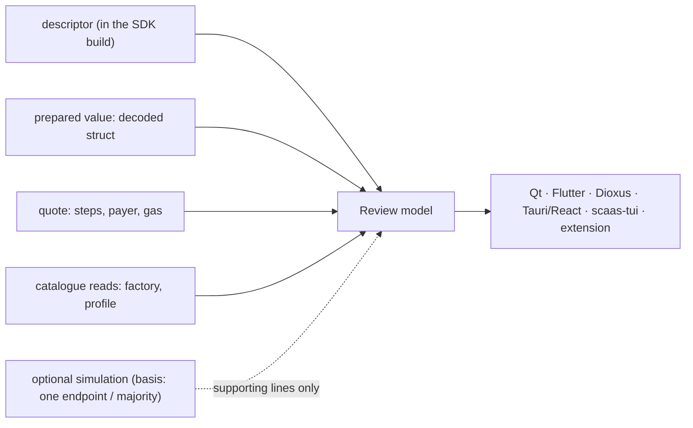

> **Research note — background and rationale only, not normative; the current rules are in docs/ (see decisions.md).**

# Clear signing: one signing review for every SCaaS front-end (2026-11-27)

Research of 2026-11-27 for the owner, who asked for one signing-review experience across the four scaas-app front-ends
(Qt, Flutter, Dioxus, Tauri/React), scaas-tui and the browser extension: what the review screen shows, and where that
knowledge lives. Nothing here is built, specified or ruled; every recommendation is a proposal for the owner. External claims
carry a source tag [Sn] (§9, all read 2026-11-27); SCaaS facts cite the rule or the file.

## Summary

- **Today the SDK already decodes every signed field** ([CLI-SDK-08](../clients/scaas-sdk.md#CLI-SDK-08)): `Prepared::review()`
  is a flat list of `{name, value, display, source}` with `source` ∈ {Signed, Request, Derived}. The quote, the registration's
  "1 or 2 transactions" (`RegistrationGas`), the app-call review (`AppCall`) and TreeKEM's review lines (`TreeBuilt.review`, a
  `Vec<(String, String)>` on branch `treekem-pathless`) are **separate shapes**. The SDK has no severities, no warnings, no
  typed values (amounts are raw integers, UA ids raw hex) and no grouping. The blocking warnings of
  [CLI-APP-09](../clients/app.md#CLI-APP-09) are specified for one front-end only. Six front-ends would write them six times.
- **State of the art:** ERC-7730 descriptors written by the dApp author and bound to a contract or EIP-712 domain [S2]. Ledger
  devices accept them only when Ledger's metadata service has signed them [S5]. Safe signers check the same hash in three
  places [S6], because the Bybit theft of 2025-02-21 went through a tampered signing UI [S8]. MetaMask, Rabby and Blockaid run a
  remote simulation and score its risk [S9, S11]. Every one of these adds a party the user must trust: the descriptor author,
  a registry, a signing service or a simulation vendor.
- **Recommendation:** put **one review model in the SDK**: typed rows, the steps (the "N transactions" line), the payer,
  alternatives and deferred costs, and warnings with three severities and stable codes. Build it from **descriptors compiled
  into the SDK**, one per `(struct, domain kind)` of `typed_ops.json` (115 structs), keyed by the pinned typehash. Bind each
  contract to its release through the factory (`isRegisteredToken`, `versionOf`). **Refuse any descriptor fetched at run
  time.** Every front-end renders the same JSON and passes the same golden vectors. ERC-7730 files for outside wallets can be
  *generated* from the same source later.
- **Simulation is supporting evidence, never the basis.** An `eth_call` shows "this calldata did not revert on these nodes at
  block B", nothing about later blocks or a lying node. A simulated line carries its basis: one endpoint, or the strict
  majority of [ARCH-POS-15](../decisions.md#ARCH-POS-15). No line is computed from decrypting a ciphertext someone else chose
  ([ARCH-POS-13](../decisions.md#ARCH-POS-13)).
- **Cost (estimate):** about 4–6 weeks of one engineer for the SDK model, the descriptors for every struct, the warnings moved
  from CLI-APP-09, bindings and vectors. Then about 3–5 days per front-end to render it. No contract change and no gate.

## 1. What SCaaS has today

| Where | What it shows | Shape | Status |
|---|---|---|---|
| SDK `Op::prepare` (`clients/scaas-sdk/src/op/prepared.rs`) | every leaf of the signed struct by path, decoded fields a module adds (`payNo` as UUID, the plaintext amount and recipient of a confidential op as `Request`), `contract`, `target`, `fee.due`, every touched token with `listed <symbol>` or `unlisted` | `Vec<ReviewField{name, value, display, source}>` | BUILT ([CLI-SDK-08](../clients/scaas-sdk.md#CLI-SDK-08)) |
| SDK quote (`src/op/quote.rs`) | path (gateway or self-relay), payer address, gas limit, regular bound, gas and its sources, max fee, max cost, fee to relayer, gateways, tx nonce and type | `SubmitQuote` | BUILT ([CLI-SDK-09](../clients/scaas-sdk.md#CLI-SDK-09)) |
| SDK registry writes (`src/account/register.rs`) | the write's fields, plus "1 or 2 transactions", each step's gas and the total, for a PQ registration that carries its PQZ key's proof | `RegistryWrite::review()` + `RegistrationGas` | BUILT (owner 2026-11-20, the auto-split) |
| SDK app calls (`src/app_core.rs`) | `contract`, `entry`, every named argument; app records: path, primary type, every domain and message field | `AppCall{review, quote}`, `AppPrepared{review, digest}` | BUILT |
| `pqchat-core` TreeKEM (`src/tree.rs` on branch `treekem-pathless` at `9d9a39e9f`; not on `dev` at `86bce90ec`) | the commit's lines as signed, "leaves under review", the other price (`TreeSplit.refresh`: the same Adds as "add and refresh"), the deferred cost (`deferred_line`: "the next refresh carries about m ciphertexts, about x M asked"), `head_confirmed` | `Vec<(String, String)>` + `TreeSplit` | BUILT on the branch |
| App spec [CLI-APP-09](../clients/app.md#CLI-APP-09), [CLI-APP-27](../clients/app.md#CLI-APP-27) | rows Network, Contract, Operation, From → To, Amount and fee, Validity, Relayer, Wallet display, Raw; eight **blocking warnings** (unknown contract, fee ≥ 1 %, recipient = the token, lookalike recipient, DEX price ≥ 5 % from the best level, an under-reserved Multi leg, a pending rate change, a UA user sending a v1/v2 token); `untrustedText` | prose, built in `clientkeys` (JS) only | SPECIFIED |
| scaas-tui [CLI-TUI-02](../clients/scaas-tui.md#CLI-TUI-02), [CLI-TUI-08](../clients/scaas-tui.md#CLI-TUI-08) | every field of the SDK's review and the quote; a confirm that counts only after every line was drawn, a settle interval, no ellipsis in an address, id, amount or hash | renders `ReviewField` | SPECIFIED |

**Gaps:**

1. Five shapes for one idea.
2. `display` equals `value` for most signed leaves: decimals, UA kind names and chain names are left to each front-end.
3. No severity and no warning in the SDK: CLI-APP-09's warnings and scaas-tui's rules live in front-end specs.
4. No address book or first-recipient check anywhere in the SDK.
5. Nothing ties a review to the contract release it describes, beyond `listed` / `unlisted`.
6. A simulation result reaches the review only for an imported hand-off (spec §27.5 (c), `add_review`). Today `submit`
   simulates after signing ([CLI-SDK-09](../clients/scaas-sdk.md#CLI-SDK-09), ruling A).

## 2. State of the art

### 2.1 EIP-712

The domain separator exists so that typed data "is displayed to the user for verification when signing". Wallets "are free to
use the provided information to inform/warn users or refuse signing". A user agent "should refuse signing if [the chain id]
does not match the currently active chain". The EIP defines no UI and no replay protection [S1]. SCaaS already signs
everything as typed EIP-712 (the explicit-parameters rule), so the decoding half is solved. What a generic wallet does with
SCaaS's `bytes32` UA ids was measured on 2026-11-12 ([ua-mtx-merge-wallet-display](ua-mtx-merge-wallet-display.md)). MetaMask
shows them as 64 hex digits, with no checksum, no address book and no name.

### 2.2 ERC-7730 clear-signing descriptors

- **What it is.** ERC-7730 (Draft; schema 2.1.0) is a JSON file that maps a function or an EIP-712 primary type to an `intent`,
  an optional `interpolatedIntent` sentence and per-field formats (`tokenAmount`, `addressName`, `date`, …) [S2].
- **Binding.** A wallet "MUST ensure these constraints are met" before using one: chain ids and deployment addresses, an
  EIP-712 `domain` or `domainSeparator`, or a `factory` binding with a `deployEvent` that must have emitted the target
  address [S2]. The spec says authors "MUST set restrictive constraints". On EIP-712, "if not known a wallet SHOULD reject using
  the ERC-7730 file" [S2].
- **Limits that matter here.** The address formats apply to the `address` type only. A `bytes32` UA id can be shown only raw
  [S2]. Interpolated intents "MUST only refer to paths that are noted as always visible", fall back to `intent` on any failure,
  and must not interpolate unverified names [S2]. Batches (EIP-5792) are shown as intents joined by " and " [S2].
- **Who writes and who vouches.** "App developers will be the best placed to write such a file" [S2]. The registry
  (`clear-signing-erc7730-registry`) takes one entity per pull request with schema checks and tests. It states that
  "inclusion means only that a descriptor passed the registry's automated checks and basic review". A wallet should use a
  descriptor "only after verifying that it is covered by a valid, unrevoked attestation from an auditor the wallet has
  independently vetted", and "a valid signature … does not itself prove accuracy" [S3].
- **How a Ledger device trusts it.** The wallet software sends an `OPERATION_INFO` header with the chain, the contract, the
  selector or the domain separator and primary type hash, and a `FIELDS_HASH` over every field descriptor. The header is
  "computed by CAL" and signed. Token, enum and map metadata are "signed by CAL" too, verified on the device through the
  Ledger PKI [S5]. Ledger describes the result as "a display layer that is verified on the signer itself". Without a
  descriptor the user approves "a screen full of unreadable calldata" [S4].
- **Trust chain.** The dApp author writes, the registry reviews, Ledger's metadata service signs, the device checks the
  signature and renders. The device trusts Ledger's key and, through it, the author's honesty.

### 2.3 Safe: decoding and hash cross-checks

- Safe's transaction service decodes calldata from a database of contract ABIs (`dataDecoded`) [S7]. ABIs come from Sourcify,
  Etherscan and Blockscout, per Safe's older service docs; that part was read through search snippets only [S7].
- Its guidance for signers is to verify the same transaction "in three separate, isolated places": the Safe UI, a Tenderly
  simulation, and the hardware wallet. On the device, `to`, `value`, `data`, `operation` (0), `nonce`, the gas fields and
  the refund receiver are checked. The rule is "If you can't verify it, don't sign it" [S6].
- The reason is the Bybit theft (2025-02-21). Malicious JavaScript served to the signers' Safe UI disguised the transaction.
  Safe attributed it to "a compromised Safe{Wallet} developer machine resulting in the proposal of a disguised malicious
  transaction" [S8].
- **Lesson for SCaaS:** a review built in web code the signer loads at run time is only as good as that code's delivery.
  The descriptor and the renderer belong in the signed, built app, not in a page.

### 2.4 Security alerts and simulation vendors

- **MetaMask** sends "transactions and signature requests … to a MetaMask (EVM) or Blockaid (non-EVM) server", with the dApp
  URL, the JSON-RPC method, the chain id and the transaction data [S9]. Its alerts are "informational only". The user "can
  still confirm", and simulations "do not guarantee detection of all threats" [S9].
- **Address poisoning.** MetaMask shows "a blocking warning" for a recipient that "closely resembles" one used before (for
  example the same first and last four characters). It warns, without blocking, on an address never interacted with
  [S10]. A study of 53 wallets (2025-08) found three that warn on a phishing recipient, and only when Etherscan already
  flags it. Four confirm unknown recipients and 42 do nothing. Every wallet that shows transfers truncates addresses [S12].
- **Rabby** shows the simulated balance changes and the action, so that "Claim" against "Transfer" is visible. It flags
  approvals to an EOA spender, a spender with "Trust Value $0" or "Deploy Day < 3", and high price impact. On a flagged
  risk "the Sign button is disabled" until the user presses "Ignore All" [S11].
- **Blockaid**'s own documentation is behind a login (redirect, 2026-11-27) and is described here only through its
  integrators.
- **Ledger** carries a vendor's verdict to the device as a signed `TX_SIMULATION` struct with a normalized risk
  (0 benign, 1 warning, 2 malicious), a category (address, dApp, losing operation) and a 30-character provider message
  [S5].
- **Trust:** the vendor sees every request before it is signed (privacy). Its verdict is a score, not a proof. A verdict that
  says benign clears nothing.

### 2.5 Simulation as a primitive

- `eth_simulateV1` runs a sequence of calls on top of each other's state, with block and state overrides, without a
  transaction. Its error codes are normative, its messages are not, and the API is still beta [S13].
- A 2026-01 proposal makes a simulation trust-minimised. It checks the pre-state against a state root that several nodes
  agree on, through `eth_getProof`, then executes locally (revm) [S14]. Its own limits: it fails when one node is down, a node
  can omit slots, behaviour can depend on time or sender, and the state can move before inclusion [S14].
- A plain `eth_call` trusts one node's state *and* its execution.

### 2.6 What each gives and whom it trusts

| Mechanism | Gives | Written by | Vouched by | SCaaS takes |
|---|---|---|---|---|
| EIP-712 typed data [S1] | field names and types; domain binding | contract author | nobody (the wallet renders the types) | already used for every signed struct |
| ERC-7730 [S2, S3] | intents, field formats, binding to deployments or a factory | dApp author | registry review; attestations; Ledger's signing service for devices [S5] | the model (intent, field formats, binding), not the run-time fetch |
| Safe decoding + hash checks [S6, S7] | decoded calldata; the same hash on three devices | ABI from explorers | the signer's own comparison | "the review is built in the signed app"; a hash a second device can show |
| Vendor simulation / alerts [S9, S11] | balance changes, risk score | vendor | vendor's reputation | balance-change lines for opaque calls only, with their basis; no vendor in the SDK |
| Address-book / first-interaction checks [S10, S12] | lookalike and new-recipient warnings | the wallet, from local history | none needed (local data) | yes, in the SDK, from the user's own history and book |

## 3. SCaaS specifics the review must carry

### 3.1 The signer's kind, its cost and the number of transactions

A UA's kind is part of what is signed. The review names it from the kind table or `kindName`, with the `uint16` beside it
([CTR-UA-35](../contracts/accounts.md#CTR-UA-35); [CLI-APP-09](../clients/app.md#CLI-APP-09) already asks this for portable
records). PQ kinds change the cost by two orders of magnitude. Reference table (`clients/scaas-sdk/gas/reference.json`;
ML-DSA rows measured on precompile stand-ins):

| Kind | Signature bytes | Verify gas |
|---|---:|---:|
| `0x0101` (secp256k1) | 128 | 19,000 |
| `0x0131` `mldsa65` | 3,328 | 123,000 |
| `0x0134` `mldsa87` | 4,640 | 160,000 |
| `0x0132` `fndsa512` | 672 | 2,355,000 |
| `0x0133` `slhdsa128s` | 7,872 | 1,339,000 |
| `0x0135` `fndsa1024` | 1,280 | 4,824,000 |

The calldata adds 64 gas a byte. The quote already holds the regular gas to the per-transaction cap of 2^24 (EIP-7825) and a
registration step to half the block (`GasAboveTxCap`, `GasAboveBlockShare`). A PQ registration with its PQZ proof goes in two
steps when one does not fit (owner 2026-11-20). The review must say **before anything is signed** that this is 2
transactions, what each costs, and that the second can resume after a restart. Today `RegistrationGas` carries the facts
but no front-end contract says how they are shown. The same "N steps" line serves TreeKEM's split commits
(`TreeSplit.batches`) and a BLS group above the 45 members that fit under the cap ([CLI-SDK-09](../clients/scaas-sdk.md#CLI-SDK-09)).

### 3.2 `msig` and groups

- **For an `msig` subject** the review shows the threshold, the members with their kinds, which slots have **accepted**
  (listing is no consent; only accepted members count: [CTR-UA-37](../contracts/accounts.md#CTR-UA-37)), whose signature is
  still needed, and that this device signs one slot.
- **For a `bls12381-multi` group** it shows the threshold and n, and that the coordinator aggregates. A member on another
  device must see the same digest. The review id is the typed digest, `Prepared::id()`, so the app can show it, or a short
  form of it, on both devices. That is Safe's hash cross-check [S6] without a third party.

### 3.3 Who pays: fee 0 and relayers

Every state-changing `mtx*` is relayable, and a fee of 0 is accepted and never replaced
([CLI-SDK-08](../clients/scaas-sdk.md#CLI-SDK-08)). The review keeps three things apart:

1. **The relayer the signature binds:** a named address, or "any". A non-zero unbound `relayer` or `feeRecipient` is refused
   ([CLI-UAL-13](../clients/ua-libraries.md#CLI-UAL-13)).
2. **The fee signed:** the token, the amount, the recipient, or "0: a gateway may refuse or delay it".
3. **Who pays the gas:** the gateway's lane, or the holder's own native account on self-relay. A self-relay payer is
   **linked on chain to the subject**, and the review should say so: it is a privacy fact, not a cost.

### 3.4 Confidential operations: Zether and PQZ, kept apart

- **What both share.** The signed struct holds ciphertexts and a proof. The plaintext amount and recipient exist only in the
  request, as `Source::Request` rows. Each row must say *what is public on chain* and *what is not*: the sender's UA, the
  token and the leg count are public; the amount is not; the proof is shown by its hash and length
  ([CLI-APP-09](../clients/app.md#CLI-APP-09)).
- **Zether.** The auditor mode is the token's ([CTR-ZTH-49](../contracts/zether.md#CTR-ZTH-49)).
- **PQZ.** The auditor leg is per token. `FULL` adds it to every transfer. `OPTIONAL` makes `auditorOn` the sender's choice,
  **publicly visible** ([CTR-PQZ-24](../contracts/pq-zero-knowledge.md#CTR-PQZ-24)). The review names the auditor UA, says
  "the auditor can read this amount" when the leg is on, and shows `auditorOn = 0` as visible to everyone. On an opening
  token the auditor reads `v_a` from its opening, and its outcomes per credit are public (CTR-PQZ-24's three-key Change).
- **The rule for any line derived from a decryption.** A balance after the operation is computed from the holder's own
  decrypted balance. It is shown to the key holder only, never sent anywhere, and no automatic action depends on it
  ([ARCH-POS-13](../decisions.md#ARCH-POS-13)).

### 3.5 PqChat and PqVault records

- **TreeKEM path-less Add** (branch `treekem-pathless`; delta spec §6.4, §6.5, §9). The review shows:
  - "adds without refreshing the group's keys; n of N since the last refresh". The cost of that choice is post-compromise
    security for the committer ([2026-11-25-treekem-pathless-add](2026-11-25-treekem-pathless-add.md)).
  - **Both prices**: path-less, and "add and refresh".
  - **The deferred cost**: "the next refresh carries about m ciphertexts, about x M asked".
  - Whether a strict majority of at least 3 named endpoints confirmed the head it was built on (`head_confirmed`).
  - The leaves under review for a path commit.

  These lines are part of the review model, not app strings. Every front-end must show the two prices side by side.
- **PqVault share** (share box: [CLI-PQV-02](../clients/ua-libraries.md#CLI-PQV-02)). The first share creates a shared vault
  for the recipient set, and each later share is one `createItems` copy. The review shows:
  - the recipients (UA, kind, KEM key version);
  - whether this creates a new vault or reuses one;
  - the number of items, with their titles, decrypted locally: titles live only inside ciphertexts
    ([CLI-PQV-03](../clients/ua-libraries.md#CLI-PQV-03)), so the title rows are local-only;
  - the honest limit ([CLI-PQV-05](../clients/ua-libraries.md#CLI-PQV-05)): "a recipient keeps what it has read; removing
    them later does not take it back";
  - the gas and the payer.
- **Messages.** PqChat's per-message seal has no per-signature review ([CLI-PQC-04](../clients/pqchat-core.md#CLI-PQC-04)) and
  stays out of this model.

### 3.6 Cross-chain UA ids and chain identity

A derived UA id is one 32-byte value on every chain; a native one is a padded address. The typed domain binds the chain id
and `chain_uid` ([CLI-SDK-09](../clients/scaas-sdk.md#CLI-SDK-09)).

- **Header.** The review states the chain by the profile's name, with its id and `chain_uid`, and that the profile's identity
  check passed (CLI-APP-09's Network row).
- **Counterparties.** A UA is shown whole, with its kind and, where the user has one, the address-book name. The same id
  being the same party on another chain is a fact the review may state ("known on 3 chains in your book") but never infers
  from a node.
- **Digest-only families.** These show the exact string the outside wallet will display
  ([NET-ALL-23](../networks/README.md#NET-ALL-23)).

## 4. Where the knowledge lives

### 4.1 Options

| | A: per front-end | B: descriptors in the SDK (single source) | C: ERC-7730 files fetched at run time |
|---|---|---|---|
| Code | 6 renderers × 115 structs × warnings | one table + one model; front-ends render generic rows | a registry client + descriptor interpreter in the SDK |
| Drift | certain (CLI-APP-09 exists for one front-end already) | none: one golden vector set | none in code, but per-descriptor |
| Trust added | none | none beyond the SDK build | the descriptor author, the registry, a signer of attestations [S3, S5] |
| Fits SCaaS ids | yes | yes | no: `bytes32` is raw-only [S2] |
| Third-party contracts | each front-end decides | refused unless the app core names an ABI (today's rule) | open |

**Recommendation: B**, with an optional generator from B to ERC-7730 for outside signers (§4.4).

### 4.2 The descriptor and its versioning

- **One descriptor per `(struct, domain kind)`,** keyed by the struct's **typehash**. Typehashes are pinned
  (`*TypehashIsPinned`) and generated into `smartcontracts/vectors/typed/typed_ops.json`, whose 115 rows already list
  each struct's fields and the contracts it is signed on.
- **What the descriptor adds:** an intent key, a format per field (amount with its token path, UA, chain, duration,
  hash-and-length for crypto bytes, enum), the field's visibility (public, encrypted on chain, local only) and the warnings
  that apply.
- **Where it sits:** a source file beside the generator (for example `clients/scaas-sdk/review/descriptors.json`). It is
  checked by a test that every `typed_ops.json` row has exactly one descriptor and that every field of the struct appears in
  it, so a new field cannot be left out. `ReviewField`'s flat list stays as the "raw" section: CLI-TUI-02's "every field"
  test keeps holding.
- **Versioning follows the contracts.** A deployed contract never changes, so a struct never changes. A new struct is a new
  typehash and a new descriptor. A descriptor's display can be corrected in a new SDK release, because it never changes what
  is signed. The review carries `descriptor: {typehash, revision}` so a bug report names it.
- **Binding to the catalogue.** The contract a review names is checked in this order:
  1. The profile's curated contracts (registry, router, DEX, reviewed tokens: [CLI-SDK-09](../clients/scaas-sdk.md#CLI-SDK-09)'s
     release data).
  2. For a token, the factory: `isRegisteredToken(token)` and `versionOf(token)` give `(kind, version)`;
     `isTokenDeprecated(kind, version)` gives a Caution.
  3. A token of `version() == 0` (`createTokenUnregistered`) is "code its creator brought"
     ([contracts README](../contracts/README.md), the catalogue invariants) and raises a Block-level warning outside dev
     builds, as CLI-APP-09's unknown contract does.

  These reads go through the same line reader and node list as every other SDK read
  ([CLI-SDK-08](../clients/scaas-sdk.md#CLI-SDK-08)).

### 4.3 Third-party contracts

The SDK already refuses an undecoded call (`OpaqueCallRefused`). An app core's own contract is decoded by the ABI the app
core links (`prepare_app_call`). That ABI is code in the signed app, so it is trusted like code.

**Recommendation:** no descriptor reaches the SDK at run time, neither from a dApp, a node nor a registry. A third party's
descriptor enters only as **release data pinned by hash**, reviewed like the token list. It is shown with its origin
("descriptor by `<owner>`, not SCaaS's") and a Caution. Without one, the call is raw: the `entry` and the named arguments
from the app core's ABI, which is today's behaviour. This keeps "a relayer can refuse or delay, never forge or alter" true
of the display too.

### 4.4 Outside signers (hardware wallets, generic EVM wallets)

A native EOA member signing `UAAuth` on a hardware wallet sees only what that device can render
([sdk-keys-and-derivation](sdk-keys-and-derivation.md), hardware wallet row). An ERC-7730 file generated from §4.2's
descriptors, with a `factory` binding on `OpenFactory`'s deploy event [S2], could give such a device intents and amounts. It
would show UA ids raw [S2]. It reaches a Ledger device only through Ledger's registry and signing service [S3, S5], a trust
dependency the owner would have to choose. **Proposal:** later and optional. Nothing in the SDK depends on it.

## 5. Simulation



**What an `eth_call` simulation proves:** that this calldata, from this sender, did not revert on the answering nodes' state
at block B, with this gas and these logs.

**What it cannot prove:**

1. **The future.** Ordering, a rate change before `validUntil`, a freeze, a competing nonce [S14].
2. **The node's honesty.** One node can lie about state and execution [S14].
3. **That the gas fits.** A successful estimate is not proof that the regular gas fits the 2^24 cap, since anvil and forge do
   not enforce EIP-7825 (decisions, registry-write quote Change of 2026-11-19).
4. **The effect of a SCaaS struct before it is signed.** The contract checks the signature first, so an unsigned `mtx*` call
   reverts. That is why the SDK simulates the **signed** calldata after the row is written (ruling A).

**Recommendations:**

- **First-party structs need no pre-sign simulation:** the decoded struct is the effect, because the contract executes
  exactly those named fields. The post-sign simulation stays as built. A revert or more gas than the quote is `SimRefused`,
  and the review is not reopened.
- **Opaque or inner calls** (`mtxExecute`'s inner call, an app call) may get a pre-sign `eth_call` of the inner call from
  the executing contract. Its balance-change lines are `Simulated` rows. They carry their basis: `OneEndpoint`, or `Majority`
  under ARCH-POS-15's agreement option, the same words as [CLI-SDK-18](../clients/scaas-sdk.md#CLI-SDK-18).
- **Node disagreement raises a Caution** ("nodes disagree"). A simulation never lowers a severity the descriptor set, and a
  discovered endpoint alone never clears a warning.
- **No simulation vendor in the SDK.** A vendor would see a confidential operation's request before signing, and its score
  is not evidence. An app may add one as its own extra line, off by default, never for a confidential operation.
- **Never a decryption oracle.** No simulation and no review line decrypts a ciphertext from a node or a peer and reports
  anything back to them. A line computed from the holder's own decryption is `LocalOnly`. It never changes what is sent, never
  requests a simulation and never triggers an action a node can observe ([ARCH-POS-13](../decisions.md#ARCH-POS-13)).

## 6. Proposal: the review model the SDK emits

One serialisable record (`serde`, uniffi, FRB, the same JSON for the extension and the TUI). Field names are proposals.

```text
Review {
  v: 1,
  id,                                  // Prepared::id(): the typed digest, shown short on every device that signs
  descriptor: { typehash, revision } | null,   // null: no descriptor, raw section only + warning NO_DESCRIPTOR
  intent: { key, args },               // an i18n key and typed args, never a free sentence (ERC-7730's
                                       // interpolatedIntent risk [S2])
  chain: { name, chain_id, chain_uid, identity_checked },
  contract: { address, label, provenance: Curated | Registered{kind, version} | Unregistered | Unknown, deprecated },
  signer: { ua, kind, kind_name, sig_bytes, verify_gas,
            msig: { threshold, members: [{ua, kind, accepted, signs_here}] } | null },
  sections: [ { key, rows: [Row] } ],
  steps: [ { n, entry, gas, regular_gas, state_gas, resumable } ],     // "N transactions"; one row when 1
  cost: { path: Gateway{relayer: Bound(addr) | Any, fee: Amount, fee_recipient}
               | SelfRelay{payer, max_cost, linked_to_subject: true} },
  alternatives: [ { key, steps, cost } ],           // the other price (TreeKEM "add and refresh")
  deferred: [ { key, count, gas } ],                // a later cost this choice creates
  warnings: [ { code, severity: Info | Caution | Block, rows: [path], basis } ],
  simulation: { basis: OneEndpoint | Majority{agreed, of}, block, outcome } | null,
  raw: [ReviewField]                                // today's flat list, unchanged: every signed leaf
}
Row { path, label_key, value: Value, source: Signed | Request | Derived | Simulated,
      visibility: Public | EncryptedOnChain | LocalOnly }
Value = Amount{raw, decimals, symbol, listed} | Ua{id, kind, kind_name, book_name} | Address{addr, book_name}
      | Chain{...} | Time{unix, relative} | Duration{s} | Hash{hex} | Bytes{len, sha256}
      | Count{n} | Gas{n} | Enum{key} | Text{sanitised, non_ascii}
```

### Severities

- **Info** is shown.
- **Caution** is shown beside its rows, and confirm stays live.
- **Block** disables confirm. Where the rule allows it, an explicit second confirmation can override: CLI-APP-09's validity
  over 24 h, and nothing else outside dev builds.

These three mirror the benign / warning / malicious scale of [S5], but SCaaS's are rule results, not scores.

### Warning codes

Stable names, computed in the SDK.

- **From CLI-APP-09:** `UNKNOWN_CONTRACT`, `FEE_HIGH`, `RECIPIENT_IS_TOKEN`, `LOOKALIKE_RECIPIENT`, `PRICE_AWAY`,
  `UNDER_RESERVED_LEG`, `RATE_CHANGE_PENDING`, `OLD_TOKEN_FOR_UA`, `VALIDITY_LONG`.
- **New:**
  - recipients and contracts: `FIRST_RECIPIENT`, `UNREGISTERED_RELEASE`, `DEPRECATED_RELEASE`, `UNLISTED_TOKEN`,
    `OPAQUE_CALL`, `NO_DESCRIPTOR`;
  - payer and steps: `PAYER_LINKED`, `MULTI_STEP`;
  - TreeKEM: `NO_KEY_REFRESH`, `REFRESH_DUE`, `HEAD_UNCONFIRMED`, `LEAVES_UNDER_REVIEW`;
  - confidential: `AUDITOR_READS`, `AUDITOR_OFF_PUBLIC`;
  - PqVault: `SHARE_IRREVOCABLE`;
  - simulation: `NODES_DISAGREE`, `SIM_REVERTED`.

The lookalike and first-recipient checks need the user's history and address book. The SDK's state holds the operation rows.
The book is app data, passed to the SDK as a read-only list, so the check is one code path for every front-end.

### Rendering contract

Each front-end:

- renders every section, row and warning;
- draws values whole (CLI-TUI-08 (8)) and passes `Text` through `untrustedText` ([CLI-APP-27](../clients/app.md#CLI-APP-27));
- counts confirm only on a settled, fully drawn review (CLI-TUI-08);
- keeps the raw section reachable.

A vector set (proposal: `smartcontracts/vectors/review/`, one `Review` JSON per descriptor and per warning) is read by every
front-end's test, the way client vectors are read today.

### 6.1 Examples (values illustrative)

**Token transfer** (`UAMetaTransfer` on a registered token, gateway path, fee 0):

```text
intent  token.transfer {amount: 125.50 VND, to: 0x…c0de (Alice, book)}
chain   scaas-testnet · 7622 · chain_uid 0x…  ✓ identity
contract VND · Registered{NormalToken, v3}
signer  0x… · fndsa512 (0x0132) · 672 B · verify 2,355,000 gas
rows    from, to (Ua, book "Alice"), amount (raw 12550, decimals 2), lane, nonce, validUntil (in 15 min), relayer: Any, fee: 0
steps   1 · cost Gateway{relayer: Any, fee: 0}
warnings  none (Alice is in the book and in the history)
raw     every signed leaf
```

**PQ registration, split** (`register` without the proof, then `storePqzPop`; owner 2026-11-20):

```text
intent  account.register {kind: mldsa87 (0x0134), pqz_key: yes, kem: yes}
signer  the new UA · mldsa87 · 4,640 B · verify 160,000
steps   1 register (record + key)   gas G1 · regular R1 ≤ 2^24 · ≤ ½ block
        2 storePqzPop (the proof)   gas G2 · resumable after restart
cost    SelfRelay{payer 0x…, max_cost …, linked_to_subject: true}
warnings  Info MULTI_STEP ("2 transactions; the PQZ key is unproven until step 2 lands"), Caution PAYER_LINKED
```

**TreeKEM path-less Add** (2 Adds; branch `treekem-pathless`):

```text
intent  pqchat.tree.add {members: 2, session: …}
rows    the commit's fields as signed; joiners (Ua, kind, KEM key version)
steps   1 · gas G
alternatives  "add and refresh": 1 step · gas G′
deferred      next refresh: about 7 ciphertexts, about 20.3 M
warnings  Info NO_KEY_REFRESH ("5 of 20 since the last refresh"),
          Caution HEAD_UNCONFIRMED (fewer than 3 named endpoints agreed on the head)
```

**PqVault share** (first share to this recipient set):

```text
intent  pqvault.share {items: 1, recipients: 1, new_box: true}
rows    recipient (Ua, kind, KEM key v2); item title (LocalOnly); vault: new share box
steps   2 (createVault, createItems) · gas G1, G2
cost    SelfRelay{payer, linked_to_subject: true}
warnings  Caution SHARE_IRREVOCABLE ("they keep what they have read; removing them later does not take it back")
```

## 7. What is missing in the SDK today, and the cost

| Missing | Work (estimate, one engineer) |
|---|---|
| The `Review` model and its bindings (uniffi, FRB, JSON), next to `ReviewField`, which stays | 3–4 d |
| Descriptors for the 115 structs plus registry writes and app records; the completeness test against `typed_ops.json` | 8–12 d |
| Typed values: token decimals and symbols from the profile, kind names, chain names, the UA book lookup | 2–3 d |
| Catalogue provenance reads (`isRegisteredToken`, `versionOf`, `isTokenDeprecated`) on the line reader | 1–2 d |
| Warnings: CLI-APP-09's eight moved from `clientkeys`, the new codes, tests with a positive control and one mutant each | 5–7 d |
| `steps`, `alternatives` and `deferred` from `RegistrationGas`, `TreeSplit` and BLS limits; `pqchat-core`'s review lines moved into the model | 2–3 d |
| The review vector set and its generator | 2–3 d |
| Per front-end: render the model and pass the vectors (Qt, Flutter, Dioxus, Tauri/React, TUI, extension) | 3–5 d each |

The SDK side comes to about 4–6 weeks. No contract, node or vector change outside the new review vectors, no new typehash, no
gate. The descriptors are display only and change no signed byte. Rule texts would move: CLI-APP-09's warnings to the SDK
spec, and CLI-TUI-02 to "renders the SDK's Review".

## 8. Open questions for the owner

1. B (descriptors in the SDK, no run-time fetch) as the single source: accept, or keep warnings per front-end?
2. Third-party descriptors: release data pinned by hash with a Caution, or refused outright?
3. The ERC-7730 export for outside signers (§4.4): later, or never?
4. A pre-sign simulation for opaque and app calls (§5): build it, or keep only the post-sign check?

## 9. Sources (all read 2026-11-27)

- [S1] EIP-712, "Typed structured data hashing and signing" (Final): <https://eips.ethereum.org/EIPS/eip-712>
- [S2] ERC-7730, "Structured Data Clear Signing Format" (Draft; schema 2.1.0), incl. context binding, `factory`, batch
  display, interpolated-intent and encryption security: <https://eips.ethereum.org/EIPS/eip-7730>
- [S3] ERC-7730 registry, README (submission, review, "inclusion means only…", attestations):
  <https://github.com/LedgerHQ/clear-signing-erc7730-registry>
- [S4] Ledger, "How does it work?" (clear signing): <https://developers.ledger.com/docs/clear-signing/understanding/how-does-it-work>
- [S5] Ledger Ethereum app, `doc/apdu.md` (PROVIDE TRUSTED NAME, OPERATION INFO, MAP ENTRY "signed by CAL", TX SIMULATION) and
  `doc/tlv_structs.md` (`OPERATION_INFO` with `FIELDS_HASH` and signature "computed by CAL"; `TX_SIMULATION` risk levels):
  <https://github.com/LedgerHQ/app-ethereum/blob/master/doc/apdu.md>, <https://github.com/LedgerHQ/app-ethereum/blob/master/doc/tlv_structs.md>
- [S6] Safe Help Center, "How to verify Safe{Wallet} transactions on a hardware wallet":
  <https://help.safe.global/articles/4369997924-how-to-verify-safewallet-transactions-on-a-hardware-wallet>
- [S7] Safe docs, data decoder and Safe Decoder Service: <https://docs.safe.global/core-api/transaction-service-guides/data-decoder>,
  <https://docs.safe.global/core-api/safe-decoder-service-overview>; ABI sources (Sourcify, Etherscan, Blockscout) only
  through search snippets of <https://docs.gnosis-safe.io/advanced/api-service-architecture/safe-transaction-service>
- [S8] BleepingComputer, "Lazarus hacked Bybit via breached Safe{Wallet} developer machine" (2025-02-26, quoting Safe's
  statement and the Sygnia and Verichains findings):
  <https://www.bleepingcomputer.com/news/security/lazarus-hacked-bybit-via-a-breached-safe-wallet-developer-machine/>;
  NCC Group's analysis returned HTTP 403: <https://www.nccgroup.com/research/in-depth-technical-analysis-of-the-bybit-hack/>
- [S9] MetaMask Support, "Security alerts": <https://support.metamask.com/configure/wallet/security-alerts/>
- [S10] MetaMask Support, "Address poisoning scams":
  <https://support.metamask.com/stay-safe/protect-yourself/wallet-and-hardware/address-poisoning-scams>
- [S11] Rabby Support, "Understanding Rabby's transaction simulation":
  <https://support.rabby.io/en/articles/14124199-understanding-rabby-s-transaction-simulation>
- [S12] S. Guan, K. Li, "Ethereum Crypto Wallets under Address Poisoning: How Usable and Secure Are They?", arXiv:2508.12107,
  2025-08-16: <https://arxiv.org/html/2508.12107v1>
- [S13] Ethereum execution APIs, `eth_simulateV1` (1.0.0-beta.7): <https://ethereum.github.io/execution-apis/api/methods/eth_simulateV1/>
- [S14] Sednaoui, "Trust-minimized transaction simulation using state proofs", ethresear.ch, 2026-01-15:
  <https://ethresear.ch/t/trust-minimized-transaction-simulation-using-state-proofs/23857>
- Blockaid's documentation (<https://docs.blockaid.io/docs/transaction-scanning>) redirected to a login page; not read.
