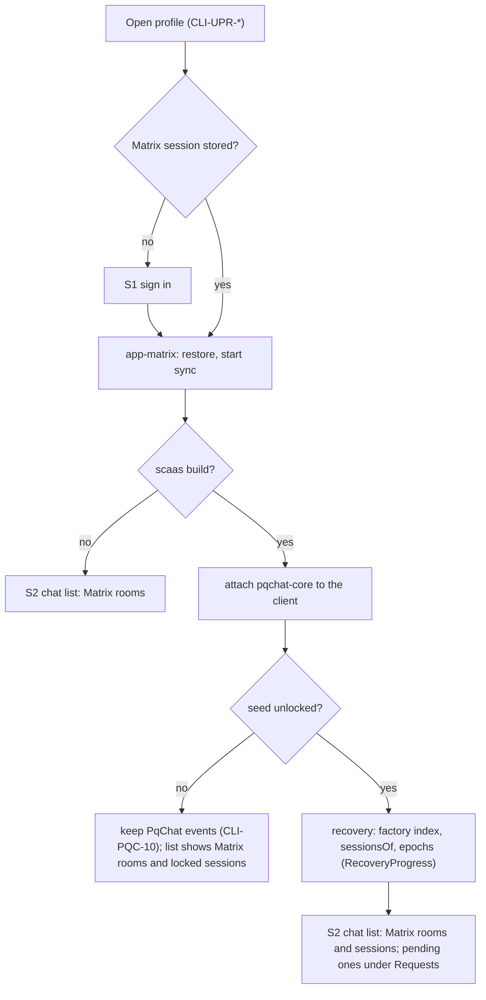
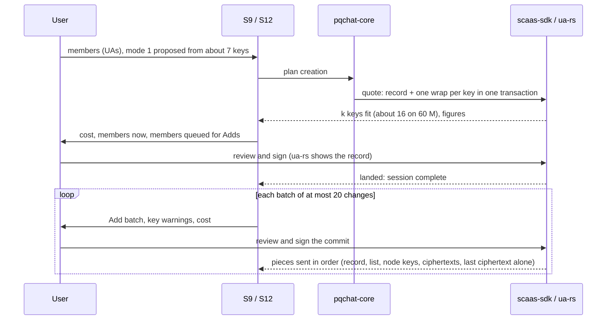
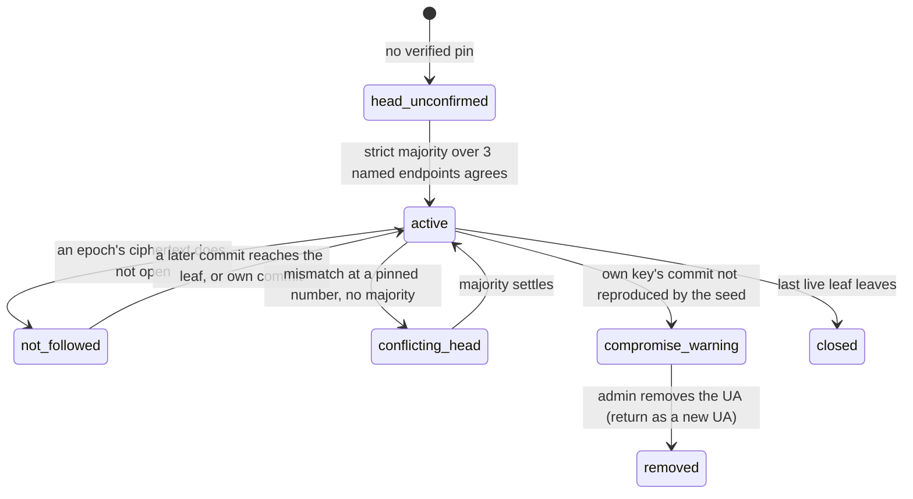
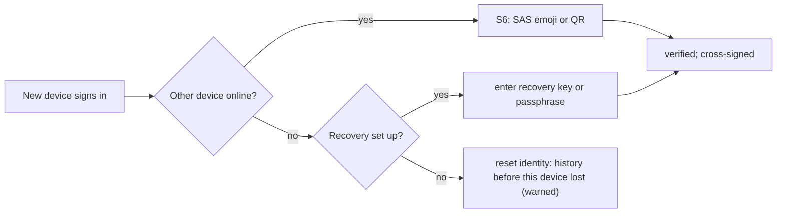

> **Research note — background and rationale only, not normative; the current rules are in docs/ (see decisions.md).**

# Chat UI for scaas-app and scaas-tui: Matrix rooms and PqChat sessions (2026-11-27)

Research of 2026-11-27 for the owner, who asked what the chat UI should be: plain Matrix chat in every build and PqChat
sessions in the `scaas` build, over the same Matrix client, in mode 0 (flat wraps) and mode 1 (TreeKEM), across
scaas-app's four front-ends (Qt over the Status fork, Flutter, Dioxus, Tauri with a React UI including a web build and a
browser extension) and `scaas-tui` (plan T14 part B, pending). Nothing here is built, specified or ruled: every screen,
default and name below is a **proposal**. PqChat's cryptography is **UNAUDITED** ([ARCH-POS-14](../decisions.md#ARCH-POS-14));
this note changes none of it.

Tags: **[F]** a fact with its source (a repo rule by id, a file of this tree, or an external page with its URL and the
date read); **[E]** an estimate made here; **[I]** an inference; **[U]** not verified here. Other apps were read from their
source code and docs, never from screenshots (owner rule); no code was copied. Paths prefixed `scaas-app:` are in the
scaas-app repository (`app-common/`, `scaas-qt-wallet-client/`, `scaas-app-status/`), as its own spec writes them.

**Contents**

1. [Summary](#1-summary)
2. [Ground truth: what the UI must obey](#2-ground-truth-what-the-ui-must-obey)
3. [Survey of Matrix clients](#3-survey-of-matrix-clients)
4. [How PqChat fits beside Matrix](#4-how-pqchat-fits-beside-matrix)
5. [Trust indicators](#5-trust-indicators)
6. [Screens and flows](#6-screens-and-flows)
7. [View-model needs per screen (input to B10)](#7-view-model-needs-per-screen-input-to-b10)
8. [Privacy defaults](#8-privacy-defaults)
9. [Per front-end notes](#9-per-front-end-notes)
10. [What `pqchat-core`, `app-matrix` and the SDK lack](#10-what-pqchat-core-app-matrix-and-the-sdk-lack)
11. [Cost](#11-cost)
12. [Questions for the owner](#12-questions-for-the-owner)
13. [Sources](#13-sources)

## 1. Summary

- **One chat list, two kinds of row that never mix** [I]. A Matrix room carries a "Matrix, classical end-to-end" mark; a
  PqChat session carries a distinct "PQ" mark with its mode, epoch and members by UA. The Matrix room that carries a
  session's envelopes never appears as a Matrix room, and a held invite to it never appears as a Matrix invite
  ([CLI-PQC-05](../clients/pqchat-core.md#CLI-PQC-05), [CLI-PQC-08](../clients/pqchat-core.md#CLI-PQC-08); scaas-app
  contract §11.1 [F]).
- **The trust indicator is a state, not a colour** [I]: a PqChat session has one state from a fixed set (pending,
  active, sends held, store unconfirmed, head unconfirmed, epoch not followed, compromise warning, conflicting head,
  creation incomplete, closed, left), each drawn with its own words and shape; a Matrix room has the encryption and
  verification states every surveyed client already draws, Nheko's per-message set being the clearest model (§3, §5).
- **Privacy by default** [I]: Matrix rooms send private read receipts (`m.read.private`), no typing notice and no presence;
  pushes are `event_id_only`; PqChat sessions send no Matrix ephemeral event at all (a rule, CLI-PQC-05), no receipt by
  default in mode 0 and none automatic in mode 1 (R11), typing off by default (§8).
- **Every on-chain write shows its cost before the review** [I]: create, rekey, remove, leave, the mode 1 commit with its
  Adds, `treeLeave` and `treeRemove`, and each message to a chain store (consented per session). A mode 1 session is
  created small in one transaction (about 16 keys on a 60 M block, plan T5) and grown by batches of at most 20 changes.
- **What is missing** (§10): `pqchat-core` gives a pull queue of five event kinds and no per-session state, no
  timeline-changed event and no per-store send status; its tree mode is SPECIFIED only. `app-matrix` is not built and its
  contract lacks invites with spam controls, push, receipt and typing settings, identity-change warnings, media and a
  room-kind filter. The web build and the extension can run `matrix-sdk` on wasm with an IndexedDB store, but the
  extension's service worker cannot hold a sync loop (§9.4).
- **Cost** (§11) [E]: about 6.5 to 11.5 person-weeks of shared work (view-model contract, `app-matrix`, the core and SDK
  additions), then about 4 to 9 per front-end for the chat screens, the web build and extension 3 to 5 more, the TUI 2 to 4.

## 2. Ground truth: what the UI must obey

The rules below are in force [F]; the UI proposals of later sections are built on them.

| Area | Rule | Source |
|---|---|---|
| Two kinds | default build: Matrix chat with Matrix's own E2EE (Olm / Megolm, classical); `scaas` build adds PqChat; never mixed; a Matrix room is never upgraded into a session in place; a Matrix conversation is never presented as post-quantum | scaas-app spec D5; contract `scaas-app:app-common/spec/app-core-contract.md` §11.1 |
| One stack | one `matrix-rust-sdk` client, one login, one sync loop per app, in `app-matrix`; `pqchat-core` sends through it, opens no client of its own | CLI-PQC-01, CLI-PQC-05; contract §11.2 |
| Default build | a `net.scaas.pqchat.v1` event is shown as "needs the SCaaS build", never as a message | contract §11.2 |
| Bound room | no Matrix read receipt, read marker, typing notice or presence in a bound room; joined only on the crate's call; no Matrix encryption in the room (so a fresh device reads history from the seed); no PqChat right from a power level | CLI-PQC-05; UA-7 P15, P20 |
| Pending | before acceptance: preview only (creator, members, name, cost of accepting); no store read, invite answer, receipt or write; declining writes nothing | CLI-PQC-08 |
| Stores and cost | chain-store gas only under a per-session consent with the figure per message; a store added by a rekey is used only after the user confirms it, a non-admin's change flagged; `postMessage` only by the user's choice, above 1,024 B after a cost confirmation, "public forever" | CLI-PQC-06; UA-7 P16 |
| Reads | a record that fails is dropped silently, counted on the device per reason; nothing sent depends on an opening | CLI-PQC-07; ARCH-POS-13 |
| Signing | every record reviewed before it is signed, except each chat message; the review shows the store list and Matrix ids | CLI-PQC-04 |
| Recovery | sessions and latest messages from contract state and the room's history; no plaintext stored locally until the sealed history lands (PLANNED) | CLI-PQC-09 |
| Locked seed | envelopes received while locked are kept and processed at unlock, never answered | CLI-PQC-10 |
| Mode 1 | replay from the Welcome; "unconfirmed" head without a majority pin over at least 3 named endpoints; "not followed" epochs shown, nothing sent by itself; compromise warning; conflicting head; creation incomplete; closed session; no return (a new UA); warning before an Add of a key held by another UA; a changed session info only after a strict-majority read over at least 3 named endpoints; no automatic receipt; held sends go back to the user | CLI-PQC-17; spec `2026-11-23-pqchat-treekem.md` R9–R16, C21, C33, C35, C38 |
| Mode 1 size | creation with all wraps in one transaction, about 16 member keys on a 60 M block, more by commits of at most `TREE_CHANGES_MAX` = 20 changes; up to 512 leaves | plan `2026-11-23-pqchat-treekem.md` T5; R8 |
| Path-less Adds | to be built in mode 1 after PR #30, spec first; a forced path commit bound per session, default 20; admins warned after 20 path-less leaves when the bound is 0 | owner 2026-11-25, research `2026-11-25-treekem-pathless-add.md` |
| Parties | PqChat parties are PQ UA kinds only; a classical-only UA has no KEM key | CTR-UA-32 Change of 2026-11-27 |
| Profiles | a profile is its own data directory with its own Matrix login and store and PqChat device anchor; open in one instance at a time; switching locks; hidden profiles exist | CLI-UPR-03, CLI-UPR-06, CLI-UPR-07, CLI-UPR-08 |
| Matrix setup | direct rooms encrypted from the first event; cross-signing at first login; SAS or QR verification with outcomes verified, unverified, changed-since-verified; undecryptable shown, never dropped; recovery key shown once; server key backup optional and off until turned on | contract §11.5 |

## 3. Survey of Matrix clients

Read from source and docs; each cell names its file or page in §13. Element X is the closest model (it runs on
`matrix-rust-sdk`, the stack scaas-app uses); the others show alternatives. iamb and gomuks are covered in
[2026-11-24-chat-tui-survey.md](2026-11-24-chat-tui-survey.md) §2 and summarised here.

| Topic | Element X (iOS, Android) | Element Web | FluffyChat | Cinny | Nheko | iamb | gomuks |
|---|---|---|---|---|---|---|---|
| Stack | `matrix-rust-sdk` through FFI packages pinned `26.11.25` (`SyncService`, `RoomListService`, `NotificationClient`) | `matrix-js-sdk` | Dart `matrix` SDK | `matrix-js-sdk` | mtxclient (C++) | `matrix-sdk` | mautrix-go |
| Read receipts default | public on; one switch "Share presence" turns receipts and typing off both ways, and then a private receipt is sent (`sharePresence` true on iOS; `sendPublicReadReceipts` true on Android) | on (`sendReadReceipts` true) | public on (`send_public_read_receipts` true) | on; one switch "Hide Typing & Read Receipts" (`hideActivity` false) | on; off sends private (`user/read_receipts` true) | — | — |
| Typing default | on (same switch) | on (`sendTypingNotifications`, `showTypingNotifications` true) | on (`send_typing_notifications` true) | on (same switch) | on (`user/typing_notifications` true) | — | — |
| Push format | `event_id_only` (iOS `.eventIdOnly`, Android `EVENT_ID_ONLY`); iOS fetches the event in a notification service extension through `NotificationClient`; Android Firebase or UnifiedPush | — | `event_id_only`, gateway `push.fluffychat.im` | — | desktop only | bell / desktop | — |
| Unknown events | — | — | hidden (`hideUnknownEvents` true) | — | — | — | — |
| Identity and trust | at login: another device, recovery key, or reset; SAS emoji (QR device verification not found); another user's reset identity shown as `pinViolation` or `verificationViolation` with "Withdraw verification" | — | — | — | per message: not encrypted / verified / TOFU / unverified / key from an untrusted source | emoji SAS by commands | — |
| Key backup | cross-signing and backup **on by default** (`autoEnableBackups` true); recovery states `unknown`, `disabled`, `enabled`, `incomplete`, `settingUp`; a reset-identity flow | — | — | — | online backup on (`user/online_key_backup` true); share keys only with verified users off | recovery key typed on the command line | pickle key a constant |
| Sliding sync | required: a server without it is refused ("does not support sliding sync") | — | — | — | — | — | — |
| Invites, spam | invites in the room list; "Decline and block" with report; "Hide avatars in room invite requests"; report room | — | — | — | — | `:invites` list | — |
| Threads | built, behind a flag off by default | yes | — | — | — | yes (vendor claim) | — |

**What the Matrix specification gives the UI** (spec v1.19, read 2026-11-27; URLs in §13):

- **Private receipts** exist since v1.4: `m.read.private` "to achieve the same purpose without any other user being
  aware". Typing and receipts are ephemeral events that the homeserver acts on in the clear (`PUT …/typing/{userId}`,
  `POST …/receipt/{receiptType}/{eventId}`); presence is aggregated by the homeserver. None of them is end-to-end
  encrypted [F, the endpoints; the absence of encryption is read from the API, no sentence states it].
- **Push.** The gateway's `notification` object can carry `content`, `counts`, `devices`, `event_id`, `prio`, `room_alias`,
  `room_id`, `room_name`, `sender`, `sender_display_name`, `type` and `user_is_target`; with the pusher format
  `event_id_only` "only the `event_id`, `room_id`, `counts`, and `devices` are required to be populated"; without a format
  "the server is expected to populate all of the event-related fields". The gateway forwards to the platform's provider
  (APNs, FCM). So the gateway operator and the provider see at least the room id, the event id and the counts [F, I].
- **Relations.** Threads (`m.thread`) and edits (`m.replace`) since v1.4, reactions (`m.annotation`) since v1.7;
  `m.relates_to` stays in the clear in encrypted rooms and reactions "are normally not encrypted" [F].
- **Media.** Authenticated media since v1.11; an encrypted attachment is an `EncryptedFile` (AES-256-CTR, SHA-256 of the
  ciphertext) [F].
- **Spam.** `m.ignored_user_list` ("servers must not send room invites from ignored users"); invite blocking by
  `m.invite_permission_config` since v1.18 (MSC4380); MSC4155 still open [F].
- **Verification.** SAS (emoji or decimal), QR (`m.qr_code.show.v1`, `m.qr_code.scan.v1`, `m.reciprocate.v1`);
  cross-signing keys master, self-signing, user-signing; key backup `m.megolm_backup.v1.curve25519-aes-sha2`; secret
  storage `m.secret_storage.v1.aes-hmac-sha2`, the spec no longer using the term "recovery key"; since v1.18 clients
  "SHOULD NOT" send room keys to devices that are not cross-signed (MSC4153) [F].
- **Sliding sync.** MSC4186 is accepted (merged 2026-06-29) but not in spec v1.19; Synapse enables it natively by
  default since 1.114.0 (2024-09-02); `matrix-sdk` 0.20.0 (2026-11-25) speaks both the stable and the unstable MSC4186
  version and discovers which one the server offers; Element X builds its client with the unstable discovery [F].
- **Unencrypted private rooms** are allowed: encryption is a state event a room may not have, and custom event types are
  allowed ("can be created on a whim") [F]. A PqChat room is such a room.

**Lessons for scaas-app** [I]:

1. Nheko's per-message states are the right granularity for Matrix rooms: "not encrypted", "verified device",
   "unverified device, user trusted so far", "unverified device", and "key from an untrusted source (forwarded or from the
   backup), so the sender cannot be verified". scaas-app should draw the same five, in its own words.
2. Every surveyed client defaults to public receipts and typing on; Cinny shows that one switch is enough for most users.
   Private receipts keep unread counts across the user's own devices, so "private receipts" loses nothing for the user.
3. Element X (iOS and Android) and FluffyChat register `event_id_only` pushers; FluffyChat also hides unknown
   events, the shape for the default build's view of PqChat rooms.
4. Element X turns key backup on automatically; scaas-app's contract keeps it off until the user turns it on (§11.5).
   That is a deliberate difference the setup screen must explain: off means history is lost with the last device.
5. Element X's identity-change states (`pinViolation`: the other user's identity was reset; `verificationViolation`: a
   verified user's identity changed) are the two warnings contract §11.5 calls "changed since verified"; "Decline and
   block" with a report and hidden invite avatars are its spam controls, and the room list refuses a homeserver
   without sliding sync.
6. A UI process that does not hold keys (gomuks' split) costs two front-ends; scaas-app's single library per app avoids
   it (CLI-SDK-12).

## 4. How PqChat fits beside Matrix

### 4.1 A session is a conversation kind of its own

A PqChat session is a row in the same chat list, never a Matrix room [F, CLI-PQC-05]. Proposal [I]:

- **Row kinds.** `matrix_dm`, `matrix_group`, `matrix_invite`, `pqchat_session`, `pqchat_pending`, `pqchat_topic`
  (public topics, read-only for most users). Filters above the list: All, Matrix, PqChat, Requests (Matrix invites and
  pending sessions together, each with its own mark).
- **The carrier room is hidden.** `app-matrix`'s room list drops every room `pqchat-core` binds (its `room_session`) and
  every invite it holds (`hold_invite`); today neither is exposed to the room list (§10).
- **At a glance.** The two marks differ in shape and word, not only colour (accessibility): Matrix rooms show a closed
  lock and "Matrix E2EE" (or an open lock and "Not encrypted"); PqChat sessions show a "PQ" badge and the mode ("1:1",
  "Group", "Tree group"). The conversation header repeats the mark and the session's state; the composer's placeholder
  names the protection ("Message, PQ end-to-end" against "Message, Matrix E2EE").
- **Names.** A session's name and topic come from its `sealedInfo` (opened for accepted sessions only); a member's name
  from the user's contacts (a signed contact card, UA-7 §14 O7) or a local alias, never from a Matrix display name alone,
  since a Matrix id counts for a UA only when that UA asserted it (CLI-PQC-05).

### 4.2 Matrix's own E2EE inside a PqChat room

None, by rule [F, CLI-PQC-05]: the room carries `net.scaas.pqchat.v1` events without Megolm, so a device restored from
the seed reads the history. The homeserver therefore sees the event type, the 8-byte epoch hint, sizes, timing and room
membership, never content (UA-7 P15, P20). UA-7 P15 allows Megolm as an outer layer that would also hide the event type;
CLI-PQC-05 chose recovery from the seed over it. The UI consequences [I]:

- the session's trust panel says what the homeserver sees ("membership, timing, sizes; not content");
- no Matrix verification state is shown for a PqChat session: device verification belongs to Matrix rooms;
- the default build, which cannot read PqChat, shows such a room as "PqChat session, needs the SCaaS build" with no
  composer (contract §11.2 covers single events; a room whose state and timeline hold only PqChat events is recognisable
  by its events [I]).

### 4.3 History: contract state against Matrix key backup

| | Matrix room | PqChat session |
|---|---|---|
| What restores | the Megolm keys from server-side key backup, opened by the recovery key or passphrase (secret storage) | the seed alone: sessions from `sessionsOf`, epochs, own wraps, then messages from chain stores (`storedRange`) and the room's history (CLI-PQC-09) |
| Without it | history before the new device is lost (contract §11.5: "the app says so at setup") | nothing lost while the stores keep it; a Matrix-only session depends on the homeserver's retention |
| Local copy | `matrix-sdk`'s encrypted store | a cache with no plaintext until the sealed history lands (PLANNED); each open decrypts again |
| UI | recovery setup screen, recovery state (enabled, incomplete, disabled) | a recovery progress line ("instances read, sessions found", the `RecoveryProgress` event); pending sessions listed for acceptance again |

Two consequences for the UI [I]: PqChat search is not possible until the sealed history exists, and older messages
"load from the network" when scrolled (the crate reads at most 64 history pages, 4,096 events per call).

### 4.4 Devices and profiles

- **Matrix**: each device is a Matrix device, cross-signed and verified (contract §11.5).
- **PqChat**: another device with the same seed is the same UA with its own device id (the store anchor, CLI-PQC-09); it
  reads every session from state and needs no verification step. Device linking and epoch-key export are PLANNED
  (CLI-PQC-02). A tree session's leaf is a registry KEM key `(ua, keyId)` (C5); a new key is a new `keyId` added by a
  commit, so a member's devices with one seed share one leaf.
- **Profiles** (CLI-UPR-*): each profile has its own Matrix login and store and its own PqChat device; one instance per
  profile; switching locks the current profile and closes its Matrix client. Proposals [I]: the profile switcher sits
  above the chat list; a pusher belongs to one profile's Matrix login, so **a hidden profile registers no pusher** (a
  notification would reveal it); notification text never names a profile.

### 4.5 Cost display for session writes

Every write's quote comes from the SDK (the crate prepares each write as the SDK's quoted operation, `session.rs`), shown
before the signing review [I]: the chain, regular and state gas, the fee (0 is a normal case through a relayer), the
number of transactions and what each carries. Measured examples on an `sstore2` home with ML-DSA-65, 2 members
([contracts/pqchat.md](../contracts/pqchat.md) §12) [F]:

| Write | Regular | State |
|---|---:|---:|
| `createSession`, both wraps | 560,024 | 13,713,390 |
| `rekey`, plain | 562,072 | 13,762,350 |
| `remove` 1 of 3 | 261,016 | 6,502,500 |
| `postMessage`, 1,040 B | 330,648 | 8,069,220 |
| `leave` | 250,776 | 6,257,700 |

The user sees a fee, not gas: the UI converts with the chain's quote and shows gas only in a details row [I]. A chain
store's per-message figure is shown once, at the session's consent, and again when it changes [I].

### 4.6 Mode 1 group admin flows

- **Create.** The wizard proposes mode 1 from about 7 keys where several members commit (the size hint, C3) and caps the
  first record at what one transaction holds on the home chain (the planner, about 16 keys on a 60 M block); the rest
  are queued as Add batches the creator confirms after the session completes [F plan T5, I UI].
- **Add.** Select UAs (or keys of a UA); for each, the KEM version and the warning "this key is also held by UA …
  (version …)" or "not found among the N UAs checked", never "held by nobody" (R16, CLI-PQC-17); at most 20 changes per
  commit; refused returns named (`PqChatTreeReturn`, `PqChatTreeOwnKeyReturn`, `PqChatTreeKeyReturn`): "this UA left or
  was removed and cannot come back; they can join with a new UA" (R14).
- **Remove and leave.** The review says the UA cannot come back (C30). A leave or removal is owed until a commit honours
  it: the admin sees "N exits owed" and a "commit now" action; a refused `PqChatTreeBacklog` is shown as queued, not
  failed (C21, plan T4).
- **Admins and info.** Changing admins or the session info (name, room, stores) is a commit; a changed info needs the
  strict majority over at least 3 named endpoints (R13): with fewer, the action is shown disabled with the reason and a
  link to the node list. After a gap, the cached info is a draft "not in force" until the admin confirms it (C33).
- **Path-less Adds** (to be built): an Add without a path is cheaper per joiner; the session shows "path refresh due" to
  admins after 20 path-less leaves when the bound is 0 [F owner 2026-11-25; I UI].

## 5. Trust indicators

### 5.1 PqChat session state

One value per session, computed by `pqchat-core` (today partly computable, §10) [I]:

| State | When | Shown as | Composer |
|---|---|---|---|
| `pending` | found in state, not accepted on this device | "Invitation" with creator, members, name, cost of accepting | none; Accept, Decline |
| `active` | accepted, latest epoch open | PQ badge, epoch number | enabled |
| `sends_held` | a complete child seen, not final (CLI-PQC-07) | "Updating keys…" | queued; in mode 1 held sends return to the user (C35) |
| `store_unconfirmed` | a rekey lists a store not confirmed (CLI-PQC-06) | "New store proposed by X" (flag when X is not an admin) | enabled on confirmed stores |
| `chain_cost_unconfirmed` | a chain store without the spend consent | "Confirm the cost per message" | disabled until consent |
| `read_only` | Matrix detached, or a store kind not implemented (`MatrixDetached`, `StoreUnsupported`) | "Read only: …" | disabled |
| `head_unconfirmed` | mode 1, no verified pin and no majority read over 3 named endpoints | "Unconfirmed: cannot verify the latest keys" | disabled |
| `not_followed` | mode 1, an epoch this device cannot open | "Messages of this period are not readable here" | disabled until a commit reaches the device or the user commits |
| `compromise_warning` | mode 1, a commit from this device's `(ua, keyId)` the seed does not reproduce (R10) | red, persistent; what that commit changed; advice: remove the UA, return as a new UA | disabled |
| `conflicting_head` | mode 1, two records at a pinned number and no majority (C26) | "Conflicting history" | disabled |
| `creation_incomplete` | mode 1, epoch 0 not complete and its prepared pieces lost | "Creation incomplete, cannot be finished", offer a new session | none |
| `closed` | mode 1, no live leaf left (C38) | "Closed" | none |
| `left`, `removed` | this UA left or was removed | "You left" / "You were removed" (mode 1: "cannot come back") | none |

### 5.2 Members, messages, drops

- **Member row** [I]: the UA (short form plus an identicon derived from it, never from a Matrix avatar), the contact name,
  the KEM version, admin, the Matrix binding (by card, by a signed envelope, unbound: `RoomSync.unbound`), and in mode 1
  "gone" members marked "cannot come back".
- **Messages.** A shown PqChat message has passed every check (CLI-PQC-07), so a message needs no "verified" badge;
  marks are only: unsupported content (UA-7 P49), edited, unreadable on this device (`too-far`, an own wrap that does not
  open), posted on chain ("public forever"), and the send state per store (Matrix sent, chain transaction pending,
  landed or dead as the node reports it).
- **Drops** are counted per reason on the device only (`dropped(session)`); the trust panel lists the counts, never a
  notification or a reply.
- **Matrix rooms** draw Nheko's five per-message states (§3) and, per room, encrypted or not; another user's identity
  change since verification is a warning that stays until the user acts (contract §11.5).

## 6. Screens and flows

### 6.1 Screen list

| # | Screen | Builds | Notes |
|---|---|---|---|
| S1 | Matrix sign-in (homeserver, password or SSO) | all | contract §11.3 |
| S2 | Chat list (both kinds, filters, requests) | all; PqChat rows in `scaas` | §4.1 |
| S3 | Matrix conversation (timeline, composer, reactions, replies, edits, redactions) | all | threads later |
| S4 | Matrix room info, members, encryption state | all | |
| S5 | Requests: Matrix invites (accept, decline, decline and ignore, report) and pending PqChat sessions | all; pending in `scaas` | §8 |
| S6 | Device verification (SAS, QR) and other users' identities | all | contract §11.5 |
| S7 | Recovery and key backup | all | off until turned on |
| S8 | Pending session preview | `scaas` | CLI-PQC-08 |
| S9 | New PqChat session (members, mode, stores, name, cost, review) | `scaas` | §4.5, §4.6 |
| S10 | PqChat conversation | `scaas` | §5 |
| S11 | Session info and trust panel (state, mode, epoch, home, `sigStore`, members, stores, drops; rekey, leave) | `scaas` | |
| S12 | Mode 1 admin (Add, Remove, owed exits, admins, info) | `scaas` | §4.6 |
| S13 | Contacts (UA, signed card by QR or link, bound Matrix ids) | `scaas` | UA-7 §14 O7 |
| S14 | Chat settings (privacy, notifications, stores, node list for chat reads, `agreed_reads`, `require_signed_records`) | all; PqChat rows in `scaas` | §8 |
| S15 | Public topics (read, post, vote) | `scaas` | "public forever" on every write |

### 6.2 Start and recovery

### 6.3 Pending session to active

```mermaid
stateDiagram-v2
  [*] --> pending: found in state
  pending --> previewed: user opens S8 (own wrap and sealedInfo opened locally)
  previewed --> declined: Decline (writes nothing)
  previewed --> consent: Accept
  consent --> active: chain spend consent given or no chain store; open_session joins the room
  consent --> previewed: cancel
  active --> sends_held: complete child not final
  sends_held --> active: child final
  active --> store_unconfirmed: rekey lists a new store
  store_unconfirmed --> active: user confirms
  active --> left: leave
  active --> removed: removed by an admin
```

### 6.4 Mode 1: create and grow

### 6.5 Mode 1 session states on a device

### 6.6 Matrix device verification

## 7. View-model needs per screen (input to B10)

Names are lower snake case and toolkit-free, as the contract asks (scaas-app spec §3); "events" are pushed by the core,
"states" are a screen's own machine. Matrix rows map to `matrix-sdk` / `matrix-sdk-ui` (`RoomListService`, `Timeline`,
`Encryption::recovery()`, `VerificationRequest`); PqChat rows to `pqchat-core` [F the API names in §13; I the shape].

| Screen | Model and roles | Actions (named parameters) | Events | States |
|---|---|---|---|---|
| S1 | `login`: `homeserver`, `flows` (password, sso), `user_id` | `discover(server)`, `login_password(server, user, password)`, `login_sso(server)`, `logout()` | `login_state_changed(state)` | `signed_out`, `discovering`, `signing_in`, `signed_in`, `error(code)` |
| S2 | `chat_list` rows: `id`, `kind` (§4.1), `name`, `last_activity_ts`, `unread`, `highlight`, `protection` (`matrix_e2ee`, `matrix_plain`, `pq`), `pq_mode` (`one_to_one`, `group`, `tree`), `pq_state` (§5.1), `muted` | `open(id)`, `set_filter(filter)`, `mute(id, until)`, `create_matrix_dm(user_id)`, `create_pq_session()` | `list_changed(diff)`, `recovery_progress(chain, done, total, found)` | `loading`, `ready`, `offline` |
| S3 | `timeline` items: `event_id`, `sender`, `ts`, `body`, `reply_to`, `edited`, `redacted`, `reactions` (`key`, `count`, `mine`), `trust` (5 states), `utd` (undecryptable), `send_state` | `send_text(room, body, reply_to)`, `edit(room, event_id, body)`, `redact(room, event_id, reason)`, `react(room, event_id, key)`, `paginate_back(room)`, `mark_read(room, event_id)` | `timeline_diff(room, diff)` | `live`, `paginating`, `at_start` |
| S4 | `room_info`: `encrypted`, `members` (`user_id`, `name`, `verified`, `power`) | `invite(room, user_id)`, `kick(room, user_id)`, `leave(room)` | `members_changed` | |
| S5 | `requests`: `id`, `kind` (`matrix_invite`, `pq_pending`), `inviter`, `room_name`, `ts` | `accept_invite(room)`, `decline_invite(room)`, `ignore_user(user_id)`, `report_room(room, reason)` | `requests_changed` | |
| S6 | `verification`: `other_user`, `other_device`, `method` (`sas`, `qr`), `emojis`, `qr_payload` | `request(user_id, device_id)`, `accept()`, `confirm_match()`, `mismatch()`, `cancel()`, `scan(qr)` | `verification_step(step)` | `requested`, `ready`, `sas_shown`, `qr_shown`, `done`, `cancelled(reason)` |
| S7 | `recovery`: `state` (`unknown`, `enabled`, `disabled`, `incomplete`), `backup_enabled` | `enable_recovery(passphrase?)`, `show_key_once()`, `recover(key_or_passphrase)`, `reset_identity()`, `set_backup(on)` | `recovery_state_changed` | |
| S8 | `pending`: `creator`, `members`, `admins`, `name`, `topic`, `chain_stores`, `matrix`, `accept_cost` | `accept(session, chain_spend_consent)`, `decline(session)` | | `previewing`, `accepting`, `accepted`, `declined` |
| S9 | `draft`: `members` (`ua`, `name`, `kem_version`, `key_warning`), `mode`, `mode_hint`, `stores`, `name`, `topic`, `quote` (`fee`, `regular_gas`, `state_gas`, `transactions`, `keys_now`, `keys_queued`) | `add_member(ua)`, `remove_member(ua)`, `set_mode(mode)`, `set_stores(list)`, `set_info(name, topic)`, `quote()`, `create()` | `quote_ready`, `write_progress(step, of)` | `editing`, `quoting`, `reviewing`, `sending`, `done`, `refused(code)` |
| S10 | `pq_timeline` items: `message_id`, `sender_ua`, `sender_name`, `ts`, `epoch`, `body` or `file` (`media_type`, `size`, `name`), `edited`, `reactions`, `supported`, `unreadable_reason`, `posted_on_chain`, `send_state` per store | `send_text(session, body)`, `send_file(session, path)`, `edit(session, message_id, body)`, `redact(session, message_id)`, `react(session, message_id, value)`, `open_file(session, message_id)`, `post_on_chain(session, message_id)`, `set_typing(session, on)` | `timeline_changed(session)`, `send_result(session, local_id, store, state)` | `pq_state` of §5.1 |
| S11 | `session_info`: `state`, `mode`, `epoch`, `home_chain`, `instance`, `sig_store`, `members` (§5.2), `admins`, `stores` (`kind`, `confirmed`, `cost_per_message`), `drops` (`reason`, `count`), `homeserver_sees` | `rekey(session, members, admins, info)`, `confirm_store(session, store)`, `leave(session)`, `remove(session, ua)` | `kem_version_raised(session, member)`, `stores_changed(session, author, by_admin)`, `room_not_used(session, reason)` | |
| S12 | `tree_admin`: `leaves`, `owed_exits`, `changes_left` (of 20), `info_in_force`, `majority_available`, `path_less_run` | `add(session, uas)`, `remove_keys(session, keys)`, `remove_ua(session, ua)`, `set_admins(session, admins)`, `set_info(session, info)`, `commit_now(session)` | `add_warning(ua, held_by)`, `backlog(session, owed)` | `editing`, `quoting`, `reviewing`, `pieces_sending(n, of)`, `done`, `order_broken`, `refused(code)` |
| S13 | `contacts`: `ua`, `name`, `kem_version`, `matrix_ids` (`id`, `bound_by`) | `add_card(card)`, `show_my_card()`, `rename(ua, name)` | | |
| S14 | `chat_settings`: §8's rows | `set(name, value)` | | |
| S15 | `topic`: `entries` (`id`, `author`, `body`, `score`, `version`) | `post(topic, body)`, `edit(entry, body)`, `vote(entry, up)` | | each write reviewed, "public forever" |

## 8. Privacy defaults

Proposed defaults [I]; the rule column is [F].

| Setting | Matrix rooms | PqChat sessions | Why, rule |
|---|---|---|---|
| Read receipts | private (`m.read.private`); public opt-in | none to Matrix (rule); `receipt` content off by default | a public receipt tells every member when you read; CLI-PQC-05; R11 for mode 1 |
| Read marker (`m.fully_read`) | kept (own account data) | none to Matrix (rule) | CLI-PQC-05 |
| Typing | off; opt-in | none to Matrix (rule); `typing` content off by default, opt-in per session | typing is timing metadata to the homeserver; CLI-PQC-05, UA-7 §6.4.1 |
| Presence | off | none (rule) | presence is aggregated by the homeserver |
| Push format | `event_id_only` | a push rule for `net.scaas.pqchat.v1` only on opt-in; text "New PqChat activity", no sender, no session name | the default push rules match room messages, not custom types [U]; the seed may be locked at push time (CLI-PQC-10) |
| Push for a hidden profile | none | none | a notification would reveal the profile (CLI-UPR-08) |
| Invites | from anyone, shown under Requests; "decline and ignore" one tap; invite blocking (v1.18) offered | pending sessions shown under Requests, nothing answered (rule) | CLI-PQC-08 |
| URL previews | off in encrypted rooms | off (no fetch before the user's tap: UA-7 §6.4.1) | a preview fetch leaks the URL |
| Media | download on tap in encrypted rooms | `file` fetched on the user's key only | UA-7 P28 |
| Key backup | off until turned on | not applicable: recovery from state | contract §11.5; CLI-PQC-09 |
| Room keys to non-cross-signed devices | not sent (MSC4153 SHOULD NOT) | not applicable | spec v1.18 |
| Unknown event types | hidden; PqChat events as "needs the SCaaS build" | — | contract §11.2 |
| Logs | no body, room id, Matrix id or token | the same, plus no hint or session name | contract §11.3; CLI-PQC-03 |

## 9. Per front-end notes

### 9.1 Qt (Status fork)

- Status's chat QML reads directly into the screens: `ChatLayout.qml`, `views/ContactsColumnView.qml` over StatusQ's
  `StatusChatList` (roles `name`, `hasUnreadMessages`, `notificationsCount`, `muted`, `type`, `onlineStatus`),
  `views/ChatMessagesView.qml` and `ui/imports/shared/views/chat/MessageView.qml` (sender, outgoing status `sending`,
  `sent`, `delivered`, `expired`, `failedResending`, reactions, edits, deletes, replies, pinned, threads, gaps by
  `fillGaps`), `panels/ChatRequestMessagePanel.qml` (contact requests), `stores/MessageStore.qml` (actions
  `toggleReaction`, `editMessage`, `deleteMessage`, `loadMoreMessages`, `markMessageAsUnread`) [F, read as source].
- What changes [I]: chat types (`oneToOne`, `privateGroupChat`, `communityChat` …) become §4.1's kinds; Status's trust
  type (`None`, `Verified`, `Untrustworthy`) does not fit either kind and is replaced by §5; the outgoing status becomes
  a per-store send state; the contact-request panel is the model for S8; communities, stickers and payment requests are
  dropped. New QML (the trust panel, the PQ badge, S9, S12) carries the SCaaS SPDX, Status files keep MPL-2.0 (owner
  2026-11-27: no Status file outside the fork).
- Models are C++ `QAbstractListModel`s over the app library's C ABI, with events as queued signals (spec §4, plan M5, M6).

### 9.2 Flutter

- The view models arrive as `flutter_rust_bridge` `Stream`s (spec §4); this needs the core's events to be pushed, not
  pulled (§10). FluffyChat is a reference for Matrix UX in Flutter, read only; it runs another SDK (Dart `matrix`), so
  its models do not carry over.

### 9.3 Dioxus

- Links `app-core-rust` as a crate; view models are Rust types and channels into the event loop, so the B10 contract is
  closest to Rust there. Desktop first (D3). A Dioxus web target would compile the same stack to wasm, with §9.4's limits.

### 9.4 Tauri with a React UI, the web build and the extension

- **Desktop and mobile.** The Rust side runs natively (`matrix-sdk` with SQLite, the OS keychain); the UI calls Tauri
  commands with named JSON fields and receives view-model diffs over a Tauri channel, "the recommended mechanism for
  streaming data" (Tauri docs) [F]. Two languages: TypeScript types are generated from the B10 contract [I].
- **Web build.** No Rust host: `scaas-sdk` (its `wasm-bindgen` binding, plan T20g), `ua-rs` (compiled for wasm32 in CI,
  not run), `pqchat-core` (a wasm32 check) and `matrix-sdk` all run as wasm in the page [F this tree]. `matrix-sdk`'s CI
  checks and tests `matrix-sdk` with `js,indexeddb,e2e-encryption` on wasm32 and only checks that `matrix-sdk-ui`
  compiles (`check_only`) [F]; `ClientBuilder::indexeddb_store(name, passphrase)` encrypts the IndexedDB store under a
  passphrase [F]. What is missing in a browser [I]: the platform's non-backed-up secret storage that holds the Matrix store
  key and the PqChat device anchor (contract §11.4, CLI-PQC-09); a non-extractable WebCrypto key in IndexedDB is the
  nearest, and cleared site data then gives a new device id, which CLI-PQC-09 already handles.
- **Extension (Manifest V3).** Chrome stops an idle service worker "after 30 seconds of inactivity" and when "a fetch()
  response takes more than 30 seconds to arrive"; WebSocket traffic (Chrome 116+), long-lived ports and messages from an
  offscreen document reset the timer [F]. A Matrix long poll therefore does not belong in the service worker; the sync
  loop runs in an offscreen document or in the side panel while it is open, and the worker only routes messages [I].
  Push needs a Web Push pusher, which hands the push to the browser vendor's push service [U].

### 9.5 `scaas-tui` (T14 part B)

- The plan lists the Matrix login, the session list, the pending preview, the timeline and compose, members, rekey,
  remove, leave and attachments over `pqchat-core` and `app-matrix` [F plan `2026-11-17-scaas-tui.md` T14b]. The TUI is
  SCaaS only (CLI-TUI-01); proposal [I]: PqChat sessions only, no plain Matrix rooms, so the TUI needs no Olm/Megolm
  verification or recovery screens at all (PqChat rooms are not Megolm-encrypted). iamb's command-line recovery key
  (survey §2) is the pattern to avoid: every secret in a secret field.
- `app-matrix` lives in the scaas-app repository, and the TUI in this one; the TUI cannot depend on it without inverting
  the dependency direction CLI-PQC-01 keeps (§10).

## 10. What `pqchat-core`, `app-matrix` and the SDK lack

`pqchat-core` (BUILT for mode 0) [F `clients/pqchat-core/src/`, I the need]:

1. **Pushed events.** `events()` is a pull queue of at most 256 entries with five kinds (`KemVersionRaised`,
   `StoresChanged`, `RoomNotUsed`, `RecoveryProgress`, `Lagged`). A UI needs a subscription with `timeline_changed`,
   `session_state_changed` and `send_result` (per store), for FRB streams, Tauri channels and Qt signals.
2. **A session state.** No call returns §5.1's state; the UI would assemble it from `consent`, `pending`, held sends,
   `RoomUse`, store confirmations and errors. Mode 1's states exist only in the spec (CLI-PQC-17, plan T6a, T6b); the
   crate refuses `groupMode ≠ 0` today (`model.rs`).
3. **Unread counts and read positions.** The store keeps read positions (CLI-PQC-09) but no call exposes an unread count
   or a "mark read" that stays local [U on intent].
4. **Room-list filter.** `room_session()` exists; `app-matrix` also needs the held invites (`hold_invite`) to hide them.
5. **Quote before review.** Writes are quoted inside the crate's prepare step; the UI needs the quote (fee, transactions,
   keys now and queued) as a value before it opens the review.
6. **Search** waits for the sealed local history (CLI-PQC-09, PLANNED).

`app-matrix` (not built; plan M1–M7) [F contract §11, I the need]:

1. Its contract §11.6 lists room list, timeline, send, login, verification and recovery; it lacks invites with decline,
   ignore, invite blocking and report; push registration (`event_id_only`); receipt, typing and presence settings;
   identity-change warnings; replies, edits, reactions and redactions; media ("attachments … not in this version")
   while PqChat sends files; and the room-kind filter of §4.1.
2. **Contradictions to settle:** `scaas-app:app-common/viewmodel/README.md` says chat is "only in the `scaas` build",
   against D5 and contract §11.1 (Matrix chat in every build); contract §11.4 keeps the Matrix store key in the OS secret
   storage, while the user-profiles spec keeps it as a sealed item of the profile (CLI-UPR-03, spec §5).
3. **Sliding sync.** `matrix-sdk-ui`'s room list runs on simplified sliding sync; the homeserver must offer MSC4186
   (Synapse does by default since 1.114.0); the contract names no homeserver requirement.
4. **The TUI's dependency** (§9.5): the TUI needs a Matrix transport inside this repository, or `app-matrix` published
   as a crate it can depend on.

`scaas-sdk` [F docs, I the need]:

1. The tree writes' quote and chunk planning (plan T5, pending) and a progress event per piece for S9 and S12.
2. An indicator of whether a strict-majority read over at least 3 named endpoints is available, so S12 can disable "change
   info" before the user fills it (R13).
3. A profile-switch event that tears down chat view models (CLI-UPR-07).

## 11. Cost

Person-weeks for one developer, chat only, after `pqchat-core`'s tree mode (plan T6) and `app-matrix` M1–M7 are counted
where marked [E]. Calibration: [pqchat-client-options.md](pqchat-client-options.md) §11.4 puts chat and wallet screens at
16 to 26 person-weeks per toolkit; chat is taken here as about 40 % of it.

| Item | pw [E] |
|---|---:|
| B10 view-model contract, chat part (§7), with vectors of states | 1.5–2.5 |
| `app-matrix` beyond the M1–M7 plan (§10: invites and spam, push, settings, media, identity warnings, filter) | 2–4 |
| `pqchat-core` additions (pushed events, session state, quote value, unread) | 2–3 |
| SDK additions (tree progress events, majority indicator, profile event) | 1–2 |
| **Shared total** | **6.5–11.5** |
| Qt (Status QML exists; C++ models and new trust QML) | 4–6 |
| Flutter | 6–9 |
| Dioxus | 6–9 |
| Tauri + React, desktop | 5–8 |
| Web build and extension (wasm stack, secret-storage stand-in, offscreen sync) | 3–5 |
| `scaas-tui` T14b (PqChat only) | 2–4 |

The front-end figures are additive only where the toolkits are built; the D2 order (Qt, Flutter, Dioxus) spreads them.

## 12. Questions for the owner

Each is a proposal waiting for a ruling, not one.

1. The TUI shows PqChat sessions only, without plain Matrix rooms (§9.5)?
2. Matrix read receipts private and typing off by default, against the surveyed clients' public-on defaults (§8)?
3. PqChat pushes at all, and if so the generic text of §8?
4. PqChat `typing` off by default per session (§8)?
5. The web build and the extension carry chat, with the secret-storage stand-in of §9.4?
6. Where the Matrix transport for the TUI lives (§10)?

## 13. Sources

Repository [F]: [clients/pqchat-core.md](../clients/pqchat-core.md); spec
[`2026-11-17-pqchat-core.md`](../superpowers/specs/2026-11-17-pqchat-core.md); spec
[`2026-11-23-pqchat-treekem.md`](../superpowers/specs/2026-11-23-pqchat-treekem.md); plan
[`2026-11-23-pqchat-treekem.md`](../superpowers/plans/2026-11-23-pqchat-treekem.md) T5; spec
[`2026-10-25-ua7-pq-e2e-sessions.md`](../superpowers/specs/2026-10-25-ua7-pq-e2e-sessions.md) P15, P16, P20, §6.4.1, §14 O7;
[contracts/pqchat.md](../contracts/pqchat.md) §12; [clients/scaas-sdk.md](../clients/scaas-sdk.md) §12;
[clients/scaas-tui.md](../clients/scaas-tui.md); plan [`2026-11-17-scaas-tui.md`](../superpowers/plans/2026-11-17-scaas-tui.md)
T14; research [pqchat-client-options.md](pqchat-client-options.md) §11,
[2026-11-24-chat-tui-survey.md](2026-11-24-chat-tui-survey.md), [2026-11-25-treekem-pathless-add.md](2026-11-25-treekem-pathless-add.md),
[2026-11-27-matrix-homeservers.md](2026-11-27-matrix-homeservers.md); code `clients/pqchat-core/src/lib.rs`, `matrix.rs`,
`consent.rs`, `order.rs`, `recovery.rs`, `drops.rs`, `session.rs`, `content.rs`, `model.rs`, `error.rs`.
scaas-app (read 2026-11-27): `scaas-app:scaas-qt-wallet-client/docs/superpowers/specs/2026-11-17-scaas-app-three-frontends.md`,
`scaas-app:scaas-qt-wallet-client/docs/superpowers/plans/2026-11-17-scaas-app-next.md` (M1–M7),
`scaas-app:app-common/spec/app-core-contract.md` §11, `scaas-app:app-common/viewmodel/README.md`, and the Status QML in
`scaas-app:scaas-app-status/ui/app/AppLayouts/Chat/`, `ui/imports/shared/views/chat/MessageView.qml`,
`ui/imports/utils/Constants.qml`, `ui/StatusQ/src/StatusQ/Components/StatusContactVerificationIcons.qml`.

External, all read 2026-11-27:

- Matrix spec v1.19: client-server API <https://spec.matrix.org/latest/client-server-api/> (receipts, typing,
  presence, relations, media, ignored users, invite permission, verification, key backup, secret storage, MSC4153
  recommendation, room creation, custom event types); push gateway API <https://spec.matrix.org/latest/push-gateway-api/>;
  release notes <https://github.com/matrix-org/matrix-spec/releases> (v1.4, v1.7, v1.11, v1.18).
- MSC4186 <https://github.com/matrix-org/matrix-spec-proposals/pull/4186> and
  <https://raw.githubusercontent.com/matrix-org/matrix-spec-proposals/main/proposals/4186-simplified-sliding-sync.md>;
  MSC4155 <https://github.com/matrix-org/matrix-spec-proposals/pull/4155>; MSC4153
  <https://github.com/matrix-org/matrix-spec-proposals/pull/4153>; Synapse changelog
  <https://raw.githubusercontent.com/element-hq/synapse/develop/docs/changelogs/CHANGES-2024.md> (1.114.0).
- matrix-rust-sdk: <https://crates.io/api/v1/crates/matrix-sdk> (0.20.0, 2026-11-25);
  <https://github.com/matrix-org/matrix-rust-sdk/blob/main/README.md>;
  <https://github.com/matrix-org/matrix-rust-sdk/blob/main/.github/workflows/ci.yml> (`test-wasm`);
  <https://github.com/matrix-org/matrix-rust-sdk/blob/main/xtask/src/ci.rs> (`WasmFeatureSet`);
  <https://github.com/matrix-org/matrix-rust-sdk/blob/main/crates/matrix-sdk/src/client/builder/mod.rs> (`indexeddb_store`,
  `sqlite_store`); `crates/matrix-sdk/src/room/mod.rs` (`typing_notice`, `send_single_receipt`, `send_raw`, `join`,
  `leave`, `report_room`); `crates/matrix-sdk/src/account.rs` (`ignore_user`); `crates/matrix-sdk/src/client/mod.rs`
  (`create_room`, `create_dm`); `crates/matrix-sdk/src/encryption/recovery/types.rs` (`RecoveryState`);
  `crates/matrix-sdk-ui/src/` (`room_list_service`, `sync_service.rs`, `notification_client.rs`, `timeline`,
  `TimelineFocus::Thread`); `crates/matrix-sdk/CHANGELOG.md` (`sliding_sync::Version::Stable`).
- Element X iOS (`develop`): <https://github.com/element-hq/element-x-ios/blob/develop/project.yml> (`MatrixRustSDK`
  `exactVersion: 26.11.25`); `ElementX/Sources/Application/Settings/AccountSettings.swift` (`sharePresence`);
  `ElementX/Sources/Services/Timeline/TimelineController/TimelineController.swift` (`.read : .readPrivate`);
  `ElementX/Sources/Screens/Timeline/TimelineViewModel.swift`; `ElementX/Sources/Services/Client/ClientFactory.swift`
  (`autoEnableBackups`, `autoEnableCrossSigning`, `slidingSyncVersionBuilder`, `threadsEnabled`);
  `ElementX/Sources/Services/SecureBackup/SecureBackupControllerProtocol.swift` (`SecureBackupRecoveryState`);
  `ElementX/Sources/FlowCoordinators/EncryptionResetFlowCoordinator.swift`;
  `ElementX/Sources/Screens/Onboarding/IdentityConfirmationScreen/IdentityConfirmationScreenModels.swift`;
  `ElementX/Sources/Screens/RoomScreen/RoomScreenViewModel.swift` (`pinViolation`, `verificationViolation`);
  `NSE/Sources/NSEUserSession.swift` (`notificationClient`); `ElementX/Sources/Services/Notification/Service/NotificationService.swift`
  (`.eventIdOnly`); `ElementX/Sources/Services/Authentication/AuthenticationService.swift` (`slidingSyncNotAvailable`);
  `ElementX/Sources/Services/Room/RoomSummary/RoomSummaryProvider.swift`; `ElementX/Sources/Services/Client/ClientProxy.swift`
  (`setInviteAvatarsDisplayPolicy`); `ElementX/Sources/Application/Settings/AppSettings.swift`;
  `ElementX/Resources/Localizations/en.lproj/Localizable.strings` ("Share presence", "Decline and block").
- Element X Android (`develop`): <https://github.com/element-hq/element-x-android/blob/develop/gradle/libs.versions.toml>
  (`sdk-android:26.11.25-nightly`);
  `libraries/preferences/impl/src/main/kotlin/io/element/android/libraries/preferences/impl/store/DefaultSessionPreferencesStore.kt`
  (`sendPublicReadReceipts`, `sendTypingNotifications`); `features/messages/impl/.../timeline/TimelinePresenter.kt`
  (`READ_PRIVATE`); `libraries/matrix/impl/.../RustMatrixClientFactory.kt` (`autoEnableBackups`, sliding sync);
  `libraries/matrix/impl/.../pushers/RustPushersService.kt` (`EVENT_ID_ONLY`); `libraries/pushproviders/firebase/`,
  `libraries/pushproviders/unifiedpush/`; `features/invite/impl/.../declineandblock/DeclineAndBlockState.kt`;
  `features/messages/impl/.../crypto/identity/IdentityChangeStateView.kt`; `libraries/featureflag/api/.../FeatureFlags.kt`
  (`feature.thread_timeline` false); `features/preferences/impl/.../moderation/ModerationAndSafetyPresenter.kt`.
- Element Web (`develop`): <https://github.com/element-hq/element-web/blob/develop/apps/web/src/settings/Settings.tsx>
  (`sendReadReceipts`, `sendTypingNotifications`, `showTypingNotifications` default true).
- Nheko: <https://github.com/Nheko-Reborn/nheko/blob/master/src/UserSettingsPage.cpp> (`user/typing_notifications`,
  `user/read_receipts`, `user/online_key_backup`, `user/only_share_keys_with_verified_users`, `user/presence`);
  `src/timeline/TimelineModel.cpp` (a private receipt when receipts are off); `resources/qml/EncryptionIndicator.qml`
  (`Crypto.Verified`, `TOFU`, `Unverified`, `MessageUnverified`).
- FluffyChat: <https://github.com/krille-chan/fluffychat/blob/main/lib/config/setting_keys.dart>
  (`send_typing_notifications`, `send_public_read_receipts`, `pushNotificationsPusherFormat` `event_id_only`,
  `hideUnknownEvents`).
- Cinny: <https://github.com/cinnyapp/cinny/blob/dev/src/app/state/settings.ts> (`hideActivity: false`);
  `src/app/features/settings/general/General.tsx` ("Hide Typing & Read Receipts"); `src/app/features/room/RoomInput.tsx`.
- Chrome: <https://developer.chrome.com/docs/extensions/develop/concepts/service-workers/lifecycle>.
- Tauri: <https://v2.tauri.app/develop/calling-rust/>.
